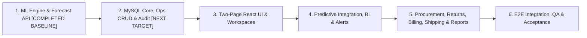

# AGENTS.md — NEXORA Development & Collaboration Handbook

- **Project:** NEXORA — AI-Powered Retail Management & Intelligence System
- **Audience:** All AI Coding Agents & Student Developers (Google Antigravity Sessions)
- **Primary Reference:** [`docs/NEXORA — Technical Blueprint v1.0.md`](docs/NEXORA%20%E2%80%94%20Technical%20Blueprint%20v1.0.md) *(Version 2.2)*
- **Current Phase Status:** Phase 1 ML & Forecast API Baseline Completed *(w/ Partial M12 Integration, M14 Prototype & React Demo)* — **Next Major Target:** [Phase 2 (MySQL Core, Operational CRUD & Audit Foundation)](docs/DEVELOPMENT_ROADMAP.md#phase-2--mysql-core-operational-crud--audit-foundation)

---

## 1. Project Identity and Approved Architecture

**NEXORA — AI-Powered Retail Management & Intelligence System** is an integrated retail management platform combining operational retail workflows, inventory and procurement management, financial operations, business intelligence, and machine-learning demand forecasting.

> [!IMPORTANT]
> **NEXORA must never be reduced to an isolated ML script, a standalone inference endpoint, or a dashboard without transactional persistence.**
> At the same time, workspace selection (`Store Manager (Admin)`, `Inventory Staff`, `Purchase Manager`, `Finance Staff`) is **strictly UI operational context** — NEXORA does **not** include employee user accounts, password logins, JWT sessions, or server-enforced RBAC.

### Decoupled Four-Tier Architecture

1. **Frontend Presentation (React 18 + TypeScript + Vite):** Strictly **two primary pages** — `/` (*Stakeholder Workspace Selection*) and `/dashboard` (*Unified Retail Management Dashboard*) with an in-header Workspace Switcher. *(Currently a single-screen Phase 1 forecasting demo on `main`; Tailwind CSS, Chart.js, and Two-Page UI are planned in Phase 3.)*
2. **Backend API & Orchestration (FastAPI + Pydantic v2):** Modular REST services under `/api/v1` handling schema validation, business invariants, deterministic replenishment math, forecast orchestration, and workspace/correlation provenance (`X-NEXORA-Workspace`, `X-Correlation-ID`).
3. **Intelligence Engine (Python, Scikit-learn, Joblib):** Leakage-free multi-horizon demand pipelines (`7, 15, 30, 90` days), historical CSV lookup, and pre-trained `.joblib` models loaded read-only at startup.
4. **Relational Persistence (MySQL 8.x InnoDB + SQLAlchemy 2.x + Alembic):** Planned **41-table** ACID schema (`DATABASE_SCHEMA.md` v2.8) for catalog, inventory, ledgers, orders, sales, procurement, returns, billing, shipping, ML runs, and centralized audit logs. *(Zero live tables, ORM models, or migrations exist yet on `main`.)*

```text
+---------------------------------------------------------------+
|       NEXORA Web SPA: Page 1 (/)  <-->  Page 2 (/dashboard)   |
|  Workspaces: Store Manager | Inventory | Purchase | Finance   |
+---------------------------------------------------------------+
               |  (REST / JSON + X-NEXORA-Workspace)
               v
+---------------------------------------------------------------+
|                  FastAPI Backend (/api/v1)                    |
+---------------------------------------------------------------+
      |                       |                       |
      v                       v                       v
[ Validation /        [ Business Ops &       [ ML Service ]
  Provenance ]          Audit (Tier 1/2) ]            |
      |                       |                       +--> [ .joblib Models ]
      v                       v
+---------------------------------------------------------------+
|       Planned MySQL 8.x Database (InnoDB — 41 Tables)         |
|  Catalog, Inventory, Orders, Sales, POs, Finance, Audit Logs  |
+---------------------------------------------------------------+
```

---

## 2. Source-of-Truth Hierarchy

Distinguish two separate questions before resolving any documentation or implementation conflict:

- **A. What architecture and requirements are approved?** [`docs/NEXORA — Technical Blueprint v1.0.md`](docs/NEXORA%20%E2%80%94%20Technical%20Blueprint%20v1.0.md) *(Version 2.2)* and `DDR-01`–`DDR-10` establish intended architecture and business requirements, while `DATABASE_SCHEMA.md` (v2.8), `API_DOCUMENTATION.md` (v2.0), and `DEVELOPMENT_ROADMAP.md` (v2.0) define approved relational, API, and execution specifications.
- **B. What is actually implemented today?** Actual repository source code (`backend/`, `frontend/`), dependency/configuration files, and verified executed tests establish current implementation reality. `PROJECT_OVERVIEW.md`, `FEATURES_STATUS.md`, and other status documents summarize implementation but must never override contradictory direct code or executed test evidence.

> Approved architecture documents define what NEXORA is intended to become; repository source code and executed tests establish what currently exists. Neither should be used as a substitute for the other.

1. **Existing Working Source Code & Verified Executed Tests (`backend/`, `frontend/`):** Establishes what is actually implemented today. Never claim a feature is implemented just because it appears in a blueprint or schema.
2. **Authoritative Target Architecture & Detailed Specifications (`docs/`):**
   - [`docs/NEXORA — Technical Blueprint v1.0.md`](docs/NEXORA%20%E2%80%94%20Technical%20Blueprint%20v1.0.md) *(Version 2.2)* — Approved system architecture, operational boundaries, `EXCL-01`–`EXCL-08`, and `DDR-01`–`DDR-10`.
   - [`docs/DATABASE_SCHEMA.md`](docs/DATABASE_SCHEMA.md) *(Version 2.8)* — Authoritative `41`-table InnoDB relational target design and transaction/locking/rollover invariants.
   - [`docs/API_DOCUMENTATION.md`](docs/API_DOCUMENTATION.md) *(Version 2.0)* — Verified implemented/experimental/partial endpoints and planned `/api/v1` domain contracts.
   - [`docs/DEVELOPMENT_ROADMAP.md`](docs/DEVELOPMENT_ROADMAP.md) *(Version 2.0)* — Approved six-phase execution sequence, dependencies, and testable acceptance criteria.
   - [`docs/FEATURES_STATUS.md`](docs/FEATURES_STATUS.md) *(Version 2.3)* — Authoritative 277-feature registry (`IMPLEMENTED` / `PARTIALLY IMPLEMENTED` / `PLANNED` / `EXCLUDED`).
   - [`docs/PROJECT_OVERVIEW.md`](docs/PROJECT_OVERVIEW.md) *(Version 2.0)* — High-level approved architecture and implementation snapshot.
   - [`docs/NEXORA — Application Functionality & System Workflow Guide.md`](docs/NEXORA%20%E2%80%94%20Application%20Functionality%20%26%20System%20Workflow%20Guide.md) *(Version 1.0)* — End-to-end user & system workflows.
3. **Engineering Records & ML Notes (`docs/`):**
   - [`docs/ML_DOCUMENTATION.md`](docs/ML_DOCUMENTATION.md) — Preprocessing rules, leakage-free feature engineering, and metrics *(some Phase 1 summary lines lag current 2-year code/artifact state)*.
   - [`docs/DEVELOPMENT_LOG.md`](docs/DEVELOPMENT_LOG.md) — Chronological engineering ledger of completed implementation work.
   - [`docs/TECHNICAL_DECISIONS.md`](docs/TECHNICAL_DECISIONS.md) — Architectural Decision Records *(older `TD-*` entries pre-date Blueprint v2.2 module numbering)*.
   - [`docs/KNOWN_ISSUES.md`](docs/KNOWN_ISSUES.md) — Active defects, inconsistencies, and resolved fixes.
4. **Historical Drafts (`docs/PROJECT_SPEC.md`, `DATABASE_DESIGN.md`, `ML_DESIGN.md`):** Legacy early notes only; non-authoritative wherever they conflict with the approved v2.x documents above. Remain untouched unless archival is explicitly approved.

---

## 3. Technology Stack — Current vs. Planned

Do not introduce unapproved frameworks or dependencies without team consent. Strictly distinguish libraries active in source code today from planned database and UI packages:

| Area | Approved Technology | Declared Spec ([`backend/requirements.txt`](backend/requirements.txt) / [`frontend/package.json`](frontend/package.json)) | Status on `main` |
| :--- | :--- | :--- | :--- |
| **Backend Runtime** | Python, FastAPI, Uvicorn | Python `>=3.10` (`.venv` `3.11.9`), `fastapi>=0.110.0`, `uvicorn[standard]>=0.29.0` | **Currently Active** |
| **Validation & Config** | Pydantic v2, Pydantic-Settings, python-dotenv | `pydantic>=2.6.0`, `pydantic-settings>=2.2.0`, `python-dotenv>=1.0.0` | **Currently Active** |
| **Data & ML Engine** | Pandas, NumPy, Scikit-learn, Joblib, OpenPyXL | `pandas>=2.2.0`, `numpy>=1.26.0`, `scikit-learn>=1.4.0`, `joblib>=1.3.0`, `openpyxl>=3.1.2` | **Currently Active** |
| **Backend Testing** | Pytest, pytest-timeout, HTTPX | `pytest>=8.0.0`, `pytest-timeout>=2.3.0`, `httpx>=0.27.0` | **Currently Active** (`Swagger /docs`, Postman) |
| **Frontend Core** | React 18, TypeScript, Vite | `react ^18.3.1`, `react-dom ^18.3.1`, `typescript ^5.4.5`, `vite ^5.3.1` | **Currently Active** *(Partial Phase 1 demo SPA)* |
| **Frontend UI & Charts** | Tailwind CSS, Chart.js, `react-chartjs-2`, React Router | Not yet declared in `frontend/package.json` | **Planned (Phase 3)** |
| **Relational DB** | MySQL 8.x (InnoDB Engine) | Placeholder `DB_*` config keys only (`config.py`, `.env.example`) | **Planned (Phase 2 — 0 live tables)** |
| **ORM, Driver & Migrations** | SQLAlchemy 2.x, PyMySQL, Cryptography, Alembic | `sqlalchemy>=2.0.0`, `pymysql>=1.1.0`, `cryptography>=42.0.0` pinned under `# Future Database Integration`; `alembic` not yet declared | **Planned (Phase 2 — 0 ORM models / 0 migrations)** |

*(Application authentication packages such as `Passlib` or `bcrypt` and JWT libraries are **not** part of NEXORA's approved stack.)*

---

## 4. Application Scope — Pages, Workspaces, Modules, SYS and Exclusions

### 4.1 Two-Page Application Architecture
1. **Page 1 (`/`) — Stakeholder Workspace Selection:** Displays exact heading **`Welcome to NEXORA — Select Your Workspace`** and the four workspace cards without any credential prompts.
2. **Page 2 (`/dashboard`) — Unified Retail Management Dashboard:** Single unified operational dashboard containing navigation tabs filtered to the selected workspace plus an in-header **Workspace Switcher**.

**Never create separate application pages or separate per-role dashboards** outside `/` and `/dashboard`.

### 4.2 Four Workspaces *(UI Operational Contexts Only — NOT Auth or RBAC)*
- `Store Manager (Admin)`
- `Inventory Staff`
- `Purchase Manager`
- `Finance Staff`

> [!WARNING]
> **Workspace Non-Authentication Rule:** Selecting a workspace configures dashboard navigation focus, visible UI views, and `X-NEXORA-Workspace` provenance metadata only. It does **not** represent user authentication, identity verification, password login, JWT sessions, server-enforced authorization, application RBAC, or any security boundary. Optional `operator_ref` text never constitutes verified user identity.

### 4.3 Eighteen Core Modules (`M01`–`M18`)

| Group | ID & Exact Module Name | Core Responsibility |
| :--- | :--- | :--- |
| **Group 1 — Retail Foundation** | **`M01` Product Management** | Catalog SKUs, categories, `INR` unit prices, UoM conversions (`DDR-06`), soft activation |
| **Group 1 — Retail Foundation** | **`M02` Supplier Management** | Vendor profiles, `supplier_products` mappings (`DDR-07`), product & vendor lead times (`DDR-01`) |
| **Group 1 — Retail Foundation** | **`M03` Customer Management** | Manual customer intake, billing/shipping contacts, status control (`EXCL-08`) |
| **Group 1 — Retail Foundation** | **`M04` Sales Management** | Clean UCI historical vs. operational realized sales (`transactions`), traceable reversals |
| **Group 1 — Retail Foundation** | **`M05` Order Management** | Order draft/edit, stock-reserving confirmation, partial/full fulfilment (`DDR-05`), cancellation |
| **Group 2 — Business Intelligence** | **`M06` Business Intelligence** | Time-series sales, country breakdown, SKU rankings (`GBP` UCI vs. `INR` live separated) |
| **Group 2 — Business Intelligence** | **`M07` Seasonal Demand Calendar** | Monthly and day-of-week clean demand intensity calendars |
| **Group 2 — Business Intelligence** | **`M08` Product Lifecycle Intelligence** | `Introduction`–`Discontinued` stages w/ hysteresis; `Discontinued` requires an explicit authorized Store Manager action and must not be assigned automatically (`DDR-08`) |
| **Group 3 — Inventory & Procurement** | **`M09` Inventory Control** | Live 5-metric stock master (`DDR-03`), locked manual adjustments, safety thresholds |
| **Group 3 — Inventory & Procurement** | **`M10` Stock Movement Tracking** | Read-only immutable `inventory_movements` physical delta ledger |
| **Group 3 — Inventory & Procurement** | **`M11` Purchase Planning Simulator** | Stateless what-if simulation, PO drafting, `DDR-09` tiered approval, partial/full receipts |
| **Group 4 — AI & Predictive Intelligence** | **`M12` Demand Forecasting** | `7/15/30/90`d ML inference (implemented CSV baseline; planned MySQL B2B demand `DDR-06`) |
| **Group 4 — AI & Predictive Intelligence** | **`M13` Price & Revenue Intelligence** | Observational price vs. quantity & revenue contribution analytics (`EXCL-04` read-only) |
| **Group 4 — AI & Predictive Intelligence** | **`M14` Predictive Planner** | Stockout risk & replenishment math (`DDR-01`–`03`; stateless Phase 1 prototype today) |
| **Group 4 — AI & Predictive Intelligence** | **`M15` Anomaly Detection** | Statistical & rule-based anomaly events across demand, returns, stock & POs (`DDR-08`) |
| **Group 5 — Business Operations** | **`M16` Return Intelligence** | Return intake (`excess_stock` vs. `defective`/`damaged`), over-return caps, net health metrics |
| **Group 5 — Business Operations** | **`M17` Billing & Finance** | Immutable `INR` invoices (`DDR-04`), payments, credit notes, `refunds`, reconciliation |
| **Group 5 — Business Operations** | **`M18` Shipping & Delivery** | Pick lists, `1:N` split shipments (`DDR-05`), printable packing slips, routing labels, events |

### 4.4 Four Supporting System Capabilities (`SYS-01`–`SYS-04`)
NEXORA consists of **18 core modules + 4 separate supporting capabilities (NEVER "22 core modules")**:
- **`SYS-01` Workspace Selection** — Page 1 workspace cards, Page 2 Workspace Switcher, `X-NEXORA-Workspace` provenance.
- **`SYS-02` Centralized History & Audit** — Immutable `audit_logs` (Tier 1 fail-closed) + `audit_outbox` retry/dead-letter (Tier 2).
- **`SYS-03` Smart Alerts** — Actionable notifications with unresolved duplicate suppression (`DDR-08`).
- **`SYS-04` Reports & Export** — Paginated previews, JSON/formula-neutralized CSV exports, printable views.

### 4.5 Eight Explicit Exclusions (`EXCL-01`–`EXCL-08` — `EXCLUDED`)
Never implement or schedule tasks for: **`EXCL-01`** Government E-Way bill generation; **`EXCL-02`** External shipping carrier APIs (FedEx, UPS, DHL, etc.); **`EXCL-03`** Automatic supplier PO dispatch/emails; **`EXCL-04`** Autonomous price markdowns; **`EXCL-05`** Conversational AI chatbots or NL POS; **`EXCL-06`** Market basket / purchase-affinity mining; **`EXCL-07`** Complex multi-supplier linear optimization solvers; **`EXCL-08`** Automatic customer-address scraping from UCI records.

### 4.6 Verified Implementation Status Baseline
Use strict status taxonomy (**`IMPLEMENTED`**, **`PARTIALLY IMPLEMENTED`**, **`EXPERIMENTAL`**, **`PLANNED`**, **`EXCLUDED`**; see [`FEATURES_STATUS.md`](docs/FEATURES_STATUS.md) v2.3 for all 277 feature IDs):
- **Phase 1 Core (`IMPLEMENTED`):** UCI ingestion & 4-stream preprocessing, continuous daily aggregation (`daily_product_demand.csv`: `2,287,495` rows across `4,905` SKUs), leakage-free feature engineering, `7/15/30/90`d model training/evaluation/Joblib serialization (`backend/ml/models/`), FastAPI probes (`/`, `/health`, `/ready`, hidden `/api/v1/health`, `/api/v1/ready`), and production `/api/v1/forecast/*` routes (`horizons`, `model-metrics`, `model-info`, `/`, `/predict`).
- **Experimental Extensions (`EXPERIMENTAL`):** Task 12 routes (`/api/v1/experimental/*`, `models_task12/`, `PITPriceService`) and comparative macro routes (`/api/v1/forecast/evaluation-comparison`, `/store-wide`, `models_experimental/`). Strictly isolated from production baseline contracts and `/ready`.
- **Important Partial Implementations (`PARTIALLY IMPLEMENTED`):**
  - **`M12` Demand Forecasting:** Offline ML training and UCI CSV inference exist; operational confirmed B2B demand, `demand_quarantine`, `demand_adjustments`, MySQL `forecasts`/`model_runs`, and scheduled retraining remain **`PLANNED`**.
  - **`M14` Predictive Planner:** Stateless `POST /api/v1/inventory/recommend` exists as a limited caller-supplied-stock prototype; full MySQL-backed live stock + supplier lead-time planning remains **`PLANNED`**.
  - **Frontend:** Existing `frontend/` is a single-screen Phase 1 forecasting demo (`/health` & `POST /api/v1/forecast/` only); the Two-Page / 4-Workspace dashboard remains **`PLANNED`**.
  - **Database:** Approved **41-table** `InnoDB` schema (`DATABASE_SCHEMA.md` v2.8) is a target specification only; **`0` live MySQL tables, `0` ORM models, and `0` Alembic migrations exist on `main`**.
- **Test Baseline Rule:** `168 / 168` `pytest` tests across `13` suites executed and passed at commit `e74ae8970195a3609c8701799137154aa3f35d30` (`API_DOCUMENTATION.md`, `PROJECT_OVERVIEW.md`, and `DEVELOPMENT_ROADMAP.md` were documentation-only commits through `a4657bd`/`d253cf8` with unchanged source/tests). **Never claim tests were rerun on a later documentation commit unless actually executed.**

---

## 5. ML and Demand Forecasting Rules

- **UCI Dataset Limitations:** Historical 2009–2011 transactions only; no live warehouse stock, supplier lead times, street addresses, or return defect reasons. Live operational entities live in MySQL.
- **Strict 4-Stream Isolation (`preprocessing.py`):**
  1. *Gross Positive Sales:* `Quantity > 0`, `Price > 0`, no `'C'` prefix *(sole historical ML training stream)*.
  2. *Cancellations:* Invoice starting with `'C'` *(logged separately)*.
  3. *Returns / Credit Adjustments:* `Quantity < 0` without `'C'` *(logged separately)*.
  4. *Exceptional / Non-Sales:* `Price <= 0` administrative entries *(excluded from demand)*.
- **Daily Aggregation & Leakage-Free Features (`feature_engineering.py`):** Continuous lifespan zero-padding per `StockCode`; calendar (`DayOfWeek`, `Month`, `DayOfMonth`), shifted lags (`Lag1`, `Lag7`, `Lag14`, `Lag28` from $t-k$), and historical rolling stats (`RollingMean7`, `RollingMean28` shifted $t-1$ backwards). **Never use random splits** — always chronological/embargo evaluation using **MAE**, **RMSE**, and **WAPE**.
- **Inference Serving:** Clamp outputs via $\hat{y} = \max(0, \hat{y})$, serve read-only `.joblib` models loaded at FastAPI startup, **never retrain inside HTTP requests**, and keep experimental Task 12 models isolated.
- **Planned Operational Demand (`DDR-06`):** Confirmed B2B orders (`requested_delivery_date`) convert via frozen `uom_conversions` to `base_uom`, isolate `one_time_bulk`/`tender` spikes and `is_censored_demand`, and route malformed inputs to `demand_quarantine` without aborting pipelines.

---

## 6. Inventory Risk Logic

Inventory replenishment risk evaluation (`M11` and `M14`) follows [`DDR-01`](docs/NEXORA%20%E2%80%94%20Technical%20Blueprint%20v1.0.md) and `DDR-07`. See [`docs/DATABASE_SCHEMA.md`](docs/DATABASE_SCHEMA.md) v2.8 and [`Technical Blueprint v2.2`](docs/NEXORA%20%E2%80%94%20Technical%20Blueprint%20v1.0.md) for detailed schema columns and workflows.

### 6.1 Supplier Lead-Time Resolution
Resolve supplier lead time strictly in this priority order (never invent or assume a missing lead time):
1. Active supplier-product mapping lead time (`supplier_products.lead_time_days`).
2. Supplier-level default lead time (`suppliers.lead_time_days`).
3. If neither exists, supplier lead-time-based risk is **`UNAVAILABLE`**.

### 6.2 Approved Formulas
$$\text{Lead-Time Demand} = \left(\frac{\text{Forecast Demand}}{\text{Forecast Horizon Days}}\right) \times \text{Supplier Lead Time Days}$$
$$\text{Replenishment Risk Threshold} = \text{Lead-Time Demand} \times \text{Safety Factor} \quad (\text{initial } 1.20)$$

*(Never use an unscaled forecast-times-safety-factor threshold that omits scaling by supplier lead time and horizon days.)*

### 6.3 Distinguish Risk Types
When supplier lead time is missing:
- Supplier lead-time-based risk must be shown explicitly as **`UNAVAILABLE`**.
- A separate horizon-based stock risk calculation may still be presented if supported.
- Clearly label both calculations and never imply that a horizon-based estimate is supplier lead-time-based.

### 6.4 Implementation Guidance
- Keep supplier-product lead-time resolution consistent with `DDR-07` across `M11` and `M14`.
- Do not invent alternative risk formulas, alter the initial `1.20` safety factor, or duplicate/contradict [`docs/DATABASE_SCHEMA.md`](docs/DATABASE_SCHEMA.md) v2.8.

---

## 7. Inventory, Procurement and Business Logic Invariants

Consult [`docs/DATABASE_SCHEMA.md`](docs/DATABASE_SCHEMA.md) v2.8 and [`Technical Blueprint v2.2`](docs/NEXORA%20%E2%80%94%20Technical%20Blueprint%20v1.0.md) for complete DDL and transaction steps; enforce these cross-module invariants across code (with supplier lead-time risk logic covered in Section 6 above):

### 7.1 Five Inventory Metrics (`DDR-03`)
Always maintain and display these five metrics separately (never treat incoming PO units as physically available before receipt):
- **Physical Stock** = quantity physically held (`inventory.current_quantity`)
- **Reserved Stock** = confirmed, unfulfilled customer order allocations (`inventory.reserved_quantity`)
- **Available Stock** = $\text{Physical Stock} - \text{Reserved Stock}$
- **Incoming Stock** = outstanding (`ordered - received`) quantities from **approved** Purchase Orders only
- **Projected Available Stock** = $\text{Available Stock} + \text{Incoming Stock}$

### 7.2 Incoming Purchase Orders (`DDR-02`) & Procurement (`DDR-09`)
- **Incoming Stock Rule:** Only `approved` and `partially_received` POs contribute remaining unreceived units to Incoming Stock; `draft`, `submitted`/`pending_approval`, `rejected`, `cancelled`, and `received` POs contribute `0`.
- **Procurement Lifecycle:** Purchase simulation (`M11`) is not a PO. `draft`, `submitted`, `approved`, and `received` are distinct states; **human approval is mandatory**; Tier 1 (`Purchase Manager` `<= Limit`) emits a Store Manager oversight digest while escalations (`> Limit`, rolling-window split flags, anomalies, price spikes) require `Store Manager (Admin)`; post-approval edits invalidate prior approval; zero automatic supplier dispatch (`EXCL-03`).

### 7.3 Orders, Sales, Partial Fulfilment & Reversal (`DDR-05`)
- **Orders (`orders`) vs. Realized Sales (`transactions`):** Confirmed orders reserve `Available Stock`; inventory is deducted **only** for actual fulfilled quantities via locked idempotent fulfilment batches (`order_fulfillments`); partial fulfilment and `1:N` split shipments (`M18`) operate independently; confirmed unfulfilled quantities remain reserved.
- **Compensating Batch Reversal (`DATABASE_SCHEMA.md` v2.8 Section `6.2b`):** Allowed only when zero non-cancelled `shipments` reference the batch (`pending`/`packed`/`dispatched`/`delivered`, directing dispatched/delivered goods through `M16` returns) and, if invoiced, `SUM(credit_notes.amount) = invoice.grand_total` with `Open Refund Payable = 0.00`. Never update/delete original `sale_fulfillment` rows; append a positive `fulfillment_reversal` movement, restore Physical and Reserved stock together (Available remains invariant until explicit order cancellation), and commit atomically under Tier 1 audit & idempotency.

### 7.4 Operational Demand, UoM Conversion & Immediate Rollover (`DDR-06`, Schema v2.8)
- Operational demand comes from confirmed B2B orders (`requested_delivery_date`), adjusted via `demand_adjustments` (`excess_stock` returns & cancellations, never `defective` returns), with malformed inputs routed to `demand_quarantine`.
- `uom_conversions` rollovers are **strictly immediate**: capture one DB-server `tx_now = NOW(6)` timestamp inside the locked transaction (`[effective_from, effective_to)` half-open interval, `VIRTUAL` columns `active_product_id` & `active_uom_code` with `uq_uom_one_active`).
- **Reject unsupported caller-supplied effective timestamps with `HTTP 422`** (prefer omitting effective timestamp fields from planned request schemas). Never use backdated or future-dated operational factors; preserve frozen `base_uom_conversion_factor` snapshots on existing documents.

### 7.5 Billing, Returns (`DDR-04`, `DDR-06`) & Audit Integrity (`DDR-08`, `DDR-10`)
- **Finance (`DDR-04`):** `INR` (`DECIMAL`) default currency; central tax edits affect future records only; keep `invoices`, `payments`, `credit_notes` (`fully_credited`), and cash/bank `refunds` (`pending` reserve) strictly separate; refunds never mutate `payments`; enforce `uq_inv_fulfillment` against duplicate fulfilment billing.
- **Returns & Governance (`DDR-06`, `DDR-08`):** Separate physical disposition (`restock`/`damaged`) from `demand_adjustments` (`excess_stock` vs. `defective`); lifecycle `Discontinued` requires an explicit authorized Store Manager action (must not be assigned automatically); suppress duplicate unresolved `alerts`.
- **Audit Separation & Tiers (`DDR-10`):** Keep `audit_logs`, `audit_outbox`, `inventory_movements`, and `transactions` strictly separate. **Tier 1** critical mutations insert into `audit_logs` inside the exact ACID transaction (audit failure triggers rollback); **Tier 2** routine events degrade via `audit_outbox` idempotent retry/dead-letter. Runtime MySQL accounts must lack `UPDATE`/`DELETE` privileges on `audit_logs` *(DB privilege hardening — NOT application login or workspace RBAC)*.

---

## 8. Database Development Rules

1. **Approved Target Schema:** [`docs/DATABASE_SCHEMA.md`](docs/DATABASE_SCHEMA.md) v2.8 specifies **`41` InnoDB tables** on **MySQL 8.x** managed via **SQLAlchemy 2.x** and **Alembic** migrations.
2. **Exact Numeric Precision:** All monetary columns must use `DECIMAL(10, 2)` / `DECIMAL(12, 2)`, and UoM/base-unit quantities must use approved `DECIMAL(12, 6)` / `DECIMAL(14, 4)` — **never `FLOAT` or `DOUBLE`**.
3. **Mandatory Schema-to-Code Review & Change Control:** Before writing Phase 2 migrations, inspect the approved schema line-by-line; never casually simplify or alter tables during coding (raise a separate schema-review task if a genuine defect appears).
4. **Live MySQL Validation Required:** Database implementation must be validated against an **actual MySQL 8.x instance** (constraints, triggers/checks, `FOR UPDATE` locking, Tier 1 rollback, restricted grants) — never rely solely on mocks or static checks.
5. **Secrets & Truthfulness:** Read DB credentials strictly from `.env` (never commit `.env`), and never claim tables/models exist until Alembic migrations have executed cleanly against MySQL.

---

## 9. Backend API Rules

Maintain clean separation across `backend/app/`: `api/routes/` (HTTP routing/status), `schemas/` (Pydantic v2 contracts), `services/` (orchestration & ML inference), `models/` (planned SQLAlchemy ORM declarations), and `core/` (config, DB engine, provenance utilities).
1. Inspect existing routes/services/tests before creating or modifying modules.
2. Preserve verified existing `/`, `/health`, `/ready`, `/api/v1/forecast/*`, `/api/v1/experimental/*`, and `/api/v1/inventory/recommend` contracts unless changes are explicitly approved.
3. Keep ML inference decoupled from offline training; never train inside API handlers.
4. Validate all incoming inputs via Pydantic v2 (`DECIMAL`, ranges, finite checks, disallowed timestamps).
5. Execute multi-row operational mutations inside explicit ACID transactions with deterministic `FOR UPDATE` ordering (`product_id ASC`).
6. Enforce `idempotency_key` deduplication on fulfilments, reversals, cancellations, PO receipts, and outbox retries.
7. Apply standardized FastAPI HTTP status codes (`200`, `201`, `400`, `404`, `409`, `422`, `500`, `503`) without leaking stack traces or DB credentials.
8. Never treat frontend visibility, UI modals, or `X-NEXORA-Workspace` headers as security authorization.
9. Do **not** add `/api/v1/auth/*`, JWT, Passlib/bcrypt, or server-side RBAC dependencies.

---

## 10. Frontend Development Rules

1. Maintain strict TypeScript interfaces in `frontend/src/types/` aligned 1:1 with backend Pydantic schemas.
2. Separate reusable UI components (`components/`), workspace views, and typed HTTP clients (`services/`).
3. Handle explicit **Loading**, **Empty**, **`422` field-validation**, and **API Error** states on every asynchronous view.
4. Display only truthful backend responses (explicitly labelling `GBP` UCI historical demos vs. `INR` operational data and `UNAVAILABLE` lead times).
5. Use **Chart.js** via `react-chartjs-2` when the planned Phase 3–4 visualization layer is added.
6. Preserve the strict **two-page SPA architecture** (`/` and `/dashboard` only).
7. Provide an in-header **Workspace Switcher** inside Page 2 (`/dashboard`) for the four approved workspaces.
8. Ensure workspace switching changes UI focus and `X-NEXORA-Workspace` context only — never imply authentication or RBAC.
9. Require explicit confirmation modals before critical operational mutations (`Fulfill Order`, `Cancel Order`, `Approve/Reject PO`, `Issue Credit Note/Refund`, `Discontinue Product`).
10. Never create separate per-stakeholder dashboards, login pages, or extra standalone application routes.

---

## 11. Six-Phase Development Roadmap

Proceed sequentially per [`docs/DEVELOPMENT_ROADMAP.md`](docs/DEVELOPMENT_ROADMAP.md) v2.0 (**zero seventh phase, zero fabricated deadlines, zero artificial % completion**):



1. **Phase 1 — ML Engine & Forecast API Foundation:** **Completed baseline** *(with `M12` B2B integration, `M14` operational planner, and Two-Page React UI explicitly partial)*.
2. **Phase 2 — MySQL Core, Operational CRUD & Audit Foundation:** **Planned next major target** (`M01`–`M05`, `M09`–`M10`, `SYS-02`, 41-table Schema v2.8 via Alembic, real MySQL integration tests).
3. **Phase 3 — Two-Page React Application & Workspace UI:** Expand existing Phase 1 React SPA into Page 1 (`Welcome to NEXORA — Select Your Workspace`) & Page 2 (`/dashboard`) with Tailwind CSS, Chart.js, and Workspace Switcher (`SYS-01`).
4. **Phase 4 — Predictive Integration, Business Intelligence & Alerts:** `M12` B2B demand/quarantine (`DDR-06`), operational `M14` (`DDR-01`–`03`), `M06`–`M08`, `M13`, `M15`, and `SYS-03`.
5. **Phase 5 — Procurement, Returns, Billing, Shipping & Reports:** `M11` (`DDR-09`), `M16`, `M17` (`DDR-04`, `refunds`), `M18` (`DDR-05`), and `SYS-04`.
6. **Phase 6 — End-to-End Integration, Quality Assurance & Acceptance:** Full connected workflows (`Workflows A–G`), concurrency/audit failure tests against live MySQL, Postman sync, and defense prep.

---

## 12. Multi-Agent Collaboration Rules

1. **Inspect Before Modifying:** Always read target code, schemas, and tests before editing.
2. **Preserve Workspace Structure:** Never arbitrarily move, rename, or delete directories, database tables, or verified API endpoints.
3. **Respect Module Ownership:** Confine edits to your assigned scope; do not overwrite working sibling modules.
4. **Stable API Contracts:** Preserve backward compatibility on shared schemas/routes and note interface impacts explicitly.
5. **No Monolithic Generations:** Implement, migrate, and test one cohesive slice at a time.
6. **No Phantom Claims:** Never report a table, route, test, or UI view as complete without executing verified checks.

---

## 13. Student-Friendly Coding Standards

1. **Self-Documenting Code:** Prefer clear domain-specific names over clever abstractions.
2. **Explain the "Why":** Add concise inline comments on non-obvious invariants (lag shifts, zero-padding boundaries, `DDR-01`–`03` stock formulas, Section `6.2b` reversals, immediate `tx_now` UoM locks, and `DECIMAL` rounding).
3. **Avoid Overengineering & Unnecessary Refactors:** Favor clear functions and standard FastAPI / SQLAlchemy / React idioms over unnecessary abstractions or inheritance; reuse verified modules and never refactor working code without a demonstrated concrete bug or benefit.
4. **Standard Post-Task Reporting:** Summarize what was built/changed, exact files touched, verification results (`Executed & Passed` / `Failed` / `Not Yet Executed`), remaining gaps, and recommended next step.

---

## 14. Testing, Verification and Git Safety

1. **Empirical Verification:** Test every endpoint, business rule, migration, and calculation after your final edit (`pytest.ini` sets `pythonpath = backend` and `timeout = 30`). Never claim live MySQL validation until run against an actual MySQL server.
2. **Honest Attribution & Reporting:** State the exact commit/scope of executed checks (`168/168` across `13` suites executed at `e74ae89`; unchanged source/tests through `d253cf8`). Never describe mock runs as full DB integration or doc-only commits as fresh test reruns.
3. **Git Hygiene:** Never commit `.env`, credentials, or local caches (`backend/.venv/`, `node_modules/`). Never run destructive history-rewriting git commands (`git reset --hard`, force-pushes) without explicit user direction. Use clean, scoped atomic commits after verification.

---

## 15. Documentation and Knowledge-Tracking Rules

- **Implementation Tasks:** Update [`docs/DEVELOPMENT_LOG.md`](docs/DEVELOPMENT_LOG.md) (newest entry at top), transition [`docs/FEATURES_STATUS.md`](docs/FEATURES_STATUS.md) statuses accurately, record major ADRs in [`docs/TECHNICAL_DECISIONS.md`](docs/TECHNICAL_DECISIONS.md), log bugs/fixes in [`docs/KNOWN_ISSUES.md`](docs/KNOWN_ISSUES.md), and keep [`API_DOCUMENTATION.md`](docs/API_DOCUMENTATION.md) / [`DATABASE_SCHEMA.md`](docs/DATABASE_SCHEMA.md) synchronized.
- **Documentation-Only / Alignment Tasks:** Modify **only** the targeted document(s) unless the task explicitly authorizes broader registry updates — do not trigger unnecessary churn in `DEVELOPMENT_LOG.md`, `FEATURES_STATUS.md`, or code files.
- **Zero Fabrication:** Never document planned work as implemented, invent test metrics, or cite legacy draft specs as overriding v2.x architecture.

---

## 16. Python Environment and Dependency Management

### 1. Mandatory Virtual Environment (`backend/.venv`)
All Python scripts, ML pipelines, backend servers, and tests must execute exclusively inside:
- Windows interpreter: `backend/.venv/Scripts/python.exe`
- PowerShell activation: `.\backend\.venv\Scripts\Activate.ps1` *(if execution policy blocks scripts: `Set-ExecutionPolicy -ExecutionPolicy RemoteSigned -Scope CurrentUser`, or invoke `backend/.venv/Scripts/python.exe <script>` directly without relying on global `python` PATH)*.

### 2. Active vs. Future Dependencies (`backend/requirements.txt`)
Before adding packages, check whether existing dependencies already cover the need; optional packages (such as `xgboost`) must never be required by core runtime paths.
- **Verify Currently Active Phase 1 Packages:**
  ```powershell
  backend\.venv\Scripts\python.exe -c "import sys, pandas, numpy, sklearn, joblib, openpyxl, fastapi, uvicorn, pydantic, pydantic_settings, dotenv, pytest, httpx; print(sys.executable)"
  backend\.venv\Scripts\python.exe -m pip check
  ```
- **Future Phase 2 Database Dependencies:** `sqlalchemy>=2.0.0`, `pymysql>=1.1.0`, and `cryptography>=42.0.0` are declared in `backend/requirements.txt` under `# Future Database Integration`, while `alembic` must be added when Phase 2 migration setup begins. Do **not** assume SQLAlchemy ORM models, MySQL connections, or Alembic migrations are integrated on `main` today:
  ```powershell
  # Run only when beginning / verifying Phase 2 MySQL integration
  backend\.venv\Scripts\python.exe -c "import sqlalchemy, pymysql; print(sqlalchemy.__version__)"
  ```

### 3. Synchronizing Dependencies & Running Tests
- Update `backend/requirements.txt` (or `frontend/package.json` for Phase 3 UI packages) and install inside `.venv` whenever new approved packages are introduced.
- Standard test command: `backend\.venv\Scripts\python.exe -m pytest backend/tests/ -q`

---

## 17. Mandatory Agent Execution Workflow

```text
  === BEFORE EDITING ===
  1. READ         --> Read AGENTS.md plus relevant v2.x docs/ (Blueprint v2.2, Schema v2.8, API v2.0, Roadmap v2.0).
  2. VERIFY ENV   --> Confirm Python runs via backend/.venv/Scripts/python.exe (check node/npm for frontend/).
  3. INSPECT CODE --> Check actual backend/, frontend/, and backend/tests/ state; verify branch & git status.
  4. CHECK LOGS   --> Consult FEATURES_STATUS.md, DEVELOPMENT_LOG.md, TECHNICAL_DECISIONS.md, and KNOWN_ISSUES.md.
  5. PLAN         --> Formulate a scoped plan aligned with the approved phase order (no unapproved scope).

  === DURING & AFTER EDITING ===
  6. IMPLEMENT    --> Keep code modular, student-readable, decimal-safe, transactionally locked, and well-commented.
  7. VERIFY       --> Run real pytest / build / DB checks matching your change; never skip or fake test results.
  8. UPDATE DOCS  --> Synchronize required registries/docs for implementation tasks (respect doc-only task boundaries).
  9. REPORT       --> Provide an honest summary of changes, exact files, observed test outputs, and next steps.
```
