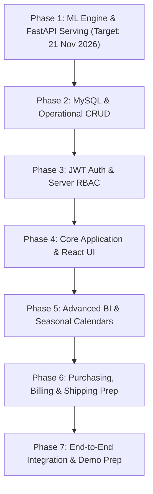

# AGENTS.md — NEXORA Development & Collaboration Handbook
**Project:** NEXORA – AI-Powered Retail Management & Intelligence System  
**Audience:** All AI Coding Agents & Student Developers (Google Antigravity Sessions)  
**Primary Reference:** `docs/NEXORA — Technical Blueprint v1.0.md`  
**Current Milestone Target:** Phase 2 (MySQL Database & Operational CRUD) — **Phase 1 Completed & Verified (17 November 2026)**

---

## 1. Project Identity & Architecture Overview

**NEXORA** is an enterprise-grade retail management and intelligence web platform uniting day-to-day retail store and supply-chain operations with machine-learning-driven demand forecasting.

> [!IMPORTANT]
> **NEXORA must never be reduced to merely an ML model, an inference API, or a simple visualization dashboard.**  
> It is an integrated retail operating system with 13 functional modules, role-based access control, relational database management in MySQL, and an ML intelligence engine providing empirical decision support.

### System Architecture
The application follows a strictly decoupled 4-tier architecture:
1. **Frontend Presentation (React + TypeScript):** Role-specific operational dashboards, interactive data visualization (Chart.js), order entry, and simulation interfaces.
2. **Backend API & Orchestration (FastAPI + Pydantic):** RESTful endpoints (`/api/v1`), stateless authentication (JWT), server-side RBAC validation, and business workflow services.
3. **Intelligence Engine (Python, Scikit-learn, Joblib):** Multi-horizon demand regression (7, 15, 30, 90 days), feature engineering without target leakage, and stockout risk evaluation.
4. **Relational Persistence (MySQL 8.x + SQLAlchemy):** ACID-compliant operational persistence for catalog SKUs, live stock quantities, movements ledger, invoices, purchase orders, shipments, users, and audit logs.

```text
                 +------------------------------------------+
                 |       NEXORA Web Interface (React)       |
                 +------------------------------------------+
                                      |  (REST / JSON)
                                      v
                 +------------------------------------------+
                 |       FastAPI Backend (/api/v1)          |
                 +------------------------------------------+
                       |              |              |
                       v              v              v
               [ Auth / RBAC ] [ Business Ops ] [ ML Service ]
                       |              |              |
                       |              |              +--> [ Trained Models ]
                       |              |                   (.joblib binaries)
                       v              v
                 +------------------------------------------+
                 |             MySQL Database               |
                 |  (InnoDB: Users, Inventory, Orders, POs) |
                 +------------------------------------------+
```

---

## 2. Source-of-Truth Hierarchy & Knowledge Registries

When developing or inspecting code, resolve all discrepancies using the following strict hierarchy:
1. **Approved Technical Blueprint (`docs/NEXORA — Technical Blueprint v1.0.md`):** Authoritative specification for intended scope, architecture, formulas, and operational boundaries.
2. **Existing Working Source Code & Successfully Executed Tests:** Establishes actual implementation reality. Never assume a component is built just because it appears in docs.
3. **Knowledge Registries & Historical Logs (`docs/`):**
   - `DEVELOPMENT_LOG.md` — Chronological engineering ledger recording what was built, files touched, tests passed, and remaining work.
   - `FEATURES_STATUS.md` — Central feature matrix tracking implementation status across all 13 modules.
   - `TECHNICAL_DECISIONS.md` — Architectural Decision Records (ADR) detailing context, choices, alternatives, and module impacts.
   - `KNOWN_ISSUES.md` — Active defect, inconsistency, and technical debt tracking.
4. **Core Technical Documentation (`docs/`):**
   - `PROJECT_OVERVIEW.md` — System objectives, technology stack, operational boundaries.
   - `ML_DOCUMENTATION.md` — Preprocessing rules, feature engineering, horizons, evaluation.
   - `DATABASE_SCHEMA.md` — 19 MySQL relational tables, constraints, precision rules.
   - `API_DOCUMENTATION.md` — Active and planned REST endpoints under `/api/v1`.
   - `DEVELOPMENT_ROADMAP.md` — Phased progress and milestone deadlines.
5. **Historical Reference Files (`docs/PROJECT_SPEC.md`, `DATABASE_DESIGN.md`, `ML_DESIGN.md`):** Legacy draft notes. Must remain untouched unless the team explicitly approves archival.

---

## 3. Approved Technology Stack

All agents must strictly adhere to the approved technologies. **Do not introduce alternative frameworks or unnecessary packages without explicit team consent:**

| Area | Approved Technology | Key Libraries / Specs |
| :--- | :--- | :--- |
| **Frontend** | React 18+, TypeScript 5.x | Vite, Tailwind CSS 3.x, Chart.js, react-chartjs-2 |
| **Backend** | Python 3.10+, FastAPI | Pydantic v2, Pydantic-Settings, Uvicorn |
| **Data & ML** | Python | Pandas, NumPy, Scikit-learn, Joblib, OpenPyXL (Optional: XGBoost) |
| **Database** | MySQL 8.x (InnoDB Engine) | SQLAlchemy 2.x, PyMySQL, Alembic migrations |
| **Authentication** | JWT (Stateless) | Passlib (bcrypt password hashing) |
| **Testing** | Pytest, HTTPX | Swagger UI (`/docs`), Postman |
| **Development** | Git, GitHub | Google Antigravity |

---

## 4. Complete Application Scope & Operational Boundaries

### The 13 Core Modules
1. **Role-Based Home Dashboard:** Dynamic UI tailored to user role.
2. **Analytics and Business Intelligence:** Sales trends, SKU volume rankings, country breakdown.
3. **Seasonal Demand Calendar:** Monthly and day-of-week demand heatmaps.
4. **Product Lifecycle Intelligence:** SKU classification (*Emerging, Growing, Stable, Declining, Inactive/Dead Stock*).
5. **Price and Revenue Intelligence:** Price distribution vs quantity correlation.
6. **Inventory Control:** Master stock list, manual stock adjustments, movement history ledger.
7. **Predictive Planner:** 7-, 15-, 30-, and 90-day demand predictions vs live inventory.
8. **Purchase Planning Simulator:** Interactive "what-if" scratchpad adjusting lead times and safety factors.
9. **Product Health and Return Intelligence:** Disaggregated tracking of sales, cancellations, and returns.
10. **Anomaly Detection and Alerts:** Statistical deviation alerts for demand spikes, dips, and return surges.
11. **Billing and Finance:** Customer entry, tax calculation, printable invoices, credit notes.
12. **Shipping and Delivery Preparation:** Warehouse pick lists, digital packing slips, internal routing labels.
13. **Role-Based Access Management:** User administration, role assignments, audit logs.

### Approved Operational Boundaries (What IS and IS NOT in Scope)
- **Included:**
  - Manual customer data entry during invoice generation.
  - Printable sales invoices, credit notes, and internal packing slips.
  - Internal purchase-order drafting and mandatory human approval.
  - Manual inventory adjustments recorded in a transactional movement log.
  - Explainable, rule-based stock-risk indicators (`CRITICAL`, `ELEVATED`, `SAFE`).
  - Simulation scratchpads for purchase order volume exploration.
- **Explicitly Postponed or Excluded (DO NOT IMPLEMENT):**
  - Official governmental E-Way bill generation.
  - Real shipping carrier API integrations (e.g., FedEx, UPS, DHL, Shiprocket).
  - Automated supplier reordering or automated PO email transmission.
  - Unilateral automated markdown or price discount recommendations.
  - Conversational AI chatbots or natural language query assistants.
  - Market basket / purchase-affinity algorithms.
  - Multi-supplier algorithmic cost optimization engines.

---

## 5. Machine Learning Rules & Demand Forecasting

The ML subsystem is the analytical intelligence engine of NEXORA.

### Dataset Profile & Reality Distinctions
- **Dataset:** UCI Online Retail II (`online_retail_II.csv` / `.xlsx`).
- **Nature:** Historical transaction records (2009–2011).
- **Inherent Limitations:** The dataset **does not** contain live warehouse stock, supplier lead times, customer street addresses, carrier tracking, or reasons for return.
- **Principle:** Historical demand is derived from the dataset; operational inventory and business entities are created and maintained natively in MySQL.

### Transaction Handling & Demand Isolation
Transactions must be categorized strictly into separate streams:
1. **Gross Positive Sales Demand:** Transactions where $\text{Quantity} > 0$, $\text{Price} > 0$, and `Invoice` does not begin with `'C'`. This is the **only** data stream used for demand forecasting models.
2. **Cancellations:** Invoices beginning with `'C'`. Logged and evaluated separately.
3. **Returns / Credit Adjustments:** Negative quantity transactions ($\text{Quantity} < 0$) without `'C'`. Logged and evaluated separately.
4. **Net Volume:** $\text{Net} = \text{Gross} - \text{Returns} - \text{Cancellations}$.
*Rules:* Never double-count cancellation events. Never infer physical product defects solely from returns or cancellations. Never silently drop negative records without proper category accounting.

### Forecasting Horizons & Feature Engineering
- **Horizons:** 
  - $D_7$: 7 days (operational shelf replenishment)
  - $D_{15}$: 15 days (bi-weekly ordering)
  - $D_{30}$: 30 days (monthly inventory and budget planning)
  - $D_{90}$: 90 days (quarterly supplier quota planning)
- **Daily SKU Aggregation:** Sales demand must be aggregated per product (`StockCode`) per calendar day. Sparse periods must be padded with continuous dates and `0` demand (do not drop inactive days).
- **Leakage-Free Features:**
  - *Calendar features:* `DayOfWeek`, `Month`, `DayOfMonth`.
  - *Lags:* `Lag1`, `Lag7`, `Lag14`, `Lag28` (shifted demand $t - k$).
  - *Rolling windows:* `RollingMean7`, `RollingMean28` (calculated strictly over historical windows $t-1$ backwards; must exclude current and future target horizons).
- **Model Candidates:** Seasonal Naïve baseline $\rightarrow$ Linear Regression $\rightarrow$ Random Forest Regressor $\rightarrow$ optional XGBoost. Separate models trained for each horizon.
- **Validation & Metrics:**
  - Strict **chronological split** and rolling-origin evaluation (never random train/test splits).
  - Metrics: **MAE**, **RMSE**, and **WAPE** (Weighted Absolute Percentage Error). Avoid MAPE due to zero-demand division instability.
- **Serving & Non-Negativity:** Post-processing enforces $\hat{y} = \max(0, \hat{y})$. Models must be serialized to `backend/ml/models/` via Joblib and loaded read-only by FastAPI at startup (never retrain inside an API request).

---

## 6. Inventory Risk Logic

Inventory risk is computed deterministically by combining ML demand predictions with live MySQL stock levels:

$$\text{Reorder Threshold} = \text{Forecast Demand} \times \text{Safety Factor}$$
$$\text{Suggested Purchase Quantity} = \max(0, \text{Reorder Threshold} - \text{Current Stock})$$

| Stock Condition | Risk Classification | Action |
| :--- | :--- | :--- |
| $\text{Current Stock} < \text{Forecast Demand}$ | **CRITICAL** | Urgent replenishment required |
| $\text{Forecast Demand} \le \text{Current Stock} < \text{Reorder Threshold}$ | **ELEVATED** | Restock buffer advised |
| $\text{Current Stock} \ge \text{Reorder Threshold}$ | **SAFE** | Stock adequately covers projected demand |

> [!NOTE]
> Stock-risk indicators are empirical decision-support warnings; they do not guarantee an actual physical stockout.

---

## 7. Database Development Rules (MySQL 8.x + SQLAlchemy)

1. **Relational Integrity:** All 19 planned tables must use the MySQL **InnoDB** engine with strictly enforced primary keys and foreign keys.
2. **Financial Precision:** All monetary amounts (`unit_price`, `subtotal`, `tax_amount`, `grand_total`, `line_total`, `amount`) must use `DECIMAL(10, 2)` or `DECIMAL(12, 2)`. Never use `FLOAT` or `DOUBLE` for financial calculations.
3. **Inventory Movement Ledger:** Direct, silent edits to `inventory.current_quantity` are forbidden. Every stock change must be wrapped in a database transaction that logs an entry in `inventory_movements` (`adjustment`, `purchase_receipt`, `sale_fulfillment`, `return_restock`, `damaged`).
4. **Auditability:** User foreign keys (`created_by`, `approved_by`) must track accountability on invoices, credit notes, purchase orders, shipments, and inventory movements.
5. **Secrets & Migrations:** Database connection parameters must be read from environment variables (`.env`). Never hardcode passwords or commit `.env` files. Maintain schema evolution via Alembic migrations.
6. **Integrity Rule:** Do not claim planned database tables exist until migrations have run and tables are verified.

---

## 8. Backend API Rules (FastAPI)

1. **Routing Structure:** All application endpoints reside under `/api/v1` (e.g., `/api/v1/forecast`, `/api/v1/products`, `/api/v1/inventory`).
2. **Separation of Concerns:** Maintain clean architectural boundaries:
   - `app/api/routes/` — Route handlers, status codes, and HTTP responses only.
   - `app/schemas/` — Pydantic request/response validation and serialization models.
   - `app/services/` — Core business workflows and prediction loading.
   - `app/models/` — SQLAlchemy ORM table declarations.
   - `app/core/` — Application configuration, security, and global constants.
3. **Decoupled ML Inference:** The API service must load pre-trained `.joblib` estimators into memory. It must never trigger dataset preprocessing or offline model training within an API request cycle.
4. **Server-Side Authorization:** Role permissions must be validated on the backend using FastAPI dependencies. Never rely on frontend UI hiding for security.

---

## 9. Frontend Architecture Rules (React + TypeScript)

1. **Type Safety:** Maintain strict TypeScript interfaces matching backend Pydantic schemas in `frontend/src/types/`.
2. **Component Modularity:** Reusable UI components in `components/`, page-level views in `pages/`, layout wrappers in `layouts/`, and API clients in `services/`.
3. **Visualizations:** Analytics and forecasting charts must use Chart.js via `react-chartjs-2`.
4. **UI State Completeness:** Every asynchronous view must handle:
   - *Loading state* (skeleton or spinner).
   - *Error state* (clear, human-readable error messages).
   - *Empty state* (helpful guidance when tables or charts have zero records).
5. **Truthful Data Rendering:** Display only real data retrieved from the backend API or clear, explicitly labeled demonstration values. Never present hardcoded mock numbers as live ML or database results.

---

## 10. Role-Based Access Control (RBAC) Matrix

NEXORA enforces 6 user roles. Permissions are validated on the backend:

| Module / Resource | Admin | Executive | Inventory Manager | Warehouse Worker | Finance Employee | Sales Employee |
| :--- | :---: | :---: | :---: | :---: | :---: | :---: |
| **Executive Dashboard** | Full | Full | — | — | — | — |
| **Inventory Dashboard** | Full | View | Full | Full | — | — |
| **Finance Dashboard** | Full | View | — | — | Full | — |
| **Sales Dashboard** | Full | View | View | — | View | Full |
| **BI & Analytics** | Full | Full | View | Limited | View | Full |
| **Inventory Management**| Full | View | Full | Limited (Count/Adj) | — | — |
| **Demand Forecasts** | Full | View | Full | View | — | View |
| **Purchase Orders** | Full | View (Approve) | Full (Draft) | View | — | — |
| **Billing & Invoices** | Full | — | — | — | Full | — |
| **Shipping Preparation**| Full | — | View | Full | — | — |
| **User & Role Admin** | Full | — | — | — | — | — |

---

## 11. Phased Development Roadmap

Work must proceed sequentially according to the approved roadmap. **Do not skip ahead to later phases without completing and verifying prerequisites:**



### Phase 1 Priority Checklist — COMPLETED (17 November 2026)
- [x] Ingest and verify raw UCI dataset placement (`backend/ml/data/raw/online_retail_II.csv`).
- [x] Exploratory data inspection, null checking, and invoice profiling in `data_loader.py`.
- [x] Preprocess data, separating cancellations (`'C'`) and returns (`Quantity < 0`) from gross demand.
- [x] Aggregate daily demand per `StockCode`, padding inactive days with zero demand.
- [x] Build leakage-free feature matrix (Calendar, Lags 1/7/14/28, Rolling 7/28).
- [x] Train and evaluate baseline, Linear Regression, and Random Forest models across 7, 15, 30, and 90-day horizons.
- [x] Compute chronological out-of-time evaluation metrics (MAE, RMSE, WAPE).
- [x] Persist best model artifacts as `.joblib` binaries in `backend/ml/models/`.
- [x] Wire `backend/app/services/prediction_service.py` to load model artifacts.
- [x] Test multi-horizon prediction endpoints via Swagger UI (`/docs`) and automated test suite.
- [x] Code simplification, maintainability audit, and 60-test regression verification.
- [x] React + TypeScript demonstration client, live HTTP integration, and 21 November presentation audit.

### Phase 2 Priority Checklist (Immediate Next Target: MySQL & Operational CRUD)
- [ ] Configure MySQL 8.x database connection, connection pooling, and Alembic migrations.
- [ ] Define SQLAlchemy declarative models for initial operational tables (`products`, `inventory`, `inventory_movements`, `transactions`, `transaction_items`).
- [ ] Implement product catalog CRUD endpoints with soft-deletion support under `/api/v1/products`.
- [ ] Implement inventory management endpoints, tracking live stock levels and threshold alerts under `/api/v1/inventory`.
- [ ] Establish transactional inventory movements ledger logging all physical adjustments.

---

## 12. Multi-Agent & Team Collaboration Rules

When working in separate Google Antigravity sessions across different modules:

1. **Inspect Before Modifying:** Always inspect existing code and documentation before creating or altering files.
2. **Preserve Workspace Structure:** Never move, delete, or arbitrarily rename files, directories, database tables, or API endpoints.
3. **Respect Module Ownership:** Never overwrite another developer's working module. Confine edits to the scope of your assigned task.
4. **Stable API Contracts:** When updating shared interfaces (schemas, services, route signatures), ensure backward compatibility and notify the team.
5. **No Monolithic Generations:** Build one discrete module or sub-component at a time. Never attempt to generate the entire application in a single turn.
6. **No Phantom Claims:** Never claim a database table, API route, or ML model is implemented unless the code exists and has been tested.

---

## 13. Student-Friendly Coding & Explanation Standards

NEXORA is being developed by a student engineering team. The code must be understandable, maintainable, and easily defendable during project viva and technical demonstrations:

1. **Self-Documenting Code:** Use expressive variable, function, and class names.
2. **Explanatory Comments:** Add concise comments explaining *why* complex logic exists (especially around lag shifts, zero-padding, risk formulas, and decimal financial rounding).
3. **Avoid Overengineering:** Prefer clear, standard, maintainable patterns over obscure abstractions.
4. **Standard Post-Task Reporting:** After completing any task, provide a concise explanation covering:
   - What was implemented.
   - Files created and modified.
   - How the implementation works.
   - How to run and test it.
   - Any remaining items or blockers.

---

## 14. Testing, Verification & Git Safety

1. **Empirical Verification:** Never assume generated code functions correctly. Test every endpoint, migration, or script after modification.
2. **Honest Reporting:** Clearly categorize test results into *Executed & Passed*, *Failed*, or *Not Yet Executed*.
3. **Git Hygiene:**
   - Never commit sensitive files (`.env`, credentials, local caches).
   - Never run destructive git commands (`git reset --hard`, deleting branches) that could destroy a teammate's work.
   - Suggest clean, atomic commits after completing verified milestone tasks.

---

## 15. Permanent Documentation & Knowledge-Tracking Rules

To ensure knowledge continuity between different developers and AI agents operating in separate sessions, every agent must adhere to strict documentation maintenance:

### Core Documentation Registries
- **`docs/DEVELOPMENT_LOG.md`:** Must be updated with a new dated entry at the top for *every* completed development task. Record the date, task description, files touched, technical details, test results, limitations, and next recommended task.
- **`docs/FEATURES_STATUS.md`:** Must be updated whenever a feature transitions between status categories (`IMPLEMENTED`, `PARTIALLY IMPLEMENTED`, `PLANNED`, `POSTPONED`, `EXCLUDED`).
- **`docs/TECHNICAL_DECISIONS.md`:** Must document every significant technical or architectural decision (ADR) using the structured format (Decision ID, Topic, Context, Decision, Reasoning, Alternatives, Impact).
- **`docs/KNOWN_ISSUES.md`:** Must record newly discovered defects, schema mismatches, or technical debt, and document verified resolutions.
- **Core Guides (`PROJECT_OVERVIEW.md`, `ML_DOCUMENTATION.md`, `DATABASE_SCHEMA.md`, `API_DOCUMENTATION.md`, `DEVELOPMENT_ROADMAP.md`):** Keep continuously synchronized with actual codebase changes.

### Documentation Accuracy Rules
- **No Fabrications:** Never document planned features as implemented. Never invent API endpoints, database tables, or model accuracy metrics.
- **No Phantom Test Results:** Never claim tests passed without executing them.
- **Synchronized State:** All documentation must faithfully reflect the actual, verifiable state of the repository.

---

## 16. Permanent Python Environment & Dependency Management Rules

To prevent interpreter confusion, missing package errors, and environment drift across multi-agent sessions, all developers and AI agents must strictly obey these environment rules:

### 1. Mandatory Virtual Environment
All Python development, script execution, testing, ML pipelines, and backend server operations must run exclusively inside the project-local virtual environment:
```text
backend/.venv/
```
On Windows, the exact interpreter is:
```text
backend/.venv/Scripts/python.exe
```

### 2. Interpreter Consistency & Antigravity Execution Rule
- **Never assume the global `python` command points to the project environment.** In Windows environments, `python` in PATH may point to an unconfigured system Python or Microsoft Store stub.
- **Pre-execution verification:** Before executing Python commands, verify which interpreter is active (`python -c "import sys; print(sys.executable)"`). If the virtual environment is not active, explicitly invoke the virtual environment's executable (`backend/.venv/Scripts/python.exe`) or activate the virtual environment first.

### 3. Environment Activation in Windows PowerShell
Students and developers should activate the virtual environment in PowerShell using:
```powershell
.\backend\.venv\Scripts\Activate.ps1
```
*Note on Execution Policy:* If PowerShell restricts script activation, running `Set-ExecutionPolicy -ExecutionPolicy RemoteSigned -Scope CurrentUser` enables it. Alternatively, explicitly invoking `backend/.venv/Scripts/python.exe <script.py>` is always valid.

### 4. Dependency Declaration & Management
- Every mandatory third-party package must be explicitly declared with version constraints in `backend/requirements.txt`.
- Before adding new dependencies, verify whether existing libraries (`pandas`, `numpy`, `scikit-learn`, `fastapi`, `pydantic`, `sqlalchemy`) can already perform the required task. Avoid unnecessary packages or duplicate dependencies.
- **Optional Dependencies:** Packages like `xgboost` remain strictly optional. Core demand forecasting, preprocessing, and API endpoints must never fail if an optional package is omitted. Document optional installation steps separately.

### 5. Dependency Verification Procedure
Whenever setting up or verifying the Python environment, execute the following standardized checks with the project virtual environment active:
```powershell
# 1. Verify Python Version (Must be Python 3.10+, standard: 3.11)
python --version

# 2. Verify Core Package Imports
python -c "import pandas, numpy, sklearn, joblib, fastapi, uvicorn, pydantic, pydantic_settings, sqlalchemy, pymysql, dotenv, pytest, httpx; print('Core dependencies verified successfully!')"

# 3. Verify Pip Package Consistency
python -m pip check
```

### 6. Synchronizing Environment Changes
Whenever dependencies or environment requirements change:
1. Update `backend/requirements.txt`.
2. Update setup instructions in `README.md`.
3. Verify installation inside `backend/.venv` using `python -m pip install -r backend/requirements.txt`.
4. Record significant changes and package versions in `docs/DEVELOPMENT_LOG.md`.
5. Add an Architectural Decision Record to `docs/TECHNICAL_DECISIONS.md` when introducing a meaningful architectural change.

### 7. Test Execution Standard
All automated tests must run through the project virtual environment:
```powershell
python -m pytest backend/tests
```

---

## 17. Mandatory Agent Execution Workflow

Every Antigravity agent assigned a task must execute it following these mandatory steps:

```text
  === BEFORE IMPLEMENTATION ===
  1. READ         --> Read AGENTS.md, relevant docs/, and the Technical Blueprint.
  2. VERIFY ENV   --> Verify Python interpreter is backend/.venv/Scripts/python.exe.
  3. INSPECT      --> Check existing code reality, active tests, and file locations.
  4. REVIEW STATE --> Check docs/FEATURES_STATUS.md and docs/DEVELOPMENT_LOG.md.
  5. CHECK ISSUES --> Consult docs/KNOWN_ISSUES.md and docs/TECHNICAL_DECISIONS.md.
  6. PLAN         --> State a concise, scoped implementation plan before editing.

  === DURING & AFTER IMPLEMENTATION ===
  7. IMPLEMENT    --> Write clean, beginner-friendly, modular code within assigned scope.
  8. TEST         --> Run the code and execute real tests using backend/.venv.
  9. RECORD LOG   --> Update docs/DEVELOPMENT_LOG.md with results, files, and next tasks.
  10. UPDATE MATRIX--> Update docs/FEATURES_STATUS.md if feature status changed.
  11. UPDATE TECH --> Update affected core technical docs (API, DB, ML, OVERVIEW).
  12. RECORD ADR  --> Record significant design choices in docs/TECHNICAL_DECISIONS.md.
  13. LOG ISSUES  --> Document new bugs or verified fixes in docs/KNOWN_ISSUES.md.
  14. EXPLAIN     --> Deliver an honest, clear technical summary to the user.
```
### Code Simplicity Rule

All new code must follow a simple, readable, student-friendly implementation style.

- Avoid unnecessary abstractions, inheritance and design patterns.
- Avoid duplicate logic and redundant functions.
- Prefer straightforward functions and readable control flow.
- Do not introduce unnecessary dependencies.
- Keep modules focused and appropriately sized.
- Explain complex business logic with meaningful comments.
- Before implementing a feature, inspect existing code and reuse suitable functionality.
- Do not sacrifice correctness, security, performance or maintainability for fewer lines of code.
- Do not refactor already verified working modules without identifying a concrete problem and demonstrating the benefit.