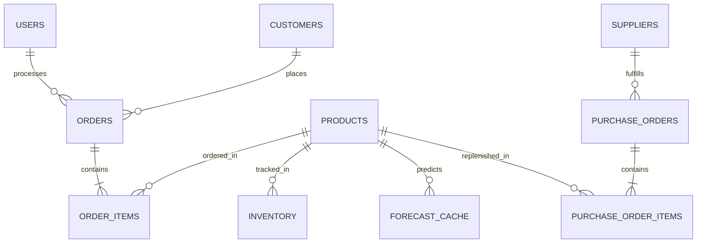

# NEXORA – Database Design Specification (MySQL)

> **Notice:** This document defines the planned relational schema for future milestones. Database integration is not yet active in Milestone 1.

---

## 1. Entity-Relationship Overview

---

## 2. Planned Tables

### `users` (Authentication & RBAC)
- `id` (BIGINT PK AUTO_INCREMENT)
- `email` (VARCHAR 255 UNIQUE NOT NULL)
- `hashed_password` (VARCHAR 255 NOT NULL)
- `full_name` (VARCHAR 120 NOT NULL)
- `role` (ENUM('admin', 'manager', 'inventory_clerk', 'cashier') NOT NULL)
- `is_active` (BOOLEAN DEFAULT TRUE)
- `created_at` (TIMESTAMP)

### `products` (Catalog & SKU registry)
- `id` (BIGINT PK AUTO_INCREMENT)
- `stock_code` (VARCHAR 50 UNIQUE NOT NULL)
- `name` (VARCHAR 255 NOT NULL)
- `category` (VARCHAR 100)
- `unit_price` (DECIMAL(10,2) NOT NULL)
- `cost_price` (DECIMAL(10,2) NOT NULL)
- `created_at` (TIMESTAMP)

### `inventory` (Stock levels & warehouse locations)
- `id` (BIGINT PK AUTO_INCREMENT)
- `product_id` (BIGINT FK -> products.id)
- `current_stock` (INT NOT NULL DEFAULT 0)
- `safety_stock` (INT NOT NULL DEFAULT 0)
- `reorder_point` (INT NOT NULL DEFAULT 0)
- `last_restocked_at` (TIMESTAMP)

### `orders` & `order_items` (Sales & Billing)
- Tracks transactions, customer link, invoice total, tax, discount, and cashier reference.

### `forecast_cache` (Demand Projections)
- `id` (BIGINT PK AUTO_INCREMENT)
- `product_id` (BIGINT FK -> products.id)
- `horizon_days` (INT NOT NULL)
- `predicted_units` (DECIMAL(10,2) NOT NULL)
- `generated_at` (TIMESTAMP)
