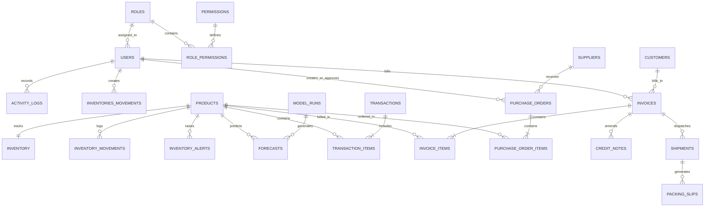

# NEXORA – Database Schema Specification

> [!WARNING]
> **Status: PLANNED (Milestone 2 & Subsequent Phases)**
> No database connection or active tables currently exist in this milestone. This document outlines the comprehensive 19-table target schema defined in the NEXORA Technical Blueprint v1.0 for future integration with MySQL 8.x (InnoDB engine) and SQLAlchemy.

---

## 1. Planned Entity-Relationship Architecture



---

## 2. Relational Schema Groups

### 2.1 User, Role & Audit Tables (RBAC)

#### `roles`
Stores application roles (`admin`, `executive`, `inventory_manager`, `warehouse_worker`, `finance_employee`, `sales_employee`).
```sql
CREATE TABLE roles (
    id BIGINT AUTO_INCREMENT PRIMARY KEY,
    role_name VARCHAR(50) NOT NULL UNIQUE,
    description VARCHAR(255) NULL
) ENGINE=InnoDB;
```

#### `permissions`
Granular privileges across modules.
```sql
CREATE TABLE permissions (
    id BIGINT AUTO_INCREMENT PRIMARY KEY,
    permission_name VARCHAR(100) NOT NULL UNIQUE,
    description VARCHAR(255) NULL
) ENGINE=InnoDB;
```

#### `role_permissions`
Cross-reference mapping roles to authorized permissions.
```sql
CREATE TABLE role_permissions (
    id BIGINT AUTO_INCREMENT PRIMARY KEY,
    role_id BIGINT NOT NULL,
    permission_id BIGINT NOT NULL,
    FOREIGN KEY (role_id) REFERENCES roles(id) ON DELETE CASCADE,
    FOREIGN KEY (permission_id) REFERENCES permissions(id) ON DELETE CASCADE,
    UNIQUE KEY uq_role_perm (role_id, permission_id)
) ENGINE=InnoDB;
```

#### `users`
Employee credentials and profile status.
```sql
CREATE TABLE users (
    id BIGINT AUTO_INCREMENT PRIMARY KEY,
    full_name VARCHAR(150) NOT NULL,
    email VARCHAR(255) NOT NULL UNIQUE,
    password_hash VARCHAR(255) NOT NULL,
    role_id BIGINT NOT NULL,
    is_active BOOLEAN NOT NULL DEFAULT TRUE,
    created_at TIMESTAMP DEFAULT CURRENT_TIMESTAMP,
    FOREIGN KEY (role_id) REFERENCES roles(id)
) ENGINE=InnoDB;
```

#### `activity_logs`
System-wide audit trail of critical operational actions.
```sql
CREATE TABLE activity_logs (
    id BIGINT AUTO_INCREMENT PRIMARY KEY,
    user_id BIGINT NOT NULL,
    action VARCHAR(100) NOT NULL,
    module VARCHAR(50) NOT NULL,
    record_id BIGINT NULL,
    created_at TIMESTAMP DEFAULT CURRENT_TIMESTAMP,
    FOREIGN KEY (user_id) REFERENCES users(id)
) ENGINE=InnoDB;
```

---

### 2.2 Product Catalog & Historical Transactions

#### `products`
Master catalog items mapped to retail stock codes.
```sql
CREATE TABLE products (
    id BIGINT AUTO_INCREMENT PRIMARY KEY,
    stock_code VARCHAR(50) NOT NULL UNIQUE,
    description VARCHAR(255) NOT NULL,
    current_unit_price DECIMAL(10, 2) NOT NULL DEFAULT 0.00,
    is_active BOOLEAN NOT NULL DEFAULT TRUE,
    created_at TIMESTAMP DEFAULT CURRENT_TIMESTAMP,
    updated_at TIMESTAMP DEFAULT CURRENT_TIMESTAMP ON UPDATE CURRENT_TIMESTAMP,
    INDEX idx_products_stock_code (stock_code)
) ENGINE=InnoDB;
```

#### `transactions`
Historical and ongoing transaction receipts.
```sql
CREATE TABLE transactions (
    id BIGINT AUTO_INCREMENT PRIMARY KEY,
    invoice_number VARCHAR(64) NOT NULL,
    invoice_date DATETIME NOT NULL,
    customer_id VARCHAR(64) NULL,
    country VARCHAR(100) NOT NULL DEFAULT 'United Kingdom',
    transaction_type ENUM('standard', 'cancellation', 'return') NOT NULL DEFAULT 'standard',
    created_at TIMESTAMP DEFAULT CURRENT_TIMESTAMP,
    INDEX idx_trans_invoice (invoice_number),
    INDEX idx_trans_date (invoice_date)
) ENGINE=InnoDB;
```

#### `transaction_items`
Individual line items within a sales transaction.
```sql
CREATE TABLE transaction_items (
    id BIGINT AUTO_INCREMENT PRIMARY KEY,
    transaction_id BIGINT NOT NULL,
    product_id BIGINT NOT NULL,
    quantity INT NOT NULL,
    unit_price DECIMAL(10, 2) NOT NULL,
    line_total DECIMAL(12, 2) NOT NULL,
    FOREIGN KEY (transaction_id) REFERENCES transactions(id) ON DELETE CASCADE,
    FOREIGN KEY (product_id) REFERENCES products(id)
) ENGINE=InnoDB;
```

---

### 2.3 Operational Inventory & Movements

#### `inventory`
Live stock levels and safety parameters maintained natively in MySQL.
```sql
CREATE TABLE inventory (
    id BIGINT AUTO_INCREMENT PRIMARY KEY,
    product_id BIGINT NOT NULL UNIQUE,
    current_quantity INT NOT NULL DEFAULT 0,
    minimum_stock INT NOT NULL DEFAULT 10,
    safety_factor DECIMAL(4, 2) NOT NULL DEFAULT 1.20,
    updated_at TIMESTAMP DEFAULT CURRENT_TIMESTAMP ON UPDATE CURRENT_TIMESTAMP,
    FOREIGN KEY (product_id) REFERENCES products(id) ON DELETE CASCADE
) ENGINE=InnoDB;
```

#### `inventory_movements`
Ledger of every stock adjustment, incoming delivery, or fulfillment deduction.
```sql
CREATE TABLE inventory_movements (
    id BIGINT AUTO_INCREMENT PRIMARY KEY,
    product_id BIGINT NOT NULL,
    movement_type ENUM('adjustment', 'purchase_receipt', 'sale_fulfillment', 'return_restock', 'damaged') NOT NULL,
    quantity_change INT NOT NULL,
    reason VARCHAR(255) NULL,
    reference_id VARCHAR(100) NULL,
    created_by BIGINT NOT NULL,
    created_at TIMESTAMP DEFAULT CURRENT_TIMESTAMP,
    FOREIGN KEY (product_id) REFERENCES products(id),
    FOREIGN KEY (created_by) REFERENCES users(id)
) ENGINE=InnoDB;
```

---

### 2.4 Forecasting & Alert Tables

#### `model_runs`
Model training runs, horizons, and validation metrics manifest.
```sql
CREATE TABLE model_runs (
    id BIGINT AUTO_INCREMENT PRIMARY KEY,
    model_name VARCHAR(100) NOT NULL,
    model_version VARCHAR(50) NOT NULL,
    training_start_date DATE NOT NULL,
    training_end_date DATE NOT NULL,
    evaluation_metrics JSON NOT NULL,
    created_at TIMESTAMP DEFAULT CURRENT_TIMESTAMP
) ENGINE=InnoDB;
```

#### `forecasts`
Persisted predictions for multi-horizon planning.
```sql
CREATE TABLE forecasts (
    id BIGINT AUTO_INCREMENT PRIMARY KEY,
    product_id BIGINT NOT NULL,
    model_run_id BIGINT NOT NULL,
    forecast_date DATE NOT NULL,
    horizon_days INT NOT NULL,
    predicted_quantity DECIMAL(10, 2) NOT NULL,
    created_at TIMESTAMP DEFAULT CURRENT_TIMESTAMP,
    FOREIGN KEY (product_id) REFERENCES products(id) ON DELETE CASCADE,
    FOREIGN KEY (model_run_id) REFERENCES model_runs(id) ON DELETE CASCADE,
    INDEX idx_forecast_lookup (product_id, horizon_days, forecast_date)
) ENGINE=InnoDB;
```

#### `inventory_alerts`
Generated warnings categorizing stock risk against forecast demand.
```sql
CREATE TABLE inventory_alerts (
    id BIGINT AUTO_INCREMENT PRIMARY KEY,
    product_id BIGINT NOT NULL,
    risk_level ENUM('SAFE', 'ELEVATED', 'CRITICAL') NOT NULL,
    predicted_demand DECIMAL(10, 2) NOT NULL,
    current_stock INT NOT NULL,
    suggested_quantity INT NOT NULL DEFAULT 0,
    status ENUM('active', 'acknowledged', 'resolved') NOT NULL DEFAULT 'active',
    created_at TIMESTAMP DEFAULT CURRENT_TIMESTAMP,
    FOREIGN KEY (product_id) REFERENCES products(id) ON DELETE CASCADE
) ENGINE=InnoDB;
```

---

### 2.5 Purchasing & Supplier Tables

#### `suppliers`
Vendor master catalog and fulfillment lead times.
```sql
CREATE TABLE suppliers (
    id BIGINT AUTO_INCREMENT PRIMARY KEY,
    supplier_name VARCHAR(150) NOT NULL,
    contact_person VARCHAR(100) NULL,
    email VARCHAR(255) NULL,
    phone VARCHAR(50) NULL,
    address TEXT NULL,
    lead_time_days INT NOT NULL DEFAULT 7
) ENGINE=InnoDB;
```

#### `purchase_orders`
Purchase orders with human review and approval states.
```sql
CREATE TABLE purchase_orders (
    id BIGINT AUTO_INCREMENT PRIMARY KEY,
    supplier_id BIGINT NOT NULL,
    created_by BIGINT NOT NULL,
    approved_by BIGINT NULL,
    order_status ENUM('draft', 'submitted', 'approved', 'rejected', 'received') NOT NULL DEFAULT 'draft',
    order_date DATE NOT NULL,
    expected_delivery_date DATE NULL,
    created_at TIMESTAMP DEFAULT CURRENT_TIMESTAMP,
    FOREIGN KEY (supplier_id) REFERENCES suppliers(id),
    FOREIGN KEY (created_by) REFERENCES users(id),
    FOREIGN KEY (approved_by) REFERENCES users(id)
) ENGINE=InnoDB;
```

#### `purchase_order_items`
Line items for purchase orders.
```sql
CREATE TABLE purchase_order_items (
    id BIGINT AUTO_INCREMENT PRIMARY KEY,
    purchase_order_id BIGINT NOT NULL,
    product_id BIGINT NOT NULL,
    quantity INT NOT NULL,
    unit_cost DECIMAL(10, 2) NOT NULL,
    FOREIGN KEY (purchase_order_id) REFERENCES purchase_orders(id) ON DELETE CASCADE,
    FOREIGN KEY (product_id) REFERENCES products(id)
) ENGINE=InnoDB;
```

---

### 2.6 Billing & Finance Tables

#### `customers`
Manually entered customer billing records.
```sql
CREATE TABLE customers (
    id BIGINT AUTO_INCREMENT PRIMARY KEY,
    customer_name VARCHAR(150) NOT NULL,
    phone VARCHAR(50) NULL,
    email VARCHAR(255) NULL,
    billing_address TEXT NOT NULL,
    city VARCHAR(100) NOT NULL,
    state VARCHAR(100) NULL,
    postal_code VARCHAR(20) NOT NULL,
    country VARCHAR(100) NOT NULL DEFAULT 'United Kingdom'
) ENGINE=InnoDB;
```

#### `invoices`
Sales invoices generated with tax and total calculations.
```sql
CREATE TABLE invoices (
    id BIGINT AUTO_INCREMENT PRIMARY KEY,
    invoice_number VARCHAR(64) NOT NULL UNIQUE,
    customer_id BIGINT NOT NULL,
    invoice_date DATE NOT NULL,
    subtotal DECIMAL(12, 2) NOT NULL,
    tax_amount DECIMAL(12, 2) NOT NULL DEFAULT 0.00,
    grand_total DECIMAL(12, 2) NOT NULL,
    payment_status ENUM('unpaid', 'paid', 'refunded', 'partially_credited') NOT NULL DEFAULT 'paid',
    created_by BIGINT NOT NULL,
    created_at TIMESTAMP DEFAULT CURRENT_TIMESTAMP,
    FOREIGN KEY (customer_id) REFERENCES customers(id),
    FOREIGN KEY (created_by) REFERENCES users(id)
) ENGINE=InnoDB;
```

#### `invoice_items`
Billed items per invoice.
```sql
CREATE TABLE invoice_items (
    id BIGINT AUTO_INCREMENT PRIMARY KEY,
    invoice_id BIGINT NOT NULL,
    product_id BIGINT NOT NULL,
    description VARCHAR(255) NOT NULL,
    quantity INT NOT NULL,
    unit_price DECIMAL(10, 2) NOT NULL,
    line_total DECIMAL(12, 2) NOT NULL,
    FOREIGN KEY (invoice_id) REFERENCES invoices(id) ON DELETE CASCADE,
    FOREIGN KEY (product_id) REFERENCES products(id)
) ENGINE=InnoDB;
```

#### `credit_notes`
Financial refund and credit adjustments tied to invoices.
```sql
CREATE TABLE credit_notes (
    id BIGINT AUTO_INCREMENT PRIMARY KEY,
    invoice_id BIGINT NOT NULL,
    credit_note_number VARCHAR(64) NOT NULL UNIQUE,
    reason TEXT NOT NULL,
    amount DECIMAL(12, 2) NOT NULL,
    created_by BIGINT NOT NULL,
    created_at TIMESTAMP DEFAULT CURRENT_TIMESTAMP,
    FOREIGN KEY (invoice_id) REFERENCES invoices(id),
    FOREIGN KEY (created_by) REFERENCES users(id)
) ENGINE=InnoDB;
```

---

### 2.7 Shipping & Dispatch Preparation

#### `shipments`
Internal parcel routing and fulfillment records.
```sql
CREATE TABLE shipments (
    id BIGINT AUTO_INCREMENT PRIMARY KEY,
    invoice_id BIGINT NOT NULL,
    shipping_address TEXT NOT NULL,
    delivery_method VARCHAR(50) NOT NULL DEFAULT 'Standard Delivery',
    shipping_status ENUM('pending', 'packed', 'dispatched', 'delivered') NOT NULL DEFAULT 'pending',
    tracking_reference VARCHAR(100) NULL,
    created_at TIMESTAMP DEFAULT CURRENT_TIMESTAMP,
    FOREIGN KEY (invoice_id) REFERENCES invoices(id)
) ENGINE=InnoDB;
```

#### `packing_slips`
Internal warehouse packing checklists.
```sql
CREATE TABLE packing_slips (
    id BIGINT AUTO_INCREMENT PRIMARY KEY,
    shipment_id BIGINT NOT NULL,
    generated_by BIGINT NOT NULL,
    generated_at TIMESTAMP DEFAULT CURRENT_TIMESTAMP,
    FOREIGN KEY (shipment_id) REFERENCES shipments(id) ON DELETE CASCADE,
    FOREIGN KEY (generated_by) REFERENCES users(id)
) ENGINE=InnoDB;
```

---

## 3. Database Design Principles
1. **ACID Compliance & Referential Integrity:** Foreign keys enforced across all operational relationships via MySQL InnoDB.
2. **High-Precision Financial Arithmetic:** All currency values strictly utilize `DECIMAL(10, 2)` or `DECIMAL(12, 2)` to avoid floating-point rounding errors.
3. **Auditing & Accountability:** `created_by` / `approved_by` audit fields capture user accountability on critical financial and stock transactions.
4. **Index Optimization:** Targeted indexes placed on lookup keys (`stock_code`, `invoice_number`, `invoice_date`, and foreign keys) for low-latency joins.
