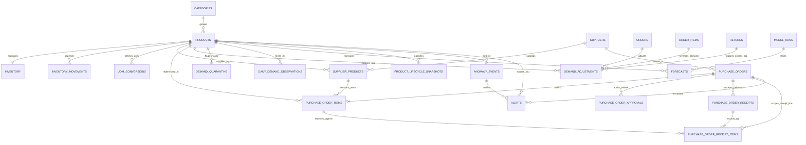

# NEXORA — Database Schema Specification

- **Project:** NEXORA – AI-Powered Retail Management & Intelligence System
- **Document Version:** 2.2 — Final Database Foundation & Integrity Specification
- **Updated:** 26 November 2026
- **Target Engine:** MySQL 8.x (`InnoDB`, `utf8mb4`, SQLAlchemy 2.x + Alembic)
- **Authoritative References:**
  - [NEXORA — Technical Blueprint v1.0.md](NEXORA%20%E2%80%94%20Technical%20Blueprint%20v1.0.md) (`Version 2.2 (Design Decision Resolution)`)
  - [FEATURES_STATUS.md](FEATURES_STATUS.md) (`Version 2.3`)
  - [NEXORA — Application Functionality & System Workflow Guide.md](NEXORA%20%E2%80%94%20Application%20Functionality%20%26%20System%20Workflow%20Guide.md) (`Version 1.0`)
  - [API_DOCUMENTATION.md](API_DOCUMENTATION.md)

### Document Version History

| Version | Date | Summary |
| :---: | :---: | :--- |
| `1.0` | Nov 2026 | Legacy draft claiming 19 tables (22 DDL definitions) with RBAC (`roles`, `permissions`, `role_permissions`, `users`), `activity_logs`, `inventory_alerts`, and default 7-day lead times. |
| `2.0` | 26 Nov 2026 | Architectural overhaul aligned with Technical Blueprint v2.2 & `DDR-01`–`DDR-10`: removed 4 RBAC tables, replaced auth with 4 UI-only workspaces, expanded to 40 InnoDB tables across 9 schema groups. |
| `2.1` | 26 Nov 2026 | **Integrity & Consistency Corrections:** Unified fractional `DECIMAL(14, 4)` operational quantities; added composite `UNIQUE`/`FOREIGN KEY` cross-table parent-line integrity; replaced `(supplier_id, product_id)` overwrite risk with effective-dated `supplier_products` history + generated single-active/single-preferred uniqueness + PO line snapshots; standardized UI workspace provenance; separated PO workflow app validation from DB storage; aligned `operational_settings` to native MySQL `JSON`. |
| **`2.2`** | **26 Nov 2026** | **Final Database Foundation & Integrity Specification:** Enforced same-customer order binding (`orders(id, customer_id)` on `invoices` & `transactions`), same-order shipment invoice integrity (`shipments(invoice_id, order_id)`), and cross-parent `returns` order consistency (`(sale_id, order_id)`, `(invoice_id, order_id)`); unified procurement UoM conversion tracking on `purchase_order_items` & `purchase_order_receipt_items` so `Incoming Stock` matches `inventory` `base_uom`; backticked MySQL 8.0 reserved identifier `` `returns` `` in raw SQL DDL; switched uniqueness generated columns from `STORED` to `VIRTUAL`; tightened `CHECK` constraints across `uom_conversions`, `supplier_products`, `orders`, `return_items`, `demand_adjustments`, `demand_quarantine`, `alerts`, and `audit_outbox`; pruned redundant FK-subsumed indexes; completed `FOR UPDATE` lock ordering across all 8 multi-table workflows; refined `Section 9.2` deferred policies. |

> [!WARNING]
> **Implementation Status — `PLANNED` (Zero Live MySQL Tables on `main`):**
> No live MySQL database tables, SQLAlchemy ORM model classes, or Alembic migrations exist on branch `main`. Currently implemented persistence/serving consists solely of offline Phase 1 UCI CSV pipelines, committed `.joblib` model artifacts, and stateless FastAPI forecast/inventory recommendation routes. All **40 tables** specified below represent the planned target relational schema across Modules **`M01`–`M18`** and Supporting Capabilities **`SYS-01`–`SYS-04`**.

---

## 1. Database Architecture & Entity-Relationship Diagrams

### 1.1 Schema Modernization Scope & Old RBAC Removal
Per **Technical Blueprint v2.2**, NEXORA **has no authentication, login, passwords, sessions, JWTs, or server-enforced RBAC**. All authentication and RBAC structures from `v1.0` (`roles`, `permissions`, `role_permissions`, `users`, `password_hash`, `user_id` FKs) are retired and omitted:
- **Removed Entities (`4`):** `roles`, `permissions`, `role_permissions`, `users`.
- **Workspace UI Context Model (`SYS-01`):** Page 2 organizes views and workflow governance across four UI-only workspaces (`store_manager`, `inventory_staff`, `purchase_manager`, `finance_staff`).
- **Context vs. Verified Identity:** `selected_workspace`, `action_source`, and optional caller-supplied `operator_ref` provide non-authenticated provenance context only—**never** cryptographic identity verification, session state, or endpoint security authorization. Any future authenticated-user system remains explicitly outside current scope.

### 1.2 Overview Entity-Relationship Diagram

```mermaid
erDiagram
    CATEGORIES ||--o{ PRODUCTS : categorizes
    PRODUCTS ||--|| INVENTORY : tracks
    PRODUCTS ||--o{ INVENTORY_MOVEMENTS : logs
    PRODUCTS ||--o{ UOM_CONVERSIONS : converts
    PRODUCTS ||--o{ SUPPLIER_PRODUCTS : sourced_via
    SUPPLIERS ||--o{ SUPPLIER_PRODUCTS : offers

    CUSTOMERS ||--o{ ORDERS : places
    ORDERS ||--|{ ORDER_ITEMS : contains
    ORDERS ||--o{ ORDER_FULFILLMENTS : fulfills
    ORDERS ||--o{ TRANSACTIONS : settles_as
    ORDERS ||--o{ INVOICES : bills
    ORDERS ||--o{ RETURNS : receives
    ORDERS ||--o{ SHIPMENTS : dispatches
    ORDERS ||--o{ DEMAND_ADJUSTMENTS : adjusts

    SUPPLIERS ||--o{ PURCHASE_ORDERS : supplies
    PURCHASE_ORDERS ||--|{ PURCHASE_ORDER_ITEMS : requests
    PURCHASE_ORDERS ||--o{ PURCHASE_ORDER_APPROVALS : reviews
    PURCHASE_ORDERS ||--o{ PURCHASE_ORDER_RECEIPTS : receives

    INVOICES ||--|{ INVOICE_ITEMS : details
    INVOICES ||--o{ PAYMENTS : collects
    INVOICES ||--o{ CREDIT_NOTES : offsets
    INVOICES ||--o{ SHIPMENTS : accompanies_parcel
    RETURNS ||--|{ RETURN_ITEMS : itemizes
    RETURNS ||--o{ CREDIT_NOTES : triggers
    SHIPMENTS ||--|{ SHIPMENT_ITEMS : carries
    SHIPMENTS ||--o{ PACKING_SLIPS : prints
    SHIPMENTS ||--o{ SHIPMENT_EVENTS : logs

    PRODUCTS ||--o{ DAILY_DEMAND_OBSERVATIONS : aggregates
    PRODUCTS ||--o{ FORECASTS : projects
    MODEL_RUNS ||--o{ FORECASTS : produces
    PRODUCTS ||--o{ PRODUCT_LIFECYCLE_SNAPSHOTS : evaluates
    PRODUCTS ||--o{ ANOMALY_EVENTS : monitors
    ANOMALY_EVENTS ||--o{ ALERTS : surfaces
```



### 1.3 Domain ER View A — Retail Foundation, Orders, Fulfilment, Returns, Finance & Shipping

```mermaid
erDiagram
    CUSTOMERS ||--o{ ORDERS : places
    CUSTOMERS ||--o{ TRANSACTIONS : records
    CUSTOMERS ||--o{ INVOICES : billed_to

    PRODUCTS ||--o{ ORDER_ITEMS : ordered_in
    PRODUCTS ||--o{ TRANSACTION_ITEMS : sold_in
    PRODUCTS ||--o{ INVOICE_ITEMS : invoiced_in
    PRODUCTS ||--o{ RETURN_ITEMS : returned_in

    ORDERS ||--|{ ORDER_ITEMS : contains
    ORDERS ||--o{ ORDER_FULFILLMENTS : executes
    ORDER_FULFILLMENTS ||--|{ ORDER_FULFILLMENT_ITEMS : dispatches
    ORDERS ||--o{ ORDER_FULFILLMENT_ITEMS : scopes_batch_line
    ORDER_ITEMS ||--o{ ORDER_FULFILLMENT_ITEMS : fulfilled_by

    ORDERS ||--o{ SHIPMENTS : splits_into
    ORDER_FULFILLMENTS ||--o{ SHIPMENTS : prepares
    INVOICES ||--o{ SHIPMENTS : links_parcel
    SHIPMENTS ||--|{ SHIPMENT_ITEMS : allocates
    ORDERS ||--o{ SHIPMENT_ITEMS : scopes_parcel_line
    ORDER_ITEMS ||--o{ SHIPMENT_ITEMS : ships_line
    ORDER_FULFILLMENT_ITEMS ||--o{ SHIPMENT_ITEMS : links_batch_line
    SHIPMENTS ||--{ PACKING_SLIPS : generates
    SHIPMENTS ||--o{ SHIPMENT_EVENTS : tracks

    ORDERS ||--o{ TRANSACTIONS : realizes_sale
    ORDER_FULFILLMENTS ||--o{ TRANSACTIONS : settles_batch
    TRANSACTIONS ||--|{ TRANSACTION_ITEMS : itemizes
    ORDER_ITEMS ||--o{ TRANSACTION_ITEMS : billed_sale_line

    ORDERS ||--o{ INVOICES : generates
    ORDER_FULFILLMENTS ||--o{ INVOICES : invoices_batch
    INVOICES ||--|{ INVOICE_ITEMS : includes
    ORDER_ITEMS ||--o{ INVOICE_ITEMS : links_order_line
    INVOICES ||--o{ PAYMENTS : paid_by
    INVOICES ||--o{ CREDIT_NOTES : credited_by

    ORDERS ||--o{ RETURNS : links_order
    TRANSACTIONS ||--o{ RETURNS : links_sale
    INVOICES ||--o{ RETURNS : links_invoice
    RETURNS ||--|{ RETURN_ITEMS : specifies
    ORDER_ITEMS ||--o{ RETURN_ITEMS : returns_from
    RETURNS ||--o{ CREDIT_NOTES : issues_credit
```

*(Note: `order_fulfillment_items` and `shipment_items` derive `product_id` strictly from their required `order_items` parent without duplicating `product_id` columns.)*

### 1.4 Domain ER View B — Inventory, Sourcing (`DDR-07`), Procurement (`DDR-09`), ML Demand (`DDR-06`) & Governance (`DDR-08`/`DDR-10`)



*(Note: `purchase_order_receipt_items` derives `product_id` directly from `purchase_order_items`. Three configuration/audit tables—`operational_settings`, `audit_logs`, and `audit_outbox`—are intentionally standalone without operational parent foreign keys.)*

---

## 2. Relational Schema Groups & Provenance Architecture

The **40 InnoDB tables** organize across nine domain groups covering all **18 Core Modules (`M01`–`M18`)** and **4 Supporting System Capabilities (`SYS-01`–`SYS-04`)**:

| Schema Group | Modules / Capabilities | Tables Included (`40` Total) | Key Design Decisions Covered |
| :--- | :--- | :--- | :--- |
| **3.1 Centralized Settings** | `M08`, `M11`, `M15`, `M17`, `SYS-01` | `operational_settings` | `DDR-04`, `DDR-08`, `DDR-09`, `DDR-10` |
| **3.2 Catalog, UoM & Partners** | `M01`, `M02`, `M03` | `categories`, `products`, `uom_conversions`, `suppliers`, `supplier_products`, `customers` | `DDR-01`, `DDR-04`, `DDR-06`, `DDR-07`, `EXCL-08` |
| **3.3 Orders, Fulfilment & Sales** | `M04`, `M05`, `M06` | `orders`, `order_items`, `order_fulfillments`, `order_fulfillment_items`, `transactions`, `transaction_items` | `DDR-03`, `DDR-04`, `DDR-05`, `DDR-06`, `DDR-10` |
| **3.4 Inventory & Stock Ledger** | `M09`, `M10` | `inventory`, `inventory_movements` | `DDR-02`, `DDR-03`, `DDR-05`, `DDR-10` |
| **3.5 Procurement & Tiered Approval** | `M11`, `M02` | `purchase_orders`, `purchase_order_items`, `purchase_order_approvals`, `purchase_order_receipts`, `purchase_order_receipt_items` | `DDR-01`, `DDR-02`, `DDR-07`, `DDR-09`, `EXCL-03` |
| **3.6 Returns & Billing Finance** | `M16`, `M17` | `invoices`, `invoice_items`, `payments`, `returns`, `return_items`, `credit_notes` | `DDR-04`, `DDR-06`, `DDR-10`, `EXCL-01` |
| **3.7 Internal Shipping & Split Delivery** | `M18` | `shipments`, `shipment_items`, `packing_slips`, `shipment_events` | `DDR-05`, `EXCL-02` |
| **3.8 Demand ML, Lifecycle & Anomalies** | `M07`, `M08`, `M12`, `M13`, `M14`, `M15`, `SYS-03` | `demand_adjustments`, `demand_quarantine`, `daily_demand_observations`, `model_runs`, `forecasts`, `product_lifecycle_snapshots`, `anomaly_events`, `alerts` | `DDR-01`, `DDR-06`, `DDR-08`, `DDR-09` |
| **3.9 Centralized Audit & Outbox** | `SYS-02`, `SYS-04` | `audit_logs`, `audit_outbox` | `DDR-10` |

### 2.1 Standardized Non-Authenticated Workspace Provenance (`SYS-01` & `DDR-10`)
NEXORA uses one consistent non-authenticated provenance column triad wherever operations or state transitions are tracked:
- **`selected_workspace`:** `ENUM('store_manager', 'inventory_staff', 'purchase_manager', 'finance_staff') NULL` — captures the active Page 2 UI workspace (`X-NEXORA-Workspace`). Remains `NULL` for headless API, scheduled batch, CLI seed, or system-generated rows. **Strictly UI navigation context, never authorization.**
- **`action_source`:** `ENUM('UI', 'API', 'SYSTEM', 'ML_ENGINE') NOT NULL` — cleanly distinguishes human UI-triggered operations (`'UI'`), direct REST/CLI calls (`'API'`), background/automated system jobs (`'SYSTEM'`), and offline ML pipelines (`'ML_ENGINE'`).
- **`operator_ref`:** `VARCHAR(64) NULL` — optional non-authenticated attribution token supplied explicitly by callers on workflow/governance mutations; defaults to `NULL` and **never implies verified user identity, login, or credentials**.

| Provenance Category | Tables Covered | Schema Representation |
| :--- | :--- | :--- |
| **Full Mutation Provenance Triad (`selected_workspace`, `action_source`, `operator_ref`)** | `operational_settings`, `categories`, `products`, `uom_conversions`, `suppliers`, `supplier_products`, `customers`, `orders`, `order_fulfillments`, `transactions`, `inventory_movements`, `purchase_order_approvals`, `purchase_order_receipts`, `invoices`, `payments`, `returns`, `credit_notes`, `shipments`, `packing_slips`, `shipment_events`, `demand_adjustments`, `demand_quarantine`, `forecasts`, `product_lifecycle_snapshots`, `audit_logs` | Stored directly with standardized column names and enums. Master entities (`categories`..`customers`, `operational_settings`) record latest mutating provenance while complete mutation history lives in `audit_logs`. |
| **Dual-Stage Workflow Provenance (`created_*` + `reviewed_*`)** | `purchase_orders`, `alerts` | `purchase_orders` tracks `created_workspace`/`created_action_source`/`created_operator_ref` and `reviewed_workspace`/`reviewed_action_source`/`reviewed_operator_ref`. `alerts` tracks `created_source`, `acknowledged_workspace`/`acknowledged_operator_ref`, and `resolved_workspace`/`resolved_operator_ref`. |
| **System / Empirical / Aggregated Tables (`action_source` or none where parent-owned)** | `model_runs`, `anomaly_events`, `daily_demand_observations`, `inventory`, `audit_outbox`, plus the 8 child line tables (`order_items`, `order_fulfillment_items`, `transaction_items`, `purchase_order_items`, `purchase_order_receipt_items`, `invoice_items`, `return_items`, `shipment_items`) | `model_runs` & `anomaly_events` carry `action_source` (`ML_ENGINE`/`SYSTEM`/`API`); `daily_demand_observations` aggregates pre-attributed confirmed orders; `inventory` delegates provenance to `inventory_movements`; `audit_outbox` preserves provenance in its `payload` JSON; child line tables inherit provenance from their parent transaction headers without redundant duplication. |

---

## 3. Complete Table Definitions & Precision Standards (MySQL 8.x `InnoDB`)

> [!NOTE]
> **Precision, UoM & Integrity Standards (`v2.2`):**
> - **Quantity Domains & `DECIMAL(14, 4)` Policy:**
>   1. **Transaction / Document Line Quantity** (`order_items.quantity`, `purchase_order_items.ordered_quantity`, `purchase_order_receipt_items.quantity_received`, `invoice_items.quantity`, `return_items.quantity`, `shipment_items.quantity`, etc.): stored in `DECIMAL(14, 4)` in the line's recorded UoM (`uom_code`).
>   2. **Conversion Factor** (`uom_conversions.conversion_to_base`, `order_items.base_uom_conversion_factor`, `purchase_order_items.base_uom_conversion_factor`, `demand_adjustments.base_uom_conversion_factor`): stored in `DECIMAL(12, 6)`.
>   3. **Base-UoM Converted Quantity** (`order_items.base_uom_quantity`, `base_uom_fulfilled_quantity`, `purchase_order_items.base_uom_ordered_quantity`, `base_uom_received_quantity`, `purchase_order_receipt_items.base_uom_quantity_received`, `demand_adjustments.base_uom_quantity_delta`, `daily_demand_observations.*_base_uom_qty`): stored in **`DECIMAL(14, 4)`** in `products.base_uom`.
>   4. **Warehouse Physical & Reserved Stock** (`inventory.current_quantity`, `reserved_quantity`, `minimum_stock`, and `inventory_movements.*_quantity`): stored in **`DECIMAL(14, 4)`** in **`products.base_uom`** so live stock and ML base-UoM demand share identical fixed-point precision without integer truncation or floating-point error.
>   5. **Integer Non-Quantity Counts:** Calendar/day spans (`lead_time_days`, `horizon_days`, `sku_age_days`, `days_since_last_sale`), revision numbers, retry counts, and order counts remain `INT` / `INT UNSIGNED`.
> - **Monetary Types:** Unit prices/costs use `DECIMAL(10, 2)`; financial totals, subtotals, taxes, payments, credits, and PO limits use `DECIMAL(12, 2)`. Zero `FLOAT` or `DOUBLE` columns exist.
> - **Rounding & Unresolved Precision Rule:** Converting `quantity × conversion_to_base` uses fixed-point decimal arithmetic. **Silent rounding that creates or removes physical inventory is prohibited.** Per-SKU discrete-integer vs. fractional unit enforcement and residual sub-`0.0001` rounding policies are documented as an explicit deferred application policy in **Section 9.2**.
> - **Parent-Child Integrity:** All FKs use `ON DELETE RESTRICT` across business history; composite `UNIQUE` + composite `FOREIGN KEY` constraints enforce parent transaction consistency at DB level wherever MySQL 8.x InnoDB permits.

---

### 3.1 Group 1 — Centralized Settings

#### `operational_settings`
- **Purpose:** Centralized, bounded configuration store governing operational currency (`'INR'`), store tax rate (`DDR-04`), lifecycle & anomaly bounds (`DDR-08`), and PO Tier 1 approval limit / anti-split rolling window (`DDR-09`).
- **Primary Key:** `id` (`BIGINT UNSIGNED`).
- **Foreign Keys:** None.
- **Value Representation & Validation:** `setting_value` and `default_value` use native MySQL `JSON NOT NULL` so scalar numbers (`18.00`), integers (`7`), booleans (`true`), strings (`"INR"`), and structured escalation JSON objects are validated natively as well-formed JSON at DB level. Application services enforce `value_type` compatibility (`DECIMAL`/`INTEGER` bounds checking against `min_bound`/`max_bound`, `422` on violation), prospective-only effect, and Tier 1 `audit_logs` capture (`before_values` / `after_values`). Only approved Blueprint settings keys are seeded; arbitrary unapproved parameters are forbidden.

```sql
CREATE TABLE operational_settings (
    id BIGINT UNSIGNED AUTO_INCREMENT PRIMARY KEY,
    setting_key VARCHAR(100) NOT NULL,
    setting_value JSON NOT NULL,
    default_value JSON NOT NULL,
    min_bound DECIMAL(14, 4) NULL,
    max_bound DECIMAL(14, 4) NULL,
    value_type ENUM('DECIMAL', 'INTEGER', 'STRING', 'BOOLEAN', 'JSON') NOT NULL,
    domain ENUM('finance', 'lifecycle', 'anomaly', 'procurement', 'inventory') NOT NULL,
    description VARCHAR(255) NOT NULL,
    selected_workspace ENUM('store_manager', 'inventory_staff', 'purchase_manager', 'finance_staff') NULL,
    action_source ENUM('UI', 'API', 'SYSTEM', 'ML_ENGINE') NOT NULL DEFAULT 'SYSTEM',
    operator_ref VARCHAR(64) NULL,
    updated_at DATETIME(6) NOT NULL DEFAULT CURRENT_TIMESTAMP(6) ON UPDATE CURRENT_TIMESTAMP(6),
    CONSTRAINT uq_operational_settings_key UNIQUE (setting_key),
    CONSTRAINT chk_op_settings_bounds CHECK (min_bound IS NULL OR max_bound IS NULL OR min_bound <= max_bound),
    INDEX idx_op_settings_domain (domain)
) ENGINE=InnoDB DEFAULT CHARSET=utf8mb4 COLLATE=utf8mb4_unicode_ci;
```

*Approved Seeded Keys:* `default_operational_currency` (`"INR"`), `store_tax_rate` (`DECIMAL`, `0.00`–`50.00`), `po_tier1_approval_limit` (`DECIMAL`, `> 0`), `po_split_window_days` (`INTEGER`, `1`–`90`), `po_split_count_threshold` (`INTEGER`, `>= 2`), `lifecycle_hysteresis_windows` (`INTEGER`), `lifecycle_inactivity_days` (`INTEGER`), `anomaly_rolling_window_days` (`INTEGER`), `anomaly_z_threshold` (`DECIMAL`), `anomaly_price_variance_pct` (`DECIMAL`).

---

### 3.2 Group 2 — Retail Foundation, UoM Conversions & Sourcing (`M01`–`M03`)

#### `categories`
- **Purpose:** Product catalog categories (`M01`).
- **Primary Key:** `id` (`BIGINT UNSIGNED`).
- **Foreign Keys:** None.
- **Unique Constraints:** `uq_categories_name` (`name`).
- **Deletion Behaviour:** Soft-deactivate via `is_active = FALSE` (`ON DELETE RESTRICT` on children).

```sql
CREATE TABLE categories (
    id BIGINT UNSIGNED AUTO_INCREMENT PRIMARY KEY,
    name VARCHAR(100) NOT NULL,
    description VARCHAR(255) NULL,
    is_active BOOLEAN NOT NULL DEFAULT TRUE,
    selected_workspace ENUM('store_manager', 'inventory_staff', 'purchase_manager', 'finance_staff') NULL,
    action_source ENUM('UI', 'API', 'SYSTEM', 'ML_ENGINE') NOT NULL DEFAULT 'UI',
    operator_ref VARCHAR(64) NULL,
    created_at DATETIME NOT NULL DEFAULT CURRENT_TIMESTAMP,
    updated_at DATETIME NOT NULL DEFAULT CURRENT_TIMESTAMP ON UPDATE CURRENT_TIMESTAMP,
    CONSTRAINT uq_categories_name UNIQUE (name),
    INDEX idx_categories_active (is_active)
) ENGINE=InnoDB DEFAULT CHARSET=utf8mb4 COLLATE=utf8mb4_unicode_ci;
```

#### `products`
- **Purpose:** Master SKU catalog (`M01`), holding base pricing (`INR` operational default), canonical `base_uom`, UCI provenance flag, and current cached `DDR-08` `lifecycle_stage` synchronized alongside immutable `product_lifecycle_snapshots`.
- **Primary Key:** `id` (`BIGINT UNSIGNED`).
- **Foreign Keys:** `category_id` → `categories(id)` (`ON DELETE RESTRICT`).
- **Unique Constraints:** `uq_products_stock_code` (`stock_code`).
- **Check Constraints:** `current_unit_price >= 0.00`.
- **Snapshot vs. Master:** Master data; price updates affect future drafts only.

```sql
CREATE TABLE products (
    id BIGINT UNSIGNED AUTO_INCREMENT PRIMARY KEY,
    stock_code VARCHAR(50) NOT NULL,
    description VARCHAR(255) NOT NULL,
    category_id BIGINT UNSIGNED NULL,
    base_uom VARCHAR(32) NOT NULL DEFAULT 'unit',
    current_unit_price DECIMAL(10, 2) NOT NULL DEFAULT 0.00,
    currency_code CHAR(3) NOT NULL DEFAULT 'INR',
    lifecycle_stage ENUM('Introduction', 'Growth', 'Maturity', 'Decline', 'Discontinued') NOT NULL DEFAULT 'Introduction',
    is_uci_baseline BOOLEAN NOT NULL DEFAULT FALSE,
    is_active BOOLEAN NOT NULL DEFAULT TRUE,
    selected_workspace ENUM('store_manager', 'inventory_staff', 'purchase_manager', 'finance_staff') NULL,
    action_source ENUM('UI', 'API', 'SYSTEM', 'ML_ENGINE') NOT NULL DEFAULT 'UI',
    operator_ref VARCHAR(64) NULL,
    created_at DATETIME NOT NULL DEFAULT CURRENT_TIMESTAMP,
    updated_at DATETIME NOT NULL DEFAULT CURRENT_TIMESTAMP ON UPDATE CURRENT_TIMESTAMP,
    CONSTRAINT uq_products_stock_code UNIQUE (stock_code),
    CONSTRAINT fk_products_category FOREIGN KEY (category_id) REFERENCES categories(id) ON DELETE RESTRICT,
    CONSTRAINT chk_products_price_nonneg CHECK (current_unit_price >= 0.00),
    INDEX idx_products_category_active (category_id, is_active),
    INDEX idx_products_lifecycle (lifecycle_stage),
    INDEX idx_products_uci (is_uci_baseline)
) ENGINE=InnoDB DEFAULT CHARSET=utf8mb4 COLLATE=utf8mb4_unicode_ci;
```

#### `uom_conversions`
- **Purpose:** Effective-dated, product-specific UoM conversion multipliers (`uom_code` → `products.base_uom`) supporting `DDR-06` base-unit order and PO conversion traceability.
- **Primary Key:** `id` (`BIGINT UNSIGNED`).
- **Foreign Keys:** `product_id` → `products(id)` (`ON DELETE RESTRICT`).
- **Unique Constraints:** `uq_uom_product_code_eff` (`product_id`, `uom_code`, `effective_from`).
- **Check Constraints:** `conversion_to_base > 0.000000`, `effective_to IS NULL OR effective_to >= effective_from`, and `is_active = TRUE OR effective_to IS NOT NULL`.
- **Precision & Deletion Behaviour:** Microsecond `DATETIME(6)` timestamps prevent same-second revision collisions on `uq_uom_product_code_eff`; expired rules close permanently via `is_active = FALSE` and `effective_to`.

```sql
CREATE TABLE uom_conversions (
    id BIGINT UNSIGNED AUTO_INCREMENT PRIMARY KEY,
    product_id BIGINT UNSIGNED NOT NULL,
    uom_code VARCHAR(32) NOT NULL,
    conversion_to_base DECIMAL(12, 6) NOT NULL,
    effective_from DATETIME(6) NOT NULL DEFAULT CURRENT_TIMESTAMP(6),
    effective_to DATETIME(6) NULL,
    is_active BOOLEAN NOT NULL DEFAULT TRUE,
    selected_workspace ENUM('store_manager', 'inventory_staff', 'purchase_manager', 'finance_staff') NULL,
    action_source ENUM('UI', 'API', 'SYSTEM', 'ML_ENGINE') NOT NULL DEFAULT 'UI',
    operator_ref VARCHAR(64) NULL,
    created_at DATETIME(6) NOT NULL DEFAULT CURRENT_TIMESTAMP(6),
    CONSTRAINT uq_uom_product_code_eff UNIQUE (product_id, uom_code, effective_from),
    CONSTRAINT fk_uom_product FOREIGN KEY (product_id) REFERENCES products(id) ON DELETE RESTRICT,
    CONSTRAINT chk_uom_factor_pos CHECK (conversion_to_base > 0.000000),
    CONSTRAINT chk_uom_effective_window CHECK (effective_to IS NULL OR effective_to >= effective_from),
    CONSTRAINT chk_uom_inactive_closed CHECK (is_active = TRUE OR effective_to IS NOT NULL),
    INDEX idx_uom_lookup (product_id, uom_code, is_active, effective_from)
) ENGINE=InnoDB DEFAULT CHARSET=utf8mb4 COLLATE=utf8mb4_unicode_ci;
```

#### `suppliers`
- **Purpose:** Vendor master directory (`M02`) supplying fallback `lead_time_days` when `supplier_products.lead_time_days` is unset (`DDR-01`, `DDR-07`).
- **Primary Key:** `id` (`BIGINT UNSIGNED`).
- **Foreign Keys:** None.
- **Check Constraints:** `lead_time_days IS NULL OR (lead_time_days BETWEEN 1 AND 365)` (nullable; never fabricated).

```sql
CREATE TABLE suppliers (
    id BIGINT UNSIGNED AUTO_INCREMENT PRIMARY KEY,
    supplier_name VARCHAR(150) NOT NULL,
    contact_person VARCHAR(100) NULL,
    email VARCHAR(255) NULL,
    phone VARCHAR(50) NULL,
    address TEXT NULL,
    lead_time_days INT NULL,
    is_active BOOLEAN NOT NULL DEFAULT TRUE,
    selected_workspace ENUM('store_manager', 'inventory_staff', 'purchase_manager', 'finance_staff') NULL,
    action_source ENUM('UI', 'API', 'SYSTEM', 'ML_ENGINE') NOT NULL DEFAULT 'UI',
    operator_ref VARCHAR(64) NULL,
    created_at DATETIME NOT NULL DEFAULT CURRENT_TIMESTAMP,
    updated_at DATETIME NOT NULL DEFAULT CURRENT_TIMESTAMP ON UPDATE CURRENT_TIMESTAMP,
    CONSTRAINT chk_suppliers_lt CHECK (lead_time_days IS NULL OR (lead_time_days BETWEEN 1 AND 365)),
    INDEX idx_suppliers_name_active (supplier_name, is_active)
) ENGINE=InnoDB DEFAULT CHARSET=utf8mb4 COLLATE=utf8mb4_unicode_ci;
```

#### `supplier_products` *(Versioned Historical Sourcing — `DDR-07`)*
- **Purpose:** Effective-dated many-to-many supplier-product sourcing catalog (`DDR-07`) holding vendor SKU code, `purchase_price`, product-specific `lead_time_days` (`DDR-01` primary), `minimum_order_quantity`, preferred vendor flag, and permanent history of superseded/inactive sourcing terms.
- **Historical Versioning Strategy (Least-Complex Immutable Design):** Instead of overwriting terms in place (which would destroy past price/LT/MOQ evidence) or adding a duplicate archive table, updates to sourcing terms close the prior active row (`is_active = FALSE`, `is_preferred = FALSE`, `effective_to = NOW(6)`) and insert a new active row (`is_active = TRUE`, `effective_to = NULL`). Old `purchase_order_items` retain their FK `supplier_product_id` directly to the exact historical version row (plus point-in-time snapshots).
- **Database-Enforced Uniqueness Rules (via MySQL 8.x `VIRTUAL` Generated Columns):**
  1. `uq_sp_one_active_pair` (`active_supplier_id`, `active_product_id`): guarantees at most **one** active mapping (`is_active = TRUE`) per `(supplier_id, product_id)` while permitting unlimited closed (`is_active = FALSE`) historical versions with zero redundant clustered-row byte storage (`VIRTUAL` secondary B-tree indexing in InnoDB).
  2. `uq_sp_one_active_preferred` (`active_preferred_product_id`): guarantees at most **one** active preferred supplier mapping (`is_active = TRUE AND is_preferred = TRUE`) per `product_id`.
  3. `uq_sp_id_sup_prod` (`id`, `supplier_id`, `product_id`): enables composite FK validation from `purchase_order_items`.
- **Determining Current Preferred Active Mapping:** Application queries `WHERE product_id = ? AND is_active = TRUE AND is_preferred = TRUE` (`uq_sp_one_active_preferred` returns `0` or `1` row deterministically); if none is preferred, operator selects among active rows or falls back to `suppliers.lead_time_days` (`UNAVAILABLE` if both null per `DDR-01`).

```sql
CREATE TABLE supplier_products (
    id BIGINT UNSIGNED AUTO_INCREMENT PRIMARY KEY,
    supplier_id BIGINT UNSIGNED NOT NULL,
    product_id BIGINT UNSIGNED NOT NULL,
    supplier_product_code VARCHAR(64) NULL,
    purchase_price DECIMAL(10, 2) NOT NULL,
    currency_code CHAR(3) NOT NULL DEFAULT 'INR',
    lead_time_days INT NULL,
    minimum_order_quantity DECIMAL(14, 4) NOT NULL DEFAULT 1.0000,
    uom_code VARCHAR(32) NOT NULL DEFAULT 'unit',
    is_preferred BOOLEAN NOT NULL DEFAULT FALSE,
    is_active BOOLEAN NOT NULL DEFAULT TRUE,
    effective_from DATETIME(6) NOT NULL DEFAULT CURRENT_TIMESTAMP(6),
    effective_to DATETIME(6) NULL,
    active_supplier_id BIGINT UNSIGNED GENERATED ALWAYS AS (
        IF(is_active = TRUE, supplier_id, NULL)
    ) VIRTUAL,
    active_product_id BIGINT UNSIGNED GENERATED ALWAYS AS (
        IF(is_active = TRUE, product_id, NULL)
    ) VIRTUAL,
    active_preferred_product_id BIGINT UNSIGNED GENERATED ALWAYS AS (
        IF(is_active = TRUE AND is_preferred = TRUE, product_id, NULL)
    ) VIRTUAL,
    selected_workspace ENUM('store_manager', 'inventory_staff', 'purchase_manager', 'finance_staff') NULL,
    action_source ENUM('UI', 'API', 'SYSTEM', 'ML_ENGINE') NOT NULL DEFAULT 'UI',
    operator_ref VARCHAR(64) NULL,
    created_at DATETIME NOT NULL DEFAULT CURRENT_TIMESTAMP,
    updated_at DATETIME NOT NULL DEFAULT CURRENT_TIMESTAMP ON UPDATE CURRENT_TIMESTAMP,
    CONSTRAINT uq_sp_one_active_pair UNIQUE (active_supplier_id, active_product_id),
    CONSTRAINT uq_sp_one_active_preferred UNIQUE (active_preferred_product_id),
    CONSTRAINT uq_sp_id_sup_prod UNIQUE (id, supplier_id, product_id),
    CONSTRAINT fk_sp_supplier FOREIGN KEY (supplier_id) REFERENCES suppliers(id) ON DELETE RESTRICT,
    CONSTRAINT fk_sp_product FOREIGN KEY (product_id) REFERENCES products(id) ON DELETE RESTRICT,
    CONSTRAINT chk_sp_price CHECK (purchase_price >= 0.00),
    CONSTRAINT chk_sp_lt CHECK (lead_time_days IS NULL OR (lead_time_days BETWEEN 1 AND 365)),
    CONSTRAINT chk_sp_moq CHECK (minimum_order_quantity > 0.0000),
    CONSTRAINT chk_sp_pref_requires_active CHECK (is_preferred = FALSE OR is_active = TRUE),
    CONSTRAINT chk_sp_effective_window CHECK (effective_to IS NULL OR effective_to >= effective_from),
    CONSTRAINT chk_sp_inactive_closed CHECK (is_active = TRUE OR effective_to IS NOT NULL),
    INDEX idx_sp_product_history (product_id, supplier_id, effective_from),
    INDEX idx_sp_supplier_active (supplier_id, is_active)
) ENGINE=InnoDB DEFAULT CHARSET=utf8mb4 COLLATE=utf8mb4_unicode_ci;
```

#### `customers`
- **Purpose:** Manually maintained customer master directory (`M03`, `EXCL-08`).
- **Primary Key:** `id` (`BIGINT UNSIGNED`).
- **Snapshot vs. Master:** Master record; `invoices` freeze `billing_snapshot` JSON and `shipments` freeze `shipping_address`.

```sql
CREATE TABLE customers (
    id BIGINT UNSIGNED AUTO_INCREMENT PRIMARY KEY,
    uci_customer_ref VARCHAR(64) NULL,
    customer_name VARCHAR(150) NOT NULL,
    phone VARCHAR(50) NULL,
    email VARCHAR(255) NULL,
    billing_address TEXT NOT NULL,
    shipping_address TEXT NULL,
    city VARCHAR(100) NOT NULL,
    state VARCHAR(100) NULL,
    postal_code VARCHAR(20) NOT NULL,
    country VARCHAR(100) NOT NULL DEFAULT 'India',
    is_active BOOLEAN NOT NULL DEFAULT TRUE,
    selected_workspace ENUM('store_manager', 'inventory_staff', 'purchase_manager', 'finance_staff') NULL,
    action_source ENUM('UI', 'API', 'SYSTEM', 'ML_ENGINE') NOT NULL DEFAULT 'UI',
    operator_ref VARCHAR(64) NULL,
    created_at DATETIME NOT NULL DEFAULT CURRENT_TIMESTAMP,
    updated_at DATETIME NOT NULL DEFAULT CURRENT_TIMESTAMP ON UPDATE CURRENT_TIMESTAMP,
    INDEX idx_customers_name_active (customer_name, is_active),
    INDEX idx_customers_uci_ref (uci_customer_ref),
    INDEX idx_customers_country (country)
) ENGINE=InnoDB DEFAULT CHARSET=utf8mb4 COLLATE=utf8mb4_unicode_ci;
```

---

### 3.3 Group 3 — Orders, Reservations, Fulfilment & Sales (`M04`, `M05`, `M06`)

#### `orders`
- **Purpose:** Customer/B2B order lifecycle (`M05`, `DDR-03`, `DDR-05`, `DDR-06`). Drafts reserve `0` stock; confirmation strictly validates `Available Stock >= line base_uom_quantity` before locking `inventory.reserved_quantity` and establishing confirmed B2B demand timed by `requested_delivery_date` (or `DATE(created_at)` for immediate fulfilment). Insufficient-stock confirmations fail atomically (`409`) without bypassing validation or creating sales. `inventory_deducted` flips `TRUE` on the first completed fulfilment batch (`order_items.fulfilled_quantity > 0`) while cumulative progress tracks per line.
- **Primary Key:** `id` (`BIGINT UNSIGNED`).
- **Foreign Keys:** `customer_id` → `customers(id)` (`ON DELETE RESTRICT`).
- **Unique Constraints:** `uq_orders_number` (`order_number`), and `uq_orders_id_cust` (`id`, `customer_id`) enforcing customer consistency on child `transactions` and `invoices`.

```sql
CREATE TABLE orders (
    id BIGINT UNSIGNED AUTO_INCREMENT PRIMARY KEY,
    order_number VARCHAR(64) NOT NULL,
    customer_id BIGINT UNSIGNED NOT NULL,
    order_status ENUM('draft', 'pending', 'confirmed', 'partially_fulfilled', 'fulfilled', 'cancelled') NOT NULL DEFAULT 'draft',
    order_demand_type ENUM('recurring_replenishment', 'one_time_bulk', 'contract', 'tender') NOT NULL DEFAULT 'recurring_replenishment',
    requested_delivery_date DATE NULL,
    is_censored_demand BOOLEAN NOT NULL DEFAULT FALSE,
    inventory_deducted BOOLEAN NOT NULL DEFAULT FALSE,
    currency_code CHAR(3) NOT NULL DEFAULT 'INR',
    subtotal DECIMAL(12, 2) NOT NULL DEFAULT 0.00,
    notes TEXT NULL,
    selected_workspace ENUM('store_manager', 'inventory_staff', 'purchase_manager', 'finance_staff') NULL,
    action_source ENUM('UI', 'API', 'SYSTEM', 'ML_ENGINE') NOT NULL DEFAULT 'UI',
    operator_ref VARCHAR(64) NULL,
    confirmed_at DATETIME NULL,
    cancelled_at DATETIME NULL,
    created_at DATETIME NOT NULL DEFAULT CURRENT_TIMESTAMP,
    updated_at DATETIME NOT NULL DEFAULT CURRENT_TIMESTAMP ON UPDATE CURRENT_TIMESTAMP,
    CONSTRAINT uq_orders_number UNIQUE (order_number),
    CONSTRAINT uq_orders_id_cust UNIQUE (id, customer_id),
    CONSTRAINT fk_orders_customer FOREIGN KEY (customer_id) REFERENCES customers(id) ON DELETE RESTRICT,
    CONSTRAINT chk_orders_subtotal CHECK (subtotal >= 0.00),
    CONSTRAINT chk_orders_lifecycle_dates CHECK (
        (order_status IN ('draft', 'pending') AND confirmed_at IS NULL AND cancelled_at IS NULL AND inventory_deducted = FALSE) OR
        (order_status IN ('confirmed', 'partially_fulfilled', 'fulfilled') AND confirmed_at IS NOT NULL AND cancelled_at IS NULL) OR
        (order_status = 'cancelled' AND cancelled_at IS NOT NULL)
    ),
    INDEX idx_orders_status_date (order_status, created_at),
    INDEX idx_orders_demand_timing (order_status, order_demand_type, requested_delivery_date, created_at),
    INDEX idx_orders_customer (customer_id)
) ENGINE=InnoDB DEFAULT CHARSET=utf8mb4 COLLATE=utf8mb4_unicode_ci;
```

#### `order_items`
- **Purpose:** Line items capturing requested/confirmed `quantity` in recorded `uom_code`, cumulative `fulfilled_quantity` (`<= quantity`), and frozen base-UoM equivalents (`base_uom_conversion_factor`, `base_uom_quantity`, `base_uom_fulfilled_quantity`).
- **Composite Parent Keys Exposed:** `uq_oi_order_item` (`order_id`, `id`) and `uq_oi_order_item_prod` (`order_id`, `id`, `product_id`) allow downstream fulfilment, shipment, invoice, return, and demand-adjustment lines to enforce exact parent-order and product consistency in DDL.
- **Check Constraints:** `quantity > 0`, `0 <= fulfilled_quantity <= quantity`, `0 <= base_uom_fulfilled_quantity <= base_uom_quantity`, `base_uom_conversion_factor > 0`.

```sql
CREATE TABLE order_items (
    id BIGINT UNSIGNED AUTO_INCREMENT PRIMARY KEY,
    order_id BIGINT UNSIGNED NOT NULL,
    product_id BIGINT UNSIGNED NOT NULL,
    uom_code VARCHAR(32) NOT NULL DEFAULT 'unit',
    quantity DECIMAL(14, 4) NOT NULL,
    fulfilled_quantity DECIMAL(14, 4) NOT NULL DEFAULT 0.0000,
    base_uom_conversion_factor DECIMAL(12, 6) NOT NULL DEFAULT 1.000000,
    base_uom_quantity DECIMAL(14, 4) NOT NULL,
    base_uom_fulfilled_quantity DECIMAL(14, 4) NOT NULL DEFAULT 0.0000,
    unit_price DECIMAL(10, 2) NOT NULL,
    line_total DECIMAL(12, 2) NOT NULL,
    CONSTRAINT uq_oi_order_item UNIQUE (order_id, id),
    CONSTRAINT uq_oi_order_item_prod UNIQUE (order_id, id, product_id),
    CONSTRAINT fk_order_items_order FOREIGN KEY (order_id) REFERENCES orders(id) ON DELETE RESTRICT,
    CONSTRAINT fk_order_items_product FOREIGN KEY (product_id) REFERENCES products(id) ON DELETE RESTRICT,
    CONSTRAINT chk_oi_qty CHECK (quantity > 0.0000),
    CONSTRAINT chk_oi_fulfilled CHECK (fulfilled_quantity >= 0.0000 AND fulfilled_quantity <= quantity),
    CONSTRAINT chk_oi_uom_factor CHECK (base_uom_conversion_factor > 0.000000),
    CONSTRAINT chk_oi_base_qty CHECK (base_uom_quantity > 0.0000),
    CONSTRAINT chk_oi_base_fulfilled CHECK (base_uom_fulfilled_quantity >= 0.0000 AND base_uom_fulfilled_quantity <= base_uom_quantity),
    CONSTRAINT chk_oi_price CHECK (unit_price >= 0.00),
    CONSTRAINT chk_oi_total CHECK (line_total >= 0.00),
    INDEX idx_oi_product (product_id)
) ENGINE=InnoDB DEFAULT CHARSET=utf8mb4 COLLATE=utf8mb4_unicode_ci;
```

#### `order_fulfillments`
- **Purpose:** Batch headers executing idempotent partial or full fulfilment (`DDR-05`).
- **Composite Parent Key Exposed:** `uq_of_order_id` (`order_id`, `id`) enforces same-order integrity on `order_fulfillment_items`, `shipments`, `invoices`, and `transactions`.

```sql
CREATE TABLE order_fulfillments (
    id BIGINT UNSIGNED AUTO_INCREMENT PRIMARY KEY,
    order_id BIGINT UNSIGNED NOT NULL,
    fulfillment_number VARCHAR(64) NOT NULL,
    idempotency_key VARCHAR(128) NOT NULL,
    fulfillment_status ENUM('completed', 'reversed') NOT NULL DEFAULT 'completed',
    selected_workspace ENUM('store_manager', 'inventory_staff', 'purchase_manager', 'finance_staff') NULL,
    action_source ENUM('UI', 'API', 'SYSTEM', 'ML_ENGINE') NOT NULL DEFAULT 'UI',
    operator_ref VARCHAR(64) NULL,
    notes VARCHAR(255) NULL,
    fulfilled_at DATETIME(6) NOT NULL DEFAULT CURRENT_TIMESTAMP(6),
    CONSTRAINT uq_fulfillments_number UNIQUE (fulfillment_number),
    CONSTRAINT uq_fulfillments_idempotency UNIQUE (idempotency_key),
    CONSTRAINT uq_of_order_id UNIQUE (order_id, id),
    CONSTRAINT fk_fulfillments_order FOREIGN KEY (order_id) REFERENCES orders(id) ON DELETE RESTRICT,
    INDEX idx_fulfillments_order_time (order_id, fulfilled_at)
) ENGINE=InnoDB DEFAULT CHARSET=utf8mb4 COLLATE=utf8mb4_unicode_ci;
```

#### `order_fulfillment_items`
- **Purpose:** Line-level batch quantities fulfilled per `order_fulfillments` header (`DDR-05`), deriving `product_id` strictly from `order_items` without redundant column duplication.
- **Database-Enforced Cross-Table Consistency:** Composite FKs `fk_ofi_fulfill_order` `(order_id, order_fulfillment_id)` and `fk_ofi_item_order` `(order_id, order_item_id)` **guarantee at DB level** that a fulfilment item cannot reference an order item from a different order than its parent fulfilment header.
- **Composite Key Exposed:** `uq_ofi_ship_link` (`order_id`, `order_fulfillment_id`, `order_item_id`, `id`) binds `shipment_items` back to the exact order, batch, and line.

```sql
CREATE TABLE order_fulfillment_items (
    id BIGINT UNSIGNED AUTO_INCREMENT PRIMARY KEY,
    order_id BIGINT UNSIGNED NOT NULL,
    order_fulfillment_id BIGINT UNSIGNED NOT NULL,
    order_item_id BIGINT UNSIGNED NOT NULL,
    quantity_fulfilled DECIMAL(14, 4) NOT NULL,
    base_uom_quantity_fulfilled DECIMAL(14, 4) NOT NULL,
    CONSTRAINT uq_ofi_batch_item UNIQUE (order_fulfillment_id, order_item_id),
    CONSTRAINT uq_ofi_ship_link UNIQUE (order_id, order_fulfillment_id, order_item_id, id),
    CONSTRAINT fk_ofi_order FOREIGN KEY (order_id) REFERENCES orders(id) ON DELETE RESTRICT,
    CONSTRAINT fk_ofi_fulfill_order FOREIGN KEY (order_id, order_fulfillment_id) REFERENCES order_fulfillments(order_id, id) ON DELETE RESTRICT,
    CONSTRAINT fk_ofi_item_order FOREIGN KEY (order_id, order_item_id) REFERENCES order_items(order_id, id) ON DELETE RESTRICT,
    CONSTRAINT chk_ofi_qty CHECK (quantity_fulfilled > 0.0000),
    CONSTRAINT chk_ofi_base_qty CHECK (base_uom_quantity_fulfilled > 0.0000),
    INDEX idx_ofi_order_item (order_item_id)
) ENGINE=InnoDB DEFAULT CHARSET=utf8mb4 COLLATE=utf8mb4_unicode_ci;
```

#### `transactions` *(Realized Commercial Sales)*
- **Purpose:** Immutable realized sales registry (`M04`), separating `uci_historical` (`GBP`) from `operational` (`INR`, `DDR-04`), isolating streams (`standard`, `cancellation`, `return`, `exceptional`), and never double-deducting inventory (`DDR-05`).
- **Database-Enforced Cross-Table Consistency:** Composite `fk_trans_fulfill_order` `(order_id, order_fulfillment_id)` + `CHECK (order_fulfillment_id IS NULL OR order_id IS NOT NULL)` prevents linking a batch belonging to another order; `fk_trans_order_cust` `(order_id, customer_id)` + `CHECK (order_id IS NULL OR customer_id IS NOT NULL)` prevents mismatching `orders.customer_id` whenever `order_id IS NOT NULL` (while permitting nullable `customer_id` strictly on unattributed `uci_historical` rows).

```sql
CREATE TABLE transactions (
    id BIGINT UNSIGNED AUTO_INCREMENT PRIMARY KEY,
    invoice_number VARCHAR(64) NOT NULL,
    order_id BIGINT UNSIGNED NULL,
    order_fulfillment_id BIGINT UNSIGNED NULL,
    customer_id BIGINT UNSIGNED NULL,
    uci_customer_ref VARCHAR(64) NULL,
    transaction_date DATETIME NOT NULL,
    country VARCHAR(100) NOT NULL DEFAULT 'India',
    transaction_type ENUM('standard', 'cancellation', 'return', 'exceptional') NOT NULL DEFAULT 'standard',
    source_origin ENUM('uci_historical', 'operational') NOT NULL DEFAULT 'operational',
    currency_code CHAR(3) NOT NULL DEFAULT 'INR',
    tax_rate DECIMAL(5, 2) NOT NULL DEFAULT 0.00,
    tax_amount DECIMAL(12, 2) NOT NULL DEFAULT 0.00,
    total_amount DECIMAL(12, 2) NOT NULL,
    status ENUM('completed', 'cancelled', 'reversed') NOT NULL DEFAULT 'completed',
    selected_workspace ENUM('store_manager', 'inventory_staff', 'purchase_manager', 'finance_staff') NULL,
    action_source ENUM('UI', 'API', 'SYSTEM', 'ML_ENGINE') NOT NULL DEFAULT 'UI',
    operator_ref VARCHAR(64) NULL,
    created_at DATETIME NOT NULL DEFAULT CURRENT_TIMESTAMP,
    CONSTRAINT uq_trans_id_order UNIQUE (id, order_id),
    CONSTRAINT fk_trans_order FOREIGN KEY (order_id) REFERENCES orders(id) ON DELETE RESTRICT,
    CONSTRAINT fk_trans_fulfill_order FOREIGN KEY (order_id, order_fulfillment_id) REFERENCES order_fulfillments(order_id, id) ON DELETE RESTRICT,
    CONSTRAINT fk_trans_customer FOREIGN KEY (customer_id) REFERENCES customers(id) ON DELETE RESTRICT,
    CONSTRAINT fk_trans_order_cust FOREIGN KEY (order_id, customer_id) REFERENCES orders(id, customer_id) ON DELETE RESTRICT,
    CONSTRAINT chk_trans_fulfill_needs_order CHECK (order_fulfillment_id IS NULL OR order_id IS NOT NULL),
    CONSTRAINT chk_trans_order_requires_cust CHECK (order_id IS NULL OR customer_id IS NOT NULL),
    CONSTRAINT chk_trans_tax_rate CHECK (tax_rate >= 0.00),
    INDEX idx_trans_invoice (invoice_number),
    INDEX idx_trans_date_origin (transaction_date, source_origin, transaction_type),
    INDEX idx_trans_fulfillment (order_fulfillment_id),
    INDEX idx_trans_country (country),
    INDEX idx_trans_customer (customer_id)
) ENGINE=InnoDB DEFAULT CHARSET=utf8mb4 COLLATE=utf8mb4_unicode_ci;
```

#### `transaction_items`
- **Purpose:** Immutable commercial line amounts (`DECIMAL`). When referencing an `order_item_id`, enforces parent `order_id` and `product_id` consistency via composite FKs.
- **Check Constraints:** `quantity <> 0.0000`, `order_item_id IS NULL OR order_id IS NOT NULL`. *(Allows negative quantities/unit prices strictly for UCI historical `cancellation`/`return`/`exceptional` ingestion; operational services reject non-positive commercial prices.)*

```sql
CREATE TABLE transaction_items (
    id BIGINT UNSIGNED AUTO_INCREMENT PRIMARY KEY,
    transaction_id BIGINT UNSIGNED NOT NULL,
    order_id BIGINT UNSIGNED NULL,
    order_item_id BIGINT UNSIGNED NULL,
    product_id BIGINT UNSIGNED NOT NULL,
    quantity DECIMAL(14, 4) NOT NULL,
    unit_price DECIMAL(10, 2) NOT NULL,
    line_total DECIMAL(12, 2) NOT NULL,
    CONSTRAINT fk_ti_transaction FOREIGN KEY (transaction_id) REFERENCES transactions(id) ON DELETE RESTRICT,
    CONSTRAINT fk_ti_trans_order FOREIGN KEY (transaction_id, order_id) REFERENCES transactions(id, order_id) ON DELETE RESTRICT,
    CONSTRAINT fk_ti_oi_order_prod FOREIGN KEY (order_id, order_item_id, product_id) REFERENCES order_items(order_id, id, product_id) ON DELETE RESTRICT,
    CONSTRAINT fk_ti_product FOREIGN KEY (product_id) REFERENCES products(id) ON DELETE RESTRICT,
    CONSTRAINT chk_ti_oi_needs_order CHECK (order_item_id IS NULL OR order_id IS NOT NULL),
    CONSTRAINT chk_ti_qty_nonzero CHECK (quantity <> 0.0000),
    INDEX idx_ti_transaction (transaction_id),
    INDEX idx_ti_product (product_id)
) ENGINE=InnoDB DEFAULT CHARSET=utf8mb4 COLLATE=utf8mb4_unicode_ci;
```

---

### 3.4 Group 4 — Inventory Control & Immutable Movement Ledger (`M09`, `M10`)

#### `inventory`
- **Purpose:** Authoritative live MySQL stock state (`1:1` per SKU, `M09`), holding `Physical Stock` (`current_quantity`) and `Reserved Stock` (`reserved_quantity`) strictly in `products.base_uom` (`DECIMAL(14, 4)`), plus safety settings (`minimum_stock`, `safety_factor = 1.20` default per `DDR-01`).
- **Derived Metrics (Computed Dynamically / View — Never Duplicated):**
  - `Available Stock = current_quantity - reserved_quantity` (`DDR-03`)
  - `Incoming Stock = SUM(GREATEST(0.0000, base_uom_ordered_quantity - base_uom_received_quantity))` in `products.base_uom` strictly from `purchase_orders.order_status IN ('approved', 'partially_received')` (`DDR-02`)
  - `Projected Available Stock = Available Stock + Incoming Stock` (`DDR-02`, `DDR-03`)

```sql
CREATE TABLE inventory (
    id BIGINT UNSIGNED AUTO_INCREMENT PRIMARY KEY,
    product_id BIGINT UNSIGNED NOT NULL,
    current_quantity DECIMAL(14, 4) NOT NULL DEFAULT 0.0000,
    reserved_quantity DECIMAL(14, 4) NOT NULL DEFAULT 0.0000,
    minimum_stock DECIMAL(14, 4) NOT NULL DEFAULT 10.0000,
    safety_factor DECIMAL(4, 2) NOT NULL DEFAULT 1.20,
    updated_at DATETIME(6) NOT NULL DEFAULT CURRENT_TIMESTAMP(6) ON UPDATE CURRENT_TIMESTAMP(6),
    CONSTRAINT uq_inventory_product UNIQUE (product_id),
    CONSTRAINT fk_inventory_product FOREIGN KEY (product_id) REFERENCES products(id) ON DELETE RESTRICT,
    CONSTRAINT chk_inv_phys_nonneg CHECK (current_quantity >= 0.0000),
    CONSTRAINT chk_inv_res_nonneg CHECK (reserved_quantity >= 0.0000),
    CONSTRAINT chk_inv_avail_nonneg CHECK (reserved_quantity <= current_quantity),
    CONSTRAINT chk_inv_min_stock CHECK (minimum_stock >= 0.0000),
    CONSTRAINT chk_inv_safety_factor CHECK (safety_factor >= 1.00)
) ENGINE=InnoDB DEFAULT CHARSET=utf8mb4 COLLATE=utf8mb4_unicode_ci;
```

#### `inventory_movements`
- **Purpose:** Immutable append-only warehouse delta ledger (`M10`) recording every physical unit delta in `products.base_uom` (`DECIMAL(14, 4)`) inside the exact ACID transaction mutating `inventory.current_quantity`.
- **Check Constraints:** Exact balance math (`resulting_quantity = previous_quantity + quantity_delta >= 0.0000`), non-zero delta, and signed direction rules per `movement_type`.

```sql
CREATE TABLE inventory_movements (
    id BIGINT UNSIGNED AUTO_INCREMENT PRIMARY KEY,
    product_id BIGINT UNSIGNED NOT NULL,
    movement_type ENUM('adjustment', 'purchase_receipt', 'sale_fulfillment', 'return_restock', 'damaged') NOT NULL,
    quantity_delta DECIMAL(14, 4) NOT NULL,
    previous_quantity DECIMAL(14, 4) NOT NULL,
    resulting_quantity DECIMAL(14, 4) NOT NULL,
    reference_type ENUM('onboarding', 'manual', 'order', 'purchase_order', 'return') NOT NULL,
    reference_id BIGINT UNSIGNED NULL,
    reason VARCHAR(255) NULL,
    selected_workspace ENUM('store_manager', 'inventory_staff', 'purchase_manager', 'finance_staff') NULL,
    action_source ENUM('UI', 'API', 'SYSTEM', 'ML_ENGINE') NOT NULL DEFAULT 'UI',
    operator_ref VARCHAR(64) NULL,
    created_at DATETIME(6) NOT NULL DEFAULT CURRENT_TIMESTAMP(6),
    CONSTRAINT fk_im_product FOREIGN KEY (product_id) REFERENCES products(id) ON DELETE RESTRICT,
    CONSTRAINT chk_im_delta_nonzero CHECK (quantity_delta <> 0.0000),
    CONSTRAINT chk_im_prev_nonneg CHECK (previous_quantity >= 0.0000),
    CONSTRAINT chk_im_res_nonneg CHECK (resulting_quantity >= 0.0000),
    CONSTRAINT chk_im_math CHECK (resulting_quantity = previous_quantity + quantity_delta),
    CONSTRAINT chk_im_sign CHECK (
        (movement_type NOT IN ('purchase_receipt', 'return_restock') OR quantity_delta > 0.0000) AND
        (movement_type NOT IN ('sale_fulfillment', 'damaged') OR quantity_delta < 0.0000)
    ),
    INDEX idx_im_product_time (product_id, created_at),
    INDEX idx_im_type_time (movement_type, created_at),
    INDEX idx_im_ref (reference_type, reference_id)
) ENGINE=InnoDB DEFAULT CHARSET=utf8mb4 COLLATE=utf8mb4_unicode_ci;
```

---

### 3.5 Group 5 — Procurement, Tiered Approvals & Receipts (`M11`, `DDR-02`, `DDR-09`)

#### `purchase_orders`
- **Purpose:** Supplier Purchase Order header (`M11`) enforcing `DDR-02` (`Incoming Stock` derived solely from `approved` & `partially_received` POs), `DDR-09` dual-control governance snapshots (`approval_tier`, `applied_tier1_limit`, `escalation_required`, `split_review_flagged`), and `EXCL-03` (zero automated vendor dispatch).
- **Workflow Boundary:** `created_workspace` / `reviewed_workspace` / `*_operator_ref` provide UI attribution only—never verified user security; workflow gating runs inside locked application approval transactions (Section 6).
- **Composite Parent Keys Exposed:** `uq_po_sup_id` (`supplier_id`, `id`) binds PO lines to the supplier's historical sourcing mapping version.

```sql
CREATE TABLE purchase_orders (
    id BIGINT UNSIGNED AUTO_INCREMENT PRIMARY KEY,
    po_number VARCHAR(64) NOT NULL,
    supplier_id BIGINT UNSIGNED NOT NULL,
    order_status ENUM('draft', 'submitted', 'approved', 'rejected', 'partially_received', 'received', 'cancelled') NOT NULL DEFAULT 'draft',
    order_date DATE NOT NULL,
    expected_delivery_date DATE NULL,
    currency_code CHAR(3) NOT NULL DEFAULT 'INR',
    total_cost DECIMAL(12, 2) NOT NULL DEFAULT 0.00,
    approval_tier ENUM('tier1_routine', 'tier2_store_manager') NULL,
    applied_tier1_limit DECIMAL(12, 2) NULL,
    escalation_required BOOLEAN NOT NULL DEFAULT FALSE,
    escalation_reason VARCHAR(255) NULL,
    split_review_flagged BOOLEAN NOT NULL DEFAULT FALSE,
    created_workspace ENUM('store_manager', 'inventory_staff', 'purchase_manager', 'finance_staff') NULL,
    created_action_source ENUM('UI', 'API', 'SYSTEM', 'ML_ENGINE') NOT NULL DEFAULT 'UI',
    created_operator_ref VARCHAR(64) NULL,
    reviewed_workspace ENUM('store_manager', 'inventory_staff', 'purchase_manager', 'finance_staff') NULL,
    reviewed_action_source ENUM('UI', 'API', 'SYSTEM', 'ML_ENGINE') NULL,
    reviewed_operator_ref VARCHAR(64) NULL,
    review_notes TEXT NULL,
    reviewed_at DATETIME(6) NULL,
    created_at DATETIME NOT NULL DEFAULT CURRENT_TIMESTAMP,
    updated_at DATETIME NOT NULL DEFAULT CURRENT_TIMESTAMP ON UPDATE CURRENT_TIMESTAMP,
    CONSTRAINT uq_po_number UNIQUE (po_number),
    CONSTRAINT uq_po_sup_id UNIQUE (supplier_id, id),
    CONSTRAINT fk_po_supplier FOREIGN KEY (supplier_id) REFERENCES suppliers(id) ON DELETE RESTRICT,
    CONSTRAINT chk_po_total CHECK (total_cost >= 0.00),
    CONSTRAINT chk_po_limit CHECK (applied_tier1_limit IS NULL OR applied_tier1_limit > 0.00),
    INDEX idx_po_status_supplier (order_status, supplier_id, order_date),
    INDEX idx_po_split_window (supplier_id, created_at, order_status)
) ENGINE=InnoDB DEFAULT CHARSET=utf8mb4 COLLATE=utf8mb4_unicode_ci;
```

#### `purchase_order_items`
- **Purpose:** PO SKU lines (`DECIMAL(14, 4)`), preserving commercial procurement UoM (`uom_code`), `ordered_quantity` / `received_quantity` (matching vendor pricing `unit_cost` without per-unit rounding loss), and frozen base-UoM equivalents (`base_uom_conversion_factor`, `base_uom_ordered_quantity`, `base_uom_received_quantity`) used cleanly by `Incoming Stock` (`DDR-02`) and `inventory_movements` (`purchase_receipt`). Links optionally to exact historical `supplier_products` version (`supplier_product_id`) while freezing point-in-time `unit_cost`, `supplier_product_code_snapshot`, `lead_time_days_snapshot`, and `moq_snapshot` (`DDR-07`).
- **Database-Enforced Cross-Table Consistency:** `fk_poi_po_sup` `(supplier_id, purchase_order_id)` matches `purchase_orders(supplier_id, id)` and `fk_poi_sp_ver` `(supplier_product_id, supplier_id, product_id)` guarantees any linked sourcing row belongs to the exact same supplier and SKU! `uq_poi_po_item` `(purchase_order_id, id)` enforces same-PO receipt linkage.

```sql
CREATE TABLE purchase_order_items (
    id BIGINT UNSIGNED AUTO_INCREMENT PRIMARY KEY,
    purchase_order_id BIGINT UNSIGNED NOT NULL,
    supplier_id BIGINT UNSIGNED NOT NULL,
    product_id BIGINT UNSIGNED NOT NULL,
    supplier_product_id BIGINT UNSIGNED NULL,
    supplier_product_code_snapshot VARCHAR(64) NULL,
    lead_time_days_snapshot INT NULL,
    moq_snapshot DECIMAL(14, 4) NULL,
    uom_code VARCHAR(32) NOT NULL DEFAULT 'unit',
    ordered_quantity DECIMAL(14, 4) NOT NULL,
    received_quantity DECIMAL(14, 4) NOT NULL DEFAULT 0.0000,
    base_uom_conversion_factor DECIMAL(12, 6) NOT NULL DEFAULT 1.000000,
    base_uom_ordered_quantity DECIMAL(14, 4) NOT NULL,
    base_uom_received_quantity DECIMAL(14, 4) NOT NULL DEFAULT 0.0000,
    unit_cost DECIMAL(10, 2) NOT NULL,
    line_total DECIMAL(12, 2) NOT NULL,
    CONSTRAINT uq_poi_po_item UNIQUE (purchase_order_id, id),
    CONSTRAINT fk_poi_po FOREIGN KEY (purchase_order_id) REFERENCES purchase_orders(id) ON DELETE RESTRICT,
    CONSTRAINT fk_poi_po_sup FOREIGN KEY (supplier_id, purchase_order_id) REFERENCES purchase_orders(supplier_id, id) ON DELETE RESTRICT,
    CONSTRAINT fk_poi_product FOREIGN KEY (product_id) REFERENCES products(id) ON DELETE RESTRICT,
    CONSTRAINT fk_poi_sp_ver FOREIGN KEY (supplier_product_id, supplier_id, product_id) REFERENCES supplier_products(id, supplier_id, product_id) ON DELETE RESTRICT,
    CONSTRAINT chk_poi_ordered CHECK (ordered_quantity > 0.0000),
    CONSTRAINT chk_poi_received CHECK (received_quantity >= 0.0000 AND received_quantity <= ordered_quantity),
    CONSTRAINT chk_poi_uom_factor CHECK (base_uom_conversion_factor > 0.000000),
    CONSTRAINT chk_poi_base_ordered CHECK (base_uom_ordered_quantity > 0.0000),
    CONSTRAINT chk_poi_base_received CHECK (base_uom_received_quantity >= 0.0000 AND base_uom_received_quantity <= base_uom_ordered_quantity),
    CONSTRAINT chk_poi_cost CHECK (unit_cost >= 0.00),
    CONSTRAINT chk_poi_total CHECK (line_total >= 0.00),
    CONSTRAINT chk_poi_lt_snap CHECK (lead_time_days_snapshot IS NULL OR (lead_time_days_snapshot BETWEEN 1 AND 365)),
    CONSTRAINT chk_poi_moq_snap CHECK (moq_snapshot IS NULL OR moq_snapshot > 0.0000),
    INDEX idx_poi_product (product_id),
    INDEX idx_poi_sp (supplier_product_id)
) ENGINE=InnoDB DEFAULT CHARSET=utf8mb4 COLLATE=utf8mb4_unicode_ci;
```

#### `purchase_order_approvals`
- **Purpose:** Append-only PO review/governance ledger (`DDR-09`) preserving every `submitted`, `escalated`, `approved`, `rejected`, `invalidated`, and `cancelled` event plus optional `idempotency_key` (`UNIQUE`) for safe retry/duplicate-click suppression. Cannot be deleted (`ON DELETE RESTRICT`).

```sql
CREATE TABLE purchase_order_approvals (
    id BIGINT UNSIGNED AUTO_INCREMENT PRIMARY KEY,
    purchase_order_id BIGINT UNSIGNED NOT NULL,
    idempotency_key VARCHAR(128) NULL,
    decision_event ENUM('submitted', 'escalated', 'approved', 'rejected', 'invalidated', 'cancelled') NOT NULL,
    approval_tier ENUM('tier1_routine', 'tier2_store_manager') NULL,
    po_total_cost DECIMAL(12, 2) NOT NULL,
    tier1_limit_snapshot DECIMAL(12, 2) NULL,
    escalation_reason VARCHAR(255) NULL,
    split_review_flagged BOOLEAN NOT NULL DEFAULT FALSE,
    review_notes TEXT NULL,
    selected_workspace ENUM('store_manager', 'inventory_staff', 'purchase_manager', 'finance_staff') NULL,
    action_source ENUM('UI', 'API', 'SYSTEM', 'ML_ENGINE') NOT NULL DEFAULT 'UI',
    operator_ref VARCHAR(64) NULL,
    event_at DATETIME(6) NOT NULL DEFAULT CURRENT_TIMESTAMP(6),
    CONSTRAINT uq_poa_idempotency UNIQUE (idempotency_key),
    CONSTRAINT fk_poa_po FOREIGN KEY (purchase_order_id) REFERENCES purchase_orders(id) ON DELETE RESTRICT,
    CONSTRAINT chk_poa_total CHECK (po_total_cost >= 0.00),
    INDEX idx_poa_po_time (purchase_order_id, event_at)
) ENGINE=InnoDB DEFAULT CHARSET=utf8mb4 COLLATE=utf8mb4_unicode_ci;
```

#### `purchase_order_receipts`
- **Purpose:** Delivery receipt header (`M11`, `DDR-02`) with unique `idempotency_key` preventing duplicate receipt submissions. Exposes `uq_por_po_id` (`purchase_order_id`, `id`) for child line enforcement.

```sql
CREATE TABLE purchase_order_receipts (
    id BIGINT UNSIGNED AUTO_INCREMENT PRIMARY KEY,
    purchase_order_id BIGINT UNSIGNED NOT NULL,
    receipt_number VARCHAR(64) NOT NULL,
    idempotency_key VARCHAR(128) NOT NULL,
    notes VARCHAR(255) NULL,
    selected_workspace ENUM('store_manager', 'inventory_staff', 'purchase_manager', 'finance_staff') NULL,
    action_source ENUM('UI', 'API', 'SYSTEM', 'ML_ENGINE') NOT NULL DEFAULT 'UI',
    operator_ref VARCHAR(64) NULL,
    received_at DATETIME(6) NOT NULL DEFAULT CURRENT_TIMESTAMP(6),
    CONSTRAINT uq_por_number UNIQUE (receipt_number),
    CONSTRAINT uq_por_idempotency UNIQUE (idempotency_key),
    CONSTRAINT uq_por_po_id UNIQUE (purchase_order_id, id),
    CONSTRAINT fk_por_po FOREIGN KEY (purchase_order_id) REFERENCES purchase_orders(id) ON DELETE RESTRICT,
    INDEX idx_por_po_time (purchase_order_id, received_at)
) ENGINE=InnoDB DEFAULT CHARSET=utf8mb4 COLLATE=utf8mb4_unicode_ci;
```

#### `purchase_order_receipt_items`
- **Purpose:** Received line quantities (`DECIMAL(14, 4)`) in recorded PO `uom_code` and frozen `base_uom_quantity_received` entering `inventory.current_quantity` (`purchase_receipt`), deriving `product_id` directly from `purchase_order_items` without column duplication.
- **Database-Enforced Cross-Table Consistency:** Composite FKs `fk_pori_receipt_po` `(purchase_order_id, receipt_id)` and `fk_pori_item_po` `(purchase_order_id, purchase_order_item_id)` strictly enforce that a receipt item belongs to the exact same `purchase_order_id` as both its receipt header and PO line.

```sql
CREATE TABLE purchase_order_receipt_items (
    id BIGINT UNSIGNED AUTO_INCREMENT PRIMARY KEY,
    purchase_order_id BIGINT UNSIGNED NOT NULL,
    receipt_id BIGINT UNSIGNED NOT NULL,
    purchase_order_item_id BIGINT UNSIGNED NOT NULL,
    quantity_received DECIMAL(14, 4) NOT NULL,
    base_uom_quantity_received DECIMAL(14, 4) NOT NULL,
    CONSTRAINT uq_pori_receipt_item UNIQUE (receipt_id, purchase_order_item_id),
    CONSTRAINT fk_pori_po FOREIGN KEY (purchase_order_id) REFERENCES purchase_orders(id) ON DELETE RESTRICT,
    CONSTRAINT fk_pori_receipt_po FOREIGN KEY (purchase_order_id, receipt_id) REFERENCES purchase_order_receipts(purchase_order_id, id) ON DELETE RESTRICT,
    CONSTRAINT fk_pori_item_po FOREIGN KEY (purchase_order_id, purchase_order_item_id) REFERENCES purchase_order_items(purchase_order_id, id) ON DELETE RESTRICT,
    CONSTRAINT chk_pori_qty CHECK (quantity_received > 0.0000),
    CONSTRAINT chk_pori_base_qty CHECK (base_uom_quantity_received > 0.0000),
    INDEX idx_pori_poi (purchase_order_item_id)
) ENGINE=InnoDB DEFAULT CHARSET=utf8mb4 COLLATE=utf8mb4_unicode_ci;
```

---

### 3.6 Group 6 — Billing, Finance & Return Intelligence (`M16`, `M17`, `DDR-04`)

#### `invoices`
- **Purpose:** Immutable `INR`-default customer billing ledger (`M17`, `DDR-04`, `EXCL-01`), freezing `billing_snapshot`, `currency_code`, `tax_rate`, and `tax_amount` at issuance.
- **Database-Enforced Cross-Table Consistency:** Composite `fk_inv_fulfill_order` `(order_id, order_fulfillment_id)` + `CHECK (order_fulfillment_id IS NULL OR order_id IS NOT NULL)` guarantees that any linked fulfilment belongs strictly to `invoices.order_id`, while composite `fk_inv_order_cust` `(order_id, customer_id)` guarantees order-linked invoices cannot diverge from `orders.customer_id`. Exposes `uq_inv_id_order` (`id`, `order_id`) for `invoice_items`, `returns`, and `shipments` enforcement.

```sql
CREATE TABLE invoices (
    id BIGINT UNSIGNED AUTO_INCREMENT PRIMARY KEY,
    invoice_number VARCHAR(64) NOT NULL,
    order_id BIGINT UNSIGNED NULL,
    order_fulfillment_id BIGINT UNSIGNED NULL,
    customer_id BIGINT UNSIGNED NOT NULL,
    billing_snapshot JSON NOT NULL,
    currency_code CHAR(3) NOT NULL DEFAULT 'INR',
    invoice_date DATE NOT NULL,
    subtotal DECIMAL(12, 2) NOT NULL,
    tax_rate DECIMAL(5, 2) NOT NULL,
    tax_amount DECIMAL(12, 2) NOT NULL,
    grand_total DECIMAL(12, 2) NOT NULL,
    amount_paid DECIMAL(12, 2) NOT NULL DEFAULT 0.00,
    payment_status ENUM('unpaid', 'partially_paid', 'paid', 'partially_credited', 'refunded') NOT NULL DEFAULT 'unpaid',
    selected_workspace ENUM('store_manager', 'inventory_staff', 'purchase_manager', 'finance_staff') NULL,
    action_source ENUM('UI', 'API', 'SYSTEM', 'ML_ENGINE') NOT NULL DEFAULT 'UI',
    operator_ref VARCHAR(64) NULL,
    created_at DATETIME NOT NULL DEFAULT CURRENT_TIMESTAMP,
    CONSTRAINT uq_invoices_number UNIQUE (invoice_number),
    CONSTRAINT uq_inv_id_order UNIQUE (id, order_id),
    CONSTRAINT fk_inv_order FOREIGN KEY (order_id) REFERENCES orders(id) ON DELETE RESTRICT,
    CONSTRAINT fk_inv_fulfill_order FOREIGN KEY (order_id, order_fulfillment_id) REFERENCES order_fulfillments(order_id, id) ON DELETE RESTRICT,
    CONSTRAINT fk_inv_customer FOREIGN KEY (customer_id) REFERENCES customers(id) ON DELETE RESTRICT,
    CONSTRAINT fk_inv_order_cust FOREIGN KEY (order_id, customer_id) REFERENCES orders(id, customer_id) ON DELETE RESTRICT,
    CONSTRAINT chk_inv_fulfill_needs_order CHECK (order_fulfillment_id IS NULL OR order_id IS NOT NULL),
    CONSTRAINT chk_inv_subtotal CHECK (subtotal >= 0.00),
    CONSTRAINT chk_inv_tax_rate CHECK (tax_rate >= 0.00),
    CONSTRAINT chk_inv_tax_amt CHECK (tax_amount >= 0.00),
    CONSTRAINT chk_inv_grand CHECK (grand_total >= 0.00),
    CONSTRAINT chk_inv_paid CHECK (amount_paid >= 0.00 AND amount_paid <= grand_total),
    INDEX idx_invoices_customer_date (customer_id, invoice_date),
    INDEX idx_inv_fulfillment (order_fulfillment_id),
    INDEX idx_invoices_status (payment_status, invoice_date)
) ENGINE=InnoDB DEFAULT CHARSET=utf8mb4 COLLATE=utf8mb4_unicode_ci;
```

#### `invoice_items`
- **Purpose:** Immutable billed line items (`DECIMAL(14, 4)` quantities, frozen `unit_price`). Retains `product_id` (`NOT NULL`) to support standalone manual invoices (`order_item_id IS NULL`) while composite FKs `(invoice_id, order_id)` and `(order_id, order_item_id, product_id)` guarantee at DB level that whenever `order_item_id` is referenced, it belongs to the invoice's order and SKU.

```sql
CREATE TABLE invoice_items (
    id BIGINT UNSIGNED AUTO_INCREMENT PRIMARY KEY,
    invoice_id BIGINT UNSIGNED NOT NULL,
    order_id BIGINT UNSIGNED NULL,
    order_item_id BIGINT UNSIGNED NULL,
    product_id BIGINT UNSIGNED NOT NULL,
    description VARCHAR(255) NOT NULL,
    quantity DECIMAL(14, 4) NOT NULL,
    unit_price DECIMAL(10, 2) NOT NULL,
    line_total DECIMAL(12, 2) NOT NULL,
    CONSTRAINT fk_ii_invoice FOREIGN KEY (invoice_id) REFERENCES invoices(id) ON DELETE RESTRICT,
    CONSTRAINT fk_ii_inv_order FOREIGN KEY (invoice_id, order_id) REFERENCES invoices(id, order_id) ON DELETE RESTRICT,
    CONSTRAINT fk_ii_oi_order_prod FOREIGN KEY (order_id, order_item_id, product_id) REFERENCES order_items(order_id, id, product_id) ON DELETE RESTRICT,
    CONSTRAINT fk_ii_product FOREIGN KEY (product_id) REFERENCES products(id) ON DELETE RESTRICT,
    CONSTRAINT chk_ii_oi_needs_order CHECK (order_item_id IS NULL OR order_id IS NOT NULL),
    CONSTRAINT chk_ii_qty CHECK (quantity > 0.0000),
    CONSTRAINT chk_ii_price CHECK (unit_price >= 0.00),
    CONSTRAINT chk_ii_total CHECK (line_total >= 0.00),
    INDEX idx_ii_invoice (invoice_id),
    INDEX idx_ii_product (product_id)
) ENGINE=InnoDB DEFAULT CHARSET=utf8mb4 COLLATE=utf8mb4_unicode_ci;
```

#### `payments`
- **Purpose:** Manual payment collection records (`M17`, no gateways or card PANs/CVVs).

```sql
CREATE TABLE payments (
    id BIGINT UNSIGNED AUTO_INCREMENT PRIMARY KEY,
    invoice_id BIGINT UNSIGNED NOT NULL,
    payment_reference VARCHAR(100) NULL,
    currency_code CHAR(3) NOT NULL DEFAULT 'INR',
    amount DECIMAL(12, 2) NOT NULL,
    payment_method ENUM('cash', 'card_manual', 'bank_transfer', 'cheque', 'other') NOT NULL,
    payment_date DATE NOT NULL,
    notes VARCHAR(255) NULL,
    selected_workspace ENUM('store_manager', 'inventory_staff', 'purchase_manager', 'finance_staff') NULL,
    action_source ENUM('UI', 'API', 'SYSTEM', 'ML_ENGINE') NOT NULL DEFAULT 'UI',
    operator_ref VARCHAR(64) NULL,
    created_at DATETIME NOT NULL DEFAULT CURRENT_TIMESTAMP,
    CONSTRAINT fk_pay_invoice FOREIGN KEY (invoice_id) REFERENCES invoices(id) ON DELETE RESTRICT,
    CONSTRAINT chk_pay_amount CHECK (amount > 0.00),
    INDEX idx_payments_invoice_date (invoice_id, payment_date)
) ENGINE=InnoDB DEFAULT CHARSET=utf8mb4 COLLATE=utf8mb4_unicode_ci;
```

#### `returns`
- **Purpose:** Operational customer return intake (`M16`), linking back to `orders`, `transactions` (`sale_id`), and/or `invoices` with unique `idempotency_key` preventing duplicate return submissions (`4.3`). Composite FKs `fk_ret_sale_order` `(sale_id, order_id)` and `fk_ret_inv_order` `(invoice_id, order_id)` guarantee that any order-linked return aligns `order_id` across linked sale and invoice records; exposes `uq_ret_id_order` (`id`, `order_id`) for `return_items` and `demand_adjustments`.
- **MySQL 8.x Reserved-Keyword Note:** Because `RETURNS` is a MySQL 8.0 reserved keyword, raw SQL DDL backtick-quotes `` `returns` `` everywhere (`CREATE TABLE `returns`` and child `REFERENCES `returns``) while keeping the logical/ORM table name `returns`.

```sql
CREATE TABLE `returns` (
    id BIGINT UNSIGNED AUTO_INCREMENT PRIMARY KEY,
    return_number VARCHAR(64) NOT NULL,
    idempotency_key VARCHAR(128) NULL,
    order_id BIGINT UNSIGNED NULL,
    sale_id BIGINT UNSIGNED NULL,
    invoice_id BIGINT UNSIGNED NULL,
    return_status ENUM('requested', 'approved', 'completed', 'rejected') NOT NULL DEFAULT 'requested',
    currency_code CHAR(3) NOT NULL DEFAULT 'INR',
    total_refund_amount DECIMAL(12, 2) NOT NULL DEFAULT 0.00,
    selected_workspace ENUM('store_manager', 'inventory_staff', 'purchase_manager', 'finance_staff') NULL,
    action_source ENUM('UI', 'API', 'SYSTEM', 'ML_ENGINE') NOT NULL DEFAULT 'UI',
    operator_ref VARCHAR(64) NULL,
    created_at DATETIME NOT NULL DEFAULT CURRENT_TIMESTAMP,
    completed_at DATETIME NULL,
    CONSTRAINT uq_returns_number UNIQUE (return_number),
    CONSTRAINT uq_returns_idempotency UNIQUE (idempotency_key),
    CONSTRAINT uq_ret_id_order UNIQUE (id, order_id),
    CONSTRAINT fk_ret_order FOREIGN KEY (order_id) REFERENCES orders(id) ON DELETE RESTRICT,
    CONSTRAINT fk_ret_sale FOREIGN KEY (sale_id) REFERENCES transactions(id) ON DELETE RESTRICT,
    CONSTRAINT fk_ret_sale_order FOREIGN KEY (sale_id, order_id) REFERENCES transactions(id, order_id) ON DELETE RESTRICT,
    CONSTRAINT fk_ret_invoice FOREIGN KEY (invoice_id) REFERENCES invoices(id) ON DELETE RESTRICT,
    CONSTRAINT fk_ret_inv_order FOREIGN KEY (invoice_id, order_id) REFERENCES invoices(id, order_id) ON DELETE RESTRICT,
    CONSTRAINT chk_ret_parent_present CHECK (order_id IS NOT NULL OR sale_id IS NOT NULL OR invoice_id IS NOT NULL),
    CONSTRAINT chk_ret_refund_nonneg CHECK (total_refund_amount >= 0.00),
    CONSTRAINT chk_ret_completed_state CHECK ((return_status = 'completed' AND completed_at IS NOT NULL) OR (return_status <> 'completed' AND completed_at IS NULL)),
    INDEX idx_returns_order (order_id),
    INDEX idx_returns_status (return_status, created_at)
) ENGINE=InnoDB DEFAULT CHARSET=utf8mb4 COLLATE=utf8mb4_unicode_ci;
```

#### `return_items`
- **Purpose:** Item-level return lines (`DECIMAL(14, 4)`), separating `DDR-06` `return_classification` (`excess_stock` vs `defective`/`damaged`/`other`) from warehouse `disposition` (`restock` vs `damaged`). Only `disposition = 'restock'` increments sellable `inventory.current_quantity`; `defective`/`damaged` lines are strictly constrained (`chk_ri_defect_no_restock`) against `restock`; strictly `return_classification = 'excess_stock'` feeds `demand_adjustments`.
- **Database-Enforced Cross-Table Consistency:** Composite FKs `(return_id, order_id)` → `` `returns`(id, order_id) `` and `(order_id, order_item_id, product_id)` → `order_items(order_id, id, product_id)` plus `CHECK (order_item_id IS NULL OR order_id IS NOT NULL)` guarantee that any order-linked return item matches its return header's `order_id` and `product_id`.

```sql
CREATE TABLE return_items (
    id BIGINT UNSIGNED AUTO_INCREMENT PRIMARY KEY,
    return_id BIGINT UNSIGNED NOT NULL,
    order_id BIGINT UNSIGNED NULL,
    order_item_id BIGINT UNSIGNED NULL,
    product_id BIGINT UNSIGNED NOT NULL,
    quantity DECIMAL(14, 4) NOT NULL,
    base_uom_quantity DECIMAL(14, 4) NOT NULL,
    unit_price DECIMAL(10, 2) NOT NULL,
    line_refund DECIMAL(12, 2) NOT NULL,
    return_classification ENUM('excess_stock', 'defective', 'damaged', 'other') NOT NULL,
    disposition ENUM('restock', 'damaged') NOT NULL,
    reason VARCHAR(255) NOT NULL,
    CONSTRAINT fk_ri_return FOREIGN KEY (return_id) REFERENCES `returns`(id) ON DELETE RESTRICT,
    CONSTRAINT fk_ri_ret_order FOREIGN KEY (return_id, order_id) REFERENCES `returns`(id, order_id) ON DELETE RESTRICT,
    CONSTRAINT fk_ri_oi_order_prod FOREIGN KEY (order_id, order_item_id, product_id) REFERENCES order_items(order_id, id, product_id) ON DELETE RESTRICT,
    CONSTRAINT fk_ri_product FOREIGN KEY (product_id) REFERENCES products(id) ON DELETE RESTRICT,
    CONSTRAINT chk_ri_oi_needs_order CHECK (order_item_id IS NULL OR order_id IS NOT NULL),
    CONSTRAINT chk_ri_qty CHECK (quantity > 0.0000),
    CONSTRAINT chk_ri_base_qty CHECK (base_uom_quantity > 0.0000),
    CONSTRAINT chk_ri_price CHECK (unit_price >= 0.00),
    CONSTRAINT chk_ri_refund CHECK (line_refund >= 0.00),
    CONSTRAINT chk_ri_defect_no_restock CHECK (return_classification NOT IN ('defective', 'damaged') OR disposition = 'damaged'),
    INDEX idx_ri_return (return_id),
    INDEX idx_ri_order_item (order_item_id),
    INDEX idx_ri_product_class (product_id, return_classification)
) ENGINE=InnoDB DEFAULT CHARSET=utf8mb4 COLLATE=utf8mb4_unicode_ci;
```

#### `credit_notes`
- **Purpose:** Immutable credit adjustments offsetting parent `invoices` (linked optionally to approved/completed `returns`). Application transaction (`FOR UPDATE` on `invoices`, optional `returns`, and existing `credit_notes`) enforces matching currency/order/customer linkage, `SUM(credit_notes.amount per return) <= returns.total_refund_amount`, `SUM(credit_notes.amount per invoice) <= invoices.grand_total`, and synced `invoices.payment_status` (`4.3`).

```sql
CREATE TABLE credit_notes (
    id BIGINT UNSIGNED AUTO_INCREMENT PRIMARY KEY,
    credit_note_number VARCHAR(64) NOT NULL,
    invoice_id BIGINT UNSIGNED NOT NULL,
    return_id BIGINT UNSIGNED NULL,
    currency_code CHAR(3) NOT NULL DEFAULT 'INR',
    amount DECIMAL(12, 2) NOT NULL,
    reason TEXT NOT NULL,
    selected_workspace ENUM('store_manager', 'inventory_staff', 'purchase_manager', 'finance_staff') NULL,
    action_source ENUM('UI', 'API', 'SYSTEM', 'ML_ENGINE') NOT NULL DEFAULT 'UI',
    operator_ref VARCHAR(64) NULL,
    created_at DATETIME NOT NULL DEFAULT CURRENT_TIMESTAMP,
    CONSTRAINT uq_cn_number UNIQUE (credit_note_number),
    CONSTRAINT fk_cn_invoice FOREIGN KEY (invoice_id) REFERENCES invoices(id) ON DELETE RESTRICT,
    CONSTRAINT fk_cn_return FOREIGN KEY (return_id) REFERENCES `returns`(id) ON DELETE RESTRICT,
    CONSTRAINT chk_cn_amount CHECK (amount > 0.00),
    INDEX idx_cn_invoice (invoice_id),
    INDEX idx_cn_return (return_id)
) ENGINE=InnoDB DEFAULT CHARSET=utf8mb4 COLLATE=utf8mb4_unicode_ci;
```

---

### 3.7 Group 7 — Internal Shipping & Split Delivery (`M18`, `DDR-05`, `EXCL-02`)

#### `shipments`
- **Purpose:** Internal parcel preparation and dispatch tracking (`M18`, `DDR-05`, `EXCL-02`), supporting `1:N` split or multi-batch consolidated shipments per order. Composite `fk_ship_fulfill_order` `(order_id, order_fulfillment_id)` guarantees any batch reference belongs strictly to `shipments.order_id`, while `fk_ship_inv_order` `(invoice_id, order_id)` enforces that any linked invoice belongs to the exact same `order_id` (preventing mismatched or standalone invoices via MySQL `MATCH SIMPLE` when `invoice_id IS NOT NULL`). When `shipments.order_fulfillment_id` is set, application TX verifies child `shipment_items.order_fulfillment_id` matches (`NULL` permits consolidated multi-batch parcels). Exposes `uq_ship_order_id` (`order_id`, `id`) for `shipment_items`.

```sql
CREATE TABLE shipments (
    id BIGINT UNSIGNED AUTO_INCREMENT PRIMARY KEY,
    shipment_number VARCHAR(64) NOT NULL,
    order_id BIGINT UNSIGNED NOT NULL,
    order_fulfillment_id BIGINT UNSIGNED NULL,
    invoice_id BIGINT UNSIGNED NULL,
    shipping_address TEXT NOT NULL,
    delivery_method VARCHAR(50) NOT NULL DEFAULT 'Standard Delivery',
    shipping_status ENUM('pending', 'packed', 'dispatched', 'delivered', 'cancelled') NOT NULL DEFAULT 'pending',
    internal_tracking_ref VARCHAR(100) NULL,
    selected_workspace ENUM('store_manager', 'inventory_staff', 'purchase_manager', 'finance_staff') NULL,
    action_source ENUM('UI', 'API', 'SYSTEM', 'ML_ENGINE') NOT NULL DEFAULT 'UI',
    operator_ref VARCHAR(64) NULL,
    created_at DATETIME NOT NULL DEFAULT CURRENT_TIMESTAMP,
    updated_at DATETIME NOT NULL DEFAULT CURRENT_TIMESTAMP ON UPDATE CURRENT_TIMESTAMP,
    CONSTRAINT uq_shipments_number UNIQUE (shipment_number),
    CONSTRAINT uq_ship_order_id UNIQUE (order_id, id),
    CONSTRAINT fk_ship_order FOREIGN KEY (order_id) REFERENCES orders(id) ON DELETE RESTRICT,
    CONSTRAINT fk_ship_fulfill_order FOREIGN KEY (order_id, order_fulfillment_id) REFERENCES order_fulfillments(order_id, id) ON DELETE RESTRICT,
    CONSTRAINT fk_ship_inv_order FOREIGN KEY (invoice_id, order_id) REFERENCES invoices(id, order_id) ON DELETE RESTRICT,
    INDEX idx_shipments_order_status (order_id, shipping_status),
    INDEX idx_shipments_fulfillment (order_fulfillment_id)
) ENGINE=InnoDB DEFAULT CHARSET=utf8mb4 COLLATE=utf8mb4_unicode_ci;
```

#### `shipment_items`
- **Purpose:** Parcel line-item quantities (`DECIMAL(14, 4)`), deriving `product_id` directly from `order_items` without column duplication (`3.2` Requirement 7).
- **Database-Enforced Cross-Table Consistency:** Composite FKs `fk_si_ship_order` `(order_id, shipment_id)`, `fk_si_oi` `(order_id, order_item_id)`, and `fk_si_ofi` `(order_id, order_fulfillment_id, order_item_id, order_fulfillment_item_id)` guarantee header, batch, fulfilment line, and order line all belong to the identical `order_id`.

```sql
CREATE TABLE shipment_items (
    id BIGINT UNSIGNED AUTO_INCREMENT PRIMARY KEY,
    order_id BIGINT UNSIGNED NOT NULL,
    shipment_id BIGINT UNSIGNED NOT NULL,
    order_item_id BIGINT UNSIGNED NOT NULL,
    order_fulfillment_id BIGINT UNSIGNED NULL,
    order_fulfillment_item_id BIGINT UNSIGNED NULL,
    quantity DECIMAL(14, 4) NOT NULL,
    CONSTRAINT uq_ship_item_line UNIQUE (shipment_id, order_item_id),
    CONSTRAINT fk_si_order FOREIGN KEY (order_id) REFERENCES orders(id) ON DELETE RESTRICT,
    CONSTRAINT fk_si_ship_order FOREIGN KEY (order_id, shipment_id) REFERENCES shipments(order_id, id) ON DELETE RESTRICT,
    CONSTRAINT fk_si_oi FOREIGN KEY (order_id, order_item_id) REFERENCES order_items(order_id, id) ON DELETE RESTRICT,
    CONSTRAINT fk_si_ofi FOREIGN KEY (order_id, order_fulfillment_id, order_item_id, order_fulfillment_item_id) REFERENCES order_fulfillment_items(order_id, order_fulfillment_id, order_item_id, id) ON DELETE RESTRICT,
    CONSTRAINT chk_si_ofi_pair CHECK ((order_fulfillment_item_id IS NULL) = (order_fulfillment_id IS NULL)),
    CONSTRAINT chk_si_qty CHECK (quantity > 0.0000),
    INDEX idx_si_order_item (order_item_id),
    INDEX idx_si_ofi (order_fulfillment_item_id)
) ENGINE=InnoDB DEFAULT CHARSET=utf8mb4 COLLATE=utf8mb4_unicode_ci;
```

#### `packing_slips`
- **Purpose:** Internal warehouse packing slip log (`M18`, `EXCL-02`).

```sql
CREATE TABLE packing_slips (
    id BIGINT UNSIGNED AUTO_INCREMENT PRIMARY KEY,
    shipment_id BIGINT UNSIGNED NOT NULL,
    slip_number VARCHAR(64) NOT NULL,
    revision_no INT NOT NULL DEFAULT 1,
    selected_workspace ENUM('store_manager', 'inventory_staff', 'purchase_manager', 'finance_staff') NULL,
    action_source ENUM('UI', 'API', 'SYSTEM', 'ML_ENGINE') NOT NULL DEFAULT 'UI',
    operator_ref VARCHAR(64) NULL,
    generated_at DATETIME NOT NULL DEFAULT CURRENT_TIMESTAMP,
    CONSTRAINT uq_ps_number UNIQUE (slip_number),
    CONSTRAINT uq_ps_ship_rev UNIQUE (shipment_id, revision_no),
    CONSTRAINT fk_ps_shipment FOREIGN KEY (shipment_id) REFERENCES shipments(id) ON DELETE RESTRICT,
    CONSTRAINT chk_ps_rev CHECK (revision_no >= 1)
) ENGINE=InnoDB DEFAULT CHARSET=utf8mb4 COLLATE=utf8mb4_unicode_ci;
```

#### `shipment_events`
- **Purpose:** Append-only parcel transition log (`pending` → `packed` → `dispatched` → `delivered`, or pre-dispatch `cancelled`).

```sql
CREATE TABLE shipment_events (
    id BIGINT UNSIGNED AUTO_INCREMENT PRIMARY KEY,
    shipment_id BIGINT UNSIGNED NOT NULL,
    status ENUM('pending', 'packed', 'dispatched', 'delivered', 'cancelled') NOT NULL,
    notes VARCHAR(255) NULL,
    selected_workspace ENUM('store_manager', 'inventory_staff', 'purchase_manager', 'finance_staff') NULL,
    action_source ENUM('UI', 'API', 'SYSTEM', 'ML_ENGINE') NOT NULL DEFAULT 'UI',
    operator_ref VARCHAR(64) NULL,
    event_at DATETIME(6) NOT NULL DEFAULT CURRENT_TIMESTAMP(6),
    CONSTRAINT fk_se_shipment FOREIGN KEY (shipment_id) REFERENCES shipments(id) ON DELETE RESTRICT,
    INDEX idx_se_shipment_time (shipment_id, event_at)
) ENGINE=InnoDB DEFAULT CHARSET=utf8mb4 COLLATE=utf8mb4_unicode_ci;
```

---

### 3.8 Group 8 — Demand Data, ML Integration, Lifecycle & Anomaly Intelligence (`M08`, `M12`, `M14`, `M15`, `SYS-03`, `DDR-06`, `DDR-08`)

#### `demand_adjustments`
- **Purpose:** Append-only net-demand reduction ledger (`DDR-06`) recording strictly **`excess_stock` returns** and **full / open-line order cancellations** tied to original `(order_id, order_item_id)` without altering confirmed `orders` rows and never subtracting `defective`/`damaged` returns (`4.4`).
- **Database-Enforced Cross-Table Consistency:** `fk_da_oi_prod` `(order_id, order_item_id, product_id)` and `fk_da_ret_order` `(return_id, order_id)` ensure return adjustments match both order and product cleanly; `uq_da_key` and `uq_da_return_item` enforce idempotency.

```sql
CREATE TABLE demand_adjustments (
    id BIGINT UNSIGNED AUTO_INCREMENT PRIMARY KEY,
    adjustment_key VARCHAR(128) NOT NULL,
    order_id BIGINT UNSIGNED NOT NULL,
    order_item_id BIGINT UNSIGNED NOT NULL,
    return_id BIGINT UNSIGNED NULL,
    product_id BIGINT UNSIGNED NOT NULL,
    adjustment_reason ENUM('excess_stock_return', 'full_cancellation', 'partial_open_cancellation') NOT NULL,
    quantity_delta DECIMAL(14, 4) NOT NULL,
    base_uom_conversion_factor DECIMAL(12, 6) NOT NULL,
    base_uom_quantity_delta DECIMAL(14, 4) NOT NULL,
    effective_date DATE NOT NULL,
    selected_workspace ENUM('store_manager', 'inventory_staff', 'purchase_manager', 'finance_staff') NULL,
    action_source ENUM('UI', 'API', 'SYSTEM', 'ML_ENGINE') NOT NULL DEFAULT 'UI',
    operator_ref VARCHAR(64) NULL,
    created_at DATETIME(6) NOT NULL DEFAULT CURRENT_TIMESTAMP(6),
    CONSTRAINT uq_da_key UNIQUE (adjustment_key),
    CONSTRAINT uq_da_return_item UNIQUE (return_id, order_item_id),
    CONSTRAINT fk_da_oi_prod FOREIGN KEY (order_id, order_item_id, product_id) REFERENCES order_items(order_id, id, product_id) ON DELETE RESTRICT,
    CONSTRAINT fk_da_ret_order FOREIGN KEY (return_id, order_id) REFERENCES `returns`(id, order_id) ON DELETE RESTRICT,
    CONSTRAINT chk_da_reason_return_ref CHECK (
        (adjustment_reason = 'excess_stock_return' AND return_id IS NOT NULL) OR
        (adjustment_reason <> 'excess_stock_return' AND return_id IS NULL)
    ),
    CONSTRAINT chk_da_qty_neg CHECK (quantity_delta < 0.0000),
    CONSTRAINT chk_da_factor_pos CHECK (base_uom_conversion_factor > 0.000000),
    CONSTRAINT chk_da_base_neg CHECK (base_uom_quantity_delta < 0.0000),
    INDEX idx_da_order_item (order_id, order_item_id),
    INDEX idx_da_product_date (product_id, effective_date)
) ENGINE=InnoDB DEFAULT CHARSET=utf8mb4 COLLATE=utf8mb4_unicode_ci;
```

#### `demand_quarantine`
- **Purpose:** Pre-aggregation validation staging table (`DDR-06`) holding malformed operational/historical demand rows for review rather than silently dropping records.

```sql
CREATE TABLE demand_quarantine (
    id BIGINT UNSIGNED AUTO_INCREMENT PRIMARY KEY,
    source_type ENUM('order', 'order_item', 'return', 'uom_lookup', 'csv_import', 'other') NOT NULL,
    source_reference VARCHAR(128) NOT NULL,
    product_id BIGINT UNSIGNED NULL,
    raw_payload JSON NOT NULL,
    failure_code VARCHAR(64) NOT NULL,
    failure_reason VARCHAR(255) NOT NULL,
    quarantine_status ENUM('pending_review', 'resolved', 'rejected') NOT NULL DEFAULT 'pending_review',
    resolution_notes VARCHAR(255) NULL,
    selected_workspace ENUM('store_manager', 'inventory_staff', 'purchase_manager', 'finance_staff') NULL,
    action_source ENUM('UI', 'API', 'SYSTEM', 'ML_ENGINE') NOT NULL DEFAULT 'SYSTEM',
    operator_ref VARCHAR(64) NULL,
    quarantined_at DATETIME(6) NOT NULL DEFAULT CURRENT_TIMESTAMP(6),
    resolved_at DATETIME(6) NULL,
    CONSTRAINT fk_dq_product FOREIGN KEY (product_id) REFERENCES products(id) ON DELETE RESTRICT,
    CONSTRAINT chk_dq_resolved_state CHECK (
        (quarantine_status = 'pending_review' AND resolved_at IS NULL) OR
        (quarantine_status IN ('resolved', 'rejected') AND resolved_at IS NOT NULL)
    ),
    INDEX idx_dq_status_time (quarantine_status, quarantined_at),
    INDEX idx_dq_source (source_type, source_reference)
) ENGINE=InnoDB DEFAULT CHARSET=utf8mb4 COLLATE=utf8mb4_unicode_ci;
```

#### `daily_demand_observations`
- **Purpose:** Validated base-UoM daily/weekly demand series (`DDR-06`, `M12`) built strictly from confirmed B2B demand (`requested_delivery_date` or `DATE(created_at)`, never invoice settlement dates), net of `demand_adjustments`, separating recurring base demand (`recurring_base_uom_qty`) from isolated non-recurring `one_time_bulk`/`contract`/`tender` demand (`non_recurring_bulk_qty`), marking lifespan zero-padding (`is_zero_padded`), and flagging **`is_censored_demand`** where stockouts or allocation constraints capped observed demand—preserving compatibility with the Phase 1 10-column feature contract without adding unapproved ML algorithms/features.

```sql
CREATE TABLE daily_demand_observations (
    id BIGINT UNSIGNED AUTO_INCREMENT PRIMARY KEY,
    product_id BIGINT UNSIGNED NOT NULL,
    demand_date DATE NOT NULL,
    granularity ENUM('daily', 'weekly') NOT NULL DEFAULT 'daily',
    source_origin ENUM('uci_historical', 'operational', 'combined') NOT NULL,
    recurring_base_uom_qty DECIMAL(14, 4) NOT NULL DEFAULT 0.0000,
    non_recurring_bulk_qty DECIMAL(14, 4) NOT NULL DEFAULT 0.0000,
    adjusted_net_base_uom_qty DECIMAL(14, 4) NOT NULL DEFAULT 0.0000,
    order_count INT NOT NULL DEFAULT 0,
    is_censored_demand BOOLEAN NOT NULL DEFAULT FALSE,
    is_zero_padded BOOLEAN NOT NULL DEFAULT FALSE,
    aggregated_at DATETIME(6) NOT NULL DEFAULT CURRENT_TIMESTAMP(6),
    CONSTRAINT uq_ddo_sku_date_gran_src UNIQUE (product_id, demand_date, granularity, source_origin),
    CONSTRAINT fk_ddo_product FOREIGN KEY (product_id) REFERENCES products(id) ON DELETE RESTRICT,
    CONSTRAINT chk_ddo_rec_nonneg CHECK (recurring_base_uom_qty >= 0.0000),
    CONSTRAINT chk_ddo_bulk_nonneg CHECK (non_recurring_bulk_qty >= 0.0000),
    CONSTRAINT chk_ddo_net_nonneg CHECK (adjusted_net_base_uom_qty >= 0.0000),
    CONSTRAINT chk_ddo_orders_nonneg CHECK (order_count >= 0),
    INDEX idx_ddo_lookup (product_id, granularity, source_origin, demand_date),
    INDEX idx_ddo_censored (is_censored_demand, demand_date)
) ENGINE=InnoDB DEFAULT CHARSET=utf8mb4 COLLATE=utf8mb4_unicode_ci;
```

#### `model_runs`
- **Purpose:** Scheduled offline ML training manifest and `DDR-06` drift monitoring registry (`action_source = 'ML_ENGINE'` default; never mutated inside real-time inference HTTP calls).

```sql
CREATE TABLE model_runs (
    id BIGINT UNSIGNED AUTO_INCREMENT PRIMARY KEY,
    model_name VARCHAR(100) NOT NULL,
    model_version VARCHAR(50) NOT NULL,
    horizon_days INT NOT NULL,
    feature_contract_version VARCHAR(50) NOT NULL DEFAULT 'phase1_10col',
    training_start_date DATE NOT NULL,
    training_end_date DATE NOT NULL,
    evaluation_metrics JSON NOT NULL,
    drift_status ENUM('baseline', 'healthy', 'warning', 'drift_detected', 'not_evaluated') NOT NULL DEFAULT 'not_evaluated',
    drift_metrics JSON NULL,
    artifact_path VARCHAR(255) NULL,
    is_active BOOLEAN NOT NULL DEFAULT TRUE,
    action_source ENUM('UI', 'API', 'SYSTEM', 'ML_ENGINE') NOT NULL DEFAULT 'ML_ENGINE',
    created_at DATETIME NOT NULL DEFAULT CURRENT_TIMESTAMP,
    CONSTRAINT chk_mr_horizon CHECK (horizon_days IN (7, 15, 30, 90)),
    CONSTRAINT chk_mr_dates CHECK (training_end_date >= training_start_date),
    INDEX idx_mr_horizon_active (horizon_days, is_active, created_at)
) ENGINE=InnoDB DEFAULT CHARSET=utf8mb4 COLLATE=utf8mb4_unicode_ci;
```

#### `forecasts`
- **Purpose:** Persisted SKU forecasts (`M12`, `M14`) in `products.base_uom` (`DECIMAL(14, 4)` matching `inventory` & `daily_demand_observations`).

```sql
CREATE TABLE forecasts (
    id BIGINT UNSIGNED AUTO_INCREMENT PRIMARY KEY,
    product_id BIGINT UNSIGNED NOT NULL,
    model_run_id BIGINT UNSIGNED NOT NULL,
    forecast_date DATE NOT NULL,
    horizon_days INT NOT NULL,
    predicted_quantity DECIMAL(14, 4) NOT NULL,
    status_flag ENUM('normal', 'insufficient_history', 'unseen_sku_fallback') NOT NULL DEFAULT 'normal',
    selected_workspace ENUM('store_manager', 'inventory_staff', 'purchase_manager', 'finance_staff') NULL,
    action_source ENUM('UI', 'API', 'SYSTEM', 'ML_ENGINE') NOT NULL DEFAULT 'API',
    operator_ref VARCHAR(64) NULL,
    created_at DATETIME NOT NULL DEFAULT CURRENT_TIMESTAMP,
    CONSTRAINT fk_fc_product FOREIGN KEY (product_id) REFERENCES products(id) ON DELETE RESTRICT,
    CONSTRAINT fk_fc_model_run FOREIGN KEY (model_run_id) REFERENCES model_runs(id) ON DELETE RESTRICT,
    CONSTRAINT chk_fc_horizon CHECK (horizon_days IN (7, 15, 30, 90)),
    CONSTRAINT chk_fc_pred_nonneg CHECK (predicted_quantity >= 0.0000),
    INDEX idx_forecast_lookup (product_id, horizon_days, forecast_date, created_at),
    INDEX idx_forecast_run (model_run_id)
) ENGINE=InnoDB DEFAULT CHARSET=utf8mb4 COLLATE=utf8mb4_unicode_ci;
```

#### `product_lifecycle_snapshots`
- **Purpose:** Append-only SKU lifecycle evaluation history (`M08`, `DDR-08`). Scheduled batch evaluations query prior `product_lifecycle_snapshots` ordered by `evaluated_at` to apply consecutive-period hysteresis rules in application logic without inventing unsupported hysteresis schema counters; when a transition occurs, the scheduler inserts a new immutable snapshot and updates `products.lifecycle_stage` atomically. Manual `'Discontinued'` changes write `trigger_type = 'manual_discontinued'` + Tier 1 `audit_logs`. Threshold updates apply forward-only and never alter existing rows.

```sql
CREATE TABLE product_lifecycle_snapshots (
    id BIGINT UNSIGNED AUTO_INCREMENT PRIMARY KEY,
    product_id BIGINT UNSIGNED NOT NULL,
    lifecycle_stage ENUM('Introduction', 'Growth', 'Maturity', 'Decline', 'Discontinued') NOT NULL,
    previous_stage ENUM('Introduction', 'Growth', 'Maturity', 'Decline', 'Discontinued') NULL,
    rolling_velocity DECIMAL(14, 4) NOT NULL,
    order_frequency DECIMAL(10, 4) NOT NULL,
    sku_age_days INT NOT NULL,
    days_since_last_sale INT NULL,
    is_dormant_stock BOOLEAN NOT NULL DEFAULT FALSE,
    trigger_type ENUM('scheduled_evaluation', 'manual_discontinued') NOT NULL DEFAULT 'scheduled_evaluation',
    applied_settings_snapshot JSON NULL,
    selected_workspace ENUM('store_manager', 'inventory_staff', 'purchase_manager', 'finance_staff') NULL,
    action_source ENUM('UI', 'API', 'SYSTEM', 'ML_ENGINE') NOT NULL DEFAULT 'SYSTEM',
    operator_ref VARCHAR(64) NULL,
    evaluated_at DATETIME(6) NOT NULL DEFAULT CURRENT_TIMESTAMP(6),
    CONSTRAINT fk_pls_product FOREIGN KEY (product_id) REFERENCES products(id) ON DELETE RESTRICT,
    CONSTRAINT chk_pls_vel CHECK (rolling_velocity >= 0.0000),
    CONSTRAINT chk_pls_freq CHECK (order_frequency >= 0.0000),
    CONSTRAINT chk_pls_age CHECK (sku_age_days >= 0),
    CONSTRAINT chk_pls_dormant_days CHECK (days_since_last_sale IS NULL OR days_since_last_sale >= 0),
    INDEX idx_pls_product_eval (product_id, evaluated_at),
    INDEX idx_pls_stage_eval (lifecycle_stage, evaluated_at)
) ENGINE=InnoDB DEFAULT CHARSET=utf8mb4 COLLATE=utf8mb4_unicode_ci;
```

#### `anomaly_events`
- **Purpose:** Immutable hybrid detection log (`M15`, `DDR-08`, `DDR-09`) storing `observed_value` / `expected_baseline` (`DECIMAL(14, 4)`), `applied_thresholds_snapshot`, and `is_censored_context`. Separated strictly from `alerts`.

```sql
CREATE TABLE anomaly_events (
    id BIGINT UNSIGNED AUTO_INCREMENT PRIMARY KEY,
    product_id BIGINT UNSIGNED NULL,
    reference_type VARCHAR(64) NULL,
    reference_id BIGINT UNSIGNED NULL,
    anomaly_type ENUM(
        'demand_spike',
        'demand_drop',
        'return_surge',
        'cancellation_surge',
        'rapid_depletion',
        'inventory_integrity',
        'procurement_variance'
    ) NOT NULL,
    detection_method ENUM('deterministic_rule', 'statistical_zscore', 'hybrid') NOT NULL,
    severity ENUM('LOW', 'MEDIUM', 'HIGH', 'CRITICAL') NOT NULL,
    detection_date DATE NOT NULL,
    observed_value DECIMAL(14, 4) NOT NULL,
    expected_baseline DECIMAL(14, 4) NULL,
    deviation_score DECIMAL(8, 4) NULL,
    is_censored_context BOOLEAN NOT NULL DEFAULT FALSE,
    details JSON NOT NULL,
    applied_thresholds_snapshot JSON NULL,
    action_source ENUM('UI', 'API', 'SYSTEM', 'ML_ENGINE') NOT NULL DEFAULT 'SYSTEM',
    detected_at DATETIME(6) NOT NULL DEFAULT CURRENT_TIMESTAMP(6),
    CONSTRAINT fk_ae_product FOREIGN KEY (product_id) REFERENCES products(id) ON DELETE RESTRICT,
    INDEX idx_ae_type_date (anomaly_type, detection_date),
    INDEX idx_ae_product_date (product_id, anomaly_type, detection_date),
    INDEX idx_ae_severity (severity, detected_at),
    INDEX idx_ae_ref (reference_type, reference_id)
) ENGINE=InnoDB DEFAULT CHARSET=utf8mb4 COLLATE=utf8mb4_unicode_ci;
```

#### `alerts`
- **Purpose:** Unified notification hub (`SYS-03`) aggregating recommend-only stock/planner/lifecycle/anomaly/PO notifications (`EXCL-03`). `VIRTUAL` generated column `active_dedup_key` enforces `UNIQUE` suppression for unresolved (`active` / `acknowledged`) alerts in secondary InnoDB B-tree storage without clustered-row bloat while preserving resolved history (`DDR-08`).

```sql
CREATE TABLE alerts (
    id BIGINT UNSIGNED AUTO_INCREMENT PRIMARY KEY,
    product_id BIGINT UNSIGNED NULL,
    anomaly_event_id BIGINT UNSIGNED NULL,
    purchase_order_id BIGINT UNSIGNED NULL,
    source_module ENUM('inventory_control', 'predictive_planner', 'anomaly_detection', 'lifecycle_intelligence', 'procurement') NOT NULL,
    alert_type VARCHAR(64) NOT NULL,
    severity ENUM('INFO', 'WARNING', 'ELEVATED', 'CRITICAL') NOT NULL,
    dedup_key VARCHAR(160) NULL,
    title VARCHAR(150) NOT NULL,
    message TEXT NOT NULL,
    alert_status ENUM('active', 'acknowledged', 'resolved') NOT NULL DEFAULT 'active',
    active_dedup_key VARCHAR(160) GENERATED ALWAYS AS (
        IF(alert_status IN ('active', 'acknowledged'), dedup_key, NULL)
    ) VIRTUAL,
    created_source ENUM('UI', 'API', 'SYSTEM', 'ML_ENGINE') NOT NULL DEFAULT 'SYSTEM',
    acknowledged_workspace ENUM('store_manager', 'inventory_staff', 'purchase_manager', 'finance_staff') NULL,
    acknowledged_operator_ref VARCHAR(64) NULL,
    resolved_workspace ENUM('store_manager', 'inventory_staff', 'purchase_manager', 'finance_staff') NULL,
    resolved_operator_ref VARCHAR(64) NULL,
    acknowledged_at DATETIME(6) NULL,
    resolved_at DATETIME(6) NULL,
    created_at DATETIME(6) NOT NULL DEFAULT CURRENT_TIMESTAMP(6),
    CONSTRAINT uq_alerts_open_dedup UNIQUE (active_dedup_key),
    CONSTRAINT fk_al_product FOREIGN KEY (product_id) REFERENCES products(id) ON DELETE RESTRICT,
    CONSTRAINT fk_al_anomaly FOREIGN KEY (anomaly_event_id) REFERENCES anomaly_events(id) ON DELETE RESTRICT,
    CONSTRAINT fk_al_po FOREIGN KEY (purchase_order_id) REFERENCES purchase_orders(id) ON DELETE RESTRICT,
    CONSTRAINT chk_alerts_ack_state CHECK (alert_status <> 'acknowledged' OR acknowledged_at IS NOT NULL),
    CONSTRAINT chk_alerts_resolved_state CHECK ((alert_status = 'resolved' AND resolved_at IS NOT NULL) OR (alert_status <> 'resolved' AND resolved_at IS NULL)),
    INDEX idx_alerts_status_sev (alert_status, severity, created_at),
    INDEX idx_alerts_module_prod (source_module, product_id, alert_status),
    INDEX idx_alerts_dedup_history (dedup_key, created_at),
    INDEX idx_alerts_po (purchase_order_id)
) ENGINE=InnoDB DEFAULT CHARSET=utf8mb4 COLLATE=utf8mb4_unicode_ci;
```

---

### 3.9 Group 9 — Centralized History, Audit & Durable Outbox (`SYS-02`, `DDR-10`)

#### `audit_logs`
- **Purpose:** Append-only governance ledger (`SYS-02`, `DDR-10`) supporting Tier 1 fail-closed atomicity and Tier 2 idempotent outbox drainage. Zero `UPDATE`/`DELETE` SQL privileges may be granted to runtime app DB accounts.

```sql
CREATE TABLE audit_logs (
    id BIGINT UNSIGNED AUTO_INCREMENT PRIMARY KEY,
    timestamp DATETIME(6) NOT NULL DEFAULT CURRENT_TIMESTAMP(6),
    module VARCHAR(64) NOT NULL,
    action VARCHAR(64) NOT NULL,
    entity_type VARCHAR(64) NOT NULL,
    entity_id VARCHAR(64) NULL,
    outcome ENUM('SUCCESS', 'FAILURE', 'REJECTED') NOT NULL,
    audit_tier ENUM('TIER_1_FAIL_CLOSED', 'TIER_2_OUTBOX_RESILIENT') NOT NULL,
    action_source ENUM('UI', 'API', 'SYSTEM', 'ML_ENGINE') NOT NULL,
    selected_workspace ENUM('store_manager', 'inventory_staff', 'purchase_manager', 'finance_staff') NULL,
    operator_ref VARCHAR(64) NULL,
    correlation_id VARCHAR(64) NOT NULL,
    idempotency_key VARCHAR(128) NULL,
    before_values JSON NULL,
    after_values JSON NULL,
    error_summary VARCHAR(500) NULL,
    CONSTRAINT uq_audit_idempotency UNIQUE (idempotency_key),
    INDEX idx_audit_timestamp (timestamp),
    INDEX idx_audit_module_action (module, action, timestamp),
    INDEX idx_audit_entity (entity_type, entity_id, timestamp),
    INDEX idx_audit_workspace (selected_workspace, timestamp),
    INDEX idx_audit_outcome (outcome, timestamp),
    INDEX idx_audit_correlation (correlation_id)
) ENGINE=InnoDB DEFAULT CHARSET=utf8mb4 COLLATE=utf8mb4_unicode_ci;
```

#### `audit_outbox`
- **Purpose:** Persistent MySQL retry and `dead_letter` queue for Tier 2 non-critical audit resilience (`DDR-10`) during transient `audit_logs` write failures. Because `audit_outbox` resides in the same MySQL instance, **full database outages cannot be persisted inside `audit_outbox` and require external operational telemetry** (Section 8).

```sql
CREATE TABLE audit_outbox (
    id BIGINT UNSIGNED AUTO_INCREMENT PRIMARY KEY,
    idempotency_key VARCHAR(128) NOT NULL,
    correlation_id VARCHAR(64) NOT NULL,
    payload JSON NOT NULL,
    retry_count INT NOT NULL DEFAULT 0,
    max_retries INT NOT NULL DEFAULT 5,
    next_retry_at DATETIME(6) NULL,
    status ENUM('pending', 'retrying', 'delivered', 'dead_letter') NOT NULL DEFAULT 'pending',
    last_error TEXT NULL,
    created_at DATETIME(6) NOT NULL DEFAULT CURRENT_TIMESTAMP(6),
    updated_at DATETIME(6) NOT NULL DEFAULT CURRENT_TIMESTAMP(6) ON UPDATE CURRENT_TIMESTAMP(6),
    CONSTRAINT uq_outbox_idempotency UNIQUE (idempotency_key),
    CONSTRAINT chk_outbox_retry CHECK (retry_count >= 0 AND max_retries >= 1 AND retry_count <= max_retries),
    INDEX idx_outbox_dispatch (status, next_retry_at, created_at),
    INDEX idx_outbox_correlation (correlation_id)
) ENGINE=InnoDB DEFAULT CHARSET=utf8mb4 COLLATE=utf8mb4_unicode_ci;
```

---

## 4. Primary & Foreign Key Relationships and Schema Transition Matrix

### 4.1 Legacy (`v1.0`) to Current (`v2.2`) Table Disposition
The 40-table count remains unchanged across `v2.0`, `v2.1`, and `v2.2` (strengthening relational integrity, MySQL 8.x compatibility, UoM traceability, and locking clarity cleanly without table bloat):

| Prior Draft (`v1.0` Baseline) | Disposition | Target Table(s) in `v2.2` | Key Changes (`v2.1` → `v2.2`) |
| :--- | :---: | :--- | :--- |
| `roles`, `permissions`, `role_permissions`, `users` | **Removed (`4`)** | UI-only `selected_workspace`, `action_source`, optional `operator_ref` | Unchanged — zero auth/RBAC; workspace UI context only. |
| `activity_logs`, `inventory_alerts` | **Replaced (`2` → `3`)** | `audit_logs`, `audit_outbox`, `alerts` | Switched `alerts.active_dedup_key` `STORED` → `VIRTUAL`; added resolved/ack `CHECK`s & `idx_alerts_dedup_history`; extended `idx_audit_entity` with `timestamp`; added `retry_count <= max_retries`. |
| `products`, `transactions`, `transaction_items`, `inventory`, `inventory_movements`, `model_runs`, `forecasts`, `suppliers`, `purchase_orders`, `purchase_order_items`, `customers`, `invoices`, `invoice_items`, `credit_notes`, `shipments`, `packing_slips` | **Retained & Revised (`16`)** | Retained with `v2.2` integrity updates | Added `fk_trans_order_cust` + `chk_trans_order_requires_cust` (`transactions`), `fk_inv_order_cust` (`invoices`), `fk_ship_inv_order` (`shipments`); added procurement UoM (`uom_code`, `base_uom_conversion_factor`, `base_uom_ordered_quantity`, `base_uom_received_quantity`) on `purchase_order_items`; pruned redundant `idx_trans_order`/`idx_invoices_order` & added `idx_trans_fulfillment`/`idx_inv_fulfillment`; enhanced `idx_forecast_lookup` (`created_at`). |
| *(New Blueprint `v2.2` / Task 4 Entities)* | **Added (`21`)** | `operational_settings`, `categories`, `uom_conversions`, `supplier_products`, `orders`, `order_items`, `order_fulfillments`, `order_fulfillment_items`, `purchase_order_approvals`, `purchase_order_receipts`, `purchase_order_receipt_items`, `` `returns` ``, `return_items`, `payments`, `shipment_items`, `shipment_events`, `demand_adjustments`, `demand_quarantine`, `daily_demand_observations`, `product_lifecycle_snapshots`, `anomaly_events` | Added `uq_orders_id_cust` & `chk_orders_lifecycle_dates` (`orders`); upgraded `uom_conversions` timestamps to `DATETIME(6)` + `chk_uom_inactive_closed`; switched `supplier_products` generated keys to `VIRTUAL` + `chk_sp_inactive_closed`; added `base_uom_quantity_received` (`purchase_order_receipt_items`); backticked reserved table name `` `returns` `` & added `fk_ret_sale_order` + `fk_ret_inv_order` + `chk_ret_completed_state`; added `chk_ri_defect_no_restock` (`return_items`), `chk_da_reason_return_ref` (`demand_adjustments`), and `chk_dq_resolved_state` (`demand_quarantine`). |

### 4.2 Database-Enforced Constraints vs. Application-Enforced Invariants
Because MySQL 8.x `CHECK` constraints cannot inspect other rows or tables—and MySQL composite FKs evaluate with `MATCH SIMPLE` (skipping FK checks whenever *any* column in the child composite FK is `NULL`)—multi-table integrity splits cleanly between DB DDL and locked application transactions:

| Integrity Rule | Database-Enforced (MySQL `InnoDB`) | Mandatory Application Transaction Check (`FOR UPDATE`) |
| :--- | :--- | :--- |
| **Order Customer Consistency & Lifecycle** | `orders.uq_orders_id_cust (id, customer_id)`, `fk_inv_order_cust`, `fk_trans_order_cust`, `chk_trans_order_requires_cust`, `chk_orders_lifecycle_dates`. | On `confirmed`, lock `orders` → `order_items` → `inventory`, verify `Available Stock >= base_uom_quantity` (`409`), set `confirmed_at`; on first fulfilment flip `inventory_deducted = TRUE`. Reject cross-currency children (`currency_code != parent.currency_code`). |
| **Order Fulfilment & Same-Order Matching** | Composite FKs `(order_id, order_fulfillment_id)` & `(order_id, order_item_id)` + `order_items` `fulfilled_quantity <= quantity` & `base_uom_fulfilled_quantity <= base_uom_quantity`. | Lock `orders` → `order_items` → `inventory`; verify `orders.order_status IN ('confirmed', 'partially_fulfilled')`, increment `fulfilled_quantity` + `base_uom_fulfilled_quantity`, set `orders.inventory_deducted = TRUE` on batch 1 and `orders.order_status = 'fulfilled'` solely at `100%` line completion. |
| **Nullable Composite FK Propagation (`MATCH SIMPLE`)** | Whenever child `order_id IS NOT NULL`, `(id, order_id)` and `(order_id, order_item_id, product_id)` strictly reject mismatches on `transaction_items`, `invoice_items`, and `return_items`. | **Mandatory TX Propagation:** Because `MATCH SIMPLE` skips composite FK checks if child `order_id IS NULL`, creation transactions **must** copy `parent.order_id` verbatim into every child `transaction_items`, `invoice_items`, and `return_items` row (`NULL` iff standalone parent). |
| **PO Receipt Limits & Same-PO Match** | Composite FKs `(purchase_order_id, receipt_id)` & `(purchase_order_id, purchase_order_item_id)`, `uq_por_idempotency`, `CHECK (received_quantity <= ordered_quantity)` & `CHECK (base_uom_received_quantity <= base_uom_ordered_quantity)`. | Lock `purchase_orders` → `purchase_order_items` → `inventory`; reject `order_status NOT IN ('approved', 'partially_received')` (`409`), convert & verify delta `<= ordered - received` (`422`), increment `inventory.current_quantity` by `base_uom_quantity_received`, transition PO to `'partially_received'` or `'received'`, write `inventory_movements` (`purchase_receipt`) + `purchase_order_receipts*` + Tier 1 `audit_logs`. |
| **Shipment & Parcel Batch Alignment** | Composite FKs `fk_ship_inv_order (invoice_id, order_id)`, `(order_id, shipment_id)`, `(order_id, order_item_id)`, `(order_id, order_fulfillment_id, order_item_id, order_fulfillment_item_id)`. | Lock `orders` → `order_items` → existing non-cancelled `shipments`/`shipment_items`; enforce `SUM(non-cancelled shipment_items.quantity) + new_qty <= order_items.fulfilled_quantity` (and `<= quantity_fulfilled` when linked to a batch); if `shipments.order_fulfillment_id IS NOT NULL`, verify every `shipment_items.order_fulfillment_id` matches (`NULL` permits consolidated multi-batch parcels). Append `shipment_events` on every status change. |
| **Return & Credit Note Reconciliation** | Composite FKs `fk_ret_sale_order`, `fk_ret_inv_order`, `(return_id, order_id)`, `(order_id, order_item_id, product_id)`, `uq_returns_idempotency`, `chk_ri_defect_no_restock`. | Lock `orders`/`order_items`/`transactions`/`invoices`/`returns`/`credit_notes`/`inventory`; reject returns lacking `order_id` when referenced `sale_id`/`invoice_id` belongs to an order (`422`); verify customer & currency match on standalone sale+invoice; enforce `SUM(returned) + new <= fulfilled_quantity`; on `credit_notes`, require `return_status IN ('approved', 'completed')` & matching `invoice_id`/`order_id`/`customer_id`, enforce `SUM(credit_notes per return) <= returns.total_refund_amount` and `SUM(credit_notes per invoice) <= invoices.grand_total`, and sync `invoices.payment_status` (`partially_credited`/`refunded`). |
| **Invoice Payment & Over-Credit Guard** | `chk_inv_paid (0.00 <= amount_paid <= grand_total)`, `chk_pay_amount > 0.00`, `chk_cn_amount > 0.00`. | Lock `invoices` → `payments`/`credit_notes`; verify `currency_code == invoices.currency_code`; require `amount_paid + payment <= grand_total - SUM(credit_notes.amount)`, increment `amount_paid`, sync `payment_status` (`partially_paid`/`paid`). |
| **Demand Adjustment Caps (`DDR-06`)** | Composite FKs `(order_id, order_item_id, product_id)` & `(return_id, order_id)`, `uq_da_key`, `uq_da_return_item`, `chk_da_reason_return_ref`, `quantity_delta < 0`. | Lock `order_items` → existing `demand_adjustments`; enforce `ABS(SUM(base_uom_quantity_delta) + new_delta) <= order_items.base_uom_quantity`; reject adjustments against `defective`/`damaged` returns (`422`). |
| **PO Approval & Sourcing Version (`DDR-07`/`09`)** | Generated `VIRTUAL` `UNIQUE (active_supplier_id, active_product_id)` & `UNIQUE (active_preferred_product_id)`, `fk_poi_sp_ver`, `uq_poa_idempotency`. | When creating/editing PO lines from `supplier_products`, lock active row inside effective window (`is_active=TRUE`, `effective_from <= NOW(6) <= COALESCE(effective_to, ∞)`), freeze `unit_cost`, `uom_code`, `moq_snapshot`, `lead_time_days_snapshot`, and convert to `base_uom_ordered_quantity`. During approval, lock `purchase_orders` → `purchase_order_items` → `operational_settings`; enforce workspace & tier limits; auto-invalidate on pre-receipt supplier/qty/cost edits. |

---

## 5. Indexing, Constraint & Replenishment Calculation Architecture

1. **Fixed-Point Numerical Fidelity:** All currency amounts use `DECIMAL(10, 2)` / `DECIMAL(12, 2)`; all operational/base quantities use `DECIMAL(14, 4)`; conversion factors use `DECIMAL(12, 6)`. Zero `FLOAT`/`DOUBLE`.
2. **Stock Invariants (`DDR-03`):** `inventory` enforces `0.0000 <= reserved_quantity <= current_quantity`, `minimum_stock >= 0.0000`, `safety_factor >= 1.00`.
3. **Movement Invariants (`M10`):** `inventory_movements` enforces non-zero `quantity_delta`, `resulting_quantity = previous_quantity + quantity_delta >= 0.0000`, and directional sign per `movement_type`.
4. **Supplier Lead-Time Hierarchy & Replenishment Math (`DDR-01`, `DDR-07`):**
   - Hierarchy: (1) active `supplier_products.lead_time_days` → (2) fallback `suppliers.lead_time_days` → (3) mark supplier lead-time risk **`UNAVAILABLE`** (columns strictly nullable with `CHECK BETWEEN 1 AND 365`, never defaulted synthetically).
   - Shared `M11`/`M14` formulas using `forecasts.predicted_quantity`, `forecasts.horizon_days`, resolved lead time, and `inventory.safety_factor` (initial default `1.20`):
     - `Lead-Time Demand = (Forecast Demand / Forecast Horizon Days) × Supplier Lead Time Days`
     - `Replenishment Risk Threshold = Lead-Time Demand × Safety Factor`
5. **MySQL 8.x Compatibility, `VIRTUAL` Generated Indexes & Key Hygiene:**
   - **Reserved Identifier Quoting:** `RETURNS` is a MySQL 8.0 reserved keyword; raw SQL DDL backtick-quotes `` `returns` `` on definition and FK targets (`return_items`, `credit_notes`, `demand_adjustments`). SQLAlchemy ORM quotes automatically.
   - **Clustered-Row Efficiency (`VIRTUAL` Generated Columns):** `supplier_products` (`active_supplier_id`, `active_product_id`, `active_preferred_product_id`) and `alerts` (`active_dedup_key`) use `VIRTUAL` generated columns backed by `InnoDB` secondary `UNIQUE` indexes—enforcing active/preferred/open-alert uniqueness identically to `STORED` with zero clustered-row byte duplication.
   - **Candidate Keys & Prefix Hygiene:** `order_items` intentionally retains both `uq_oi_order_item (order_id, id)` (clean ANSI/Alembic `UNIQUE` target for `order_fulfillment_items` & `shipment_items`, which omit `product_id`) and `uq_oi_order_item_prod (order_id, id, product_id)` (for `transaction_items`, `invoice_items`, `return_items`, `demand_adjustments`). Duplicate single-column indexes subsumed by leading `(order_id, ...)` composite FKs (`idx_trans_order`, `idx_invoices_order`) and `(invoice_id, order_id)` (`idx_returns_invoice`) are removed, while non-leftmost lookup indexes (`idx_trans_fulfillment`, `idx_inv_fulfillment`, `idx_forecast_lookup` ending in `created_at`, `idx_alerts_dedup_history`, `idx_audit_entity` with `timestamp`) cover high-frequency queries.

---

## 6. Transaction Boundaries & Concurrency Sequences

All multi-table mutations execute inside single ACID SQLAlchemy transactions (`with session.begin():`) acquiring pessimistic `SELECT ... FOR UPDATE` locks deterministically in strict parent-before-child and canonical primary-key order (`SKU / ID ascending` on multi-line batches) to prevent lost updates and eliminate deadlocks:

1. **Order Confirmation (`M05`, `DDR-03`):** Check idempotent status transition → lock `orders` → `order_items` (ordered by `product_id, id`) → `inventory` (ordered by `product_id`) → validate `Available Stock >= order_items.base_uom_quantity` on every line (failing atomically with `409 Conflict`, rollback + failure audit telemetry; never bypasses into sales) → set `orders.order_status = 'confirmed'`, `confirmed_at = NOW(6)` → increment `inventory.reserved_quantity` → write Tier 1 `audit_logs` → single `COMMIT`.
2. **Order Fulfilment (`M05`, `DDR-05`):** Check unique `order_fulfillments.idempotency_key` (returning safe duplicate error / idempotent result on retry) → lock `orders` → `order_items` → `inventory` (sorted by `product_id`) → verify `order_status IN ('confirmed', 'partially_fulfilled')` and `fulfilled_quantity + delta <= quantity` / `base_uom_fulfilled_quantity + base_delta <= base_uom_quantity` → update `order_items`, set `orders.inventory_deducted = TRUE` and `order_status = 'fulfilled'` at 100% completion (else `'partially_fulfilled'`) → decrement `inventory.current_quantity` & `inventory.reserved_quantity` strictly by `base_delta` → insert `order_fulfillments`, `order_fulfillment_items`, `inventory_movements` (`sale_fulfillment`, `-base_delta`), realized `transactions`/`transaction_items` (propagating `order_id`), optional `alerts`, and Tier 1 `audit_logs` → `COMMIT`.
3. **Shipment Allocation & Dispatch (`M18`, `DDR-05`):** Lock `orders` → `order_items` → existing non-cancelled `shipments`/`shipment_items` (and optional `order_fulfillments` / `invoices`) → verify `SUM(shipped) + new <= order_items.fulfilled_quantity` (and `<= quantity_fulfilled` per batch if linked, verifying `shipment_items.order_fulfillment_id == shipments.order_fulfillment_id` when header binds one batch) → validate same-order `invoice_id` & currency → insert `shipments`/`shipment_items`/`shipment_events` (`'pending'` → `'packed'` → `'dispatched'` → `'delivered'` or pre-dispatch `'cancelled'`) → write Tier 1 `audit_logs` → `COMMIT`.
4. **Supplier-Product Sourcing Version Rollover (`M02`, `DDR-07`):** Lock existing active `supplier_products` rows for `(supplier_id, product_id)` (`FOR UPDATE`) → close superseded row (`is_active = FALSE`, `is_preferred = FALSE`, `effective_to = NOW(6)`) and flush before inserting the new active version row (`is_active = TRUE`, `effective_from = NOW(6)`, avoiding transient `uq_sp_one_active_pair` / `uq_sp_one_active_preferred` collisions) → write Tier 1 `audit_logs` → `COMMIT`.
5. **PO Creation, Approval & Invalidation (`M11`, `DDR-09`):** Validate `purchase_order_approvals.idempotency_key` → lock `purchase_orders` → `purchase_order_items` → `supplier_products` / `operational_settings` → freeze active sourcing terms (`uom_code`, `base_uom_conversion_factor`, `base_uom_ordered_quantity`, `unit_cost`, `lead_time_days_snapshot`, `moq_snapshot`) → re-verify `submitted` state, `po_total_cost = SUM(line_total)`, selected workspace governance (`purchase_manager` routine `<= limit` without escalations vs mandatory `store_manager` escalation), rolling split count (`idx_po_split_window`), and `DDR-08` anomalies → update `purchase_orders` + insert `purchase_order_approvals` + optional `alerts` + Tier 1 `audit_logs` → `COMMIT`. Pre-receipt mutations to supplier/qty/cost lock PO and emit `'invalidated'` + reset `order_status = 'submitted'`.
6. **PO Delivery Receipt (`M11`, `DDR-02`):** Validate unique `purchase_order_receipts.idempotency_key` → lock `purchase_orders` → `purchase_order_items` → `inventory` (sorted by `product_id`) → reject `order_status NOT IN ('approved', 'partially_received')` (`409`) → validate delta `<= ordered - received` (`422`) and `base_delta` → increment `purchase_order_items.received_quantity` & `base_uom_received_quantity`, transition PO to `'partially_received'` or `'received'` → increment `inventory.current_quantity` by `base_uom_quantity_received` → insert `purchase_order_receipts`, `purchase_order_receipt_items`, `inventory_movements` (`+base_delta`, `'purchase_receipt'`), and Tier 1 `audit_logs` → `COMMIT`.
7. **Customer Return, Restock/Damage & Credit/Demand Adjustment (`M16`, `DDR-06`):** Validate `returns.idempotency_key` → lock parent `orders` / `transactions` / `invoices` → `order_items` / existing non-rejected `returns` & `return_items` / existing `credit_notes` → `inventory` (sorted by `product_id`) → verify `order_id` completeness & customer/currency alignment → validate `SUM(returned) + new <= fulfilled_quantity` (`<= sold_quantity`) → insert `` `returns` `` / `return_items` (blocking `restock` on `'defective'`/`'damaged'`) → increment `inventory.current_quantity` + `inventory_movements` (`'return_restock'`) strictly when `disposition = 'restock'` → insert negative `demand_adjustments` strictly for `return_classification = 'excess_stock'` (`ABS(SUM) <= base_uom_quantity`) → optional bounded `credit_notes` & `invoices.payment_status` sync → Tier 1 `audit_logs` → `COMMIT`.
8. **Invoice Payment Collection & Credit Settlement (`M17`, `DDR-04`):** Lock `invoices` → existing `payments` & `credit_notes` → verify matching `currency_code` → for `payments`, enforce `amount_paid + payment <= grand_total - SUM(credit_notes.amount)` and update `amount_paid` + `payment_status` (`partially_paid` / `paid`); for standalone `credit_notes`, enforce `SUM(credit_notes) + credit <= grand_total` and update `payment_status` (`partially_credited` / `refunded`) → insert ledger row + Tier 1 `audit_logs` → `COMMIT`.

---

## 7. Idempotency & Deduplication Keys

- `order_fulfillments.idempotency_key` (`UNIQUE`)
- `purchase_order_approvals.idempotency_key` (`UNIQUE`)
- `purchase_order_receipts.idempotency_key` (`UNIQUE`)
- `` `returns`.idempotency_key `` (`UNIQUE`)
- `demand_adjustments.adjustment_key` & `uq_da_return_item` (`UNIQUE`)
- `alerts.active_dedup_key` `VIRTUAL` generated `UNIQUE` (deduplicates active/acknowledged alerts only)
- `audit_logs.idempotency_key` & `audit_outbox.idempotency_key` (`UNIQUE`)

---

## 8. Audit Failure Boundaries & DB Role Hardening (`DDR-10`)

- **Tier 1 Fail-Closed:** PO reviews/invalidations, inventory adjustments, returns, cancellations, fulfilment, central settings updates (`DDR-04`/`08`/`09`), and financial entries execute `audit_logs` `INSERT` inside the exact business transaction; audit failure triggers full ACID rollback.
- **Tier 2 Resilient Outbox:** Routine `draft` actions, alert acknowledgements, and exports write to `audit_outbox` (`pending` → `retrying` → `delivered` or `dead_letter`) on transient `audit_logs` write trouble.
- **Explicit Outage & Telemetry Infrastructure Limitation (`4.6`):** Storing `audit_outbox` inside the same `nexora_db` MySQL instance **cannot record events if the MySQL server itself is completely unreachable or down** (and cannot survive inside a rolled-back DB transaction). Independent external failure telemetry (structured stderr/local log sink or external monitoring collector configured in Phase 2 infrastructure) is mandatory to capture complete DB unavailability and Tier 1 rollback events reliably.
- **DB Role Privileges (`DDR-10`):** Runtime FastAPI DB accounts hold strictly `SELECT, INSERT` on `audit_logs`—omitting `UPDATE`, `DELETE`, `ALTER`, and `DROP`. Secrets, `.env` keys, and payment card PANs/CVVs are excluded/redacted before JSON serialization.

---

## 9. Historical Preservation, Snapshots & Deferred Decisions

### 9.1 Frozen Historical Snapshots
- `supplier_products` old closed versions (`is_active = FALSE`) & `purchase_order_items` (`supplier_product_id`, `uom_code`, `base_uom_conversion_factor`, `unit_cost`, `lead_time_days_snapshot`, `moq_snapshot`)
- `purchase_orders` (`applied_tier1_limit`, `approval_tier`) & `purchase_order_approvals`
- `order_items` (`uom_code`, `base_uom_conversion_factor`, `base_uom_quantity`, `unit_price`)
- `invoices` / `invoice_items` / `credit_notes` (`billing_snapshot`, `currency_code`, `tax_rate`, `tax_amount`)
- `shipments` (`shipping_address`)
- `product_lifecycle_snapshots` & `anomaly_events` (`applied_settings_snapshot` / `applied_thresholds_snapshot`, never rewritten when `operational_settings` change)

### 9.2 Explicitly Deferred Application / Implementation Policies
*(Centralized store tax rate `DDR-04` and statutory GST/E-Way exclusions `EXCL-01` are already resolved in `operational_settings` and removed from deferred scope; only genuinely undecided implementation-level policies remain below.)*

1. **Per-SKU Discrete Integer vs. Fractional Quantity Policy & Sub-`0.0001` UoM Rounding (`DDR-06`):**
   - *What is deferred:* Whether specific SKUs enforce integer-only base quantities (`allow_fractional_qty`) vs fractional measurements (`kg`, `m`, `L`), and how sub-`0.0001` conversion remainders from `quantity × conversion_to_base` (`ROUND_HALF_UP` vs strict multiple validation) are handled.
   - *Why not fixed yet:* The schema standardizes all quantities in `DECIMAL(14, 4)` (`conversion_to_base` in `DECIMAL(12, 6)`), and Blueprint `v2.2` mandates UoM conversions (`DDR-06`) without specifying SKU-level divisibility flags or sub-`0.0001` rounding rules.
   - *Affected tables/columns:* `products`, `uom_conversions.conversion_to_base`, `order_items.base_uom_quantity`, `purchase_order_items.base_uom_ordered_quantity`, `inventory.*`, `inventory_movements.*`.
   - *Decision milestone:* Phase 2 operational catalog & order implementation (prior to Alembic baseline release).
   - *Implementation impact:* Either Pydantic/service guard logic (`422` on fractional units for discrete SKUs; no silent stock-altering rounding) or adding an optional `products.allow_fractional_qty BOOLEAN` flag.
2. **Censored-Demand ML Sample Weighting & `/confirm` `409` Aggregation Mechanism (`DDR-06`):**
   - *What is deferred:* How Phase 4 ML training pipelines weight rows flagged `is_censored_demand = TRUE` (weighting, imputation, or exclusion) and whether blocked confirmation attempts (`409 Conflict`) flip period-level `daily_demand_observations.is_censored_demand` via rejected `audit_logs` scans or a dedicated event query.
   - *Why not fixed yet:* Blueprint `DDR-06` mandates preserving censorship metadata without weakening `Available Stock >= qty` (`DDR-03`), leaving model training math and ETL aggregation triggers to Phase 4 ML engineering.
   - *Affected tables/columns:* `orders.is_censored_demand`, `daily_demand_observations.is_censored_demand`, `anomaly_events.is_censored_context`, `audit_logs`.
   - *Decision milestone:* Phase 4 (MySQL-backed ML demand-aggregation & retraining pipeline).
   - *Implementation impact:* Pure ETL/ML pipeline logic over existing schema columns—plus an optional composite index on `audit_logs(module, action, outcome, timestamp)` if `409` aggregation reads `audit_logs` directly.
3. **Calibration Constants for Bounded Settings (`DDR-08`, `DDR-09`) & Quarantine Review Workflow:**
   - *What is deferred:* Exact numeric seed values and `min_bound`/`max_bound` guardrails for `operational_settings` keys (`lifecycle_hysteresis_windows`, `lifecycle_inactivity_days`, `anomaly_rolling_window_days`, `anomaly_z_threshold`, `anomaly_price_variance_pct`, `po_tier1_approval_limit`, `po_split_window_days`, `po_split_count_threshold`), plus operator remediation steps for `demand_quarantine`.
   - *Why not fixed yet:* Blueprint `v2.2` defines bounded runtime configurability and forward-only snapshots while deliberately leaving specific numeric calibration constants to Phase 2/5 empirical tuning.
   - *Affected tables/columns:* `operational_settings` (`setting_value`, `default_value`, `min_bound`, `max_bound`), `demand_quarantine`, `product_lifecycle_snapshots`, `anomaly_events`, `purchase_orders.split_review_flagged`.
   - *Decision milestone:* Phase 2 seed migration (`operational_settings` fixture) and Phase 5 BI/anomaly calibration.
   - *Implementation impact:* Seed data & service threshold evaluation only; zero DDL table or column changes required.
4. **External DB-Outage Telemetry Sink (`DDR-10`) & Scheduled Batch Runner Cadence:**
   - *What is deferred:* Choice of infrastructure log collector/stderr aggregator outside MySQL for DB-down/Tier-1-rollback telemetry, and scheduler frequency/tooling triggering daily demand aggregation, lifecycle hysteresis scans, anomaly scans, and `audit_outbox` retries.
   - *Why not fixed yet:* Deployment/process-scheduler infrastructure choices sit outside relational DDL scope.
   - *Affected tables/columns:* `audit_logs`, `audit_outbox`, `daily_demand_observations`, `product_lifecycle_snapshots`, `anomaly_events`, `alerts`.
   - *Decision milestone:* Phase 2 (audit/worker setup) and Phase 5 (intelligence cron jobs).
   - *Implementation impact:* Zero schema impact; `audit_outbox` retry columns and batch timestamps (`evaluated_at`, `aggregated_at`, `detected_at`) already accommodate idempotent worker polling.

---

## 10. Data Retention & Deletion Policy

All referenced master entities (`categories`, `products`, `uom_conversions`, `suppliers`, `supplier_products`, `customers`) use soft-deactivation (`is_active = FALSE`). Open commitments close via `cancelled`/`rejected`. Commercial, ledger, receipt, fulfilment, financial, lifecycle, anomaly, and audit records enforce `ON DELETE RESTRICT` permanently.

---

## 11. Current Implementation vs. Planned Target Schema

Per [FEATURES_STATUS.md](FEATURES_STATUS.md) (`Version 2.3`: `277` tracked features = `22` Implemented, `8` Partially Implemented, `247` Planned):
- **Implemented Today on `main`:** Offline Phase 1 UCI CSV scripts, processed `daily_product_demand.csv`, committed `.joblib` models + `models_metadata.json`, CSV lag extraction (`historical_data_service.py`), `/api/v1/forecast/*`, `/api/v1/experimental/*`, stateless `POST /api/v1/inventory/recommend`, and Phase 1 SPA [App.tsx](../frontend/src/App.tsx).
- **Planned in This Schema (`0` Live MySQL Tables):** `sqlalchemy`/`pymysql`/`cryptography` packages (`backend/requirements.txt`) and `DB_*` config fields ([config.py](../backend/app/core/config.py)) exist only as dependencies/defaults; zero ORM classes, zero Alembic migrations, and zero live MySQL tables exist on `main`.

---

## 12. Design Decision Alignment Matrix (`DDR-01`–`DDR-10`)

| DDR | Decision Summary | Backing Tables | Enforcing Keys, Constraints & Application Boundaries |
| :---: | :--- | :--- | :--- |
| **`DDR-01`** | Lead-time hierarchy (`supplier_products` → `suppliers` → `UNAVAILABLE`) & `(Forecast/H)×L×1.20` parity | `suppliers`, `supplier_products`, `inventory`, `forecasts`, `model_runs` | Strictly nullable `lead_time_days` (`CHECK 1..365`); `inventory.safety_factor DECIMAL(4,2) DEFAULT 1.20 CHECK >= 1.00`. |
| **`DDR-02`** | Strictly `approved` & `partially_received` POs enter `Incoming Stock`; partial receipts move stock into `Physical Stock` | `purchase_orders`, `purchase_order_items`, `purchase_order_receipts`, `purchase_order_receipt_items`, `inventory`, `inventory_movements` | 7-state `ENUM`; `0 <= received_quantity <= ordered_quantity` & `0 <= base_uom_received_quantity <= base_uom_ordered_quantity`; composite PO-receipt FKs; unique `idempotency_key`; atomic TX updates `inventory` + `inventory_movements`. |
| **`DDR-03`** | Separate 5 stock balances in `products.base_uom` (`DECIMAL(14,4)`) | `inventory`, `orders`, `order_items`, `purchase_orders`, `purchase_order_items` | `CHECK (0.0000 <= reserved_quantity <= current_quantity)`; derived `Available` & `Projected Available` unstored via `base_uom_ordered_quantity - base_uom_received_quantity`. |
| **`DDR-04`** | `INR` default currency, `DECIMAL` financial math, centralized Store Manager tax settings, frozen history | `operational_settings`, `products`, `transactions`, `invoices`, `invoice_items`, `payments`, `credit_notes` | Zero `FLOAT`/`DOUBLE`; native JSON `store_tax_rate` in `operational_settings`; frozen `invoices.currency_code`, `tax_rate`, `tax_amount`, `billing_snapshot`; `fk_inv_order_cust` / `fk_trans_order_cust` customer binding. |
| **`DDR-05`** | Multi-batch partial fulfilment (`idempotency_key`), `1:N` split shipments, `fulfilled` at 100%, recommend alerts | `orders`, `order_items`, `order_fulfillments`, `order_fulfillment_items`, `shipments`, `shipment_items`, `packing_slips`, `shipment_events`, `inventory`, `inventory_movements`, `alerts` | Composite FKs tying batch/item/shipment/invoice to identical `order_id`; `uq_fulfillments_idempotency`; `0 <= fulfilled_quantity <= quantity`; locked app `SUM(shipped) <= fulfilled_quantity`. |
| **`DDR-06`** | Confirmed B2B orders timed by `requested_delivery_date`/creation date; separate fulfilled qty, `demand_adjustments`, `uom_conversions`, `demand_quarantine`, `is_censored_demand`, `daily_demand_observations`, `model_runs` drift | `orders`, `order_items`, `uom_conversions`, `` `returns` ``, `return_items`, `demand_adjustments`, `demand_quarantine`, `daily_demand_observations`, `model_runs` | `order_demand_type`, `requested_delivery_date`, `is_censored_demand`; `DECIMAL(14,4)`/`DECIMAL(12,6)` UoM traceability (`uom_conversions` `DATETIME(6)`); `chk_ri_defect_no_restock`; `demand_adjustments` composite FKs + `chk_da_reason_return_ref` + `uq_da_key`/`uq_da_return_item`; locked `SUM(adj) <= confirmed`. |
| **`DDR-07`** | M2M `supplier_products` retaining historical sourcing terms & inactive records without overwrites | `supplier_products`, `suppliers`, `products`, `purchase_order_items` | Effective-dated rows (`chk_sp_inactive_closed`) + `VIRTUAL` generated `uq_sp_one_active_pair` & `uq_sp_one_active_preferred` + `purchase_order_items.supplier_product_id`, UoM, & term snapshots. |
| **`DDR-08`** | 5 lifecycle stages (manual `Discontinued`), hybrid anomaly detection, bounded settings, duplicate alert suppression | `products`, `product_lifecycle_snapshots`, `anomaly_events`, `alerts`, `operational_settings`, `audit_logs` | `products.lifecycle_stage` synchronized alongside immutable `product_lifecycle_snapshots`; bounded JSON `operational_settings`; `alerts.active_dedup_key` `VIRTUAL` generated `UNIQUE` + resolved/ack `CHECK`s. |
| **`DDR-09`** | Dual-control PO approval, split/anomaly escalation, post-approval invalidation, non-retroactive limits, zero auto-dispatch | `purchase_orders`, `purchase_order_items`, `purchase_order_approvals`, `operational_settings`, `alerts`, `anomaly_events`, `audit_logs` | Snapshot `applied_tier1_limit`; immutable `purchase_order_approvals` + `idempotency_key`; app workspace & locked TX workflow validation explicitly separated from DB constraints (`EXCL-03`). |
| **`DDR-10`** | Tier 1 fail-closed atomicity vs Tier 2 `audit_outbox`, zero `UPDATE`/`DELETE` SQL grants, non-auth workspace provenance & external outage telemetry | `audit_logs`, `audit_outbox`, plus standardized `selected_workspace`/`action_source`/`operator_ref` | Unified provenance triad; `audit_logs` `SELECT, INSERT` grant pattern; `retry_count <= max_retries`; explicit `audit_outbox` single-DB outage boundary documented in Section 8. |
