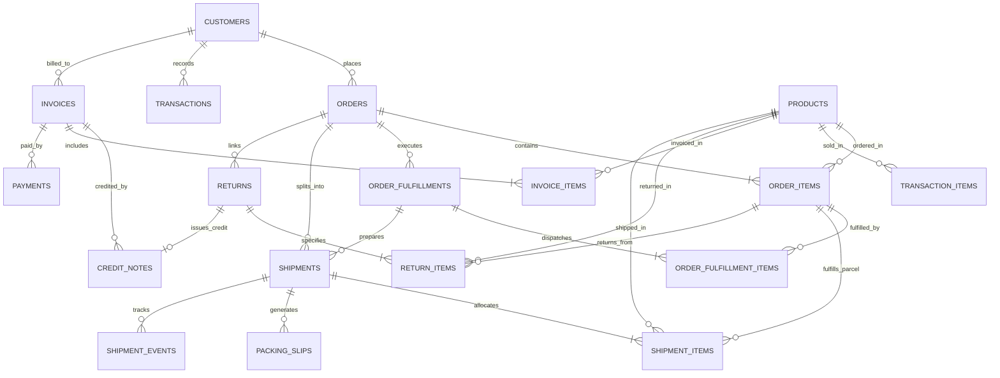
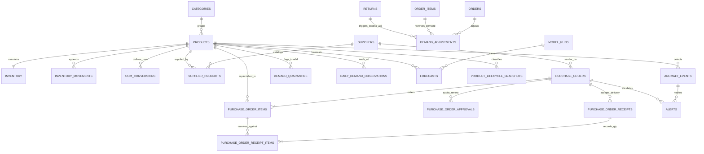

# NEXORA – Database Schema Specification

- **Project:** NEXORA – AI-Powered Retail Management & Intelligence System
- **Document Version:** 2.0 (Technical Blueprint v2.2 & `DDR-01`–`DDR-10` Alignment)
- **Updated:** 26 November 2026
- **Target Engine:** MySQL 8.x (`InnoDB`, `utf8mb4`, SQLAlchemy 2.x + Alembic)
- **Authoritative References:**
  - [NEXORA — Technical Blueprint v1.0.md](NEXORA%20%E2%80%94%20Technical%20Blueprint%20v1.0.md) (`Version 2.2 (Design Decision Resolution)`)
  - [FEATURES_STATUS.md](FEATURES_STATUS.md) (`Version 2.3`)
  - [NEXORA — Application Functionality & System Workflow Guide.md](NEXORA%20%E2%80%94%20Application%20Functionality%20%26%20System%20Workflow%20Guide.md) (`Version 1.0`)

> [!WARNING]
> **Implementation Status — `PLANNED` (Zero Live MySQL Tables on `main`):**
> No live MySQL database tables, SQLAlchemy ORM model classes, or Alembic migrations currently exist on branch `main`. Currently implemented persistence/serving consists solely of offline Phase 1 UCI CSV pipelines, committed `.joblib` model artifacts, and stateless FastAPI inference/recommendation routes. All **40 tables** specified below represent the approved target relational schema across Modules **`M01`–`M18`** and Supporting Capabilities **`SYS-01`–`SYS-04`**.

---

## 1. Database Architecture & Entity-Relationship Diagrams

### 1.1 Schema Modernization Scope & Old RBAC Removal
The previous draft schema (`v1.0`) documented a claimed `19`-table design (actually `22` SQL definitions) anchored on traditional user authentication (`roles`, `permissions`, `role_permissions`, `users` with `password_hash`) and `user_id` foreign keys. Per **Technical Blueprint v2.2**, NEXORA **has no login, passwords, sessions, JWT authentication, or server-enforced RBAC**.

All authentication and RBAC structures have been retired from this schema:
- **Removed Entities (`4`):** `roles`, `permissions`, `role_permissions`, `users`.
- **Workspace UI Context Model (`SYS-01`):** Operational interfaces organize navigation and workflow governance across four UI-only workspaces:
  1. `store_manager` (**Store Manager (Admin)**)
  2. `inventory_staff` (**Inventory Staff**)
  3. `purchase_manager` (**Purchase Manager**)
  4. `finance_staff` (**Finance Staff**)
- **Workspace Attribution vs. Verified Identity:** Operational, governance, and audit records capture non-authenticated provenance fields (`selected_workspace`, `action_source`, and optional caller-supplied `operator_ref`), **never** claiming cryptographic identity verification or endpoint access security. Future multi-user authentication remains outside the current approved scope.

### 1.2 Overview Entity-Relationship Diagram

```mermaid
erDiagram
    CATEGORIES ||--o{ PRODUCTS : categorizes
    PRODUCTS ||--|| INVENTORY : tracks
    PRODUCTS ||--o{ INVENTORY_MOVEMENTS : logs
    PRODUCTS ||--o{ UOM_CONVERSIONS : converts
    PRODUCTS ||--o{ SUPPLIER_PRODUCTS : sourced_via
    SUPPLIERS ||--o{ SUPPLIER_PRODUCTS : offers

    CUSTOMERS ||--o{ ORDERS : places
    ORDERS ||--|{ ORDER_ITEMS : contains
    ORDERS ||--o{ ORDER_FULFILLMENTS : fulfills
    ORDERS ||--o{ TRANSACTIONS : settles_as
    ORDERS ||--o{ INVOICES : bills
    ORDERS ||--o{ RETURNS : receives
    ORDERS ||--o{ SHIPMENTS : dispatches
    ORDERS ||--o{ DEMAND_ADJUSTMENTS : adjusts

    SUPPLIERS ||--o{ PURCHASE_ORDERS : supplies
    PURCHASE_ORDERS ||--|{ PURCHASE_ORDER_ITEMS : requests
    PURCHASE_ORDERS ||--o{ PURCHASE_ORDER_APPROVALS : reviews
    PURCHASE_ORDERS ||--o{ PURCHASE_ORDER_RECEIPTS : receives

    INVOICES ||--|{ INVOICE_ITEMS : details
    INVOICES ||--o{ PAYMENTS : collects
    INVOICES ||--o{ CREDIT_NOTES : offsets
    RETURNS ||--|{ RETURN_ITEMS : itemizes
    RETURNS ||--o| CREDIT_NOTES : triggers
    SHIPMENTS ||--|{ SHIPMENT_ITEMS : carries
    SHIPMENTS ||--o{ PACKING_SLIPS : prints
    SHIPMENTS ||--o{ SHIPMENT_EVENTS : logs

    PRODUCTS ||--o{ DAILY_DEMAND_OBSERVATIONS : aggregates
    PRODUCTS ||--o{ FORECASTS : projects
    MODEL_RUNS ||--o{ FORECASTS : produces
    PRODUCTS ||--o{ PRODUCT_LIFECYCLE_SNAPSHOTS : evaluates
    PRODUCTS ||--o{ ANOMALY_EVENTS : monitors
    ANOMALY_EVENTS ||--o{ ALERTS : surfaces
```



### 1.3 Domain ER View A — Retail Foundation, Orders, Fulfilment, Returns, Finance & Shipping



### 1.4 Domain ER View B — Inventory, Procurement (`DDR-09`), ML Demand (`DDR-06`) & Governance (`DDR-08`/`DDR-10`)



---

## 2. Relational Schema Groups & Architecture Mapping

The **40 InnoDB tables** organize across nine architectural groups covering all **18 Core Modules (`M01`–`M18`)** and **4 Supporting System Capabilities (`SYS-01`–`SYS-04`)**, plus `operational_settings` and supplementary normalization tables (`order_fulfillment_items`, `purchase_order_approvals`, `purchase_order_receipts`, `purchase_order_receipt_items`, `daily_demand_observations`) explicitly preserving full history and auditability:

| Schema Group | Modules / Capabilities | Tables Included (`40` Total) | Key Design Decisions Covered |
| :--- | :--- | :--- | :--- |
| **3.1 Centralized Settings** | `M08`, `M11`, `M15`, `M17`, `SYS-01` | `operational_settings` | `DDR-04`, `DDR-08`, `DDR-09`, `DDR-10` |
| **3.2 Catalog, UoM & Partners** | `M01`, `M02`, `M03` | `categories`, `products`, `uom_conversions`, `suppliers`, `supplier_products`, `customers` | `DDR-01`, `DDR-04`, `DDR-06`, `DDR-07`, `EXCL-08` |
| **3.3 Orders, Fulfilment & Sales** | `M04`, `M05`, `M06` | `orders`, `order_items`, `order_fulfillments`, `order_fulfillment_items`, `transactions`, `transaction_items` | `DDR-03`, `DDR-04`, `DDR-05`, `DDR-06`, `DDR-10` |
| **3.4 Inventory & Stock Ledger** | `M09`, `M10` | `inventory`, `inventory_movements` | `DDR-02`, `DDR-03`, `DDR-05`, `DDR-10` |
| **3.5 Procurement & Tiered Approval** | `M11`, `M02` | `purchase_orders`, `purchase_order_items`, `purchase_order_approvals`, `purchase_order_receipts`, `purchase_order_receipt_items` | `DDR-01`, `DDR-02`, `DDR-07`, `DDR-09`, `EXCL-03` |
| **3.6 Returns & Billing Finance** | `M16`, `M17` | `invoices`, `invoice_items`, `payments`, `returns`, `return_items`, `credit_notes` | `DDR-04`, `DDR-06`, `DDR-10`, `EXCL-01` |
| **3.7 Internal Shipping & Split Delivery** | `M18` | `shipments`, `shipment_items`, `packing_slips`, `shipment_events` | `DDR-05`, `EXCL-02` |
| **3.8 Demand ML, Lifecycle & Anomalies** | `M07`, `M08`, `M12`, `M13`, `M14`, `M15`, `SYS-03` | `demand_adjustments`, `demand_quarantine`, `daily_demand_observations`, `model_runs`, `forecasts`, `product_lifecycle_snapshots`, `anomaly_events`, `alerts` | `DDR-01`, `DDR-06`, `DDR-08`, `DDR-09` |
| **3.9 Centralized Audit & Outbox** | `SYS-02`, `SYS-04` | `audit_logs`, `audit_outbox` | `DDR-10` |

### 2.1 Attribution Columns Across Tables (`SYS-01` & `DDR-10` — No Auth RBAC)
Because NEXORA excludes user accounts and authentication, tables never contain `users.id` foreign keys or credential columns. Instead:
- **`selected_workspace`** (`ENUM('store_manager', 'inventory_staff', 'purchase_manager', 'finance_staff')`, nullable on system/batch rows) records the UI workspace selected when an operation ran (`X-NEXORA-Workspace`).
- **`action_source`** (`ENUM('UI', 'API', 'SYSTEM', 'ML_ENGINE')`) records invocation origin.
- **`operator_ref`** (`VARCHAR(64) NULL`) optionally records caller-supplied reference strings (explicitly supplied during governance/config changes when available; `NULL` when omitted; never treated as authenticated identity).

---

## 3. Complete Table Definitions (MySQL 8.x `InnoDB`)

> [!NOTE]
> **Schema Conventions:**
> - **Data Types:** Identifiers use `BIGINT UNSIGNED` (`AUTO_INCREMENT` PKs). Money uses `DECIMAL(10, 2)` (unit prices/costs) or `DECIMAL(12, 2)` (subtotals, tax, totals, payments, credits, limits). Precision weights/UoM conversions use `DECIMAL(12, 6)` or `DECIMAL(14, 4)`. Booleans use `BOOLEAN` (`TINYINT(1)` alias in MySQL 8.x). Zero `FLOAT` or `DOUBLE` columns exist.
> - **Master Data vs. Snapshot Fields:** Master tables (`products`, `suppliers`, `customers`, `operational_settings`) hold mutable current reference values (`is_active`, `current_unit_price`, `tax_rate`). Transactional child/document tables (`order_items`, `purchase_orders`, `invoices`, `credit_notes`, `demand_adjustments`, `product_lifecycle_snapshots`, `anomaly_events`) capture **immutable point-in-time snapshots** (`unit_price`, `base_uom_conversion_factor`, `tax_rate`, `billing_snapshot`, `applied_tier1_limit`) so subsequent master/config edits never rewrite history.
> - **Referential Integrity Default:** Parent-child operational and financial FKs enforce `ON DELETE RESTRICT` so historical records cannot be dropped silently.

---

### 3.1 Group 1 — Centralized Settings

#### `operational_settings`
- **Purpose:** Centralized, bounded configuration store governing default currency, store tax rate (`DDR-04`), lifecycle & hybrid anomaly bounds (`DDR-08`), and procurement Tier 1 spending limits / anti-split windows (`DDR-09`), with reset-to-default and Tier 1 fail-closed auditing (`DDR-10`).
- **Primary Key:** `id` (`BIGINT UNSIGNED`).
- **Foreign Keys:** None.
- **Unique Constraints:** `uq_operational_settings_key` (`setting_key`).
- **Snapshot vs. Master:** Current live master configuration; changes apply prospectively only while transactional rows and `audit_logs` preserve historical values.
- **Referential Integrity & Deletion:** System-seeded settings rows must never be deleted during normal operations; updated via Tier 1 audited Store Manager (`Admin`) actions.

```sql
CREATE TABLE operational_settings (
    id BIGINT UNSIGNED AUTO_INCREMENT PRIMARY KEY,
    setting_key VARCHAR(100) NOT NULL,
    setting_value VARCHAR(255) NOT NULL,
    default_value VARCHAR(255) NOT NULL,
    min_bound DECIMAL(14, 4) NULL,
    max_bound DECIMAL(14, 4) NULL,
    value_type ENUM('DECIMAL', 'INTEGER', 'STRING', 'BOOLEAN', 'JSON') NOT NULL,
    domain ENUM('finance', 'lifecycle', 'anomaly', 'procurement', 'inventory') NOT NULL,
    description VARCHAR(255) NOT NULL,
    updated_workspace ENUM('store_manager', 'inventory_staff', 'purchase_manager', 'finance_staff') NULL,
    updated_source ENUM('UI', 'API', 'SYSTEM', 'ML_ENGINE') NOT NULL DEFAULT 'SYSTEM',
    operator_ref VARCHAR(64) NULL,
    updated_at DATETIME(6) NOT NULL DEFAULT CURRENT_TIMESTAMP(6) ON UPDATE CURRENT_TIMESTAMP(6),
    CONSTRAINT uq_operational_settings_key UNIQUE (setting_key),
    CONSTRAINT chk_op_settings_bounds CHECK (min_bound IS NULL OR max_bound IS NULL OR min_bound <= max_bound),
    INDEX idx_op_settings_domain (domain)
) ENGINE=InnoDB DEFAULT CHARSET=utf8mb4 COLLATE=utf8mb4_unicode_ci;
```

*Core Seeded Configuration Keys:* `default_operational_currency` (`'INR'`), `store_tax_rate` (`DECIMAL`, bounds `0.00`–`50.00`), `po_tier1_approval_limit` (`DECIMAL`, `> 0`), `po_split_window_days` (`INTEGER`, `1`–`90`), `po_split_count_threshold` (`INTEGER`, `>= 2`), `lifecycle_hysteresis_windows` (`INTEGER`), `lifecycle_inactivity_days` (`INTEGER`), `anomaly_rolling_window_days` (`INTEGER`), `anomaly_z_threshold` (`DECIMAL`), `anomaly_price_variance_pct` (`DECIMAL`).

---

### 3.2 Group 2 — Retail Foundation, UoM Conversions & Sourcing (`M01`–`M03`)

#### `categories`
- **Purpose:** Product catalog grouping taxonomy (`M01`) supporting catalog filtering, BI aggregation (`M06`), and seasonality analysis (`M07`).
- **Primary Key:** `id` (`BIGINT UNSIGNED`).
- **Foreign Keys:** None.
- **Unique Constraints:** `uq_categories_name` (`name`).
- **Snapshot vs. Master:** Live catalog metadata.
- **Referential Integrity & Deletion:** Soft-deactivate via `is_active = FALSE`; referenced categories cannot be hard-deleted (`ON DELETE RESTRICT` on `products.category_id`).

```sql
CREATE TABLE categories (
    id BIGINT UNSIGNED AUTO_INCREMENT PRIMARY KEY,
    name VARCHAR(100) NOT NULL,
    description VARCHAR(255) NULL,
    is_active BOOLEAN NOT NULL DEFAULT TRUE,
    created_at DATETIME NOT NULL DEFAULT CURRENT_TIMESTAMP,
    updated_at DATETIME NOT NULL DEFAULT CURRENT_TIMESTAMP ON UPDATE CURRENT_TIMESTAMP,
    CONSTRAINT uq_categories_name UNIQUE (name),
    INDEX idx_categories_active (is_active)
) ENGINE=InnoDB DEFAULT CHARSET=utf8mb4 COLLATE=utf8mb4_unicode_ci;
```

#### `products`
- **Purpose:** Authoritative master catalog of SKUs (`M01`), unit prices (`INR` operational default), base unit of measure (`base_uom`), UCI provenance indicator, and current `DDR-08` lifecycle stage—strictly decoupled from volatile warehouse counts (`inventory`).
- **Primary Key:** `id` (`BIGINT UNSIGNED`).
- **Foreign Keys:** `category_id` → `categories(id)` (`ON DELETE RESTRICT`).
- **Unique Constraints:** `uq_products_stock_code` (`stock_code`).
- **Check Constraints:** `current_unit_price >= 0.00`, valid `lifecycle_stage` enum (`'Introduction'`, `'Growth'`, `'Maturity'`, `'Decline'`, `'Discontinued'`).
- **Snapshot vs. Master:** Live commercial master data; price edits update future drafts only without mutating existing orders/invoices/sales.
- **Referential Integrity & Deletion:** Hard deletion blocked once referenced; use `is_active = FALSE` (soft-deactivation). `lifecycle_stage = 'Discontinued'` requires an explicit authorized manual change (`DDR-08`).

```sql
CREATE TABLE products (
    id BIGINT UNSIGNED AUTO_INCREMENT PRIMARY KEY,
    stock_code VARCHAR(50) NOT NULL,
    description VARCHAR(255) NOT NULL,
    category_id BIGINT UNSIGNED NULL,
    base_uom VARCHAR(32) NOT NULL DEFAULT 'unit',
    current_unit_price DECIMAL(10, 2) NOT NULL DEFAULT 0.00,
    currency_code CHAR(3) NOT NULL DEFAULT 'INR',
    lifecycle_stage ENUM('Introduction', 'Growth', 'Maturity', 'Decline', 'Discontinued') NOT NULL DEFAULT 'Introduction',
    is_uci_baseline BOOLEAN NOT NULL DEFAULT FALSE,
    is_active BOOLEAN NOT NULL DEFAULT TRUE,
    created_at DATETIME NOT NULL DEFAULT CURRENT_TIMESTAMP,
    updated_at DATETIME NOT NULL DEFAULT CURRENT_TIMESTAMP ON UPDATE CURRENT_TIMESTAMP,
    CONSTRAINT uq_products_stock_code UNIQUE (stock_code),
    CONSTRAINT fk_products_category FOREIGN KEY (category_id) REFERENCES categories(id) ON DELETE RESTRICT,
    CONSTRAINT chk_products_price_nonneg CHECK (current_unit_price >= 0.00),
    INDEX idx_products_category_active (category_id, is_active),
    INDEX idx_products_lifecycle (lifecycle_stage),
    INDEX idx_products_uci (is_uci_baseline)
) ENGINE=InnoDB DEFAULT CHARSET=utf8mb4 COLLATE=utf8mb4_unicode_ci;
```

#### `uom_conversions`
- **Purpose:** Stores historically traceable, product-specific Unit-of-Measure conversion factors (`uom_code` → `products.base_uom`) supporting B2B case/pack ordering and accurate ML base-unit demand aggregation (`DDR-06`, `M01`, `M05`, `M12`).
- **Primary Key:** `id` (`BIGINT UNSIGNED`).
- **Foreign Keys:** `product_id` → `products(id)` (`ON DELETE RESTRICT`).
- **Unique Constraints:** `uq_uom_product_code_eff` (`product_id`, `uom_code`, `effective_from`).
- **Check Constraints:** `conversion_to_base > 0.000000`, `effective_to IS NULL OR effective_to >= effective_from`.
- **Snapshot vs. Master:** Versioned effective-date rules; inactive or superseded rows are preserved permanently so historical `order_items` and demand aggregates remain verifiable.
- **Referential Integrity & Deletion:** Retain permanently (`ON DELETE RESTRICT`); deactivate expired mappings via `is_active = FALSE` and `effective_to`.

```sql
CREATE TABLE uom_conversions (
    id BIGINT UNSIGNED AUTO_INCREMENT PRIMARY KEY,
    product_id BIGINT UNSIGNED NOT NULL,
    uom_code VARCHAR(32) NOT NULL,
    conversion_to_base DECIMAL(12, 6) NOT NULL,
    effective_from DATETIME NOT NULL DEFAULT CURRENT_TIMESTAMP,
    effective_to DATETIME NULL,
    is_active BOOLEAN NOT NULL DEFAULT TRUE,
    created_at DATETIME NOT NULL DEFAULT CURRENT_TIMESTAMP,
    CONSTRAINT uq_uom_product_code_eff UNIQUE (product_id, uom_code, effective_from),
    CONSTRAINT fk_uom_product FOREIGN KEY (product_id) REFERENCES products(id) ON DELETE RESTRICT,
    CONSTRAINT chk_uom_factor_pos CHECK (conversion_to_base > 0.000000),
    CONSTRAINT chk_uom_effective_window CHECK (effective_to IS NULL OR effective_to >= effective_from),
    INDEX idx_uom_lookup (product_id, uom_code, is_active, effective_from)
) ENGINE=InnoDB DEFAULT CHARSET=utf8mb4 COLLATE=utf8mb4_unicode_ci;
```

#### `suppliers`
- **Purpose:** Vendor directory (`M02`) providing vendor contact profiles and optional supplier-level fallback `lead_time_days` when product-specific `supplier_products.lead_time_days` is unset (`DDR-01`, `DDR-07`).
- **Primary Key:** `id` (`BIGINT UNSIGNED`).
- **Foreign Keys:** None.
- **Check Constraints:** `lead_time_days IS NULL OR (lead_time_days BETWEEN 1 AND 365)` (strictly nullable; **never fabricated** with a synthetic default when unknown per `DDR-01`).
- **Snapshot vs. Master:** Live vendor master data; historical POs and historical `supplier_products` mappings remain unchanged if vendor details change later.
- **Referential Integrity & Deletion:** Soft-deactivate via `is_active = FALSE`; referenced suppliers cannot be deleted (`ON DELETE RESTRICT`).

```sql
CREATE TABLE suppliers (
    id BIGINT UNSIGNED AUTO_INCREMENT PRIMARY KEY,
    supplier_name VARCHAR(150) NOT NULL,
    contact_person VARCHAR(100) NULL,
    email VARCHAR(255) NULL,
    phone VARCHAR(50) NULL,
    address TEXT NULL,
    lead_time_days INT NULL,
    is_active BOOLEAN NOT NULL DEFAULT TRUE,
    created_at DATETIME NOT NULL DEFAULT CURRENT_TIMESTAMP,
    updated_at DATETIME NOT NULL DEFAULT CURRENT_TIMESTAMP ON UPDATE CURRENT_TIMESTAMP,
    CONSTRAINT chk_suppliers_lt CHECK (lead_time_days IS NULL OR (lead_time_days BETWEEN 1 AND 365)),
    INDEX idx_suppliers_name_active (supplier_name, is_active)
) ENGINE=InnoDB DEFAULT CHARSET=utf8mb4 COLLATE=utf8mb4_unicode_ci;
```

#### `supplier_products`
- **Purpose:** Explicit many-to-many supplier-product sourcing table (`DDR-07`) holding supplier SKU part numbers, vendor purchase prices (`DECIMAL`), product-specific lead times (`DDR-01` primary priority), minimum order quantities (MOQs), preferred vendor indicators, and soft-deactivation history.
- **Primary Key:** `id` (`BIGINT UNSIGNED`).
- **Foreign Keys:** `supplier_id` → `suppliers(id)` (`ON DELETE RESTRICT`), `product_id` → `products(id)` (`ON DELETE RESTRICT`).
- **Unique Constraints:** `uq_supplier_product_pair` (`supplier_id`, `product_id`).
- **Check Constraints:** `purchase_price >= 0.00`, `lead_time_days IS NULL OR (lead_time_days BETWEEN 1 AND 365)`, `minimum_order_quantity >= 1`.
- **Snapshot vs. Master:** Master sourcing contract terms; deactivated pairs (`is_active = FALSE`) **must be retained permanently** for historical cost and anomaly comparison (`M15`, `DDR-07`, `DDR-09`).
- **Referential Integrity & Deletion:** Soft-deactivate (`is_active = FALSE`); never hard-deleted once historical POs or cost references exist.

```sql
CREATE TABLE supplier_products (
    id BIGINT UNSIGNED AUTO_INCREMENT PRIMARY KEY,
    supplier_id BIGINT UNSIGNED NOT NULL,
    product_id BIGINT UNSIGNED NOT NULL,
    supplier_product_code VARCHAR(64) NULL,
    purchase_price DECIMAL(10, 2) NOT NULL,
    currency_code CHAR(3) NOT NULL DEFAULT 'INR',
    lead_time_days INT NULL,
    minimum_order_quantity INT NOT NULL DEFAULT 1,
    is_preferred BOOLEAN NOT NULL DEFAULT FALSE,
    is_active BOOLEAN NOT NULL DEFAULT TRUE,
    created_at DATETIME NOT NULL DEFAULT CURRENT_TIMESTAMP,
    updated_at DATETIME NOT NULL DEFAULT CURRENT_TIMESTAMP ON UPDATE CURRENT_TIMESTAMP,
    CONSTRAINT uq_supplier_product_pair UNIQUE (supplier_id, product_id),
    CONSTRAINT fk_sp_supplier FOREIGN KEY (supplier_id) REFERENCES suppliers(id) ON DELETE RESTRICT,
    CONSTRAINT fk_sp_product FOREIGN KEY (product_id) REFERENCES products(id) ON DELETE RESTRICT,
    CONSTRAINT chk_sp_price CHECK (purchase_price >= 0.00),
    CONSTRAINT chk_sp_lt CHECK (lead_time_days IS NULL OR (lead_time_days BETWEEN 1 AND 365)),
    CONSTRAINT chk_sp_moq CHECK (minimum_order_quantity >= 1),
    INDEX idx_sp_product_pref_active (product_id, is_preferred, is_active),
    INDEX idx_sp_supplier_active (supplier_id, is_active)
) ENGINE=InnoDB DEFAULT CHARSET=utf8mb4 COLLATE=utf8mb4_unicode_ci;
```

#### `customers`
- **Purpose:** Manually entered customer directory (`M03`) supporting operational B2B/store orders (`M05`), invoice generation (`M17`), and internal dispatch destinations (`M18`), cleanly avoiding automated address scraping from historical UCI records (`EXCL-08`).
- **Primary Key:** `id` (`BIGINT UNSIGNED`).
- **Foreign Keys:** None.
- **Snapshot vs. Master:** Mutable customer master profile; completed invoices freeze a `billing_snapshot` JSON copy and shipments freeze `shipping_address` text so profile updates never mutate past financial or shipping documents.
- **Referential Integrity & Deletion:** Soft-deactivate via `is_active = FALSE`; referenced customers cannot be deleted (`ON DELETE RESTRICT`).

```sql
CREATE TABLE customers (
    id BIGINT UNSIGNED AUTO_INCREMENT PRIMARY KEY,
    uci_customer_ref VARCHAR(64) NULL,
    customer_name VARCHAR(150) NOT NULL,
    phone VARCHAR(50) NULL,
    email VARCHAR(255) NULL,
    billing_address TEXT NOT NULL,
    shipping_address TEXT NULL,
    city VARCHAR(100) NOT NULL,
    state VARCHAR(100) NULL,
    postal_code VARCHAR(20) NOT NULL,
    country VARCHAR(100) NOT NULL DEFAULT 'India',
    is_active BOOLEAN NOT NULL DEFAULT TRUE,
    created_at DATETIME NOT NULL DEFAULT CURRENT_TIMESTAMP,
    updated_at DATETIME NOT NULL DEFAULT CURRENT_TIMESTAMP ON UPDATE CURRENT_TIMESTAMP,
    INDEX idx_customers_name_active (customer_name, is_active),
    INDEX idx_customers_uci_ref (uci_customer_ref),
    INDEX idx_customers_country (country)
) ENGINE=InnoDB DEFAULT CHARSET=utf8mb4 COLLATE=utf8mb4_unicode_ci;
```

---

### 3.3 Group 3 — Orders, Reservations, Fulfilment & Sales (`M04`, `M05`, `M06`)

#### `orders`
- **Purpose:** Controls the customer/B2B order lifecycle (`M05`), separating unconfirmed requests (`draft`/`pending`) from validated confirmed demand (`confirmed`), idempotent partial/full fulfillment (`partially_fulfilled`/`fulfilled`), and `cancelled`. Establishes confirmed B2B demand timed strictly by `requested_delivery_date` (or `DATE(created_at)` when immediate) (`DDR-03`, `DDR-05`, `DDR-06`).
- **Primary Key:** `id` (`BIGINT UNSIGNED`).
- **Foreign Keys:** `customer_id` → `customers(id)` (`ON DELETE RESTRICT`).
- **Unique Constraints:** `uq_orders_number` (`order_number`).
- **Check Constraints:** `subtotal >= 0.00`, valid `order_status` & `order_demand_type` enums.
- **Censoring Rule (`DDR-06`):** Order confirmation strictly validates `Available Stock >= quantity`; insufficient stock blocks confirmation (`409`) without bypassing validation. `is_censored_demand` identifies constrained demand observations for downstream ML/anomaly awareness (`M12`, `M15`) rather than permitting unbacked order confirmation or auto-creating sales.
- **Referential Integrity & Deletion:** Never deleted once recorded; lifecycle closes via `cancelled` or completion.

```sql
CREATE TABLE orders (
    id BIGINT UNSIGNED AUTO_INCREMENT PRIMARY KEY,
    order_number VARCHAR(64) NOT NULL,
    customer_id BIGINT UNSIGNED NOT NULL,
    order_status ENUM('draft', 'pending', 'confirmed', 'partially_fulfilled', 'fulfilled', 'cancelled') NOT NULL DEFAULT 'draft',
    order_demand_type ENUM('recurring_replenishment', 'one_time_bulk', 'contract', 'tender') NOT NULL DEFAULT 'recurring_replenishment',
    requested_delivery_date DATE NULL,
    is_censored_demand BOOLEAN NOT NULL DEFAULT FALSE,
    inventory_deducted BOOLEAN NOT NULL DEFAULT FALSE,
    currency_code CHAR(3) NOT NULL DEFAULT 'INR',
    subtotal DECIMAL(12, 2) NOT NULL DEFAULT 0.00,
    notes TEXT NULL,
    selected_workspace ENUM('store_manager', 'inventory_staff', 'purchase_manager', 'finance_staff') NULL,
    operator_ref VARCHAR(64) NULL,
    confirmed_at DATETIME NULL,
    cancelled_at DATETIME NULL,
    created_at DATETIME NOT NULL DEFAULT CURRENT_TIMESTAMP,
    updated_at DATETIME NOT NULL DEFAULT CURRENT_TIMESTAMP ON UPDATE CURRENT_TIMESTAMP,
    CONSTRAINT uq_orders_number UNIQUE (order_number),
    CONSTRAINT fk_orders_customer FOREIGN KEY (customer_id) REFERENCES customers(id) ON DELETE RESTRICT,
    CONSTRAINT chk_orders_subtotal CHECK (subtotal >= 0.00),
    INDEX idx_orders_status_date (order_status, created_at),
    INDEX idx_orders_demand_timing (order_status, order_demand_type, requested_delivery_date, created_at),
    INDEX idx_orders_customer (customer_id)
) ENGINE=InnoDB DEFAULT CHARSET=utf8mb4 COLLATE=utf8mb4_unicode_ci;
```

#### `order_items`
- **Purpose:** Individual SKU order lines tracking requested/confirmed `quantity`, cumulative `fulfilled_quantity` across multiple partial batches (`DDR-05`), and point-in-time `uom_code` / `base_uom_conversion_factor` snapshots (`DDR-06`).
- **Primary Key:** `id` (`BIGINT UNSIGNED`).
- **Foreign Keys:** `order_id` → `orders(id)`, `product_id` → `products(id)` (`ON DELETE RESTRICT`).
- **Check Constraints:** `quantity > 0`, `0 <= fulfilled_quantity <= quantity`, `base_uom_conversion_factor > 0`, `base_uom_quantity > 0`, `unit_price >= 0.00`, `line_total >= 0.00`.
- **Snapshot vs. Master:** `unit_price`, `uom_code`, `base_uom_conversion_factor`, and `base_uom_quantity` freeze values at order confirmation/entry so later catalog or UoM edits never rewrite existing order economics or historical demand conversions.

```sql
CREATE TABLE order_items (
    id BIGINT UNSIGNED AUTO_INCREMENT PRIMARY KEY,
    order_id BIGINT UNSIGNED NOT NULL,
    product_id BIGINT UNSIGNED NOT NULL,
    quantity INT NOT NULL,
    fulfilled_quantity INT NOT NULL DEFAULT 0,
    uom_code VARCHAR(32) NOT NULL DEFAULT 'unit',
    base_uom_conversion_factor DECIMAL(12, 6) NOT NULL DEFAULT 1.000000,
    base_uom_quantity DECIMAL(14, 4) NOT NULL,
    unit_price DECIMAL(10, 2) NOT NULL,
    line_total DECIMAL(12, 2) NOT NULL,
    CONSTRAINT fk_order_items_order FOREIGN KEY (order_id) REFERENCES orders(id) ON DELETE RESTRICT,
    CONSTRAINT fk_order_items_product FOREIGN KEY (product_id) REFERENCES products(id) ON DELETE RESTRICT,
    CONSTRAINT chk_oi_qty CHECK (quantity > 0),
    CONSTRAINT chk_oi_fulfilled CHECK (fulfilled_quantity >= 0 AND fulfilled_quantity <= quantity),
    CONSTRAINT chk_oi_uom_factor CHECK (base_uom_conversion_factor > 0.000000),
    CONSTRAINT chk_oi_base_qty CHECK (base_uom_quantity > 0.0000),
    CONSTRAINT chk_oi_price CHECK (unit_price >= 0.00),
    CONSTRAINT chk_oi_total CHECK (line_total >= 0.00),
    INDEX idx_oi_order (order_id),
    INDEX idx_oi_product (product_id)
) ENGINE=InnoDB DEFAULT CHARSET=utf8mb4 COLLATE=utf8mb4_unicode_ci;
```

#### `order_fulfillments`
- **Purpose:** Records each distinct fulfillment batch executed against an order (`1:N` batches per order), enforcing **idempotent stock deduction (`DDR-05`)** via unique `idempotency_key` so retries or double-clicks can never deduct `Physical` or `Reserved` stock twice.
- **Primary Key:** `id` (`BIGINT UNSIGNED`).
- **Foreign Keys:** `order_id` → `orders(id)` (`ON DELETE RESTRICT`).
- **Unique Constraints:** `uq_fulfillments_number` (`fulfillment_number`), `uq_fulfillments_idempotency` (`idempotency_key`).
- **Referential Integrity & Deletion:** Immutable execution record (`ON DELETE RESTRICT`).

```sql
CREATE TABLE order_fulfillments (
    id BIGINT UNSIGNED AUTO_INCREMENT PRIMARY KEY,
    order_id BIGINT UNSIGNED NOT NULL,
    fulfillment_number VARCHAR(64) NOT NULL,
    idempotency_key VARCHAR(128) NOT NULL,
    fulfillment_status ENUM('completed', 'reversed') NOT NULL DEFAULT 'completed',
    selected_workspace ENUM('store_manager', 'inventory_staff', 'purchase_manager', 'finance_staff') NULL,
    operator_ref VARCHAR(64) NULL,
    notes VARCHAR(255) NULL,
    fulfilled_at DATETIME(6) NOT NULL DEFAULT CURRENT_TIMESTAMP(6),
    CONSTRAINT uq_fulfillments_number UNIQUE (fulfillment_number),
    CONSTRAINT uq_fulfillments_idempotency UNIQUE (idempotency_key),
    CONSTRAINT fk_fulfillments_order FOREIGN KEY (order_id) REFERENCES orders(id) ON DELETE RESTRICT,
    INDEX idx_fulfillments_order_time (order_id, fulfilled_at)
) ENGINE=InnoDB DEFAULT CHARSET=utf8mb4 COLLATE=utf8mb4_unicode_ci;
```

#### `order_fulfillment_items`
- **Purpose:** Line-level quantities physically fulfilled inside a specific `order_fulfillments` batch, directly anchoring cumulative `order_items.fulfilled_quantity`, `inventory_movements` deductions, and `1:N` split `shipment_items` allocation (`DDR-05`).
- **Primary Key:** `id` (`BIGINT UNSIGNED`).
- **Foreign Keys:** `order_fulfillment_id` → `order_fulfillments(id)`, `order_item_id` → `order_items(id)`, `product_id` → `products(id)` (`ON DELETE RESTRICT`).
- **Unique Constraints:** `uq_fulfill_batch_item` (`order_fulfillment_id`, `order_item_id`).
- **Check Constraints:** `quantity_fulfilled > 0`.

```sql
CREATE TABLE order_fulfillment_items (
    id BIGINT UNSIGNED AUTO_INCREMENT PRIMARY KEY,
    order_fulfillment_id BIGINT UNSIGNED NOT NULL,
    order_item_id BIGINT UNSIGNED NOT NULL,
    product_id BIGINT UNSIGNED NOT NULL,
    quantity_fulfilled INT NOT NULL,
    CONSTRAINT uq_fulfill_batch_item UNIQUE (order_fulfillment_id, order_item_id),
    CONSTRAINT fk_ofi_fulfillment FOREIGN KEY (order_fulfillment_id) REFERENCES order_fulfillments(id) ON DELETE RESTRICT,
    CONSTRAINT fk_ofi_order_item FOREIGN KEY (order_item_id) REFERENCES order_items(id) ON DELETE RESTRICT,
    CONSTRAINT fk_ofi_product FOREIGN KEY (product_id) REFERENCES products(id) ON DELETE RESTRICT,
    CONSTRAINT chk_ofi_qty CHECK (quantity_fulfilled > 0),
    INDEX idx_ofi_order_item (order_item_id)
) ENGINE=InnoDB DEFAULT CHARSET=utf8mb4 COLLATE=utf8mb4_unicode_ci;
```

#### `transactions` *(Realized Commercial Sales)*
- **Purpose:** Immutable commercial sales registry (`M04`) unifying read-only historical UCI baselines (`source_origin = 'uci_historical'`, `GBP`) with live store sales (`source_origin = 'operational'`, `INR` default per `DDR-04`), strictly isolating stream classes (`standard`, `cancellation`, `return`, `exceptional`) and keeping realized sales/revenue distinct from `orders` confirmed demand timing (`DDR-06`).
- **Primary Key:** `id` (`BIGINT UNSIGNED`).
- **Foreign Keys:** `order_id` → `orders(id)` (nullable for UCI / counter sales), `order_fulfillment_id` → `order_fulfillments(id)` (nullable), `customer_id` → `customers(id)` (nullable for historical UCI rows lacking customer IDs) — all `ON DELETE RESTRICT`.
- **Snapshot vs. Master:** Freezes transaction currency, applied tax rate/amount (`DDR-04`), and status permanently; reversals change status/compensating entries without destroying historical rows.
- **Referential Integrity & Deletion:** Permanently retained (`ON DELETE RESTRICT`).

```sql
CREATE TABLE transactions (
    id BIGINT UNSIGNED AUTO_INCREMENT PRIMARY KEY,
    invoice_number VARCHAR(64) NOT NULL,
    order_id BIGINT UNSIGNED NULL,
    order_fulfillment_id BIGINT UNSIGNED NULL,
    customer_id BIGINT UNSIGNED NULL,
    uci_customer_ref VARCHAR(64) NULL,
    transaction_date DATETIME NOT NULL,
    country VARCHAR(100) NOT NULL DEFAULT 'India',
    transaction_type ENUM('standard', 'cancellation', 'return', 'exceptional') NOT NULL DEFAULT 'standard',
    source_origin ENUM('uci_historical', 'operational') NOT NULL DEFAULT 'operational',
    currency_code CHAR(3) NOT NULL DEFAULT 'INR',
    tax_rate DECIMAL(5, 2) NOT NULL DEFAULT 0.00,
    tax_amount DECIMAL(12, 2) NOT NULL DEFAULT 0.00,
    total_amount DECIMAL(12, 2) NOT NULL,
    status ENUM('completed', 'cancelled', 'reversed') NOT NULL DEFAULT 'completed',
    selected_workspace ENUM('store_manager', 'inventory_staff', 'purchase_manager', 'finance_staff') NULL,
    operator_ref VARCHAR(64) NULL,
    created_at DATETIME NOT NULL DEFAULT CURRENT_TIMESTAMP,
    CONSTRAINT fk_trans_order FOREIGN KEY (order_id) REFERENCES orders(id) ON DELETE RESTRICT,
    CONSTRAINT fk_trans_fulfillment FOREIGN KEY (order_fulfillment_id) REFERENCES order_fulfillments(id) ON DELETE RESTRICT,
    CONSTRAINT fk_trans_customer FOREIGN KEY (customer_id) REFERENCES customers(id) ON DELETE RESTRICT,
    CONSTRAINT chk_trans_tax_rate CHECK (tax_rate >= 0.00),
    INDEX idx_trans_invoice (invoice_number),
    INDEX idx_trans_date_origin (transaction_date, source_origin, transaction_type),
    INDEX idx_trans_order (order_id),
    INDEX idx_trans_country (country),
    INDEX idx_trans_customer (customer_id)
) ENGINE=InnoDB DEFAULT CHARSET=utf8mb4 COLLATE=utf8mb4_unicode_ci;
```

#### `transaction_items`
- **Purpose:** Line-item sale amounts preserving exact `unit_price` (`DECIMAL(10, 2)`) and `line_total` (`DECIMAL(12, 2)`). Allows negative values strictly for historical UCI `'cancellation'` / `'return'` / `'exceptional'` (`Adjust bad debt`) stream fidelity while operational services enforce positive unit prices on `'standard'` commercial sales.
- **Primary Key:** `id` (`BIGINT UNSIGNED`).
- **Foreign Keys:** `transaction_id` → `transactions(id)`, `order_item_id` → `order_items(id)` (nullable), `product_id` → `products(id)` (`ON DELETE RESTRICT`).
- **Check Constraints:** `quantity <> 0`.

```sql
CREATE TABLE transaction_items (
    id BIGINT UNSIGNED AUTO_INCREMENT PRIMARY KEY,
    transaction_id BIGINT UNSIGNED NOT NULL,
    order_item_id BIGINT UNSIGNED NULL,
    product_id BIGINT UNSIGNED NOT NULL,
    quantity INT NOT NULL,
    unit_price DECIMAL(10, 2) NOT NULL,
    line_total DECIMAL(12, 2) NOT NULL,
    CONSTRAINT fk_ti_transaction FOREIGN KEY (transaction_id) REFERENCES transactions(id) ON DELETE RESTRICT,
    CONSTRAINT fk_ti_order_item FOREIGN KEY (order_item_id) REFERENCES order_items(id) ON DELETE RESTRICT,
    CONSTRAINT fk_ti_product FOREIGN KEY (product_id) REFERENCES products(id) ON DELETE RESTRICT,
    CONSTRAINT chk_ti_qty_nonzero CHECK (quantity <> 0),
    INDEX idx_ti_transaction (transaction_id),
    INDEX idx_ti_product (product_id)
) ENGINE=InnoDB DEFAULT CHARSET=utf8mb4 COLLATE=utf8mb4_unicode_ci;
```

---

### 3.4 Group 4 — Inventory Control & Immutable Movement Ledger (`M09`, `M10`)

#### `inventory`
- **Purpose:** Authoritative live MySQL stock state (`1:1` per product, `M09`), cleanly separating **`Physical Stock`** (`current_quantity`), **`Reserved Stock`** (`reserved_quantity`), and derived **`Available Stock`** (`current_quantity - reserved_quantity`), paired with safety parameters (`minimum_stock`, `safety_factor = 1.20` default per `DDR-01`).
- **Primary Key:** `id` (`BIGINT UNSIGNED`).
- **Foreign Keys:** `product_id` → `products(id)` (`ON DELETE RESTRICT`).
- **Unique Constraints:** `uq_inventory_product` (`product_id`).
- **Check Constraints (`DDR-03`):**
  - `current_quantity >= 0` (`Physical Stock >= 0`)
  - `reserved_quantity >= 0` (`Reserved Stock >= 0`)
  - `reserved_quantity <= current_quantity` (`Available Stock >= 0`)
  - `minimum_stock >= 0`
  - `safety_factor >= 1.00`
- **Derived Metrics (Computed / SQL View — Never Stored Duplicate Columns):**
  - `Available Stock = current_quantity - reserved_quantity` (`DDR-03`)
  - `Incoming Stock = SUM(GREATEST(0, ordered_quantity - received_quantity))` strictly across `purchase_orders.order_status IN ('approved', 'partially_received')` (`DDR-02`)
  - `Projected Available Stock = Available Stock + Incoming Stock` (`DDR-02`, `DDR-03`)

```sql
CREATE TABLE inventory (
    id BIGINT UNSIGNED AUTO_INCREMENT PRIMARY KEY,
    product_id BIGINT UNSIGNED NOT NULL,
    current_quantity INT NOT NULL DEFAULT 0,
    reserved_quantity INT NOT NULL DEFAULT 0,
    minimum_stock INT NOT NULL DEFAULT 10,
    safety_factor DECIMAL(4, 2) NOT NULL DEFAULT 1.20,
    updated_at DATETIME(6) NOT NULL DEFAULT CURRENT_TIMESTAMP(6) ON UPDATE CURRENT_TIMESTAMP(6),
    CONSTRAINT uq_inventory_product UNIQUE (product_id),
    CONSTRAINT fk_inventory_product FOREIGN KEY (product_id) REFERENCES products(id) ON DELETE RESTRICT,
    CONSTRAINT chk_inv_phys_nonneg CHECK (current_quantity >= 0),
    CONSTRAINT chk_inv_res_nonneg CHECK (reserved_quantity >= 0),
    CONSTRAINT chk_inv_avail_nonneg CHECK (reserved_quantity <= current_quantity),
    CONSTRAINT chk_inv_min_stock CHECK (minimum_stock >= 0),
    CONSTRAINT chk_inv_safety_factor CHECK (safety_factor >= 1.00)
) ENGINE=InnoDB DEFAULT CHARSET=utf8mb4 COLLATE=utf8mb4_unicode_ci;
```

#### `inventory_movements`
- **Purpose:** Immutable append-only warehouse physical delta ledger (`M10`) recording every unit change (`adjustment`, `purchase_receipt`, `sale_fulfillment`, `return_restock`, `damaged`), chaining before/after balances atomically inside the same InnoDB transaction that updates `inventory.current_quantity`. Replaces the obsolete `created_by -> users(id)` FK with UI workspace/source attribution (`selected_workspace`, `action_source`, optional `operator_ref`).
- **Primary Key:** `id` (`BIGINT UNSIGNED`).
- **Foreign Keys:** `product_id` → `products(id)` (`ON DELETE RESTRICT`).
- **Check Constraints:**
  - `quantity_delta <> 0`
  - `previous_quantity >= 0` and `resulting_quantity >= 0`
  - `resulting_quantity = previous_quantity + quantity_delta`
  - Directional sign enforcement (`purchase_receipt` & `return_restock` `> 0`; `sale_fulfillment` & `damaged` `< 0`).
- **Referential Integrity & Deletion:** Permanently append-only (`UPDATE`/`DELETE` forbidden by API & DB operations).

```sql
CREATE TABLE inventory_movements (
    id BIGINT UNSIGNED AUTO_INCREMENT PRIMARY KEY,
    product_id BIGINT UNSIGNED NOT NULL,
    movement_type ENUM('adjustment', 'purchase_receipt', 'sale_fulfillment', 'return_restock', 'damaged') NOT NULL,
    quantity_delta INT NOT NULL,
    previous_quantity INT NOT NULL,
    resulting_quantity INT NOT NULL,
    reference_type ENUM('onboarding', 'manual', 'order', 'purchase_order', 'return') NOT NULL,
    reference_id BIGINT UNSIGNED NULL,
    reason VARCHAR(255) NULL,
    selected_workspace ENUM('store_manager', 'inventory_staff', 'purchase_manager', 'finance_staff') NULL,
    action_source ENUM('UI', 'API', 'SYSTEM') NOT NULL DEFAULT 'UI',
    operator_ref VARCHAR(64) NULL,
    created_at DATETIME(6) NOT NULL DEFAULT CURRENT_TIMESTAMP(6),
    CONSTRAINT fk_im_product FOREIGN KEY (product_id) REFERENCES products(id) ON DELETE RESTRICT,
    CONSTRAINT chk_im_delta_nonzero CHECK (quantity_delta <> 0),
    CONSTRAINT chk_im_prev_nonneg CHECK (previous_quantity >= 0),
    CONSTRAINT chk_im_res_nonneg CHECK (resulting_quantity >= 0),
    CONSTRAINT chk_im_math CHECK (resulting_quantity = previous_quantity + quantity_delta),
    CONSTRAINT chk_im_sign CHECK (
        (movement_type NOT IN ('purchase_receipt', 'return_restock') OR quantity_delta > 0) AND
        (movement_type NOT IN ('sale_fulfillment', 'damaged') OR quantity_delta < 0)
    ),
    INDEX idx_im_product_time (product_id, created_at),
    INDEX idx_im_type_time (movement_type, created_at),
    INDEX idx_im_ref (reference_type, reference_id)
) ENGINE=InnoDB DEFAULT CHARSET=utf8mb4 COLLATE=utf8mb4_unicode_ci;
```

---

### 3.5 Group 5 — Procurement, Tiered Approvals & Receipts (`M11`, `DDR-02`, `DDR-09`)

#### `purchase_orders`
- **Purpose:** Governs supplier Purchase Orders (`M11`) across `draft`, `submitted`, `approved`, `rejected`, `partially_received`, `received`, and `cancelled`, enforcing `DDR-02` (`Incoming Stock` filtered strictly to `approved` & `partially_received`), `DDR-09` dual-control escalation metadata (`approval_tier`, `escalation_required`, `split_review_flagged`, `applied_tier1_limit`), post-approval edit invalidation, and `EXCL-03` zero auto-dispatch. Replaces `created_by`/`approved_by -> users(id)` with workspace governance columns.
- **Primary Key:** `id` (`BIGINT UNSIGNED`).
- **Foreign Keys:** `supplier_id` → `suppliers(id)` (`ON DELETE RESTRICT`).
- **Unique Constraints:** `uq_po_number` (`po_number`).
- **Check Constraints:** `total_cost >= 0.00`, `applied_tier1_limit IS NULL OR applied_tier1_limit > 0.00`.
- **Snapshot vs. Master:** `applied_tier1_limit` snapshots the Tier 1 approval limit evaluated at review time so subsequent changes to `operational_settings.po_tier1_approval_limit` never retroactively invalidate existing approved POs (`DDR-09`).
- **Referential Integrity & Deletion:** Retain permanently once submitted, approved, rejected, or received (`ON DELETE RESTRICT`).

```sql
CREATE TABLE purchase_orders (
    id BIGINT UNSIGNED AUTO_INCREMENT PRIMARY KEY,
    po_number VARCHAR(64) NOT NULL,
    supplier_id BIGINT UNSIGNED NOT NULL,
    order_status ENUM('draft', 'submitted', 'approved', 'rejected', 'partially_received', 'received', 'cancelled') NOT NULL DEFAULT 'draft',
    order_date DATE NOT NULL,
    expected_delivery_date DATE NULL,
    currency_code CHAR(3) NOT NULL DEFAULT 'INR',
    total_cost DECIMAL(12, 2) NOT NULL DEFAULT 0.00,
    approval_tier ENUM('tier1_routine', 'tier2_store_manager') NULL,
    applied_tier1_limit DECIMAL(12, 2) NULL,
    escalation_required BOOLEAN NOT NULL DEFAULT FALSE,
    escalation_reason VARCHAR(255) NULL,
    split_review_flagged BOOLEAN NOT NULL DEFAULT FALSE,
    created_workspace ENUM('store_manager', 'inventory_staff', 'purchase_manager', 'finance_staff') NOT NULL DEFAULT 'purchase_manager',
    created_operator_ref VARCHAR(64) NULL,
    reviewed_workspace ENUM('store_manager', 'inventory_staff', 'purchase_manager', 'finance_staff') NULL,
    reviewed_operator_ref VARCHAR(64) NULL,
    review_notes TEXT NULL,
    reviewed_at DATETIME(6) NULL,
    created_at DATETIME NOT NULL DEFAULT CURRENT_TIMESTAMP,
    updated_at DATETIME NOT NULL DEFAULT CURRENT_TIMESTAMP ON UPDATE CURRENT_TIMESTAMP,
    CONSTRAINT uq_po_number UNIQUE (po_number),
    CONSTRAINT fk_po_supplier FOREIGN KEY (supplier_id) REFERENCES suppliers(id) ON DELETE RESTRICT,
    CONSTRAINT chk_po_total CHECK (total_cost >= 0.00),
    CONSTRAINT chk_po_limit CHECK (applied_tier1_limit IS NULL OR applied_tier1_limit > 0.00),
    INDEX idx_po_status_supplier (order_status, supplier_id, order_date),
    INDEX idx_po_split_window (supplier_id, created_at, order_status)
) ENGINE=InnoDB DEFAULT CHARSET=utf8mb4 COLLATE=utf8mb4_unicode_ci;
```

#### `purchase_order_items`
- **Purpose:** PO SKU lines tracking `ordered_quantity`, cumulative `received_quantity` across partial/full receipts, point-in-time `unit_cost`, and `line_total`. Feeds `Incoming Stock = SUM(ordered_quantity - received_quantity)` when parent `order_status IN ('approved', 'partially_received')` (`DDR-02`).
- **Primary Key:** `id` (`BIGINT UNSIGNED`).
- **Foreign Keys:** `purchase_order_id` → `purchase_orders(id)`, `product_id` → `products(id)` (`ON DELETE RESTRICT`).
- **Check Constraints:** `ordered_quantity > 0`, `0 <= received_quantity <= ordered_quantity`, `unit_cost >= 0.00`, `line_total >= 0.00`.

```sql
CREATE TABLE purchase_order_items (
    id BIGINT UNSIGNED AUTO_INCREMENT PRIMARY KEY,
    purchase_order_id BIGINT UNSIGNED NOT NULL,
    product_id BIGINT UNSIGNED NOT NULL,
    ordered_quantity INT NOT NULL,
    received_quantity INT NOT NULL DEFAULT 0,
    unit_cost DECIMAL(10, 2) NOT NULL,
    line_total DECIMAL(12, 2) NOT NULL,
    CONSTRAINT fk_poi_po FOREIGN KEY (purchase_order_id) REFERENCES purchase_orders(id) ON DELETE RESTRICT,
    CONSTRAINT fk_poi_product FOREIGN KEY (product_id) REFERENCES products(id) ON DELETE RESTRICT,
    CONSTRAINT chk_poi_ordered CHECK (ordered_quantity > 0),
    CONSTRAINT chk_poi_received CHECK (received_quantity >= 0 AND received_quantity <= ordered_quantity),
    CONSTRAINT chk_poi_cost CHECK (unit_cost >= 0.00),
    CONSTRAINT chk_poi_total CHECK (line_total >= 0.00),
    INDEX idx_poi_po (purchase_order_id),
    INDEX idx_poi_product (product_id)
) ENGINE=InnoDB DEFAULT CHARSET=utf8mb4 COLLATE=utf8mb4_unicode_ci;
```

#### `purchase_order_approvals`
- **Purpose:** Append-only approval & governance history (`DDR-09`) preserving every `submitted`, `escalated`, `approved`, `rejected`, `invalidated`, and `cancelled` decision—guaranteeing earlier rejections, escalation triggers, or invalidated Tier 1 approvals remain traceable if a PO is later amended and re-submitted.
- **Primary Key:** `id` (`BIGINT UNSIGNED`).
- **Foreign Keys:** `purchase_order_id` → `purchase_orders(id)` (`ON DELETE RESTRICT`).
- **Snapshot vs. Master:** Snapshots `po_total_cost` and `tier1_limit_snapshot` evaluated at that event.
- **Referential Integrity & Deletion:** Permanently append-only (`ON DELETE RESTRICT`).

```sql
CREATE TABLE purchase_order_approvals (
    id BIGINT UNSIGNED AUTO_INCREMENT PRIMARY KEY,
    purchase_order_id BIGINT UNSIGNED NOT NULL,
    decision_event ENUM('submitted', 'escalated', 'approved', 'rejected', 'invalidated', 'cancelled') NOT NULL,
    approval_tier ENUM('tier1_routine', 'tier2_store_manager') NULL,
    po_total_cost DECIMAL(12, 2) NOT NULL,
    tier1_limit_snapshot DECIMAL(12, 2) NULL,
    escalation_reason VARCHAR(255) NULL,
    split_review_flagged BOOLEAN NOT NULL DEFAULT FALSE,
    review_notes TEXT NULL,
    selected_workspace ENUM('store_manager', 'inventory_staff', 'purchase_manager', 'finance_staff') NULL,
    operator_ref VARCHAR(64) NULL,
    event_at DATETIME(6) NOT NULL DEFAULT CURRENT_TIMESTAMP(6),
    CONSTRAINT fk_poa_po FOREIGN KEY (purchase_order_id) REFERENCES purchase_orders(id) ON DELETE RESTRICT,
    CONSTRAINT chk_poa_total CHECK (po_total_cost >= 0.00),
    INDEX idx_poa_po_time (purchase_order_id, event_at)
) ENGINE=InnoDB DEFAULT CHARSET=utf8mb4 COLLATE=utf8mb4_unicode_ci;
```

#### `purchase_order_receipts`
- **Purpose:** Header log of each physical supplier delivery batch against an `approved` or `partially_received` PO (`M11`), supporting multiple partial deliveries and idempotent submission (`DDR-02`, `DDR-10`).
- **Primary Key:** `id` (`BIGINT UNSIGNED`).
- **Foreign Keys:** `purchase_order_id` → `purchase_orders(id)` (`ON DELETE RESTRICT`).
- **Unique Constraints:** `uq_por_number` (`receipt_number`), `uq_por_idempotency` (`idempotency_key`).

```sql
CREATE TABLE purchase_order_receipts (
    id BIGINT UNSIGNED AUTO_INCREMENT PRIMARY KEY,
    purchase_order_id BIGINT UNSIGNED NOT NULL,
    receipt_number VARCHAR(64) NOT NULL,
    idempotency_key VARCHAR(128) NOT NULL,
    notes VARCHAR(255) NULL,
    selected_workspace ENUM('store_manager', 'inventory_staff', 'purchase_manager', 'finance_staff') NULL,
    operator_ref VARCHAR(64) NULL,
    received_at DATETIME(6) NOT NULL DEFAULT CURRENT_TIMESTAMP(6),
    CONSTRAINT uq_por_number UNIQUE (receipt_number),
    CONSTRAINT uq_por_idempotency UNIQUE (idempotency_key),
    CONSTRAINT fk_por_po FOREIGN KEY (purchase_order_id) REFERENCES purchase_orders(id) ON DELETE RESTRICT,
    INDEX idx_por_po_time (purchase_order_id, received_at)
) ENGINE=InnoDB DEFAULT CHARSET=utf8mb4 COLLATE=utf8mb4_unicode_ci;
```

#### `purchase_order_receipt_items`
- **Purpose:** Line-level supplier receipt quantities matching each delivery batch (`purchase_order_receipts`) to `purchase_order_items` and downstream `inventory_movements` (`purchase_receipt`).
- **Primary Key:** `id` (`BIGINT UNSIGNED`).
- **Foreign Keys:** `receipt_id` → `purchase_order_receipts(id)`, `purchase_order_item_id` → `purchase_order_items(id)`, `product_id` → `products(id)` (`ON DELETE RESTRICT`).
- **Unique Constraints:** `uq_pori_receipt_item` (`receipt_id`, `purchase_order_item_id`).
- **Check Constraints:** `quantity_received > 0`.

```sql
CREATE TABLE purchase_order_receipt_items (
    id BIGINT UNSIGNED AUTO_INCREMENT PRIMARY KEY,
    receipt_id BIGINT UNSIGNED NOT NULL,
    purchase_order_item_id BIGINT UNSIGNED NOT NULL,
    product_id BIGINT UNSIGNED NOT NULL,
    quantity_received INT NOT NULL,
    CONSTRAINT uq_pori_receipt_item UNIQUE (receipt_id, purchase_order_item_id),
    CONSTRAINT fk_pori_receipt FOREIGN KEY (receipt_id) REFERENCES purchase_order_receipts(id) ON DELETE RESTRICT,
    CONSTRAINT fk_pori_poi FOREIGN KEY (purchase_order_item_id) REFERENCES purchase_order_items(id) ON DELETE RESTRICT,
    CONSTRAINT fk_pori_product FOREIGN KEY (product_id) REFERENCES products(id) ON DELETE RESTRICT,
    CONSTRAINT chk_pori_qty CHECK (quantity_received > 0),
    INDEX idx_pori_poi (purchase_order_item_id)
) ENGINE=InnoDB DEFAULT CHARSET=utf8mb4 COLLATE=utf8mb4_unicode_ci;
```

---

### 3.6 Group 6 — Billing, Finance & Return Intelligence (`M16`, `M17`, `DDR-04`)

#### `invoices`
- **Purpose:** Immutable customer invoice accounting ledger (`M17`) supporting `INR` operational default (`DDR-04`), centrally configured historical `tax_rate` snapshots, frozen customer `billing_snapshot` JSON, payment collection tracking (`amount_paid`), and credit-note reconciliation. Excludes external tax/e-way bill portal APIs (`EXCL-01`) and never overrides `M12` demand timing (`DDR-06`).
- **Primary Key:** `id` (`BIGINT UNSIGNED`).
- **Foreign Keys:** `order_id` → `orders(id)` (nullable), `order_fulfillment_id` → `order_fulfillments(id)` (nullable), `customer_id` → `customers(id)` (`ON DELETE RESTRICT`).
- **Unique Constraints:** `uq_invoices_number` (`invoice_number`).
- **Check Constraints:** `subtotal >= 0.00`, `tax_rate >= 0.00`, `tax_amount >= 0.00`, `grand_total >= 0.00`, `amount_paid >= 0.00`, `amount_paid <= grand_total`.
- **Snapshot vs. Master:** `billing_snapshot`, `currency_code`, `tax_rate`, `tax_amount`, `subtotal`, and `grand_total` are frozen at creation and must never mutate if `operational_settings` (`store_tax_rate`) or `customers` change later.

```sql
CREATE TABLE invoices (
    id BIGINT UNSIGNED AUTO_INCREMENT PRIMARY KEY,
    invoice_number VARCHAR(64) NOT NULL,
    order_id BIGINT UNSIGNED NULL,
    order_fulfillment_id BIGINT UNSIGNED NULL,
    customer_id BIGINT UNSIGNED NOT NULL,
    billing_snapshot JSON NOT NULL,
    currency_code CHAR(3) NOT NULL DEFAULT 'INR',
    invoice_date DATE NOT NULL,
    subtotal DECIMAL(12, 2) NOT NULL,
    tax_rate DECIMAL(5, 2) NOT NULL,
    tax_amount DECIMAL(12, 2) NOT NULL,
    grand_total DECIMAL(12, 2) NOT NULL,
    amount_paid DECIMAL(12, 2) NOT NULL DEFAULT 0.00,
    payment_status ENUM('unpaid', 'partially_paid', 'paid', 'partially_credited', 'refunded') NOT NULL DEFAULT 'unpaid',
    selected_workspace ENUM('store_manager', 'inventory_staff', 'purchase_manager', 'finance_staff') NULL,
    operator_ref VARCHAR(64) NULL,
    created_at DATETIME NOT NULL DEFAULT CURRENT_TIMESTAMP,
    CONSTRAINT uq_invoices_number UNIQUE (invoice_number),
    CONSTRAINT fk_inv_order FOREIGN KEY (order_id) REFERENCES orders(id) ON DELETE RESTRICT,
    CONSTRAINT fk_inv_fulfillment FOREIGN KEY (order_fulfillment_id) REFERENCES order_fulfillments(id) ON DELETE RESTRICT,
    CONSTRAINT fk_inv_customer FOREIGN KEY (customer_id) REFERENCES customers(id) ON DELETE RESTRICT,
    CONSTRAINT chk_inv_subtotal CHECK (subtotal >= 0.00),
    CONSTRAINT chk_inv_tax_rate CHECK (tax_rate >= 0.00),
    CONSTRAINT chk_inv_tax_amt CHECK (tax_amount >= 0.00),
    CONSTRAINT chk_inv_grand CHECK (grand_total >= 0.00),
    CONSTRAINT chk_inv_paid CHECK (amount_paid >= 0.00 AND amount_paid <= grand_total),
    INDEX idx_invoices_customer_date (customer_id, invoice_date),
    INDEX idx_invoices_order (order_id),
    INDEX idx_invoices_status (payment_status, invoice_date)
) ENGINE=InnoDB DEFAULT CHARSET=utf8mb4 COLLATE=utf8mb4_unicode_ci;
```

#### `invoice_items`
- **Purpose:** Immutable billed line items freezing product `description` and `unit_price` (`DECIMAL(10, 2)`) at invoice issuance (`DDR-04`).
- **Primary Key:** `id` (`BIGINT UNSIGNED`).
- **Foreign Keys:** `invoice_id` → `invoices(id)`, `order_item_id` → `order_items(id)` (nullable), `product_id` → `products(id)` (`ON DELETE RESTRICT`).
- **Check Constraints:** `quantity > 0`, `unit_price >= 0.00`, `line_total >= 0.00`.

```sql
CREATE TABLE invoice_items (
    id BIGINT UNSIGNED AUTO_INCREMENT PRIMARY KEY,
    invoice_id BIGINT UNSIGNED NOT NULL,
    order_item_id BIGINT UNSIGNED NULL,
    product_id BIGINT UNSIGNED NOT NULL,
    description VARCHAR(255) NOT NULL,
    quantity INT NOT NULL,
    unit_price DECIMAL(10, 2) NOT NULL,
    line_total DECIMAL(12, 2) NOT NULL,
    CONSTRAINT fk_ii_invoice FOREIGN KEY (invoice_id) REFERENCES invoices(id) ON DELETE RESTRICT,
    CONSTRAINT fk_ii_order_item FOREIGN KEY (order_item_id) REFERENCES order_items(id) ON DELETE RESTRICT,
    CONSTRAINT fk_ii_product FOREIGN KEY (product_id) REFERENCES products(id) ON DELETE RESTRICT,
    CONSTRAINT chk_ii_qty CHECK (quantity > 0),
    CONSTRAINT chk_ii_price CHECK (unit_price >= 0.00),
    CONSTRAINT chk_ii_total CHECK (line_total >= 0.00),
    INDEX idx_ii_invoice (invoice_id),
    INDEX idx_ii_product (product_id)
) ENGINE=InnoDB DEFAULT CHARSET=utf8mb4 COLLATE=utf8mb4_unicode_ci;
```

#### `payments`
- **Purpose:** Manual payment collection ledger (`M17`) linked to parent `invoices` without external payment gateways, storing manual settlement types (`cash`, `card_manual`, `bank_transfer`, `cheque`, `other`) without card PANs or CVVs (`DDR-04`, `DDR-10`).
- **Primary Key:** `id` (`BIGINT UNSIGNED`).
- **Foreign Keys:** `invoice_id` → `invoices(id)` (`ON DELETE RESTRICT`).
- **Check Constraints:** `amount > 0.00`.

```sql
CREATE TABLE payments (
    id BIGINT UNSIGNED AUTO_INCREMENT PRIMARY KEY,
    invoice_id BIGINT UNSIGNED NOT NULL,
    payment_reference VARCHAR(100) NULL,
    currency_code CHAR(3) NOT NULL DEFAULT 'INR',
    amount DECIMAL(12, 2) NOT NULL,
    payment_method ENUM('cash', 'card_manual', 'bank_transfer', 'cheque', 'other') NOT NULL,
    payment_date DATE NOT NULL,
    notes VARCHAR(255) NULL,
    selected_workspace ENUM('store_manager', 'inventory_staff', 'purchase_manager', 'finance_staff') NULL,
    operator_ref VARCHAR(64) NULL,
    created_at DATETIME NOT NULL DEFAULT CURRENT_TIMESTAMP,
    CONSTRAINT fk_pay_invoice FOREIGN KEY (invoice_id) REFERENCES invoices(id) ON DELETE RESTRICT,
    CONSTRAINT chk_pay_amount CHECK (amount > 0.00),
    INDEX idx_payments_invoice_date (invoice_id, payment_date)
) ENGINE=InnoDB DEFAULT CHARSET=utf8mb4 COLLATE=utf8mb4_unicode_ci;
```

#### `returns`
- **Purpose:** Operational customer return intake (`M16`) referencing parent fulfilled orders/sales/invoices, coordinating over-return enforcement, stock restock/damage disposition, `DDR-06` net-demand adjustments, and credit notes (`DDR-10` Tier 1 atomic).
- **Primary Key:** `id` (`BIGINT UNSIGNED`).
- **Foreign Keys:** `order_id` → `orders(id)` (nullable), `sale_id` → `transactions(id)` (nullable), `invoice_id` → `invoices(id)` (nullable) — `ON DELETE RESTRICT`.
- **Unique Constraints:** `uq_returns_number` (`return_number`).
- **Check Constraints:** At least one parent reference (`order_id IS NOT NULL OR sale_id IS NOT NULL OR invoice_id IS NOT NULL`), `total_refund_amount >= 0.00`.

```sql
CREATE TABLE returns (
    id BIGINT UNSIGNED AUTO_INCREMENT PRIMARY KEY,
    return_number VARCHAR(64) NOT NULL,
    order_id BIGINT UNSIGNED NULL,
    sale_id BIGINT UNSIGNED NULL,
    invoice_id BIGINT UNSIGNED NULL,
    return_status ENUM('requested', 'approved', 'completed', 'rejected') NOT NULL DEFAULT 'requested',
    currency_code CHAR(3) NOT NULL DEFAULT 'INR',
    total_refund_amount DECIMAL(12, 2) NOT NULL DEFAULT 0.00,
    selected_workspace ENUM('store_manager', 'inventory_staff', 'purchase_manager', 'finance_staff') NULL,
    operator_ref VARCHAR(64) NULL,
    created_at DATETIME NOT NULL DEFAULT CURRENT_TIMESTAMP,
    completed_at DATETIME NULL,
    CONSTRAINT uq_returns_number UNIQUE (return_number),
    CONSTRAINT fk_ret_order FOREIGN KEY (order_id) REFERENCES orders(id) ON DELETE RESTRICT,
    CONSTRAINT fk_ret_sale FOREIGN KEY (sale_id) REFERENCES transactions(id) ON DELETE RESTRICT,
    CONSTRAINT fk_ret_invoice FOREIGN KEY (invoice_id) REFERENCES invoices(id) ON DELETE RESTRICT,
    CONSTRAINT chk_ret_parent_present CHECK (order_id IS NOT NULL OR sale_id IS NOT NULL OR invoice_id IS NOT NULL),
    CONSTRAINT chk_ret_refund_nonneg CHECK (total_refund_amount >= 0.00),
    INDEX idx_returns_order (order_id),
    INDEX idx_returns_invoice (invoice_id),
    INDEX idx_returns_status (return_status, created_at)
) ENGINE=InnoDB DEFAULT CHARSET=utf8mb4 COLLATE=utf8mb4_unicode_ci;
```

#### `return_items`
- **Purpose:** Item-level return quantities enforcing `DDR-06` **`return_classification`** (`excess_stock` vs. `defective` / `damaged` / `other`) separately from warehouse **`disposition`** (`restock` vs. `damaged`). Only `disposition = 'restock'` increments sellable `inventory.current_quantity`; strictly `return_classification = 'excess_stock'` generates `demand_adjustments` rows (`defective`/`damaged` returns issue refunds/credits without deducting original customer demand).
- **Primary Key:** `id` (`BIGINT UNSIGNED`).
- **Foreign Keys:** `return_id` → `returns(id)`, `order_item_id` → `order_items(id)` (nullable), `product_id` → `products(id)` (`ON DELETE RESTRICT`).
- **Check Constraints:** `quantity > 0`, `unit_price >= 0.00`, `line_refund >= 0.00`.

```sql
CREATE TABLE return_items (
    id BIGINT UNSIGNED AUTO_INCREMENT PRIMARY KEY,
    return_id BIGINT UNSIGNED NOT NULL,
    order_item_id BIGINT UNSIGNED NULL,
    product_id BIGINT UNSIGNED NOT NULL,
    quantity INT NOT NULL,
    unit_price DECIMAL(10, 2) NOT NULL,
    line_refund DECIMAL(12, 2) NOT NULL,
    return_classification ENUM('excess_stock', 'defective', 'damaged', 'other') NOT NULL,
    disposition ENUM('restock', 'damaged') NOT NULL,
    reason VARCHAR(255) NOT NULL,
    CONSTRAINT fk_ri_return FOREIGN KEY (return_id) REFERENCES returns(id) ON DELETE RESTRICT,
    CONSTRAINT fk_ri_order_item FOREIGN KEY (order_item_id) REFERENCES order_items(id) ON DELETE RESTRICT,
    CONSTRAINT fk_ri_product FOREIGN KEY (product_id) REFERENCES products(id) ON DELETE RESTRICT,
    CONSTRAINT chk_ri_qty CHECK (quantity > 0),
    CONSTRAINT chk_ri_price CHECK (unit_price >= 0.00),
    CONSTRAINT chk_ri_refund CHECK (line_refund >= 0.00),
    INDEX idx_ri_return (return_id),
    INDEX idx_ri_order_item (order_item_id),
    INDEX idx_ri_product_class (product_id, return_classification)
) ENGINE=InnoDB DEFAULT CHARSET=utf8mb4 COLLATE=utf8mb4_unicode_ci;
```

#### `credit_notes`
- **Purpose:** Immutable financial credit adjustments (`M17`) offsetting issued `invoices` (linked optionally to completed `returns`), enforcing cumulative credits `<= invoice.grand_total` inside Tier 1 atomic transactions (`DDR-04`, `DDR-10`).
- **Primary Key:** `id` (`BIGINT UNSIGNED`).
- **Foreign Keys:** `invoice_id` → `invoices(id)`, `return_id` → `returns(id)` (nullable) — `ON DELETE RESTRICT`.
- **Unique Constraints:** `uq_cn_number` (`credit_note_number`).
- **Check Constraints:** `amount > 0.00`.

```sql
CREATE TABLE credit_notes (
    id BIGINT UNSIGNED AUTO_INCREMENT PRIMARY KEY,
    credit_note_number VARCHAR(64) NOT NULL,
    invoice_id BIGINT UNSIGNED NOT NULL,
    return_id BIGINT UNSIGNED NULL,
    currency_code CHAR(3) NOT NULL DEFAULT 'INR',
    amount DECIMAL(12, 2) NOT NULL,
    reason TEXT NOT NULL,
    selected_workspace ENUM('store_manager', 'inventory_staff', 'purchase_manager', 'finance_staff') NULL,
    operator_ref VARCHAR(64) NULL,
    created_at DATETIME NOT NULL DEFAULT CURRENT_TIMESTAMP,
    CONSTRAINT uq_cn_number UNIQUE (credit_note_number),
    CONSTRAINT fk_cn_invoice FOREIGN KEY (invoice_id) REFERENCES invoices(id) ON DELETE RESTRICT,
    CONSTRAINT fk_cn_return FOREIGN KEY (return_id) REFERENCES returns(id) ON DELETE RESTRICT,
    CONSTRAINT chk_cn_amount CHECK (amount > 0.00),
    INDEX idx_cn_invoice (invoice_id),
    INDEX idx_cn_return (return_id)
) ENGINE=InnoDB DEFAULT CHARSET=utf8mb4 COLLATE=utf8mb4_unicode_ci;
```

---

### 3.7 Group 7 — Internal Shipping & Split Delivery (`M18`, `DDR-05`, `EXCL-02`)

#### `shipments`
- **Purpose:** Internal parcel preparation and dispatch tracking (`M18`), supporting **`1:N` split shipments per customer order (`DDR-05`)** anchored cleanly to `orders` (and optionally to a specific `order_fulfillments` batch and `invoices`), without any external carrier API credentials (`EXCL-02`).
- **Primary Key:** `id` (`BIGINT UNSIGNED`).
- **Foreign Keys:** `order_id` → `orders(id)`, `order_fulfillment_id` → `order_fulfillments(id)` (nullable), `invoice_id` → `invoices(id)` (nullable) — `ON DELETE RESTRICT`.
- **Unique Constraints:** `uq_shipments_number` (`shipment_number`).
- **Snapshot vs. Master:** `shipping_address` is frozen at shipment creation from order/customer delivery address so later address edits do not alter dispatched parcels.

```sql
CREATE TABLE shipments (
    id BIGINT UNSIGNED AUTO_INCREMENT PRIMARY KEY,
    shipment_number VARCHAR(64) NOT NULL,
    order_id BIGINT UNSIGNED NOT NULL,
    order_fulfillment_id BIGINT UNSIGNED NULL,
    invoice_id BIGINT UNSIGNED NULL,
    shipping_address TEXT NOT NULL,
    delivery_method VARCHAR(50) NOT NULL DEFAULT 'Standard Delivery',
    shipping_status ENUM('pending', 'packed', 'dispatched', 'delivered', 'cancelled') NOT NULL DEFAULT 'pending',
    internal_tracking_ref VARCHAR(100) NULL,
    selected_workspace ENUM('store_manager', 'inventory_staff', 'purchase_manager', 'finance_staff') NULL,
    created_at DATETIME NOT NULL DEFAULT CURRENT_TIMESTAMP,
    updated_at DATETIME NOT NULL DEFAULT CURRENT_TIMESTAMP ON UPDATE CURRENT_TIMESTAMP,
    CONSTRAINT uq_shipments_number UNIQUE (shipment_number),
    CONSTRAINT fk_ship_order FOREIGN KEY (order_id) REFERENCES orders(id) ON DELETE RESTRICT,
    CONSTRAINT fk_ship_fulfillment FOREIGN KEY (order_fulfillment_id) REFERENCES order_fulfillments(id) ON DELETE RESTRICT,
    CONSTRAINT fk_ship_invoice FOREIGN KEY (invoice_id) REFERENCES invoices(id) ON DELETE RESTRICT,
    INDEX idx_shipments_order_status (order_id, shipping_status),
    INDEX idx_shipments_fulfillment (order_fulfillment_id)
) ENGINE=InnoDB DEFAULT CHARSET=utf8mb4 COLLATE=utf8mb4_unicode_ci;
```

#### `shipment_items`
- **Purpose:** Parcel line-item quantities assigning fulfilled units to independent split shipments (`DDR-05`). Service-layer invariant guarantees `SUM(non-cancelled shipment_items.quantity)` per `order_item_id` never exceeds `order_items.fulfilled_quantity <= order_items.quantity`.
- **Primary Key:** `id` (`BIGINT UNSIGNED`).
- **Foreign Keys:** `shipment_id` → `shipments(id)`, `order_item_id` → `order_items(id)`, `order_fulfillment_item_id` → `order_fulfillment_items(id)` (nullable), `product_id` → `products(id)` (`ON DELETE RESTRICT`).
- **Unique Constraints:** `uq_ship_item_line` (`shipment_id`, `order_item_id`).
- **Check Constraints:** `quantity > 0`.

```sql
CREATE TABLE shipment_items (
    id BIGINT UNSIGNED AUTO_INCREMENT PRIMARY KEY,
    shipment_id BIGINT UNSIGNED NOT NULL,
    order_item_id BIGINT UNSIGNED NOT NULL,
    order_fulfillment_item_id BIGINT UNSIGNED NULL,
    product_id BIGINT UNSIGNED NOT NULL,
    quantity INT NOT NULL,
    CONSTRAINT uq_ship_item_line UNIQUE (shipment_id, order_item_id),
    CONSTRAINT fk_si_shipment FOREIGN KEY (shipment_id) REFERENCES shipments(id) ON DELETE RESTRICT,
    CONSTRAINT fk_si_order_item FOREIGN KEY (order_item_id) REFERENCES order_items(id) ON DELETE RESTRICT,
    CONSTRAINT fk_si_ofi FOREIGN KEY (order_fulfillment_item_id) REFERENCES order_fulfillment_items(id) ON DELETE RESTRICT,
    CONSTRAINT fk_si_product FOREIGN KEY (product_id) REFERENCES products(id) ON DELETE RESTRICT,
    CONSTRAINT chk_si_qty CHECK (quantity > 0),
    INDEX idx_si_order_item (order_item_id)
) ENGINE=InnoDB DEFAULT CHARSET=utf8mb4 COLLATE=utf8mb4_unicode_ci;
```

#### `packing_slips`
- **Purpose:** Internal digital packing checklist issuance log (`M18`), retaining generated slip numbers and revision numbers without carrier external calls (`EXCL-02`).
- **Primary Key:** `id` (`BIGINT UNSIGNED`).
- **Foreign Keys:** `shipment_id` → `shipments(id)` (`ON DELETE RESTRICT`).
- **Unique Constraints:** `uq_ps_number` (`slip_number`), `uq_ps_ship_rev` (`shipment_id`, `revision_no`).

```sql
CREATE TABLE packing_slips (
    id BIGINT UNSIGNED AUTO_INCREMENT PRIMARY KEY,
    shipment_id BIGINT UNSIGNED NOT NULL,
    slip_number VARCHAR(64) NOT NULL,
    revision_no INT NOT NULL DEFAULT 1,
    selected_workspace ENUM('store_manager', 'inventory_staff', 'purchase_manager', 'finance_staff') NULL,
    operator_ref VARCHAR(64) NULL,
    generated_at DATETIME NOT NULL DEFAULT CURRENT_TIMESTAMP,
    CONSTRAINT uq_ps_number UNIQUE (slip_number),
    CONSTRAINT uq_ps_ship_rev UNIQUE (shipment_id, revision_no),
    CONSTRAINT fk_ps_shipment FOREIGN KEY (shipment_id) REFERENCES shipments(id) ON DELETE RESTRICT,
    CONSTRAINT chk_ps_rev CHECK (revision_no >= 1)
) ENGINE=InnoDB DEFAULT CHARSET=utf8mb4 COLLATE=utf8mb4_unicode_ci;
```

#### `shipment_events`
- **Purpose:** Append-only status transition timeline for each internal split shipment (`pending` → `packed` → `dispatched` → `delivered`, or pre-dispatch `cancelled`).
- **Primary Key:** `id` (`BIGINT UNSIGNED`).
- **Foreign Keys:** `shipment_id` → `shipments(id)` (`ON DELETE RESTRICT`).

```sql
CREATE TABLE shipment_events (
    id BIGINT UNSIGNED AUTO_INCREMENT PRIMARY KEY,
    shipment_id BIGINT UNSIGNED NOT NULL,
    status ENUM('pending', 'packed', 'dispatched', 'delivered', 'cancelled') NOT NULL,
    notes VARCHAR(255) NULL,
    selected_workspace ENUM('store_manager', 'inventory_staff', 'purchase_manager', 'finance_staff') NULL,
    operator_ref VARCHAR(64) NULL,
    event_at DATETIME(6) NOT NULL DEFAULT CURRENT_TIMESTAMP(6),
    CONSTRAINT fk_se_shipment FOREIGN KEY (shipment_id) REFERENCES shipments(id) ON DELETE RESTRICT,
    INDEX idx_se_shipment_time (shipment_id, event_at)
) ENGINE=InnoDB DEFAULT CHARSET=utf8mb4 COLLATE=utf8mb4_unicode_ci;
```

---

### 3.8 Group 8 — Demand Data, ML Integration, Lifecycle & Anomaly Intelligence (`M08`, `M12`, `M14`, `M15`, `SYS-03`, `DDR-06`, `DDR-08`)

#### `demand_adjustments`
- **Purpose:** Append-only B2B net-demand subtraction ledger (`DDR-06`) linking strictly **`excess_stock` returns** and **full / unfulfilled order cancellations** directly to `(order_id, order_item_id)` to adjust net demand cleanly without altering original confirmed order rows and **preventing duplicate subtractions** via `adjustment_key`. `defective`/`damaged` returns are never inserted into `demand_adjustments`.
- **Primary Key:** `id` (`BIGINT UNSIGNED`).
- **Foreign Keys:** `order_id` → `orders(id)`, `order_item_id` → `order_items(id)`, `return_id` → `returns(id)` (nullable), `product_id` → `products(id)` (`ON DELETE RESTRICT`).
- **Unique Constraints:** `uq_da_key` (`adjustment_key` — e.g., `'return:<return_id>:<order_item_id>'` or `'cancel:<order_id>:<order_item_id>'`), `uq_da_return_item` (`return_id`, `order_item_id`).
- **Check Constraints:** `quantity_delta < 0`, `base_uom_conversion_factor > 0`, `base_uom_quantity_delta < 0`.

```sql
CREATE TABLE demand_adjustments (
    id BIGINT UNSIGNED AUTO_INCREMENT PRIMARY KEY,
    adjustment_key VARCHAR(128) NOT NULL,
    order_id BIGINT UNSIGNED NOT NULL,
    order_item_id BIGINT UNSIGNED NOT NULL,
    return_id BIGINT UNSIGNED NULL,
    product_id BIGINT UNSIGNED NOT NULL,
    adjustment_reason ENUM('excess_stock_return', 'full_cancellation', 'partial_open_cancellation') NOT NULL,
    quantity_delta INT NOT NULL,
    base_uom_conversion_factor DECIMAL(12, 6) NOT NULL,
    base_uom_quantity_delta DECIMAL(14, 4) NOT NULL,
    effective_date DATE NOT NULL,
    selected_workspace ENUM('store_manager', 'inventory_staff', 'purchase_manager', 'finance_staff') NULL,
    created_at DATETIME(6) NOT NULL DEFAULT CURRENT_TIMESTAMP(6),
    CONSTRAINT uq_da_key UNIQUE (adjustment_key),
    CONSTRAINT uq_da_return_item UNIQUE (return_id, order_item_id),
    CONSTRAINT fk_da_order FOREIGN KEY (order_id) REFERENCES orders(id) ON DELETE RESTRICT,
    CONSTRAINT fk_da_order_item FOREIGN KEY (order_item_id) REFERENCES order_items(id) ON DELETE RESTRICT,
    CONSTRAINT fk_da_return FOREIGN KEY (return_id) REFERENCES returns(id) ON DELETE RESTRICT,
    CONSTRAINT fk_da_product FOREIGN KEY (product_id) REFERENCES products(id) ON DELETE RESTRICT,
    CONSTRAINT chk_da_qty_neg CHECK (quantity_delta < 0),
    CONSTRAINT chk_da_factor_pos CHECK (base_uom_conversion_factor > 0.000000),
    CONSTRAINT chk_da_base_neg CHECK (base_uom_quantity_delta < 0.0000),
    INDEX idx_da_order_item (order_id, order_item_id),
    INDEX idx_da_product_date (product_id, effective_date)
) ENGINE=InnoDB DEFAULT CHARSET=utf8mb4 COLLATE=utf8mb4_unicode_ci;
```

#### `demand_quarantine`
- **Purpose:** Pre-aggregation validation staging table (`DDR-06`) holding malformed B2B/historical demand inputs (schema errors, missing UoM conversions, invalid dates/SKUs, extreme anomalous quantities) with structured diagnostics instead of silently discarding rows.
- **Primary Key:** `id` (`BIGINT UNSIGNED`).
- **Foreign Keys:** `product_id` → `products(id)` (nullable when SKU lookup failed) (`ON DELETE RESTRICT`).
- **Note on Resolution Semantics:** Detailed resolution/reprocessing workflow mechanics beyond `pending_review` / `resolved` / `rejected` tracking belong to Phase 4 ML-pipeline implementation design.

```sql
CREATE TABLE demand_quarantine (
    id BIGINT UNSIGNED AUTO_INCREMENT PRIMARY KEY,
    source_type ENUM('order', 'order_item', 'return', 'uom_lookup', 'csv_import', 'other') NOT NULL,
    source_reference VARCHAR(128) NOT NULL,
    product_id BIGINT UNSIGNED NULL,
    raw_payload JSON NOT NULL,
    failure_code VARCHAR(64) NOT NULL,
    failure_reason VARCHAR(255) NOT NULL,
    quarantine_status ENUM('pending_review', 'resolved', 'rejected') NOT NULL DEFAULT 'pending_review',
    resolution_notes VARCHAR(255) NULL,
    selected_workspace ENUM('store_manager', 'inventory_staff', 'purchase_manager', 'finance_staff') NULL,
    operator_ref VARCHAR(64) NULL,
    quarantined_at DATETIME(6) NOT NULL DEFAULT CURRENT_TIMESTAMP(6),
    resolved_at DATETIME(6) NULL,
    CONSTRAINT fk_dq_product FOREIGN KEY (product_id) REFERENCES products(id) ON DELETE RESTRICT,
    INDEX idx_dq_status_time (quarantine_status, quarantined_at),
    INDEX idx_dq_source (source_type, source_reference)
) ENGINE=InnoDB DEFAULT CHARSET=utf8mb4 COLLATE=utf8mb4_unicode_ci;
```

#### `daily_demand_observations`
- **Purpose:** Normalized historical & validated operational demand aggregation table (`DDR-06`, `M12`) storing base-UoM daily/weekly demand series generated strictly from validated confirmed B2B demand (`requested_delivery_date` or `DATE(created_at)`), net of `demand_adjustments`, separating recurring base demand (`recurring_base_uom_qty`) from isolated `one_time_bulk`/`contract`/`tender` volume (`non_recurring_bulk_qty`), marking lifespan zero-padding (`is_zero_padded`), and carrying **`is_censored_demand`** for periods affected by stockouts or allocation limits. Preserves exact downstream compatibility with the Phase 1 10-column feature contract (`StockCode`, `DayOfWeek`, `Month`, `DayOfMonth`, `Lag1`, `Lag7`, `Lag14`, `Lag28`, `RollingMean7`, `RollingMean28`) without altering approved ML features or algorithms.
- **Primary Key:** `id` (`BIGINT UNSIGNED`).
- **Foreign Keys:** `product_id` → `products(id)` (`ON DELETE RESTRICT`).
- **Unique Constraints:** `uq_ddo_sku_date_gran_src` (`product_id`, `demand_date`, `granularity`, `source_origin`).
- **Note on Censored Training Behaviour:** Exact training-time weighting/handling of rows flagged `is_censored_demand = TRUE` is left to the Phase 4 ML pipeline implementation stage; this table records the approved observation indicator cleanly.

```sql
CREATE TABLE daily_demand_observations (
    id BIGINT UNSIGNED AUTO_INCREMENT PRIMARY KEY,
    product_id BIGINT UNSIGNED NOT NULL,
    demand_date DATE NOT NULL,
    granularity ENUM('daily', 'weekly') NOT NULL DEFAULT 'daily',
    source_origin ENUM('uci_historical', 'operational', 'combined') NOT NULL,
    recurring_base_uom_qty DECIMAL(14, 4) NOT NULL DEFAULT 0.0000,
    non_recurring_bulk_qty DECIMAL(14, 4) NOT NULL DEFAULT 0.0000,
    adjusted_net_base_uom_qty DECIMAL(14, 4) NOT NULL DEFAULT 0.0000,
    order_count INT NOT NULL DEFAULT 0,
    is_censored_demand BOOLEAN NOT NULL DEFAULT FALSE,
    is_zero_padded BOOLEAN NOT NULL DEFAULT FALSE,
    aggregated_at DATETIME(6) NOT NULL DEFAULT CURRENT_TIMESTAMP(6),
    CONSTRAINT uq_ddo_sku_date_gran_src UNIQUE (product_id, demand_date, granularity, source_origin),
    CONSTRAINT fk_ddo_product FOREIGN KEY (product_id) REFERENCES products(id) ON DELETE RESTRICT,
    CONSTRAINT chk_ddo_rec_nonneg CHECK (recurring_base_uom_qty >= 0.0000),
    CONSTRAINT chk_ddo_bulk_nonneg CHECK (non_recurring_bulk_qty >= 0.0000),
    CONSTRAINT chk_ddo_net_nonneg CHECK (adjusted_net_base_uom_qty >= 0.0000),
    CONSTRAINT chk_ddo_orders_nonneg CHECK (order_count >= 0),
    INDEX idx_ddo_lookup (product_id, granularity, source_origin, demand_date),
    INDEX idx_ddo_censored (is_censored_demand, demand_date)
) ENGINE=InnoDB DEFAULT CHARSET=utf8mb4 COLLATE=utf8mb4_unicode_ci;
```

#### `model_runs`
- **Purpose:** Tracks offline ML model training versions, horizons, evaluation manifests (`MAE`, `RMSE`, `WAPE`), artifact paths (`.joblib`), `feature_contract_version` (`'phase1_10col'`), and scheduled `DDR-06` drift monitoring results. Never created or updated inside real-time inference HTTP calls.
- **Primary Key:** `id` (`BIGINT UNSIGNED`).
- **Foreign Keys:** None.
- **Check Constraints:** `horizon_days IN (7, 15, 30, 90)`, `training_end_date >= training_start_date`.

```sql
CREATE TABLE model_runs (
    id BIGINT UNSIGNED AUTO_INCREMENT PRIMARY KEY,
    model_name VARCHAR(100) NOT NULL,
    model_version VARCHAR(50) NOT NULL,
    horizon_days INT NOT NULL,
    feature_contract_version VARCHAR(50) NOT NULL DEFAULT 'phase1_10col',
    training_start_date DATE NOT NULL,
    training_end_date DATE NOT NULL,
    evaluation_metrics JSON NOT NULL,
    drift_status ENUM('baseline', 'healthy', 'warning', 'drift_detected', 'not_evaluated') NOT NULL DEFAULT 'not_evaluated',
    drift_metrics JSON NULL,
    artifact_path VARCHAR(255) NULL,
    is_active BOOLEAN NOT NULL DEFAULT TRUE,
    created_at DATETIME NOT NULL DEFAULT CURRENT_TIMESTAMP,
    CONSTRAINT chk_mr_horizon CHECK (horizon_days IN (7, 15, 30, 90)),
    CONSTRAINT chk_mr_dates CHECK (training_end_date >= training_start_date),
    INDEX idx_mr_horizon_active (horizon_days, is_active, created_at)
) ENGINE=InnoDB DEFAULT CHARSET=utf8mb4 COLLATE=utf8mb4_unicode_ci;
```

#### `forecasts`
- **Purpose:** Persisted SKU multi-horizon demand predictions (`M12`, `M14`) generated from `model_runs`, enforcing non-negativity ($\hat{y} = \max(0, \hat{y})$) and explicit `< 28`-lag (`insufficient_history`) / `unseen_sku_fallback` status flagging without fabricating predictions.
- **Primary Key:** `id` (`BIGINT UNSIGNED`).
- **Foreign Keys:** `product_id` → `products(id)`, `model_run_id` → `model_runs(id)` (`ON DELETE RESTRICT`).
- **Check Constraints:** `horizon_days IN (7, 15, 30, 90)`, `predicted_quantity >= 0.00`.

```sql
CREATE TABLE forecasts (
    id BIGINT UNSIGNED AUTO_INCREMENT PRIMARY KEY,
    product_id BIGINT UNSIGNED NOT NULL,
    model_run_id BIGINT UNSIGNED NOT NULL,
    forecast_date DATE NOT NULL,
    horizon_days INT NOT NULL,
    predicted_quantity DECIMAL(12, 2) NOT NULL,
    status_flag ENUM('normal', 'insufficient_history', 'unseen_sku_fallback') NOT NULL DEFAULT 'normal',
    selected_workspace ENUM('store_manager', 'inventory_staff', 'purchase_manager', 'finance_staff') NULL,
    created_at DATETIME NOT NULL DEFAULT CURRENT_TIMESTAMP,
    CONSTRAINT fk_fc_product FOREIGN KEY (product_id) REFERENCES products(id) ON DELETE RESTRICT,
    CONSTRAINT fk_fc_model_run FOREIGN KEY (model_run_id) REFERENCES model_runs(id) ON DELETE RESTRICT,
    CONSTRAINT chk_fc_horizon CHECK (horizon_days IN (7, 15, 30, 90)),
    CONSTRAINT chk_fc_pred_nonneg CHECK (predicted_quantity >= 0.00),
    INDEX idx_forecast_lookup (product_id, horizon_days, forecast_date),
    INDEX idx_forecast_run (model_run_id)
) ENGINE=InnoDB DEFAULT CHARSET=utf8mb4 COLLATE=utf8mb4_unicode_ci;
```

#### `product_lifecycle_snapshots`
- **Purpose:** Append-only longitudinal record of SKU lifecycle evaluations (`M08`, `DDR-08`) across all five approved stages (`Introduction`, `Growth`, `Maturity`, `Decline`, `Discontinued`). Consecutive-period hysteresis rules execute in application/scheduler logic over these snapshots cleanly without inventing unapproved schema state-counter columns, while threshold edits in `operational_settings` apply prospectively only and never rewrite historical snapshots.
- **Primary Key:** `id` (`BIGINT UNSIGNED`).
- **Foreign Keys:** `product_id` → `products(id)` (`ON DELETE RESTRICT`).
- **Check Constraints:** `rolling_velocity >= 0.0000`, `order_frequency >= 0.0000`, `sku_age_days >= 0`, `days_since_last_sale IS NULL OR days_since_last_sale >= 0`.

```sql
CREATE TABLE product_lifecycle_snapshots (
    id BIGINT UNSIGNED AUTO_INCREMENT PRIMARY KEY,
    product_id BIGINT UNSIGNED NOT NULL,
    lifecycle_stage ENUM('Introduction', 'Growth', 'Maturity', 'Decline', 'Discontinued') NOT NULL,
    previous_stage ENUM('Introduction', 'Growth', 'Maturity', 'Decline', 'Discontinued') NULL,
    rolling_velocity DECIMAL(12, 4) NOT NULL,
    order_frequency DECIMAL(10, 4) NOT NULL,
    sku_age_days INT NOT NULL,
    days_since_last_sale INT NULL,
    is_dormant_stock BOOLEAN NOT NULL DEFAULT FALSE,
    trigger_type ENUM('scheduled_evaluation', 'manual_discontinued') NOT NULL DEFAULT 'scheduled_evaluation',
    applied_settings_snapshot JSON NULL,
    selected_workspace ENUM('store_manager', 'inventory_staff', 'purchase_manager', 'finance_staff') NULL,
    operator_ref VARCHAR(64) NULL,
    evaluated_at DATETIME(6) NOT NULL DEFAULT CURRENT_TIMESTAMP(6),
    CONSTRAINT fk_pls_product FOREIGN KEY (product_id) REFERENCES products(id) ON DELETE RESTRICT,
    CONSTRAINT chk_pls_vel CHECK (rolling_velocity >= 0.0000),
    CONSTRAINT chk_pls_freq CHECK (order_frequency >= 0.0000),
    CONSTRAINT chk_pls_age CHECK (sku_age_days >= 0),
    CONSTRAINT chk_pls_dormant_days CHECK (days_since_last_sale IS NULL OR days_since_last_sale >= 0),
    INDEX idx_pls_product_eval (product_id, evaluated_at),
    INDEX idx_pls_stage_eval (lifecycle_stage, evaluated_at)
) ENGINE=InnoDB DEFAULT CHARSET=utf8mb4 COLLATE=utf8mb4_unicode_ci;
```

#### `anomaly_events`
- **Purpose:** Immutable empirical detection log produced by `M15` hybrid deterministic + statistical/ML scans (`DDR-08`) across demand spikes/drops (`DDR-06` tender/bulk and `is_censored_demand` context aware), inventory integrity/rapid depletion, return/cancellation surges, and procurement variance/PO splits (`DDR-09`). Strictly separated from user notification workflows (`alerts`) and never rewritten when `operational_settings` change later.
- **Primary Key:** `id` (`BIGINT UNSIGNED`).
- **Foreign Keys:** `product_id` → `products(id)` (nullable for supplier-level/store-wide events) (`ON DELETE RESTRICT`).

```sql
CREATE TABLE anomaly_events (
    id BIGINT UNSIGNED AUTO_INCREMENT PRIMARY KEY,
    product_id BIGINT UNSIGNED NULL,
    reference_type VARCHAR(64) NULL,
    reference_id BIGINT UNSIGNED NULL,
    anomaly_type ENUM(
        'demand_spike',
        'demand_drop',
        'return_surge',
        'cancellation_surge',
        'rapid_depletion',
        'inventory_integrity',
        'procurement_variance'
    ) NOT NULL,
    detection_method ENUM('deterministic_rule', 'statistical_zscore', 'hybrid') NOT NULL,
    severity ENUM('LOW', 'MEDIUM', 'HIGH', 'CRITICAL') NOT NULL,
    detection_date DATE NOT NULL,
    observed_value DECIMAL(14, 4) NOT NULL,
    expected_baseline DECIMAL(14, 4) NULL,
    deviation_score DECIMAL(8, 4) NULL,
    is_censored_context BOOLEAN NOT NULL DEFAULT FALSE,
    details JSON NOT NULL,
    applied_thresholds_snapshot JSON NULL,
    detected_at DATETIME(6) NOT NULL DEFAULT CURRENT_TIMESTAMP(6),
    CONSTRAINT fk_ae_product FOREIGN KEY (product_id) REFERENCES products(id) ON DELETE RESTRICT,
    INDEX idx_ae_type_date (anomaly_type, detection_date),
    INDEX idx_ae_product_date (product_id, anomaly_type, detection_date),
    INDEX idx_ae_severity (severity, detected_at),
    INDEX idx_ae_ref (reference_type, reference_id)
) ENGINE=InnoDB DEFAULT CHARSET=utf8mb4 COLLATE=utf8mb4_unicode_ci;
```

#### `alerts`
- **Purpose:** Unified notification hub (`SYS-03`, replacing old `inventory_alerts`) aggregating actionable operator alerts across `inventory_control` (post-fulfillment `DDR-05` & low-stock alerts), `predictive_planner` (`DDR-01` `CRITICAL`/`ELEVATED` risks), `anomaly_detection` (`DDR-08`), `lifecycle_intelligence`, and `procurement` (`DDR-09` Tier 1 oversight digests, anti-split escalations, overdue PO reminders). Suppresses duplicate unresolved (`active` / `acknowledged`) alerts via stored generated column `active_dedup_key` while preserving resolved history (`EXCL-03`: alerts recommend action and never auto-dispatch POs).
- **Primary Key:** `id` (`BIGINT UNSIGNED`).
- **Foreign Keys:** `product_id` → `products(id)` (nullable), `anomaly_event_id` → `anomaly_events(id)` (nullable), `purchase_order_id` → `purchase_orders(id)` (nullable) — `ON DELETE RESTRICT`.
- **Unique Constraints:** `uq_alerts_open_dedup` (`active_dedup_key`, suppressing duplicate unresolved alerts when `dedup_key IS NOT NULL`).

```sql
CREATE TABLE alerts (
    id BIGINT UNSIGNED AUTO_INCREMENT PRIMARY KEY,
    product_id BIGINT UNSIGNED NULL,
    anomaly_event_id BIGINT UNSIGNED NULL,
    purchase_order_id BIGINT UNSIGNED NULL,
    source_module ENUM('inventory_control', 'predictive_planner', 'anomaly_detection', 'lifecycle_intelligence', 'procurement') NOT NULL,
    alert_type VARCHAR(64) NOT NULL,
    severity ENUM('INFO', 'WARNING', 'ELEVATED', 'CRITICAL') NOT NULL,
    dedup_key VARCHAR(160) NULL,
    title VARCHAR(150) NOT NULL,
    message TEXT NOT NULL,
    alert_status ENUM('active', 'acknowledged', 'resolved') NOT NULL DEFAULT 'active',
    active_dedup_key VARCHAR(160) GENERATED ALWAYS AS (
        IF(alert_status IN ('active', 'acknowledged'), dedup_key, NULL)
    ) STORED,
    acknowledged_workspace ENUM('store_manager', 'inventory_staff', 'purchase_manager', 'finance_staff') NULL,
    resolved_workspace ENUM('store_manager', 'inventory_staff', 'purchase_manager', 'finance_staff') NULL,
    acknowledged_at DATETIME(6) NULL,
    resolved_at DATETIME(6) NULL,
    created_at DATETIME(6) NOT NULL DEFAULT CURRENT_TIMESTAMP(6),
    CONSTRAINT uq_alerts_open_dedup UNIQUE (active_dedup_key),
    CONSTRAINT fk_al_product FOREIGN KEY (product_id) REFERENCES products(id) ON DELETE RESTRICT,
    CONSTRAINT fk_al_anomaly FOREIGN KEY (anomaly_event_id) REFERENCES anomaly_events(id) ON DELETE RESTRICT,
    CONSTRAINT fk_al_po FOREIGN KEY (purchase_order_id) REFERENCES purchase_orders(id) ON DELETE RESTRICT,
    INDEX idx_alerts_status_sev (alert_status, severity, created_at),
    INDEX idx_alerts_module_prod (source_module, product_id, alert_status),
    INDEX idx_alerts_po (purchase_order_id)
) ENGINE=InnoDB DEFAULT CHARSET=utf8mb4 COLLATE=utf8mb4_unicode_ci;
```

---

### 3.9 Group 9 — Centralized History, Audit & Durable Outbox (`SYS-02`, `DDR-10`)

#### `audit_logs`
- **Purpose:** Append-only cross-module governance and error ledger (`SYS-02`, replacing old `activity_logs` and omitting all `users` FKs). Supports `DDR-10` **Tier 1 fail-closed atomicity** (mandatory `INSERT` inside the same InnoDB transaction as critical business mutations) and **Tier 2 async reconciliation** (idempotent writes drained from `audit_outbox`), capturing sanitized before/after JSON snapshots, `correlation_id`, `idempotency_key`, `selected_workspace`, `action_source`, and optional non-auth `operator_ref`.
- **Primary Key:** `id` (`BIGINT UNSIGNED`).
- **Foreign Keys:** **Intentionally none**—append-only audit history must never fail or lock due to parent deletion/mismatch, and records system/startup/validation errors (`entity_id` nullable).
- **Unique Constraints:** `uq_audit_idempotency` (`idempotency_key` nullable unique token preventing duplicate retries across `audit_outbox`).
- **Database Role Hardening (`DDR-10`):** Application DB roles **must hold strictly `SELECT` and `INSERT` privileges** on `audit_logs`; `UPDATE`, `DELETE`, `ALTER`, and `DROP` must **not** be granted.

```sql
CREATE TABLE audit_logs (
    id BIGINT UNSIGNED AUTO_INCREMENT PRIMARY KEY,
    timestamp DATETIME(6) NOT NULL DEFAULT CURRENT_TIMESTAMP(6),
    module VARCHAR(64) NOT NULL,
    action VARCHAR(64) NOT NULL,
    entity_type VARCHAR(64) NOT NULL,
    entity_id VARCHAR(64) NULL,
    outcome ENUM('SUCCESS', 'FAILURE', 'REJECTED') NOT NULL,
    audit_tier ENUM('TIER_1_FAIL_CLOSED', 'TIER_2_OUTBOX_RESILIENT') NOT NULL,
    action_source ENUM('UI', 'API', 'SYSTEM', 'ML_ENGINE') NOT NULL,
    selected_workspace ENUM('store_manager', 'inventory_staff', 'purchase_manager', 'finance_staff') NULL,
    operator_ref VARCHAR(64) NULL,
    correlation_id VARCHAR(64) NOT NULL,
    idempotency_key VARCHAR(128) NULL,
    before_values JSON NULL,
    after_values JSON NULL,
    error_summary VARCHAR(500) NULL,
    CONSTRAINT uq_audit_idempotency UNIQUE (idempotency_key),
    INDEX idx_audit_timestamp (timestamp),
    INDEX idx_audit_module_action (module, action, timestamp),
    INDEX idx_audit_entity (entity_type, entity_id),
    INDEX idx_audit_workspace (selected_workspace, timestamp),
    INDEX idx_audit_outcome (outcome, timestamp),
    INDEX idx_audit_correlation (correlation_id)
) ENGINE=InnoDB DEFAULT CHARSET=utf8mb4 COLLATE=utf8mb4_unicode_ci;
```

#### `audit_outbox`
- **Purpose:** Durable asynchronous reconciliation queue (`DDR-10`) buffering **Tier 2 non-critical events** (draft edits, notification acknowledgements, view/export telemetry) during transient audit write failures, supporting bounded background retries, `DEAD_LETTER` escalation after exhausted retries, and zero duplicate rows in `audit_logs` via shared `idempotency_key` + `correlation_id`.
- **Primary Key:** `id` (`BIGINT UNSIGNED`).
- **Foreign Keys:** None.
- **Unique Constraints:** `uq_outbox_idempotency` (`idempotency_key`).

```sql
CREATE TABLE audit_outbox (
    id BIGINT UNSIGNED AUTO_INCREMENT PRIMARY KEY,
    idempotency_key VARCHAR(128) NOT NULL,
    correlation_id VARCHAR(64) NOT NULL,
    payload JSON NOT NULL,
    retry_count INT NOT NULL DEFAULT 0,
    max_retries INT NOT NULL DEFAULT 5,
    next_retry_at DATETIME(6) NULL,
    status ENUM('pending', 'retrying', 'delivered', 'dead_letter') NOT NULL DEFAULT 'pending',
    last_error TEXT NULL,
    created_at DATETIME(6) NOT NULL DEFAULT CURRENT_TIMESTAMP(6),
    updated_at DATETIME(6) NOT NULL DEFAULT CURRENT_TIMESTAMP(6) ON UPDATE CURRENT_TIMESTAMP(6),
    CONSTRAINT uq_outbox_idempotency UNIQUE (idempotency_key),
    CONSTRAINT chk_outbox_retry CHECK (retry_count >= 0 AND max_retries >= 1),
    INDEX idx_outbox_dispatch (status, next_retry_at, created_at),
    INDEX idx_outbox_correlation (correlation_id)
) ENGINE=InnoDB DEFAULT CHARSET=utf8mb4 COLLATE=utf8mb4_unicode_ci;
```

---

## 4. Primary & Foreign Key Relationships and Schema Transition Matrix

### 4.1 Legacy (`v1.0`) to Revised (`v2.0` / Blueprint `v2.2`) Table Disposition

| Previous Draft Table (`v1.0` Baseline — Claimed `19`, Actually `22`) | Disposition | Target Table(s) in Revised Schema | Rationale |
| :--- | :---: | :--- | :--- |
| `roles`, `permissions`, `role_permissions`, `users` | **Removed (`4`)** | Replaced by UI-only `selected_workspace`, `action_source`, optional `operator_ref` | NEXORA `v2.2` excludes login, passwords, JWTs, and RBAC (`SYS-01`). |
| `activity_logs` | **Replaced / Refactored (`1`)** | `audit_logs`, `audit_outbox` | Removes `user_id` FK; implements `DDR-10` Tier 1/Tier 2 audit, before/after JSON snapshots, correlation/idempotency keys. |
| `inventory_alerts` | **Replaced / Consolidated (`1`)** | `alerts` | Unified `SYS-03` alert queue covering stock, planner risk, `M15` anomalies, `M08` lifecycle, and `DDR-09` PO oversight/escalations. |
| `products`, `transactions`, `transaction_items`, `inventory`, `inventory_movements`, `model_runs`, `forecasts`, `suppliers`, `purchase_orders`, `purchase_order_items`, `customers`, `invoices`, `invoice_items`, `credit_notes`, `shipments`, `packing_slips` | **Retained & Revised (`16`)** | Retained with revised columns, constraints & `ON DELETE RESTRICT` | Removed `users(id)` FKs; removed `suppliers.lead_time_days DEFAULT 7` (`DDR-01`); added `inventory.reserved_quantity` (`DDR-03`), `invoices.tax_rate`/`billing_snapshot`/`currency_code='INR'` (`DDR-04`), `1:N` split `shipments.order_id` (`DDR-05`), `purchase_orders` tiered approvals (`DDR-09`). |
| *(New Blueprint `v2.2` / Task 4 Entities)* | **Added (`21`)** | `operational_settings`, `categories`, `uom_conversions`, `supplier_products`, `orders`, `order_items`, `order_fulfillments`, `order_fulfillment_items`, `purchase_order_approvals`, `purchase_order_receipts`, `purchase_order_receipt_items`, `returns`, `return_items`, `payments`, `shipment_items`, `shipment_events`, `demand_adjustments`, `demand_quarantine`, `daily_demand_observations`, `product_lifecycle_snapshots`, `anomaly_events` | Complete support for `DDR-01`–`DDR-10`: `16` new Blueprint Section 12.1 entities + `5` supplementary normalization/aggregation entities (`order_fulfillment_items`, `purchase_order_approvals`, `purchase_order_receipts`, `purchase_order_receipt_items`, `daily_demand_observations`) = `21` added (`+ 3` replaced `alerts`/`audit_logs`/`audit_outbox` `+ 16` retained/revised = `40` total). |

*(Note: Every foreign key relationship forms a strict **Directed Acyclic Graph** without circular foreign keys. Returns reference `orders`/`transactions`/`invoices`; `credit_notes` reference `invoices` and `returns`; `invoices` never reference `returns`.)*

---

## 5. Indexing & Constraint Architecture

1. **Precision Numerical Enforcement (`DDR-04`, `DDR-06`):**
   - Monetary amounts exclusively use `DECIMAL(10, 2)` or `DECIMAL(12, 2)`; UoM and rate quantities use `DECIMAL(12, 6)` or `DECIMAL(14, 4)`.
2. **Stock Integrity Guards (`DDR-03`):**
   - `inventory` enforces `current_quantity >= 0`, `reserved_quantity >= 0`, `reserved_quantity <= current_quantity`, `minimum_stock >= 0`, and `safety_factor >= 1.00`.
3. **Movement Sign & Balance Math (`M10`):**
   - `inventory_movements` enforces `quantity_delta <> 0`, `resulting_quantity = previous_quantity + quantity_delta >= 0`, and sign rules per `movement_type`.
4. **Supplier Lead-Time Non-Fabrication & Replenishment Math (`DDR-01`, `DDR-07`):**
   - Hierarchy: (1) `supplier_products.lead_time_days` → (2) fallback `suppliers.lead_time_days` → (3) mark lead-time risk **`UNAVAILABLE`** if neither is valid. Both columns remain strictly **nullable** with `CHECK (lead_time_days IS NULL OR (lead_time_days BETWEEN 1 AND 365))`—never synthesized as default constants.
   - Approved calculations using `forecasts.predicted_quantity`, `forecasts.horizon_days`, resolved lead time, and `inventory.safety_factor` (initial default `1.20`):
     - `Lead-Time Demand = (Forecast Demand / Forecast Horizon Days) × Supplier Lead Time Days`
     - `Replenishment Risk Threshold = Lead-Time Demand × Safety Factor`
5. **Key Lookup Indexes:**
   - High-frequency query indexes cover `products(stock_code)`, `orders(order_status, order_demand_type, requested_delivery_date, created_at)`, `transactions(transaction_date, source_origin, transaction_type)`, `inventory_movements(product_id, created_at)`, `purchase_orders(order_status, supplier_id, order_date)` and `(supplier_id, created_at, order_status)`, `daily_demand_observations(product_id, granularity, source_origin, demand_date)`, `forecasts(product_id, horizon_days, forecast_date)`, `alerts(active_dedup_key)`, `audit_logs(timestamp / module / entity / workspace / correlation_id)`, and `audit_outbox(status, next_retry_at)`.

---

## 6. Transaction Boundaries & Atomicity

All multi-table state changes must run inside single explicit ACID transactions (`with session.begin():`) using `SELECT ... FOR UPDATE` row locks on contended inventory, order, PO, and invoice rows:

| Operational Workflow | Locked Rows (`FOR UPDATE`) | Atomic Write Scope | Rollback & Error Behavior |
| :--- | :--- | :--- | :--- |
| **Product Onboarding (`Workflow A`)** | — | `products` + `inventory` (1:1) + optional `inventory_movements` + `audit_logs` | Duplicate `stock_code` or check violation (`409`/`422`) leaves zero orphan `products`/`inventory`. |
| **Order Confirmation (`Workflow B`)** | `orders`, `order_items`, target `inventory` rows | Verify `Available Stock >= qty`; update `orders` (`confirmed`), increment `inventory.reserved_quantity`, insert Tier 1 `audit_logs` | Insufficient `Available Stock` rolls back completely (`409 Conflict`), reserving zero stock and creating no sale. |
| **Order Fulfilment Batch (`Workflow B`)** | `orders`, `order_items`, `inventory` | Verify unique `order_fulfillments.idempotency_key`; decrement `current_quantity` & `reserved_quantity` for `batch_qty` only; insert `order_fulfillments`, `order_fulfillment_items`, `inventory_movements` (`sale_fulfillment`), `transactions`/`transaction_items`, optional `alerts` (`DDR-05`), Tier 1 `audit_logs` | Duplicate `idempotency_key`, shortage, over-fulfillment, or audit error rolls back atomically (`409` / `500` telemetry). |
| **Manual Stock Adjustment (`Workflow E`)** | `inventory` | Update `inventory.current_quantity`, insert `inventory_movements`, optional `alerts`, Tier 1 `audit_logs` | Missing reason (`422`), `new_phys < reserved` (`409`), or audit failure rolls back completely. |
| **PO Review / Invalidation (`Workflow C`)** | `purchase_orders`, `purchase_order_items` | Update `purchase_orders`, insert `purchase_order_approvals`, optional `alerts` (oversight digest / split escalation), Tier 1 `audit_logs` | Gate mismatch (`409`/`403`) or Tier 1 audit failure rolls back cleanly; zero vendor auto-dispatch (`EXCL-03`). |
| **PO Stock Receipt (`Workflow C`)** | `purchase_orders`, `purchase_order_items`, `inventory` | Verify `idempotency_key`; update `received_quantity` & PO status, increment `inventory.current_quantity`, insert `purchase_order_receipts`, `purchase_order_receipt_items`, `inventory_movements` (`purchase_receipt`), Tier 1 `audit_logs` | Unapproved PO (`409`), over-receipt (`422`), duplicate key, or audit failure aborts cleanly. |
| **Customer Return & Credit (`Workflow D`)** | Parent `orders`/`transactions`/`invoices`, `return_items`, `inventory` | Check remaining returnable qty; insert `returns`, `return_items`, conditional `inventory` + `return_restock`, conditional `demand_adjustments` (`excess_stock` only), optional `credit_notes`, update `invoices.payment_status`, Tier 1 `audit_logs` | Over-return, excess credit, or audit failure rolls back atomically (`409`/`422`). |
| **Central Settings Edit (`DDR-04`/`08`/`09`)** | `operational_settings` | Validate `min_bound`/`max_bound`, update `setting_value`, insert Tier 1 `audit_logs` (`before_values`/`after_values`) | Out-of-bounds (`422`) or Tier 1 audit failure aborts config edit. |

---

## 7. Idempotency & Concurrency Control

1. **Fulfilment Idempotency (`DDR-05`):** `order_fulfillments.idempotency_key` (`UNIQUE`) + row locking (`SELECT ... FOR UPDATE`) on `orders`, `order_items`, and `inventory` + `CHECK (fulfilled_quantity <= quantity)` prevents duplicate stock deduction across double-clicks and network retries.
2. **PO Receipt Idempotency (`DDR-02`):** `purchase_order_receipts.idempotency_key` (`UNIQUE`) + `CHECK (received_quantity <= ordered_quantity)` prevents double-receiving deliveries.
3. **Demand Adjustment Idempotency (`DDR-06`):** `demand_adjustments.adjustment_key` (`UNIQUE`) and `uq_da_return_item` prevent duplicate net-demand subtractions per `(return_id, order_item_id)` or cancelled order item.
4. **Unresolved Alert Deduplication (`DDR-08`):** `alerts.active_dedup_key` generated `UNIQUE` index blocks duplicate unresolved (`active` / `acknowledged`) alerts for the same unresolved anomaly or stock issue while permitting new alerts if an issue recurs after resolution.
5. **Audit & Outbox Retry Idempotency (`DDR-10`):** `audit_logs.idempotency_key` and `audit_outbox.idempotency_key` share identical token guarantees so outbox workers never create duplicate `audit_logs` entries during retries.

---

## 8. Audit Failure Handling & DB Role Hardening (`DDR-10`)

- **Tier 1 Critical Operations (Fail-Closed Atomicity):** Covers PO approvals/rejections/escalations/invalidations, manual inventory adjustments, returns and order/sale cancellations, order/sales fulfilment, centralized settings/threshold edits (`DDR-04`/`08`/`09`), and financial operations (`invoices`, `payments`, `credit_notes`). The business mutation and mandatory `audit_logs` `INSERT` share **one single InnoDB transaction**. If the `audit_logs` write fails, the entire transaction rolls back so zero unaudited Tier 1 changes commit, and independent non-DB critical failure telemetry fires immediately outside the rolled-back DB transaction.
- **Tier 2 Non-Critical Events (Graceful Degradation via `audit_outbox`):** Covers `draft` saves/edits, `SYS-03` alert acknowledgements, and non-mutating UI views/exports. On transient `audit_logs` write error, the service persists the serialized audit event into `audit_outbox` (`pending` → `retrying` → `delivered`, or `dead_letter` after `max_retries` alongside independent failure telemetry) without crashing operator UX.
- **MySQL Least-Privilege Security Grants (`DDR-10`):** Production/local database accounts used by FastAPI must separate schema-migration privileges (Alembic admin account) from runtime application grants:
  ```sql
  -- Runtime application account privilege pattern on audit_logs (conceptual enforcement)
  GRANT SELECT, INSERT ON nexora_db.audit_logs TO 'nexora_app'@'%';
  -- Strictly OMIT UPDATE, DELETE, ALTER, DROP on nexora_db.audit_logs
  ```
- **Redaction Rule:** Application serializers must redact credentials, secrets, `.env` values, and any card PANs/CVVs before writing JSON snapshots into `audit_logs` or `audit_outbox`.

---

## 9. Historical Data Preservation, Snapshots & Deferred Implementation Notes

### 9.1 Immutable Snapshots vs. Current Master Data
- **`orders` / `order_items`:** Freeze `requested_delivery_date`, `order_demand_type`, `uom_code`, `base_uom_conversion_factor`, and `unit_price`.
- **`purchase_orders` / `purchase_order_items` / `purchase_order_approvals`:** Freeze `unit_cost`, `applied_tier1_limit`, `approval_tier`, and approval/rejection/invalidation events; editing `supplier_id`, quantities, `unit_cost`, or `total_cost` on an approved pre-receipt PO logs an invalidation record and resets status to `submitted` (`DDR-09`).
- **`invoices` / `invoice_items` / `credit_notes`:** Freeze `billing_snapshot`, `currency_code` (`'INR'`), `tax_rate`, and `tax_amount` (`DDR-04`).
- **`shipments`:** Freeze `shipping_address` at shipment creation.
- **`product_lifecycle_snapshots` & `anomaly_events`:** Append-only immutable historical evaluation artifacts carrying `applied_settings_snapshot` / `applied_thresholds_snapshot`; future `operational_settings` edits apply forward-only (`DDR-08`).

### 9.2 Intentionally Deferred / Underspecified Schema Boundaries
Per NEXORA specification discipline, business logic whose runtime mechanics belong to future Phase 4–5 implementation modules is not over-specified or invented in DDL columns:
1. **`is_censored_demand` Training Treatment (`DDR-06`):** `orders.is_censored_demand` and `daily_demand_observations.is_censored_demand` flag stockout/allocation-constrained demand observations cleanly; how Phase 4 retraining weights or excludes those rows remains open to detailed ML design. Likewise, observation-level tracking when `/confirm` blocks an insufficient-stock request (`409`) occurs in aggregation/service logic without weakening `Available Stock >= qty`.
2. **`demand_quarantine` Reprocessing Mechanics (`DDR-06`):** Captures malformed rows and review state (`pending_review`/`resolved`/`rejected`); detailed auto-remediation / patching forms await Phase 4 implementation.
3. **Lifecycle Hysteresis Window Counters (`DDR-08`):** Consecutive-period transition evaluation runs cleanly inside service/scheduler logic over `product_lifecycle_snapshots` and `operational_settings` rather than inventing unsupported hysteresis counter tables.
4. **Tax Multi-Slab Scope (`DDR-04`):** Uses a single centrally configured store tax setting per Blueprint `v2.2`; category/HSN multi-slab tax overrides are omitted (`EXCL-01`).
5. **External Telemetry Sink (`DDR-10`):** Tier 1 rollback failure telemetry and dead-letter alerting outside MySQL operate via external log/telemetry handlers rather than database tables.

---

## 10. Data Retention & Deletion Policy

1. **Soft-Deactivation Entities:** `categories`, `products`, `uom_conversions`, `suppliers`, `supplier_products` (mandatory historical retention per `DDR-07`), and `customers` use `is_active = FALSE` rather than `DELETE` once referenced.
2. **State-Transition Cancellation Only:** `orders`, `purchase_orders`, and pre-dispatch `shipments` transition cleanly to `cancelled` (or `rejected` for POs) without deleting historical records.
3. **Immutable Append-Only Ledgers (Zero Deletion / Update):** `transactions`, `transaction_items`, `inventory_movements`, `order_fulfillments`, `order_fulfillment_items`, `purchase_order_approvals`, `purchase_order_receipts`, `purchase_order_receipt_items`, `invoices`, `invoice_items`, `payments`, `returns`, `return_items`, `credit_notes`, `shipment_events`, `demand_adjustments`, `product_lifecycle_snapshots`, `anomaly_events`, and `audit_logs` are never deleted or retroactively overwritten.

---

## 11. Current Implementation vs. Planned Target Schema

Per [FEATURES_STATUS.md](FEATURES_STATUS.md) (`Version 2.3`, tracking `277` total features: `22` Implemented, `8` Partially Implemented, `247` Planned):

| Area | Repository Status on `main` | Verified Reality | Planned Scope in This Schema |
| :--- | :---: | :--- | :--- |
| **MySQL Engine & Migrations** | **`PLANNED`** | `sqlalchemy`, `pymysql`, `cryptography` in `backend/requirements.txt`; `DB_*` defaults in [config.py](../backend/app/core/config.py). **Zero** Alembic folder, **zero** ORM files in `backend/app/`, **zero** MySQL tables. | MySQL 8.x `InnoDB` engine, SQLAlchemy 2.x models, Alembic migrations, restricted `audit_logs` SQL roles (`DDR-10`). |
| **Retail Ops, Inventory, POs, Billing, Shipping, Governance** | **`PLANNED`** | **Zero** operational MySQL tables (`M01`–`M11`, `M13`, `M15`–`M18`, `SYS-01`–`SYS-04` entities unimplemented). | All `40` target tables documented in Section 3. |
| **Phase 1 ML Engine & Stateless Endpoints** | **`IMPLEMENTED` / `PARTIAL`** | Static UCI CSV (`online_retail_II.csv`), processed `daily_product_demand.csv`, serialized `.joblib` models + `models_metadata.json`, CSV feature lookup (`historical_data_service.py`), `/api/v1/forecast/*`, `/api/v1/experimental/*`, stateless `POST /api/v1/inventory/recommend` (`inventory_service.py`), and Phase 1 SPA (`frontend/src/App.tsx`). | Persist `model_runs`, `forecasts`, `uom_conversions`, `demand_adjustments`, `demand_quarantine`, `daily_demand_observations`; integrate MySQL 5-metric inventory & hierarchical lead times (`DDR-01`–`03`, `06`). |

---

## 12. Design Decision Alignment Matrix (`DDR-01`–`DDR-10`)

| DDR | Decision Summary | Backing Tables | Enforcing Columns, Keys & Constraints |
| :---: | :--- | :--- | :--- |
| **`DDR-01`** | Unified supplier lead-time hierarchy (`supplier_products` → `suppliers` → `UNAVAILABLE`, zero fabricated defaults) & identical `M11`/`M14` math (`(Forecast/H)×L×1.20`) | `suppliers`, `supplier_products`, `inventory`, `forecasts`, `model_runs` | `supplier_products.lead_time_days` NULLable + `suppliers.lead_time_days` NULLable (`CHECK BETWEEN 1 AND 365`, zero `DEFAULT 7`); `inventory.safety_factor DECIMAL(4,2) DEFAULT 1.20 CHECK >= 1.00`. |
| **`DDR-02`** | Strictly `approved` & `partially_received` POs contribute outstanding units to `Incoming Stock`; `draft`/`submitted`/`rejected`/`received`/`cancelled` excluded (`0`) | `purchase_orders`, `purchase_order_items`, `purchase_order_receipts`, `purchase_order_receipt_items`, `inventory` | `purchase_orders.order_status` 7-state `ENUM`; `0 <= received_quantity <= ordered_quantity`; incoming units remain excluded from `inventory.current_quantity` until receipt. |
| **`DDR-03`** | Separate 5 stock balances: `Physical`, `Reserved`, `Available = Physical - Reserved`, `Incoming`, `Projected Available = Available + Incoming` | `inventory`, `orders`, `order_items`, `purchase_orders`, `purchase_order_items` | `inventory.current_quantity`, `reserved_quantity` (`CHECK 0 <= reserved_quantity <= current_quantity`); derived `Available` & `Projected Available` kept strictly distinct. |
| **`DDR-04`** | `INR` default operational currency, `DECIMAL` math everywhere, centralized Store Manager tax config applied forward-only, historical tax/currency preserved | `operational_settings`, `products`, `transactions`, `invoices`, `invoice_items`, `payments`, `credit_notes` | Zero `FLOAT`/`DOUBLE`; `DECIMAL(10,2)`/`DECIMAL(12,2)`; `invoices.currency_code DEFAULT 'INR'`, frozen `invoices.tax_rate`, `tax_amount`, `billing_snapshot`; `operational_settings.store_tax_rate`. |
| **`DDR-05`** | Multiple partial/full fulfilment batches (`idempotency_key`), `1:N` split shipments with independent tracking, `fulfilled` at 100% completion only, threshold alerts recommend-only | `orders`, `order_items`, `order_fulfillments`, `order_fulfillment_items`, `shipments`, `shipment_items`, `packing_slips`, `shipment_events`, `inventory`, `inventory_movements`, `alerts` | `order_fulfillments.idempotency_key UNIQUE`; `0 <= fulfilled_quantity <= quantity`; `shipments.order_id` `1:N` + `shipment_items.order_item_id`; `alerts` linked safely (`EXCL-03`). |
| **`DDR-06`** | Confirmed B2B orders establish demand timed by `requested_delivery_date`/creation date (never settlement date); separate fulfilled qty, `demand_adjustments` (`excess_stock` vs `defective`), `uom_conversions`, `demand_quarantine`, `is_censored_demand`, `daily_demand_observations`, `model_runs` drift | `orders`, `order_items`, `uom_conversions`, `return_items`, `demand_adjustments`, `demand_quarantine`, `daily_demand_observations`, `model_runs` | `orders.order_demand_type`, `requested_delivery_date`, `is_censored_demand`; `order_items.base_uom_conversion_factor`; `demand_adjustments` (`adjustment_key` & `uq_da_return_item` UNIQUE, `quantity_delta < 0`); `return_items.return_classification`; `demand_quarantine`; `daily_demand_observations`; `model_runs.drift_status`/`drift_metrics`. |
| **`DDR-07`** | Explicit many-to-many supplier-product sourcing preserving inactive pairs for historical cost/PO traceability | `supplier_products`, `suppliers`, `products`, `purchase_orders` | `supplier_products` (`supplier_id`, `product_id` UNIQUE pair, `supplier_product_code`, `purchase_price`, `lead_time_days`, `minimum_order_quantity >= 1`, `is_preferred`, `is_active` retained permanently). |
| **`DDR-08`** | 5-stage Lifecycle (`Introduction`..`Discontinued`, manual auth for `Discontinued`), hybrid anomaly detection, bounded central defaults + reset + forward-only eval + duplicate alert suppression | `products`, `product_lifecycle_snapshots`, `anomaly_events`, `alerts`, `operational_settings`, `audit_logs` | `lifecycle_stage` 5-stage `ENUM`; `product_lifecycle_snapshots` & `anomaly_events` immutable with `applied_*_snapshot`; `operational_settings` (`min_bound`, `max_bound`, `default_value`); `alerts.active_dedup_key` generated `UNIQUE` index. |
| **`DDR-09`** | Dual-control tiered PO approval (`Purchase Manager <= limit`, non-escalated -> Tier 1 oversight digest; `> limit`/split flag/anomaly/price spike/vendor override -> `Store Manager`), post-approval edit invalidation, non-retroactive limit changes, zero auto-dispatch | `purchase_orders`, `purchase_order_items`, `purchase_order_approvals`, `operational_settings`, `alerts`, `anomaly_events`, `audit_logs` | `purchase_orders.approval_tier`, `applied_tier1_limit`, `escalation_required`, `split_review_flagged`, `review_notes`; `purchase_order_approvals` immutable event log; `operational_settings` (`po_tier1_approval_limit`, `po_split_window_days`). |
| **`DDR-10`** | Tier 1 fail-closed atomicity + external telemetry vs. Tier 2 resilient `audit_outbox` retries/dead-letter, zero `UPDATE`/`DELETE` grants on `audit_logs`, `selected_workspace` attribution without auth RBAC | `audit_logs`, `audit_outbox`, plus workspace attribution across `M01`–`M18` tables | `audit_logs.audit_tier`, `outcome`, `selected_workspace`, `action_source`, `operator_ref`, `correlation_id`, `idempotency_key` (`UNIQUE`), `before_values`/`after_values`; `audit_outbox` retry/dead-letter state machine; MySQL role grants strictly `SELECT, INSERT`. |
