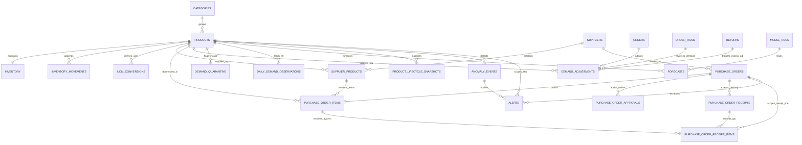

# NEXORA — Database Schema Specification

- **Project:** NEXORA – AI-Powered Retail Management & Intelligence System
- **Document Version:** 2.9 — ML and Operational Data Integrity
- **Updated:** 27 November 2026
- **Target Engine:** MySQL `8.0.16+` (`InnoDB`, `utf8mb4`, `utf8mb4_unicode_ci`, SQLAlchemy 2.x + Alembic; minimum `8.0.16` required for enforced `CHECK` constraints; recommended `8.0.32+` / `8.4 LTS`)
- **Authoritative References:**
  - [NEXORA — Technical Blueprint v1.0.md](NEXORA%20%E2%80%94%20Technical%20Blueprint%20v1.0.md) (`Version 2.2 (Design Decision Resolution)`)
  - [FEATURES_STATUS.md](FEATURES_STATUS.md) (`Version 2.3`)
  - [NEXORA — Application Functionality & System Workflow Guide.md](NEXORA%20%E2%80%94%20Application%20Functionality%20%26%20System%20Workflow%20Guide.md) (`Version 1.0`)
  - [API_DOCUMENTATION.md](API_DOCUMENTATION.md) (`Version 2.0`)
  - [ML_DOCUMENTATION.md](ML_DOCUMENTATION.md) (`Version 2.0`)

### Document Version History

| Version | Date | Summary |
| :---: | :---: | :--- |
| `1.0` | Nov 2026 | Legacy draft claiming 19 tables (22 DDL definitions) with RBAC (`roles`, `permissions`, `role_permissions`, `users`), `activity_logs`, `inventory_alerts`, and default 7-day lead times. |
| `2.0` | 26 Nov 2026 | Architectural overhaul aligned with Technical Blueprint v2.2 & `DDR-01`–`DDR-10`: removed 4 RBAC tables, replaced auth with 4 UI-only workspaces, expanded to 40 InnoDB tables across 9 schema groups. |
| `2.1` | 26 Nov 2026 | **Integrity & Consistency Corrections:** Unified fractional `DECIMAL(14, 4)` operational quantities; added composite `UNIQUE`/`FOREIGN KEY` cross-table parent-line integrity; replaced `(supplier_id, product_id)` overwrite risk with effective-dated `supplier_products` history + generated single-active/single-preferred uniqueness + PO line snapshots; standardized UI workspace provenance; separated PO workflow app validation from DB storage; aligned `operational_settings` to native MySQL `JSON`. |
| `2.2` | 26 Nov 2026 | **Final Database Foundation & Integrity Specification:** Enforced same-customer order binding (`orders(id, customer_id)` on `invoices` & `transactions`), same-order shipment invoice integrity (`shipments(invoice_id, order_id)`), and cross-parent `returns` order consistency (`(sale_id, order_id)`, `(invoice_id, order_id)`); unified procurement UoM conversion tracking on `purchase_order_items` & `purchase_order_receipt_items`; backticked reserved `` `returns` `` identifier; switched generated columns to `VIRTUAL`; tightened `CHECK` constraints and lock order. |
| `2.3` | 26 Nov 2026 | **Final Relational Integrity & Transactional Invariant Specification:** Specified minimum MySQL `8.0.16+` engine baseline (`CHECK` enforcement); added `uq_ret_id_inv` + `fk_cn_ret_inv (return_id, invoice_id)` enforcing return-to-invoice credit binding; added `idempotency_key` (`UNIQUE`) to `invoices`, `payments`, and `credit_notes`; enforced `grand_total = subtotal + tax_amount` & bounded `tax_rate` on `invoices`; added zero/full base-UoM sync checks on `order_items` & `purchase_order_items`; tightened `orders.inventory_deducted` state machine (`confirmed = FALSE`, `partially_fulfilled/fulfilled = TRUE`); blocked auto-`Discontinued` snapshots in DDL (`chk_pls_no_auto_discontinued`) & active-alert timestamps (`chk_alerts_ack_state`); enforced non-blank return/credit reasons; pruned narrower composite-FK-subsumed indexes; added exhaustive Nullable Composite FK (`MATCH SIMPLE`) audit table (`4.2`) and Business Invariant Enforcement Matrix (`4.3`). |
| `2.4` | 26 Nov 2026 | **Financial, UoM & Tax Integrity Resolution:** Introduced append-only **`refunds`** settlement ledger (`41` InnoDB tables total) bound via composite `fk_ref_cn_inv (credit_note_id, invoice_id)` to resolve paid-invoice return credits without mutating `payments`/`invoices.amount_paid` or hiding refund liabilities; formalized exact `Receivable Due`, `Refund Entitlement`, `Open Refund Payable`, `Net Cash Retained`, and `payment_status` state machine; unified commercial-to-base UoM triplet (`uom_code`, `base_uom_conversion_factor`, `base_uom_quantity`) across `transaction_items`, `invoice_items`, `return_items`, `shipment_items`, and `demand_adjustments` with explicit sub-`0.0001` residual & partial-receipt reconciliation rules (preserving deferred per-SKU integer/fractional policy in Section `9.2`); documented tax-exclusive `ROUND_HALF_UP` header tax semantics, UCI historical isolation, and unresolved partial-credit tax policy in Section `9.2`. |
| `2.5` | 26 Nov 2026 | **Refund Lifecycle & Settlement Integrity:** Added distinct `'fully_credited'` state to `invoices.payment_status` cleanly separating zero-cash-paid full credits (`P = 0, C = G`) and pending-payout full credits (`P > 0, C = G, R_comp < P`) from cash-completed `'refunded'` (`C = G, P > 0, R_comp = P`); enforced dual-level refund caps (`Credit-Note-Level <= credit_notes.amount` AND `Invoice-Level <= Refund Entitlement`) via 1:1 `credit_note_id` linkage + `payout_batch_ref`; changed `refunds.refund_status` `DEFAULT` from `'completed'` to `'pending'`, added `'reconciliation_required'` for uncertain/timed-out external payouts, added `cancelled_at` with `chk_ref_state_timestamps`, and separated `Completed Refunds` ($R_{\text{comp}}$), `Reserved Pending Refunds` ($R_{\text{resv}}$), `Open Refund Payable`, and `Available Refund Entitlement` under deterministic parent-row `FOR UPDATE` serialization. |
| `2.6` | 26 Nov 2026 | **Fulfilment, UoM & Inventory Lifecycle Integrity:** Resolved confirmed Task 4.6 integrity defects while preserving all `41` InnoDB tables, `DDR-01`–`DDR-10`, and deferred policies: **(H3)** enforced one-invoice-per-fulfilment uniqueness (`invoices.uq_inv_fulfillment UNIQUE (order_fulfillment_id)`, unlimited `NULL` standalone invoices retained) plus complete `10`-step issuance TX; **(M3)** enforced single active UoM conversion per `(product_id, uom_code)` via `VIRTUAL` generated columns (`active_product_id`, `active_uom_code`, `uq_uom_one_active`) and atomic rollover TX; **(M8)** added `'fulfillment_reversal'` & `'order_fulfillment'` to `inventory_movements`, finalized fulfilment batch reversal checks (`invoices`, `shipments`, `+base_delta` physical/reserved reconciliation, `orders.inventory_deducted`), added explicit **Order Cancellation** (`draft`/`confirmed`/`partially_fulfilled`/`fulfilled`/`shipped`) TX sequence with `3` worked numerical traces, and retained all `5` context-dependent deferred policies in Section `9.2`. |
| `2.7` | 26 Nov 2026 | **Final ERD Reconciliation & UoM Temporal Boundary Specification:** Resolved the two final pre-freeze consistency items without adding tables, auth/RBAC, or changing `DDR-01`–`DDR-10`: **(1) ERD Relationship Count Reconciliation** across Overview `1.2` (`35` summary edges), Domain Views `1.3` + `1.4` (`39 + 28 = 67` visual edges with `0` overlap), unique direct DDL `(parent, child)` FK pairs (`65`, `100%` covered in Views `1.3`–`1.4`, plus `2` transitive composite-subkey edges on `demand_adjustments` via `fk_da_oi_prod`), and total DDL `FOREIGN KEY` constraints (`75`, including `10` composite secondary FKs); **(2) UoM Temporal Interval Semantics** explicitly standardizing half-open `[effective_from, effective_to)` windows (`effective_from` inclusive, `effective_to` exclusive), abutting single-timestamp rollover closure (`effective_to = new.effective_from`, `new.effective_from > prior_active.effective_from`, never comparing `>= prior_active.effective_to` which is `NULL`), historical overlap checks across `is_active = FALSE` rows inside `FOR UPDATE` TX, and half-open temporal query predicates (`effective_from <= ts AND (effective_to IS NULL OR ts < effective_to)`, prohibiting `BETWEEN`). |
| `2.8` | 26 Nov 2026 | **Immediate UoM Rollover Integrity:** Enforced strictly immediate operational UoM conversion rollovers (`tx_now = NOW(6)` captured once on the database server inside the Section `6.6` transaction; no DDL changes). Prohibited future-dated activation and backdated/retroactive operational rollovers (`HTTP 422` if a caller supplies an unsupported effective timestamp; preferred planned API schema omits the field), aligned `is_active = TRUE` exclusively with the currently valid `[tx_now, ∞)` conversion, and preserved half-open `[effective_from, effective_to)` boundaries, closed historical records, and frozen operational document snapshots. |
| **`2.9`** | **27 Nov 2026** | **ML and Operational Data Integrity:** Resolved Task 10.0 database audit findings (`AUD-DB-01`–`AUD-DB-07`) while preserving all **`41` InnoDB tables**, `DDR-01`–`DDR-10`, and zero-auth workspace design: added `model_runs.model_generation`, `is_active DEFAULT FALSE`, `VIRTUAL` single-active production uniqueness (`uq_mr_one_active_prod_horizon`), composite `(id, horizon_days)` binding (`fk_fc_run_horizon`), and explicit Tier 1 model-promotion TX (`6.12`); removed `'combined'` from `daily_demand_observations.source_origin` (combining UCI & operational timelines via read-time queries/views without gap zero-padding); defined `demand_adjustments.effective_date` attribution (`COALESCE(requested_delivery_date, DATE(created_at))`), isolated recurring vs bulk `adjusted_net_base_uom_qty` math, ISO Monday weekly aggregation, and idempotent ETL (`6.13`); added `forecasts.uq_fc_prod_run_date_horizon`, defined `forecast_date = T` (`[T+1, T+H]`), immutability/regeneration rules, and `model_runs` contract/evaluation JSON provenance; locked `products.base_uom` post-usage (`6.14`, planned `409`) and unified `supplier_products` rollover to single `tx_now = NOW(6)` (`6.5`); separated Return intake/approval/completion/rejection stages (`6.9`), confirmed Case C `fulfilled_quantity > 0` return eligibility, and documented why mixed-classification `return_items` omit `(return_id, order_item_id)` uniqueness; extended `alerts.source_module` (`'demand_forecasting'`, `'system'`) keeping DB-outage `audit_failure` telemetry external, and specified `audit_outbox` `dead_letter` transition at `retry_count = max_retries`. |

> [!WARNING]
> **Implementation Status — `PLANNED` (Zero Live MySQL Tables on `main`):**
> No live MySQL database tables, SQLAlchemy ORM model classes, or Alembic migrations exist on branch `main`. Currently implemented persistence/serving consists solely of offline Phase 1 UCI CSV pipelines, committed `.joblib` model artifacts, and stateless FastAPI forecast/inventory recommendation routes. All **41 tables** specified below represent the planned target relational schema across Modules **`M01`–`M18`** and Supporting Capabilities **`SYS-01`–`SYS-04`**.

---

## 1. Database Architecture & Entity-Relationship Diagrams

### 1.1 Schema Modernization Scope & Old RBAC Removal
Per **Technical Blueprint v2.2**, NEXORA **has no authentication, login, passwords, sessions, JWTs, or server-enforced RBAC**. All authentication and RBAC structures from `v1.0` (`roles`, `permissions`, `role_permissions`, `users`, `password_hash`, `user_id` FKs) are retired and omitted:
- **Removed Entities (`4`):** `roles`, `permissions`, `role_permissions`, `users`.
- **Workspace UI Context Model (`SYS-01`):** Page 2 organizes views and workflow governance across four UI-only workspaces (`store_manager`, `inventory_staff`, `purchase_manager`, `finance_staff`).
- **Context vs. Verified Identity:** `selected_workspace`, `action_source`, and optional caller-supplied `operator_ref` provide non-authenticated provenance context only—**never** cryptographic identity verification, session state, or endpoint security authorization. Any future authenticated-user system remains explicitly outside current scope.

### 1.2 Overview Entity-Relationship Diagram

```mermaid
erDiagram
    CATEGORIES ||--o{ PRODUCTS : categorizes
    PRODUCTS ||--|| INVENTORY : tracks
    PRODUCTS ||--o{ INVENTORY_MOVEMENTS : logs
    PRODUCTS ||--o{ UOM_CONVERSIONS : converts
    PRODUCTS ||--o{ SUPPLIER_PRODUCTS : sourced_via
    SUPPLIERS ||--o{ SUPPLIER_PRODUCTS : offers

    CUSTOMERS ||--o{ ORDERS : places
    ORDERS ||--|{ ORDER_ITEMS : contains
    ORDERS ||--o{ ORDER_FULFILLMENTS : fulfills
    ORDERS ||--o{ TRANSACTIONS : settles_as
    ORDERS ||--o{ INVOICES : bills
    ORDERS ||--o{ RETURNS : receives
    ORDERS ||--o{ SHIPMENTS : dispatches
    ORDERS ||--o{ DEMAND_ADJUSTMENTS : adjusts

    SUPPLIERS ||--o{ PURCHASE_ORDERS : supplies
    PURCHASE_ORDERS ||--|{ PURCHASE_ORDER_ITEMS : requests
    PURCHASE_ORDERS ||--o{ PURCHASE_ORDER_APPROVALS : reviews
    PURCHASE_ORDERS ||--o{ PURCHASE_ORDER_RECEIPTS : receives

    INVOICES ||--|{ INVOICE_ITEMS : details
    INVOICES ||--o{ PAYMENTS : collects
    INVOICES ||--o{ CREDIT_NOTES : offsets
    INVOICES ||--o{ REFUNDS : disburses
    INVOICES ||--o{ SHIPMENTS : accompanies_parcel
    CREDIT_NOTES ||--o{ REFUNDS : settles
    RETURNS ||--|{ RETURN_ITEMS : itemizes
    RETURNS ||--o{ CREDIT_NOTES : triggers
    SHIPMENTS ||--|{ SHIPMENT_ITEMS : carries
    SHIPMENTS ||--o{ PACKING_SLIPS : prints
    SHIPMENTS ||--o{ SHIPMENT_EVENTS : logs

    PRODUCTS ||--o{ DAILY_DEMAND_OBSERVATIONS : aggregates
    PRODUCTS ||--o{ FORECASTS : projects
    MODEL_RUNS ||--o{ FORECASTS : produces
    PRODUCTS ||--o{ PRODUCT_LIFECYCLE_SNAPSHOTS : evaluates
    PRODUCTS ||--o{ ANOMALY_EVENTS : monitors
    ANOMALY_EVENTS ||--o{ ALERTS : surfaces
```



### 1.3 Domain ER View A — Retail Foundation, Orders, Fulfilment, Returns, Finance & Shipping

```mermaid
erDiagram
    CUSTOMERS ||--o{ ORDERS : places
    CUSTOMERS ||--o{ TRANSACTIONS : records
    CUSTOMERS ||--o{ INVOICES : billed_to

    PRODUCTS ||--o{ ORDER_ITEMS : ordered_in
    PRODUCTS ||--o{ TRANSACTION_ITEMS : sold_in
    PRODUCTS ||--o{ INVOICE_ITEMS : invoiced_in
    PRODUCTS ||--o{ RETURN_ITEMS : returned_in

    ORDERS ||--|{ ORDER_ITEMS : contains
    ORDERS ||--o{ ORDER_FULFILLMENTS : executes
    ORDER_FULFILLMENTS ||--|{ ORDER_FULFILLMENT_ITEMS : dispatches
    ORDERS ||--o{ ORDER_FULFILLMENT_ITEMS : scopes_batch_line
    ORDER_ITEMS ||--o{ ORDER_FULFILLMENT_ITEMS : fulfilled_by

    ORDERS ||--o{ SHIPMENTS : splits_into
    ORDER_FULFILLMENTS ||--o{ SHIPMENTS : prepares
    INVOICES ||--o{ SHIPMENTS : links_parcel
    SHIPMENTS ||--|{ SHIPMENT_ITEMS : allocates
    ORDERS ||--o{ SHIPMENT_ITEMS : scopes_parcel_line
    ORDER_ITEMS ||--o{ SHIPMENT_ITEMS : ships_line
    ORDER_FULFILLMENT_ITEMS ||--o{ SHIPMENT_ITEMS : links_batch_line
    SHIPMENTS ||--{ PACKING_SLIPS : generates
    SHIPMENTS ||--o{ SHIPMENT_EVENTS : tracks

    ORDERS ||--o{ TRANSACTIONS : realizes_sale
    ORDER_FULFILLMENTS ||--o{ TRANSACTIONS : settles_batch
    TRANSACTIONS ||--|{ TRANSACTION_ITEMS : itemizes
    ORDER_ITEMS ||--o{ TRANSACTION_ITEMS : billed_sale_line

    ORDERS ||--o{ INVOICES : generates
    ORDER_FULFILLMENTS ||--o{ INVOICES : invoices_batch
    INVOICES ||--|{ INVOICE_ITEMS : includes
    ORDER_ITEMS ||--o{ INVOICE_ITEMS : links_order_line
    INVOICES ||--o{ PAYMENTS : paid_by
    INVOICES ||--o{ CREDIT_NOTES : credited_by
    INVOICES ||--o{ REFUNDS : refunded_via
    CREDIT_NOTES ||--o{ REFUNDS : disbursed_by

    ORDERS ||--o{ RETURNS : links_order
    TRANSACTIONS ||--o{ RETURNS : links_sale
    INVOICES ||--o{ RETURNS : links_invoice
    RETURNS ||--|{ RETURN_ITEMS : specifies
    ORDER_ITEMS ||--o{ RETURN_ITEMS : returns_from
    RETURNS ||--o{ CREDIT_NOTES : issues_credit
```

*(Note: `order_fulfillment_items` and `shipment_items` derive `product_id` strictly from their required `order_items` parent without duplicating `product_id` columns.)*

### 1.4 Domain ER View B — Inventory, Sourcing (`DDR-07`), Procurement (`DDR-09`), ML Demand (`DDR-06`) & Governance (`DDR-08`/`DDR-10`)



*(Note: `purchase_order_receipt_items` derives `product_id` directly from `purchase_order_items`. Three configuration/audit tables—`operational_settings`, `audit_logs`, and `audit_outbox`—are intentionally standalone without operational parent foreign keys.)*

> [!NOTE]
> **ERD & Foreign-Key Relationship Count Reconciliation (`41` Tables):**
> - **Total DDL `FOREIGN KEY` Constraints (`76`):** `38` tables declare `76` `CONSTRAINT fk_* FOREIGN KEY` constraints in Section 3 (`11` parent-child table pairs declare both a single-column FK and a composite integrity FK: `credit_notes→refunds`, `invoices→invoice_items`, `invoices→returns`, `model_runs→forecasts`, `orders→invoices`, `orders→transactions`, `purchase_orders→purchase_order_items`, `returns→credit_notes`, `returns→return_items`, `transactions→returns`, `transactions→transaction_items`).
> - **Unique Direct DDL `(parent, child)` Pairs (`65`):** Collapsing those `11` dual-FK pairs yields **`65` unique parent-child table pairs** directly constrained by DDL foreign keys (`76 - 11 = 65`).
> - **Combined Domain ER Views `1.3` + `1.4` (`67` Visual Edges):** View A (`39` edges) + View B (`28` edges) have `0` overlap (`39 + 28 = 67`) across the `38` relational tables, covering **`100%` (`65/65`) of direct DDL parent-child pairs** plus **`2` transitive composite-subkey relationships** on `demand_adjustments` (`ORDERS ||--o{ DEMAND_ADJUSTMENTS : adjusts` and `PRODUCTS ||--o{ DEMAND_ADJUSTMENTS : indexes_sku`), where both `order_id` and `product_id` are non-null columns enforced transitively via composite `fk_da_oi_prod (order_id, order_item_id, product_id) -> order_items(order_id, id, product_id)` (`ON DELETE RESTRICT`) without redundant single-column FKs.
> - **Overview ERD `1.2` (`35` Summary Edges):** Architectural high-level view (`34` direct DDL pairs + `ORDERS → DEMAND_ADJUSTMENTS`), omitting `31` detailed line-level/lookup DDL relationships expanded in Views `1.3` and `1.4`. *(All three Mermaid diagrams in `1.2`, `1.3`, and `1.4` remain structurally unchanged in `v2.9` because `MODEL_RUNS ||--o{ FORECASTS` is already modeled identically across Overview `1.2` and Domain View B `1.4`.)*

---

## 2. Relational Schema Groups & Provenance Architecture

The **41 InnoDB tables** organize across nine domain groups covering all **18 Core Modules (`M01`–`M18`)** and **4 Supporting System Capabilities (`SYS-01`–`SYS-04`)**:

| Schema Group | Modules / Capabilities | Tables Included (`41` Total) | Key Design Decisions Covered |
| :--- | :--- | :--- | :--- |
| **3.1 Centralized Settings** | `M08`, `M11`, `M15`, `M17`, `SYS-01` | `operational_settings` | `DDR-04`, `DDR-08`, `DDR-09`, `DDR-10` |
| **3.2 Catalog, UoM & Partners** | `M01`, `M02`, `M03` | `categories`, `products`, `uom_conversions`, `suppliers`, `supplier_products`, `customers` | `DDR-01`, `DDR-04`, `DDR-06`, `DDR-07`, `EXCL-08` |
| **3.3 Orders, Fulfilment & Sales** | `M04`, `M05`, `M06` | `orders`, `order_items`, `order_fulfillments`, `order_fulfillment_items`, `transactions`, `transaction_items` | `DDR-03`, `DDR-04`, `DDR-05`, `DDR-06`, `DDR-10` |
| **3.4 Inventory & Stock Ledger** | `M09`, `M10` | `inventory`, `inventory_movements` | `DDR-02`, `DDR-03`, `DDR-05`, `DDR-10` |
| **3.5 Procurement & Tiered Approval** | `M11`, `M02` | `purchase_orders`, `purchase_order_items`, `purchase_order_approvals`, `purchase_order_receipts`, `purchase_order_receipt_items` | `DDR-01`, `DDR-02`, `DDR-07`, `DDR-09`, `EXCL-03` |
| **3.6 Returns & Billing Finance** | `M16`, `M17` | `invoices`, `invoice_items`, `payments`, `` `returns` ``, `return_items`, `credit_notes`, `refunds` | `DDR-04`, `DDR-06`, `DDR-10`, `EXCL-01` |
| **3.7 Internal Shipping & Split Delivery** | `M18` | `shipments`, `shipment_items`, `packing_slips`, `shipment_events` | `DDR-05`, `EXCL-02` |
| **3.8 Demand ML, Lifecycle & Anomalies** | `M07`, `M08`, `M12`, `M13`, `M14`, `M15`, `SYS-03` | `demand_adjustments`, `demand_quarantine`, `daily_demand_observations`, `model_runs`, `forecasts`, `product_lifecycle_snapshots`, `anomaly_events`, `alerts` | `DDR-01`, `DDR-06`, `DDR-08`, `DDR-09` |
| **3.9 Centralized Audit & Outbox** | `SYS-02`, `SYS-04` | `audit_logs`, `audit_outbox` | `DDR-10` |

### 2.1 Standardized Non-Authenticated Workspace Provenance (`SYS-01` & `DDR-10`)
NEXORA uses one consistent non-authenticated provenance column triad wherever operations or state transitions are tracked:
- **`selected_workspace`:** `ENUM('store_manager', 'inventory_staff', 'purchase_manager', 'finance_staff') NULL` — captures the active Page 2 UI workspace (`X-NEXORA-Workspace`). Remains `NULL` for headless API, scheduled batch, CLI seed, or system-generated rows. **Strictly UI navigation context, never authorization.**
- **`action_source`:** `ENUM('UI', 'API', 'SYSTEM', 'ML_ENGINE') NOT NULL` — cleanly distinguishes human UI-triggered operations (`'UI'`), direct REST/CLI calls (`'API'`), background/automated system jobs (`'SYSTEM'`), and offline ML pipelines (`'ML_ENGINE'`).
- **`operator_ref`:** `VARCHAR(64) NULL` — optional non-authenticated attribution token supplied explicitly by callers on workflow/governance mutations; defaults to `NULL` and **never implies verified user identity, login, or credentials**.

| Provenance Category | Tables Covered | Schema Representation |
| :--- | :--- | :--- |
| **Full Mutation Provenance Triad (`selected_workspace`, `action_source`, `operator_ref`)** | `operational_settings`, `categories`, `products`, `uom_conversions`, `suppliers`, `supplier_products`, `customers`, `orders`, `order_fulfillments`, `transactions`, `inventory_movements`, `purchase_order_approvals`, `purchase_order_receipts`, `invoices`, `payments`, `` `returns` ``, `credit_notes`, `refunds`, `shipments`, `packing_slips`, `shipment_events`, `demand_adjustments`, `demand_quarantine`, `forecasts`, `product_lifecycle_snapshots`, `audit_logs` | Stored directly with standardized column names and enums. Master entities (`categories`..`customers`, `operational_settings`) record latest mutating provenance while complete mutation history lives in `audit_logs`. |
| **Dual-Stage Workflow Provenance (`created_*` + `reviewed_*`)** | `purchase_orders`, `alerts` | `purchase_orders` tracks `created_workspace`/`created_action_source`/`created_operator_ref` and `reviewed_workspace`/`reviewed_action_source`/`reviewed_operator_ref`. `alerts` tracks `created_source`, `acknowledged_workspace`/`acknowledged_operator_ref`, and `resolved_workspace`/`resolved_operator_ref`. |
| **System / Empirical / Aggregated Tables (`action_source` or none where parent-owned)** | `model_runs`, `anomaly_events`, `daily_demand_observations`, `inventory`, `audit_outbox`, plus the 8 child line tables (`order_items`, `order_fulfillment_items`, `transaction_items`, `purchase_order_items`, `purchase_order_receipt_items`, `invoice_items`, `return_items`, `shipment_items`) | `model_runs` & `anomaly_events` carry `action_source` (`ML_ENGINE`/`SYSTEM`/`API`); `daily_demand_observations` aggregates pre-attributed confirmed orders; `inventory` delegates provenance to `inventory_movements`; `audit_outbox` preserves provenance in its `payload` JSON; child line tables inherit provenance from their parent transaction headers without redundant duplication. |

---

## 3. Complete Table Definitions & Precision Standards (MySQL `8.0.16+` `InnoDB`)

> [!NOTE]
> **Precision, UoM & Integrity Standards (`v2.6`):**
> - **Quantity Domains & `DECIMAL(14, 4)` Policy:**
>   1. **Transaction / Document Line Quantity** (`order_items.quantity`, `purchase_order_items.ordered_quantity`, `purchase_order_receipt_items.quantity_received`, `transaction_items.quantity`, `invoice_items.quantity`, `return_items.quantity`, `shipment_items.quantity`, `demand_adjustments.quantity_delta`): stored in `DECIMAL(14, 4)` in the line's recorded commercial `uom_code`.
>   2. **Frozen Conversion Factor** (`uom_conversions.conversion_to_base`, `order_items.base_uom_conversion_factor`, `purchase_order_items.base_uom_conversion_factor`, `transaction_items.base_uom_conversion_factor`, `invoice_items.base_uom_conversion_factor`, `return_items.base_uom_conversion_factor`, `demand_adjustments.base_uom_conversion_factor`): stored in `DECIMAL(12, 6)`.
>   3. **Base-UoM Converted Quantity** (`order_items.base_uom_quantity`, `base_uom_fulfilled_quantity`, `order_fulfillment_items.base_uom_quantity_fulfilled`, `purchase_order_items.base_uom_ordered_quantity`, `base_uom_received_quantity`, `purchase_order_receipt_items.base_uom_quantity_received`, `transaction_items.base_uom_quantity`, `invoice_items.base_uom_quantity`, `return_items.base_uom_quantity`, `shipment_items.base_uom_quantity`, `demand_adjustments.base_uom_quantity_delta`, `daily_demand_observations.*_base_uom_qty`): stored in **`DECIMAL(14, 4)`** in `products.base_uom`.
>   4. **Warehouse Physical & Reserved Stock** (`inventory.current_quantity`, `reserved_quantity`, `minimum_stock`, and `inventory_movements.*_quantity`): stored in **`DECIMAL(14, 4)`** strictly in **`products.base_uom`** so live stock and ML base-UoM demand share identical fixed-point precision without integer truncation or floating-point error.
>   5. **Integer Non-Quantity Counts:** Calendar/day spans (`lead_time_days`, `horizon_days`, `sku_age_days`, `days_since_last_sale`), revision numbers, retry counts, and order counts remain `INT` / `INT UNSIGNED`.
> - **Monetary Types & Tax Arithmetic:** Unit prices/costs use `DECIMAL(10, 2)`; financial totals, subtotals, taxes, payments, credits, refunds, and PO limits use `DECIMAL(12, 2)`. Zero `FLOAT` or `DOUBLE` columns exist.
> - **Rounding & Unresolved Precision Rule:** Converting `quantity × conversion_to_base` uses fixed-point decimal arithmetic. **Silent rounding that creates or removes physical inventory is prohibited.** Per-SKU discrete-integer vs. fractional unit enforcement, sub-`0.0001` conversion residuals, and partial-credit tax proportionality policies are documented in **Section 9.2**.
> - **Parent-Child Integrity:** All FKs use `ON DELETE RESTRICT` across business history; composite `UNIQUE` + composite `FOREIGN KEY` constraints enforce parent transaction consistency at DB level wherever MySQL `8.0.16+` InnoDB permits.

---

### 3.1 Group 1 — Centralized Settings

#### `operational_settings`
- **Purpose:** Centralized, bounded configuration store governing operational currency (`'INR'`), store tax rate (`DDR-04`), lifecycle & anomaly bounds (`DDR-08`), and PO Tier 1 approval limit / anti-split rolling window (`DDR-09`).
- **Primary Key:** `id` (`BIGINT UNSIGNED`).
- **Foreign Keys:** None.
- **Value Representation & Validation:** `setting_value` and `default_value` use native MySQL `JSON NOT NULL` so scalar numbers (`18.00`), integers (`7`), booleans (`true`), strings (`"INR"`), and structured escalation JSON objects are validated natively as well-formed JSON at DB level. Application services enforce `value_type` compatibility (`DECIMAL`/`INTEGER` bounds checking against `min_bound`/`max_bound`, `422` on violation), prospective-only effect, and Tier 1 `audit_logs` capture (`before_values` / `after_values`). Only approved Blueprint settings keys are seeded; arbitrary unapproved parameters are forbidden.

```sql
CREATE TABLE operational_settings (
    id BIGINT UNSIGNED AUTO_INCREMENT PRIMARY KEY,
    setting_key VARCHAR(100) NOT NULL,
    setting_value JSON NOT NULL,
    default_value JSON NOT NULL,
    min_bound DECIMAL(14, 4) NULL,
    max_bound DECIMAL(14, 4) NULL,
    value_type ENUM('DECIMAL', 'INTEGER', 'STRING', 'BOOLEAN', 'JSON') NOT NULL,
    domain ENUM('finance', 'lifecycle', 'anomaly', 'procurement', 'inventory') NOT NULL,
    description VARCHAR(255) NOT NULL,
    selected_workspace ENUM('store_manager', 'inventory_staff', 'purchase_manager', 'finance_staff') NULL,
    action_source ENUM('UI', 'API', 'SYSTEM', 'ML_ENGINE') NOT NULL DEFAULT 'SYSTEM',
    operator_ref VARCHAR(64) NULL,
    updated_at DATETIME(6) NOT NULL DEFAULT CURRENT_TIMESTAMP(6) ON UPDATE CURRENT_TIMESTAMP(6),
    CONSTRAINT uq_operational_settings_key UNIQUE (setting_key),
    CONSTRAINT chk_op_settings_bounds CHECK (min_bound IS NULL OR max_bound IS NULL OR min_bound <= max_bound),
    INDEX idx_op_settings_domain (domain)
) ENGINE=InnoDB DEFAULT CHARSET=utf8mb4 COLLATE=utf8mb4_unicode_ci;
```

*Approved Seeded Keys:* `default_operational_currency` (`"INR"`), `store_tax_rate` (`DECIMAL`, `0.00`–`50.00`), `po_tier1_approval_limit` (`DECIMAL`, `> 0`), `po_split_window_days` (`INTEGER`, `1`–`90`), `po_split_count_threshold` (`INTEGER`, `>= 2`), `lifecycle_hysteresis_windows` (`INTEGER`), `lifecycle_inactivity_days` (`INTEGER`), `anomaly_rolling_window_days` (`INTEGER`), `anomaly_z_threshold` (`DECIMAL`), `anomaly_price_variance_pct` (`DECIMAL`).

---

### 3.2 Group 2 — Retail Foundation, UoM Conversions & Sourcing (`M01`–`M03`)

#### `categories`
- **Purpose:** Product catalog categories (`M01`).
- **Primary Key:** `id` (`BIGINT UNSIGNED`).
- **Foreign Keys:** None.
- **Unique Constraints:** `uq_categories_name` (`name`).
- **Deletion Behaviour:** Soft-deactivate via `is_active = FALSE` (`ON DELETE RESTRICT` on children).

```sql
CREATE TABLE categories (
    id BIGINT UNSIGNED AUTO_INCREMENT PRIMARY KEY,
    name VARCHAR(100) NOT NULL,
    description VARCHAR(255) NULL,
    is_active BOOLEAN NOT NULL DEFAULT TRUE,
    selected_workspace ENUM('store_manager', 'inventory_staff', 'purchase_manager', 'finance_staff') NULL,
    action_source ENUM('UI', 'API', 'SYSTEM', 'ML_ENGINE') NOT NULL DEFAULT 'UI',
    operator_ref VARCHAR(64) NULL,
    created_at DATETIME NOT NULL DEFAULT CURRENT_TIMESTAMP,
    updated_at DATETIME NOT NULL DEFAULT CURRENT_TIMESTAMP ON UPDATE CURRENT_TIMESTAMP,
    CONSTRAINT uq_categories_name UNIQUE (name),
    INDEX idx_categories_active (is_active)
) ENGINE=InnoDB DEFAULT CHARSET=utf8mb4 COLLATE=utf8mb4_unicode_ci;
```

#### `products`
- **Purpose:** Master SKU catalog (`M01`), holding base pricing (`INR` operational default), canonical `base_uom`, UCI provenance flag, and current cached `DDR-08` `lifecycle_stage` synchronized alongside immutable `product_lifecycle_snapshots`.
- **Primary Key:** `id` (`BIGINT UNSIGNED`).
- **Foreign Keys:** `category_id` → `categories(id)` (`ON DELETE RESTRICT`).
- **Unique Constraints:** `uq_products_stock_code` (`stock_code`).
- **Check Constraints:** `current_unit_price >= 0.00`.
- **Snapshot vs. Master & `base_uom` Immutability (`v2.9`):** Master data; price updates affect future drafts only. Because `uom_conversions`, `inventory`, `inventory_movements`, `daily_demand_observations`, `forecasts`, and all commercial line tables express quantities in `products.base_uom` without duplicating a `base_uom` string on every ledger row, **`products.base_uom` becomes permanently immutable once `product_id` is referenced by any row in `uom_conversions`, `inventory`, `inventory_movements`, `order_items` (`orders`), `purchase_order_items` (`purchase_orders`), `daily_demand_observations`, `forecasts` (or `transaction_items`, `invoice_items`, `return_items`, `demand_adjustments`)**. Any planned catalog endpoint attempting to modify `base_uom` after such reference exists must fail with **`HTTP 409 Conflict`** inside a parent-locked transaction (`Section 6.14`, planned behavior not yet implemented on `main`); operators requiring a different base unit must soft-deactivate the existing SKU (`is_active = FALSE`) and create a new product SKU identity.

```sql
CREATE TABLE products (
    id BIGINT UNSIGNED AUTO_INCREMENT PRIMARY KEY,
    stock_code VARCHAR(50) NOT NULL,
    description VARCHAR(255) NOT NULL,
    category_id BIGINT UNSIGNED NULL,
    base_uom VARCHAR(32) NOT NULL DEFAULT 'unit',
    current_unit_price DECIMAL(10, 2) NOT NULL DEFAULT 0.00,
    currency_code CHAR(3) NOT NULL DEFAULT 'INR',
    lifecycle_stage ENUM('Introduction', 'Growth', 'Maturity', 'Decline', 'Discontinued') NOT NULL DEFAULT 'Introduction',
    is_uci_baseline BOOLEAN NOT NULL DEFAULT FALSE,
    is_active BOOLEAN NOT NULL DEFAULT TRUE,
    selected_workspace ENUM('store_manager', 'inventory_staff', 'purchase_manager', 'finance_staff') NULL,
    action_source ENUM('UI', 'API', 'SYSTEM', 'ML_ENGINE') NOT NULL DEFAULT 'UI',
    operator_ref VARCHAR(64) NULL,
    created_at DATETIME NOT NULL DEFAULT CURRENT_TIMESTAMP,
    updated_at DATETIME NOT NULL DEFAULT CURRENT_TIMESTAMP ON UPDATE CURRENT_TIMESTAMP,
    CONSTRAINT uq_products_stock_code UNIQUE (stock_code),
    CONSTRAINT fk_products_category FOREIGN KEY (category_id) REFERENCES categories(id) ON DELETE RESTRICT,
    CONSTRAINT chk_products_price_nonneg CHECK (current_unit_price >= 0.00),
    INDEX idx_products_category_active (category_id, is_active),
    INDEX idx_products_lifecycle (lifecycle_stage),
    INDEX idx_products_uci (is_uci_baseline)
) ENGINE=InnoDB DEFAULT CHARSET=utf8mb4 COLLATE=utf8mb4_unicode_ci;
```

#### `uom_conversions`
- **Purpose:** Effective-dated, product-specific UoM conversion multipliers (`uom_code` → `products.base_uom`) supporting `DDR-06` base-unit order and PO conversion traceability.
- **Primary Key:** `id` (`BIGINT UNSIGNED`).
- **Foreign Keys:** `product_id` → `products(id)` (`ON DELETE RESTRICT`).
- **Unique Constraints & Active-Pair Enforcement (`M3`):**
  - `uq_uom_product_code_eff` (`product_id`, `uom_code`, `effective_from`): prevents identical effective-start duplicates across history.
  - `uq_uom_one_active` (`active_product_id`, `active_uom_code`) via `VIRTUAL` generated columns: guarantees **at most one active conversion (`is_active = TRUE`)** per `(product_id, uom_code)` while permitting unlimited closed historical versions (`is_active = FALSE`, where generated active keys evaluate to `NULL`, ignored by InnoDB `UNIQUE` indexes) and independent active rows across different products (`P001` vs `P002`).
- **Temporal Interval Convention & Immediate Rollover Policy — Half-Open `[effective_from, effective_to)` (`v2.8`):**
  - **Strictly Immediate Operational Rollovers:** Operational UoM conversion updates take effect **immediately** using one database-server timestamp captured once inside the Section `6.6` transaction (`tx_now = NOW(6)`). Future-dated and backdated operational rollovers are **prohibited**; caller-supplied effective timestamps must never override `tx_now`. If an API caller supplies an unsupported effective timestamp, the planned API rejects the request with **`HTTP 422 Unprocessable Entity`** *(omitting any caller effective-timestamp field entirely from the planned rollover request schema is the preferred API design; UoM endpoints remain `PLANNED`)*.
  - Every UoM conversion version represents a **half-open validity interval `[effective_from, effective_to)`**: `effective_from` is **inclusive** (`ts >= effective_from`) and `effective_to` is **exclusive** (`ts < effective_to`, or open-ended when `effective_to IS NULL`).
  - Active operational rules stay open-ended (`is_active = TRUE, effective_to IS NULL`) and correspond strictly to the **currently valid operational conversion** at current server time—never a future scheduled conversion. Inside the Section `6.6` TX, closing the previous active conversion with `is_active = FALSE, effective_to = tx_now` and inserting the replacement conversion with `is_active = TRUE, effective_from = tx_now, effective_to = NULL` produces abutting contiguous windows **`[T_0, tx_now)`** and **`[tx_now, ∞)`** with **zero overlap and zero gap** (`ts < tx_now` resolves uniquely to version 1; `ts >= tx_now` resolves uniquely to version 2).
  - **DB Enforcement vs. TX Overlap Responsibility:** In MySQL InnoDB, `uq_uom_one_active` enforces at most one `is_active = TRUE` row per `(product_id, uom_code)` and `uq_uom_product_code_eff` blocks identical start timestamps, **but InnoDB ignores `NULL` virtual keys on closed (`is_active = FALSE`) rows and lacks temporal exclusion constraints**. Therefore, validating `tx_now > prior_active.effective_from`, `tx_now >= MAX(closed.effective_to)`, and historical `[effective_from, effective_to)` non-overlap **must execute inside the Section `6.6` `ORDER BY id FOR UPDATE` transaction**.
  - **Operational & Historical Lookup Rules:** Active operational transactions query `WHERE product_id = ? AND uom_code = ? AND is_active = TRUE` (guaranteed `0` or `1` row by `uq_uom_one_active`, identifying strictly the live conversion active now). Any point-in-time historical lookup at timestamp `:ts` must use **`effective_from <= :ts AND (effective_to IS NULL OR :ts < effective_to)`** (never `BETWEEN`, which is double-inclusive at rollover boundary `tx_now`).
- **Current vs. Inactive vs. Frozen Snapshots:** Updating a conversion factor closes the current active row (`is_active = FALSE`, `effective_to = tx_now`), flushes, and inserts the new active row (`is_active = TRUE`, `effective_from = tx_now`, `effective_to = NULL`) inside one ACID TX (`Section 6.6`). Historical conversion records remain immutable across their established validity windows, updates affect **only future operational documents** created at or after `tx_now`, and existing operational documents retain their frozen `base_uom_conversion_factor` snapshots (`order_items`, `purchase_order_items`, `transaction_items`, `invoice_items`, `return_items`, `demand_adjustments`) unchanged permanently.
- **Check Constraints:** `conversion_to_base > 0.000000`, `effective_to IS NULL OR effective_to >= effective_from`, and `is_active = TRUE OR effective_to IS NOT NULL`.
- **Precision & Deletion Behaviour:** Microsecond `DATETIME(6)` timestamps prevent same-second revision collisions on `uq_uom_product_code_eff` (while rollover TX requires `tx_now > prior_active.effective_from` so closed history retains positive width `[T_0, tx_now)`); expired rules close permanently via `is_active = FALSE` and `effective_to`.

```sql
CREATE TABLE uom_conversions (
    id BIGINT UNSIGNED AUTO_INCREMENT PRIMARY KEY,
    product_id BIGINT UNSIGNED NOT NULL,
    uom_code VARCHAR(32) NOT NULL,
    conversion_to_base DECIMAL(12, 6) NOT NULL,
    effective_from DATETIME(6) NOT NULL DEFAULT CURRENT_TIMESTAMP(6),
    effective_to DATETIME(6) NULL,
    is_active BOOLEAN NOT NULL DEFAULT TRUE,
    active_product_id BIGINT UNSIGNED GENERATED ALWAYS AS (
        IF(is_active = TRUE, product_id, NULL)
    ) VIRTUAL,
    active_uom_code VARCHAR(32) GENERATED ALWAYS AS (
        IF(is_active = TRUE, uom_code, NULL)
    ) VIRTUAL,
    selected_workspace ENUM('store_manager', 'inventory_staff', 'purchase_manager', 'finance_staff') NULL,
    action_source ENUM('UI', 'API', 'SYSTEM', 'ML_ENGINE') NOT NULL DEFAULT 'UI',
    operator_ref VARCHAR(64) NULL,
    created_at DATETIME(6) NOT NULL DEFAULT CURRENT_TIMESTAMP(6),
    CONSTRAINT uq_uom_product_code_eff UNIQUE (product_id, uom_code, effective_from),
    CONSTRAINT uq_uom_one_active UNIQUE (active_product_id, active_uom_code),
    CONSTRAINT fk_uom_product FOREIGN KEY (product_id) REFERENCES products(id) ON DELETE RESTRICT,
    CONSTRAINT chk_uom_factor_pos CHECK (conversion_to_base > 0.000000),
    CONSTRAINT chk_uom_effective_window CHECK (effective_to IS NULL OR effective_to >= effective_from),
    CONSTRAINT chk_uom_inactive_closed CHECK (is_active = TRUE OR effective_to IS NOT NULL),
    INDEX idx_uom_lookup (product_id, uom_code, is_active, effective_from)
) ENGINE=InnoDB DEFAULT CHARSET=utf8mb4 COLLATE=utf8mb4_unicode_ci;
```

#### `suppliers`
- **Purpose:** Vendor master directory (`M02`) supplying fallback `lead_time_days` when `supplier_products.lead_time_days` is unset (`DDR-01`, `DDR-07`).
- **Primary Key:** `id` (`BIGINT UNSIGNED`).
- **Foreign Keys:** None.
- **Check Constraints:** `lead_time_days IS NULL OR (lead_time_days BETWEEN 1 AND 365)` (nullable; never fabricated).

```sql
CREATE TABLE suppliers (
    id BIGINT UNSIGNED AUTO_INCREMENT PRIMARY KEY,
    supplier_name VARCHAR(150) NOT NULL,
    contact_person VARCHAR(100) NULL,
    email VARCHAR(255) NULL,
    phone VARCHAR(50) NULL,
    address TEXT NULL,
    lead_time_days INT NULL,
    is_active BOOLEAN NOT NULL DEFAULT TRUE,
    selected_workspace ENUM('store_manager', 'inventory_staff', 'purchase_manager', 'finance_staff') NULL,
    action_source ENUM('UI', 'API', 'SYSTEM', 'ML_ENGINE') NOT NULL DEFAULT 'UI',
    operator_ref VARCHAR(64) NULL,
    created_at DATETIME NOT NULL DEFAULT CURRENT_TIMESTAMP,
    updated_at DATETIME NOT NULL DEFAULT CURRENT_TIMESTAMP ON UPDATE CURRENT_TIMESTAMP,
    CONSTRAINT chk_suppliers_lt CHECK (lead_time_days IS NULL OR (lead_time_days BETWEEN 1 AND 365)),
    INDEX idx_suppliers_name_active (supplier_name, is_active)
) ENGINE=InnoDB DEFAULT CHARSET=utf8mb4 COLLATE=utf8mb4_unicode_ci;
```

#### `supplier_products` *(Versioned Historical Sourcing — `DDR-07`)*
- **Purpose:** Effective-dated many-to-many supplier-product sourcing catalog (`DDR-07`) holding vendor SKU code, `purchase_price`, product-specific `lead_time_days` (`DDR-01` primary), `minimum_order_quantity`, preferred vendor flag, and permanent history of superseded/inactive sourcing terms.
- **Historical Versioning Strategy (Least-Complex Immutable Design):** Instead of overwriting terms in place (which would destroy past price/LT/MOQ evidence) or adding a duplicate archive table, updates to sourcing terms execute atomically using one database-server timestamp (`tx_now = NOW(6)` captured once inside `Section 6.5`): closing the prior active row (`is_active = FALSE`, `is_preferred = FALSE`, `effective_to = tx_now`), flushing, and inserting the replacement active row (`is_active = TRUE`, `effective_from = tx_now`, `effective_to = NULL`), forming contiguous half-open `[effective_from, effective_to)` history. Old `purchase_order_items` retain their FK `supplier_product_id` directly to the exact historical version row (plus point-in-time snapshots).
- **Database-Enforced Uniqueness Rules (via MySQL 8.x `VIRTUAL` Generated Columns):**
  1. `uq_sp_one_active_pair` (`active_supplier_id`, `active_product_id`): guarantees at most **one** active mapping (`is_active = TRUE`) per `(supplier_id, product_id)` while permitting unlimited closed (`is_active = FALSE`) historical versions with zero redundant clustered-row byte storage (`VIRTUAL` secondary B-tree indexing in InnoDB).
  2. `uq_sp_one_active_preferred` (`active_preferred_product_id`): guarantees at most **one** active preferred supplier mapping (`is_active = TRUE AND is_preferred = TRUE`) per `product_id`.
  3. `uq_sp_id_sup_prod` (`id`, `supplier_id`, `product_id`): enables composite FK validation from `purchase_order_items`.
- **Determining Current Preferred Active Mapping:** Application queries `WHERE product_id = ? AND is_active = TRUE AND is_preferred = TRUE` (`uq_sp_one_active_preferred` returns `0` or `1` row deterministically); if none is preferred, operator selects among active rows or falls back to `suppliers.lead_time_days` (`UNAVAILABLE` if both null per `DDR-01`).

```sql
CREATE TABLE supplier_products (
    id BIGINT UNSIGNED AUTO_INCREMENT PRIMARY KEY,
    supplier_id BIGINT UNSIGNED NOT NULL,
    product_id BIGINT UNSIGNED NOT NULL,
    supplier_product_code VARCHAR(64) NULL,
    purchase_price DECIMAL(10, 2) NOT NULL,
    currency_code CHAR(3) NOT NULL DEFAULT 'INR',
    lead_time_days INT NULL,
    minimum_order_quantity DECIMAL(14, 4) NOT NULL DEFAULT 1.0000,
    uom_code VARCHAR(32) NOT NULL DEFAULT 'unit',
    is_preferred BOOLEAN NOT NULL DEFAULT FALSE,
    is_active BOOLEAN NOT NULL DEFAULT TRUE,
    effective_from DATETIME(6) NOT NULL DEFAULT CURRENT_TIMESTAMP(6),
    effective_to DATETIME(6) NULL,
    active_supplier_id BIGINT UNSIGNED GENERATED ALWAYS AS (
        IF(is_active = TRUE, supplier_id, NULL)
    ) VIRTUAL,
    active_product_id BIGINT UNSIGNED GENERATED ALWAYS AS (
        IF(is_active = TRUE, product_id, NULL)
    ) VIRTUAL,
    active_preferred_product_id BIGINT UNSIGNED GENERATED ALWAYS AS (
        IF(is_active = TRUE AND is_preferred = TRUE, product_id, NULL)
    ) VIRTUAL,
    selected_workspace ENUM('store_manager', 'inventory_staff', 'purchase_manager', 'finance_staff') NULL,
    action_source ENUM('UI', 'API', 'SYSTEM', 'ML_ENGINE') NOT NULL DEFAULT 'UI',
    operator_ref VARCHAR(64) NULL,
    created_at DATETIME NOT NULL DEFAULT CURRENT_TIMESTAMP,
    updated_at DATETIME NOT NULL DEFAULT CURRENT_TIMESTAMP ON UPDATE CURRENT_TIMESTAMP,
    CONSTRAINT uq_sp_one_active_pair UNIQUE (active_supplier_id, active_product_id),
    CONSTRAINT uq_sp_one_active_preferred UNIQUE (active_preferred_product_id),
    CONSTRAINT uq_sp_id_sup_prod UNIQUE (id, supplier_id, product_id),
    CONSTRAINT fk_sp_supplier FOREIGN KEY (supplier_id) REFERENCES suppliers(id) ON DELETE RESTRICT,
    CONSTRAINT fk_sp_product FOREIGN KEY (product_id) REFERENCES products(id) ON DELETE RESTRICT,
    CONSTRAINT chk_sp_price CHECK (purchase_price >= 0.00),
    CONSTRAINT chk_sp_lt CHECK (lead_time_days IS NULL OR (lead_time_days BETWEEN 1 AND 365)),
    CONSTRAINT chk_sp_moq CHECK (minimum_order_quantity > 0.0000),
    CONSTRAINT chk_sp_pref_requires_active CHECK (is_preferred = FALSE OR is_active = TRUE),
    CONSTRAINT chk_sp_effective_window CHECK (effective_to IS NULL OR effective_to >= effective_from),
    CONSTRAINT chk_sp_inactive_closed CHECK (is_active = TRUE OR effective_to IS NOT NULL),
    INDEX idx_sp_product_history (product_id, supplier_id, effective_from),
    INDEX idx_sp_supplier_active (supplier_id, is_active)
) ENGINE=InnoDB DEFAULT CHARSET=utf8mb4 COLLATE=utf8mb4_unicode_ci;
```

#### `customers`
- **Purpose:** Manually maintained customer master directory (`M03`, `EXCL-08`).
- **Primary Key:** `id` (`BIGINT UNSIGNED`).
- **Snapshot vs. Master:** Master record; `invoices` freeze `billing_snapshot` JSON and `shipments` freeze `shipping_address`.

```sql
CREATE TABLE customers (
    id BIGINT UNSIGNED AUTO_INCREMENT PRIMARY KEY,
    uci_customer_ref VARCHAR(64) NULL,
    customer_name VARCHAR(150) NOT NULL,
    phone VARCHAR(50) NULL,
    email VARCHAR(255) NULL,
    billing_address TEXT NOT NULL,
    shipping_address TEXT NULL,
    city VARCHAR(100) NOT NULL,
    state VARCHAR(100) NULL,
    postal_code VARCHAR(20) NOT NULL,
    country VARCHAR(100) NOT NULL DEFAULT 'India',
    is_active BOOLEAN NOT NULL DEFAULT TRUE,
    selected_workspace ENUM('store_manager', 'inventory_staff', 'purchase_manager', 'finance_staff') NULL,
    action_source ENUM('UI', 'API', 'SYSTEM', 'ML_ENGINE') NOT NULL DEFAULT 'UI',
    operator_ref VARCHAR(64) NULL,
    created_at DATETIME NOT NULL DEFAULT CURRENT_TIMESTAMP,
    updated_at DATETIME NOT NULL DEFAULT CURRENT_TIMESTAMP ON UPDATE CURRENT_TIMESTAMP,
    INDEX idx_customers_name_active (customer_name, is_active),
    INDEX idx_customers_uci_ref (uci_customer_ref),
    INDEX idx_customers_country (country)
) ENGINE=InnoDB DEFAULT CHARSET=utf8mb4 COLLATE=utf8mb4_unicode_ci;
```

---

### 3.3 Group 3 — Orders, Reservations, Fulfilment & Sales (`M04`, `M05`, `M06`)

#### `orders`
- **Purpose:** Customer/B2B order lifecycle (`M05`, `DDR-03`, `DDR-05`, `DDR-06`). Drafts reserve `0` stock; confirmation strictly validates `Available Stock >= line base_uom_quantity` before locking `inventory.reserved_quantity` and establishing confirmed B2B demand timed by `requested_delivery_date` (or `DATE(created_at)` for immediate fulfilment). Insufficient-stock confirmations fail atomically (`409`) without bypassing validation or creating sales. `inventory_deducted` flips `TRUE` on the first completed fulfilment batch (`order_items.fulfilled_quantity > 0`) while cumulative progress tracks per line.
- **Primary Key:** `id` (`BIGINT UNSIGNED`).
- **Foreign Keys:** `customer_id` → `customers(id)` (`ON DELETE RESTRICT`).
- **Unique Constraints:** `uq_orders_number` (`order_number`), and `uq_orders_id_cust` (`id`, `customer_id`) enforcing customer consistency on child `transactions` and `invoices`.

```sql
CREATE TABLE orders (
    id BIGINT UNSIGNED AUTO_INCREMENT PRIMARY KEY,
    order_number VARCHAR(64) NOT NULL,
    customer_id BIGINT UNSIGNED NOT NULL,
    order_status ENUM('draft', 'pending', 'confirmed', 'partially_fulfilled', 'fulfilled', 'cancelled') NOT NULL DEFAULT 'draft',
    order_demand_type ENUM('recurring_replenishment', 'one_time_bulk', 'contract', 'tender') NOT NULL DEFAULT 'recurring_replenishment',
    requested_delivery_date DATE NULL,
    is_censored_demand BOOLEAN NOT NULL DEFAULT FALSE,
    inventory_deducted BOOLEAN NOT NULL DEFAULT FALSE,
    currency_code CHAR(3) NOT NULL DEFAULT 'INR',
    subtotal DECIMAL(12, 2) NOT NULL DEFAULT 0.00,
    notes TEXT NULL,
    selected_workspace ENUM('store_manager', 'inventory_staff', 'purchase_manager', 'finance_staff') NULL,
    action_source ENUM('UI', 'API', 'SYSTEM', 'ML_ENGINE') NOT NULL DEFAULT 'UI',
    operator_ref VARCHAR(64) NULL,
    confirmed_at DATETIME NULL,
    cancelled_at DATETIME NULL,
    created_at DATETIME NOT NULL DEFAULT CURRENT_TIMESTAMP,
    updated_at DATETIME NOT NULL DEFAULT CURRENT_TIMESTAMP ON UPDATE CURRENT_TIMESTAMP,
    CONSTRAINT uq_orders_number UNIQUE (order_number),
    CONSTRAINT uq_orders_id_cust UNIQUE (id, customer_id),
    CONSTRAINT fk_orders_customer FOREIGN KEY (customer_id) REFERENCES customers(id) ON DELETE RESTRICT,
    CONSTRAINT chk_orders_subtotal CHECK (subtotal >= 0.00),
    CONSTRAINT chk_orders_lifecycle_dates CHECK (
        (order_status IN ('draft', 'pending') AND confirmed_at IS NULL AND cancelled_at IS NULL AND inventory_deducted = FALSE) OR
        (order_status = 'confirmed' AND confirmed_at IS NOT NULL AND cancelled_at IS NULL AND inventory_deducted = FALSE) OR
        (order_status IN ('partially_fulfilled', 'fulfilled') AND confirmed_at IS NOT NULL AND cancelled_at IS NULL AND inventory_deducted = TRUE) OR
        (order_status = 'cancelled' AND cancelled_at IS NOT NULL)
    ),
    INDEX idx_orders_status_date (order_status, created_at),
    INDEX idx_orders_demand_timing (order_status, order_demand_type, requested_delivery_date, created_at),
    INDEX idx_orders_customer (customer_id)
) ENGINE=InnoDB DEFAULT CHARSET=utf8mb4 COLLATE=utf8mb4_unicode_ci;
```

#### `order_items`
- **Purpose:** Line items capturing requested/confirmed `quantity` in recorded `uom_code`, cumulative `fulfilled_quantity` (`<= quantity`), and frozen base-UoM equivalents (`base_uom_conversion_factor`, `base_uom_quantity`, `base_uom_fulfilled_quantity`).
- **Composite Parent Keys Exposed:** `uq_oi_order_item` (`order_id`, `id`) and `uq_oi_order_item_prod` (`order_id`, `id`, `product_id`) allow downstream fulfilment, shipment, invoice, return, and demand-adjustment lines to enforce exact parent-order and product consistency in DDL.
- **Check Constraints:** `quantity > 0`, `0 <= fulfilled_quantity <= quantity`, `0 <= base_uom_fulfilled_quantity <= base_uom_quantity`, `base_uom_conversion_factor > 0`.

```sql
CREATE TABLE order_items (
    id BIGINT UNSIGNED AUTO_INCREMENT PRIMARY KEY,
    order_id BIGINT UNSIGNED NOT NULL,
    product_id BIGINT UNSIGNED NOT NULL,
    uom_code VARCHAR(32) NOT NULL DEFAULT 'unit',
    quantity DECIMAL(14, 4) NOT NULL,
    fulfilled_quantity DECIMAL(14, 4) NOT NULL DEFAULT 0.0000,
    base_uom_conversion_factor DECIMAL(12, 6) NOT NULL DEFAULT 1.000000,
    base_uom_quantity DECIMAL(14, 4) NOT NULL,
    base_uom_fulfilled_quantity DECIMAL(14, 4) NOT NULL DEFAULT 0.0000,
    unit_price DECIMAL(10, 2) NOT NULL,
    line_total DECIMAL(12, 2) NOT NULL,
    CONSTRAINT uq_oi_order_item UNIQUE (order_id, id),
    CONSTRAINT uq_oi_order_item_prod UNIQUE (order_id, id, product_id),
    CONSTRAINT fk_order_items_order FOREIGN KEY (order_id) REFERENCES orders(id) ON DELETE RESTRICT,
    CONSTRAINT fk_order_items_product FOREIGN KEY (product_id) REFERENCES products(id) ON DELETE RESTRICT,
    CONSTRAINT chk_oi_qty CHECK (quantity > 0.0000),
    CONSTRAINT chk_oi_fulfilled CHECK (fulfilled_quantity >= 0.0000 AND fulfilled_quantity <= quantity),
    CONSTRAINT chk_oi_uom_factor CHECK (base_uom_conversion_factor > 0.000000),
    CONSTRAINT chk_oi_base_qty CHECK (base_uom_quantity > 0.0000),
    CONSTRAINT chk_oi_base_fulfilled CHECK (base_uom_fulfilled_quantity >= 0.0000 AND base_uom_fulfilled_quantity <= base_uom_quantity),
    CONSTRAINT chk_oi_zero_fulfill_sync CHECK ((fulfilled_quantity = 0.0000) = (base_uom_fulfilled_quantity = 0.0000)),
    CONSTRAINT chk_oi_full_fulfill_sync CHECK ((fulfilled_quantity = quantity) = (base_uom_fulfilled_quantity = base_uom_quantity)),
    CONSTRAINT chk_oi_price CHECK (unit_price >= 0.00),
    CONSTRAINT chk_oi_total CHECK (line_total >= 0.00),
    INDEX idx_oi_product (product_id)
) ENGINE=InnoDB DEFAULT CHARSET=utf8mb4 COLLATE=utf8mb4_unicode_ci;
```

#### `order_fulfillments`
- **Purpose:** Batch headers executing idempotent partial or full fulfilment (`DDR-05`).
- **Composite Parent Key Exposed:** `uq_of_order_id` (`order_id`, `id`) enforces same-order integrity on `order_fulfillment_items`, `shipments`, `invoices`, and `transactions`.

```sql
CREATE TABLE order_fulfillments (
    id BIGINT UNSIGNED AUTO_INCREMENT PRIMARY KEY,
    order_id BIGINT UNSIGNED NOT NULL,
    fulfillment_number VARCHAR(64) NOT NULL,
    idempotency_key VARCHAR(128) NOT NULL,
    fulfillment_status ENUM('completed', 'reversed') NOT NULL DEFAULT 'completed',
    selected_workspace ENUM('store_manager', 'inventory_staff', 'purchase_manager', 'finance_staff') NULL,
    action_source ENUM('UI', 'API', 'SYSTEM', 'ML_ENGINE') NOT NULL DEFAULT 'UI',
    operator_ref VARCHAR(64) NULL,
    notes VARCHAR(255) NULL,
    fulfilled_at DATETIME(6) NOT NULL DEFAULT CURRENT_TIMESTAMP(6),
    CONSTRAINT uq_fulfillments_number UNIQUE (fulfillment_number),
    CONSTRAINT uq_fulfillments_idempotency UNIQUE (idempotency_key),
    CONSTRAINT uq_of_order_id UNIQUE (order_id, id),
    CONSTRAINT fk_fulfillments_order FOREIGN KEY (order_id) REFERENCES orders(id) ON DELETE RESTRICT,
    INDEX idx_fulfillments_order_time (order_id, fulfilled_at)
) ENGINE=InnoDB DEFAULT CHARSET=utf8mb4 COLLATE=utf8mb4_unicode_ci;
```

#### `order_fulfillment_items`
- **Purpose:** Line-level batch quantities fulfilled per `order_fulfillments` header (`DDR-05`), deriving `product_id` strictly from `order_items` without redundant column duplication.
- **Database-Enforced Cross-Table Consistency:** Composite FKs `fk_ofi_fulfill_order` `(order_id, order_fulfillment_id)` and `fk_ofi_item_order` `(order_id, order_item_id)` **guarantee at DB level** that a fulfilment item cannot reference an order item from a different order than its parent fulfilment header.
- **Composite Key Exposed:** `uq_ofi_ship_link` (`order_id`, `order_fulfillment_id`, `order_item_id`, `id`) binds `shipment_items` back to the exact order, batch, and line.

```sql
CREATE TABLE order_fulfillment_items (
    id BIGINT UNSIGNED AUTO_INCREMENT PRIMARY KEY,
    order_id BIGINT UNSIGNED NOT NULL,
    order_fulfillment_id BIGINT UNSIGNED NOT NULL,
    order_item_id BIGINT UNSIGNED NOT NULL,
    quantity_fulfilled DECIMAL(14, 4) NOT NULL,
    base_uom_quantity_fulfilled DECIMAL(14, 4) NOT NULL,
    CONSTRAINT uq_ofi_batch_item UNIQUE (order_fulfillment_id, order_item_id),
    CONSTRAINT uq_ofi_ship_link UNIQUE (order_id, order_fulfillment_id, order_item_id, id),
    CONSTRAINT fk_ofi_order FOREIGN KEY (order_id) REFERENCES orders(id) ON DELETE RESTRICT,
    CONSTRAINT fk_ofi_fulfill_order FOREIGN KEY (order_id, order_fulfillment_id) REFERENCES order_fulfillments(order_id, id) ON DELETE RESTRICT,
    CONSTRAINT fk_ofi_item_order FOREIGN KEY (order_id, order_item_id) REFERENCES order_items(order_id, id) ON DELETE RESTRICT,
    CONSTRAINT chk_ofi_qty CHECK (quantity_fulfilled > 0.0000),
    CONSTRAINT chk_ofi_base_qty CHECK (base_uom_quantity_fulfilled > 0.0000),
    INDEX idx_ofi_order_item (order_item_id)
) ENGINE=InnoDB DEFAULT CHARSET=utf8mb4 COLLATE=utf8mb4_unicode_ci;
```

#### `transactions` *(Realized Commercial Sales)*
- **Purpose:** Immutable realized sales registry (`M04`), separating `uci_historical` (`GBP`) from `operational` (`INR`, `DDR-04`), isolating streams (`standard`, `cancellation`, `return`, `exceptional`), and never double-deducting inventory (`DDR-05`).
- **Database-Enforced Cross-Table Consistency:** Composite `fk_trans_fulfill_order` `(order_id, order_fulfillment_id)` + `CHECK (order_fulfillment_id IS NULL OR order_id IS NOT NULL)` prevents linking a batch belonging to another order; `fk_trans_order_cust` `(order_id, customer_id)` + `CHECK (order_id IS NULL OR customer_id IS NOT NULL)` prevents mismatching `orders.customer_id` whenever `order_id IS NOT NULL` (while permitting nullable `customer_id` strictly on unattributed `uci_historical` rows).

```sql
CREATE TABLE transactions (
    id BIGINT UNSIGNED AUTO_INCREMENT PRIMARY KEY,
    invoice_number VARCHAR(64) NOT NULL,
    order_id BIGINT UNSIGNED NULL,
    order_fulfillment_id BIGINT UNSIGNED NULL,
    customer_id BIGINT UNSIGNED NULL,
    uci_customer_ref VARCHAR(64) NULL,
    transaction_date DATETIME NOT NULL,
    country VARCHAR(100) NOT NULL DEFAULT 'India',
    transaction_type ENUM('standard', 'cancellation', 'return', 'exceptional') NOT NULL DEFAULT 'standard',
    source_origin ENUM('uci_historical', 'operational') NOT NULL DEFAULT 'operational',
    currency_code CHAR(3) NOT NULL DEFAULT 'INR',
    tax_rate DECIMAL(5, 2) NOT NULL DEFAULT 0.00,
    tax_amount DECIMAL(12, 2) NOT NULL DEFAULT 0.00,
    total_amount DECIMAL(12, 2) NOT NULL,
    status ENUM('completed', 'cancelled', 'reversed') NOT NULL DEFAULT 'completed',
    selected_workspace ENUM('store_manager', 'inventory_staff', 'purchase_manager', 'finance_staff') NULL,
    action_source ENUM('UI', 'API', 'SYSTEM', 'ML_ENGINE') NOT NULL DEFAULT 'UI',
    operator_ref VARCHAR(64) NULL,
    created_at DATETIME NOT NULL DEFAULT CURRENT_TIMESTAMP,
    CONSTRAINT uq_trans_id_order UNIQUE (id, order_id),
    CONSTRAINT fk_trans_order FOREIGN KEY (order_id) REFERENCES orders(id) ON DELETE RESTRICT,
    CONSTRAINT fk_trans_fulfill_order FOREIGN KEY (order_id, order_fulfillment_id) REFERENCES order_fulfillments(order_id, id) ON DELETE RESTRICT,
    CONSTRAINT fk_trans_customer FOREIGN KEY (customer_id) REFERENCES customers(id) ON DELETE RESTRICT,
    CONSTRAINT fk_trans_order_cust FOREIGN KEY (order_id, customer_id) REFERENCES orders(id, customer_id) ON DELETE RESTRICT,
    CONSTRAINT chk_trans_fulfill_needs_order CHECK (order_fulfillment_id IS NULL OR order_id IS NOT NULL),
    CONSTRAINT chk_trans_order_requires_cust CHECK (order_id IS NULL OR customer_id IS NOT NULL),
    CONSTRAINT chk_trans_tax_rate CHECK (tax_rate >= 0.00),
    INDEX idx_trans_invoice (invoice_number),
    INDEX idx_trans_date_origin (transaction_date, source_origin, transaction_type),
    INDEX idx_trans_fulfillment (order_fulfillment_id),
    INDEX idx_trans_country (country),
    INDEX idx_trans_customer (customer_id)
) ENGINE=InnoDB DEFAULT CHARSET=utf8mb4 COLLATE=utf8mb4_unicode_ci;
```

#### `transaction_items`
- **Purpose:** Immutable commercial line amounts (`DECIMAL`) and UoM conversion snapshots (`uom_code`, `base_uom_conversion_factor`, `base_uom_quantity`). When referencing an `order_item_id`, enforces parent `order_id` and `product_id` consistency via composite FKs and inherits `order_items.uom_code` & `base_uom_conversion_factor`. For standalone counter/UCI rows (`order_item_id IS NULL`), captures the line's active conversion factor (`1.000000` when sold in `products.base_uom`).
- **Check Constraints:** `quantity <> 0.0000`, `base_uom_conversion_factor > 0.000000`, `base_uom_quantity <> 0.0000`, `(quantity > 0.0000) = (base_uom_quantity > 0.0000)` (sign parity), `order_item_id IS NULL OR order_id IS NOT NULL`. *(Allows negative quantities/unit prices strictly for UCI historical `cancellation`/`return`/`exceptional` ingestion; operational services reject non-positive commercial prices.)*

```sql
CREATE TABLE transaction_items (
    id BIGINT UNSIGNED AUTO_INCREMENT PRIMARY KEY,
    transaction_id BIGINT UNSIGNED NOT NULL,
    order_id BIGINT UNSIGNED NULL,
    order_item_id BIGINT UNSIGNED NULL,
    product_id BIGINT UNSIGNED NOT NULL,
    uom_code VARCHAR(32) NOT NULL DEFAULT 'unit',
    quantity DECIMAL(14, 4) NOT NULL,
    base_uom_conversion_factor DECIMAL(12, 6) NOT NULL DEFAULT 1.000000,
    base_uom_quantity DECIMAL(14, 4) NOT NULL,
    unit_price DECIMAL(10, 2) NOT NULL,
    line_total DECIMAL(12, 2) NOT NULL,
    CONSTRAINT fk_ti_transaction FOREIGN KEY (transaction_id) REFERENCES transactions(id) ON DELETE RESTRICT,
    CONSTRAINT fk_ti_trans_order FOREIGN KEY (transaction_id, order_id) REFERENCES transactions(id, order_id) ON DELETE RESTRICT,
    CONSTRAINT fk_ti_oi_order_prod FOREIGN KEY (order_id, order_item_id, product_id) REFERENCES order_items(order_id, id, product_id) ON DELETE RESTRICT,
    CONSTRAINT fk_ti_product FOREIGN KEY (product_id) REFERENCES products(id) ON DELETE RESTRICT,
    CONSTRAINT chk_ti_oi_needs_order CHECK (order_item_id IS NULL OR order_id IS NOT NULL),
    CONSTRAINT chk_ti_qty_nonzero CHECK (quantity <> 0.0000),
    CONSTRAINT chk_ti_uom_factor CHECK (base_uom_conversion_factor > 0.000000),
    CONSTRAINT chk_ti_base_nonzero CHECK (base_uom_quantity <> 0.0000),
    CONSTRAINT chk_ti_sign_match CHECK ((quantity > 0.0000) = (base_uom_quantity > 0.0000)),
    INDEX idx_ti_product (product_id)
) ENGINE=InnoDB DEFAULT CHARSET=utf8mb4 COLLATE=utf8mb4_unicode_ci;
```

---

### 3.4 Group 4 — Inventory Control & Immutable Movement Ledger (`M09`, `M10`)

#### `inventory`
- **Purpose:** Authoritative live MySQL stock state (`1:1` per SKU, `M09`), holding `Physical Stock` (`current_quantity`) and `Reserved Stock` (`reserved_quantity`) strictly in `products.base_uom` (`DECIMAL(14, 4)`), plus safety settings (`minimum_stock`, `safety_factor = 1.20` default per `DDR-01`).
- **Derived Metrics (Computed Dynamically / View — Never Duplicated):**
  - `Available Stock = current_quantity - reserved_quantity` (`DDR-03`)
  - `Incoming Stock = SUM(GREATEST(0.0000, base_uom_ordered_quantity - base_uom_received_quantity))` in `products.base_uom` strictly from `purchase_orders.order_status IN ('approved', 'partially_received')` (`DDR-02`)
  - `Projected Available Stock = Available Stock + Incoming Stock` (`DDR-02`, `DDR-03`)

```sql
CREATE TABLE inventory (
    id BIGINT UNSIGNED AUTO_INCREMENT PRIMARY KEY,
    product_id BIGINT UNSIGNED NOT NULL,
    current_quantity DECIMAL(14, 4) NOT NULL DEFAULT 0.0000,
    reserved_quantity DECIMAL(14, 4) NOT NULL DEFAULT 0.0000,
    minimum_stock DECIMAL(14, 4) NOT NULL DEFAULT 10.0000,
    safety_factor DECIMAL(4, 2) NOT NULL DEFAULT 1.20,
    updated_at DATETIME(6) NOT NULL DEFAULT CURRENT_TIMESTAMP(6) ON UPDATE CURRENT_TIMESTAMP(6),
    CONSTRAINT uq_inventory_product UNIQUE (product_id),
    CONSTRAINT fk_inventory_product FOREIGN KEY (product_id) REFERENCES products(id) ON DELETE RESTRICT,
    CONSTRAINT chk_inv_phys_nonneg CHECK (current_quantity >= 0.0000),
    CONSTRAINT chk_inv_res_nonneg CHECK (reserved_quantity >= 0.0000),
    CONSTRAINT chk_inv_avail_nonneg CHECK (reserved_quantity <= current_quantity),
    CONSTRAINT chk_inv_min_stock CHECK (minimum_stock >= 0.0000),
    CONSTRAINT chk_inv_safety_factor CHECK (safety_factor >= 1.00)
) ENGINE=InnoDB DEFAULT CHARSET=utf8mb4 COLLATE=utf8mb4_unicode_ci;
```

#### `inventory_movements`
- **Purpose:** Immutable append-only warehouse delta ledger (`M10`) recording every physical unit delta in `products.base_uom` (`DECIMAL(14, 4)`) inside the exact ACID transaction mutating `inventory.current_quantity`. Original movements (such as `'sale_fulfillment'`) are **never updated or deleted**; reversing a fulfilment batch appends a dedicated compensating **`'fulfillment_reversal'`** row (`quantity_delta > 0.0000`) linked via `reference_type = 'order_fulfillment'` and `reference_id = order_fulfillments.id` (recording original batch number / movement trace in `reason` & `audit_logs`).
- **Check Constraints:** Exact balance math (`resulting_quantity = previous_quantity + quantity_delta >= 0.0000`), non-zero delta, and signed direction rules per `movement_type` (`'purchase_receipt'`, `'return_restock'`, `'fulfillment_reversal'` strictly positive; `'sale_fulfillment'`, `'damaged'` strictly negative; `'adjustment'` non-zero either sign).

```sql
CREATE TABLE inventory_movements (
    id BIGINT UNSIGNED AUTO_INCREMENT PRIMARY KEY,
    product_id BIGINT UNSIGNED NOT NULL,
    movement_type ENUM('adjustment', 'purchase_receipt', 'sale_fulfillment', 'fulfillment_reversal', 'return_restock', 'damaged') NOT NULL,
    quantity_delta DECIMAL(14, 4) NOT NULL,
    previous_quantity DECIMAL(14, 4) NOT NULL,
    resulting_quantity DECIMAL(14, 4) NOT NULL,
    reference_type ENUM('onboarding', 'manual', 'order', 'order_fulfillment', 'purchase_order', 'return') NOT NULL,
    reference_id BIGINT UNSIGNED NULL,
    reason VARCHAR(255) NULL,
    selected_workspace ENUM('store_manager', 'inventory_staff', 'purchase_manager', 'finance_staff') NULL,
    action_source ENUM('UI', 'API', 'SYSTEM', 'ML_ENGINE') NOT NULL DEFAULT 'UI',
    operator_ref VARCHAR(64) NULL,
    created_at DATETIME(6) NOT NULL DEFAULT CURRENT_TIMESTAMP(6),
    CONSTRAINT fk_im_product FOREIGN KEY (product_id) REFERENCES products(id) ON DELETE RESTRICT,
    CONSTRAINT chk_im_delta_nonzero CHECK (quantity_delta <> 0.0000),
    CONSTRAINT chk_im_prev_nonneg CHECK (previous_quantity >= 0.0000),
    CONSTRAINT chk_im_res_nonneg CHECK (resulting_quantity >= 0.0000),
    CONSTRAINT chk_im_math CHECK (resulting_quantity = previous_quantity + quantity_delta),
    CONSTRAINT chk_im_sign CHECK (
        (movement_type NOT IN ('purchase_receipt', 'return_restock', 'fulfillment_reversal') OR quantity_delta > 0.0000) AND
        (movement_type NOT IN ('sale_fulfillment', 'damaged') OR quantity_delta < 0.0000)
    ),
    INDEX idx_im_product_time (product_id, created_at),
    INDEX idx_im_type_time (movement_type, created_at),
    INDEX idx_im_ref (reference_type, reference_id)
) ENGINE=InnoDB DEFAULT CHARSET=utf8mb4 COLLATE=utf8mb4_unicode_ci;
```

---

### 3.5 Group 5 — Procurement, Tiered Approvals & Receipts (`M11`, `DDR-02`, `DDR-09`)

#### `purchase_orders`
- **Purpose:** Supplier Purchase Order header (`M11`) enforcing `DDR-02` (`Incoming Stock` derived solely from `approved` & `partially_received` POs), `DDR-09` dual-control governance snapshots (`approval_tier`, `applied_tier1_limit`, `escalation_required`, `split_review_flagged`), and `EXCL-03` (zero automated vendor dispatch).
- **Workflow Boundary:** `created_workspace` / `reviewed_workspace` / `*_operator_ref` provide UI attribution only—never verified user security; workflow gating runs inside locked application approval transactions (Section 6).
- **Composite Parent Keys Exposed:** `uq_po_sup_id` (`supplier_id`, `id`) binds PO lines to the supplier's historical sourcing mapping version.

```sql
CREATE TABLE purchase_orders (
    id BIGINT UNSIGNED AUTO_INCREMENT PRIMARY KEY,
    po_number VARCHAR(64) NOT NULL,
    supplier_id BIGINT UNSIGNED NOT NULL,
    order_status ENUM('draft', 'submitted', 'approved', 'rejected', 'partially_received', 'received', 'cancelled') NOT NULL DEFAULT 'draft',
    order_date DATE NOT NULL,
    expected_delivery_date DATE NULL,
    currency_code CHAR(3) NOT NULL DEFAULT 'INR',
    total_cost DECIMAL(12, 2) NOT NULL DEFAULT 0.00,
    approval_tier ENUM('tier1_routine', 'tier2_store_manager') NULL,
    applied_tier1_limit DECIMAL(12, 2) NULL,
    escalation_required BOOLEAN NOT NULL DEFAULT FALSE,
    escalation_reason VARCHAR(255) NULL,
    split_review_flagged BOOLEAN NOT NULL DEFAULT FALSE,
    created_workspace ENUM('store_manager', 'inventory_staff', 'purchase_manager', 'finance_staff') NULL,
    created_action_source ENUM('UI', 'API', 'SYSTEM', 'ML_ENGINE') NOT NULL DEFAULT 'UI',
    created_operator_ref VARCHAR(64) NULL,
    reviewed_workspace ENUM('store_manager', 'inventory_staff', 'purchase_manager', 'finance_staff') NULL,
    reviewed_action_source ENUM('UI', 'API', 'SYSTEM', 'ML_ENGINE') NULL,
    reviewed_operator_ref VARCHAR(64) NULL,
    review_notes TEXT NULL,
    reviewed_at DATETIME(6) NULL,
    created_at DATETIME NOT NULL DEFAULT CURRENT_TIMESTAMP,
    updated_at DATETIME NOT NULL DEFAULT CURRENT_TIMESTAMP ON UPDATE CURRENT_TIMESTAMP,
    CONSTRAINT uq_po_number UNIQUE (po_number),
    CONSTRAINT uq_po_sup_id UNIQUE (supplier_id, id),
    CONSTRAINT fk_po_supplier FOREIGN KEY (supplier_id) REFERENCES suppliers(id) ON DELETE RESTRICT,
    CONSTRAINT chk_po_total CHECK (total_cost >= 0.00),
    CONSTRAINT chk_po_limit CHECK (applied_tier1_limit IS NULL OR applied_tier1_limit > 0.00),
    INDEX idx_po_status_supplier (order_status, supplier_id, order_date),
    INDEX idx_po_split_window (supplier_id, created_at, order_status)
) ENGINE=InnoDB DEFAULT CHARSET=utf8mb4 COLLATE=utf8mb4_unicode_ci;
```

#### `purchase_order_items`
- **Purpose:** PO SKU lines (`DECIMAL(14, 4)`), preserving commercial procurement UoM (`uom_code`), `ordered_quantity` / `received_quantity` (matching vendor pricing `unit_cost` without per-unit rounding loss), and frozen base-UoM equivalents (`base_uom_conversion_factor`, `base_uom_ordered_quantity`, `base_uom_received_quantity`) used cleanly by `Incoming Stock` (`DDR-02`) and `inventory_movements` (`purchase_receipt`). Links optionally to exact historical `supplier_products` version (`supplier_product_id`) while freezing point-in-time `unit_cost`, `supplier_product_code_snapshot`, `lead_time_days_snapshot`, and `moq_snapshot` (`DDR-07`).
- **Procurement Quantity Reconciliation Chain:**
  - `purchase_order_items.ordered_quantity` × `purchase_order_items.base_uom_conversion_factor` = `base_uom_ordered_quantity` (frozen PO line snapshot).
  - `purchase_order_receipt_items.quantity_received` × `purchase_order_items.base_uom_conversion_factor` = `purchase_order_receipt_items.base_uom_quantity_received` = `inventory_movements.quantity_delta` (`+purchase_receipt`).
  - `SUM(purchase_order_receipt_items.quantity_received)` = `purchase_order_items.received_quantity` (`<= ordered_quantity`).
  - `SUM(purchase_order_receipt_items.base_uom_quantity_received)` = `purchase_order_items.base_uom_received_quantity` (`<= base_uom_ordered_quantity`).
  - `Incoming Stock` sums `GREATEST(0.0000, base_uom_ordered_quantity - base_uom_received_quantity)` across `purchase_orders.order_status IN ('approved', 'partially_received')`.
- **Database-Enforced Cross-Table Consistency:** `fk_poi_po_sup` `(supplier_id, purchase_order_id)` matches `purchase_orders(supplier_id, id)` and `fk_poi_sp_ver` `(supplier_product_id, supplier_id, product_id)` guarantees any linked sourcing row belongs to the exact same supplier and SKU! `uq_poi_po_item` `(purchase_order_id, id)` enforces same-PO receipt linkage.

```sql
CREATE TABLE purchase_order_items (
    id BIGINT UNSIGNED AUTO_INCREMENT PRIMARY KEY,
    purchase_order_id BIGINT UNSIGNED NOT NULL,
    supplier_id BIGINT UNSIGNED NOT NULL,
    product_id BIGINT UNSIGNED NOT NULL,
    supplier_product_id BIGINT UNSIGNED NULL,
    supplier_product_code_snapshot VARCHAR(64) NULL,
    lead_time_days_snapshot INT NULL,
    moq_snapshot DECIMAL(14, 4) NULL,
    uom_code VARCHAR(32) NOT NULL DEFAULT 'unit',
    ordered_quantity DECIMAL(14, 4) NOT NULL,
    received_quantity DECIMAL(14, 4) NOT NULL DEFAULT 0.0000,
    base_uom_conversion_factor DECIMAL(12, 6) NOT NULL DEFAULT 1.000000,
    base_uom_ordered_quantity DECIMAL(14, 4) NOT NULL,
    base_uom_received_quantity DECIMAL(14, 4) NOT NULL DEFAULT 0.0000,
    unit_cost DECIMAL(10, 2) NOT NULL,
    line_total DECIMAL(12, 2) NOT NULL,
    CONSTRAINT uq_poi_po_item UNIQUE (purchase_order_id, id),
    CONSTRAINT fk_poi_po FOREIGN KEY (purchase_order_id) REFERENCES purchase_orders(id) ON DELETE RESTRICT,
    CONSTRAINT fk_poi_po_sup FOREIGN KEY (supplier_id, purchase_order_id) REFERENCES purchase_orders(supplier_id, id) ON DELETE RESTRICT,
    CONSTRAINT fk_poi_product FOREIGN KEY (product_id) REFERENCES products(id) ON DELETE RESTRICT,
    CONSTRAINT fk_poi_sp_ver FOREIGN KEY (supplier_product_id, supplier_id, product_id) REFERENCES supplier_products(id, supplier_id, product_id) ON DELETE RESTRICT,
    CONSTRAINT chk_poi_ordered CHECK (ordered_quantity > 0.0000),
    CONSTRAINT chk_poi_received CHECK (received_quantity >= 0.0000 AND received_quantity <= ordered_quantity),
    CONSTRAINT chk_poi_uom_factor CHECK (base_uom_conversion_factor > 0.000000),
    CONSTRAINT chk_poi_base_ordered CHECK (base_uom_ordered_quantity > 0.0000),
    CONSTRAINT chk_poi_base_received CHECK (base_uom_received_quantity >= 0.0000 AND base_uom_received_quantity <= base_uom_ordered_quantity),
    CONSTRAINT chk_poi_zero_rec_sync CHECK ((received_quantity = 0.0000) = (base_uom_received_quantity = 0.0000)),
    CONSTRAINT chk_poi_full_rec_sync CHECK ((received_quantity = ordered_quantity) = (base_uom_received_quantity = base_uom_ordered_quantity)),
    CONSTRAINT chk_poi_cost CHECK (unit_cost >= 0.00),
    CONSTRAINT chk_poi_total CHECK (line_total >= 0.00),
    CONSTRAINT chk_poi_lt_snap CHECK (lead_time_days_snapshot IS NULL OR (lead_time_days_snapshot BETWEEN 1 AND 365)),
    CONSTRAINT chk_poi_moq_snap CHECK (moq_snapshot IS NULL OR moq_snapshot > 0.0000),
    INDEX idx_poi_product (product_id)
) ENGINE=InnoDB DEFAULT CHARSET=utf8mb4 COLLATE=utf8mb4_unicode_ci;
```

#### `purchase_order_approvals`
- **Purpose:** Append-only PO review/governance ledger (`DDR-09`) preserving every `submitted`, `escalated`, `approved`, `rejected`, `invalidated`, and `cancelled` event plus optional `idempotency_key` (`UNIQUE`) for safe retry/duplicate-click suppression. Cannot be deleted (`ON DELETE RESTRICT`).

```sql
CREATE TABLE purchase_order_approvals (
    id BIGINT UNSIGNED AUTO_INCREMENT PRIMARY KEY,
    purchase_order_id BIGINT UNSIGNED NOT NULL,
    idempotency_key VARCHAR(128) NULL,
    decision_event ENUM('submitted', 'escalated', 'approved', 'rejected', 'invalidated', 'cancelled') NOT NULL,
    approval_tier ENUM('tier1_routine', 'tier2_store_manager') NULL,
    po_total_cost DECIMAL(12, 2) NOT NULL,
    tier1_limit_snapshot DECIMAL(12, 2) NULL,
    escalation_reason VARCHAR(255) NULL,
    split_review_flagged BOOLEAN NOT NULL DEFAULT FALSE,
    review_notes TEXT NULL,
    selected_workspace ENUM('store_manager', 'inventory_staff', 'purchase_manager', 'finance_staff') NULL,
    action_source ENUM('UI', 'API', 'SYSTEM', 'ML_ENGINE') NOT NULL DEFAULT 'UI',
    operator_ref VARCHAR(64) NULL,
    event_at DATETIME(6) NOT NULL DEFAULT CURRENT_TIMESTAMP(6),
    CONSTRAINT uq_poa_idempotency UNIQUE (idempotency_key),
    CONSTRAINT fk_poa_po FOREIGN KEY (purchase_order_id) REFERENCES purchase_orders(id) ON DELETE RESTRICT,
    CONSTRAINT chk_poa_total CHECK (po_total_cost >= 0.00),
    INDEX idx_poa_po_time (purchase_order_id, event_at)
) ENGINE=InnoDB DEFAULT CHARSET=utf8mb4 COLLATE=utf8mb4_unicode_ci;
```

#### `purchase_order_receipts`
- **Purpose:** Delivery receipt header (`M11`, `DDR-02`) with unique `idempotency_key` preventing duplicate receipt submissions. Exposes `uq_por_po_id` (`purchase_order_id`, `id`) for child line enforcement.

```sql
CREATE TABLE purchase_order_receipts (
    id BIGINT UNSIGNED AUTO_INCREMENT PRIMARY KEY,
    purchase_order_id BIGINT UNSIGNED NOT NULL,
    receipt_number VARCHAR(64) NOT NULL,
    idempotency_key VARCHAR(128) NOT NULL,
    notes VARCHAR(255) NULL,
    selected_workspace ENUM('store_manager', 'inventory_staff', 'purchase_manager', 'finance_staff') NULL,
    action_source ENUM('UI', 'API', 'SYSTEM', 'ML_ENGINE') NOT NULL DEFAULT 'UI',
    operator_ref VARCHAR(64) NULL,
    received_at DATETIME(6) NOT NULL DEFAULT CURRENT_TIMESTAMP(6),
    CONSTRAINT uq_por_number UNIQUE (receipt_number),
    CONSTRAINT uq_por_idempotency UNIQUE (idempotency_key),
    CONSTRAINT uq_por_po_id UNIQUE (purchase_order_id, id),
    CONSTRAINT fk_por_po FOREIGN KEY (purchase_order_id) REFERENCES purchase_orders(id) ON DELETE RESTRICT,
    INDEX idx_por_po_time (purchase_order_id, received_at)
) ENGINE=InnoDB DEFAULT CHARSET=utf8mb4 COLLATE=utf8mb4_unicode_ci;
```

#### `purchase_order_receipt_items`
- **Purpose:** Received line quantities (`DECIMAL(14, 4)`) in recorded PO `uom_code` and frozen `base_uom_quantity_received` entering `inventory.current_quantity` (`purchase_receipt`), deriving `product_id` directly from `purchase_order_items` without column duplication.
- **Database-Enforced Cross-Table Consistency:** Composite FKs `fk_pori_receipt_po` `(purchase_order_id, receipt_id)` and `fk_pori_item_po` `(purchase_order_id, purchase_order_item_id)` strictly enforce that a receipt item belongs to the exact same `purchase_order_id` as both its receipt header and PO line.

```sql
CREATE TABLE purchase_order_receipt_items (
    id BIGINT UNSIGNED AUTO_INCREMENT PRIMARY KEY,
    purchase_order_id BIGINT UNSIGNED NOT NULL,
    receipt_id BIGINT UNSIGNED NOT NULL,
    purchase_order_item_id BIGINT UNSIGNED NOT NULL,
    quantity_received DECIMAL(14, 4) NOT NULL,
    base_uom_quantity_received DECIMAL(14, 4) NOT NULL,
    CONSTRAINT uq_pori_receipt_item UNIQUE (receipt_id, purchase_order_item_id),
    CONSTRAINT fk_pori_po FOREIGN KEY (purchase_order_id) REFERENCES purchase_orders(id) ON DELETE RESTRICT,
    CONSTRAINT fk_pori_receipt_po FOREIGN KEY (purchase_order_id, receipt_id) REFERENCES purchase_order_receipts(purchase_order_id, id) ON DELETE RESTRICT,
    CONSTRAINT fk_pori_item_po FOREIGN KEY (purchase_order_id, purchase_order_item_id) REFERENCES purchase_order_items(purchase_order_id, id) ON DELETE RESTRICT,
    CONSTRAINT chk_pori_qty CHECK (quantity_received > 0.0000),
    CONSTRAINT chk_pori_base_qty CHECK (base_uom_quantity_received > 0.0000),
    INDEX idx_pori_poi (purchase_order_item_id)
) ENGINE=InnoDB DEFAULT CHARSET=utf8mb4 COLLATE=utf8mb4_unicode_ci;
```

---

### 3.6 Group 6 — Billing, Finance & Return Intelligence (`M16`, `M17`, `DDR-04`)

#### `invoices`
- **Purpose:** Immutable `INR`-default customer billing ledger (`M17`, `DDR-04`, `EXCL-01`), freezing `billing_snapshot`, `currency_code`, `tax_rate`, and `tax_amount` at issuance, with optional `idempotency_key` (`UNIQUE`) preventing duplicate invoice creation on client retries. Supports both order-linked batch invoices (`order_id IS NOT NULL`) and standalone manual invoices (`order_id IS NULL`, `order_fulfillment_id IS NULL`) using the identical server-side calculation and central `store_tax_rate` lookup.
- **Tax Calculation Semantics (Approved Blueprint `v2.2` / `DDR-04`):**
  - `unit_price`, `line_total`, and `subtotal` are **tax-exclusive**.
  - Per line: `line_total = ROUND_HALF_UP(quantity × unit_price, 2)`.
  - Header taxable base: `subtotal = SUM(invoice_items.line_total)`.
  - Header tax: `tax_amount = ROUND_HALF_UP(subtotal × (tax_rate / 100), 2)` using `operational_settings.store_tax_rate` (flat store-wide rate per `EXCL-01`; no HSN/GST slabs). Updates to central settings affect future invoices only.
  - Header total: `grand_total = subtotal + tax_amount` (`chk_inv_grand_eq` DB-enforced).
- **Receivable, Credit, Reservation & Refund Balance Model (Derived — Never Duplicated Except Immutable `amount_paid`):**
  - Let $G = \text{grand\_total} \ge 0.00$, $P = \text{amount\_paid} = \sum \text{payments.amount}$ ($0 \le P \le G$), $C = \sum \text{credit\_notes.amount}$ ($0 \le C \le G$), $R_{\text{comp}} = \sum \text{refunds.amount WHERE refund\_status = 'completed'}$, and $R_{\text{resv}} = \sum \text{refunds.amount WHERE refund\_status IN ('pending', 'reconciliation\_required')}$.
  - `Net Billed Value` = $G - C$
  - `Collectible Cap` = $\max(0.00,\; G - C)$ *(caps cumulative `payments`)*
  - `Outstanding Receivable` = $\max(0.00,\; G - C - P)$ *(remaining cash owed by customer)*
  - `Refund Entitlement` = $\max(0.00,\; P + C - G)$ *(total overpayment credit eligible for cash return)*
  - `Completed Refunds` = $R_{\text{comp}}$ *(cash/bank payouts actually disbursed; `'completed'` rows are permanently immutable)*
  - `Reserved Pending Refunds` = $R_{\text{resv}}$ *(in-flight `'pending'` and uncertain `'reconciliation_required'` payouts reserving entitlement; does **not** reduce `Open Refund Payable` until completed)*
  - `Open Refund Payable` = $\max(0.00,\; \text{Refund Entitlement} - R_{\text{comp}})$ *(actual unpaid cash liability still owed to customer)*
  - `Available Refund Entitlement` = $\text{Refund Entitlement} - R_{\text{comp}} - R_{\text{resv}} = \text{Open Refund Payable} - R_{\text{resv}} \ge 0.00$ *(caps any new refund initiation)*
  - `Net Cash Retained` = $P - R_{\text{comp}}$
  - **`payment_status` Mutually Exclusive 6-State Partition:**
    - `'unpaid'`: $G > 0.00 \land P = 0.00 \land C = 0.00$
    - `'partially_paid'`: $0.00 < P < G \land C = 0.00$
    - `'paid'`: $(G = 0.00 \land C = 0.00) \lor (P = G \land C = 0.00)$
    - `'partially_credited'`: $0.00 < C < G$ *(any partial credit, whether customer owes balance, net settled, awaiting payout, or credit portion refunded)*
    - `'fully_credited'`: $C = G \land G > 0.00 \land (P = 0.00 \lor R_{\text{comp}} < P)$ *(entire invoice credited, and either zero cash collected OR collected cash refund is still pending/incomplete)*
    - `'refunded'`: $C = G \land G > 0.00 \land P > 0.00 \land R_{\text{comp}} = P$ *(entire invoice credited AND 100% of collected cash physically returned via completed `refunds`; `Open Refund Payable = 0.00`, `Net Cash Retained = 0.00`)*
- **One-Invoice-Per-Fulfilment Constraint (`H3` / `v2.6`):**
  - `uq_inv_fulfillment` (`UNIQUE (order_fulfillment_id)`) strictly enforces at DB level that **at most one invoice** can reference any given `order_fulfillment_id` (blocking concurrent/duplicate billing even when `idempotency_key` differs or is `NULL`; multiple partial invoices against one fulfilment batch are not supported in initial scope).
  - Because SQL / MySQL InnoDB `UNIQUE` indexes ignore multiple `NULL` values (`NULL != NULL`), **unlimited standalone manual invoices (`order_fulfillment_id IS NULL`)** remain supported alongside **multiple independent invoices across `1:N` fulfilment batches of the same order** (`order_id = 10, order_fulfillment_id = 101` and `order_fulfillment_id = 102`).
  - `uq_inv_fulfillment` directly indexes `(order_fulfillment_id)` and cleanly supersedes the narrower non-unique `idx_inv_fulfillment`.
- **Database-Enforced Cross-Table Consistency:** Composite `fk_inv_fulfill_order` `(order_id, order_fulfillment_id)` + `CHECK (order_fulfillment_id IS NULL OR order_id IS NOT NULL)` guarantees linked fulfilment belongs strictly to `invoices.order_id`, while `fk_inv_order_cust` `(order_id, customer_id)` binds order-linked invoices to `orders.customer_id`. Exposes `uq_inv_id_order` (`id`, `order_id`) for `invoice_items`, `` `returns` ``, and `shipments`.

```sql
CREATE TABLE invoices (
    id BIGINT UNSIGNED AUTO_INCREMENT PRIMARY KEY,
    invoice_number VARCHAR(64) NOT NULL,
    idempotency_key VARCHAR(128) NULL,
    order_id BIGINT UNSIGNED NULL,
    order_fulfillment_id BIGINT UNSIGNED NULL,
    customer_id BIGINT UNSIGNED NOT NULL,
    billing_snapshot JSON NOT NULL,
    currency_code CHAR(3) NOT NULL DEFAULT 'INR',
    invoice_date DATE NOT NULL,
    subtotal DECIMAL(12, 2) NOT NULL,
    tax_rate DECIMAL(5, 2) NOT NULL,
    tax_amount DECIMAL(12, 2) NOT NULL,
    grand_total DECIMAL(12, 2) NOT NULL,
    amount_paid DECIMAL(12, 2) NOT NULL DEFAULT 0.00,
    payment_status ENUM('unpaid', 'partially_paid', 'paid', 'partially_credited', 'fully_credited', 'refunded') NOT NULL DEFAULT 'unpaid',
    selected_workspace ENUM('store_manager', 'inventory_staff', 'purchase_manager', 'finance_staff') NULL,
    action_source ENUM('UI', 'API', 'SYSTEM', 'ML_ENGINE') NOT NULL DEFAULT 'UI',
    operator_ref VARCHAR(64) NULL,
    created_at DATETIME NOT NULL DEFAULT CURRENT_TIMESTAMP,
    CONSTRAINT uq_invoices_number UNIQUE (invoice_number),
    CONSTRAINT uq_invoices_idempotency UNIQUE (idempotency_key),
    CONSTRAINT uq_inv_fulfillment UNIQUE (order_fulfillment_id),
    CONSTRAINT uq_inv_id_order UNIQUE (id, order_id),
    CONSTRAINT fk_inv_order FOREIGN KEY (order_id) REFERENCES orders(id) ON DELETE RESTRICT,
    CONSTRAINT fk_inv_fulfill_order FOREIGN KEY (order_id, order_fulfillment_id) REFERENCES order_fulfillments(order_id, id) ON DELETE RESTRICT,
    CONSTRAINT fk_inv_customer FOREIGN KEY (customer_id) REFERENCES customers(id) ON DELETE RESTRICT,
    CONSTRAINT fk_inv_order_cust FOREIGN KEY (order_id, customer_id) REFERENCES orders(id, customer_id) ON DELETE RESTRICT,
    CONSTRAINT chk_inv_fulfill_needs_order CHECK (order_fulfillment_id IS NULL OR order_id IS NOT NULL),
    CONSTRAINT chk_inv_subtotal CHECK (subtotal >= 0.00),
    CONSTRAINT chk_inv_tax_rate CHECK (tax_rate >= 0.00 AND tax_rate <= 100.00),
    CONSTRAINT chk_inv_tax_amt CHECK (tax_amount >= 0.00),
    CONSTRAINT chk_inv_grand CHECK (grand_total >= 0.00),
    CONSTRAINT chk_inv_grand_eq CHECK (grand_total = subtotal + tax_amount),
    CONSTRAINT chk_inv_paid CHECK (amount_paid >= 0.00 AND amount_paid <= grand_total),
    INDEX idx_invoices_customer_date (customer_id, invoice_date),
    INDEX idx_invoices_status (payment_status, invoice_date)
) ENGINE=InnoDB DEFAULT CHARSET=utf8mb4 COLLATE=utf8mb4_unicode_ci;
```

#### `invoice_items`
- **Purpose:** Immutable billed line items preserving tax-exclusive `unit_price` (`line_total = ROUND_HALF_UP(quantity × unit_price, 2)`) plus commercial/base UoM snapshot (`uom_code`, `base_uom_conversion_factor`, `base_uom_quantity`). Retains `product_id` (`NOT NULL`) to support standalone manual invoices (`order_item_id IS NULL`) while composite FKs `(invoice_id, order_id)` and `(order_id, order_item_id, product_id)` guarantee at DB level that whenever `order_item_id` is referenced, it belongs to the invoice's order and SKU.

```sql
CREATE TABLE invoice_items (
    id BIGINT UNSIGNED AUTO_INCREMENT PRIMARY KEY,
    invoice_id BIGINT UNSIGNED NOT NULL,
    order_id BIGINT UNSIGNED NULL,
    order_item_id BIGINT UNSIGNED NULL,
    product_id BIGINT UNSIGNED NOT NULL,
    description VARCHAR(255) NOT NULL,
    uom_code VARCHAR(32) NOT NULL DEFAULT 'unit',
    quantity DECIMAL(14, 4) NOT NULL,
    base_uom_conversion_factor DECIMAL(12, 6) NOT NULL DEFAULT 1.000000,
    base_uom_quantity DECIMAL(14, 4) NOT NULL,
    unit_price DECIMAL(10, 2) NOT NULL,
    line_total DECIMAL(12, 2) NOT NULL,
    CONSTRAINT fk_ii_invoice FOREIGN KEY (invoice_id) REFERENCES invoices(id) ON DELETE RESTRICT,
    CONSTRAINT fk_ii_inv_order FOREIGN KEY (invoice_id, order_id) REFERENCES invoices(id, order_id) ON DELETE RESTRICT,
    CONSTRAINT fk_ii_oi_order_prod FOREIGN KEY (order_id, order_item_id, product_id) REFERENCES order_items(order_id, id, product_id) ON DELETE RESTRICT,
    CONSTRAINT fk_ii_product FOREIGN KEY (product_id) REFERENCES products(id) ON DELETE RESTRICT,
    CONSTRAINT chk_ii_oi_needs_order CHECK (order_item_id IS NULL OR order_id IS NOT NULL),
    CONSTRAINT chk_ii_qty CHECK (quantity > 0.0000),
    CONSTRAINT chk_ii_uom_factor CHECK (base_uom_conversion_factor > 0.000000),
    CONSTRAINT chk_ii_base_qty CHECK (base_uom_quantity > 0.0000),
    CONSTRAINT chk_ii_price CHECK (unit_price >= 0.00),
    CONSTRAINT chk_ii_total CHECK (line_total >= 0.00),
    INDEX idx_ii_product (product_id)
) ENGINE=InnoDB DEFAULT CHARSET=utf8mb4 COLLATE=utf8mb4_unicode_ci;
```

#### `payments`
- **Purpose:** Manual payment collection records (`M17`, no gateways or card PANs/CVVs), guarded by optional `idempotency_key` (`UNIQUE`) preventing duplicate settlement postings following client retries.

```sql
CREATE TABLE payments (
    id BIGINT UNSIGNED AUTO_INCREMENT PRIMARY KEY,
    invoice_id BIGINT UNSIGNED NOT NULL,
    idempotency_key VARCHAR(128) NULL,
    payment_reference VARCHAR(100) NULL,
    currency_code CHAR(3) NOT NULL DEFAULT 'INR',
    amount DECIMAL(12, 2) NOT NULL,
    payment_method ENUM('cash', 'card_manual', 'bank_transfer', 'cheque', 'other') NOT NULL,
    payment_date DATE NOT NULL,
    notes VARCHAR(255) NULL,
    selected_workspace ENUM('store_manager', 'inventory_staff', 'purchase_manager', 'finance_staff') NULL,
    action_source ENUM('UI', 'API', 'SYSTEM', 'ML_ENGINE') NOT NULL DEFAULT 'UI',
    operator_ref VARCHAR(64) NULL,
    created_at DATETIME NOT NULL DEFAULT CURRENT_TIMESTAMP,
    CONSTRAINT uq_pay_idempotency UNIQUE (idempotency_key),
    CONSTRAINT fk_pay_invoice FOREIGN KEY (invoice_id) REFERENCES invoices(id) ON DELETE RESTRICT,
    CONSTRAINT chk_pay_amount CHECK (amount > 0.00),
    INDEX idx_payments_invoice_date (invoice_id, payment_date)
) ENGINE=InnoDB DEFAULT CHARSET=utf8mb4 COLLATE=utf8mb4_unicode_ci;
```

#### `returns`
- **Purpose:** Operational customer return intake (`M16`), linking back to `orders`, `transactions` (`sale_id`), and/or `invoices` with unique `idempotency_key` preventing duplicate return submissions (`4.3`). Composite FKs `fk_ret_sale_order` `(sale_id, order_id)` and `fk_ret_inv_order` `(invoice_id, order_id)` guarantee that any order-linked return aligns `order_id` across linked sale and invoice records; exposes `uq_ret_id_order` (`id`, `order_id`) for `return_items` and `demand_adjustments` plus `uq_ret_id_inv` (`id`, `invoice_id`) enforcing return-to-invoice consistency on `credit_notes`.
- **Staged Lifecycle & Cancelled-Order Eligibility (`v2.9`):**
  - Progresses across distinct operational stages (`Section 6.9`): `requested` (intake record only — zero stock/demand/financial mutation) → `approved` (authorization to receive/inspect physical goods — **does not** prematurely restock unreceived goods or write `demand_adjustments`) → `completed` (physical receipt/inspection verified, triggering `return_restock` iff `disposition = 'restock'`, excess-stock `demand_adjustments`, and bounded `credit_notes`/`refunds`), OR `rejected` (terminal rejection leaving zero inventory, demand, or credit mutations).
  - **Partially Fulfilled + Cancelled Orders (`Case C`):** Under `Section 6.3 Case C`, cancelling the unfulfilled remainder of a `'partially_fulfilled'` order transitions `orders.order_status` to `'cancelled'` while preserving `inventory_deducted = TRUE` and realized `order_items.fulfilled_quantity > 0`. Therefore, an order with `order_status = 'cancelled'` **remains eligible for `M16` physical returns strictly up to `fulfilled_quantity`** (minus prior non-rejected returns) whenever `fulfilled_quantity > 0`; only unfulfilled cancelled orders (`fulfilled_quantity = 0`, Case A/B) are ineligible (`409 Conflict`). *(Application services and downstream doc synchronization tasks must never reject returns solely on `orders.order_status = 'cancelled'` without inspecting `fulfilled_quantity > 0`.)*
- **MySQL `8.0.16+` Reserved-Keyword Note:** Because `RETURNS` is a MySQL 8.0 reserved keyword, raw SQL DDL backtick-quotes `` `returns` `` everywhere (`CREATE TABLE `returns`` and child `REFERENCES `returns``) while keeping the logical/ORM table name `returns`.

```sql
CREATE TABLE `returns` (
    id BIGINT UNSIGNED AUTO_INCREMENT PRIMARY KEY,
    return_number VARCHAR(64) NOT NULL,
    idempotency_key VARCHAR(128) NULL,
    order_id BIGINT UNSIGNED NULL,
    sale_id BIGINT UNSIGNED NULL,
    invoice_id BIGINT UNSIGNED NULL,
    return_status ENUM('requested', 'approved', 'completed', 'rejected') NOT NULL DEFAULT 'requested',
    currency_code CHAR(3) NOT NULL DEFAULT 'INR',
    total_refund_amount DECIMAL(12, 2) NOT NULL DEFAULT 0.00,
    selected_workspace ENUM('store_manager', 'inventory_staff', 'purchase_manager', 'finance_staff') NULL,
    action_source ENUM('UI', 'API', 'SYSTEM', 'ML_ENGINE') NOT NULL DEFAULT 'UI',
    operator_ref VARCHAR(64) NULL,
    created_at DATETIME NOT NULL DEFAULT CURRENT_TIMESTAMP,
    completed_at DATETIME NULL,
    CONSTRAINT uq_returns_number UNIQUE (return_number),
    CONSTRAINT uq_returns_idempotency UNIQUE (idempotency_key),
    CONSTRAINT uq_ret_id_order UNIQUE (id, order_id),
    CONSTRAINT uq_ret_id_inv UNIQUE (id, invoice_id),
    CONSTRAINT fk_ret_order FOREIGN KEY (order_id) REFERENCES orders(id) ON DELETE RESTRICT,
    CONSTRAINT fk_ret_sale FOREIGN KEY (sale_id) REFERENCES transactions(id) ON DELETE RESTRICT,
    CONSTRAINT fk_ret_sale_order FOREIGN KEY (sale_id, order_id) REFERENCES transactions(id, order_id) ON DELETE RESTRICT,
    CONSTRAINT fk_ret_invoice FOREIGN KEY (invoice_id) REFERENCES invoices(id) ON DELETE RESTRICT,
    CONSTRAINT fk_ret_inv_order FOREIGN KEY (invoice_id, order_id) REFERENCES invoices(id, order_id) ON DELETE RESTRICT,
    CONSTRAINT chk_ret_parent_present CHECK (order_id IS NOT NULL OR sale_id IS NOT NULL OR invoice_id IS NOT NULL),
    CONSTRAINT chk_ret_refund_nonneg CHECK (total_refund_amount >= 0.00),
    CONSTRAINT chk_ret_completed_state CHECK ((return_status = 'completed' AND completed_at IS NOT NULL) OR (return_status <> 'completed' AND completed_at IS NULL)),
    INDEX idx_returns_order (order_id),
    INDEX idx_returns_status (return_status, created_at)
) ENGINE=InnoDB DEFAULT CHARSET=utf8mb4 COLLATE=utf8mb4_unicode_ci;
```

#### `return_items`
- **Purpose:** Item-level return lines (`DECIMAL(14, 4)`), separating `DDR-06` `return_classification` (`excess_stock` vs `defective`/`damaged`/`other`) from warehouse `disposition` (`restock` vs `damaged`). Stores commercial `quantity` in frozen `uom_code`, frozen `base_uom_conversion_factor` (copied from `order_items` when order-linked, or resolved from `invoice_items`/`transaction_items`/`uom_conversions` when standalone), and `base_uom_quantity`. Only `disposition = 'restock'` on physically received `'completed'` returns increments sellable `inventory.current_quantity` via `base_uom_quantity`; `defective`/`damaged` lines are strictly constrained (`chk_ri_defect_no_restock`) against `restock`; strictly `return_classification = 'excess_stock'` feeds `demand_adjustments`.
- **Database-Enforced Cross-Table Consistency & Intentional Non-Unique `(return_id, order_item_id)` (`v2.9`):** Composite FKs `(return_id, order_id)` → `` `returns`(id, order_id) `` and `(order_id, order_item_id, product_id)` → `order_items(order_id, id, product_id)` plus `CHECK (order_item_id IS NULL OR order_id IS NOT NULL)` guarantee that any order-linked return item matches its return header's `order_id` and `product_id`. **`UNIQUE (return_id, order_item_id)` is deliberately NOT imposed on `return_items`** because `return_classification` and `disposition` reside at line granularity: a single RMA (`return_id`) may legitimately inspect and split one `order_item_id` into an `'excess_stock'` / `'restock'` accepted subset and a `'defective'` or `'damaged'` subset without requiring an unapproved 42nd table. Instead, sequential partial returns create distinct `` `returns` `` headers (each capped cumulatively `<= fulfilled_quantity`), and Stage 3 return completion (`Section 6.9`) aggregates all accepted `'excess_stock'` lines sharing `(return_id, order_item_id)` into at most **one** `demand_adjustments` row satisfying `uq_da_return_item (return_id, order_item_id)`.

```sql
CREATE TABLE return_items (
    id BIGINT UNSIGNED AUTO_INCREMENT PRIMARY KEY,
    return_id BIGINT UNSIGNED NOT NULL,
    order_id BIGINT UNSIGNED NULL,
    order_item_id BIGINT UNSIGNED NULL,
    product_id BIGINT UNSIGNED NOT NULL,
    uom_code VARCHAR(32) NOT NULL DEFAULT 'unit',
    quantity DECIMAL(14, 4) NOT NULL,
    base_uom_conversion_factor DECIMAL(12, 6) NOT NULL DEFAULT 1.000000,
    base_uom_quantity DECIMAL(14, 4) NOT NULL,
    unit_price DECIMAL(10, 2) NOT NULL,
    line_refund DECIMAL(12, 2) NOT NULL,
    return_classification ENUM('excess_stock', 'defective', 'damaged', 'other') NOT NULL,
    disposition ENUM('restock', 'damaged') NOT NULL,
    reason VARCHAR(255) NOT NULL,
    CONSTRAINT fk_ri_return FOREIGN KEY (return_id) REFERENCES `returns`(id) ON DELETE RESTRICT,
    CONSTRAINT fk_ri_ret_order FOREIGN KEY (return_id, order_id) REFERENCES `returns`(id, order_id) ON DELETE RESTRICT,
    CONSTRAINT fk_ri_oi_order_prod FOREIGN KEY (order_id, order_item_id, product_id) REFERENCES order_items(order_id, id, product_id) ON DELETE RESTRICT,
    CONSTRAINT fk_ri_product FOREIGN KEY (product_id) REFERENCES products(id) ON DELETE RESTRICT,
    CONSTRAINT chk_ri_oi_needs_order CHECK (order_item_id IS NULL OR order_id IS NOT NULL),
    CONSTRAINT chk_ri_qty CHECK (quantity > 0.0000),
    CONSTRAINT chk_ri_uom_factor CHECK (base_uom_conversion_factor > 0.000000),
    CONSTRAINT chk_ri_base_qty CHECK (base_uom_quantity > 0.0000),
    CONSTRAINT chk_ri_price CHECK (unit_price >= 0.00),
    CONSTRAINT chk_ri_refund CHECK (line_refund >= 0.00),
    CONSTRAINT chk_ri_defect_no_restock CHECK (return_classification NOT IN ('defective', 'damaged') OR disposition = 'damaged'),
    CONSTRAINT chk_ri_reason_nonblank CHECK (TRIM(reason) <> ''),
    INDEX idx_ri_order_item (order_item_id),
    INDEX idx_ri_product_class (product_id, return_classification)
) ENGINE=InnoDB DEFAULT CHARSET=utf8mb4 COLLATE=utf8mb4_unicode_ci;
```

#### `credit_notes`
- **Purpose:** Immutable credit adjustments reducing net recognized value on parent `invoices` (linked optionally to approved/completed `` `returns` ``), guarded by optional `idempotency_key` (`UNIQUE`). Composite FK `fk_cn_ret_inv` `(return_id, invoice_id)` → `` `returns`(id, invoice_id) `` enforces at DB level (`MATCH SIMPLE`) that whenever `return_id IS NOT NULL`, `` `returns`.invoice_id `` must match `credit_notes.invoice_id` identically (standalone non-return credits leave `return_id IS NULL`; partial multi-invoice order returns create per-invoice return records or bind `returns.invoice_id` before credit issuance). Exposes `uq_cn_id_inv` (`id`, `invoice_id`) so `refunds` payouts remain bound strictly to both credit note and invoice.
- **Receivable, Credit-Note Allocation & Refund Payable Semantics (`v2.5`):**
  - Credits are permitted up to `invoices.grand_total` even after `amount_paid` equals `grand_total` (or `0.00 < amount_paid < grand_total`, or `amount_paid = 0.00`).
  - **Credit-Note-Level Allocation Cap:** Every active/settled refund (`refund_status IN ('pending', 'reconciliation_required', 'completed')`) attributed to a credit note reduces that credit note's remaining refundable allocation: `Completed(cn) + Reserved(cn) <= credit_notes.amount`.
  - **Invoice-Level Entitlement Cap:** Across all credit notes on an invoice, total refunds (`R_comp + R_resv`) must never exceed `Refund Entitlement = MAX(0.00, amount_paid + SUM(credit_notes) - grand_total)`, protecting partially paid or unpaid credited invoices against over-refunding.

```sql
CREATE TABLE credit_notes (
    id BIGINT UNSIGNED AUTO_INCREMENT PRIMARY KEY,
    credit_note_number VARCHAR(64) NOT NULL,
    idempotency_key VARCHAR(128) NULL,
    invoice_id BIGINT UNSIGNED NOT NULL,
    return_id BIGINT UNSIGNED NULL,
    currency_code CHAR(3) NOT NULL DEFAULT 'INR',
    amount DECIMAL(12, 2) NOT NULL,
    reason TEXT NOT NULL,
    selected_workspace ENUM('store_manager', 'inventory_staff', 'purchase_manager', 'finance_staff') NULL,
    action_source ENUM('UI', 'API', 'SYSTEM', 'ML_ENGINE') NOT NULL DEFAULT 'UI',
    operator_ref VARCHAR(64) NULL,
    created_at DATETIME NOT NULL DEFAULT CURRENT_TIMESTAMP,
    CONSTRAINT uq_cn_number UNIQUE (credit_note_number),
    CONSTRAINT uq_cn_idempotency UNIQUE (idempotency_key),
    CONSTRAINT uq_cn_id_inv UNIQUE (id, invoice_id),
    CONSTRAINT fk_cn_invoice FOREIGN KEY (invoice_id) REFERENCES invoices(id) ON DELETE RESTRICT,
    CONSTRAINT fk_cn_return FOREIGN KEY (return_id) REFERENCES `returns`(id) ON DELETE RESTRICT,
    CONSTRAINT fk_cn_ret_inv FOREIGN KEY (return_id, invoice_id) REFERENCES `returns`(id, invoice_id) ON DELETE RESTRICT,
    CONSTRAINT chk_cn_amount CHECK (amount > 0.00),
    CONSTRAINT chk_cn_reason_nonblank CHECK (TRIM(reason) <> ''),
    INDEX idx_cn_invoice (invoice_id)
) ENGINE=InnoDB DEFAULT CHARSET=utf8mb4 COLLATE=utf8mb4_unicode_ci;
```

#### `refunds` *(Customer Cash / Bank Refund Disbursement Ledger — Added `v2.4`, Hardened `v2.5`)*
- **Purpose:** Append-only financial disbursement ledger (`M17` / `DDR-04`) tracking initiation, pending reservation, uncertain-payout reconciliation, cancellation abort, and final cash/bank settlement (`payments` `chk_pay_amount > 0.00` and `invoices.amount_paid` remain strictly monotonic collection history).
- **Lifecycle, Defaults & Timestamps (`Audit C` & `Audit D`):**
  - `refund_status` defaults strictly to **`'pending'`** (`refunded_at IS NULL`, `cancelled_at IS NULL`) so inserts without settlement timestamps succeed natively and immediately reserve `amount` against both the linked `credit_note` and parent `invoice` under parent-row `FOR UPDATE` locking.
  - `'pending'` → **`'completed'`** (`refunded_at IS NOT NULL`, `cancelled_at IS NULL`) strictly after verified cash/bank settlement. Completed rows are **permanently immutable** (`UPDATE`/`DELETE` forbidden `405`/`409`).
  - `'pending'` → **`'reconciliation_required'`** (`refunded_at IS NULL`, `cancelled_at IS NULL`) when an external bank/transfer payout times out or returns an ambiguous response. **Retains full reservation** and blocks duplicate retries or one-click cancellation until authorized `Finance Staff` / `Store Manager` verifies out-of-band bank status and transitions cleanly to `'completed'` or `'cancelled'` under Tier 1 audit.
  - `'pending'` or `'reconciliation_required'` → **`'cancelled'`** (`refunded_at IS NULL`, `cancelled_at IS NOT NULL`) strictly after verifying zero external disbursement occurred; permanently terminal (`cancelled` rows cannot re-open) and releases reserved entitlement.
- **Credit-Note Linkage & Batch Settlement (`Audit B`):** Preserves 1:1 `credit_note_id NOT NULL` + composite `fk_ref_cn_inv (credit_note_id, invoice_id)` → `credit_notes(id, invoice_id)` (`ON DELETE RESTRICT`, zero `MATCH SIMPLE` bypass) without adding a 42nd junction table. When one bank transfer settles multiple credit notes on the same invoice (e.g., `CN_A = ₹100` + `CN_B = ₹900`), the atomic TX writes separate per-credit-note `refunds` rows grouped by shared `payout_batch_ref` (`idx_refunds_payout_batch`).

```sql
CREATE TABLE refunds (
    id BIGINT UNSIGNED AUTO_INCREMENT PRIMARY KEY,
    refund_number VARCHAR(64) NOT NULL,
    idempotency_key VARCHAR(128) NOT NULL,
    payout_batch_ref VARCHAR(64) NULL,
    invoice_id BIGINT UNSIGNED NOT NULL,
    credit_note_id BIGINT UNSIGNED NOT NULL,
    currency_code CHAR(3) NOT NULL DEFAULT 'INR',
    amount DECIMAL(12, 2) NOT NULL,
    refund_method ENUM('cash', 'card_manual', 'bank_transfer', 'cheque', 'other') NOT NULL,
    refund_reference VARCHAR(100) NULL,
    refund_status ENUM('pending', 'reconciliation_required', 'completed', 'cancelled') NOT NULL DEFAULT 'pending',
    notes VARCHAR(255) NULL,
    selected_workspace ENUM('store_manager', 'inventory_staff', 'purchase_manager', 'finance_staff') NULL,
    action_source ENUM('UI', 'API', 'SYSTEM', 'ML_ENGINE') NOT NULL DEFAULT 'UI',
    operator_ref VARCHAR(64) NULL,
    refunded_at DATETIME NULL,
    cancelled_at DATETIME NULL,
    created_at DATETIME NOT NULL DEFAULT CURRENT_TIMESTAMP,
    CONSTRAINT uq_refunds_number UNIQUE (refund_number),
    CONSTRAINT uq_refunds_idempotency UNIQUE (idempotency_key),
    CONSTRAINT fk_ref_invoice FOREIGN KEY (invoice_id) REFERENCES invoices(id) ON DELETE RESTRICT,
    CONSTRAINT fk_ref_credit_note FOREIGN KEY (credit_note_id) REFERENCES credit_notes(id) ON DELETE RESTRICT,
    CONSTRAINT fk_ref_cn_inv FOREIGN KEY (credit_note_id, invoice_id) REFERENCES credit_notes(id, invoice_id) ON DELETE RESTRICT,
    CONSTRAINT chk_ref_amount CHECK (amount > 0.00),
    CONSTRAINT chk_ref_state_timestamps CHECK (
        (refund_status IN ('pending', 'reconciliation_required') AND refunded_at IS NULL AND cancelled_at IS NULL) OR
        (refund_status = 'completed' AND refunded_at IS NOT NULL AND cancelled_at IS NULL) OR
        (refund_status = 'cancelled' AND refunded_at IS NULL AND cancelled_at IS NOT NULL)
    ),
    INDEX idx_refunds_invoice_status (invoice_id, refund_status, created_at),
    INDEX idx_refunds_cn_status (credit_note_id, refund_status, created_at),
    INDEX idx_refunds_payout_batch (payout_batch_ref)
) ENGINE=InnoDB DEFAULT CHARSET=utf8mb4 COLLATE=utf8mb4_unicode_ci;
```

---

### 3.7 Group 7 — Internal Shipping & Split Delivery (`M18`, `DDR-05`, `EXCL-02`)

#### `shipments`
- **Purpose:** Internal parcel preparation and dispatch tracking (`M18`, `DDR-05`, `EXCL-02`), supporting `1:N` split or multi-batch consolidated shipments per order. Composite `fk_ship_fulfill_order` `(order_id, order_fulfillment_id)` guarantees any batch reference belongs strictly to `shipments.order_id`, while `fk_ship_inv_order` `(invoice_id, order_id)` enforces that any linked invoice belongs to the exact same `order_id` (preventing mismatched or standalone invoices via MySQL `MATCH SIMPLE` when `invoice_id IS NOT NULL`). When `shipments.order_fulfillment_id` is set, application TX verifies child `shipment_items.order_fulfillment_id` matches (`NULL` permits consolidated multi-batch parcels). Exposes `uq_ship_order_id` (`order_id`, `id`) for `shipment_items`.

```sql
CREATE TABLE shipments (
    id BIGINT UNSIGNED AUTO_INCREMENT PRIMARY KEY,
    shipment_number VARCHAR(64) NOT NULL,
    order_id BIGINT UNSIGNED NOT NULL,
    order_fulfillment_id BIGINT UNSIGNED NULL,
    invoice_id BIGINT UNSIGNED NULL,
    shipping_address TEXT NOT NULL,
    delivery_method VARCHAR(50) NOT NULL DEFAULT 'Standard Delivery',
    shipping_status ENUM('pending', 'packed', 'dispatched', 'delivered', 'cancelled') NOT NULL DEFAULT 'pending',
    internal_tracking_ref VARCHAR(100) NULL,
    selected_workspace ENUM('store_manager', 'inventory_staff', 'purchase_manager', 'finance_staff') NULL,
    action_source ENUM('UI', 'API', 'SYSTEM', 'ML_ENGINE') NOT NULL DEFAULT 'UI',
    operator_ref VARCHAR(64) NULL,
    created_at DATETIME NOT NULL DEFAULT CURRENT_TIMESTAMP,
    updated_at DATETIME NOT NULL DEFAULT CURRENT_TIMESTAMP ON UPDATE CURRENT_TIMESTAMP,
    CONSTRAINT uq_shipments_number UNIQUE (shipment_number),
    CONSTRAINT uq_ship_order_id UNIQUE (order_id, id),
    CONSTRAINT fk_ship_order FOREIGN KEY (order_id) REFERENCES orders(id) ON DELETE RESTRICT,
    CONSTRAINT fk_ship_fulfill_order FOREIGN KEY (order_id, order_fulfillment_id) REFERENCES order_fulfillments(order_id, id) ON DELETE RESTRICT,
    CONSTRAINT fk_ship_inv_order FOREIGN KEY (invoice_id, order_id) REFERENCES invoices(id, order_id) ON DELETE RESTRICT,
    INDEX idx_shipments_order_status (order_id, shipping_status),
    INDEX idx_shipments_fulfillment (order_fulfillment_id)
) ENGINE=InnoDB DEFAULT CHARSET=utf8mb4 COLLATE=utf8mb4_unicode_ci;
```

#### `shipment_items`
- **Purpose:** Parcel line-item quantities (`DECIMAL(14, 4)`) in commercial `order_items.uom_code` plus frozen `base_uom_quantity` (`quantity × order_items.base_uom_conversion_factor`), deriving `product_id` and `uom_code` directly from `order_items` without column duplication (`3.2` Requirement 7).
- **Database-Enforced Cross-Table Consistency:** Composite FKs `fk_si_ship_order` `(order_id, shipment_id)`, `fk_si_oi` `(order_id, order_item_id)`, and `fk_si_ofi` `(order_id, order_fulfillment_id, order_item_id, order_fulfillment_item_id)` guarantee header, batch, fulfilment line, and order line all belong to the identical `order_id`.

```sql
CREATE TABLE shipment_items (
    id BIGINT UNSIGNED AUTO_INCREMENT PRIMARY KEY,
    order_id BIGINT UNSIGNED NOT NULL,
    shipment_id BIGINT UNSIGNED NOT NULL,
    order_item_id BIGINT UNSIGNED NOT NULL,
    order_fulfillment_id BIGINT UNSIGNED NULL,
    order_fulfillment_item_id BIGINT UNSIGNED NULL,
    quantity DECIMAL(14, 4) NOT NULL,
    base_uom_quantity DECIMAL(14, 4) NOT NULL,
    CONSTRAINT uq_ship_item_line UNIQUE (shipment_id, order_item_id),
    CONSTRAINT fk_si_order FOREIGN KEY (order_id) REFERENCES orders(id) ON DELETE RESTRICT,
    CONSTRAINT fk_si_ship_order FOREIGN KEY (order_id, shipment_id) REFERENCES shipments(order_id, id) ON DELETE RESTRICT,
    CONSTRAINT fk_si_oi FOREIGN KEY (order_id, order_item_id) REFERENCES order_items(order_id, id) ON DELETE RESTRICT,
    CONSTRAINT fk_si_ofi FOREIGN KEY (order_id, order_fulfillment_id, order_item_id, order_fulfillment_item_id) REFERENCES order_fulfillment_items(order_id, order_fulfillment_id, order_item_id, id) ON DELETE RESTRICT,
    CONSTRAINT chk_si_ofi_pair CHECK ((order_fulfillment_item_id IS NULL) = (order_fulfillment_id IS NULL)),
    CONSTRAINT chk_si_qty CHECK (quantity > 0.0000),
    CONSTRAINT chk_si_base_qty CHECK (base_uom_quantity > 0.0000),
    INDEX idx_si_order_item (order_item_id),
    INDEX idx_si_ofi (order_fulfillment_item_id)
) ENGINE=InnoDB DEFAULT CHARSET=utf8mb4 COLLATE=utf8mb4_unicode_ci;
```

#### `packing_slips`
- **Purpose:** Internal warehouse packing slip log (`M18`, `EXCL-02`).

```sql
CREATE TABLE packing_slips (
    id BIGINT UNSIGNED AUTO_INCREMENT PRIMARY KEY,
    shipment_id BIGINT UNSIGNED NOT NULL,
    slip_number VARCHAR(64) NOT NULL,
    revision_no INT NOT NULL DEFAULT 1,
    selected_workspace ENUM('store_manager', 'inventory_staff', 'purchase_manager', 'finance_staff') NULL,
    action_source ENUM('UI', 'API', 'SYSTEM', 'ML_ENGINE') NOT NULL DEFAULT 'UI',
    operator_ref VARCHAR(64) NULL,
    generated_at DATETIME NOT NULL DEFAULT CURRENT_TIMESTAMP,
    CONSTRAINT uq_ps_number UNIQUE (slip_number),
    CONSTRAINT uq_ps_ship_rev UNIQUE (shipment_id, revision_no),
    CONSTRAINT fk_ps_shipment FOREIGN KEY (shipment_id) REFERENCES shipments(id) ON DELETE RESTRICT,
    CONSTRAINT chk_ps_rev CHECK (revision_no >= 1)
) ENGINE=InnoDB DEFAULT CHARSET=utf8mb4 COLLATE=utf8mb4_unicode_ci;
```

#### `shipment_events`
- **Purpose:** Append-only parcel transition log (`pending` → `packed` → `dispatched` → `delivered`, or pre-dispatch `cancelled`).

```sql
CREATE TABLE shipment_events (
    id BIGINT UNSIGNED AUTO_INCREMENT PRIMARY KEY,
    shipment_id BIGINT UNSIGNED NOT NULL,
    status ENUM('pending', 'packed', 'dispatched', 'delivered', 'cancelled') NOT NULL,
    notes VARCHAR(255) NULL,
    selected_workspace ENUM('store_manager', 'inventory_staff', 'purchase_manager', 'finance_staff') NULL,
    action_source ENUM('UI', 'API', 'SYSTEM', 'ML_ENGINE') NOT NULL DEFAULT 'UI',
    operator_ref VARCHAR(64) NULL,
    event_at DATETIME(6) NOT NULL DEFAULT CURRENT_TIMESTAMP(6),
    CONSTRAINT fk_se_shipment FOREIGN KEY (shipment_id) REFERENCES shipments(id) ON DELETE RESTRICT,
    INDEX idx_se_shipment_time (shipment_id, event_at)
) ENGINE=InnoDB DEFAULT CHARSET=utf8mb4 COLLATE=utf8mb4_unicode_ci;
```

---

### 3.8 Group 8 — Demand Data, ML Integration, Lifecycle & Anomaly Intelligence (`M08`, `M12`, `M14`, `M15`, `SYS-03`, `DDR-06`, `DDR-08`)

#### `demand_adjustments`
- **Purpose:** Append-only net-demand reduction ledger (`DDR-06`) recording strictly **`excess_stock` returns** and **full / open-line order cancellations** tied to original `(order_id, order_item_id)` without altering confirmed `orders` rows and never subtracting `defective`/`damaged` returns (`4.4`).
- **Temporal Attribution Rule (`effective_date` vs. Event vs. Audit Ledger, `v2.9`):** Because returns and late cancellations occur days after an order was confirmed, `demand_adjustments` distinguishes three dates:
  1. **`effective_date` (`DATE NOT NULL` — Attributed Demand Bucket):** Must be populated as **`COALESCE(orders.requested_delivery_date, DATE(orders.created_at))`** (the originating order's demand attribution date matching `daily_demand_observations.demand_date`), **never** the return or cancellation posting date when reversing prior confirmed demand. Netting on the originating order's date guarantees adjustments reduce the exact demand bucket originally incremented and avoids losing adjustments against `chk_ddo_net_nonneg >= 0.0000` on zero-order posting dates.
  2. **Business Event Timestamp:** `orders.cancelled_at` or `` `returns`.completed_at `` captures when the cancellation or physical return occurred.
  3. **Ledger Creation Timestamp:** `demand_adjustments.created_at DATETIME(6)` records exact append-only ledger persistence time.
- **Database-Enforced Cross-Table Consistency:** `fk_da_oi_prod` `(order_id, order_item_id, product_id)` and `fk_da_ret_order` `(return_id, order_id)` ensure return adjustments match both order and product cleanly; `uq_da_key` and `uq_da_return_item` enforce idempotency and prevent duplicate `(return_id, order_item_id)` reductions.

```sql
CREATE TABLE demand_adjustments (
    id BIGINT UNSIGNED AUTO_INCREMENT PRIMARY KEY,
    adjustment_key VARCHAR(128) NOT NULL,
    order_id BIGINT UNSIGNED NOT NULL,
    order_item_id BIGINT UNSIGNED NOT NULL,
    return_id BIGINT UNSIGNED NULL,
    product_id BIGINT UNSIGNED NOT NULL,
    uom_code VARCHAR(32) NOT NULL DEFAULT 'unit',
    adjustment_reason ENUM('excess_stock_return', 'full_cancellation', 'partial_open_cancellation') NOT NULL,
    quantity_delta DECIMAL(14, 4) NOT NULL,
    base_uom_conversion_factor DECIMAL(12, 6) NOT NULL,
    base_uom_quantity_delta DECIMAL(14, 4) NOT NULL,
    effective_date DATE NOT NULL,
    selected_workspace ENUM('store_manager', 'inventory_staff', 'purchase_manager', 'finance_staff') NULL,
    action_source ENUM('UI', 'API', 'SYSTEM', 'ML_ENGINE') NOT NULL DEFAULT 'UI',
    operator_ref VARCHAR(64) NULL,
    created_at DATETIME(6) NOT NULL DEFAULT CURRENT_TIMESTAMP(6),
    CONSTRAINT uq_da_key UNIQUE (adjustment_key),
    CONSTRAINT uq_da_return_item UNIQUE (return_id, order_item_id),
    CONSTRAINT fk_da_oi_prod FOREIGN KEY (order_id, order_item_id, product_id) REFERENCES order_items(order_id, id, product_id) ON DELETE RESTRICT,
    CONSTRAINT fk_da_ret_order FOREIGN KEY (return_id, order_id) REFERENCES `returns`(id, order_id) ON DELETE RESTRICT,
    CONSTRAINT chk_da_reason_return_ref CHECK (
        (adjustment_reason = 'excess_stock_return' AND return_id IS NOT NULL) OR
        (adjustment_reason <> 'excess_stock_return' AND return_id IS NULL)
    ),
    CONSTRAINT chk_da_qty_neg CHECK (quantity_delta < 0.0000),
    CONSTRAINT chk_da_factor_pos CHECK (base_uom_conversion_factor > 0.000000),
    CONSTRAINT chk_da_base_neg CHECK (base_uom_quantity_delta < 0.0000),
    INDEX idx_da_product_date (product_id, effective_date)
) ENGINE=InnoDB DEFAULT CHARSET=utf8mb4 COLLATE=utf8mb4_unicode_ci;
```

#### `demand_quarantine`
- **Purpose:** Pre-aggregation validation staging table (`DDR-06`) holding malformed operational/historical demand rows for review rather than silently dropping records.

```sql
CREATE TABLE demand_quarantine (
    id BIGINT UNSIGNED AUTO_INCREMENT PRIMARY KEY,
    source_type ENUM('order', 'order_item', 'return', 'uom_lookup', 'csv_import', 'other') NOT NULL,
    source_reference VARCHAR(128) NOT NULL,
    product_id BIGINT UNSIGNED NULL,
    raw_payload JSON NOT NULL,
    failure_code VARCHAR(64) NOT NULL,
    failure_reason VARCHAR(255) NOT NULL,
    quarantine_status ENUM('pending_review', 'resolved', 'rejected') NOT NULL DEFAULT 'pending_review',
    resolution_notes VARCHAR(255) NULL,
    selected_workspace ENUM('store_manager', 'inventory_staff', 'purchase_manager', 'finance_staff') NULL,
    action_source ENUM('UI', 'API', 'SYSTEM', 'ML_ENGINE') NOT NULL DEFAULT 'SYSTEM',
    operator_ref VARCHAR(64) NULL,
    quarantined_at DATETIME(6) NOT NULL DEFAULT CURRENT_TIMESTAMP(6),
    resolved_at DATETIME(6) NULL,
    CONSTRAINT fk_dq_product FOREIGN KEY (product_id) REFERENCES products(id) ON DELETE RESTRICT,
    CONSTRAINT chk_dq_resolved_state CHECK (
        (quarantine_status = 'pending_review' AND resolved_at IS NULL) OR
        (quarantine_status IN ('resolved', 'rejected') AND resolved_at IS NOT NULL)
    ),
    INDEX idx_dq_status_time (quarantine_status, quarantined_at),
    INDEX idx_dq_source (source_type, source_reference)
) ENGINE=InnoDB DEFAULT CHARSET=utf8mb4 COLLATE=utf8mb4_unicode_ci;
```

#### `daily_demand_observations`
- **Purpose:** Validated base-UoM daily/weekly demand series (`DDR-06`, `M12`) built strictly from confirmed B2B demand (`COALESCE(requested_delivery_date, DATE(created_at))`, never invoice settlement dates) and UCI historical gross sales, net of `demand_adjustments`, separating recurring base demand (`recurring_base_uom_qty`) from isolated non-recurring `one_time_bulk`/`contract`/`tender` demand (`non_recurring_bulk_qty`), marking source-bounded lifespan zero-padding (`is_zero_padded`), and flagging **`is_censored_demand`** where stockouts or allocation constraints capped observed demand—preserving compatibility with the Phase 1 10-column feature contract without adding unapproved ML algorithms/features.
- **Source Isolation, Read-Time Combination & Zero-Padding Boundaries (`AUD-DB-02`, `v2.9`):**
  - `source_origin` permits strictly **`'uci_historical'`** and **`'operational'`** (never storing a materialized `'combined'` row, preventing double-counting across overlapping queries and preserving source provenance).
  - Historical UCI and operational timelines are combined strictly at **read time** via explicitly scoped queries or views (e.g., filtering `WHERE source_origin IN ('uci_historical', 'operational')` ordered chronologically while retaining `source_origin`).
  - **Source-Specific Zero-Padding Rule (`TD-009`):** `is_zero_padded = TRUE` rows are generated strictly within each source's own active SKU observation window (`[uci_min_date, uci_max_date]` for `'uci_historical'`; `[op_first_confirmed_date, aggregation_cutoff]` for `'operational'`). **Zero-padding across the multi-year gap between the end of UCI data (`2011-12-09`) and the start of live B2B operations is strictly prohibited.** Observed days whose confirmed orders were fully offset to `0.0000` by cancellations keep `is_zero_padded = FALSE` (observed net zero), preserving exact provenance without altering Phase 1 UCI training sets.
- **Demand Category Separation & Deterministic Net Formulas (`AUD-DB-03`, `DDR-06`, `v2.9`):**
  - **Confirmed Gross Demand (`orders.confirmed_at IS NOT NULL`, `order_status IN ('confirmed', 'partially_fulfilled', 'fulfilled', 'cancelled')`, attributed on `demand_date = COALESCE(orders.requested_delivery_date, DATE(orders.created_at))`):**
    - $G_{\text{rec}}(p, d)$ sums `order_items.base_uom_quantity` strictly where `orders.order_demand_type = 'recurring_replenishment'`.
    - $G_{\text{bulk}}(p, d)$ sums `order_items.base_uom_quantity` strictly where `orders.order_demand_type IN ('one_time_bulk', 'contract', 'tender')`.
  - **Category-Isolated Adjustment Attribution (`demand_adjustments` joined via `order_id` → `orders.order_demand_type`, attributed on `demand_adjustments.effective_date = d`):**
    - **Recurring Adjustments ($A_{\text{rec}}(p, d) \le 0.0000$):** Sum of `demand_adjustments.base_uom_quantity_delta` (`'excess_stock_return'`, `'full_cancellation'`, `'partial_open_cancellation'`) whose originating `orders.order_demand_type = 'recurring_replenishment'`. Affects recurring net demand **only**.
    - **Non-Recurring Adjustments ($A_{\text{bulk}}(p, d) \le 0.0000$):** Sum of `demand_adjustments.base_uom_quantity_delta` (`'excess_stock_return'`, `'full_cancellation'`, `'partial_open_cancellation'`) whose originating `orders.order_demand_type IN ('one_time_bulk', 'contract', 'tender')`. Affects non-recurring demand **only** (`non_recurring_bulk_qty`).
    - **Strict Zero Cross-Category Mixing & Exclusions:** Non-recurring (`one_time_bulk`, `contract`, `tender`) cancellations and excess-stock returns **never** subtract from recurring baselines ($A_{\text{bulk}}$ never enters $A_{\text{rec}}$); recurring cancellations/returns **never** subtract from non-recurring bulk demand; `'defective'`/`'damaged'` returns **never** emit `demand_adjustments` (`0.0000` impact on both categories); return/cancellation posting timestamps never move an adjustment out of its originating `effective_date = d` bucket.
  - **Deterministic Derived Column Definitions (`products.base_uom`):**
    - **`recurring_base_uom_qty` = $G_{\text{rec}}(p, d)$** *(gross confirmed recurring replenishment demand)*.
    - **`non_recurring_bulk_qty` = $G_{\text{bulk}}(p, d) + A_{\text{bulk}}(p, d)$** *(**net** non-recurring demand after deducting exclusively non-recurring cancellations and excess-stock returns for `one_time_bulk`, `contract`, and `tender` orders; both raw gross $G_{\text{bulk}}$ and adjustment sum $A_{\text{bulk}}$ remain fully reproducible from `orders`/`order_items` and append-only `demand_adjustments` via `order_id`)*.
    - **`adjusted_net_base_uom_qty` = $G_{\text{rec}}(p, d) + A_{\text{rec}}(p, d)$** *(**net** recurring replenishment forecast baseline after deducting exclusively recurring cancellations and excess-stock returns, strictly isolated from bulk/contract/tender adjustments)*.
  - **No Silent Negative Clamping:** Valid transaction bounds guarantee both $G_{\text{rec}} + A_{\text{rec}} \ge 0.0000$ and $G_{\text{bulk}} + A_{\text{bulk}} \ge 0.0000$. If an upstream anomaly causes **either** category net sum (`adjusted_net_base_uom_qty` or `non_recurring_bulk_qty`) to evaluate `< 0.0000`, the Section `6.13` ETL transaction **fails and routes the anomalous `(product_id, demand_date)` batch to `demand_quarantine`** (`failure_code = 'NET_DEMAND_NEGATIVE'`) rather than silently clamping negatives to `0.0000` against `chk_ddo_net_nonneg` / `chk_ddo_bulk_nonneg`.
- **ISO Weekly Boundaries & Idempotent ETL (`v2.9`):** For `granularity = 'weekly'`, `demand_date` stores the **ISO-8601 Monday** (`DATE_SUB(d, INTERVAL WEEKDAY(d) DAY)`) covering the Monday–Sunday interval summing `recurring_base_uom_qty`, net `non_recurring_bulk_qty`, and net recurring `adjusted_net_base_uom_qty` strictly from source-matched `'daily'` rows; a weekly row carries `is_zero_padded = TRUE` iff inside the source-specific active observation range and all member daily rows are `is_zero_padded = TRUE`. Deterministic batch refresh executes inside Section `6.13` serialized transactions via `uq_ddo_sku_date_gran_src` (`ON DUPLICATE KEY UPDATE`).

```sql
CREATE TABLE daily_demand_observations (
    id BIGINT UNSIGNED AUTO_INCREMENT PRIMARY KEY,
    product_id BIGINT UNSIGNED NOT NULL,
    demand_date DATE NOT NULL,
    granularity ENUM('daily', 'weekly') NOT NULL DEFAULT 'daily',
    source_origin ENUM('uci_historical', 'operational') NOT NULL,
    recurring_base_uom_qty DECIMAL(14, 4) NOT NULL DEFAULT 0.0000,
    non_recurring_bulk_qty DECIMAL(14, 4) NOT NULL DEFAULT 0.0000,
    adjusted_net_base_uom_qty DECIMAL(14, 4) NOT NULL DEFAULT 0.0000,
    order_count INT NOT NULL DEFAULT 0,
    is_censored_demand BOOLEAN NOT NULL DEFAULT FALSE,
    is_zero_padded BOOLEAN NOT NULL DEFAULT FALSE,
    aggregated_at DATETIME(6) NOT NULL DEFAULT CURRENT_TIMESTAMP(6),
    CONSTRAINT uq_ddo_sku_date_gran_src UNIQUE (product_id, demand_date, granularity, source_origin),
    CONSTRAINT fk_ddo_product FOREIGN KEY (product_id) REFERENCES products(id) ON DELETE RESTRICT,
    CONSTRAINT chk_ddo_rec_nonneg CHECK (recurring_base_uom_qty >= 0.0000),
    CONSTRAINT chk_ddo_bulk_nonneg CHECK (non_recurring_bulk_qty >= 0.0000),
    CONSTRAINT chk_ddo_net_nonneg CHECK (adjusted_net_base_uom_qty >= 0.0000),
    CONSTRAINT chk_ddo_orders_nonneg CHECK (order_count >= 0),
    INDEX idx_ddo_lookup (product_id, granularity, source_origin, demand_date),
    INDEX idx_ddo_censored (is_censored_demand, demand_date)
) ENGINE=InnoDB DEFAULT CHARSET=utf8mb4 COLLATE=utf8mb4_unicode_ci;
```

#### `model_runs`
- **Purpose:** Scheduled offline ML training manifest and `DDR-06` drift monitoring registry (`action_source = 'ML_ENGINE'` default; never mutated inside real-time inference HTTP calls).
- **Generation Isolation & Single-Active Production Uniqueness (`AUD-DB-01`, `v2.9`):**
  - `model_generation` (`ENUM('production', 'experimental', 'macro_store_wide') NOT NULL` — **strictly no database `DEFAULT`**) separates **`'production'`** (authoritative `/api/v1/forecast/*` estimators), **`'experimental'`** (Task 12 / research candidates behind `/api/v1/experimental/*`), and **`'macro_store_wide'`** (`models_experimental/store_wide/` aggregate research). Every `model_runs` creation operation (including experimental and macro/store-wide runs) **must explicitly specify `model_generation`**; omitting `model_generation` is a validation error (`HTTP 422` at planned API/service layer and MySQL strict error `1364`) rather than silently defaulting to `'production'`.
  - `is_active` defaults strictly to **`FALSE`**, so no model run becomes active merely by being inserted (preventing accidental production activation of newly trained, experimental, or macro runs).
  - `VIRTUAL` generated column `active_prod_horizon_days = IF(model_generation = 'production' AND is_active = TRUE, horizon_days, NULL)` backed by `uq_mr_one_active_prod_horizon` enforces **at most one active `'production'` run per horizon `(7, 15, 30, 90)`**. Experimental/macro/inactive rows evaluate `active_prod_horizon_days` to `NULL` (ignored by InnoDB `UNIQUE`), preventing accidental cross-generation activation while permitting separate `experimental` candidate flags.
  - Lower WAPE or any other metric **never** automatically promotes an `'experimental'` or `'macro_store_wide'` model; initial production activation and subsequent production replacements occur strictly through the explicit Section `6.12` promotion transaction under Tier 1 `audit_logs`. Composite `uq_mr_id_horizon (id, horizon_days)` binds child `forecasts.horizon_days` to exact parent horizon.
- **Feature Contracts & `evaluation_metrics` JSON Provenance Contract (`AUD-DB-04`):**
  - **Supported `feature_contract_version` Identifiers (`ML_DOCUMENTATION.md` v2.0):** `'phase1_10col'` (`StockCode`, calendar, lags `1/7/14/28`, rolling means `7/28`), `'task12_20col'` (`19` features incl. `Lag60`, `RollingMean14/60`, `RollingStd7/28`, `ZeroFraction28`, `MomentumRatio`, `UnitPrice`, `Has60dHistory` + `date`), `'operational_b2b_v1'` (Phase 4 MySQL `daily_demand_observations` retraining contract maintaining 10-predictor inference parity), and `'store_wide_12col'` (macro aggregate research).
  - **`evaluation_metrics` JSON Schema Contract:** Every row must persist structured keys separating CV vs untouched holdout benchmarks (never conflating them):
    `{ "model_family": "Linear | RandomForest | Residual | HistGradientBoosting | Baseline", "dataset_source": "uci_1yr_ml_feature_dataset | uci_2yr_commercial | operational_b2b | macro_store_wide", "dataset_rows": <int>, "evaluation_methodology": "single_chronological_holdout | 3fold_date_grouped_cv_plus_holdout", "holdout_metrics": { "wape": <num>, "mae": <num>, "rmse": <num>, "bias_pct": <num|null>, "val_samples": <int>, "embargo_days": <int> }, "cv_metrics": { "folds": <int>, "cv_pooled_wape": <num>, "cv_wape_std": <num> } | null, "artifact_version": "<sha256_or_release_tag>", "hyperparameters": { ... } }`.

```sql
CREATE TABLE model_runs (
    id BIGINT UNSIGNED AUTO_INCREMENT PRIMARY KEY,
    model_name VARCHAR(100) NOT NULL,
    model_version VARCHAR(50) NOT NULL,
    model_generation ENUM('production', 'experimental', 'macro_store_wide') NOT NULL,
    horizon_days INT NOT NULL,
    feature_contract_version VARCHAR(50) NOT NULL DEFAULT 'phase1_10col',
    training_start_date DATE NOT NULL,
    training_end_date DATE NOT NULL,
    evaluation_metrics JSON NOT NULL,
    drift_status ENUM('baseline', 'healthy', 'warning', 'drift_detected', 'not_evaluated') NOT NULL DEFAULT 'not_evaluated',
    drift_metrics JSON NULL,
    artifact_path VARCHAR(255) NULL,
    is_active BOOLEAN NOT NULL DEFAULT FALSE,
    active_prod_horizon_days INT GENERATED ALWAYS AS (
        IF(model_generation = 'production' AND is_active = TRUE, horizon_days, NULL)
    ) VIRTUAL,
    action_source ENUM('UI', 'API', 'SYSTEM', 'ML_ENGINE') NOT NULL DEFAULT 'ML_ENGINE',
    created_at DATETIME NOT NULL DEFAULT CURRENT_TIMESTAMP,
    CONSTRAINT uq_mr_one_active_prod_horizon UNIQUE (active_prod_horizon_days),
    CONSTRAINT uq_mr_id_horizon UNIQUE (id, horizon_days),
    CONSTRAINT chk_mr_horizon CHECK (horizon_days IN (7, 15, 30, 90)),
    CONSTRAINT chk_mr_dates CHECK (training_end_date >= training_start_date),
    INDEX idx_mr_gen_horizon_active (model_generation, horizon_days, is_active, created_at)
) ENGINE=InnoDB DEFAULT CHARSET=utf8mb4 COLLATE=utf8mb4_unicode_ci;
```

#### `forecasts`
- **Purpose:** Persisted SKU forecasts (`M12`, `M14`) in `products.base_uom` (`DECIMAL(14, 4)` matching `inventory` & `daily_demand_observations`), bound permanently to exact `(model_run_id, horizon_days)`.
- **Forecast Origin Semantics, Idempotency & Immutability (`AUD-DB-04`, `v2.9`):**
  - **`forecast_date` = Observation Origin Date $T$:** Corresponds directly to API `ForecastResponse.observation_date`. `predicted_quantity` represents cumulative demand strictly across **`[T + 1, T + H]`** (inclusive days $T+1$ through $T+H$ where $H = \text{horizon\_days}$)—**never** the horizon end date $T + H$ and excluding date $T$. *(Example: `forecast_date = '2011-12-09'` with `horizon_days = 7` predicts cumulative demand from `'2011-12-10'` through `'2011-12-16'`.)*
  - **Idempotent Uniqueness (`uq_fc_prod_run_date_horizon`):** `UNIQUE (product_id, model_run_id, forecast_date, horizon_days)` guarantees repeated generation calls or partial-batch retries for the same `(product_id, model_run_id, T, H)` never insert duplicate persisted rows (`INSERT IGNORE` / idempotent lookup).
  - **Historical Immutability & Regeneration:** Rows remain immutable historical records tied to their generating `model_run_id` (`fk_fc_run_horizon`, `ON DELETE RESTRICT`). Promoting or running a new `model_run_id` appends new rows under the new `model_run_id` rather than overwriting earlier runs' outputs, preserving full traceability after model promotions.

```sql
CREATE TABLE forecasts (
    id BIGINT UNSIGNED AUTO_INCREMENT PRIMARY KEY,
    product_id BIGINT UNSIGNED NOT NULL,
    model_run_id BIGINT UNSIGNED NOT NULL,
    forecast_date DATE NOT NULL,
    horizon_days INT NOT NULL,
    predicted_quantity DECIMAL(14, 4) NOT NULL,
    status_flag ENUM('normal', 'insufficient_history', 'unseen_sku_fallback') NOT NULL DEFAULT 'normal',
    selected_workspace ENUM('store_manager', 'inventory_staff', 'purchase_manager', 'finance_staff') NULL,
    action_source ENUM('UI', 'API', 'SYSTEM', 'ML_ENGINE') NOT NULL DEFAULT 'API',
    operator_ref VARCHAR(64) NULL,
    created_at DATETIME NOT NULL DEFAULT CURRENT_TIMESTAMP,
    CONSTRAINT uq_fc_prod_run_date_horizon UNIQUE (product_id, model_run_id, forecast_date, horizon_days),
    CONSTRAINT fk_fc_product FOREIGN KEY (product_id) REFERENCES products(id) ON DELETE RESTRICT,
    CONSTRAINT fk_fc_model_run FOREIGN KEY (model_run_id) REFERENCES model_runs(id) ON DELETE RESTRICT,
    CONSTRAINT fk_fc_run_horizon FOREIGN KEY (model_run_id, horizon_days) REFERENCES model_runs(id, horizon_days) ON DELETE RESTRICT,
    CONSTRAINT chk_fc_horizon CHECK (horizon_days IN (7, 15, 30, 90)),
    CONSTRAINT chk_fc_pred_nonneg CHECK (predicted_quantity >= 0.0000),
    INDEX idx_forecast_lookup (product_id, horizon_days, forecast_date, created_at),
    INDEX idx_forecast_run (model_run_id)
) ENGINE=InnoDB DEFAULT CHARSET=utf8mb4 COLLATE=utf8mb4_unicode_ci;
```

#### `product_lifecycle_snapshots`
- **Purpose:** Append-only SKU lifecycle evaluation history (`M08`, `DDR-08`). Scheduled batch evaluations query prior `product_lifecycle_snapshots` ordered by `evaluated_at` to apply consecutive-period hysteresis rules in application logic without inventing unsupported hysteresis schema counters; when a transition occurs, the scheduler inserts a new immutable snapshot and updates `products.lifecycle_stage` atomically. Manual `'Discontinued'` changes write `trigger_type = 'manual_discontinued'` + Tier 1 `audit_logs`. Threshold updates apply forward-only and never alter existing rows.

```sql
CREATE TABLE product_lifecycle_snapshots (
    id BIGINT UNSIGNED AUTO_INCREMENT PRIMARY KEY,
    product_id BIGINT UNSIGNED NOT NULL,
    lifecycle_stage ENUM('Introduction', 'Growth', 'Maturity', 'Decline', 'Discontinued') NOT NULL,
    previous_stage ENUM('Introduction', 'Growth', 'Maturity', 'Decline', 'Discontinued') NULL,
    rolling_velocity DECIMAL(14, 4) NOT NULL,
    order_frequency DECIMAL(10, 4) NOT NULL,
    sku_age_days INT NOT NULL,
    days_since_last_sale INT NULL,
    is_dormant_stock BOOLEAN NOT NULL DEFAULT FALSE,
    trigger_type ENUM('scheduled_evaluation', 'manual_discontinued') NOT NULL DEFAULT 'scheduled_evaluation',
    applied_settings_snapshot JSON NULL,
    selected_workspace ENUM('store_manager', 'inventory_staff', 'purchase_manager', 'finance_staff') NULL,
    action_source ENUM('UI', 'API', 'SYSTEM', 'ML_ENGINE') NOT NULL DEFAULT 'SYSTEM',
    operator_ref VARCHAR(64) NULL,
    evaluated_at DATETIME(6) NOT NULL DEFAULT CURRENT_TIMESTAMP(6),
    CONSTRAINT fk_pls_product FOREIGN KEY (product_id) REFERENCES products(id) ON DELETE RESTRICT,
    CONSTRAINT chk_pls_vel CHECK (rolling_velocity >= 0.0000),
    CONSTRAINT chk_pls_freq CHECK (order_frequency >= 0.0000),
    CONSTRAINT chk_pls_age CHECK (sku_age_days >= 0),
    CONSTRAINT chk_pls_dormant_days CHECK (days_since_last_sale IS NULL OR days_since_last_sale >= 0),
    CONSTRAINT chk_pls_no_auto_discontinued CHECK (trigger_type <> 'scheduled_evaluation' OR lifecycle_stage <> 'Discontinued'),
    INDEX idx_pls_product_eval (product_id, evaluated_at),
    INDEX idx_pls_stage_eval (lifecycle_stage, evaluated_at)
) ENGINE=InnoDB DEFAULT CHARSET=utf8mb4 COLLATE=utf8mb4_unicode_ci;
```

#### `anomaly_events`
- **Purpose:** Immutable hybrid detection log (`M15`, `DDR-08`, `DDR-09`) storing `observed_value` / `expected_baseline` (`DECIMAL(14, 4)`), `applied_thresholds_snapshot`, and `is_censored_context`. Separated strictly from `alerts`.

```sql
CREATE TABLE anomaly_events (
    id BIGINT UNSIGNED AUTO_INCREMENT PRIMARY KEY,
    product_id BIGINT UNSIGNED NULL,
    reference_type VARCHAR(64) NULL,
    reference_id BIGINT UNSIGNED NULL,
    anomaly_type ENUM(
        'demand_spike',
        'demand_drop',
        'return_surge',
        'cancellation_surge',
        'rapid_depletion',
        'inventory_integrity',
        'procurement_variance'
    ) NOT NULL,
    detection_method ENUM('deterministic_rule', 'statistical_zscore', 'hybrid') NOT NULL,
    severity ENUM('LOW', 'MEDIUM', 'HIGH', 'CRITICAL') NOT NULL,
    detection_date DATE NOT NULL,
    observed_value DECIMAL(14, 4) NOT NULL,
    expected_baseline DECIMAL(14, 4) NULL,
    deviation_score DECIMAL(8, 4) NULL,
    is_censored_context BOOLEAN NOT NULL DEFAULT FALSE,
    details JSON NOT NULL,
    applied_thresholds_snapshot JSON NULL,
    action_source ENUM('UI', 'API', 'SYSTEM', 'ML_ENGINE') NOT NULL DEFAULT 'SYSTEM',
    detected_at DATETIME(6) NOT NULL DEFAULT CURRENT_TIMESTAMP(6),
    CONSTRAINT fk_ae_product FOREIGN KEY (product_id) REFERENCES products(id) ON DELETE RESTRICT,
    INDEX idx_ae_type_date (anomaly_type, detection_date),
    INDEX idx_ae_product_date (product_id, anomaly_type, detection_date),
    INDEX idx_ae_severity (severity, detected_at),
    INDEX idx_ae_ref (reference_type, reference_id)
) ENGINE=InnoDB DEFAULT CHARSET=utf8mb4 COLLATE=utf8mb4_unicode_ci;
```

#### `alerts`
- **Purpose:** Unified notification hub (`SYS-03`) aggregating recommend-only stock/planner/lifecycle/anomaly/PO/forecasting/system notifications (`EXCL-03`). `VIRTUAL` generated column `active_dedup_key` enforces `UNIQUE` suppression for unresolved (`active` / `acknowledged`) alerts in secondary InnoDB B-tree storage without clustered-row bloat while preserving resolved history (`DDR-08`).
- **Source Routing Matrix (`AUD-DB-07`, `v2.9`):**
  - `'inventory_control'` ← `M09` low-stock & `M05` post-fulfilment stock threshold breaches (`DDR-05`)
  - `'predictive_planner'` ← `M14` `CRITICAL`/`ELEVATED` replenishment risk notifications (`DDR-01`)
  - `'anomaly_detection'` ← `M15` demand, return, cancellation, depletion, integrity, & procurement anomalies (`DDR-08`)
  - `'lifecycle_intelligence'` ← `M08` dormant stock & stage-transition notices (`DDR-08`)
  - `'procurement'` ← `M11` Tier 1 approval oversight digests & PO split/escalation alerts (`DDR-09`)
  - `'demand_forecasting'` ← `M12` scheduled ML drift warnings (`drift_status IN ('warning', 'drift_detected')`) & `demand_quarantine` ingestion backlog notifications (`DDR-06`)
  - `'system'` ← in-DB system-level operational alerts emitted when MySQL is healthy (e.g., `audit_outbox` `dead_letter` queue alerts). **DB-outage `audit_failure` and Tier 1 rollback telemetry remain strictly outside MySQL `alerts` (emitted to external stderr/monitoring sinks per `DDR-10` & `Section 8` so audit DB failures never trigger recursive inserts into an unavailable DB).**

```sql
CREATE TABLE alerts (
    id BIGINT UNSIGNED AUTO_INCREMENT PRIMARY KEY,
    product_id BIGINT UNSIGNED NULL,
    anomaly_event_id BIGINT UNSIGNED NULL,
    purchase_order_id BIGINT UNSIGNED NULL,
    source_module ENUM('inventory_control', 'predictive_planner', 'anomaly_detection', 'lifecycle_intelligence', 'procurement', 'demand_forecasting', 'system') NOT NULL,
    alert_type VARCHAR(64) NOT NULL,
    severity ENUM('INFO', 'WARNING', 'ELEVATED', 'CRITICAL') NOT NULL,
    dedup_key VARCHAR(160) NULL,
    title VARCHAR(150) NOT NULL,
    message TEXT NOT NULL,
    alert_status ENUM('active', 'acknowledged', 'resolved') NOT NULL DEFAULT 'active',
    active_dedup_key VARCHAR(160) GENERATED ALWAYS AS (
        IF(alert_status IN ('active', 'acknowledged'), dedup_key, NULL)
    ) VIRTUAL,
    created_source ENUM('UI', 'API', 'SYSTEM', 'ML_ENGINE') NOT NULL DEFAULT 'SYSTEM',
    acknowledged_workspace ENUM('store_manager', 'inventory_staff', 'purchase_manager', 'finance_staff') NULL,
    acknowledged_operator_ref VARCHAR(64) NULL,
    resolved_workspace ENUM('store_manager', 'inventory_staff', 'purchase_manager', 'finance_staff') NULL,
    resolved_operator_ref VARCHAR(64) NULL,
    acknowledged_at DATETIME(6) NULL,
    resolved_at DATETIME(6) NULL,
    created_at DATETIME(6) NOT NULL DEFAULT CURRENT_TIMESTAMP(6),
    CONSTRAINT uq_alerts_open_dedup UNIQUE (active_dedup_key),
    CONSTRAINT fk_al_product FOREIGN KEY (product_id) REFERENCES products(id) ON DELETE RESTRICT,
    CONSTRAINT fk_al_anomaly FOREIGN KEY (anomaly_event_id) REFERENCES anomaly_events(id) ON DELETE RESTRICT,
    CONSTRAINT fk_al_po FOREIGN KEY (purchase_order_id) REFERENCES purchase_orders(id) ON DELETE RESTRICT,
    CONSTRAINT chk_alerts_ack_state CHECK (
        (alert_status = 'active' AND acknowledged_at IS NULL) OR
        (alert_status = 'acknowledged' AND acknowledged_at IS NOT NULL) OR
        (alert_status = 'resolved')
    ),
    CONSTRAINT chk_alerts_resolved_state CHECK ((alert_status = 'resolved' AND resolved_at IS NOT NULL) OR (alert_status <> 'resolved' AND resolved_at IS NULL)),
    INDEX idx_alerts_status_sev (alert_status, severity, created_at),
    INDEX idx_alerts_module_prod (source_module, product_id, alert_status),
    INDEX idx_alerts_dedup_history (dedup_key, created_at),
    INDEX idx_alerts_po (purchase_order_id)
) ENGINE=InnoDB DEFAULT CHARSET=utf8mb4 COLLATE=utf8mb4_unicode_ci;
```

---

### 3.9 Group 9 — Centralized History, Audit & Durable Outbox (`SYS-02`, `DDR-10`)

#### `audit_logs`
- **Purpose:** Append-only governance ledger (`SYS-02`, `DDR-10`) supporting Tier 1 fail-closed atomicity and Tier 2 idempotent outbox drainage. Zero `UPDATE`/`DELETE` SQL privileges may be granted to runtime app DB accounts.

```sql
CREATE TABLE audit_logs (
    id BIGINT UNSIGNED AUTO_INCREMENT PRIMARY KEY,
    timestamp DATETIME(6) NOT NULL DEFAULT CURRENT_TIMESTAMP(6),
    module VARCHAR(64) NOT NULL,
    action VARCHAR(64) NOT NULL,
    entity_type VARCHAR(64) NOT NULL,
    entity_id VARCHAR(64) NULL,
    outcome ENUM('SUCCESS', 'FAILURE', 'REJECTED') NOT NULL,
    audit_tier ENUM('TIER_1_FAIL_CLOSED', 'TIER_2_OUTBOX_RESILIENT') NOT NULL,
    action_source ENUM('UI', 'API', 'SYSTEM', 'ML_ENGINE') NOT NULL,
    selected_workspace ENUM('store_manager', 'inventory_staff', 'purchase_manager', 'finance_staff') NULL,
    operator_ref VARCHAR(64) NULL,
    correlation_id VARCHAR(64) NOT NULL,
    idempotency_key VARCHAR(128) NULL,
    before_values JSON NULL,
    after_values JSON NULL,
    error_summary VARCHAR(500) NULL,
    CONSTRAINT uq_audit_idempotency UNIQUE (idempotency_key),
    INDEX idx_audit_timestamp (timestamp),
    INDEX idx_audit_module_action (module, action, timestamp),
    INDEX idx_audit_entity (entity_type, entity_id, timestamp),
    INDEX idx_audit_workspace (selected_workspace, timestamp),
    INDEX idx_audit_outcome (outcome, timestamp),
    INDEX idx_audit_correlation (correlation_id)
) ENGINE=InnoDB DEFAULT CHARSET=utf8mb4 COLLATE=utf8mb4_unicode_ci;
```

#### `audit_outbox`
- **Purpose:** Persistent MySQL retry and `dead_letter` queue for Tier 2 non-critical audit resilience (`DDR-10`) during transient `audit_logs` write failures. Because `audit_outbox` resides in the same MySQL instance, **full database outages cannot be persisted inside `audit_outbox` and require external operational telemetry** (Section 8).
- **Worker Retry & `dead_letter` Boundary (`chk_outbox_retry`, `AUD-DB-07`, `v2.9`):** `retry_count` tracks completed retry attempts (`0 .. max_retries`). While `retry_count < max_retries`, failed deliveries increment `retry_count = retry_count + 1`, set `status = 'retrying'`, and advance `next_retry_at`. When delivery fails with **`retry_count = max_retries`**, the worker transitions the row cleanly to **`status = 'dead_letter'`** and **`next_retry_at = NULL`** **without incrementing `retry_count` past `max_retries`** (respecting `chk_outbox_retry`). Dead-letter rows remain permanently in `audit_outbox` for operator inspection and manual replay into `audit_logs` (deduplicated via `audit_logs.uq_audit_idempotency`) without ever mutating or deleting immutable `audit_logs` history.

```sql
CREATE TABLE audit_outbox (
    id BIGINT UNSIGNED AUTO_INCREMENT PRIMARY KEY,
    idempotency_key VARCHAR(128) NOT NULL,
    correlation_id VARCHAR(64) NOT NULL,
    payload JSON NOT NULL,
    retry_count INT NOT NULL DEFAULT 0,
    max_retries INT NOT NULL DEFAULT 5,
    next_retry_at DATETIME(6) NULL,
    status ENUM('pending', 'retrying', 'delivered', 'dead_letter') NOT NULL DEFAULT 'pending',
    last_error TEXT NULL,
    created_at DATETIME(6) NOT NULL DEFAULT CURRENT_TIMESTAMP(6),
    updated_at DATETIME(6) NOT NULL DEFAULT CURRENT_TIMESTAMP(6) ON UPDATE CURRENT_TIMESTAMP(6),
    CONSTRAINT uq_outbox_idempotency UNIQUE (idempotency_key),
    CONSTRAINT chk_outbox_retry CHECK (retry_count >= 0 AND max_retries >= 1 AND retry_count <= max_retries),
    INDEX idx_outbox_dispatch (status, next_retry_at, created_at),
    INDEX idx_outbox_correlation (correlation_id)
) ENGINE=InnoDB DEFAULT CHARSET=utf8mb4 COLLATE=utf8mb4_unicode_ci;
```

---

## 4. Primary & Foreign Key Relationships and Schema Transition Matrix

### 4.1 Legacy (`v1.0`) to Current (`v2.9`) Table Disposition
The schema preserves its **`41`-table architecture** in `v2.9` (`76` DDL FKs, `65` direct parent-child pairs across `11` dual-FK pairs, `67` combined Domain View `1.3`+`1.4` edges, `35` Overview `1.2` edges, `113` `CHECK`s, `55` `UNIQUE`s, `7` `VIRTUAL` cols), retaining all `v2.6`–`v2.8` invariants while resolving all confirmed Task 10.0 ML, demand, return, alert, and audit consistency findings:

| Prior Draft (`v1.0` Baseline) | Disposition | Target Table(s) in `v2.9` | Key Changes (`v2.8` → `v2.9`) |
| :--- | :---: | :--- | :--- |
| `roles`, `permissions`, `role_permissions`, `users` | **Removed (`4`)** | UI-only `selected_workspace`, `action_source`, optional `operator_ref` | Unchanged — zero auth/RBAC; workspace UI context only. |
| `activity_logs`, `inventory_alerts` | **Replaced (`2` → `3`)** | `audit_logs`, `audit_outbox`, `alerts` | Extended `alerts.source_module` (`'demand_forecasting'`, `'system'`; DB-outage `audit_failure` telemetry kept external); clarified `audit_outbox` `dead_letter` transition at `retry_count = max_retries`. |
| `products`, `transactions`, `transaction_items`, `inventory`, `inventory_movements`, `model_runs`, `forecasts`, `suppliers`, `purchase_orders`, `purchase_order_items`, `customers`, `invoices`, `invoice_items`, `credit_notes`, `shipments`, `packing_slips` | **Retained & Revised (`16`)** | Retained with `v2.6`–`v2.9` integrity updates | Added `model_runs.model_generation`, `is_active DEFAULT FALSE`, `VIRTUAL` `active_prod_horizon_days` + `uq_mr_one_active_prod_horizon`, `uq_mr_id_horizon`; added `forecasts.uq_fc_prod_run_date_horizon` + `fk_fc_run_horizon`; documented `products.base_uom` immutability (`6.14`) and `forecast_date = T` / JSON provenance contracts. |
| *(New Blueprint `v2.2` / Task 4 Entities)* | **Added (`22`)** | `operational_settings`, `categories`, `uom_conversions`, `supplier_products`, `orders`, `order_items`, `order_fulfillments`, `order_fulfillment_items`, `purchase_order_approvals`, `purchase_order_receipts`, `purchase_order_receipt_items`, `` `returns` ``, `return_items`, `payments`, **`refunds`**, `shipment_items`, `shipment_events`, `demand_adjustments`, `demand_quarantine`, `daily_demand_observations`, `product_lifecycle_snapshots`, `anomaly_events` | Removed `'combined'` from `daily_demand_observations.source_origin`; defined `demand_adjustments.effective_date` attribution, isolated net recurring formula, ISO Monday weekly rollup, and idempotent ETL (`6.13`); unified `supplier_products` rollover to single `tx_now = NOW(6)` (`6.5`); separated Return `6.9` stages + Case C return eligibility (`fulfilled_quantity > 0`) + non-unique `return_items`. |

### 4.2 Nullable Composite Foreign Key (`MATCH SIMPLE`) & Cross-Parent Propagation Audit

MySQL composite foreign keys implement ANSI `MATCH SIMPLE` semantics: if **any** column in the referencing child's composite FK is `NULL`, MySQL skips checking the composite FK entirely. Because NEXORA supports standalone historical UCI sales (`transactions.order_id IS NULL`), standalone manual invoices (`invoices.order_id IS NULL`), standalone returns (`returns.order_id IS NULL`), standalone goodwill credit notes (`credit_notes.return_id IS NULL`), consolidated shipments (`shipments.order_fulfillment_id IS NULL`), and ad-hoc cancellations (`demand_adjustments.return_id IS NULL`), every nullable composite FK (plus mandatory zero-bypass pairs such as `refunds`) was individually audited below:

| Table & Nullable Composite FK | Parent Context (Order-Linked vs. Standalone) | Child `order_id` Propagation Rule | Potential `NULL` Bypass Vector | DB-Enforceable vs. Application-Required & Exact Locking/Validation |
| :--- | :--- | :--- | :--- | :--- |
| **`transaction_items`** (`fk_ti_trans_order`, `fk_ti_oi_order_prod`) | Parent `transactions`: standalone (`uci_historical`/counter `order_id IS NULL`) OR order-linked (`order_id IS NOT NULL`). | **Mandatory TX propagation** whenever `transactions.order_id IS NOT NULL` (`NULL` iff standalone). | Order-linked `transactions` (`order_id = 10`) + child `transaction_items(order_id = NULL, order_item_id = NULL)` skips both composite FKs under `MATCH SIMPLE`. | **Hybrid (DB + TX):** DB blocks mismatched non-null `order_id`/`order_item_id`/`product_id` and enforces `chk_ti_uom_factor`, `chk_ti_base_nonzero`, `chk_ti_sign_match`. TX locks `orders` → `transactions` (`FOR UPDATE`), copies `child.order_id = transactions.order_id`, requires matching `order_item_id` when order-linked, and freezes `(uom_code, base_uom_conversion_factor, base_uom_quantity)` (`1.000000` / active `uom_conversions` on standalone). |
| **`invoice_items`** (`fk_ii_inv_order`, `fk_ii_oi_order_prod`) | Parent `invoices`: standalone manual (`order_id IS NULL`) OR order-linked (`order_id IS NOT NULL`). | **Mandatory TX propagation** whenever `invoices.order_id IS NOT NULL` (`NULL` iff standalone). | Order-linked `invoices` (`order_id = 10`) + child `invoice_items(order_id = NULL, order_item_id = NULL)` skips `fk_ii_inv_order`. | **Hybrid (DB + TX):** DB blocks non-null order/SKU mismatches and enforces `chk_ii_uom_factor`, `chk_ii_base_qty`. Invoice TX locks `orders` → `order_items` → `invoices` (`FOR UPDATE`), copies `child.order_id = invoices.order_id`, freezes `(uom_code, base_uom_conversion_factor, base_uom_quantity)` (`order_items` or `uom_conversions`), and calculates `ROUND_HALF_UP` tax-exclusive totals. |
| **`` `returns` ``** (`fk_ret_sale_order`, `fk_ret_inv_order`) | Return may reference order-linked sale/invoice (`order_id IS NOT NULL`) OR standalone sale/invoice (`order_id IS NULL`). | **Mandatory TX propagation** whenever referenced `sale_id` or `invoice_id` has a non-null `order_id`. | Return referencing an order-linked `transactions(id=5, order_id=10)` or `invoices(id=8, order_id=10)` with `returns.order_id = NULL` skips both composite FKs! Also standalone `sale_id` + `invoice_id` could span two customers if unvalidated. | **Hybrid (DB + TX):** Whenever `returns.order_id IS NOT NULL`, DB strictly enforces alignment across order, sale, and invoice. For standalone/null-order intake, TX locks `orders`/`transactions`/`invoices` (`FOR UPDATE`), requires `returns.order_id = parent.order_id` if non-null (`422` if omitted), blocks returns against `'cancellation'`/`'return'`/`'exceptional'` or non-`'completed'` transactions (`409`/`422`), and verifies customer + currency match across standalone pairs. |
| **`return_items`** (`fk_ri_ret_order`, `fk_ri_oi_order_prod`) | Child of `` `returns` `` (`order_id NULL` if standalone; `NOT NULL` if order-linked). | **Mandatory TX propagation** from `` `returns`.order_id `` (`NULL` iff standalone). | Order-linked `` `returns` `` (`order_id = 10`) + child `return_items(order_id = NULL, order_item_id = NULL)` skips `fk_ri_ret_order`; standalone return items (`order_item_id IS NULL`) are not FK-checked against `transaction_items`/`invoice_items`. | **Hybrid (DB + TX):** DB enforces order/item match whenever `return_items.order_id` is set and guards `chk_ri_oi_needs_order` & `chk_ri_uom_factor`. TX locks `` `returns` `` → `orders`/`order_items`/`transaction_items`/`invoice_items` → prior `return_items` (`FOR UPDATE`), propagates `child.order_id = returns.order_id`, enforces SKU membership & cumulative `<= sold/fulfilled` in both commercial & base UoM, and freezes `(uom_code, base_uom_conversion_factor, base_uom_quantity)`. |
| **`credit_notes`** (`fk_cn_ret_inv`) | Always tied to `invoices` (`NOT NULL`); optionally tied to `` `returns` `` (`return_id NULL` for standalone goodwill credit). | N/A (`credit_notes` uses `(return_id, invoice_id)` instead of `order_id`). | None when `return_id IS NOT NULL`: since `invoice_id` is `NOT NULL`, `fk_cn_ret_inv` runs unconditionally; when `return_id IS NULL`, standalone invoice credits intentionally skip return check. | **DB-Enforced `(return_id, invoice_id)` + TX Guards:** `fk_cn_ret_inv` strictly forbids crediting an invoice different from `returns.invoice_id` (`uq_ret_id_inv`). TX locks `invoices` → `` `returns` `` → `credit_notes` → `refunds` (`FOR UPDATE`), enforces `return_status IN ('approved', 'completed')`, currency parity, `SUM(cn per return) <= returns.total_refund_amount`, and `SUM(cn per invoice) <= grand_total` (permitted on unpaid, partially paid, or fully paid invoices), syncing 6-state `invoices.payment_status` (`partially_credited` / `fully_credited` / `refunded`). |
| **`refunds`** (`fk_ref_cn_inv`) | Always tied to both `invoices` (`NOT NULL`) and its originating `credit_notes` (`NOT NULL`). | N/A (`refunds` uses `(credit_note_id, invoice_id)` instead of `order_id`). | **Zero bypass:** both `credit_note_id` and `invoice_id` are `NOT NULL`, so `fk_ref_cn_inv` always executes unconditionally in MySQL InnoDB (`chk_ref_state_timestamps` enforces timestamp parity per state). | **100% DB-Enforced `(credit_note_id, invoice_id)` + TX Dual Caps:** `fk_ref_cn_inv` strictly forbids linking a credit note belonging to another invoice (`uq_cn_id_inv`, `ON DELETE RESTRICT`). Parent-row `invoices -> payments -> credit_notes -> refunds FOR UPDATE` locks serialize concurrent requests, enforcing **both** `R_comp(cn) + R_resv(cn) <= credit_notes.amount` and `R_comp(inv) + R_resv(inv) <= Refund Entitlement`, reserving `'pending'`/`'reconciliation_required'` rows immediately and keeping `'completed'` immutable (`refunded_at IS NOT NULL`). |
| **`shipments`** (`fk_ship_fulfill_order`, `fk_ship_inv_order`) | Always order-linked (`order_id NOT NULL`); optional `order_fulfillment_id` (batch-specific vs consolidated) and optional `invoice_id`. | Always `NOT NULL` (`order_id` required on header). | **Zero bypass when optional FK is set:** since `shipments.order_id` is `NOT NULL`, setting `order_fulfillment_id` or `invoice_id` triggers unconditional DB composite FK enforcement. | **DB-Enforced Same-Order + TX Batch Check:** DB blocks wrong-order or standalone `invoice_id`/`order_fulfillment_id`. TX locks `orders` → `order_fulfillments` → `invoices` → `shipments` (`FOR UPDATE`) and checks that if both `order_fulfillment_id` and `invoice_id` (having non-null `invoices.order_fulfillment_id`) are present, they match identically. |
| **`shipment_items`** (`fk_si_ofi`) | Always order/shipment-linked (`order_id`, `shipment_id`, `order_item_id` all `NOT NULL`); optional pair `(order_fulfillment_id, order_fulfillment_item_id)`. | Always `NOT NULL`. | Guarded by `chk_si_ofi_pair ((ofi_id IS NULL) = (of_id IS NULL))`: impossible for one half to be NULL! Only omitted when parcel consolidates batches without line-level batch pointer. | **Hybrid (DB + TX):** When batch pointer set, DB enforces all 4 columns against `order_fulfillment_items`. TX locks `orders` → `order_items` → non-cancelled `shipments`/`shipment_items` (`FOR UPDATE`), computes `base_uom_quantity` via `order_items.base_uom_conversion_factor` (final batch residual reconciliation), and enforces `SUM(shipped) <= order_items.fulfilled_quantity` (and `<= quantity_fulfilled` per batch). |
| **`demand_adjustments`** (`fk_da_ret_order`) | Always tied to `orders`/`order_items` (`NOT NULL`); optional `return_id` (`excess_stock_return` only). | Always `NOT NULL`. | **Zero bypass:** `chk_da_reason_return_ref` forces `return_id IS NOT NULL` for `excess_stock_return` and `return_id IS NULL` for cancellations! | **Hybrid (DB + TX):** Because `order_id` & `return_id` are non-null on returns, `fk_da_ret_order` is 100% DB-enforced (`uq_da_return_item` prevents double return credits). TX locks `order_items` → `return_items` → `demand_adjustments` (`FOR UPDATE`), copies `uom_code` from `return_items`/`order_items`, blocks `defective`/`damaged` (`422`), and ensures `ABS(SUM(base_uom_quantity_delta)) <= order_items.base_uom_quantity`. |
| **`purchase_order_items`** (`fk_poi_sp_ver`) | Always tied to `purchase_orders`, `supplier_id`, `product_id` (`NOT NULL`); optional `supplier_product_id` (nullable for ad-hoc override SKUs). | Supplier/PO pair always `NOT NULL` (`fk_poi_po_sup`). | **Zero bypass when `supplier_product_id` is set:** all 3 columns (`id, supplier_id, product_id`) execute strictly; `NULL` only on escalated unmapped SKUs. | **Hybrid (DB + TX):** DB enforces supplier & product identity (`fk_poi_po_sup`, `fk_poi_sp_ver`). TX locks active `supplier_products` (`is_active=TRUE`, within `[effective_from, effective_to]`) + `uom_conversions`, freezes UoM/cost/LT/MOQ snapshots, and escalates `supplier_product_id IS NULL` to `store_manager` (`DDR-09`). |

### 4.3 Comprehensive Business Invariant & Enforcement Layer Matrix (`Audit H` / `Audit F`)

*(Note: MySQL `CHECK` constraints operate strictly on single rows; all cross-row `SUM(...)` aggregates are enforced via parent-row `SELECT ... FOR UPDATE` ACID serialization, never unguarded DB triggers or client checks.)*

| Invariant & Primary Enforcement Layer | Database Constraint (`MySQL 8.0.16+ InnoDB`) | Transaction / Application Workflow / External Rule | Locking Requirement (`SELECT ... FOR UPDATE`) | Failure Behavior |
| :--- | :--- | :--- | :--- | :--- |
| **Customer/Order Consistency** *(DB + TX)* | `orders.uq_orders_id_cust (id, customer_id)`; `transactions.chk_trans_order_requires_cust`; `fk_trans_order_cust`; `invoices.fk_inv_order_cust` (all `ON DELETE RESTRICT`). | Reject cross-currency order children (`currency_code != orders.currency_code`); require valid `customer_id` on operational sales/invoices. | Lock `orders` (`FOR UPDATE`) + `customers` before generating realized `transactions` or `invoices`. | DB raises FK/CHECK error (`1452`/`3819`) on mismatch; API rejects with `409 Conflict` / `422 Unprocessable Entity`, rolling back atomically. |
| **Invoice Single-Batch Billing & Tax Calculation (`H3`, `DDR-04`)** *(DB + TX)* | `invoices` `uq_inv_fulfillment UNIQUE (order_fulfillment_id)`, `uq_invoices_idempotency`, `chk_inv_subtotal >= 0`, `chk_inv_tax_rate (0..100)`, `chk_inv_tax_amt >= 0`, `chk_inv_grand >= 0`, `chk_inv_grand_eq (grand_total = subtotal + tax_amount)`; `invoice_items` `chk_ii_qty > 0`, `chk_ii_price >= 0`, `chk_ii_total >= 0`. | **TX-Enforced:** When batch-linked, lock `orders` → `order_items` → `order_fulfillments` (`fulfillment_status = 'completed'`) → `invoices`; confirm `NOT EXISTS` prior invoice on `order_fulfillment_id` (1 invoice per batch; `1:N` batches per order and unlimited `NULL` standalone invoices allowed) and `invoice_items.qty <= quantity_fulfilled`. Read `operational_settings.store_tax_rate`, compute `ROUND_HALF_UP` totals, freeze snapshot; ignore store tax on `uci_historical` (`GBP`). | Lock `orders`, `order_items`, `order_fulfillments`, `customers`, `operational_settings`, and `invoices` (`FOR UPDATE`). | Duplicate non-NULL `order_fulfillment_id` fails DB `1062` / TX `409 Conflict` (atomic rollback, 0 orphan `invoice_items`); reversed/ineligible batch fails `409`; client total mismatch fails `422` (`3819` backstop). |
| **Total Payments vs. Invoice Total (`DDR-04`)** *(DB + TX + App-Workflow)* | `invoices` `chk_inv_paid (0 <= amount_paid <= grand_total)`, `uq_invoices_idempotency`; `payments.chk_pay_amount > 0`, `uq_pay_idempotency`. | **TX-Enforced:** Enforce `payments.currency_code == invoices.currency_code`; validate `amount_paid + payment <= MAX(0.00, grand_total - SUM(credit_notes.amount))`; append immutable `payments` row, increment `invoices.amount_paid`, sync 6-state `payment_status`. **App-Workflow:** Block updates/deletes on completed payments (`405`/`409`). | Lock `invoices` → existing `payments` & `credit_notes` (`FOR UPDATE`) ordered by `id`. | Overpayment above net collectible balance or currency mismatch rejects `409`/`422`; duplicate `idempotency_key` blocks `1062`/`409`; mutations blocked (`405`/`409`). |
| **Credit Notes vs. Paid/Unpaid Invoices (`v2.5`)** *(DB + TX)* | `credit_notes.fk_cn_invoice`, `fk_cn_return`, `fk_cn_ret_inv (return_id, invoice_id)`, `uq_cn_id_inv`, `uq_cn_idempotency`, `chk_cn_amount > 0`, `chk_cn_reason_nonblank`; `invoices.payment_status` `ENUM` incl. `'fully_credited'`. | **TX-Enforced:** Verify `return_status IN ('approved', 'completed')`, currency parity, customer alignment, `SUM(cn per return) <= returns.total_refund_amount`, and `SUM(cn per invoice) <= grand_total`. Syncs 6-state `payment_status`: sets `'partially_credited'` for `0 < C < G`, and **`'fully_credited'`** for `C = G` with `P = 0` or `Open Refund Payable > 0` (**never** `'refunded'` when `P = 0`!). | Lock `invoices` → optional `` `returns` `` → existing `credit_notes` & `refunds` (`FOR UPDATE`) ordered by `id`. | Wrong invoice for a return fails DB FK `1452`; crediting above `grand_total` or return refund rejects `409`/`422`; duplicate `idempotency_key` fails `409`. |
| **Refund Entitlement, Dual Allocation & Pending Reservation (`refunds`)** *(DB + TX + App-Workflow)* | `refunds.fk_ref_invoice`, `fk_ref_credit_note`, `fk_ref_cn_inv (credit_note_id, invoice_id)`, `uq_refunds_number`, `uq_refunds_idempotency`, `chk_ref_amount > 0`, `refund_status DEFAULT 'pending'`, `chk_ref_state_timestamps`. | **TX-Enforced Aggregate Bounds:** Verify `currency_code == invoices.currency_code`; sum `R_comp = SUM(completed)` and `R_resv = SUM(pending, reconciliation_required)`. Reject creation or completion exceeding **either** `Available Refund Entitlement(inv) = MAX(0, P + C - G) - R_comp - R_resv` **or** `Remaining CN Allocation(cn) = cn.amount - R_comp(cn) - R_resv(cn)`. `'pending'` reserves entitlement immediately; `'refunded'` triggers strictly when `C = G AND P > 0 AND R_comp = P`! **App-Workflow:** Block all edits/deletes on `'completed'` or `'cancelled'` rows (`405`/`409`). | Serialize concurrency via parent-row lock: lock `invoices` → `payments` → target/all `credit_notes` (`ORDER BY id`) → existing `refunds` (`ORDER BY id`, `FOR UPDATE`). | Cross-invoice `credit_note_id` fails DB `1452`; bad timestamp parity fails DB `3819`; concurrent race serialized cleanly on `invoices` (`409` on second request); excess over credit note OR invoice entitlement rejects `409`/`422`; duplicate `idempotency_key` returns existing/blocks (`409`). |
| **External Payout Uncertainty & Reconciliation (`reconciliation_required`)** *(TX + App-Workflow + External-Provider Reconciliation)* | `refunds.refund_status` includes `'reconciliation_required'`; `chk_ref_state_timestamps` enforces `refunded_at IS NULL AND cancelled_at IS NULL` until reconciled. | **App-Workflow & External Reconciliation:** On payout timeout/ambiguous provider response, TX transitions `'pending' -> 'reconciliation_required'` (retaining full reservation $R_{\text{resv}}$; automated retries and ordinary cancel calls **blocked `409`**). Only authorized `Finance Staff` / `Store Manager` performing **external bank/provider statement verification** may advance `'reconciliation_required'` → `'completed'` (`refunded_at = NOW(6)` + verified `refund_reference`) or `'cancelled'` (`cancelled_at = NOW(6)`, releasing reservation), atomically with Tier 1 `audit_logs`. | Lock `invoices` → `payments` → `credit_notes` → target `refunds` (`FOR UPDATE`). | Never auto-cancels timed-out payouts; unverified cancel attempt blocked `409`; external ambiguity cannot cause duplicate disbursement. |
| **Return/Sale/Invoice Consistency & Case C Eligibility** *(DB + TX)* | `` `returns`.uq_ret_id_order ``, `uq_ret_id_inv`, `chk_ret_parent_present`, `fk_ret_sale_order`, `fk_ret_inv_order`; `return_items.fk_ri_ret_order`, `fk_ri_oi_order_prod`, `chk_ri_oi_needs_order`. | Reject omitted `order_id` if `sale_id`/`invoice_id` has an `order_id`; block returns on `'cancellation'`/`'return'`/`'exceptional'`/`'reversed'` sales; verify customer & currency match on standalone sale+invoice; propagate `order_id` into `return_items`; permit returns on Case C `'cancelled'` orders where `fulfilled_quantity > 0` (rejecting only Case A/B `fulfilled_quantity == 0` `409`). | Lock parent `orders` → `transactions` → `invoices` → existing non-rejected `` `returns` ``/`return_items` (`FOR UPDATE`). | Cross-order DB mismatch fails `1452`; missing `order_id`, zero-fulfilled cancelled order, invalid parent type, or customer/currency mismatch rolls back with `409`/`422`. |
| **Active UoM Uniqueness, `products.base_uom` Lock & Base Consistency (`M3`, `v2.9`, 10 Tables)** *(DB + TX)* | `uom_conversions` `VIRTUAL` `active_product_id`, `active_uom_code`, `uq_uom_one_active`, `uq_uom_product_code_eff`, `chk_uom_factor_pos (> 0)`, `chk_uom_effective_window`, `chk_uom_inactive_closed`; factor `> 0` + base/commercial positive/sign `CHECK`s across 9 commercial line tables; zero/full sync checks (`chk_oi_*_sync`, `chk_poi_*_sync`). | **Immediate-Only Half-Open Rollover TX (`[effective_from, effective_to)`):** Reject caller-supplied future or backdated timestamps (`422`); capture one `tx_now = NOW(6)` once inside TX; enforce `tx_now > prior_active.effective_from` & non-overlap; close `prior_active`, flush, insert `[tx_now, NULL)` + Tier 1 audit. **Base-UoM Lock (`6.14`):** Reject `products.base_uom` edits with `409` once SKU is referenced by `uom_conversions`, `inventory`, `inventory_movements`, `order_items`, `purchase_order_items`, `daily_demand_observations`, or `forecasts`. | Lock `products` (`FOR UPDATE`) + `uom_conversions` (`ORDER BY id FOR UPDATE`) on rollover or `base_uom` edit; lock active mappings on doc creation. | Future/backdated timestamp rejects `422`; dual-active UoM fails `1062`/`409`; post-usage `base_uom` edit fails `409`; zero/full base mismatch fails `3819`. |
| **PO Receipt Cumulative Limits & Inventory Movement** *(DB + TX)* | `purchase_order_items` `chk_poi_received`, `chk_poi_base_received`, `chk_poi_zero_rec_sync`, `chk_poi_full_rec_sync`; `purchase_order_receipts.uq_por_po_id`, `uq_por_idempotency`; `purchase_order_receipt_items` `fk_pori_receipt_po`, `fk_pori_item_po`, `chk_pori_qty > 0`, `chk_pori_base_qty > 0`. | Reject `order_status NOT IN ('approved', 'partially_received')`; enforce `SUM(receipts.qty) + delta == received_quantity <= ordered_quantity` & exact `base_uom_quantity_received` parity; transition PO to `'partially_received'`/`'received'`; increment `inventory.current_quantity` by exact `base_uom_quantity_received` and insert `inventory_movements` (`'purchase_receipt'`). | Lock `purchase_orders` → `purchase_order_items` (ordered by `product_id, id`) → `inventory` (ordered by `product_id`). | Duplicate `idempotency_key` blocks `409`; unapproved PO returns `409`; over-receipt or base-UoM sync error returns `422`/`3819` with full rollback. |
| **Incoming Stock Calculations (`DDR-02`)** *(DB + TX)* | `purchase_orders.order_status` 7-state `ENUM`; `purchase_order_items` `base_uom_ordered_quantity` / `base_uom_received_quantity` bounds & full-sync checks. | Compute `Incoming Stock = SUM(GREATEST(0.0000, base_uom_ordered_quantity - base_uom_received_quantity))` strictly where `order_status IN ('approved', 'partially_received')` (`0` for `draft`, `submitted`, `rejected`, `received`, `cancelled`). Pre-receipt approved edits emit `invalidated` (`submitted`), clearing Incoming immediately. | Read-consistent transaction / `FOR UPDATE` on `purchase_orders` + `purchase_order_items` during Planner (`M14`) & approval/invalidation/receipt mutations. | Unapproved or invalidated POs contribute `0.0000`; partial receipt shifts `base_uom_quantity_received` from Incoming into Physical atomically. |
| **Fulfilment, Batch Reversal & Order Cancellation (`M8`, `DDR-03`, `DDR-05`)** *(DB + TX)* | `orders.chk_orders_lifecycle_dates`; `order_items` `chk_oi_fulfilled`, `chk_oi_base_fulfilled`, `chk_oi_zero_fulfill_sync`, `chk_oi_full_fulfill_sync`; `order_fulfillments.uq_fulfillments_idempotency`; `inventory_movements` `chk_im_sign` (`'sale_fulfillment' < 0`, `'fulfillment_reversal' > 0`), `reference_type` incl. `'order_fulfillment'`. | **Fulfil:** Reject `NOT IN ('confirmed', 'partially_fulfilled')`; decrement `Physical` & `Reserved` by `base_delta`; log `-base_delta` (`sale_fulfillment`). **Batch Reversal:** Verify `fulfillment_status = 'completed'`, `0` non-cancelled shipments, & `0` uncredited invoices (`fully_credited`/`refunded` with `Open Payable = 0`); flip `'reversed'`; restore `+base_delta` to `current_quantity` & `reserved_quantity` (`fulfillment_reversal`, `reference_type = 'order_fulfillment'`); recompute `fulfilled_quantity`, `inventory_deducted`, & `order_status`. **Cancel:** Release `open_base = base_qty - base_fulfilled` from `reserved_quantity`; write `demand_adjustments`; keep `fulfilled_quantity`; block `fulfilled`/delivered orders (`409` → `M16`). | Lock `orders` → `order_items` (`product_id, id`) → `order_fulfillments` → `shipments` → `invoices` → `demand_adjustments` → `inventory` (`product_id ASC`, `FOR UPDATE`). | Duplicate fulfilment/reversal/cancel blocked idempotently (`0` double movement/release); uncredited invoice or active shipment rejects reversal (`409`); fulfilled/shipped order cancellation rejected (`409`); failed step rolls back atomically. |
| **Shipment Allocation & Batch Limits** *(DB + TX)* | `shipments.fk_ship_fulfill_order`, `fk_ship_inv_order`; `shipment_items` `fk_si_ship_order`, `fk_si_oi`, `fk_si_ofi`, `chk_si_ofi_pair`, `chk_si_qty > 0`, `chk_si_base_qty > 0`, `uq_ship_item_line`. | Enforce `SUM(non-cancelled shipment_items.qty) + new <= order_items.fulfilled_quantity` (and `<= quantity_fulfilled` per batch when linked, matching both commercial and `base_uom` totals); verify batch alignment when `shipments.order_fulfillment_id` is set (`NULL` allows consolidated parcels); reject missing address or invalid status jumps; write `shipment_events`. | Lock `orders` → `order_items` → existing non-cancelled `shipments` & `shipment_items` (and `order_fulfillments`) (`FOR UPDATE`). | Missing address fails `422`; over-allocation > fulfilled qty or invalid status jump (`dispatched`→`cancelled`) rolls back `409`/`422`; cancels release quota cleanly. |
| **Return Stage Separation, Inventory & Demand Adjustment (`DDR-06`, `v2.9`)** *(DB + TX)* | `return_items` `chk_ri_qty > 0`, `chk_ri_uom_factor > 0`, `chk_ri_base_qty > 0`, `chk_ri_defect_no_restock` (`defective`/`damaged` -> `'damaged'`), `chk_ri_reason_nonblank`; `demand_adjustments` `fk_da_oi_prod`, `fk_da_ret_order`, `uq_da_key`, `uq_da_return_item`, `chk_da_reason_return_ref`, `chk_da_qty_neg`, `chk_da_base_neg`. | Stage `'requested'` / `'approved'` perform zero stock/demand/credit mutations; Stage `'completed'` verifies physical receipt/inspection, restocks (`return_restock`) iff `disposition = 'restock'`, aggregates `'excess_stock'` lines per `(return_id, order_item_id)` into negative `demand_adjustments` (`effective_date = COALESCE(requested_delivery_date, DATE(created_at))`, `ABS(SUM) <= base_uom_quantity`; never subtracting `'defective'`/`'damaged'`). Stage `'rejected'` closes cleanly with zero mutations. | Lock parent `orders`/`transactions`/`invoices` → parent items → `` `returns` ``/`return_items` → existing `demand_adjustments` → `inventory` (ordered by `product_id`, `FOR UPDATE`). | Over-return fails `409`; `'restock'` on `'defective'`/`'damaged'` fails DB `3819`/`422`; negative net attributed observation quarantines via `demand_quarantine` instead of silent clamp; double return adjustment blocked `1062`/`409`. |
| **Inventory Balance Reconciliation** *(DB + TX)* | `inventory` `chk_inv_phys_nonneg`, `chk_inv_res_nonneg`, `chk_inv_avail_nonneg (reserved <= current)`; `inventory_movements` `chk_im_delta_nonzero`, `chk_im_prev_nonneg`, `chk_im_res_nonneg`, `chk_im_math (resulting = prev + delta)`, `chk_im_sign` (`purchase_receipt`, `return_restock`, `fulfillment_reversal` > 0; `sale_fulfillment`, `damaged` < 0). | Wrap every physical delta (`products.base_uom`) in an ACID TX mutating `inventory.current_quantity` alongside 1+ compensating `inventory_movements` rows (`opening + SUM(deltas) == current_quantity`); never update/delete original movements; check `current + delta >= reserved` on downward adjustments/damage; evaluate low-stock threshold alerts (`SYS-03`). | Lock `inventory` rows ordered by `product_id` ASC (`FOR UPDATE`) prior to mutation. | Negative shelf/available stock (`reserved > current`) rolls back with `409 Conflict` / DB `3819`; zero/wrong-sign movement fails DB `3819`. |
| **Audit Atomicity & Outbox `dead_letter` Resilience (`DDR-10`, `v2.9`)** | `audit_logs.uq_audit_idempotency`; `audit_outbox.uq_outbox_idempotency`, `chk_outbox_retry (0 <= retry <= max)`. SQL roles omit `UPDATE`/`DELETE` on `audit_logs`. | **Tier 1:** Execute `audit_logs` `INSERT` inside the exact domain DB transaction (`ROLLBACK` + external failure telemetry if audit insert fails). **Tier 2:** Write fallback row to `audit_outbox` (`idempotency_key` deduplicated) on transient failures; at `retry_count = max_retries`, worker sets `status = 'dead_letter'`, `next_retry_at = NULL` without exceeding `max_retries`. **Outage Limit:** Complete MySQL outages emit strictly to external telemetry, never recursive `alerts` inserts. | Same enclosing TX lock as Tier 1 business mutation (no extra table lock on `audit_logs` `INSERT`); worker locks `audit_outbox` rows (`FOR UPDATE SKIP LOCKED`) during async retry. | Tier 1 audit write failure triggers full ACID domain rollback (`500`) + external telemetry; `retry_count > max_retries` blocked `3819`; `UPDATE`/`DELETE` on `audit_logs` denied by MySQL grants (`1142`). |
| **Lifecycle & Alert Synchronization (`DDR-08`, `v2.9`)** | `products.lifecycle_stage` `ENUM`; `product_lifecycle_snapshots.chk_pls_no_auto_discontinued`; `alerts.source_module` 7-module `ENUM`, `VIRTUAL` `active_dedup_key` + `uq_alerts_open_dedup`, `chk_alerts_ack_state`, `chk_alerts_resolved_state`; `operational_settings` native `JSON` + `chk_op_settings_bounds`. | Scheduled scans enforce consecutive hysteresis windows & write immutable `product_lifecycle_snapshots` + `products.lifecycle_stage` atomically without setting `'Discontinued'`; manual `'Discontinued'` checks workspace governance (`Store Manager`) + Tier 1 audit; config edits validate `min_bound..max_bound` forward-only; alerts route unambiguously per `source_module` (`'demand_forecasting'`, `'system'`, etc.) and suppress unresolved duplicates. | Lock `products` (`FOR UPDATE`) during stage transitions/manual discontinue; lock `operational_settings` (`FOR UPDATE`) during bounded config edits/resets. | Auto-scan setting `'Discontinued'` fails DB `CHECK` (`3819`); out-of-bounds settings fail `422`; duplicate active alert suppressed cleanly without losing resolved rows. |
| **ML Isolation, Demand Attribution & Forecast Provenance (`DDR-06`, `v2.9`)** | `model_runs` `model_generation` (`NOT NULL`, no default), `is_active DEFAULT FALSE`, `VIRTUAL` `active_prod_horizon_days` + `uq_mr_one_active_prod_horizon`, `uq_mr_id_horizon`; `forecasts` `fk_fc_run_horizon`, `uq_fc_prod_run_date_horizon`; `daily_demand_observations` `source_origin ENUM('uci_historical','operational')`, `uq_ddo_sku_date_gran_src`. | **Promotion (`6.12`):** Require explicit `model_generation` on insert (`422`/`1364` if omitted); Tier 1 TX deactivates old production run, flushes, activates replacement `'production'` run; never auto-promotes `'experimental'`/`'macro_store_wide'`. **Demand ETL (`6.13`):** Classifies adjustments via originating `orders.order_demand_type` on `effective_date` (zero cross-category mixing: `adjusted_net_base_uom_qty = G_rec + A_rec`, net `non_recurring_bulk_qty = G_bulk + A_bulk`); ISO Monday weeks & source-specific zero-padding (`no 2011–2026 gap fill`); `forecasts.forecast_date = T` (`[T+1, T+H]`). | Lock `model_runs` (`ORDER BY id FOR UPDATE`) on promotion; serialize `daily_demand_observations` by `(source_origin, date_range)` (`ORDER BY product_id, demand_date FOR UPDATE`) on ETL refresh. | Missing `model_generation` fails `422`/`1364`; concurrent production activation fails `1062`; horizon mismatch fails `1452`; duplicate forecast insert suppressed idempotently; negative category net (`rec` or `bulk`) quarantines via `demand_quarantine` instead of silent clamp. |

---

## 5. MySQL `8.0.16+` Compatibility, Indexing, UoM, Tax & Financial Architecture

1. **Minimum MySQL Version (`8.0.16+`, Recommended `8.0.32+` / `8.4 LTS`):**
   - Although generic MySQL 8.0 parses `CHECK (...)` syntax, **`MySQL 8.0.0`–`8.0.15` silently ignore `CHECK` constraints**. Because NEXORA's data integrity relies critically on `113` enforced `CHECK` constraints (`reserved_quantity <= current_quantity`, `grand_total = subtotal + tax_amount`, `chk_orders_lifecycle_dates`, `chk_poi_full_rec_sync`, `chk_ri_defect_no_restock`, `chk_pls_no_auto_discontinued`, `chk_im_math`, `chk_ref_state_timestamps`, `chk_outbox_retry`), **`MySQL 8.0.16` is the strict minimum supported database engine version**.
   - Generated columns (`VIRTUAL`: `7` total across `uom_conversions`, `supplier_products`, `model_runs`, and `alerts`), InnoDB secondary `UNIQUE` indexes on `VIRTUAL` columns, native `JSON` columns (`operational_settings`, `billing_snapshot`, `evaluation_metrics`, `audit_logs`), microsecond `DATETIME(6)`, `BIGINT UNSIGNED`, and `utf8mb4` (`utf8mb4_unicode_ci`) are all natively supported from `MySQL 8.0.16+` onward.
   - **Reserved Identifiers:** Only `` `returns` `` collides with a MySQL 8.0 reserved keyword (`RETURNS` in stored function syntax) and is backtick-quoted consistently on `CREATE TABLE` and all child `REFERENCES` clauses; non-reserved keywords (`status`, `timestamp`, `action`, `domain`, `description`, `reason`) parse cleanly without ambiguity.
   - **FK Referential Actions & Dependency Graph:** All `76` DDL FKs (spanning `65` unique direct `(parent, child)` pairs across `38` tables across `11` dual-FK pairs, visually expanded alongside `2` transitive `demand_adjustments` composite-subkey edges into `67` Domain ER View `1.3`+`1.4` relationships and `35` Overview `1.2` edges) explicitly specify `ON DELETE RESTRICT` and inherit MySQL InnoDB's default `ON UPDATE RESTRICT` (preventing parent PK/composite key mutations such as changing `purchase_orders.supplier_id`, `orders.customer_id`, `credit_notes.invoice_id`, or `model_runs.horizon_days` while referencing child rows exist). Zero circular FKs and zero forward FK references exist—all `41` `CREATE TABLE` statements execute sequentially from Section `3.1` through Section `3.9` without deferred `ALTER TABLE` statements.

2. **Fixed-Point Numerical Fidelity & Unified Commercial-vs-Base UoM Model Across All 10 Line Tables:**
   - **Precision:** All monetary amounts use `DECIMAL(10, 2)` / `DECIMAL(12, 2)`; all commercial & base quantities use `DECIMAL(14, 4)`; conversion factors use `DECIMAL(12, 6)`. Zero `FLOAT`/`DOUBLE` columns exist.
   - **10-Table Guarantee Classification:** Parent commercial document lines (`order_items`, `purchase_order_items`, `transaction_items`, `invoice_items`, `return_items`) freeze `(uom_code, base_uom_conversion_factor, base_uom_quantity)`, child execution/parcel/adjustment lines (`order_fulfillment_items`, `purchase_order_receipt_items`, `shipment_items`, `demand_adjustments`) store both commercial quantity and `base_uom_quantity` inheriting their parent line's frozen factor, and `inventory_movements` operates exclusively in `products.base_uom`:

   | Table | Commercial & Base Columns Stored | DB-Enforced (`MySQL 8.0.16+`) | TX-Enforced (`FOR UPDATE` ACIDS) | Snapshot-Derived |
   | :--- | :--- | :--- | :--- | :--- |
   | **`transaction_items`** | `quantity`, `uom_code`, `base_uom_conversion_factor`, `base_uom_quantity` | `factor > 0`, `base != 0`, sign parity (`chk_ti_sign_match`) | Copies `order_items` factor if order-linked; else active `uom_conversions` / `1.000000` | Historical UCI rows preserve original UoM snapshot (`1.000000`). |
   | **`order_items`** | `quantity`, `fulfilled_quantity`, `uom_code`, `base_uom_conversion_factor`, `base_uom_quantity`, `base_uom_fulfilled_quantity` | Bounds (`0 <= fulfilled <= qty`), factor `> 0`, zero/full sync (`chk_oi_*_sync`) | Locks `uom_conversions`; checks `base_uom_quantity = quantity × factor` per Section `9.2`; reconciles final partial residual | Frozen at order creation; never mutated retroactively when `uom_conversions` edits. |
   | **`order_fulfillment_items`** | `quantity_fulfilled`, `base_uom_quantity_fulfilled` | Strictly positive (`> 0`); composite FK `(order_id, order_item_id)` | Derives `base_delta` from frozen `order_items.base_uom_conversion_factor`; final batch reconciles `remaining_base` | Mirrors exact `order_items` UoM & conversion factor. |
   | **`invoice_items`** | `quantity`, `uom_code`, `base_uom_conversion_factor`, `base_uom_quantity` | `qty > 0`, `factor > 0`, `base_qty > 0` | Copies `order_items` UoM & factor when order-linked; active `uom_conversions` when standalone | Frozen at invoice issuance inside `invoices` + `billing_snapshot`. |
   | **`purchase_order_items`** | `ordered_quantity`, `received_quantity`, `uom_code`, `base_uom_conversion_factor`, `base_uom_ordered_quantity`, `base_uom_received_quantity` | Bounds (`0 <= rec <= ord`), factor `> 0`, zero/full sync (`chk_poi_*_sync`) | Locks active `supplier_products` + `uom_conversions` at PO create/amend; enforces residual reconciliation at 100% receipt | Frozen on PO line; later `supplier_products` / `uom_conversions` rollovers keep open POs stable. |
   | **`purchase_order_receipt_items`** | `quantity_received`, `base_uom_quantity_received` | Strictly positive (`> 0`); composite FK `(purchase_order_id, po_item_id)` | Computes `base_received = qty_received × poi.base_uom_conversion_factor`; final partial receipt closes `base_uom_ordered - SUM(prior)` | Drives exact `inventory_movements.quantity_delta` in `base_uom`. |
   | **`` `return_items` ``** | `quantity`, `uom_code`, `base_uom_conversion_factor`, `base_uom_quantity` | `qty > 0`, `factor > 0`, `base_qty > 0`, `chk_ri_defect_no_restock` | Inherits parent `order_items`/`transaction_items`/`invoice_items` UoM & factor; enforces cumulative commercial & base `<= parent` | Restock pushes exact `base_uom_quantity` into `inventory_movements`. |
   | **`shipment_items`** | `quantity`, `base_uom_quantity` | `qty > 0`, `base_qty > 0`; composite FK `(order_id, order_item_id)` | Computes `base_shipped = qty × oi.base_uom_conversion_factor` (final batch residual reconciliation); enforces `<= fulfilled` | Traceable per parcel without re-touching `inventory`. |
   | **`demand_adjustments`** | `uom_code`, `quantity_delta`, `base_uom_quantity_delta` | Strictly negative (`< 0`); `chk_da_reason_return_ref` | Copies `uom_code` & factor from `return_items`/`order_items`; verifies `ABS(SUM(base_delta)) <= base_uom_quantity` | Preserved for Phase 4 ML net demand exclusion (`DDR-06`). |
   | **`inventory_movements`** | `quantity_delta`, `previous_quantity`, `resulting_quantity` (all `base_uom`) | Non-zero delta, `resulting = prev + delta >= 0`, directional sign (`chk_im_sign`) | Mutated atomically in the exact TX as `inventory.current_quantity` using pre-validated `base_uom` deltas | Permanent immutable base-UoM stock audit ledger. |

3. **Tax Semantics, Accounting Identities, Dual-Level Refund Allocation & State Machine (`DDR-04` / `v2.5`):**
   - **Tax-Exclusive `ROUND_HALF_UP` Header Tax Model (`Blueprint v2.2` / `DDR-04`):** Operational product prices (`products.unit_price`, `order_items.unit_price`, `invoice_items.unit_price`) are **tax-exclusive**. Each line stores `line_total = ROUND_HALF_UP(quantity × unit_price, 2)`. The invoice header reads active `operational_settings.store_tax_rate` on creation and computes:
     - `subtotal = SUM(invoice_items.line_total)`
     - `tax_amount = ROUND_HALF_UP(subtotal × (tax_rate / 100), 2)`
     - `grand_total = subtotal + tax_amount` (`chk_inv_grand_eq`)
     - Both order-linked (`order_id IS NOT NULL`) and standalone manual (`order_id IS NULL`) operational invoices follow this identical calculation, while `transactions` rows flagged `source_origin = 'uci_historical'` (`GBP`) remain strictly read-only and never consult `store_tax_rate`. Updates to `operational_settings.store_tax_rate` apply strictly forward-only (`M02`/`M17`).
   - **Six Distinct Financial Measures (Reservation Does Not Simulate Payout):** Let $G = \text{invoices.grand\_total} \ge 0.00$, $P = \text{invoices.amount\_paid} = \sum \text{payments.amount}$, $C = \sum \text{credit\_notes.amount}$, $R_{\text{comp}} = \sum \text{refunds.amount WHERE refund\_status = 'completed'}$, and $R_{\text{resv}} = \sum \text{refunds.amount WHERE refund\_status IN ('pending', 'reconciliation\_required')}$ (`'cancelled'` rows contribute `0.00`):
     1. **Collectible Cap** = $\max(0.00,\; G - C)$ *(caps cumulative `payments`)*
     2. **Amount Owed by Customer (`Outstanding Receivable`)** = $\max(0.00,\; G - C - P)$
     3. **Total Overpayment Eligible (`Refund Entitlement`)** = $\max(0.00,\; P + C - G)$
     4. **Cash Actually Disbursed (`Completed Refunds`)** = $R_{\text{comp}}$
     5. **Amount Reserved for Initiated / Uncertain Payouts (`Reserved Pending Refunds`)** = $R_{\text{resv}}$ *(held immediately on `'pending'` creation and retained across `'reconciliation_required'`)*
     6. **Actual Cash Liability Still Owed (`Open Refund Payable`)** = $\max(0.00,\; \text{Refund Entitlement} - R_{\text{comp}})$ *(not reduced by pending reservations until `'completed'`)*
     7. **Remaining Initiable Payout Capacity (`Available Refund Entitlement`)** = $\text{Refund Entitlement} - R_{\text{comp}} - R_{\text{resv}} = \text{Open Refund Payable} - R_{\text{resv}} \ge 0.00$
     8. **Net Cash Held by Store (`Net Cash Retained`)** = $P - R_{\text{comp}}$
   - **Why Dual-Level Refund Caps Are Mandatory (`Audit B`):** Every active/completed `refunds` row must satisfy **both**:
     - *Credit-Note-Level Cap:* $R_{\text{comp}}(cn) + R_{\text{resv}}(cn) \le \text{credit\_notes.amount}$ *(prevents allocating `₹1,000` onto a `₹100` credit note when `CN_A = ₹100, CN_B = ₹900`)*.
     - *Invoice-Level Cap:* $R_{\text{comp}}(inv) + R_{\text{resv}}(inv) \le \text{Refund Entitlement}(inv) = \max(0.00,\; P + C - G)$ *(prevents refunding beyond actual cash collected on an under-paid invoice: if $G = 10,000, P = 4,000, CN_A = 5,000, CN_B = 5,000$, individual `CN_A` headroom is `₹5,000`, yet invoice `Refund Entitlement` strictly limits total payouts to `₹4,000`)*.
     - Combined multi-credit payouts reuse explicit 1:1 `credit_note_id` rows grouped atomically by shared `payout_batch_ref` (`idx_refunds_payout_batch`), avoiding a redundant 42nd table while preserving unconditional DB FK `fk_ref_cn_inv`. Whether multi-credit UI payouts prompt explicit selection vs FIFO auto-split (`created_at ASC, id ASC`) is documented cleanly in **Section `9.2`**.
   - **6-State `invoices.payment_status` Partition (Rejecting Redundant Enum States):**
     - `unpaid`: $G > 0.00 \land P = 0.00 \land C = 0.00$
     - `partially_paid`: $0.00 < P < G \land C = 0.00$
     - `paid`: $(G = 0.00 \land C = 0.00) \lor (P = G \land C = 0.00)$
     - `partially_credited`: $0.00 < C < G$ *(partial credit; open receivable, pending payout, or net cash retention derived transparently)*
     - `fully_credited`: $C = G \land G > 0.00 \land (P = 0.00 \lor R_{\text{comp}} < P)$ *(entire invoice credited, and zero cash collected OR collected cash refund is still pending/incomplete)*
     - `refunded`: $C = G \land G > 0.00 \land P > 0.00 \land R_{\text{comp}} = P$ *(entire invoice credited AND all collected cash physically returned via completed `refunds`)*
     - Adding `'refund_pending'` or `'partially_refunded'` to the `ENUM` is deliberately rejected: both `partially_credited` (`Scenario B`) and `fully_credited` (`Scenario E`) can hold pending payouts simultaneously alongside partial cash/credit balances, and derived `Open Refund Payable`, `Reserved Pending Refunds`, and `Available Refund Entitlement` expose exact settlement progress without overlapping states.
   - **Verified Financial Scenarios (`Scenarios A–E` + Dual CN + Pending Reservation & Timeout):**

   | Scenario | $G$ | $P$ | $C$ | $R_{\text{comp}}$ | $R_{\text{resv}}$ | Receivable | Entitlement | Open Payable | Avail. Refund | Net Cash | `payment_status` |
   | :--- | :---: | :---: | :---: | :---: | :---: | :---: | :---: | :---: | :---: | :---: | :--- |
   | **A — Fully credited, never paid** | `10,000` | `0` | `10,000` | `0` | `0` | `0` | `0` | `0` | `0` | `0` | **`'fully_credited'`** *(NOT `'refunded'`)* |
   | **B — Paid, partial credit (`CN=2,000`)** | `10,000` | `10,000` | `2,000` | `0` | `0` | `0` | `2,000` | `2,000` | `2,000` | `10,000` | **`'partially_credited'`** |
   | **B2 — Pending payout initiated (`2,000`)** | `10,000` | `10,000` | `2,000` | `0` | `2,000` | `0` | `2,000` | `2,000` | **`0`** *(blocks #2)* | `10,000` | **`'partially_credited'`** |
   | **B3 — Timeout (`reconciliation_required`)** | `10,000` | `10,000` | `2,000` | `0` | `2,000` | `0` | `2,000` | `2,000` | **`0`** *(held safe)* | `10,000` | **`'partially_credited'`** |
   | **C — Partial credit settled (`2,000`)** | `10,000` | `10,000` | `2,000` | `2,000` | `0` | `0` | `2,000` | `0` | `0` | **`8,000`** | **`'partially_credited'`** *(NOT `'refunded'`)* |
   | **D — Paid, full credit & full refund** | `10,000` | `10,000` | `10,000` | `10,000` | `0` | `0` | `10,000` | `0` | `0` | **`0`** | **`'refunded'`** |
   | **E — Partial pay (`4,000`), full credit** | `10,000` | `4,000` | `10,000` | `0` | `0` | `0` | `4,000` | `4,000` | `4,000` | `4,000` | **`'fully_credited'`** *(Open Payable = `4,000`)* |
   | **Dual CN (`CN_A=100, CN_B=900`)** | `10,000` | `10,000` | `1,000` | `0` | `100`+`900` | `0` | `1,000` | `1,000` | `0` | `10,000` | `'partially_credited'` (`payout_batch_ref` links split) |

4. **Stock & Movement Invariants (`DDR-03`, `M10`, `v2.6`):** `inventory` enforces `0.0000 <= reserved_quantity <= current_quantity`, `minimum_stock >= 0.0000`, `safety_factor >= 1.00`. `inventory_movements` enforces non-zero `quantity_delta`, `resulting_quantity = previous_quantity + quantity_delta >= 0.0000`, and directional sign per `movement_type` (`'purchase_receipt'`, `'return_restock'`, `'fulfillment_reversal'` > `0`; `'sale_fulfillment'`, `'damaged'` < `0`). Original `'sale_fulfillment'` rows are never mutated or deleted; reversals append compensating `'fulfillment_reversal'` entries linked to `'order_fulfillment'` (`reference_id = order_fulfillments.id`).

5. **Supplier Lead-Time Hierarchy & Replenishment Math (`DDR-01`, `DDR-07`):**
   - Hierarchy: (1) active `supplier_products.lead_time_days` → (2) fallback `suppliers.lead_time_days` → (3) mark supplier lead-time risk **`UNAVAILABLE`** (columns strictly nullable with `CHECK BETWEEN 1 AND 365`, never defaulted synthetically).
   - Shared `M11`/`M14` formulas using `forecasts.predicted_quantity`, `forecasts.horizon_days`, resolved lead time, and `inventory.safety_factor` (initial default `1.20`):
     - `Lead-Time Demand = (Forecast Demand / Forecast Horizon Days) × Supplier Lead Time Days`
     - `Replenishment Risk Threshold = Lead-Time Demand × Safety Factor`

6. **Standalone vs. Order-Linked & Batch-Unique Financial Records (`H3`, `Audit E`):**
   - *Historical UCI Sales (`transactions.source_origin = 'uci_historical'`):* Legacy `GBP` CSV ingest (`order_id IS NULL`, `order_fulfillment_id IS NULL`, nullable `customer_id`, negative `quantity`/`unit_price` allowed only on historical `'cancellation'`/`'return'`/`'exceptional'` streams; strictly read-only `403`/`409`).
   - *Standalone Manual Sales & Invoices (`order_id IS NULL`):* Operational `INR` default (`customer_id NOT NULL` on `invoices`, `order_fulfillment_id IS NULL`, `order_item_id IS NULL` on line items), freezing centralized `operational_settings.store_tax_rate` and UoM snapshots without touching `inventory` inside `M17`. Because InnoDB permits unlimited `NULL` values inside `uq_inv_fulfillment UNIQUE (order_fulfillment_id)`, multiple standalone manual invoices remain unrestricted.
   - *Order-Linked Sales & Batch Invoices (`order_id IS NOT NULL`):* DB composite FKs (`fk_trans_order_cust`, `fk_inv_order_cust`, `fk_trans_fulfill_order`, `fk_inv_fulfill_order`) enforce identical `customer_id` and batch ownership, `uq_inv_fulfillment` enforces strictly one invoice per non-`NULL` `order_fulfillment_id` (supporting `1:N` batch invoices across multiple fulfilments of the same order), and creation TX copies `order_id` + UoM snapshots into all child line items (`transaction_items`, `invoice_items`).

7. **Clustered-Row `VIRTUAL` Indexes & Prefix Hygiene:**
   - `uom_conversions` (`active_product_id`, `active_uom_code`), `supplier_products` (`active_supplier_id`, `active_product_id`, `active_preferred_product_id`), `model_runs` (`active_prod_horizon_days`), and `alerts` (`active_dedup_key`) use `7` `VIRTUAL` generated columns backed by `InnoDB` secondary `UNIQUE` indexes (`uq_*`) with zero clustered-row byte duplication.
   - `order_items` intentionally retains both `uq_oi_order_item (order_id, id)` (clean ANSI/Alembic `UNIQUE` target for `order_fulfillment_items` & `shipment_items`, which omit `product_id`) and `uq_oi_order_item_prod (order_id, id, product_id)` (for `transaction_items`, `invoice_items`, `return_items`, `demand_adjustments`).
   - Narrower explicit indexes subsumed by wider composite FK or `UNIQUE` indexes that InnoDB must maintain anyway (`idx_ti_transaction`, `idx_ii_invoice`, `idx_ri_return`, `idx_poi_sp`, `idx_da_order_item`, `idx_cn_return`, plus pruned `idx_trans_order`, `idx_invoices_order`, `idx_inv_fulfillment` superseded by `uq_inv_fulfillment`, and `idx_returns_invoice`) are omitted, while non-leftmost lookup indexes (`idx_trans_fulfillment`, `idx_forecast_lookup` ending in `created_at`, `idx_mr_gen_horizon_active`, `idx_alerts_dedup_history`, `idx_audit_entity` with `timestamp`, `idx_refunds_invoice_status`, `idx_refunds_cn_status`, `idx_refunds_payout_batch`) support high-frequency operational queries cleanly.

---

## 6. Transaction Boundaries & Concurrency Sequences

All multi-table mutations execute inside single ACID SQLAlchemy transactions (`with session.begin():`) acquiring pessimistic `SELECT ... FOR UPDATE` locks deterministically in strict parent-before-child and canonical primary-key order (`SKU / ID ascending` on multi-line batches) to prevent lost updates and eliminate deadlocks:

1. **Order Confirmation (`M05`, `DDR-03`):** Check idempotent status transition → lock `orders` → `order_items` (ordered by `product_id, id`) → `inventory` (ordered by `product_id`) → validate `Available Stock >= order_items.base_uom_quantity` on every line (failing atomically with `409 Conflict`, rollback + failure audit telemetry; never bypasses into sales) → set `orders.order_status = 'confirmed'`, `confirmed_at = NOW(6)` (`inventory_deducted = FALSE`) → increment `inventory.reserved_quantity` → write Tier 1 `audit_logs` (`ORDER_CONFIRMED`) → single `COMMIT`.

2. **Order Fulfilment & Compensating Batch Reversal (`M05`, `M08`, `DDR-03`, `DDR-05`):**
   - **2a. Partial / Full Fulfilment Execution:** Check unique `order_fulfillments.idempotency_key` (returning `409` duplicate error / safe idempotent response on retry) → lock `orders` → `order_items` (`ORDER BY product_id, id`) → `inventory` (`ORDER BY product_id ASC`) → verify `order_status IN ('confirmed', 'partially_fulfilled')`, compute `base_delta = comm_delta × order_items.base_uom_conversion_factor` (reconciling final residual `remaining_base = base_uom_quantity - base_uom_fulfilled_quantity` at `100%` line fulfilment), and verify bounds → update `order_items`, set `orders.inventory_deducted = TRUE` and `order_status = 'fulfilled'` strictly at `100%` completion (else `'partially_fulfilled'`) → decrement `inventory.current_quantity` & `inventory.reserved_quantity` strictly by `base_delta` → insert `order_fulfillments`, `order_fulfillment_items`, `inventory_movements` (`'sale_fulfillment'`, `-base_delta`, `reference_type = 'order_fulfillment'`, `reference_id = order_fulfillments.id`), realized `transactions`/`transaction_items` (propagating `order_id` + frozen UoM snapshots), optional `alerts`, and Tier 1 `audit_logs` (`ORDER_PARTIALLY_FULFILLED` / `ORDER_FULFILLED`) → `COMMIT`.
   - **2b. Compensating Fulfilment Batch Reversal (`M8`):** Never updates or deletes original `'sale_fulfillment'` rows; executes atomically inside a Tier 1 TX:
     1. Lock `orders` → `order_items` (`ORDER BY product_id, id`) → `order_fulfillments` (`id = ?`, `FOR UPDATE`) → `order_fulfillment_items` → non-cancelled `shipments` / `shipment_items` → linked `invoices` (+ `credit_notes`/`refunds` if present) → linked `transactions` → `inventory` (`ORDER BY product_id ASC`, `FOR UPDATE`).
     2. **Idempotency & Eligibility Checks:** Confirm `order_fulfillments.order_id == order_id`. If `fulfillment_status == 'reversed'` already (or duplicate reversal `audit_logs.idempotency_key`), abort duplicate restoration (`0` extra stock changes) and return idempotent/`409` result cleanly. Verify **zero non-cancelled `shipments`** (`pending`/`packed`/`dispatched`/`delivered`) reference `order_fulfillment_id` (`409 Conflict` if dispatched/delivered → use `M16` Return workflow). Verify **no uncredited `invoices`** reference `order_fulfillment_id`: if an invoice exists, require `SUM(credit_notes) == inv.grand_total` AND `Open Refund Payable == 0.00` (already settled via `M17`, never silently bypassing payments/credits!).
     3. **Physical & Reservation Reconciliation (`DDR-03`):** For each line (`product_id ASC`), validate reversal qty `== order_fulfillment_items.quantity_fulfilled` and `<= order_items.fulfilled_quantity` (`base_delta <= base_uom_fulfilled_quantity`); subtract from `order_items.fulfilled_quantity` & `base_uom_fulfilled_quantity`; increment `inventory.current_quantity += base_delta` AND increment `inventory.reserved_quantity += base_delta` (preserving `0 <= reserved_quantity <= current_quantity` since the active order still holds confirmed unfulfilled demand; `Available = Physical - Reserved` stays invariant until explicit Order Cancellation releases it); append immutable compensating **`inventory_movements`** row (`movement_type = 'fulfillment_reversal'`, `+base_delta > 0.0000`, `reference_type = 'order_fulfillment'`, `reference_id = order_fulfillments.id`, referencing original batch/`sale_fulfillment` movement in `reason`).
     4. Flip `order_fulfillments.fulfillment_status = 'reversed'` and linked `transactions.status = 'reversed'`. Recompute remaining order progress: if `SUM(order_items.fulfilled_quantity) == 0`, set `orders.inventory_deducted = FALSE` and `order_status = 'confirmed'`; else retain `orders.inventory_deducted = TRUE` and set `order_status = 'partially_fulfilled'`.
     5. Insert Tier 1 `audit_logs` (`ORDER_FULFILLMENT_REVERSED`, referencing batch ID & movement IDs) → `COMMIT` *(any failure rolls back all stock/status changes cleanly)*.

3. **Order Cancellation (`M05`, `M08`, `DDR-03`, `DDR-06`, `DDR-10`):**
   - **Canonical Lock Order:** Lock `orders` → `order_items` (`ORDER BY product_id, id`) → `order_fulfillments` (`ORDER BY id`) → non-cancelled `shipments` (`ORDER BY id`) → `invoices` (`ORDER BY id`) → existing `demand_adjustments` (`ORDER BY id`) → `inventory` (`ORDER BY product_id ASC`, `FOR UPDATE`).
   - **Idempotency Guard:** If `orders.order_status == 'cancelled'` (or matching `demand_adjustments.uq_da_key` / `audit_logs.uq_audit_idempotency`), release **zero** additional `reserved_quantity`, insert **zero** duplicate `demand_adjustments`, and return the idempotent cancelled state (`409` if payload conflicts).
   - **Lifecycle Branches (`Cases A–E`):**
     - *Case A (`'draft'` or `'pending'`):* No fulfilment and no stock reservation occurred. Set `order_status = 'cancelled'`, `cancelled_at = NOW(6)` (`inventory_deducted = FALSE`); zero `inventory` or `demand_adjustments` rows created; write Tier 1 `audit_logs` (`ORDER_CANCELLED`).
     - *Case B (`'confirmed'`, `0` fulfilments):* Verify `0` active non-cancelled shipments/uncredited invoices (`409`). For each line (`product_id ASC`), decrement `inventory.reserved_quantity -= order_items.base_uom_quantity` (`Physical` untouched!), insert `demand_adjustments` (`adjustment_reason = 'full_cancellation'`, `adjustment_key = 'order_cancel:' || order_id || ':' || order_item_id`, `return_id = NULL`, `effective_date = COALESCE(orders.requested_delivery_date, DATE(orders.created_at))`, negative `quantity_delta` & `base_uom_quantity_delta`), set `order_status = 'cancelled'`, `cancelled_at = NOW(6)` (`inventory_deducted = FALSE`), and write Tier 1 `audit_logs` (`ORDER_CANCELLED`).
     - *Case C (`'partially_fulfilled'`):* Preserves all completed `order_fulfillments`, `-sale_fulfillment` movements, realized `transactions`, `shipments`/`shipment_events`, and `invoices` on the fulfilled units (never restoring already-deducted physical stock or mutating shipping history). Releases **only** remaining unfulfilled reservation per line: `open_base = base_uom_quantity - base_uom_fulfilled_quantity > 0` → `inventory.reserved_quantity -= open_base`; inserts `demand_adjustments` (`adjustment_reason = 'partial_open_cancellation'`, `return_id = NULL`, `effective_date = COALESCE(orders.requested_delivery_date, DATE(orders.created_at))`, `quantity_delta = -(quantity - fulfilled_quantity)`, `base_uom_quantity_delta = -open_base`); sets `order_status = 'cancelled'`, `cancelled_at = NOW(6)` while preserving `confirmed_at`, `inventory_deducted = TRUE`, and `fulfilled_quantity` (`chk_orders_lifecycle_dates` satisfied); writes Tier 1 `audit_logs` (`ORDER_CANCELLED`). **Fulfilled units on a Case C cancelled order remain realized customer demand and remain return-eligible under `Section 6.9` strictly up to `order_items.fulfilled_quantity` (`fulfilled_quantity > 0`).**
     - *Case D (`'fulfilled'`) & Case E (`fully shipped/delivered`):* **Rejected (`409 Conflict`)** for ordinary cancellation (`remaining_unfulfilled == 0`); fulfilled/dispatched goods must go through `M16 Return Intelligence` (`Workflow D`) & `M17` financial settlement without deleting or rewriting shipment events or inventing unverified restocks.
   - **Verified Numerical Examples (`Section 6.7`):**
     - *Example 1 (Full Fulfilment Reversal):* Order `10` units confirmed (`Physical = 20, Reserved = 10, Available = 10`) → Batch `FUL-1` fulfills `10` (`Physical = 10, Reserved = 0, Available = 10`, `-10 sale_fulfillment`) → valid reversal of `FUL-1` sets `'reversed'`, appends `+10` `'fulfillment_reversal'`, restores `Physical = 20, Reserved = 10, Available = 10`, and reverts `order_status = 'confirmed'`, `inventory_deducted = FALSE` → repeated reversal request sees `'reversed'` and creates **zero** extra movements. *(Subsequent Order Cancellation Case B releases `Reserved 10 -> 0`, yielding `Available = 20`.)*
     - *Example 2 (Partial Fulfilment + Cancel Remaining):* Initial `Physical = 20` → Order `10` confirmed (`Physical = 20, Reserved = 10, Available = 10`) → Batch `FUL-1` fulfills `4` (`Physical = 16, Reserved = 6, Available = 10`, `-4 sale_fulfillment`, `partially_fulfilled`) → Cancel Remaining releases **strictly `6` reserved** (`Reserved: 6 -> 0`, `Physical` stays `16`, `Available = 16`, `demand_adjustments` `-6 partial_open_cancellation`), preserving all `4` fulfilled/shipped records untouched.
     - *Example 3 (Cancellation Retry):* First cancel sets `cancelled_at` and writes `demand_adjustments` (`uq_da_key`) + `ORDER_CANCELLED`; second identical request hits `'cancelled'` / `uq_da_key`, performs **zero** second reservation release or duplicate adjustment, and returns idempotently.

4. **Shipment Allocation & Dispatch (`M18`, `DDR-05`):** Lock `orders` → `order_items` → existing non-cancelled `shipments`/`shipment_items` (and optional `order_fulfillments` / `invoices`) → verify `SUM(shipped) + new <= order_items.fulfilled_quantity` in both commercial qty and `base_uom_quantity` (computing `base_uom_quantity` via `order_items.base_uom_conversion_factor` with final residual reconciliation, and enforcing `<= quantity_fulfilled` per batch when linked and `shipment_items.order_fulfillment_id == shipments.order_fulfillment_id` when header binds one batch) → validate same-order `invoice_id` & `invoices.order_fulfillment_id` compatibility → insert `shipments`/`shipment_items`/`shipment_events` (`'pending'` → `'packed'` → `'dispatched'` → `'delivered'`, or pre-dispatch `'cancelled'`, releasing parcel quota without mutating `inventory`) → write Tier 1 `audit_logs` → `COMMIT`.

5. **Supplier-Product Sourcing Version Rollover (`M02`, `DDR-07`, `v2.9`):** Lock `products` (`id = ?`, `FOR UPDATE`) and all active/historical `supplier_products` rows for `(supplier_id, product_id)` (`ORDER BY id FOR UPDATE`) → capture **one** database-server timestamp inside the TX (`tx_now = NOW(6)`), validate `tx_now > prior_active.effective_from` (and `>= MAX(closed.effective_to)`) preserving contiguous half-open `[effective_from, effective_to)` intervals → close superseded active row (`is_active = FALSE`, `is_preferred = FALSE`, `effective_to = tx_now`) and `flush()` before inserting the replacement active row (`is_active = TRUE`, `effective_from = tx_now`, `effective_to = NULL`, avoiding transient `uq_sp_one_active_pair` / `uq_sp_one_active_preferred` collisions while leaving all prior `purchase_order_items` snapshots and `DDR-01`/`DDR-07` lead-time hierarchy untouched) → write Tier 1 `audit_logs` (`SUPPLIER_PRODUCT_UPDATED`) → `COMMIT`.

6. **UoM Conversion Version Rollover (`M01`, `M03`, `DDR-06`, `v2.8` Strictly Immediate Half-Open `[from, to)`):** Reject any caller-supplied future-dated or backdated effective timestamp with **`HTTP 422`** (authoritative server timestamp cannot be overridden; omitting the effective-timestamp field entirely from the planned rollover request schema is preferred), validate `new_conversion_to_base > 0.000000` (and approved divisibility bounds per `Section 9.2 #1`), then execute atomically: (1) begin ACID TX (`with session.begin():`); (2) lock `products` (`id = ?`, `FOR UPDATE`); (3) lock **all** `uom_conversions` rows for `(product_id, uom_code)` in deterministic `ORDER BY id FOR UPDATE` order; (4) capture **exactly one** database-server timestamp inside the TX (`tx_now = NOW(6)` — never re-read or regenerated mid-transaction); (5) locate the current active conversion (`prior_active` where `is_active = TRUE`, verifying `prior_active.effective_to IS NULL` where an active prior row exists); (6) validate `tx_now > prior_active.effective_from` (maintaining non-empty `[T_0, tx_now)` interval width and `uq_uom_product_code_eff` uniqueness); (7) validate `tx_now >= MAX(closed.effective_to)` across applicable closed historical rows; (8) preserve historical half-open **`[effective_from, effective_to)`** interval non-overlap across all locked rows (`a_from < b_to AND b_from < a_to`, treating `NULL` as `+∞`); (9)–(10) update `prior_active` setting `effective_to = tx_now` and `is_active = FALSE` (when present); (11) call `flush()` before inserting the replacement; (12) insert the replacement with `effective_from = tx_now`, `effective_to = NULL`, and `is_active = TRUE` (identifying strictly the currently valid operational conversion with zero gap and zero overlap against `[T_0, tx_now)`); (13) preserve all existing `UNIQUE` (`uq_uom_one_active`, `uq_uom_product_code_eff`), `FK`, and `CHECK` constraints; (14) insert mandatory Tier 1 `audit_logs` (`UOM_CONVERSION_UPDATED`, per `DDR-10`) inside the same transaction; (15) `COMMIT` *(any validation error, temporal overlap, audit write failure, or concurrent `1062` collision rolls back atomically; historical point-in-time queries use `effective_from <= :ts AND (effective_to IS NULL OR :ts < effective_to)`, never `BETWEEN`; historical rows and frozen `base_uom_conversion_factor` snapshots on existing/open documents remain untouched permanently)*.

7. **PO Creation, Approval & Invalidation (`M11`, `DDR-09`):** Validate `purchase_order_approvals.idempotency_key` → lock `purchase_orders` → `purchase_order_items` → active `supplier_products` / `uom_conversions` / `operational_settings` → freeze active sourcing terms (`uom_code`, `base_uom_conversion_factor`, `base_uom_ordered_quantity = ordered_quantity × factor`, `unit_cost`, `lead_time_days_snapshot`, `moq_snapshot`) and enforce `ordered_quantity >= moq_snapshot` & currency parity → on review, lock PO + items + settings, re-verify `submitted` state, `po_total_cost = SUM(line_total)`, selected workspace governance (`purchase_manager` routine `<= limit` without escalations vs mandatory `store_manager` escalation), rolling split count (`idx_po_split_window`), and `DDR-08` anomalies → update `purchase_orders` + insert `purchase_order_approvals` + optional `alerts` + Tier 1 `audit_logs` → `COMMIT`. Pre-receipt mutations to supplier/qty/cost lock PO and emit `'invalidated'` + reset `order_status = 'submitted'`.

8. **PO Delivery Receipt (`M11`, `DDR-02`):** Validate unique `purchase_order_receipts.idempotency_key` → lock `purchase_orders` → `purchase_order_items` → `inventory` (sorted by `product_id`) → reject `order_status NOT IN ('approved', 'partially_received')` (`409`) → validate `quantity_received <= ordered_quantity - received_quantity` (`422`), compute `base_uom_quantity_received = quantity_received × purchase_order_items.base_uom_conversion_factor` (reconciling final partial receipt residual to `base_uom_ordered_quantity - base_uom_received_quantity` when cumulative commercial qty equals `ordered_quantity` so zero/full checks hold identically) → increment `purchase_order_items.received_quantity` & `base_uom_received_quantity`, transition PO to `'partially_received'` or `'received'` → increment `inventory.current_quantity` by exact `base_uom_quantity_received` → insert `purchase_order_receipts`, `purchase_order_receipt_items`, `inventory_movements` (`+base_uom_quantity_received`, `'purchase_receipt'`), and Tier 1 `audit_logs` → `COMMIT`.

9. **Customer Return Staged Lifecycle (`M16`, `DDR-05`, `DDR-06` / `Workflow D`, `v2.9`):** Return processing strictly separates intake, approval, physical receipt/inspection completion, and rejection so irreversible stock, demand, and credit movements never run prematurely:
   - **9a. Return Intake (`return_status = 'requested'`):** Check unique `returns.idempotency_key` (returning existing row cleanly on retry) → lock parent `orders` / `transactions` / `invoices` → `order_items` / `transaction_items` / `invoice_items` → existing non-rejected `` `returns` `` & `return_items` → verify parent presence (`chk_ret_parent_present`), propagate `order_id` from `sale_id`/`invoice_id` into `returns` and `return_items`, block `'cancellation'`/`'return'`/`'exceptional'`/`'reversed'` sales, verify customer/currency parity on standalone pairs, enforce SKU membership & cumulative `SUM(non-rejected returned) + new <= eligible_qty` in both commercial & base UoM (**where Case C `orders.order_status = 'cancelled'` WITH `fulfilled_quantity > 0` remains eligible up to `order_items.fulfilled_quantity`, while Case A/B `fulfilled_quantity == 0` rejects `409 Conflict`**) → insert `` `returns` `` (`return_status = 'requested'`, `completed_at = NULL`) and `return_items` freezing `(uom_code, base_uom_conversion_factor, base_uom_quantity)` (`chk_ri_defect_no_restock` enforced) → write audit log (`RETURN_REQUESTED`) → `COMMIT`. **Creates ZERO `inventory_movements`, ZERO `inventory` changes, ZERO `demand_adjustments`, ZERO `credit_notes`, and ZERO `refunds`.**
   - **9b. Return Approval (`return_status = 'approved'`):** Lock `` `returns` `` & `return_items` (`FOR UPDATE`), validate current status `'requested'`, transition `'requested' -> 'approved'` (`completed_at = NULL`), write Tier 1 `audit_logs` (`RETURN_APPROVED`), and `COMMIT`. **Does NOT restock `inventory.current_quantity` or write `demand_adjustments` before physical receipt and warehouse inspection occur.**
   - **9c. Physical Receipt, Inspection & Completion (`return_status = 'completed'`):** Lock parent `orders` / `transactions` / `invoices` → parent items → `` `returns` `` & `return_items` (`FOR UPDATE`) → existing `demand_adjustments` → `credit_notes` / `refunds` → `inventory` (`ORDER BY product_id ASC FOR UPDATE`) → validate current status IN (`'requested'`, `'approved'`) (idempotent/`409` if already `'completed'`/`'rejected'`), confirm actual received quantity (`<= approved quantity`), verify accepted vs damaged inspection splits (`chk_ri_defect_no_restock` blocks `'restock'` on `'defective'`/`'damaged'`), and recompute cumulative caps (`<= fulfilled_quantity`/`sold_quantity`):
     1. Increment `inventory.current_quantity += base_uom_quantity` + append `inventory_movements` (`'return_restock'`, `reference_type = 'return'`) **strictly for physically received lines with `disposition = 'restock'`** (damaged/rejected lines emit zero sellable restock).
     2. Aggregate all `'excess_stock'` lines per `(return_id, order_item_id)` (`order_id IS NOT NULL`) and insert **one** negative `demand_adjustments` row (`adjustment_reason = 'excess_stock_return'`, `adjustment_key = 'ret_excess:' || return_id || ':' || order_item_id`, `effective_date = COALESCE(orders.requested_delivery_date, DATE(orders.created_at))`, parent `uom_code`, `ABS(SUM(base_delta)) <= order_items.base_uom_quantity`, `uq_da_return_item`); **`'defective'` / `'damaged'` / `'other'` lines never write `demand_adjustments`**.
     3. Transition `` `returns`.return_status = 'completed' ``, `completed_at = NOW(6)` → optionally issue bounded `credit_notes` (`idempotency_key` guarded) & sync 6-state `invoices.payment_status` (`TX 10b`) and optionally reserve `'pending'` `refunds` (`TX 11a`) → write mandatory Tier 1 `audit_logs` (`RETURN_COMPLETED`) → `COMMIT`.
   - **9d. Return Rejection (`return_status = 'rejected'`):** Valid strictly while `return_status IN ('requested', 'approved')` with zero `credit_notes`, zero `'return_restock'` movements, and zero `demand_adjustments`. Transition `'rejected'` (`completed_at = NULL`) under Tier 1 `audit_logs` (`RETURN_REJECTED`) → `COMMIT`. Leaves **zero** inventory, demand, credit-note, or refund mutations (`'completed'` returns cannot be rejected or undone).

10. **Invoice Issuance (`H3` Single-Batch Cap), Payment Collection & Credit Settlement (`M17`, `DDR-04`):**
    - **10a. Invoice Issuance (`10`-Step ACID Sequence):** (1) Begin TX (`with session.begin():`); (2) When `order_fulfillment_id IS NOT NULL`, lock `orders` → `order_items` (`product_id, id`) → `order_fulfillments` (`id = ?`, `FOR UPDATE`) → `customers` → `operational_settings` (`store_tax_rate`) → existing `invoices` (`WHERE order_fulfillment_id = ? FOR UPDATE`); (3) Confirm `order_fulfillments.order_id == order_id` (`fk_inv_fulfill_order`) and `fulfillment_status == 'completed'`; (4) Verify `NOT EXISTS` any `invoices` row referencing `order_fulfillment_id` (or replay if matching `idempotency_key`; reject concurrent `1062` `uq_inv_fulfillment` violation cleanly with rollback + `409 Conflict`, zero orphan `invoice_items`; unlimited `NULL` standalone invoices & `1:N` batches per order remain allowed); (5) Validate every `invoice_items.quantity <= order_fulfillment_items.quantity_fulfilled` (preserving frozen UoM snapshots; standalone validates active catalog/UoM); (6) Verify `customer_id == orders.customer_id` (`fk_inv_order_cust`) and `currency_code == orders.currency_code` (`INR` default); (7) Compute server `ROUND_HALF_UP` line totals, `subtotal`, `tax_amount`, and `grand_total = subtotal + tax_amount`; (8) Insert `invoices` + `invoice_items` atomically; (9) Initialize `amount_paid = 0.00`, `payment_status = 'unpaid'` + insert Tier 1 `audit_logs` (`INVOICE_CREATED`); (10) `COMMIT`.
    - **10b. Payment Collection & Credit Settlement:** Lock `invoices` → optional `` `returns` `` → existing `payments` → `credit_notes` → `refunds` (`ORDER BY id FOR UPDATE`) → verify matching `currency_code`:
      - For `payments`: enforce `amount_paid + payment <= MAX(0.00, grand_total - SUM(credit_notes.amount))`, update `amount_paid`, and recompute 6-state `payment_status`.
      - For `credit_notes`: verify `return_status IN ('approved', 'completed')`, customer/invoice alignment (`fk_cn_ret_inv`), `SUM(cn per return) <= returns.total_refund_amount`, and `SUM(cn per invoice) <= grand_total` (explicitly allowed for unpaid, partially paid, and paid invoices); recompute `Refund Entitlement = MAX(0.00, amount_paid + C - G)` and sync `payment_status` (`'partially_credited'` when `0 < C < G`; **`'fully_credited'`** when `C = G` with `P = 0` or `Open Refund Payable > 0.00`; never `'refunded'` without `R_comp = P > 0`) → insert ledger row + Tier 1 `audit_logs` → `COMMIT`.

11. **Refund Lifecycle: Initiation/Reservation, Completion, Timeout Uncertainty & Reconciliation (`M17`, `DDR-04`):**
    - **11a. Initiate & Reserve (`DEFAULT 'pending'`):** Check `refunds.idempotency_key` (duplicate retry returns existing row cleanly without double reservation) → execute canonical lock sequence: (1) lock `invoices` row (`FOR UPDATE`, serializing concurrent requests even when zero `refunds` exist), (2) lock `payments`, (3) lock target `credit_notes` row (and all `credit_notes` on invoice `ORDER BY id` when allocating a `payout_batch_ref` group), (4) lock existing `refunds` (`ORDER BY id FOR UPDATE`) → validate `currency_code == invoices.currency_code` and `(credit_note_id, invoice_id)` (`fk_ref_cn_inv`) → recompute `Refund Entitlement = MAX(0.00, P + C - G)`, $R_{\text{comp}}$, $R_{\text{resv}}$, `Available Refund Entitlement = Refund Entitlement - R_comp - R_resv`, and `Remaining CN Allocation(cn) = cn.amount - R_comp(cn) - R_resv(cn)` → reject if `amount > Available Refund Entitlement` OR `amount > Remaining CN Allocation(cn)` (`409`/`422`) → insert `refunds` with `refund_status = 'pending'`, `refunded_at = NULL`, `cancelled_at = NULL` → write Tier 1 `audit_logs` (`REFUND_RESERVED`) → `COMMIT` *(if audit fails, full TX rolls back and no reservation persists)*.
    - **11b. Confirm / Complete:** Execute canonical lock order `invoices -> payments -> credit_notes -> refunds FOR UPDATE` → verify current status IN (`'pending'`, `'reconciliation_required'`) → re-validate invoice entitlement & credit-note cap (excluding self from pending sum / ensuring `R_comp + new_amount <= Entitlement` and `<= cn.amount`) → update `refund_status = 'completed'`, `refunded_at = NOW(6)`, `refund_reference = <verified ref>` without touching `payments` or `invoices.amount_paid` → sync `invoices.payment_status` (`'refunded'` strictly iff $C = G \land P > 0 \land R_{\text{comp}} = P$; else preserve `'partially_credited'` / `'fully_credited'`) → write Tier 1 `audit_logs` (`REFUND_COMPLETED`) → `COMMIT`.
    - **11c. External Payout Timeout / Ambiguity (`reconciliation_required`):** If an external transfer submission times out or yields an unconfirmed response, transition `'pending' -> 'reconciliation_required'` (`refunded_at = NULL`, `cancelled_at = NULL`) under `FOR UPDATE` + Tier 1 audit (`REFUND_RECONCILIATION_REQUIRED`). Reservation $R_{\text{resv}}$ remains **100% intact**; automatic retries and standard cancellations are blocked (`409 Conflict`).
    - **11d. Authorized Reconciliation or Abort (`'cancelled'`):** Only `Finance Staff` / `Store Manager` verified against external bank/transfer logs may transition `'pending'`/`'reconciliation_required' -> 'cancelled'` (`cancelled_at = NOW(6)`, `refunded_at = NULL`) under Tier 1 audit (`REFUND_CANCELLED`), releasing $R_{\text{resv}}$ immediately (`'completed'` and `'cancelled'` rows are permanently immutable against updates or deletes: `405`/`409`).

12. **Model Run Initial Activation & Production Promotion (`M12`, `DDR-06`, `AUD-DB-01`, `v2.9`):**
    - Every `model_runs` creation operation (production, experimental, and macro/store-wide) **must explicitly supply `model_generation` (`'production'`, `'experimental'`, or `'macro_store_wide'`)**; omitting `model_generation` is rejected as a validation error (`HTTP 422` / MySQL `1364`, never silently classified as `'production'`). Inserting any `model_runs` row defaults strictly to `is_active = FALSE` so no run becomes active merely upon insertion, `'experimental'` and `'macro_store_wide'` models remain permanently isolated from `/api/v1/forecast/*`, and **lower WAPE or other evaluation metrics never trigger automatic production promotion**.
    - Initial production baseline activation and subsequent production replacements execute solely through this explicit ACID promotion transaction: (1) check `audit_logs.idempotency_key` / `correlation_id` (suppressing duplicate promotion retries idempotently); (2) lock target candidate row and all `'production'` `model_runs` rows for `horizon_days = :h` in canonical **`ORDER BY id FOR UPDATE`** order; (3) validate `candidate.model_generation = 'production'`, `candidate.horizon_days = :h`, verified `artifact_path` & `artifact_version` provenance, compatible `feature_contract_version`, and structured `evaluation_metrics` JSON; (4) set `is_active = FALSE` on the previously active `'production'` run for `horizon_days = :h` (zero rows on initial baseline activation); (5) call **`flush()`** before activating the replacement so `uq_mr_one_active_prod_horizon` releases the slot cleanly; (6) set `is_active = TRUE` on the candidate row; (7) insert mandatory Tier 1 `audit_logs` (`MODEL_RUN_PROMOTED`, capturing before/after `model_run_id`, `model_version`, `feature_contract_version`, and `correlation_id`) inside the exact same TX; (8) `COMMIT`. If audit insertion or validation fails, full `ROLLBACK` leaves the previous active production model intact.

13. **Demand Observation Aggregation & Idempotent ETL (`M12`, `DDR-06`, `AUD-DB-02`, `AUD-DB-03`, `v2.9`):**
    - Serialized per `(source_origin, date_range)` (never writing `'combined'`; acquiring `FOR UPDATE` on affected `daily_demand_observations` keys ordered by `product_id, demand_date` alongside read-consistent snapshots of confirmed `orders` with `confirmed_at IS NOT NULL`, `order_items`, and `demand_adjustments`): (1) validate UoM factors, SKU links, and originating order attribution date `COALESCE(orders.requested_delivery_date, DATE(orders.created_at))`, routing malformed rows to `demand_quarantine` without aborting valid SKUs; (2) classify every `demand_adjustments` row (`full_cancellation`, `partial_open_cancellation`, `excess_stock_return`; never `defective`/`damaged`) by its originating `orders.order_demand_type` (`fk_da_oi_prod`/`order_id`) on `effective_date = d` — forming $A_{\text{rec}}$ strictly from `'recurring_replenishment'` orders and $A_{\text{bulk}}$ strictly from `'one_time_bulk'`/`'contract'`/`'tender'` orders with **zero cross-category contamination**; (3) compute gross recurring `recurring_base_uom_qty` $= G_{\text{rec}}(p, d)$, net non-recurring `non_recurring_bulk_qty` $= G_{\text{bulk}}(p, d) + A_{\text{bulk}}(p, d)$, and net recurring forecast baseline `adjusted_net_base_uom_qty` $= G_{\text{rec}}(p, d) + A_{\text{rec}}(p, d)$ (if an anomalous attributed bucket yields $< 0.0000$ in **either** category, quarantine the batch in `demand_quarantine` `NET_DEMAND_NEGATIVE` and abort that SKU/date upsert rather than silently clamping `0.0000`); (4) apply zero-padding (`is_zero_padded = TRUE`) strictly inside each `source_origin`'s own active window (never across the 2011–2026 gap); (5) rollup ISO Monday–Sunday weekly observations (`recurring_base_uom_qty`, net `non_recurring_bulk_qty`, net recurring `adjusted_net_base_uom_qty`) from source-matched daily rows; (6) execute deterministic `INSERT ... ON DUPLICATE KEY UPDATE` against natural key `uq_ddo_sku_date_gran_src (product_id, demand_date, granularity, source_origin)`, refreshing derived quantities and `aggregated_at = NOW(6)` without duplicating rows or altering source provenance.

14. **Product `base_uom` Immutability Guard (`M01`, `DDR-06`, `AUD-DB-05A`, `v2.9`):**
    - Planned catalog updates modifying `products.base_uom` acquire `SELECT ... FOR UPDATE` on `products (id = ?)` first, then lock/check existence (`LIMIT 1 FOR SHARE` / `FOR UPDATE`) across dependent tables (`uom_conversions`, `inventory`, `inventory_movements`, `order_items`, `purchase_order_items`, `daily_demand_observations`, `forecasts`, plus `transaction_items`, `invoice_items`, `return_items`, `demand_adjustments`). If any reference exists, the TX aborts cleanly with **`HTTP 409 Conflict`** (requiring operators to create a new SKU identity instead); if unreferenced, the TX updates `base_uom`, writes Tier 1 `audit_logs`, and commits atomically (`products FOR UPDATE` serializes against concurrent first-reference creation; planned behavior not yet implemented on `main`).

---

## 7. Idempotency & Deduplication Keys

- `order_fulfillments.idempotency_key` (`UNIQUE`) — plus fulfilment reversal idempotency (`fulfillment_status == 'reversed'` + `audit_logs.idempotency_key` preventing duplicate stock restoration)
- `orders` cancellation idempotency (`order_status == 'cancelled'` + `demand_adjustments.uq_da_key` + `audit_logs.idempotency_key` preventing duplicate reservation release/demand reversal)
- `uom_conversions.uq_uom_one_active` (`VIRTUAL` `UNIQUE` guaranteeing single active conversion factor per `(product_id, uom_code)`)
- `purchase_order_approvals.idempotency_key` (`UNIQUE`)
- `purchase_order_receipts.idempotency_key` (`UNIQUE`)
- `invoices.idempotency_key` & `invoices.uq_inv_fulfillment` (`UNIQUE (order_fulfillment_id)` guaranteeing one invoice per fulfilment batch while permitting unlimited `NULL` standalone invoices)
- `payments.idempotency_key` (`UNIQUE`)
- `` `returns`.idempotency_key `` (`UNIQUE`)
- `credit_notes.idempotency_key` (`UNIQUE`)
- `refunds.idempotency_key` (`UNIQUE` — protects initiation retries; state transitions serialized under `invoices -> credit_notes -> refunds` `FOR UPDATE` locks)
- `demand_adjustments.adjustment_key` & `uq_da_return_item` (`UNIQUE`)
- `daily_demand_observations.uq_ddo_sku_date_gran_src` (`UNIQUE (product_id, demand_date, granularity, source_origin)` — idempotent ETL natural key without `'combined'` duplication)
- `model_runs.uq_mr_one_active_prod_horizon` (`VIRTUAL` `UNIQUE` enforcing single active `'production'` run per horizon) — plus `MODEL_RUN_PROMOTED` `audit_logs.idempotency_key` / `correlation_id` guard
- `forecasts.uq_fc_prod_run_date_horizon` (`UNIQUE (product_id, model_run_id, forecast_date, horizon_days)` — prevents duplicate forecast writes on batch retries or repeated calls)
- `alerts.active_dedup_key` `VIRTUAL` generated `UNIQUE` (deduplicates active/acknowledged alerts only)
- `audit_logs.idempotency_key` & `audit_outbox.idempotency_key` (`UNIQUE`)

---

## 8. Audit Failure Boundaries & DB Role Hardening (`DDR-10`)

- **Tier 1 Fail-Closed:** PO reviews/invalidations, supplier-product rollovers (`SUPPLIER_PRODUCT_UPDATED`), UoM conversion updates (`UOM_CONVERSION_UPDATED`), inventory adjustments, fulfilment & batch reversals (`ORDER_FULFILLMENT_REVERSED`), order confirmations & cancellations (`ORDER_CANCELLED`), return approvals/completions/rejections (`RETURN_APPROVED`, `RETURN_COMPLETED`, `RETURN_REJECTED`), model promotions (`MODEL_RUN_PROMOTED`), central settings updates (`DDR-04`/`08`/`09`), manual lifecycle discontinuations (`DDR-08`), and financial entries (`INVOICE_CREATED`, payments, credit notes, plus `REFUND_RESERVED`, `REFUND_RECONCILIATION_REQUIRED`, `REFUND_COMPLETED`, `REFUND_CANCELLED`) execute `audit_logs` `INSERT` inside the exact business transaction; audit failure triggers full ACID rollback.
- **Tier 2 Resilient Outbox & `dead_letter` Transition (`v2.9`):** Routine `draft` actions, alert acknowledgements, and exports write to `audit_outbox` (`pending` → `retrying` → `delivered` or `dead_letter`) on transient `audit_logs` write trouble. While `retry_count < max_retries`, failed attempts increment `retry_count`; when delivery fails at **`retry_count = max_retries`**, the worker transitions `status = 'dead_letter'` and `next_retry_at = NULL` without incrementing `retry_count` above `max_retries` (`chk_outbox_retry`). Dead-letter rows remain permanently in `audit_outbox` for operator inspection and manual idempotent replay (`audit_logs.uq_audit_idempotency`) without ever mutating or deleting immutable `audit_logs`.
- **Explicit Outage & Telemetry Infrastructure Limitation (`4.6` & `AUD-DB-07`):** Storing `audit_outbox` or `'system'` `alerts` inside the same `nexora_db` MySQL instance **cannot record events if the MySQL server itself is completely unreachable or down** (and cannot survive inside a rolled-back DB transaction). Independent external failure telemetry (structured stderr/local log sink or external monitoring collector configured in Phase 2 infrastructure) is mandatory to capture complete DB unavailability, `audit_failure` outages, and Tier 1 rollback events reliably without introducing a recursive dependency on `alerts`.
- **DB Role Privileges (`DDR-10`):** Runtime FastAPI DB accounts hold strictly `SELECT, INSERT` on `audit_logs`—omitting `UPDATE`, `DELETE`, `ALTER`, and `DROP`. Secrets, `.env` keys, and payment card PANs/CVVs are excluded/redacted before JSON serialization.

---

## 9. Historical Preservation, Snapshots & Deferred Decisions

### 9.1 Frozen Historical Snapshots
- `supplier_products` old closed versions (`is_active = FALSE`) & `uom_conversions` old closed versions (`is_active = FALSE`, `effective_to IS NOT NULL`), plus `purchase_order_items` (`supplier_product_id`, `uom_code`, `base_uom_conversion_factor`, `unit_cost`, `lead_time_days_snapshot`, `moq_snapshot`)
- `purchase_orders` (`applied_tier1_limit`, `approval_tier`) & `purchase_order_approvals`
- `order_items`, `transaction_items`, `invoice_items`, `return_items` (`uom_code`, `base_uom_conversion_factor`, `base_uom_quantity`) plus `order_fulfillment_items`, `purchase_order_receipt_items`, `shipment_items`, and `demand_adjustments` (derived commercial & base quantities / `uom_code`)
- `invoices` / `invoice_items` / `credit_notes` / `refunds` (`billing_snapshot`, `currency_code`, `tax_rate`, `tax_amount`, `refund_method`, `refund_reference`, `payout_batch_ref`, `refunded_at`, `cancelled_at`)
- `shipments` (`shipping_address`)
- `product_lifecycle_snapshots` & `anomaly_events` (`applied_settings_snapshot` / `applied_thresholds_snapshot`, never rewritten when `operational_settings` change)

### 9.2 Explicitly Deferred Application / Implementation Policies
*(Centralized store tax rate `DDR-04`, tax-exclusive `ROUND_HALF_UP` header calculation, `invoices` `'fully_credited'` vs `'refunded'` state separation, dual-level credit/invoice refund caps, `'pending'` default & timeout reservation, one-invoice-per-fulfilment `uq_inv_fulfillment`, single-active UoM `uq_uom_one_active`, fulfilment reversal & order cancellation lifecycles, and statutory GST/E-Way exclusions `EXCL-01` are resolved in this specification; the five unresolved context-dependent policies identified in Task 4.6 plus Phase 4/5 operational details remain intentionally deferred below without inventing premature tables or rules.)*

1. **Per-SKU Discrete Integer vs. Fractional Quantity Policy & Sub-`0.0001` UoM Rounding (`M1`, `DDR-06`):**
   - *What is deferred:* Whether specific SKUs enforce integer-only base quantities (`allow_fractional_qty`) vs fractional measurements (`kg`, `m`, `L`), and how sub-`0.0001` conversion remainders from `quantity × conversion_to_base` (`ROUND_HALF_UP` vs strict multiple validation) are handled.
   - *Why not fixed yet:* The schema standardizes all commercial and base quantities across all 10 line tables in `DECIMAL(14, 4)` (`conversion_to_base` in `DECIMAL(12, 6)`), and Blueprint `v2.2` mandates UoM conversions (`DDR-06`) without specifying SKU-level divisibility flags or sub-`0.0001` rounding rules.
   - *Affected tables/columns:* `products`, `uom_conversions.conversion_to_base`, `order_items.base_uom_quantity`, `purchase_order_items.base_uom_ordered_quantity`, `transaction_items.base_uom_quantity`, `invoice_items.base_uom_quantity`, `return_items.base_uom_quantity`, `shipment_items.base_uom_quantity`, `demand_adjustments.base_uom_quantity_delta`, `inventory.*`, `inventory_movements.*`.
   - *Decision milestone:* Phase 2 operational catalog & order implementation (prior to Alembic baseline release).
   - *Implementation impact:* Either Pydantic/service guard logic (`422` on fractional units for discrete SKUs; no silent stock-altering rounding beyond final partial-batch residual closing) or adding an optional `products.allow_fractional_qty BOOLEAN` flag.
2. **Partial-Return Credit Note Tax Proportionality & `±₹0.01` Residual Policy (`H2`, `M16`/`M17`):**
   - *What is deferred:* Whether partial `credit_notes` linked to a taxed invoice compute proportional tax relief automatically (`ROUND_HALF_UP(line_credit × (1 + tax_rate / 100))` or store separate pre-tax vs. tax credit breakdown metadata) and how final-return `±₹0.01` header rounding residuals (`SUM(per_line_tax) != invoices.tax_amount`) are clamped/reconciled at `100%` return completion, versus allowing the Finance/billing operator to confirm a gross currency credit amount bounded by `returns.total_refund_amount` and `invoices.grand_total`.
   - *Why not fixed yet:* Blueprint `v2.2` establishes header flat-rate `store_tax_rate` calculation on `invoices` (`DDR-04`) and total-level invoice credit caps (`<= grand_total`, `M17`) without prescribing partial credit-note tax decomposition or `±₹0.01` residual closing rules (and statutory GST breakdown reporting is excluded under `EXCL-01`).
   - *Affected tables/columns:* `return_items.line_refund`, `returns.total_refund_amount`, `credit_notes.amount`, `invoices.tax_rate`, `invoices.tax_amount`, `invoices.grand_total`.
   - *Decision milestone:* Phase 2/6 billing & returns settlement workflow implementation.
   - *Implementation impact:* Pure application calculation & final-return residual clamping rule; zero DDL changes needed since `credit_notes.amount` represents total gross credit against `invoices.grand_total`.
3. **Multi-Credit-Note Automated Allocation Selection Order (`M6`, `M17`):**
   - *What is deferred:* When a Finance Staff member initiates a refund against an invoice that has multiple open `credit_notes` without specifying exact per-credit-note split amounts manually (e.g., `CN_A = ₹100`, `CN_B = ₹900`), whether the UI/API requires explicit per-credit-note selection/amounts from the operator or auto-allocates across open credit notes FIFO (`created_at ASC, id ASC`) into `payout_batch_ref`-grouped `refunds` rows.
   - *Why not fixed yet:* Technical Blueprint `v2.2` requires credit notes to bind to invoices (`M17`) without specifying automatic FIFO allocation rules across multiple credit notes; preserving mandatory `refunds.credit_note_id NOT NULL` enforces explicit database traceability either way without inventing an unapproved accounting rule.
   - *Affected tables/columns:* `refunds.credit_note_id`, `refunds.payout_batch_ref`, `credit_notes.id`, `credit_notes.created_at`.
   - *Decision milestone:* Phase 6 billing/refund workflow implementation.
   - *Implementation impact:* Pure API payload validation / service allocation helper creating `1:N` `refunds` rows under `payout_batch_ref`; zero DDL changes required.
4. **Payment Reversal (Bounced Cheque) & Mistaken Credit-Note Reversal Policy (`H6`, `M17`):**
   - *What is deferred:* Whether manual `payments` entries (specifically `'cheque'` bounces or erroneous manual payment postings) and mistaken `credit_notes` remain strictly irreversible per Blueprint `v2.2` `M17` (prevented pre-commit via mandatory UX confirmation modals) or gain a formal compensating reversal/voiding workflow in Phase 6.
   - *Why not fixed yet:* Blueprint `v2.2` (`M17`) enforces strict append-only immutability on completed `invoices`, `payments`, and `credit_notes` without specifying bounced-cheque reversal or credit-note voiding states.
   - *Affected tables/columns:* `payments` (`payment_method`, `amount`), `credit_notes.amount`, `invoices.amount_paid`, `invoices.payment_status`.
   - *Decision milestone:* Phase 6 billing & cheque-reconciliation workflow specification.
   - *Implementation impact:* If reversals are approved later, requires compensating ledger states/entries and `invoices` recalculation rules; otherwise zero schema change under strict confirmation-modal governance.
5. **Standalone `M17` Invoice vs. `M04` Sales Synchronization & Canonical `M06` Revenue Source (`M7`):**
   - *What is deferred:* Whether standalone manual `M17` invoices (`order_id IS NULL`) also automatically emit a paired `M04` `transactions` sales record, and which table (`invoices` net of `credit_notes` vs. `transactions`) serves as canonical operational revenue source in `M06` Business Intelligence to guarantee zero double-counting across standalone billing and order-linked sales.
   - *Why not fixed yet:* Blueprint `v2.2` specifies `M04` (`transactions`) and `M17` (`invoices`) as distinct operational ledgers without binding standalone manual invoices 1:1 to `transactions`.
   - *Affected tables/columns:* `transactions`, `transaction_items`, `invoices`, `invoice_items`, `credit_notes`.
   - *Decision milestone:* Phase 2/5 billing & BI aggregation implementation.
   - *Implementation impact:* Service orchestration / BI query filter rule; preserves both existing ledgers cleanly without inventing unapproved FKs or tables.
6. **Censored-Demand ML Sample Weighting & `/confirm` `409` Aggregation Mechanism (`DDR-06`):**
   - *What is deferred:* How Phase 4 ML training pipelines weight rows flagged `is_censored_demand = TRUE` (weighting, imputation, or exclusion) and whether blocked confirmation attempts (`409 Conflict`) flip period-level `daily_demand_observations.is_censored_demand` via rejected `audit_logs` scans or a dedicated event query.
   - *Why not fixed yet:* Blueprint `DDR-06` mandates preserving censorship metadata without weakening `Available Stock >= qty` (`DDR-03`), leaving model training math and ETL aggregation triggers to Phase 4 ML engineering.
   - *Affected tables/columns:* `orders.is_censored_demand`, `daily_demand_observations.is_censored_demand`, `anomaly_events.is_censored_context`, `audit_logs`.
   - *Decision milestone:* Phase 4 (MySQL-backed ML demand-aggregation & retraining pipeline).
   - *Implementation impact:* Pure ETL/ML pipeline logic over existing schema columns—plus an optional composite index on `audit_logs(module, action, outcome, timestamp)` if `409` aggregation reads `audit_logs` directly.
7. **Calibration Constants for Bounded Settings (`DDR-08`, `DDR-09`) & Quarantine Review Workflow:**
   - *What is deferred:* Exact numeric seed values and `min_bound`/`max_bound` guardrails for `operational_settings` keys (`lifecycle_hysteresis_windows`, `lifecycle_inactivity_days`, `anomaly_rolling_window_days`, `anomaly_z_threshold`, `anomaly_price_variance_pct`, `po_tier1_approval_limit`, `po_split_window_days`, `po_split_count_threshold`), plus operator remediation steps for `demand_quarantine`.
   - *Why not fixed yet:* Blueprint `v2.2` defines bounded runtime configurability and forward-only snapshots while deliberately leaving specific numeric calibration constants to Phase 2/5 empirical tuning.
   - *Affected tables/columns:* `operational_settings` (`setting_value`, `default_value`, `min_bound`, `max_bound`), `demand_quarantine`, `product_lifecycle_snapshots`, `anomaly_events`, `purchase_orders.split_review_flagged`.
   - *Decision milestone:* Phase 2 seed migration (`operational_settings` fixture) and Phase 5 BI/anomaly calibration.
   - *Implementation impact:* Seed data & service threshold evaluation only; zero DDL table or column changes required.
8. **External DB-Outage Telemetry Sink (`DDR-10`) & Scheduled Batch Runner Cadence:**
   - *What is deferred:* Choice of infrastructure log collector/stderr aggregator outside MySQL for DB-down/Tier-1-rollback telemetry, and scheduler frequency/tooling triggering daily demand aggregation, lifecycle hysteresis scans, anomaly scans, and `audit_outbox` retries.
   - *Why not fixed yet:* Deployment/process-scheduler infrastructure choices sit outside relational DDL scope.
   - *Affected tables/columns:* `audit_logs`, `audit_outbox`, `daily_demand_observations`, `product_lifecycle_snapshots`, `anomaly_events`, `alerts`.
   - *Decision milestone:* Phase 2 (audit/worker setup) and Phase 5 (intelligence cron jobs).
   - *Implementation impact:* Zero schema impact; `audit_outbox` retry columns and batch timestamps (`evaluated_at`, `aggregated_at`, `detected_at`) already accommodate idempotent worker polling.

---

## 10. Data Retention & Deletion Policy

All referenced master entities (`categories`, `products`, `uom_conversions`, `suppliers`, `supplier_products`, `customers`) use soft-deactivation (`is_active = FALSE`). Open commitments close via `cancelled`/`rejected`. Commercial, ledger, receipt, fulfilment, financial (`invoices`, `payments`, `credit_notes`, `refunds`), lifecycle, anomaly, and audit records enforce `ON DELETE RESTRICT` permanently.

---

## 11. Current Implementation vs. Planned Target Schema

Per [FEATURES_STATUS.md](FEATURES_STATUS.md) (`Version 2.3`: `277` tracked features = `22` Implemented, `8` Partially Implemented, `247` Planned; `168/168` pytest tests verified across `13` suites):
- **Implemented Today on `main`:** Offline Phase 1 UCI CSV scripts, processed `daily_product_demand.csv`, committed `.joblib` models + `models_metadata.json`, CSV lag extraction (`historical_data_service.py`), `/api/v1/forecast/*`, `/api/v1/experimental/*`, stateless `POST /api/v1/inventory/recommend`, and Phase 1 SPA [App.tsx](../frontend/src/App.tsx).
- **Planned in This Schema (`0` Live MySQL Tables):** `sqlalchemy` (`2.1.8`) / `pymysql` (`2.2.8`) / `cryptography` packages (`backend/requirements.txt`) and `DB_*` config fields ([config.py](../backend/app/core/config.py)) exist only as dependencies/defaults; zero ORM classes, zero Alembic migrations, and zero live MySQL tables exist on `main`.

---

## 12. Design Decision Alignment Matrix (`DDR-01`–`DDR-10`)

| DDR | Decision Summary | Backing Tables | Enforcing Keys, Constraints & Application Boundaries |
| :---: | :--- | :--- | :--- |
| **`DDR-01`** | Lead-time hierarchy (`supplier_products` → `suppliers` → `UNAVAILABLE`) & `(Forecast/H)×L×1.20` parity | `suppliers`, `supplier_products`, `inventory`, `forecasts`, `model_runs` | Strictly nullable `lead_time_days` (`CHECK 1..365`); `inventory.safety_factor DECIMAL(4,2) DEFAULT 1.20 CHECK >= 1.00`. |
| **`DDR-02`** | Strictly `approved` & `partially_received` POs enter `Incoming Stock`; partial receipts move stock into `Physical Stock` | `purchase_orders`, `purchase_order_items`, `purchase_order_receipts`, `purchase_order_receipt_items`, `inventory`, `inventory_movements` | 7-state `ENUM`; `0 <= received_quantity <= ordered_quantity` & `0 <= base_uom_received_quantity <= base_uom_ordered_quantity` (`chk_poi_zero_rec_sync`, `chk_poi_full_rec_sync`); composite PO-receipt FKs; unique `idempotency_key`; atomic TX updates `inventory` + `inventory_movements`. |
| **`DDR-03`** | Separate 5 stock balances in `products.base_uom` (`DECIMAL(14,4)`) | `inventory`, `inventory_movements`, `orders`, `order_items`, `order_fulfillments`, `purchase_orders`, `purchase_order_items` | `CHECK (0.0000 <= reserved_quantity <= current_quantity)`; derived `Available` & `Projected Available` unstored; batch reversals restore both `current_quantity` & `reserved_quantity` (`'fulfillment_reversal'`); cancellations release strictly remaining unfulfilled reservation. |
| **`DDR-04`** | `INR` default currency, `DECIMAL` financial math, centralized tax-exclusive `ROUND_HALF_UP` store tax, frozen history, `'fully_credited'` vs `'refunded'`, dual-capped & reserved `refunds`, single-batch invoice uniqueness | `operational_settings`, `products`, `transactions`, `invoices`, `invoice_items`, `payments`, `credit_notes`, `refunds` | Zero `FLOAT`/`DOUBLE`; native JSON `store_tax_rate` in `operational_settings`; `invoices.uq_inv_fulfillment` (1 invoice per batch, unlimited `NULL` standalone); `chk_inv_grand_eq`; 6-state `payment_status` incl. `'fully_credited'`; append-only `refunds` (`DEFAULT 'pending'`, `'reconciliation_required'`, `chk_ref_state_timestamps`, `fk_ref_cn_inv`, `payout_batch_ref`) enforcing dual credit-note + invoice caps & reservation under parent-row `FOR UPDATE`. |
| **`DDR-05`** | Multi-batch partial fulfilment (`idempotency_key`), `1:N` split shipments, `fulfilled` at 100%, batch reversal & cancellation boundaries, recommend alerts | `orders`, `order_items`, `order_fulfillments`, `order_fulfillment_items`, `shipments`, `shipment_items`, `packing_slips`, `shipment_events`, `inventory`, `inventory_movements`, `alerts` | Composite FKs tying batch/item/shipment/invoice to identical `order_id`; `uq_fulfillments_idempotency`; `chk_orders_lifecycle_dates` syncing `inventory_deducted`; `0 <= fulfilled_quantity <= quantity` + `chk_oi_zero/full_fulfill_sync`; `inventory_movements` `'fulfillment_reversal'` + `'order_fulfillment'` trace; explicit cancellation branching across Draft/Confirmed/Partial/Fulfilled/Shipped. |
| **`DDR-06`** | Confirmed B2B orders timed by `requested_delivery_date`/creation date; unified 10-table UoM traceability, single-active `uom_conversions`, `products.base_uom` lock, `demand_adjustments`, `demand_quarantine`, `is_censored_demand`, `daily_demand_observations`, `model_runs` isolation & provenance, `forecasts` origin/idempotency | `products`, `orders`, `order_items`, `order_fulfillment_items`, `transaction_items`, `invoice_items`, `purchase_order_items`, `purchase_order_receipt_items`, `shipment_items`, `uom_conversions`, `` `returns` ``, `return_items`, `demand_adjustments`, `demand_quarantine`, `daily_demand_observations`, `model_runs`, `forecasts` | Unified commercial & `base_uom_quantity` traceability across 9 commercial line tables + base-UoM `inventory_movements`; `uom_conversions` `VIRTUAL` `uq_uom_one_active` + `tx_now` `[effective_from, effective_to)` rollover TX; `products.base_uom` immutability lock (`6.14`); staged Return `6.9` + Case C eligibility; `demand_adjustments.effective_date` attribution + `uq_da_return_item`; `daily_demand_observations` without `'combined'` (`no gap fill`, recurring net formula, ISO Monday weeks, `6.13`); `model_runs` `model_generation` + `uq_mr_one_active_prod_horizon` + `6.12` promotion; `forecasts` `uq_fc_prod_run_date_horizon` + `fk_fc_run_horizon` + `forecast_date = T`. |
| **`DDR-07`** | M2M `supplier_products` retaining historical sourcing terms & inactive records without overwrites | `supplier_products`, `suppliers`, `products`, `purchase_order_items` | Effective-dated rows (`chk_sp_inactive_closed`) + `VIRTUAL` generated `uq_sp_one_active_pair` & `uq_sp_one_active_preferred` + single-`tx_now` rollover (`6.5`) + `purchase_order_items.supplier_product_id`, UoM, & term snapshots. |
| **`DDR-08`** | 5 lifecycle stages (manual `Discontinued`), hybrid anomaly detection, bounded settings, duplicate alert suppression | `products`, `product_lifecycle_snapshots`, `anomaly_events`, `alerts`, `operational_settings`, `audit_logs` | `products.lifecycle_stage` synchronized alongside immutable `product_lifecycle_snapshots` (`chk_pls_no_auto_discontinued` blocking auto-discontinue); bounded JSON `operational_settings`; `alerts.source_module` 7-module routing + `active_dedup_key` `VIRTUAL` `UNIQUE` + ack/resolved `CHECK`s. |
| **`DDR-09`** | Dual-control PO approval, split/anomaly escalation, post-approval invalidation, non-retroactive limits, zero auto-dispatch | `purchase_orders`, `purchase_order_items`, `purchase_order_approvals`, `operational_settings`, `alerts`, `anomaly_events`, `audit_logs` | Snapshot `applied_tier1_limit`; immutable `purchase_order_approvals` + `idempotency_key`; app workspace & locked TX workflow validation explicitly separated from DB constraints (`EXCL-03`). |
| **`DDR-10`** | Tier 1 fail-closed atomicity vs Tier 2 `audit_outbox`, zero `UPDATE`/`DELETE` SQL grants, non-auth workspace provenance & external outage telemetry | `audit_logs`, `audit_outbox`, plus standardized `selected_workspace`/`action_source`/`operator_ref` (incl. `refunds`) | Unified provenance triad; `audit_logs` `SELECT, INSERT` grant pattern; `retry_count <= max_retries` (`dead_letter` at `max_retries` without overflow); explicit Tier 1 events (incl. `MODEL_RUN_PROMOTED`, `SUPPLIER_PRODUCT_UPDATED`, `RETURN_APPROVED`/`COMPLETED`/`REJECTED`) + external DB-outage `audit_failure` boundary. |
