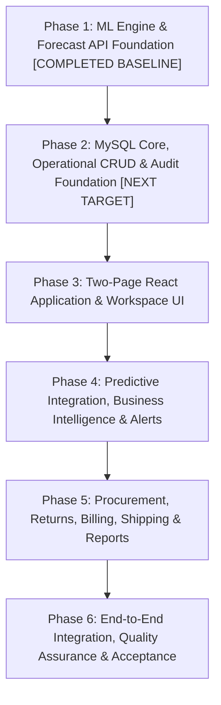

# NEXORA — Development Roadmap

- **Project:** NEXORA – AI-Powered Retail Management & Intelligence System
- **Document Version:** 2.0 — Approved Six-Phase Development Plan
- **Last Updated:** 26 November 2026
- **Repository Baseline:** `Lalith-Manohar/LLM-Project1` (Branch `main`, commit `a4657bd35ce0b772689e083d41f8f81aade4e8ae`)
- **Authoritative References:** [`Technical Blueprint v2.2`](NEXORA%20%E2%80%94%20Technical%20Blueprint%20v1.0.md) *(Section 17.2)*, [`FEATURES_STATUS.md`](FEATURES_STATUS.md) *(v2.3)*, [`Workflow Guide`](NEXORA%20%E2%80%94%20Application%20Functionality%20%26%20System%20Workflow%20Guide.md) *(v1.0)*, [`DATABASE_SCHEMA.md`](DATABASE_SCHEMA.md) *(v2.9)*, [`API_DOCUMENTATION.md`](API_DOCUMENTATION.md) *(v2.1)*, [`PROJECT_OVERVIEW.md`](PROJECT_OVERVIEW.md) *(v2.0)*

> [!IMPORTANT]
> **Six-Phase Plan & Ground-Truth Baseline:** NEXORA follows the approved **six-phase** progression from [`Technical Blueprint v2.2`](NEXORA%20%E2%80%94%20Technical%20Blueprint%20v1.0.md) (`Section 17.2`). Only **Phase 1** ML pipelines, production forecast endpoints, Task 12 experimental endpoints, a stateless inventory prototype, and a Phase 1 single-screen React demo are implemented today (`168` passing `pytest` tests across `13` suites). **Zero live MySQL tables, zero SQLAlchemy ORM classes, zero Alembic migrations, and zero operational CRUD endpoints exist yet on `main`.** No calendar deadlines or completion percentages are fabricated for Phases 2–6.

---

## 1. Approved Six-Phase Architecture & Dependency Graph

### Fixed Architectural Constraints Across All Phases
- **Two Primary Pages Only:** Page 1 (`/` — exact heading **`Welcome to NEXORA — Select Your Workspace`**) and Page 2 (`/dashboard` — **Unified Retail Management Dashboard**). No separate stakeholder dashboards or extra standalone pages.
- **Four Stakeholder Workspaces (UI Operational Context Only):** `Store Manager (Admin)`, `Inventory Staff`, `Purchase Manager`, and `Finance Staff`. Selection controls UI navigation focus and `X-NEXORA-Workspace` provenance only — **no login screens, password hashing, JWT sessions, or server-enforced RBAC exist in any phase**.
- **`18` Core Modules (`M01`–`M18`) + `4` Separate Supporting Capabilities (`SYS-01`–`SYS-04`):**
  - *Group 1 — Retail Foundation:* `M01 Product Management`, `M02 Supplier Management`, `M03 Customer Management`, `M04 Sales Management`, `M05 Order Management`
  - *Group 2 — Business Intelligence:* `M06 Business Intelligence`, `M07 Seasonal Demand Calendar`, `M08 Product Lifecycle Intelligence`
  - *Group 3 — Inventory & Procurement:* `M09 Inventory Control`, `M10 Stock Movement Tracking`, `M11 Purchase Planning Simulator`
  - *Group 4 — AI & Predictive Intelligence:* `M12 Demand Forecasting`, `M13 Price & Revenue Intelligence`, `M14 Predictive Planner`, `M15 Anomaly Detection`
  - *Group 5 — Business Operations:* `M16 Return Intelligence`, `M17 Billing & Finance`, `M18 Shipping & Delivery`
  - *Group 6 — Supporting Capabilities (Not Core Modules):* `SYS-01 Workspace Selection`, `SYS-02 Centralized History & Audit`, `SYS-03 Smart Alerts`, `SYS-04 Reports & Export`
- **All Ten Design Decisions (`DDR-01`–`DDR-10`) & All Eight Exclusions (`EXCL-01`–`EXCL-08`):** No government E-Way bills (`EXCL-01`), external shipping carrier APIs (`EXCL-02`), automatic supplier PO dispatch (`EXCL-03`), autonomous price markdowns (`EXCL-04`), chatbots/NL POS (`EXCL-05`), market basket mining (`EXCL-06`), multi-supplier optimization solvers (`EXCL-07`), or dataset customer-address scraping (`EXCL-08`).

---

## 2. Roadmap Overview Matrix

| Phase | Title | Status | Primary Modules / Capabilities Covered | Key Architectural Focus |
| :---: | :--- | :---: | :--- | :--- |
| **Phase 1** | ML Engine & Forecast API Foundation | **COMPLETED BASELINE** *(w/ Partial M12, M14, UI)* | `M12` (UCI Core + Experimental), `M14` (Prototype), Phase 1 Demo SPA | Leakage-free 7/15/30/90d ML, FastAPI `/forecast` & `/experimental` routes, stateless `/inventory/recommend`, `168` `pytest` tests |
| **Phase 2** | MySQL Core, Operational CRUD & Audit Foundation | **PLANNED (Next Major Target)** | `M01`–`M05`, `M09`, `M10`, `SYS-02` | MySQL 8.x InnoDB (`DATABASE_SCHEMA.md` v2.9), SQLAlchemy 2.x, Alembic, Foundation CRUD, immediate `tx_now` UoM rollover, Tier 1/2 Audit (`DDR-03`, `05`, `06`, `07`, `10`) |
| **Phase 3** | Two-Page React Application & Workspace UI | **PLANNED** | `SYS-01`, UI for Phase 2 (`M01`–`M05`, `M09`, `M10`, `SYS-02`) | Expand `frontend/` into Page 1 + Page 2 (`/dashboard`), Tailwind CSS, Chart.js, Workspace Switcher, `X-NEXORA-Workspace` headers |
| **Phase 4** | Predictive Integration, Business Intelligence & Alerts | **PLANNED** | `M12` (Ops Complete), `M14` (Ops Complete), `M06`–`M08`, `M13`, `M15`, `SYS-03` | Confirmed B2B demand/quarantine (`DDR-06`), live stock + supplier LT `UNAVAILABLE` risk (`DDR-01`–`03`), BI/Lifecycle/Anomaly governance (`DDR-08`), Smart Alerts |
| **Phase 5** | Procurement, Returns, Billing, Shipping & Reports | **PLANNED** | `M11`, `M16`, `M17`, `M18`, `SYS-04` | Simulator & dual-control POs (`DDR-09`), Returns & excess-stock adjustments (`DDR-06`), `INR` Invoices/Payments/Credits/Refunds (`DDR-04`), Split Shipping (`DDR-05`), formula-safe Exports |
| **Phase 6** | End-to-End Integration, QA & Acceptance | **PLANNED** | Complete System (`M01`–`M18`, `SYS-01`–`SYS-04`) | Real MySQL concurrency, audit failure recovery, E2E API/UI flows, Postman sync, viva & acceptance signoff |

---

## 3. Detailed Phase Specifications

### Phase 1 — ML Engine & Forecast API Foundation

**Phase Status:** `COMPLETED BASELINE` *(Production ML pipelines & forecast APIs complete; `M12` operational MySQL integration, `M14` live predictive planning, and full Page 1/Page 2 frontend UI remain `PARTIALLY COMPLETE` and continue in Phases 3–4).*

1. **Objective:** Establish a verified, leakage-free multi-horizon machine learning demand forecasting engine trained on the UCI Online Retail II dataset, serve predictions cleanly via FastAPI, prove experimental Task 12 improvements behind strict failure isolation, and demonstrate live browser-to-API connectivity.
2. **Scope & Deliverables:**
   - **Production ML Pipeline (`IMPLEMENTED`):** Dataset profiling ([`data_loader.py`](../backend/ml/src/data_loader.py)), 4-stream transaction isolation ([`preprocessing.py`](../backend/ml/src/preprocessing.py)), lifespan-padded daily aggregation & leakage-free calendar/lag/rolling features ([`feature_engineering.py`](../backend/ml/src/feature_engineering.py)), multi-horizon 7/15/30/90d Ridge & Random Forest training ([`train.py`](../backend/ml/src/train.py)), chronological purge/embargo evaluation ([`evaluate.py`](../backend/ml/src/evaluate.py)), CLI inference ([`predict.py`](../backend/ml/src/predict.py)), and `.joblib` binaries (`backend/ml/models/`).
   - **Production FastAPI Routes (`IMPLEMENTED`):** [`main.py`](../backend/app/main.py) (`GET /`, `/health`, `/ready`, schema-hidden `/api/v1/health`, `/api/v1/ready`) and [`forecast.py`](../backend/app/api/routes/forecast.py) (`/horizons`, `/model-metrics`, `/model-info`, `POST /`, `POST /predict`) with automatic historical CSV lookup ([`historical_data_service.py`](../backend/app/services/historical_data_service.py)).
   - **Experimental & Comparative Research (`EXPERIMENTAL` — Distinct from Production):** [`experimental_forecast.py`](../backend/app/api/routes/experimental_forecast.py) (`7` handlers under `/api/v1/experimental/*`), `ChronologicalTargetEncoder`, `PITPriceService` (`pit_sku_price_history.json`), Task 12 artifacts (`backend/ml/models_task12/`), and comparative macro routes (`/api/v1/forecast/evaluation-comparison`, `/api/v1/forecast/store-wide`) reading `backend/ml/models_experimental/`.
   - **Replenishment Prototype (`PARTIALLY COMPLETE`):** Stateless `POST /api/v1/inventory/recommend` ([`inventory.py`](../backend/app/api/routes/inventory.py), [`inventory_service.py`](../backend/app/services/inventory_service.py)) accepting caller-supplied `current_stock` and lead-time inputs.
   - **Frontend Phase 1 Demo (`PARTIALLY COMPLETE`):** Single-screen React 18 + TypeScript + Vite SPA ([`frontend/src/App.tsx`](../frontend/src/App.tsx), [`api.ts`](../frontend/src/services/api.ts), [`forecast.ts`](../frontend/src/types/forecast.ts)) calling `GET /health` and `POST /api/v1/forecast/`.
   - **Testing & Demonstration Assets:** `13` Pytest suites (`168` tests) under [`backend/tests/`](../backend/tests/test_forecast_api.py) plus Postman collections & guides in [`docs/postman/`](postman/NEXORA_Complete_Demonstration.postman_collection.json).
3. **Dependencies:** None (baseline foundation phase).
4. **Task Checklist:**
   - [x] Ingest raw UCI Online Retail II CSV/XLSX (`backend/ml/data/raw/online_retail_II.csv` & `.xlsx`) and run profiling (`eda_report.md`).
   - [x] Implement mutually exclusive 4-stream separation (`clean_gross_sales.csv`, `cancellation_transactions.csv`, `return_transactions.csv`, `exceptional_transactions.csv`) verified by `test_preprocessing.py` (`5/5`).
   - [x] Aggregate continuous daily SKU demand (`daily_product_demand.csv`: `2,287,495` rows across `4,905` SKUs) and leakage-free features (`ml_feature_dataset.csv`) verified by `test_feature_engineering.py` (`7/7`) & `test_ml_features.py` (`10/10`).
   - [x] Train, chronologically evaluate (MAE, RMSE, WAPE with purge/embargo gaps), and serialize `D_7`, `D_15`, `D_30`, `D_90` production `.joblib` models verified by `test_model_training.py` (`10/10`), `test_model_evaluation.py` (`9/9`), and `test_leakage_corrections.py` (`11/11`).
   - [x] Build FastAPI general probes (`/`, `/health`, `/ready` + `/api/v1/*` aliases) and production `/api/v1/forecast/*` routes with auto-CSV extraction (`test_main.py`: `3/3`, `test_startup_readiness.py`: `14/14`, `test_forecast_api.py`: `16/16`, `test_historical_forecast.py`: `10/10`).
   - [x] Implement isolated Task 12 experimental models/routes (`/api/v1/experimental/*`), `PITPriceService`, `/evaluation-comparison`, and `/store-wide` verified by `test_model_selection_task12.py` (`10/10`) & `test_experimental_forecast.py` (`50/50`).
   - [x] **`[PARTIALLY COMPLETE — M14 Subset]`** Deliver stateless Phase 1 `POST /api/v1/inventory/recommend` prototype (`test_inventory_recommend.py`: `13/13`); MySQL stock breakdown, supplier lead-time lookup (`DDR-01`), and approved PO incoming calculations (`DDR-02`) deferred to Phase 4.
   - [x] **`[PARTIALLY COMPLETE — Frontend Shell]`** Deliver single-screen Phase 1 React 18 + TS + Vite forecasting client (`frontend/`) for live HTTP demonstration; full Two-Page / 4-Workspace dashboard deferred to Phase 3.
   - [x] Assemble Postman academic, complete demonstration, and Task 12 experimental suites under [`docs/postman/`](postman/NEXORA_Complete_Demonstration.postman_collection.json).
5. **Acceptance Criteria *(Test Suite Executed at `e74ae89`; Unchanged Source/Test Baseline Through `a4657bd`)*:**
   - All `168/168` `pytest` tests across `13` files passed inside `backend/.venv` at commit `e74ae8970195a3609c8701799137154aa3f35d30`. Because subsequent commits through `a4657bd35ce0b772689e083d41f8f81aade4e8ae` modified only `docs/API_DOCUMENTATION.md` and `docs/PROJECT_OVERVIEW.md` (with zero source-code or test changes), this execution remains valid evidence for the Phase 1 implementation at the roadmap baseline without claiming a rerun on `a4657bd` or later documentation commits.
   - `GET /health` returns `200`; `GET /ready` verifies production models + CSV readiness (`200` / `503`) isolated from experimental Task 12 failures.
   - `POST /api/v1/forecast/` & `/predict` return non-negative finite forecasts for known (`85123A`) & unseen SKUs, `404` on unknown SKUs, and `422` on `< 29`-day SKUs (`90004A`) or invalid payloads.
6. **Out-of-Scope Boundaries:** MySQL tables, ORM models, Alembic migrations, operational CRUD modules (`M01`–`M11`, `M13`, `M15`–`M18`), `SYS-01`–`SYS-04`, and excluded features (`EXCL-01`–`EXCL-08`).

---

### Phase 2 — MySQL Core, Operational CRUD & Audit Foundation

**Phase Status:** `PLANNED — NEXT MAJOR DEVELOPMENT TARGET`

1. **Objective:** Implement MySQL 8.x (`InnoDB`) connectivity, SQLAlchemy 2.x ORM models, Alembic migrations matching [`DATABASE_SCHEMA.md`](DATABASE_SCHEMA.md) v2.9 (`41` tables), foundational Retail CRUD (`M01`–`M05`), live locked Inventory & Movement ledgers (`M09`, `M10`), and Centralized History & Audit governance (`SYS-02`).
2. **Scope & Deliverables:**
   - MySQL 8.x database setup (`backend/app/core/db.py`), session/transaction helper, startup DB readiness integration in `/ready`, and `alembic` dependency + migration scripts covering the approved **41-table schema (`DATABASE_SCHEMA.md` v2.9)** cleanly (without casual schema alterations; any discovered schema issue must raise a separate schema-review task).
   - Restricted MySQL application DB account setup omitting `UPDATE` and `DELETE` privileges on `audit_logs` (`DDR-10`).
   - Workspace provenance & correlation middleware extracting `X-NEXORA-Workspace` (`Store Manager (Admin)`, `Inventory Staff`, `Purchase Manager`, `Finance Staff`) and `X-Correlation-ID` without login/RBAC.
   - Operational REST routers & Pydantic v2 schemas (`DECIMAL` serialization + unified planned error envelope) for: `M01` Products & Categories + immediate `tx_now = NOW(6)` UoM conversion rollovers (`HTTP 422` on caller effective timestamps, `active_product_id` / `active_uom_code` `uq_uom_one_active`), `M02` Suppliers & `supplier_products` (`DDR-07`), `M03` Customers, `M04` Sales (`transactions`), `M05` Orders + confirmation stock reservation + locked idempotent partial/full `order_fulfillments` + compensating fulfilment batch reversal (`DATABASE_SCHEMA.md` v2.9 Section `6.2b`: permitted only with zero non-cancelled shipments [`pending`/`packed`/`dispatched`/`delivered`], directing dispatched/delivered goods through `M16` returns, and if invoiced requiring `SUM(credit_notes.amount) = invoice.grand_total` with `Open Refund Payable = 0.00`; never updates/deletes original `sale_fulfillment` rows, appends positive `fulfillment_reversal` movement, restores Physical and Reserved stock together while keeping Available stock invariant until explicit cancellation, and commits atomically under Tier 1 audit and idempotency) + order cancellation (`DDR-05`), `M09` Inventory Control (five separate metrics `DDR-03`, locked adjustments), `M10` Stock Movement Tracking (read-only immutable `inventory_movements`), and `SYS-02` Audit query + `audit_outbox` retry worker (`DDR-10`).
3. **Dependencies:** Phase 1 baseline (`config.py`, FastAPI app, `API_DOCUMENTATION.md` v2.1, `DATABASE_SCHEMA.md` v2.9).
4. **Task Checklist:**
   - [ ] Add `alembic` to `backend/requirements.txt`, implement SQLAlchemy 2.x engine/session factory (`backend/app/core/db.py`), and extend `/ready` to verify live MySQL connectivity alongside Phase 1 ML readiness.
   - [ ] Implement SQLAlchemy 2.x declarative models (`backend/app/models/`) and initial Alembic migration reproducing all `41` InnoDB tables, `DECIMAL` precisions, `CHECK` constraints, `VIRTUAL` generated columns, and foreign keys from [`DATABASE_SCHEMA.md`](DATABASE_SCHEMA.md) v2.9.
   - [ ] Provision `operational_settings` seed defaults (`DDR-04`, `DDR-08`, `DDR-09`) and MySQL least-privilege roles lacking `UPDATE`/`DELETE` on `audit_logs` (`DDR-10`).
   - [ ] Implement `SYS-02` Centralized History & Audit service supporting Tier 1 synchronous in-transaction `audit_logs` writes (fail-closed rollback on failure) and Tier 2 `audit_outbox` idempotent retry/dead-letter queue, plus `GET /api/v1/history` & outbox inspection.
   - [ ] Implement `M01` Product Management (`/api/v1/products`, atomic `products` + `inventory` onboarding, soft status toggles, `Discontinued` manual guard, immediate `tx_now = NOW(6)` `/uom-conversions` rollover rejecting caller timestamps with `422`) and `/api/v1/categories`.
   - [ ] Implement `M02` Supplier Management (`/api/v1/suppliers` & `/suppliers/{id}/products` retaining inactive history per `DDR-07`) and `M03` Customer Management (`/api/v1/customers` manual intake).
   - [ ] Implement `M04` Sales Management (`/api/v1/sales` stream-separated completions & traceable reversals) and `M05` Order Management (`/api/v1/orders` draft/edit, `/confirm` reserving `Available Stock` under `FOR UPDATE`, `/fulfill` idempotent partial/full batches, atomic idempotent `/fulfillments/{id}/reverse` enforcing Section `6.2b` shipment/invoice/credit/refund eligibility and positive `fulfillment_reversal` restoration under Tier 1 audit, `/cancel`).
   - [ ] Implement `M09` Inventory Control (`GET /api/v1/inventory` surfacing `Physical`/`Reserved`/`Available`/`Incoming`/`Projected Available` separately, locked `/adjustments`, bounded `/settings`) and `M10` Stock Movement Tracking (`GET /api/v1/inventory/movements` immutable ledger).
   - [ ] Write and execute automated database + API integration tests against a **live MySQL 8.x instance**.
5. **Acceptance Criteria *(Testable)*:**
   - `alembic upgrade head` executes cleanly on an empty MySQL 8.x database creating all `41` InnoDB tables, constraints, and indexes matching `DATABASE_SCHEMA.md` v2.9.
   - Concurrent/locked integration tests against live MySQL verify: `ORDER_CONFIRMED` reserves `Available` stock (`409` if insufficient); `POST /fulfill` deducts `Physical` & `Reserved` stock once and blocks duplicate `idempotency_key` (`409`); direct `UPDATE`/`DELETE` on `audit_logs` fails at DB privilege level; simulated Tier 1 audit insert failure rolls back the enclosing business transaction completely; data survives FastAPI restarts.
   - Zero authentication/RBAC tables (`users`, `roles`, `permissions`) or `/api/v1/auth/*` endpoints are introduced.
6. **Out-of-Scope Boundaries:** Login/JWT/RBAC, Phase 3 Two-Page UI components, automated PO/finance/shipping modules (Phases 4–5), and `EXCL-01`–`EXCL-08`.

---

### Phase 3 — Two-Page React Application & Workspace UI

**Phase Status:** `PLANNED`

1. **Objective:** Evolve the existing Phase 1 React + TypeScript + Vite client ([`frontend/`](../frontend/README.md)) into the approved Two-Page application hosting four stakeholder workspace contexts and live API integration for Phase 2 Foundation, Order, Sales, Inventory, Movement, and Audit operations.
2. **Scope & Deliverables:**
   - Preserve existing Vite + React 18 + TypeScript foundation while adding Tailwind CSS, `Chart.js` + `react-chartjs-2`, React Router (strictly `/` and `/dashboard`), and frontend testing dependencies.
   - **Page 1 (`/`):** Stakeholder Workspace Selection screen rendering the exact heading **`Welcome to NEXORA — Select Your Workspace`**, four workspace selection cards (`Store Manager (Admin)`, `Inventory Staff`, `Purchase Manager`, `Finance Staff`), no password/login fields, and smooth transition to `/dashboard`.
   - **Page 2 (`/dashboard`):** Unified Retail Management Dashboard with in-header **Workspace Switcher**, Smart Alerts badge/drawer placeholder, workspace-scoped navigation sidebar/tabs, typed API client (`X-NEXORA-Workspace` + `X-Correlation-ID` headers), separate display of all five stock metrics (`Physical`, `Reserved`, `Available`, `Incoming`, `Projected Available`), loading/empty/`422`/API-failure UI states, and destructive/irreversible confirmation modals.
3. **Dependencies:** Phase 2 operational REST endpoints (`/products`, `/suppliers`, `/customers`, `/orders`, `/sales`, `/inventory`, `/inventory/movements`, `/history`), Phase 1 React skeleton (`frontend/`).
4. **Task Checklist:**
   - [ ] **`[PARTIALLY COMPLETE — Phase 1 Demo Exists]`** Upgrade existing `frontend/package.json` and project scaffolding with Tailwind CSS, `chart.js`, `react-chartjs-2`, React Router, and Vitest / React Testing Library without discarding working API connectivity.
   - [ ] Implement Page 1 (`/`) displaying exact heading `Welcome to NEXORA — Select Your Workspace` and the 4 workspace cards (persisting active workspace context across in-tab refreshes).
   - [ ] Implement Page 2 (`/dashboard`) unified shell with in-header Workspace Switcher (`SYS-01`), module navigation tabs filtered per workspace, and zero separate per-role pages/routes.
   - [ ] Build typed Axios/`fetch` service modules and TypeScript interfaces matching Pydantic v2 `DECIMAL` & pagination contracts cleanly, attaching `X-NEXORA-Workspace` on every request.
   - [ ] Implement interactive UI views & modals for Phase 2 modules (`M01`–`M05`, `M09`–`M10`, `SYS-02`) plus existing `M12` forecast inspection, clearly displaying all 5 stock metrics separately and separating historical `GBP` UCI figures from live `INR` records.
   - [ ] Implement mandatory Loading, Empty, `422` field-validation, API error retry banners, and confirmation dialogs before irreversible actions (Confirm/Fulfill/Cancel Order, Adjust Stock, Deactivate Catalog/Partner).
   - [ ] Execute frontend component/routing/API integration tests.
5. **Acceptance Criteria *(Testable)*:**
   - Only `/` and `/dashboard` application pages exist; switching between all 4 workspaces filters Page 2 views without reloading away from `/dashboard` or prompting for credentials.
   - Frontend build (`tsc && vite build`) and UI test suite pass, proving CRUD actions persist across browser/server reloads in MySQL and never claim workspace selection is login/RBAC.
6. **Out-of-Scope Boundaries:** Login screens, JWT token storage, separate `/admin` or `/warehouse` routes, hardcoded mock business numbers disguised as live MySQL results, and modules from Phases 4–5 (`EXCL-01`–`EXCL-08`).

---

### Phase 4 — Predictive Integration, Business Intelligence & Alerts

**Phase Status:** `PLANNED`

1. **Objective:** Connect MySQL confirmed B2B demand, live stock positions, and hierarchical supplier lead times to ML forecasting (`M12` + `M14`), and implement Business Intelligence (`M06`), Seasonal Calendar (`M07`), Lifecycle Intelligence (`M08`), Price/Revenue Intelligence (`M13`), Anomaly Detection (`M15`), and Smart Alerts (`SYS-03`).
2. **Scope & Deliverables:**
   - **`M12` Operational Completion (`DDR-06`):** Persist `model_runs` and `forecasts` in MySQL; convert confirmed B2B order quantities (`orders.requested_delivery_date`) via historical `uom_conversions` to `base_uom` inside `daily_demand_observations`; validate/quarantine malformed inputs into `demand_quarantine`; record order-cancellation & (hookable) adjustment entries in `demand_adjustments`; isolate `one_time_bulk`/`tender` demand and flag `is_censored_demand`; preserve Phase 1 `.joblib` 10-column inference parity (`< 29` calendar days `422`); add scheduled offline batch retraining & drift checks.
   - **`M14` Operational Completion (`DDR-01`–`DDR-03`):** Implement `/api/v1/predictive-planner/*` reading live MySQL `Physical`, `Reserved`, `Available`, `Approved Outstanding PO Incoming Stock`, and `supplier_products` $\rightarrow$ `suppliers` lead times (`UNAVAILABLE` when absent — never invent lead times; `(Forecast/H) * L * safety_factor`), superseding the stateless `/api/v1/inventory/recommend` prototype (`test_13` experimental flag preserved if kept for transition/reference).
   - **BI & Analytical Governance (`M06`, `M07`, `M08`, `M13`, `M15`, `SYS-03`):** Implement Chart.js BI views (`/api/v1/analytics/*` separating `GBP` UCI history vs. `INR` operational sales), Seasonal Demand Calendar heatmaps, Lifecycle hysteresis + manual `Discontinued` (`product_lifecycle_snapshots`), read-only Price/Revenue analytics (`EXCL-04`), hybrid statistical (`z-score` zero-variance safe) & rule Anomaly Detection (`anomaly_events`), deduplicated `SYS-03` Smart Alerts (`alerts` acknowledge/resolve), and Tier-1-audited bounded `operational_settings` updates + reset-to-default (`DDR-08`).
3. **Dependencies:** Phase 1 `.joblib` forecast engine (`prediction_service`), Phase 2 MySQL operational foundation (`M01`, `M02`, `M04`, `M05`, `M09`, `M10`, `SYS-02`), Phase 3 Unified Dashboard UI.
4. **Task Checklist:**
   - [ ] Implement `M12` B2B demand observation pipeline (`daily_demand_observations`, `demand_quarantine`, `demand_adjustments` on cancellations, `model_runs`, `forecasts`), keeping `/api/v1/forecast/*` backwards-compatible (`test_forecast_api.py`).
   - [ ] Implement offline scheduled retraining & WAPE/feature-drift detection script/hooks (`model_runs.drift_status`), strictly decoupled from HTTP request paths.
   - [ ] Implement `M14` Predictive Planner (`/api/v1/predictive-planner/recommend`, `/portfolio`, `/refresh`) enforcing `DDR-01`, `DDR-02`, and `DDR-03` (`UNAVAILABLE` lead-time disclosure + horizon-fallback view clearly separated) and wire Page 2 UI tables/charts, retiring prototype dependency on caller-supplied stock.
   - [ ] Implement `M06` Business Intelligence & `M07` Seasonal Demand Calendar endpoints and Page 2 Chart.js visualizations separating `GBP` UCI baseline and `INR` operational data.
   - [ ] Implement `M08` Product Lifecycle Intelligence (`Introduction`..`Discontinued` hysteresis, append-only snapshots, manual `Discontinued` transition), `M13` Price & Revenue Intelligence (read-only), and bounded lifecycle threshold config/reset.
   - [ ] Implement `M15` Anomaly Detection (`/intelligence/anomalies` scan/list with zero-variance guard + bounded settings) and `SYS-03` Smart Alerts (`/alerts` deduplicated active alerts, acknowledge/resolve, Page 2 header bell drawer).
   - [ ] Execute unit & MySQL integration tests for `DDR-01`–`DDR-03`, `DDR-06` quarantine/demand isolation, `DDR-08` hysteresis/alert suppression, and Page 2 BI/Planner views.
5. **Acceptance Criteria *(Testable)*:**
   - `M14` risk outputs reconcile mathematically with `(Forecast/H) * L * safety_factor`, `Available = Physical - Reserved`, `Projected = Available + Approved Incoming`, and explicitly return `UNAVAILABLE` when no supplier lead time exists.
   - Malformed B2B demand rows land cleanly in `demand_quarantine` without aborting demand aggregation; `Discontinued` never triggers automatically; unresolved duplicate alerts are suppressed at the DB constraint/service layer.
6. **Out-of-Scope Boundaries:** Autonomous price markdowns (`EXCL-04`), market basket mining (`EXCL-06`), multi-supplier optimization solvers (`EXCL-07`), and `excess_stock` return intake / PO approvals / billing / shipping (Phase 5).

---

### Phase 5 — Procurement, Returns, Billing, Shipping & Reports

**Phase Status:** `PLANNED`

1. **Objective:** Complete all transactional downstream business operations across Procurement Simulation & Dual-Control POs (`M11`), Return Intelligence (`M16`), `INR` Billing/Payments/Credits/Refunds (`M17`), Internal Split Shipping (`M18`), and Formula-Safe Reports & Export (`SYS-04`).
2. **Scope & Deliverables:**
   - **`M11` Purchase Planning Simulator & POs (`DDR-01`, `DDR-02`, `DDR-07`, `DDR-09`):** Stateless `/api/v1/simulator/calculate` + `/draft-po` handoff; `/api/v1/purchase-orders` lifecycle (draft, edit invalidating prior approval on supplier/qty/price mutation, submit, Tier 1 `Purchase Manager` approval `<= Tier 1 Limit` with Store Manager digest vs. Store Manager escalation on `> Limit`/same-supplier split window/DDR-08 anomaly/price spike via `purchase_order_approvals`, rejection retaining reason, partial/full receipts via `purchase_order_receipts` moving `Incoming` $\rightarrow$ `Physical` + `purchase_receipt` movements, bounded `/settings/procurement` config/reset). No automated supplier dispatch (`EXCL-03`).
   - **`M16` Return Intelligence (`DDR-06`):** `returns` & `return_items` intake (`excess_stock`/`defective`/`damaged`/`other`, disposition `restock`/`damaged`), over-return cap against fulfilled qty, `excess_stock` demand adjustment hook (`demand_adjustments`) leaving `defective` baseline demand intact, and return/cancellation health metrics.
   - **`M17` Billing & Finance (`DDR-04`, Schema v2.9):** Immutable `INR` `DECIMAL` invoices (`uq_inv_fulfillment` blocking duplicate fulfilment billing), centrally configurable forward-only tax rate (`operational_settings`) with frozen invoice tax/billing snapshots, append-only `payments`, bounded `credit_notes` (separating `fully_credited` from `refunded`), separate `refunds` payouts (`pending` entitlement reserve capped per credit note & net settled payments, never mutating `payments`), and financial reconciliation. No E-Way bills (`EXCL-01`).
   - **`M18` Shipping & Delivery (`DDR-05`):** Internal pick lists, printable `packing_slips`, internal parcel labels, `1:N` split shipments (`shipments`, `shipment_items`), and append-only `shipment_events` (`pending` $\rightarrow$ `delivered`) distinct from fulfilment stock deduction. No external carrier APIs (`EXCL-02`).
   - **`SYS-04` Reports & Export:** Bounded paginated previews, JSON exports, formula-neutralized CSV (`=`, `+`, `-`, `@`, `\t`, `\r` escaped), printable modals, and `REPORT_EXPORTED` Tier 2 audit logging (`SYS-02`).
3. **Dependencies:** Phase 2 foundation (`M01`–`M05`, `M09`–`M10`, `SYS-02`), Phase 3 UI shell, Phase 4 predictive planner (`M14`), anomaly alerts (`M15`, `SYS-03`), and `demand_adjustments` pipeline (`M12`).
4. **Task Checklist:**
   - [ ] Implement `M11` stateless Purchase Simulator (`/api/v1/simulator/*`) and durable `/api/v1/purchase-orders` + `/settings/procurement` with `DDR-09` dual-control approvals, split/anomaly/price escalation, post-approval invalidation, and `DDR-02` partial/full receipts (`purchase_order_receipts`).
   - [ ] Implement `M16` Return Intelligence (`/api/v1/returns`, `/intelligence/returns/summary`) enforcing over-return caps, physical `restock`/`damaged` movements, and `excess_stock`-only `demand_adjustments`.
   - [ ] Implement `M17` Billing & Finance (`/api/v1/invoices`, `/payments`, `/credit-notes`, `/refunds`, `/finance/reconciliation`, `/settings/finance`) enforcing `INR` `DECIMAL`, frozen tax snapshots, `uq_inv_fulfillment`, `'fully_credited'` vs. `'refunded'`, and `refunds` payout capping/reserves.
   - [ ] Implement `M18` Shipping & Delivery (`/api/v1/shipping/*`) generating internal pick lists, printable packing slips, routing labels, `1:N` split parcels, and `shipment_events` progressions.
   - [ ] Implement `SYS-04` Reports & Export (`/api/v1/reports/*`) with row-limit caps, JSON/formula-escaped CSV streaming, printable views, and `REPORT_EXPORTED` audit tracking.
   - [ ] Integrate all Phase 5 tabs, confirmation modals, and print previews into Page 2 across the 4 workspaces, and execute automated unit + MySQL integration tests.
5. **Acceptance Criteria *(Testable)*:**
   - Only `approved`/`partially_received` PO outstanding quantities enter `Incoming Stock`; escalated/split POs block under `Purchase Manager` until `Store Manager (Admin)` approval; editing an approved PO revokes approval cleanly.
   - `excess_stock` returns increment `Physical Stock`, log `return_restock`, and insert `demand_adjustments`, whereas `defective` returns do not distort clean demand.
   - Crediting an unpaid invoice sets `fully_credited` (not `refunded`); duplicate `refunds` exceeding settled payments net of pending reserves or exceeding credit-note caps fail with `409`/`422`; two invoices billing one `order_fulfillment_id` are rejected (`uq_inv_fulfillment`).
   - CSV export tests prove `=CMD(...)` / `+...` / `-...` / `@...` cells are neutralized safely.
6. **Out-of-Scope Boundaries:** `EXCL-01`–`EXCL-08` (E-Way bills, carrier APIs, auto PO dispatch, autonomous pricing, chatbots, market basket, multi-supplier solvers, address scraping).

---

### Phase 6 — End-to-End Integration, Quality Assurance & Acceptance

**Phase Status:** `PLANNED`

1. **Objective:** Validate NEXORA end-to-end as one integrated retail + ML platform across real MySQL persistence, FastAPI contracts, ML-to-operations alignment, Page 1/Page 2 frontend flows, error/concurrency safety, documentation synchronization, and academic defense readiness.
2. **Scope & Deliverables:**
   - Connected E2E integration & UI acceptance test suite covering `Workflows A–G` (`FEATURES_STATUS.md` Section 7) and the 15-step demonstration scenario (`Technical Blueprint Section 20.2`).
   - Real MySQL concurrency (`FOR UPDATE`), rollback (`DDR-10` Tier 1 fail-closed), `audit_outbox` recovery + dead-letter, DB privilege check (`UPDATE`/`DELETE` denied on `audit_logs`), and server-restart persistence tests.
   - Strict input validation, malformed-payload fuzz/boundary testing (`400`/`404`/`409`/`422`/`503`), secret-redaction, CSV formula safety, and non-auth workspace verification checks.
   - Operational Postman suite updates, final documentation/registry verification (`DEVELOPMENT_LOG.md`, `FEATURES_STATUS.md`, `KNOWN_ISSUES.md`), and academic demonstration rehearsal.
3. **Dependencies:** Phases 1–5 completed and individually verified.
4. **Task Checklist:**
   - [ ] Build and run connected automated E2E suite tracing catalog onboarding $\rightarrow$ customer intake $\rightarrow$ order confirm/fulfill $\rightarrow$ ledger check $\rightarrow$ ML forecast & planner risk $\rightarrow$ PO simulate/dual-approve/receive $\rightarrow$ `INR` invoice/payment $\rightarrow$ excess/defective return/credit/refund $\rightarrow$ split shipping dispatch $\rightarrow$ workspace switching $\rightarrow$ audit search $\rightarrow$ formula-safe CSV export.
   - [ ] Execute database concurrency, deadlock/lock-wait, Tier 1 fail-closed rollback, Tier 2 outbox dead-letter recovery, DB-grant hardening, and `DECIMAL` reconciliation test suite against live MySQL 8.x.
   - [ ] Execute API error-handling, performance/latency sanity checks (startup `.joblib` load, indexed query responsiveness), Pydantic validation, and no-auth boundary checks across all operational endpoints.
   - [ ] Execute frontend automated UI suite across Page 1 & Page 2 (`loading`, `empty`, `422`, `500`/`503`, confirmation dialogs, zero fabricated live numbers).
   - [ ] Update Postman collections/guides for operational endpoints and synchronize final knowledge registries; conduct dry-run academic viva walkthrough.
5. **Acceptance Criteria *(Testable — No Premature Signoff Permitted)*:**
   - 100% pass rate on executed full backend, ML, real-MySQL DB, E2E integration, and frontend test runs **after final edits** (zero skipped/suppressed critical failures).
   - Confirmed restart recovery (stopping/restarting Uvicorn + Vite preserves all MySQL state and deterministic `.joblib` model loading).
   - Zero documented discrepancies between repository code/schema/tests and knowledge docs prior to academic defense.
6. **Out-of-Scope Boundaries:** Any feature in `EXCL-01`–`EXCL-08` and any unapproved login/RBAC subsystem.

---

## 4. Known Cross-Phase Coordination Notes

- **Sequential Order vs. Cross-Phase Hooks (`M12` / `M15` / `M16`):** While Phase 4 precedes Phase 5 under Blueprint Section 17.2:
  - Phase 4 establishes `demand_adjustments` handling for confirmed-order cancellations (`M05`, Phase 2), while Phase 5 wires `excess_stock` customer return adjustments from `M16` into `demand_adjustments`.
  - Phase 4 establishes `anomaly_events` & `SYS-03` alert suppression (`M15`), while Phase 5 wires `M15` high-severity anomaly and same-supplier rolling-window split checks directly into `M11` PO escalation gating (`DDR-09`).
- **Prototype Transition (`POST /api/v1/inventory/recommend`):** Remains active for Phase 1 demonstration/regression continuity until Phase 4 operationalizes `M14` (`/api/v1/predictive-planner/*`), at which point `/inventory/recommend` is superseded or clearly scoped per Phase 4 migration notes without silently altering tested Phase 1 contracts beforehand.

---

## 5. Revision History

| Version | Date | Authoritative Baseline | Summary of Changes |
| :---: | :--- | :--- | :--- |
| **1.0** | November 2026 | Legacy Draft | Initial 7-phase roadmap featuring a dedicated Phase 3 authentication/JWT/`bcrypt`/6-role RBAC milestone (`users`, `roles`, `permissions`), separate role dashboards, 13-module layout, legacy `60`-test baseline, fixed November calendar targets, and uninitialized frontend assumptions. |
| **2.0** | 26 November 2026 | Technical Blueprint v2.2 (`Section 17.2`), `FEATURES_STATUS.md` v2.3, Workflow Guide v1.0, `DATABASE_SCHEMA.md` v2.8, `API_DOCUMENTATION.md` v2.0, `PROJECT_OVERVIEW.md` v2.0 | Realigned to the approved **six-phase** plan: retired the obsolete authentication/RBAC phase and 6-role/13-module assumptions; standardized architecture around Page 1/Page 2, 4 UI workspaces, `18` core modules (`M01`–`M18`), `4` separate supporting capabilities (`SYS-01`–`SYS-04`), `DDR-01`–`DDR-10`, and `EXCL-01`–`EXCL-08`; reconciled completed Phase 1 baseline (`2,287,495` daily rows across `4,905` SKUs, production + isolated Task 12 routes, partial stateless `inventory/recommend`, Phase 1 demo React SPA, `168` passing `pytest` tests); marked MySQL (`41`-table Schema v2.8)/SQLAlchemy/Alembic explicitly as planned Phase 2 deliverables; added structured dependencies and testable acceptance criteria per phase without fabricated calendar deadlines. |
