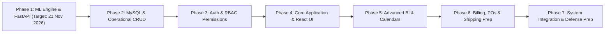

# NEXORA – Development Roadmap

## 1. Phased Development Plan (Blueprint Alignment)

The NEXORA project follows a structured 7-phase architecture:

---

## 2. Phase-by-Phase Breakdown & Tracking

### Phase 1: ML Demand Forecasting & API Serving (Target: 21 November 2026)
*Deliverable: A functioning ML prediction API delivering non-negative multi-horizon forecasts tested via Swagger UI.*
- [x] **Project Structure & Layout:** Clean separation of `backend/`, `frontend/`, `docs/`, and `backend/ml/`.
- [x] **FastAPI Foundation:** Setup root (`/`), health (`/health`), CORS, and Swagger UI (`/docs`).
- [x] **API Route & Schemas:** Defined forecast schemas in Pydantic v2.
- [x] **ML Pipeline Stubs:** Structured stubs in `backend/ml/src/` (`data_loader.py`, `preprocessing.py`, `feature_engineering.py`, `train.py`, `evaluate.py`, `predict.py`).
- [x] **Documentation Modernization:** Complete alignment of documentation with Technical Blueprint v1.0.
- [x] **UCI Dataset Acquisition:** Acquired and verified UCI Online Retail II dataset (`backend/ml/data/raw/online_retail_II.csv`, 541,910 rows).
- [x] **Dataset Ingestion & Exploratory Analysis (EDA):** Implemented in `backend/ml/src/data_loader.py`; generated `backend/ml/data/processed/eda_report.md` profiling missing values, price/quantity distributions, and cancellation vs return cross-tabulation.
- [x] **Data Cleaning & Transaction Isolation:** Implemented in `backend/ml/src/preprocessing.py`; generated `clean_gross_sales.csv` (530,105 rows), `cancellation_transactions.csv` (9,288 rows), `return_transactions.csv` (1,336 rows), and `exceptional_transactions.csv` (1,181 rows) with 100% reconciliation.
- [ ] **Daily Product Aggregation:** Aggregate daily sales per `StockCode` with continuous date ranges and zero-demand padding.
- [ ] **Leakage-Free Feature Engineering:** Construct calendar dynamics, lags (1, 7, 14, 28), and rolling windows (7, 28).
- [ ] **Model Training & Comparison:** Fit seasonal naïve baseline, Linear Regression, Random Forest, and optional XGBoost across 7, 15, 30, and 90-day targets.
- [ ] **Chronological Validation:** Rolling-origin backtesting evaluating MAE, RMSE, and WAPE.
- [ ] **Model Serialization:** Persist fitted estimators using Joblib to `backend/ml/models/`.
- [ ] **FastAPI Inference Wiring:** Connect `prediction_service.py` to loaded `.joblib` estimators.
- [ ] **Endpoint Verification:** Verify multi-horizon forecast responses via Swagger UI.

---

### Phase 2: MySQL Database & Operational CRUD (Planned)
*Deliverable: Functioning product catalog and inventory management APIs backed by MySQL.*
- [ ] Configure MySQL 8.x connection, connection pooling, and Alembic migrations.
- [ ] Implement initial relational tables (`products`, `transactions`, `transaction_items`, `inventory`, `inventory_movements`).
- [ ] Build product catalog CRUD endpoints with soft-deletion support.
- [ ] Implement inventory management endpoints, tracking current stock and manual adjustments.
- [ ] Establish transactional inventory movements ledger for stock accountability.

---

### Phase 3: Login, Security & Granular RBAC (Planned)
*Deliverable: Server-enforced authentication and role-based permissions.*
- [ ] Implement `roles`, `permissions`, `role_permissions`, `users`, and `activity_logs` tables.
- [ ] Setup password hashing (bcrypt) and stateless JWT token authentication.
- [ ] Implement dependency injection for role and permission checks on FastAPI routes.
- [ ] Define backend protection across all 6 roles (`Admin`, `Executive`, `Inventory Manager`, `Warehouse Worker`, `Finance Employee`, `Sales Employee`).

---

### Phase 4: Core Application & React Dashboards (Planned)
*Deliverable: Operational React frontend with role-specific home dashboards.*
- [ ] Initialize React + TypeScript application with Tailwind CSS and Vite in `frontend/`.
- [ ] Build role-based home dashboards with dynamic views per authenticated role.
- [ ] Implement Chart.js visualizations for sales trends, volume analysis, and country breakdown.
- [ ] Build Master Stock inventory table and low-stock alert views.
- [ ] Create Predictive Planner page displaying 7, 15, 30, 90-day demand curves alongside current stock levels and risk status (`CRITICAL`, `ELEVATED`, `SAFE`).

---

### Phase 5: Advanced Intelligence & Anomaly Detection (Planned)
*Deliverable: Specialized analytical dashboards and warning systems.*
- [ ] Build Seasonal Demand Calendar displaying day-of-week and monthly sales patterns.
- [ ] Implement Product Lifecycle Intelligence categorizing SKUs into Emerging, Growing, Stable, Declining, or Inactive.
- [ ] Construct Price and Revenue Intelligence dashboard evaluating price distributions and revenue correlations.
- [ ] Implement Product Health & Return Intelligence tracking return rates and credit transactions.
- [ ] Build statistical Anomaly Detection flagging unusual volume spikes, drops, and cancellation surges.
- [ ] Build Purchase Planning Simulator enabling interactive "what-if" lead-time testing.

---

### Phase 6: Operational Modules (Purchasing, Billing, Shipping) (Planned)
*Deliverable: Paper-ready invoice generation, purchase approval workflows, and packing slips.*
- [ ] Implement Purchase Order drafting, supplier catalog management, and executive human approval workflows.
- [ ] Implement Billing module with customer intake forms, automated tax calculation, grand totals, and print-ready invoices.
- [ ] Implement Credit Note issuance linked to invoices.
- [ ] Build Shipping Preparation module generating internal packing slips and package routing labels.

---

### Phase 7: System Finalization & Acceptance Testing (Planned)
*Deliverable: Fully integrated, validated enterprise retail management platform.*
- [ ] End-to-end integration testing across frontend, backend, ML engine, and database.
- [ ] Verify server-side role security (unauthorized API calls rejected regardless of client UI state).
- [ ] Validate financial decimal precision and inventory transactional integrity.
- [ ] Comprehensive documentation review, demonstration walk-through, and defense rehearsal.
