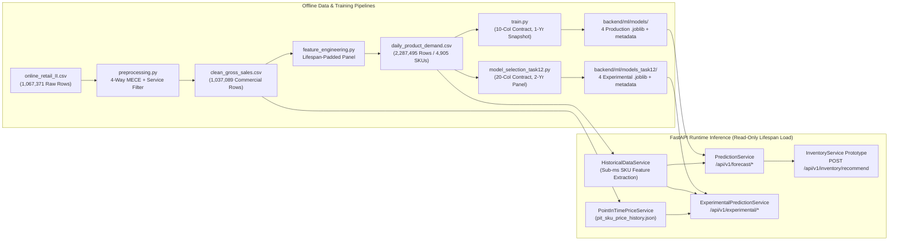
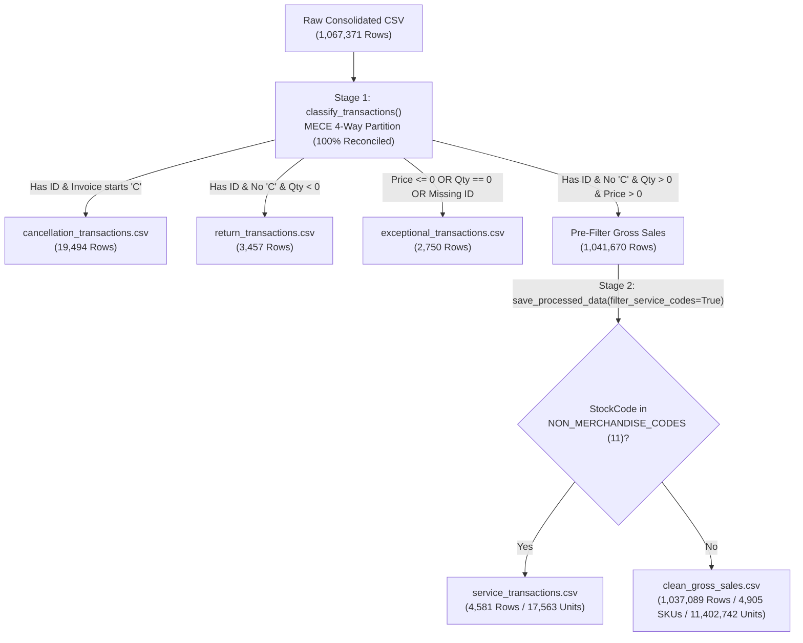

# NEXORA — Machine Learning Documentation

- **Project:** NEXORA – AI-Powered Retail Management & Intelligence System
- **Document Version:** 2.0 — Comprehensive Audit Alignment & Technical Reference
- **Last Updated:** 27 November 2026
- **Repository Baseline:** `Lalith-Manohar/LLM-Project1` (Branch `main`, commit `a03efa85a8b7b896aaba588d2bdb0b50670e3383`)
- **Authoritative Cross-References:** [`Technical Blueprint v2.2`](NEXORA%20%E2%80%94%20Technical%20Blueprint%20v1.0.md), [`FEATURES_STATUS.md`](FEATURES_STATUS.md) *(v2.3)*, [`DATABASE_SCHEMA.md`](DATABASE_SCHEMA.md) *(v2.8)*, [`API_DOCUMENTATION.md`](API_DOCUMENTATION.md) *(v2.0)*, [`PROJECT_OVERVIEW.md`](PROJECT_OVERVIEW.md) *(v2.0)*, [`DEVELOPMENT_ROADMAP.md`](DEVELOPMENT_ROADMAP.md) *(v2.0)*

> [!IMPORTANT]
> **Implementation vs. Experimental vs. Planned Boundaries:**
> - **Implemented Production Baseline (`M12` Core):** Multi-stage ingestion, four-stream isolation + service-code filtering, continuous daily SKU demand aggregation, leakage-free feature engineering, multi-horizon (`7, 15, 30, 90` days) model training and serialization (`backend/ml/models/`), and FastAPI production inference (`/api/v1/forecast/*`) with automatic historical CSV lookup are **implemented and active on `main`**.
> - **Experimental Research Extensions (`EXPERIMENTAL`):** Task 12 models (`backend/ml/models_task12/`), cutoff-aware point-in-time pricing (`PointInTimePriceService`), `/api/v1/experimental/*`, and macro/comparative artifacts (`backend/ml/models_experimental/`) operate on `main` strictly isolated from production readiness (`/ready`) and baseline contracts.
> - **Partial Replenishment Prototype (`PARTIALLY IMPLEMENTED`):** `POST /api/v1/inventory/recommend` consumes ML forecasts statistically from caller-supplied stock/lead-time parameters; full MySQL-backed `M14 Predictive Planner` (`DDR-01`–`DDR-03`, `UNAVAILABLE` lead-time state) remains **planned**.
> - **Operational Retail ML Integration (`PLANNED`):** Confirmed B2B order ingestion (`requested_delivery_date`), base-UoM conversions (`uom_conversions`), `demand_adjustments`, `demand_quarantine`, stockout-censored demand flags (`is_censored_demand`), MySQL `forecasts`/`model_runs` persistence, and scheduled offline retraining + drift monitoring (`DDR-06`) remain **planned** for Phase 4 (`0` live MySQL tables exist on `main`).

---

## 1. Overview and ML Architecture

The NEXORA Machine Learning subsystem serves as the demand forecasting intelligence core of the platform (`Module M12 Demand Forecasting`). It produces cumulative non-negative unit demand projections across four distinct operational planning horizons (**7, 15, 30, and 90 days**) using decoupled scikit-learn regression pipelines trained offline on empirical retail transaction logs.

### Architectural Design Principles
1. **Direct Multi-Horizon Regression (`TD-002`):** Separate dedicated models predict cumulative demand ($D_7, D_{15}, D_{30}, D_{90}$) rather than recursively rolling forward 1-day predictions, preventing compound error growth across 90-day quarters.
2. **Offline Batch Training vs. Read-Only Online Serving (`TD-005`, `DDR-06`):** Model training and hyper-parameter search run strictly via offline Python scripts producing serialized `.joblib` binaries and JSON metadata manifests. The FastAPI application loads these artifacts read-only during application startup (`lifespan`) for sub-millisecond inference and never trains inside HTTP request handlers.
3. **Strict Generation Isolation:** The Phase 1 production baseline (`backend/ml/models/` -> `PredictionService` -> `/api/v1/forecast/*`) is architecturally separated from Task 12 experimental models (`backend/ml/models_task12/` -> `ExperimentalPredictionService` -> `/api/v1/experimental/*`) and comparative macro models (`backend/ml/models_experimental/` -> `StoreWideService`). Failures in experimental components must never degrade production inference or fail `/ready`.
4. **Human-in-the-Loop Decision Support (`EXCL-03`):** Demand forecasts inform replenishment risk views and human Purchase Order (PO) approvals; the ML subsystem never places autonomous vendor orders or autonomously alters prices (`EXCL-04`).

---

## 2. Implementation Status

Every ML component on branch `main` (`a03efa85`) is classified below using actual source code, model artifacts, and verified tests (`IMPLEMENTED`, `PARTIALLY IMPLEMENTED`, `EXPERIMENTAL`, `PLANNED`, `EXCLUDED`).

| Component / Stage | Classification | Verified Implementation Reality on `main` | Primary Code / Artifact Evidence |
| :--- | :---: | :--- | :--- |
| **Raw Dataset Recovery & EDA Profiling** | **`IMPLEMENTED`** | Multi-sheet `.xlsx` -> `.csv` consolidator and raw `latin1` EDA profiler implemented. Consumes the recovered 2-year dataset (`1,067,371` rows). | [`convert_xlsx_to_csv.py`](../backend/ml/src/convert_xlsx_to_csv.py), [`verify_dataset_conversion.py`](../backend/ml/src/verify_dataset_conversion.py), [`data_loader.py`](../backend/ml/src/data_loader.py) |
| **Four-Stream Preprocessing & Service Isolation** | **`IMPLEMENTED`** | Mutually exclusive, collectively exhaustive (MECE) 4-stream partitioning plus 11-code non-merchandise service separation with 100% reconciliation. | [`preprocessing.py`](../backend/ml/src/preprocessing.py), [`test_preprocessing.py`](../backend/tests/test_preprocessing.py) |
| **Continuous Daily SKU Aggregation** | **`IMPLEMENTED`** | Aggregates commercial sales to `(StockCode, date)` and zero-pads strictly inside each SKU's `[min_date, max_date]` lifespan (`2,287,495` rows across `4,905` SKUs). | [`feature_engineering.py`](../backend/ml/src/feature_engineering.py), [`daily_product_demand.csv`](../backend/ml/data/processed/daily_product_demand.csv) |
| **Leakage-Free Feature Engineering** | **`IMPLEMENTED`** | Computes causal calendar features, shifted lags (`1, 7, 14, 28`), shifted rolling means (`7, 28`), and cumulative horizons $D_7, D_{15}, D_{30}, D_{90}$ preserving tail `NaN`s. | [`feature_engineering.py`](../backend/ml/src/feature_engineering.py), [`test_ml_features.py`](../backend/tests/test_ml_features.py) |
| **Production Model Training & Serialization** | **`IMPLEMENTED`** | Trains Weekly-Average Baseline, Ridge Regression, and Random Forest pipelines across `7/15/30/90`d and saves verified `.joblib` pipelines + JSON metadata. | [`train.py`](../backend/ml/src/train.py), [`backend/ml/models/models_metadata.json`](../backend/ml/models/models_metadata.json) |
| **Chronological Purge/Embargo Evaluation** | **`IMPLEMENTED`** | Implements MAE, RMSE, and zero-safe WAPE alongside chronological train/val splitting enforcing $t_{\text{train}} + H < V$. | [`evaluate.py`](../backend/ml/src/evaluate.py), [`test_model_evaluation.py`](../backend/tests/test_model_evaluation.py) |
| **Production FastAPI Inference & Auto CSV Lookup** | **`IMPLEMENTED`** | FastAPI lifespan loads production `.joblib` models (`PredictionService`) and indexes `daily_product_demand.csv` (`HistoricalDataService`), serving `/api/v1/forecast/*` plus CLI helper `predict.py`. | [`main.py`](../backend/app/main.py), [`prediction_service.py`](../backend/app/services/prediction_service.py), [`historical_data_service.py`](../backend/app/services/historical_data_service.py), [`forecast.py`](../backend/app/api/routes/forecast.py), [`predict.py`](../backend/ml/src/predict.py) |
| **Task 12 Experimental Pipeline & API** | **`EXPERIMENTAL`** | 66-candidate search (`ChronologicalTargetEncoder`, `ResidualRegressor`, `DateGroupedTimeSeriesSplit`, cutoff-aware `PointInTimePriceService`, 20-col contract), isolated under `/api/v1/experimental/*`. | [`model_selection_task12.py`](../backend/ml/experiments/model_selection_task12.py), [`experimental_prediction_service.py`](../backend/app/services/experimental_prediction_service.py), [`experimental_forecast.py`](../backend/app/api/routes/experimental_forecast.py) |
| **Comparative & Store-Wide Macro Forecasting** | **`EXPERIMENTAL`** | Multi-tier SKU-vs-macro evaluation comparison and store-wide aggregate forecasting read from `models_experimental/` JSON/Joblib artifacts. | [`store_wide_forecasting.py`](../backend/ml/experiments/store_wide_forecasting.py), [`sku_level_optimization.py`](../backend/ml/experiments/sku_level_optimization.py), [`store_wide_service.py`](../backend/app/services/store_wide_service.py) |
| **Stateless Inventory Replenishment Prototype** | **`PARTIALLY IMPLEMENTED`** | `POST /api/v1/inventory/recommend` interpolates live ML forecasts using caller-supplied `current_stock` and lead times. **Not** full MySQL-backed `M14 Predictive Planner` (`DDR-01`–`DDR-03`). | [`inventory.py`](../backend/app/api/routes/inventory.py), [`inventory_service.py`](../backend/app/services/inventory_service.py), [`inventory.py` schema](../backend/app/schemas/inventory.py) |
| **Operational B2B Demand, MySQL & MLOps (`DDR-06`)** | **`PLANNED`** | Confirmed B2B order aggregation, `uom_conversions`, `demand_adjustments`, `demand_quarantine`, `is_censored_demand`, MySQL `forecasts`/`model_runs` persistence, scheduled batch retraining, and drift monitoring. | [`DATABASE_SCHEMA.md`](DATABASE_SCHEMA.md) v2.8 *(target only; `0` live MySQL tables)* |
| **Autonomous Ordering, Auto-Markdowns & Basket Mining** | **`EXCLUDED`** | Automated supplier PO dispatch (`EXCL-03`), autonomous price discounts (`EXCL-04`), and market basket / association mining (`EXCL-06`). | [`Technical Blueprint v2.2`](NEXORA%20%E2%80%94%20Technical%20Blueprint%20v1.0.md) |

---

## 3. Dataset Profile and Data Limitations

### 3.1 Recovered UCI Online Retail II Dataset (Authoritative Raw Baseline)
- **Source:** [UCI Machine Learning Repository – Online Retail II](https://archive.ics.uci.edu/dataset/502/online+retail+ii) (`online_retail_II.xlsx` worksheets `'Year 2009-2010'` [`525,461` rows] and `'Year 2010-2011'` [`541,910` rows]).
- **Repository Raw File:** [`backend/ml/data/raw/online_retail_II.csv`](../backend/ml/data/raw/online_retail_II.csv) (consolidated via [`convert_xlsx_to_csv.py`](../backend/ml/src/convert_xlsx_to_csv.py); required `latin1` encoding for the GBP byte `0xa3`).
- **Historical Context:** Earlier initial Phase 1 work used a single-year export (`541,910` rows from `online_retail_II_2010_2011_backup.csv`). That 1-year backup is strictly superseded as the raw dataset reference (while preserved metadata for `backend/ml/models/models_metadata.json` remains documented separately in Section 7).

### 3.2 Consolidated Dataset Metrics & Scope Distinctions

> [!WARNING]
> **Do Not Conflate Dataset Granularities:** Raw transactions (`1,067,371`), commercial merchandise positive transactions (`1,037,089`), continuous daily SKU-date rows (`2,287,495`), and historical Phase 1 training feature rows (`1,074,653`) measure distinct pipeline artifacts across different stages and time spans.

| Metric | Verified Value | Scope & Pipeline Artifact |
| :--- | :---: | :--- |
| **Raw Transaction Records** | **`1,067,371`** | Consolidated 2-year CSV (`8` columns) in `online_retail_II.csv` |
| **Raw Historical Timestamp Range** | **`2009-12-01 07:45:00` to `2011-12-09 12:50:00`** | Consolidated 2-year observation bounds (`604` unique trading dates) |
| **Calendar Span** | **`738` days** (`739` inclusive calendar dates) | `2009-12-01` through `2011-12-09` |
| **Raw Cardinalities (`online_retail_II.csv`)** | `53,628` invoices; `5,305` raw codes; `5,942` customers; `43` countries | Unfiltered raw unique identifiers (non-null) |
| **Raw Missing Values & Exact Duplicates** | `Customer ID`: `243,007` nulls; `Description`: `4,382` nulls; `34,335` exact duplicates | Duplicates preserved as valid repeated line entries; `0` nulls in remaining 6 columns |
| **Commercial Merchandise Sales Records** | **`1,037,089`** | Gross positive merchandise sales after 11-code service filtering (`clean_gross_sales.csv`, local derived) |
| **Commercial Merchandise SKUs** | **`4,905`** | Unique trimmed active commercial `StockCode`s (excluding service codes & non-sale items) |
| **Commercial Daily Demand Panel** | **`2,287,495` rows** | Lifespan-padded continuous `(StockCode, date)` panel (`daily_product_demand.csv`, `11,402,742` units) |

### 3.3 Raw Schema & Field Handling Rules
| Field | Raw Type | Handling Rule in NEXORA ML |
| :--- | :--- | :--- |
| `Invoice` | `str` | Preserved as string; `'C'` prefix deterministically isolates cancellation transactions. |
| `StockCode` | `str` | Trimmed whitespace (`str.strip()`); preserved as string to keep alphanumeric suffixes (`85123A`, `85099B`) and leading zeros intact. |
| `Description` | `str` | Optional text (`4,382` nulls in raw data); omitted from ML demand regressors, falling back to `StockCode` in profiling. |
| `Quantity` | `int` | Positive values (`> 0`) feed gross demand when paired with positive prices and non-`'C'` invoices; negative values route to cancellations or returns. |
| `InvoiceDate` | `datetime` | Normalized to ISO strings (`YYYY-MM-DD HH:MM:SS`) in consolidation; grouped to calendar `date` for daily demand panels. |
| `Price` | `float` | Unit price in GBP (`£`); `Price <= 0` excluded from gross demand (`exceptional_transactions.csv`). |
| `Customer ID` | `str` | High missingness (`243,007` nulls / `22.77%`); omitted from SKU-level demand forecasting so unauthenticated/guest baskets still contribute volume. |
| `Country` | `str` | Retained in raw & transaction streams for future `M06 Business Intelligence` geographic breakdowns. |

### 3.4 Historical Dataset Limitations vs. Operational Persistence
The UCI Online Retail II log is strictly an uncurated historical transaction dump (`2009–2011`) and **does not contain**:
1. Actual warehouse physical, reserved, or incoming stock balances.
2. Supplier identities, costs, or contractual lead-time records (`lead_time_days`).
3. Complete customer billing or delivery street addresses.
4. Reliable structured return justification categories (such as `excess_stock` vs. `defective` or damaged inspection dispositions).
5. Live operational shipping, carrier, or parcel fulfillment state.

Consequently, historical transaction logs supply empirical demand baselines, whereas live stock, suppliers, customers, B2B orders, returns, invoices, and shipments are designed to reside natively in MySQL 8.x (`DATABASE_SCHEMA.md` v2.8). Historical UCI demand and live operational B2B demand must remain explicitly separated (`source_origin`, `GBP` vs. `INR`).

---

## 4. Data Ingestion and Preprocessing

Raw ingestion ([`data_loader.py`](../backend/ml/src/data_loader.py)) reads `online_retail_II.csv` with `encoding="latin1"`, enforcing string `dtype` for `Invoice`, `StockCode`, and `Customer ID` so numeric/alphanumeric codes are never coerced into floats.

### 4.1 Two-Stage Isolation Architecture ([`preprocessing.py`](../backend/ml/src/preprocessing.py))

Preprocessing separates **Stage 1 (Mutually Exclusive, Collectively Exhaustive 4-Stream Classification)** from **Stage 2 (Downstream Commercial Merchandise Service-Code Filtering)**:

1. **Stage 1 — Four-Way MECE Stream Reconciliation (`classify_transactions` + `validate_preprocessed_data`):**
   - **Gross Positive Sales (`gross_sales`):** Valid `Invoice` and `StockCode`, no `'C'` invoice prefix, `Quantity > 0`, and `Price > 0` (`1,041,670` raw positive-sale rows prior to service filtering).
   - **Invoice Cancellations (`cancellation`):** Valid identifiers and `Invoice` starting with `'C'` (`19,494` rows). Tracked separately rather than merged into gross demand.
   - **Returns & Credit Adjustments (`return_credit`):** Valid identifiers, `Quantity < 0`, and no `'C'` prefix (`3,457` rows). Avoids conflating administrative write-offs/returns with `'C'` cancellations.
   - **Exceptional / Non-Sales (`exceptional`):** Complement covering `Price <= 0`, `Quantity == 0`, or missing `Invoice`/`StockCode` (`2,750` rows). Guarantees zero silent drops: $1,041,670 + 19,494 + 3,457 + 2,750 = 1,067,371$ (`100.00%` Stage 1 conservation).
2. **Stage 2 — Non-Merchandise Service-Code Separation (`save_processed_data`):**
   - When `filter_service_codes=True` (default), `NON_MERCHANDISE_CODES` — comprising the `11` codes `{"POST", "DOT", "M", "BANK CHARGES", "PADS", "AMAZONFEE", "D", "CRUK", "ADJUST", "TEST001", "C2"}` — are partitioned out of the gross sales stream into `service_transactions.csv` (`4,581` rows, `17,563` units) so postage, fees, and accounting entries never pollute inventory demand forecasting.
   - The remaining **`1,037,089` commercial merchandise records** (`11,402,742` units across `4,905` SKUs) write to `clean_gross_sales.csv`.
   - Total conservation across all five output CSVs: $1,037,089 + 4,581 + 19,494 + 3,457 + 2,750 = 1,067,371$ rows (`100.00%`).
   - *Fresh-Clone Self-Healing:* `clean_gross_sales.csv` and the sibling intermediate CSVs are `.gitignore`d; `PointInTimePriceService.load_index()` automatically runs `run_preprocessing_pipeline()` from the tracked `online_retail_II.csv` if `clean_gross_sales.csv` is absent on a fresh checkout.

---

## 5. Daily Demand Aggregation and Feature Engineering

### 5.1 Continuous Daily SKU Panel (`feature_engineering.py` Stage 1)
`aggregate_daily_demand()` and `create_continuous_date_series()` convert `clean_gross_sales.csv` into the tracked [`daily_product_demand.csv`](../backend/ml/data/processed/daily_product_demand.csv) panel:

- **Per-`(StockCode, date)` Aggregation:** Computes `daily_demand` ($\sum \text{Quantity}$), `transaction_count` ($\text{Count}$), and `revenue` ($\sum \text{Quantity} \times \text{Price}$).
- **Lifespan-Bounded Zero-Padding (`TD-009`):** For each SKU independently, reindexes dates over its exact observed trading interval $[\text{min\_date}, \text{max\_date}]$ (`freq="D"`), filling inactive interior calendar days with `daily_demand = 0`, `transaction_count = 0`, `revenue = 0.0`, and `is_imputed = True`. Dates before a product's first sale or after its final sale are **never** padded.
- **Current 2-Year Panel Metrics (Tracked on `main`):**
  - **Total Panel Rows:** `2,287,495` (`531,245` active trading rows + `1,756,250` imputed zero-demand rows = **`76.78%` interior zero-demand days**).
  - **Commercial SKUs:** `4,905` SKUs (`0` service codes).
  - **Unit Reconciliation:** $\sum \text{daily\_demand} = 11,402,742$ units (exact 100.00% conservation vs. `clean_gross_sales.csv`, zero duplicate `(StockCode, date)` keys, zero contiguous date gaps inside SKU lifespans).

### 5.2 Leakage-Free Predictor Generations (Production vs. Task 12 Experimental)

NEXORA enforces per-SKU chronological isolation across feature generation (`groupby("StockCode")`). **Never conflate the two feature contracts across model generations:**

| Pipeline Generation | Model Input Contract | Intermediate Dataset / Runtime Matrix | Historical Depth & Pricing |
| :--- | :--- | :--- | :--- |
| **Production Baseline (`train.py` & `PredictionService`)** | **`10` model predictors** (`StockCode` + `9` numerical features) | Phase 1 `ml_feature_dataset.csv` contains **`19` columns total** (`6` panel columns [`StockCode`, `date`, `daily_demand`, `transaction_count`, `revenue`, `is_imputed`] + `13` engineered columns [`3` calendar + `4` lags + `2` rolling means + `4` targets `D_7/15/30/90`]) *(an early auto-report string casually labeled this 18 columns before `is_imputed` accounting)* | Up to `28`-day lookback (`min 29` calendar days required for auto-lookup); **no** `UnitPrice` or 60-day predictors |
| **Task 12 Experimental (`model_selection_task12.py` & `ExperimentalPredictionService`)** | **`19` model predictors + `date` = `20`-column input DataFrame** | Built dynamically from the 2-year service-filtered `daily_product_demand.csv` panel (`is_zero` helper added internally during feature construction) | `60`-day lookback with 28-day fallback + `Has60dHistory`; volatility/intermittency stats; cutoff-aware point-in-time `UnitPrice` |

#### Production 10-Column Feature Definitions (`feature_engineering.py` Stage 2)
1. **Calendar (`3` features, date $t$):** `DayOfWeek` (`0` = Mon .. `6` = Sun), `Month` (`1..12`), `DayOfMonth` (`1..31`).
2. **Historical Lags (`4` features, $t - k$):** `Lag1` ($t-1$), `Lag7` ($t-7$), `Lag14` ($t-14$), `Lag28` ($t-28$). Initial burn-in rows remain `NaN` (never filled with artificial zeros).
3. **Shifted Rolling Means (`2` features, $< t$):** `RollingMean7` ($\frac{1}{7}\sum_{i=1}^{7} y_{t-i}$) and `RollingMean28` ($\frac{1}{28}\sum_{i=1}^{28} y_{t-i}$), explicitly constructed via `s.shift(1).rolling(window=W, min_periods=W).mean()` so observation date $t$ is strictly excluded and incomplete burn-in windows remain `NaN`.
4. **SKU Identifier (`1` categorical column):** `StockCode` (encoded without target leakage via top-50 `OneHotEncoder`).

#### Extended Features Added Exclusively in Task 12 Experimental Models
- **Extended Memory + Restored Coverage:** `Lag60` ($t-60$), `RollingMean14`, `RollingMean60`, plus indicator `Has60dHistory` (`1.0` when SKU history $\ge 61$ calendar days, else `0.0` falling back `Lag60` $\rightarrow$ `Lag28` and `RollingMean60` $\rightarrow$ `RollingMean28`).
- **Volatility, Intermittency & Momentum (`< t`):** `RollingStd7`, `RollingStd28` (shifted by 1 day), `ZeroFraction28` (fraction of zero-demand days across $t-28..t-1$), and `MomentumRatio` ($\text{RollingMean7} / (\text{RollingMean28} + 1.0)$).
- **Point-in-Time Unit Price (`UnitPrice`):** Expanding arithmetic mean unit price computed strictly from commercial sales transactions occurring before observation date ($\text{tx\_date} < T$) in `point_in_time_price.py`.

---

## 6. Multi-Horizon Forecast Targets

Each horizon $H \in \{7, 15, 30, 90\}$ defines its cumulative future target strictly excluding observation date $t$:

$$D_H(t) = \sum_{i=1}^{H} \text{daily\_demand}_{t+i}$$

Implemented in `create_future_demand_targets()` by reversing each SKU's series, shifting by `1` day (to exclude date $t$), applying a rolling sum over $H$ periods with `min_periods=H`, and reversing back.

- **Critical Incomplete-Target Rule (`TD-010`):** Whenever fewer than $H$ observed days remain after date $t$ within an SKU's lifespan, $D_H(t)$ is explicitly set to `NaN` — incomplete tail horizons are never zero-padded or replaced with partial sums.
- **Eligible Training Rows in Production Baseline `ml_feature_dataset.csv` (`1,074,653` total rows; `970,840` complete-feature rows):**

| Target | Window | Retail Planning Use Case | Available Targets | Eligible Training Rows (Complete Features + Target) |
| :--- | :---: | :--- | :---: | :---: |
| **`D_7`** | $t+1 \dots t+7$ | Fast-moving shelf restock & weekly stockout prevention | `1,048,251` (`97.54%`) | **`945,345`** (`87.97%`) |
| **`D_15`** | $t+1 \dots t+15$ | Bi-weekly supplier ordering cycles | `1,018,506` (`94.78%`) | **`916,376`** (`85.27%`) |
| **`D_30`** | $t+1 \dots t+30$ | Monthly warehouse space & working capital planning | `963,538` (`89.66%`) | **`862,938`** (`80.30%`) |
| **`D_90`** | $t+1 \dots t+90$ | Quarterly supplier volume quotas & chain capacity planning | `753,054` (`70.07%`) | **`661,228`** (`61.53%`) |

*(Rows lacking any required predictor lag or target $D_H$ are filtered out per horizon via completeness masks inside training and splitting.)*

---

## 7. Production Baseline Models

The Phase 1 production models reside in [`backend/ml/models/`](../backend/ml/models/models_metadata.json) (`demand_model_{7,15,30,90}d.joblib`) and remain **the authoritative production baseline** served by `/api/v1/forecast/*`.

### 7.1 Training Dataset & Metadata Provenance (`backend/ml/models/models_metadata.json`)
- **Dataset Reference Recorded in Metadata:** Phase 1 `ml_feature_dataset.csv` (`1,074,653` rows across `3,922` unique SKUs, generated `2026-11-17 01:06:35` in Python `3.11.9` / `scikit-learn 1.9.1`). *(Note: Preserving these `3,922`-SKU / `1,074,653`-row figures accurately reflects the committed Phase 1 training metadata manifest; they describe the initial 1-year Phase 1 training matrix, NOT the 2-year `daily_product_demand.csv` panel of `4,905` SKUs / `2,287,495` rows.)*
- **Input Contract (`10` columns):** `["StockCode", "DayOfWeek", "Month", "DayOfMonth", "Lag1", "Lag7", "Lag14", "Lag28", "RollingMean7", "RollingMean28"]`.
- **Pipeline Preprocessing & Unseen-SKU Handling (`build_preprocessor()`):**
  - `StockCode`: `OneHotEncoder(max_categories=50, handle_unknown='infrequent_if_exist', sparse_output=False)` — isolates the top-50 highest-frequency categories and maps remaining `3,872` training SKUs plus any unseen inference SKU into an infrequent category indicator with **zero access to target $y$** (`TD-013`).
  - Numerical predictors (`9` columns): `StandardScaler()` fitted strictly on the training split.

### 7.2 Evaluated Model Candidates (`train.py`)
For each horizon $H \in \{7, 15, 30, 90\}$, `train_and_evaluate_horizon()` compares three approaches and selects between ML candidates by lowest `(WAPE, RMSE)`:
1. **Weekly-Average Demand-Rate Baseline (`WeeklyAverageDemandRateBaseline` / `SeasonalNaiveBaseline`):**
   $$\hat{y}_{\text{Baseline}}(t) = \max\left(0,\ H \times \text{RollingMean7}(t)\right)$$
2. **Linear Regression Pipeline:** `ColumnTransformer` + `Ridge(alpha=1.0, random_state=42)`.
3. **Random Forest Regressor Pipeline:** `ColumnTransformer` + `RandomForestRegressor(n_estimators=25, max_depth=10, random_state=42, n_jobs=-1)`.

---

## 8. Production Model Evaluation

### 8.1 Evaluation Metrics (`evaluate.py`)
- **MAE (Mean Absolute Error):** $\text{MAE} = \frac{1}{n}\sum_{i=1}^{n} |y_i - \hat{y}_i|$
- **RMSE (Root Mean Squared Error):** $\text{RMSE} = \sqrt{\frac{1}{n}\sum_{i=1}^{n} (y_i - \hat{y}_i)^2}$
- **WAPE (Weighted Absolute Percentage Error):**
  $$\text{WAPE} = \frac{\sum_{i=1}^{n} |y_i - \hat{y}_i|}{\sum_{i=1}^{n} |y_i|} \times 100\%$$
  Weighted by total demand volume to prevent division-by-zero explosion on sparse zero-demand days. In `calculate_wape()`, if $\sum |y_i| = 0$, the function returns `0.0%` when total absolute error is `0.0`, else `100.0%`.

### 8.2 Chronological Holdout Protocol & Purge/Embargo Rule (`TD-011`)
For horizon $H$, each sample at date $t$ carries a forward target covering $[t+1, t+H]$. A standard train/test split on date $V = \text{val\_start}$ without a gap would allow late training targets to overlap validation dates. Therefore, `get_chronological_split()` enforces the strict inequality:

$$t_{\text{train}} + H < \text{val\_start} \iff t_{\text{train}} \le \text{val\_start} - (H + 1)\text{ days}$$

### 8.3 Audited Production Benchmark Results (`backend/ml/models/models_metadata.json`)

| Horizon | Window (`val_start`..`val_end`, `train_cutoff`) | Train / Val Samples (Embargo) | Candidate Model | MAE | RMSE | WAPE (%) | Selected Production Model |
| :---: | :--- | :---: | :--- | :---: | :---: | :---: | :---: |
| **`D_7`** | `2011-11-15`..`2011-12-02` Cutoff: `2011-11-07` | `884,219` / `42,091` (`8` days) | Seasonal Naive Baseline | `44.474` | `115.7454` | `66.1245%` | — |
| **`D_7`** | `2011-11-15`..`2011-12-02` | `884,219` / `42,091` (`8d`) | **Linear Regression (`Ridge alpha=1.0`)** | **`37.4318`** | **`92.5686`** | **`55.654%`** | **Selected (`demand_model_7d.joblib`)** |
| **`D_7`** | `2011-11-15`..`2011-12-02` | `884,219` / `42,091` (`8d`) | Random Forest (`25`, depth `10`) | `48.9813` | `140.5037` | `72.8259%` | — |
| **`D_15`** | `2011-11-01`..`2011-11-24` Cutoff: `2011-10-16` | `816,930` / `57,840` (`16` days) | Seasonal Naive Baseline | `86.868` | `238.3332` | `59.5654%` | — |
| **`D_15`** | `2011-11-01`..`2011-11-24` | `816,930` / `57,840` (`16d`) | Linear Regression (`Ridge alpha=1.0`) | `74.2055` | `184.6175` | `50.8827%` | — |
| **`D_15`** | `2011-11-01`..`2011-11-24` | `816,930` / `57,840` (`16d`) | **Random Forest (`25`, depth `10`)** | **`72.9252`** | **`217.4885`** | **`50.0048%`** | **Selected (`demand_model_15d.joblib`)** |
| **`D_30`** | `2011-10-01`..`2011-11-09` Cutoff: `2011-08-31` | `678,252` / `100,262` (`31` days) | Seasonal Naive Baseline | `159.0215` | `509.0589` | `61.9769%` | — |
| **`D_30`** | `2011-10-01`..`2011-11-09` | `678,252` / `100,262` (`31d`) | Linear Regression (`Ridge alpha=1.0`) | `134.4925` | `403.8248` | `52.417%` | — |
| **`D_30`** | `2011-10-01`..`2011-11-09` | `678,252` / `100,262` (`31d`) | **Random Forest (`25`, depth `10`)** | **`125.0314`** | **`406.2522`** | **`48.7296%`** | **Selected (`demand_model_30d.joblib`)** |
| **`D_90`** | `2011-08-01`..`2011-09-10` Cutoff: `2011-05-02` | `320,428` / `98,157` (`91` days) | Seasonal Naive Baseline | `458.6808` | `1253.707` | `71.0929%` | — |
| **`D_90`** | `2011-08-01`..`2011-09-10` | `320,428` / `98,157` (`91d`) | Linear Regression (`Ridge alpha=1.0`) | `358.9292` | `925.343` | `55.6319%` | — |
| **`D_90`** | `2011-08-01`..`2011-09-10` | `320,428` / `98,157` (`91d`) | **Random Forest (`25`, depth `10`)** | **`343.3591`** | **`890.1797`** | **`53.2187%`** | **Selected (`demand_model_90d.joblib`)** |

All four serialized production pipelines passed numerical reload consistency checks (`np.testing.assert_allclose(orig_pred, reloaded_pred, rtol=1e-5, atol=1e-5)`) and maintain verified baseline SHA-256 checksums checked by [`test_leakage_corrections.py`](../backend/tests/test_leakage_corrections.py).

---

## 9. Production Inference and FastAPI Integration

Production serving runs live inside [`backend/app/`](../backend/app/main.py) without stubs or fabricated values (`TD-014`). *(For full HTTP payload contracts, status schemas, and OpenAPI visibility details, refer to [`API_DOCUMENTATION.md`](API_DOCUMENTATION.md) v2.0.)*

### 9.1 Application Lifespan Startup (`backend/app/main.py`)
During FastAPI `lifespan` startup, four independent initializations execute cleanly:
1. `prediction_service.load_models()` — Loads the 4 `.joblib` production pipelines + `models_metadata.json` from `settings.MODELS_DIR` (`backend/ml/models/`).
2. `historical_data_service.load_dataset()` — Indexes `daily_product_demand.csv` (with fallback to `clean_gross_sales.csv`) and initializes `pit_price_service`.
3. `experimental_prediction_service.load_models()` — Independently loads Task 12 models (`settings.EXPERIMENTAL_MODELS_DIR`); startup failure emits a warning and **does not** abort production readiness.
4. `pit_price_service.ensure_loaded()` — Ensures cutoff-aware price lookup is ready for Task 12 queries without blocking production `/ready`.

Liveness (`GET /health`, hidden `/api/v1/health`) returns `200 OK` whenever the worker process responds. Production readiness (`GET /ready`, hidden `/api/v1/ready`) returns `200 OK` if and only if **both** `prediction_service.is_ready()` and `historical_data_service.is_ready()` are true (reporting `503 Service Unavailable` otherwise), remaining unaffected by Task 12 experimental outages.

### 9.2 `PredictionService` ([`prediction_service.py`](../backend/app/services/prediction_service.py))
- Loads `demand_model_{7,15,30,90}d.joblib` and `models_metadata.json` under a `threading.Lock()`.
- Executes a dummy 10-column usability smoke test per horizon at load time (`StockCode="85123A"`), verifying finite scalar output before marking the registry ready.
- Extracts `frequent_skus` from the `OneHotEncoder` categories to emit an informational warning whenever a caller requests a tail or unseen `StockCode`.
- Enforces non-negativity ($\max(0.0, \hat{y})$) and finiteness checks (`NaN`/`Inf` rejection), rounding prediction outputs to `4` decimal places.

### 9.3 `HistoricalDataService` ([`historical_data_service.py`](../backend/app/services/historical_data_service.py))
- Indexes `2,287,495` rows across `4,905` SKUs from `daily_product_demand.csv` sorted chronologically per SKU.
- **Automatic Feature Extraction (`get_features_for_sku`):** When API callers submit `{"stock_code": "..."}` without manual features (`ForecastRequest.features is None`), extracts calendar features, `Lag1`, `Lag7`, `Lag14`, `Lag28`, `RollingMean7`, and `RollingMean28` from the SKU's latest observation date (or `as_of_date` cutoff) using exact vectorized slices matching training definitions (`demands[-1]` is date $t$, strictly excluded from `demands[-2]`, `demands[-8:-1]`, `demands[-29:-1]`).
- **Minimum History Guard (`< 29` Days):** Computing `Lag28` (`demands[-29]`) requires **`29` continuous calendar days** ($t-28 \dots t$). SKUs with fewer than `29` continuous days raise `InsufficientHistoryError`, mapped to `HTTP 422`.
- Separate readiness methods (`is_demand_data_ready()` vs. `is_price_service_ready()`) guarantee that `PITPriceService` failures leave `unit_price = None` cleanly without crashing production demand feature extraction.

### 9.4 Production & Co-Located Endpoints ([`forecast.py`](../backend/app/api/routes/forecast.py))
- **Production Baseline Routes (`IMPLEMENTED`):**
  - `GET /api/v1/forecast/horizons` — Returns supported horizons `[7, 15, 30, 90]` and retail definitions (`SupportedHorizonsResponse`).
  - `GET /api/v1/forecast/model-metrics` — Returns `models_metadata.json` benchmarks, splits, and candidate matrices (`503` if unready).
  - `GET /api/v1/forecast/model-info` — Returns active estimator class names (`Ridge`, `RandomForestRegressor`), `10`-column contract, Python/sklearn versions, and unseen-SKU behavior.
  - `POST /api/v1/forecast/` & `POST /api/v1/forecast/predict` — Multi- or single-horizon inference supporting auto-CSV lookup, nested `features`, or flat lag parameters (`200`, `404` unknown SKU, `422` validation or `< 29` days history, `503` unready).
- **Co-Located Comparative Research Routes (`EXPERIMENTAL`):**
  - `GET /api/v1/forecast/evaluation-comparison` & `GET /api/v1/forecast/store-wide` read experimental metadata in `backend/ml/models_experimental/` via [`store_wide_service.py`](../backend/app/services/store_wide_service.py) (detailed in Section 11).
- **Stateless Inventory Prototype (`PARTIALLY IMPLEMENTED`):**
  - `POST /api/v1/inventory/recommend` ([`inventory.py`](../backend/app/api/routes/inventory.py), [`inventory_service.py`](../backend/app/services/inventory_service.py)) performs piecewise linear horizon interpolation across `7/15/30/90`d predictions using **caller-supplied** `current_stock`, `lead_time_days` (default `7`), `review_period_days` (default `7`), and `safety_stock_days` (default `3.0`). This prototype is explicitly distinct from the planned MySQL-backed `M14 Predictive Planner` (`DDR-01`–`DDR-03`, `UNAVAILABLE` lead-time state).

---

## 10. Task 12 Experimental Models

The Task 12 experimental subsystem ([`backend/ml/experiments/model_selection_task12.py`](../backend/ml/experiments/model_selection_task12.py), [`backend/ml/models_task12/`](../backend/ml/models_task12/models_metadata.json)) was developed on the consolidated **2-year** commercial dataset (`1,067,371` raw rows, `2009-12-01` to `2011-12-09`, `738` calendar days span, `4,905` commercial SKUs) to investigate causal categorical encoding, point-in-time pricing, expanded lag memory, and algorithm selection.

> [!NOTE]
> **Experimental Promotion Status:** Lower experimental holdout WAPE does **not** automatically promote Task 12 estimators to production. Production endpoints continue serving the verified Phase 1 `backend/ml/models/` baseline; Task 12 remains isolated behind `/api/v1/experimental/*` pending Phase 4 operational readiness and team promotion approval.

### 10.1 Core Technical Innovations
1. **Chronological Expanding-Window Target Encoding (`ChronologicalTargetEncoder` in [`chronological_encoder.py`](../backend/ml/src/chronological_encoder.py)):**
   - During training (`fit_transform`), for any observation at date $T$, computes $m$-smoothed target encodings ($\text{smooth} = 10.0$, `default_prior = 0.0`) strictly from historically realized targets with $t \le T - (H + 1)$ using cumulative daily prefix pivots and `bisect_right`.
   - Modifying future targets produces **exact `0.0`** perturbation on earlier encodings (`test_04_no_future_target_leakage_in_encoder`, `test_3_future_target_perturbation_invariance`).
   - During out-of-sample inference (`transform`), maps `StockCode` to frozen cumulative encodings from training end (`final_encodings_`), falling back to `global_prior_` for unseen SKUs.
2. **Cutoff-Aware Point-in-Time Historical Unit Pricing (`point_in_time_price.py`):**
   - Training (`enrich_daily_with_pit_price`) and serving (`PointInTimePriceService`) aggregate unit prices from `clean_gross_sales.csv` strictly over transactions occurring prior to observation date $T$ (`tx_date < T`, excluding same-day `tx_date == T` and future dates via `shift(1)` in training and `bisect_left(...) - 1` binary search over cached `pit_sku_price_history.json` prefix sums).
   - Fallback chain: prior SKU transactions (`tx_date < T`) $\rightarrow$ global expanding mean strictly prior to $T$ $\rightarrow$ empirical baseline default prior (`2.10`). When `as_of_date=None` (live forward inference), resolves latest expanding mean or static fallback `2.10`.
   - `pit_sku_price_history.json` validates source `clean_gross_sales.csv` size & mtime (`schema_version = "1.1"`), auto-rebuilding atomically (`.tmp.<pid>` + `os.replace`) if missing, stale, or corrupted.
3. **60-Day Coverage Restoration:**
   - Adds `Lag60` and `RollingMean60` with indicator `Has60dHistory` (`1.0` for `history >= 61` continuous days; otherwise `0.0` with `Lag60 = Lag28` and `RollingMean60 = RollingMean28`), preserving 100% of validation rows without dropping newer SKUs (`ISSUE-010`).
4. **Baseline-Anchored Residual Regression (`ResidualRegressor` in [`residual_model.py`](../backend/ml/src/residual_model.py)):**
   - Models cumulative demand as $\hat{y} = \max\left(0,\ \text{multiplier} \times X[\text{base\_feature}] + \hat{r}(X)\right)$, predicting only the residual deviation from a moving-average run-rate anchor to curb shallow tree under-prediction bias (`TD-016`).
5. **Date-Grouped Chronological Cross-Validation (`DateGroupedTimeSeriesSplit` in [`time_series_split.py`](../backend/ml/src/time_series_split.py)):**
   - Groups all SKUs sharing a date into the same fold and enforces horizon embargo `embargo_days = horizon + 1` between max training date and min validation date across 3 expanding splits.

### 10.2 Experimental Registry, Service & Isolation (`experimental_forecast.py`)
- **Candidate Search Registry (`model_selection_task12.py`):** Evaluates **`66` candidate configurations per horizon** across `7` families (`Baseline` MA7/14/28/60, `Linear` OLS/Ridge/Lasso/ElasticNet, `Polynomial` deg 2 & 3 + Ridge, `RandomForest`, `ExtraTrees`, `GradientBoosting` `HistGradientBoostingRegressor`, and `Residual` models), selecting by lowest 3-fold `cv_pooled_wape` before retraining on full pre-holdout history (using a seeded `200,000`-row subsample for final fit when `len(X_train) > 200,000` on non-baseline models).
- **20-Column Input Contract (`ExperimentalPredictionService`):** Passes `["StockCode", "date", "DayOfWeek", "Month", "DayOfMonth", "Lag1", "Lag7", "Lag14", "Lag28", "Lag60", "RollingMean7", "RollingMean14", "RollingMean28", "RollingMean60", "RollingStd7", "RollingStd28", "ZeroFraction28", "MomentumRatio", "UnitPrice", "Has60dHistory"]` (`19` model features + `date`).
- **Independent Endpoints (`/api/v1/experimental/*`):**
  - `GET /api/v1/experimental/ready` — Returns `200` only if `experimental_prediction_service.is_ready()` (which itself requires `pit_price_service` readiness) **and** `historical_data_service.is_ready()`; otherwise `503`.
  - `GET /api/v1/experimental/forecast/horizons`, `.../model-metrics`, `.../model-info`.
  - `POST /api/v1/experimental/forecast/predict`, `.../forecast`, and schema-hidden trailing-slash alias `.../forecast/`.

---

## 11. Experimental Evaluation and Comparative Research

> [!IMPORTANT]
> **Keep CV WAPE and Untouched Holdout WAPE Separate:** Task 12 selects candidates on expanding **3-fold cross-validation (`cv_pooled_wape`)** over earlier seasons (`2009–2011`) where demand volume & sparsity differ from the final late-2011 out-of-time **holdout (`holdout_wape`)**. Never mix cross-validation and holdout percentages in comparisons.

### 11.1 Task 12 Selected Models, CV vs. Holdout Metrics (`backend/ml/models_task12/models_metadata.json`)

| Horizon | Selected Experimental Model (`Family`) | CV Pooled WAPE (Fold Std) | Untouched Holdout MAE | Untouched Holdout RMSE | Untouched Holdout WAPE | Holdout Bias | Holdout Val Rows (`Unique SKUs`) | Task 10 Benchmark WAPE (`Delta`) |
| :---: | :--- | :---: | :---: | :---: | :---: | :---: | :---: | :---: |
| **`D_7`** | `ElasticNet_a_0.01_l1_0.8` (`Linear`, `alpha=0.01, l1_ratio=0.8`) | `80.33%` (`±5.34`) | `36.21` | `90.90` (`90.9`) | **`54.20%`** (`54.2`) | `+0.42%` | `42,106` (`2,730`) | `53.94%` (`-0.26` pp) |
| **`D_15`** | `Residual_RollingMean28_Ridge_a_100.0` (`Residual`, `RollingMean28 * 15.0 + Ridge alpha=100.0`) | `71.90%` (`±6.35`) | `65.00` (`65.0`) | `167.69` | **`44.88%`** | `-9.44%` | `57,906` (`2,794`) | `44.87%` (`-0.01` pp) |
| **`D_30`** | `ElasticNet_a_0.01_l1_0.2` (`Linear`, `alpha=0.01, l1_ratio=0.2`) | `63.83%` (`±4.20`) | `114.76` | `374.21` | **`45.10%`** (`45.1`) | `-19.67%` | `100,527` (`2,907`) | `44.76%` (`-0.34` pp) |
| **`D_90`** | `ElasticNet_a_0.1_l1_0.8` (`Linear`, `alpha=0.1, l1_ratio=0.8`) | `62.61%` (`±5.70`) | `308.52` | `822.56` | **`48.22%`** | `-26.11%` | `98,639` (`2,762`) | `51.73%` (`+3.51` pp) |

*(Note: `wape_delta_vs_task10` equals `task10_benchmark_wape - holdout_wape`; `+3.51` pp indicates `D_90` holdout WAPE improved by 3.51 percentage points over the Task 10 `51.73%` benchmark. Target sums across validation windows: `D_7`: `2,813,308.0`, `D_15`: `8,386,891.0`, `D_30`: `25,582,345.0`, `D_90`: `63,112,358.0` units.)*

### 11.2 Comparative & Store-Wide Macro Research (`backend/ml/models_experimental/`)
To investigate why SKU-level forecasts on intermittent UCI retail demand average `~45%–56%` WAPE whereas macro retail totals often report `~10%` error (`TD-015`), the repository also maintains isolated comparative artifacts under `backend/ml/models_experimental/`:

1. **Intermediate SKU Optimization (`models_experimental/models_metadata.json`):** Early TargetEncoder/residual benchmarks (`15` features on `D_7`/`D_15`; `17` features on `D_30`/`D_90`; `TargetEncoder cv=5` prior to Task 8 leakage remediation) recording optimized WAPE of `54.47%` (`D_7`), `46.34%` (`D_15`), `45.37%` (`D_30`), and `51.35%` (`D_90`). Surfaced comparatively by `GET /api/v1/forecast/evaluation-comparison`.
2. **Store-Wide Macro Aggregate Forecasting ([`store_wide_forecasting.py`](../backend/ml/experiments/store_wide_forecasting.py), `models_experimental/store_wide/store_metadata.json`):** Aggregates all SKUs per calendar day into a single store-level series (`739` calendar days, `11,420,305` units in the stored run snapshot), comparing Seasonal Naive, Moving Average 28, Ridge, Random Forest, and HistGradientBoosting under identical embargo windows:

| Horizon | Best Store-Wide Macro Model | Macro WAPE (%) | Macro MAE (Units) | Macro RMSE (Units) | Macro Bias | Train / Val Days |
| :---: | :--- | :---: | :---: | :---: | :---: | :---: |
| **`D_7`** | `Moving_Average_28` | **`8.87%`** | `15,100.0` | `23,982.7` | `+0.97%` | `679` / `18` |
| **`D_15`** | `Random_Forest` | **`12.15%`** | `45,795.7` | `52,122.6` | `+5.79%` | `657` / `24` |
| **`D_30`** | `HistGradientBoosting` | **`7.56%`** | `53,221.7` | `67,592.0` | `+6.00%` | `611` / `40` |
| **`D_90`** | `HistGradientBoosting` | **`5.61%`** | `101,012.7` | `111,002.6` | `+5.32%` | `490` / `41` |

Aggregating volatile individual SKUs (`76.78%` zero-demand days across `4,905` items) cancels opposing intermittent Poisson fluctuations, explaining why macro volume errors (`5.61%–12.15%` WAPE) cannot be expected on single-SKU intermittent replenishment series. [`StoreWideService`](../backend/app/services/store_wide_service.py) exposes these macro summaries on `GET /api/v1/forecast/store-wide` and `/api/v1/forecast/evaluation-comparison` (using precomputed `store_latest_state.json` scaling for latest run-rate output).

---

## 12. Prediction Constraints and Error Handling

Both production and experimental serving pipelines enforce deterministic mathematical bounds and HTTP error contracts ([`schemas/forecast.py`](../backend/app/schemas/forecast.py), [`forecast.py`](../backend/app/api/routes/forecast.py), [`experimental_forecast.py`](../backend/app/api/routes/experimental_forecast.py)):

1. **Non-Negativity Clamp & Finiteness Guard:** All model outputs satisfy $\hat{y} = \max(0.0, \hat{y})$ rounded to `4` decimals; `NaN` or `Inf` estimator results raise `RuntimeError` (`HTTP 503`/`500`) rather than returning corrupted outputs.
2. **Input Schema Bounds (`HTTP 422`):** Rejects whitespace/blank `stock_code`, empty `horizons`, horizons outside `{7, 15, 30, 90}`, negative lags or rolling means (`< 0.0`), out-of-range `zero_fraction_28`/`has_60d_history` (`[0, 1]`), non-finite numbers, and partial manual flat lag sets (`ForecastRequest`).
3. **Unknown Catalog SKU (`HTTP 404` vs. Manual Unseen Mode):**
   - In **auto-lookup mode** (`features=None`), an unknown SKU raises `HistoricalDataNotFoundError` $\rightarrow$ **`404 Not Found`**.
   - In **manual feature mode** (`features` supplied), unseen SKUs execute cleanly through `OneHotEncoder(handle_unknown="infrequent_if_exist")` (production) or global training prior fallback (Task 12) and emit informational warnings in `ForecastResponse.warnings`.
4. **Insufficient History Guard (`HTTP 422`):** SKUs present in `daily_product_demand.csv` with fewer than **`29` continuous calendar days** raise `InsufficientHistoryError` (`HTTP 422`), preventing fabricated lag values (`Lag28`, `RollingMean28`). SKUs with `29–60` days execute cleanly in Task 12 via `Has60dHistory = 0.0` fallback.
5. **Subsystem Readiness Isolation (`HTTP 503`):** Missing/corrupt models or unindexed demand CSVs fail readiness probes and prediction routes cleanly (`503`), while experimental/price-service outages never affect `/ready` or `/api/v1/forecast/*`.

---

## 13. Temporal Leakage Prevention and Testing

### 13.1 Leakage Prevention Controls Across the Lifecycle
1. **MECE & Service Isolation:** Non-merchandise service codes, cancellations, returns, and `<= 0` price records are partitioned out before any aggregation.
2. **Lifespan-Bounded Padding:** Zero imputation occurs strictly inside observed `[min_date, max_date]` per SKU (`TD-009`).
3. **Causal Shifts & SKU Grouping:** All lags (`t - k`), shifted rollings (`shift(1)` excluding $t$), and cumulative targets (`t + 1 .. t + H`, incomplete tails kept `NaN`) run strictly inside `groupby("StockCode")`.
4. **Strict Chronological Splitting + Embargoes (`TD-011`, `DateGroupedTimeSeriesSplit`):** All training targets end strictly before validation start ($t_{\text{train}} + H < \text{val\_start}$); preprocessing (`StandardScaler`, `OneHotEncoder`, `PolynomialFeatures`) fits strictly inside training partitions.
5. **Invariance Guarantees (Task 12):** `ChronologicalTargetEncoder` ($t \le T - H - 1$) and `PointInTimePriceService` ($\text{tx\_date} < T$) are verified mathematically so adversarial perturbations to future targets or future prices yield exact `0.0` change on earlier dates.

### 13.2 Verified Backend & ML Test Coverage

> [!NOTE]
> **Test Run Attribution:** No tests were re-executed during this documentation-only alignment task on `a03efa85`. The latest complete verified execution of the backend/ML test suite passed **`168 / 168` tests (`0` failures, `0` skipped) across `13` files** at commit `e74ae8970195a3609c8701799137154aa3f35d30` (`backend\.venv\Scripts\python.exe -m pytest backend/tests/ -q --tb=short`; commits between `e74ae897` and `a03efa85` updated documentation files only, leaving source code, models, and tests unchanged).

| Test Suite | Focus Verified |
| :--- | :--- |
| [`test_preprocessing.py`](../backend/tests/test_preprocessing.py) | 4-way MECE classification, 100% row reconciliation, `'C'` cancellation & negative return separation, exceptional handling |
| [`test_feature_engineering.py`](../backend/tests/test_feature_engineering.py) | `(StockCode, date)` sum aggregation, `[min_date, max_date]` lifespan zero-padding, single-day SKUs, alphanumeric SKU preservation |
| [`test_ml_features.py`](../backend/tests/test_ml_features.py) | Calendar, lag, shifted rolling exclusions of date $t$, $D_7$–$D_{90}$ forward windows, incomplete-tail `NaN` rule, cross-SKU boundary isolation |
| [`test_model_training.py`](../backend/tests/test_model_training.py) | Zero-leakage `OneHotEncoder`, baseline scaling, unseen-SKU handling, Joblib reload equivalence, fixed-seed reproducibility, adversarial target spike invariance |
| [`test_model_evaluation.py`](../backend/tests/test_model_evaluation.py) | MAE, RMSE, zero-safe WAPE calculations, exclusion of incomplete targets/features, strict purge/embargo gap $> H$ across all 4 horizons |
| [`test_leakage_corrections.py`](../backend/tests/test_leakage_corrections.py) | `ChronologicalTargetEncoder` embargo & perturbation invariance (`0.0`), PIT price date cutoffs & invariance (`0.0`), 60d fallback, `DateGroupedTimeSeriesSplit`, production `.joblib` SHA-256 hash immutability |
| [`test_model_selection_task12.py`](../backend/tests/test_model_selection_task12.py) | Fold separation, embargo enforcement, zero `(StockCode, date)` overlap, encoder future invariance, scaler fold isolation, polynomial pipelines |
| [`test_forecast_api.py`](../backend/tests/test_forecast_api.py) | `/horizons`, `/model-info`, `/model-metrics`, multi/single/legacy predictions, `/predict` alias, unseen SKU warnings, `422` validation, `predict.py` CLI helper |
| [`test_historical_forecast.py`](../backend/tests/test_historical_forecast.py) | CSV-to-feature mathematical parity vs. `ml_feature_dataset.csv`, SKU-only auto inference, `< 29`-day `422`, unknown SKU `404`, manual feature backward compatibility |
| [`test_experimental_forecast.py`](../backend/tests/test_experimental_forecast.py) | Task 12 routes, 20-col contract parity vs. `.joblib`, `/evaluation-comparison`, `/store-wide`, PIT cutoff/cache invalidation/atomic rebuilds, readiness failure isolation & self-healing preprocessing |
| [`test_startup_readiness.py`](../backend/tests/test_startup_readiness.py) | Lifespan initialization, `/health` vs. `/ready` `200`/`503` probes, missing/corrupt artifact checks, `503` prediction guard |
| [`test_main.py`](../backend/tests/test_main.py) | Root `/`, `/health`, and `/api/v1/forecast/horizons` smoke checks |
| [`test_inventory_recommend.py`](../backend/tests/test_inventory_recommend.py) | Stateless `POST /api/v1/inventory/recommend` prototype risk states (`CRITICAL`/`ELEVATED`/`SAFE`), monotonicity, non-negativity, `use_experimental=true`, `404`/`422` bounds |

*(Note: `data_loader.py` is verified via script execution rather than dedicated automated unit tests; see `FEATURES_STATUS.md` `FEAT-V2-M12-01`.)*

---

## 14. Future Operational ML Integration

All items below are **strictly `PLANNED`** for Phase 2 and Phase 4 (`Technical Blueprint v2.2`, [`DATABASE_SCHEMA.md`](DATABASE_SCHEMA.md) v2.8, [`DEVELOPMENT_ROADMAP.md`](DEVELOPMENT_ROADMAP.md) v2.0). **None of these MySQL-backed capabilities operate on `main` today:**

### 14.1 Planned B2B Demand Ingestion & Feature Parity (`DDR-06`)
1. **Confirmed B2B Orders as Actual Demand:** Operational demand aggregates from confirmed B2B customer orders (`orders` / `order_items`), timed by **`requested_delivery_date`** (or creation date for immediate fulfillment) — **never invoice issuance or payment settlement dates**, and keeping confirmed demand distinct from realized fulfilment quantities (`DDR-05`).
2. **Historical UoM Conversion Normalization:** Incoming line quantities convert to canonical `products.base_uom` via frozen `order_items.base_uom_conversion_factor` and append-only `uom_conversions` (`[effective_from, effective_to)` immediate `tx_now = NOW(6)` rollovers).
3. **Separated Adjustment Ledger (`demand_adjustments`):** Net demand reduces strictly for `excess_stock_return`, `full_cancellation`, and `partial_open_cancellation` keyed to `(order_id, order_item_id)` (`uq_da_return_item`); **`defective` / `damaged` returns never subtract from original confirmed demand**.
4. **Validation & Staging Quarantine (`demand_quarantine`):** Malformed rows (missing SKU/customer, invalid/missing UoM factors, schema/anomaly failures) route into `demand_quarantine` (`pending_review` $\rightarrow$ `resolved`/`rejected`) instead of silently dropping records or aborting aggregation pipelines.
5. **Order Demand Classification & Censoring (`daily_demand_observations`):** Preserves `one_time_bulk`, `contract`, and `tender` orders (`non_recurring_bulk_qty`) separately from `recurring_base_uom_qty` so isolated tender spikes do not distort baseline replenishment forecasts; flags `is_censored_demand` when warehouse stockouts or allocation constraints cap confirmed quantities.
6. **Inference Parity:** Aggregated base-UoM operational series populate the exact **10-column production contract** (`StockCode`, calendar, lags `1/7/14/28`, rolling means `7/28`), maintaining compatibility with `.joblib` estimators (`model_runs.feature_contract_version = 'phase1_10col'`).

### 14.2 Persistence, Scheduled MLOps & Live `M14` Planner Integration
- **Forecast & Run Persistence:** Persist model metadata, training date spans, evaluation metrics, and `drift_status` (`baseline`, `healthy`, `warning`, `drift_detected`, `not_evaluated`) inside **`model_runs`**, and store persisted predictions (`normal`, `insufficient_history`, `unseen_sku_fallback`) with workspace provenance (`X-NEXORA-Workspace`) in **`forecasts`**.
- **Scheduled Offline Retraining & Drift Monitoring:** Execute batch retraining exclusively via scheduled offline jobs (never inside HTTP inference requests), tracking validation WAPE and feature distribution shifts before promoting refreshed artifacts.
- **Full `M14 Predictive Planner` Connection (`DDR-01`–`DDR-03`, `DDR-07`):** Replace dependency on stateless manual-stock `/api/v1/inventory/recommend` with live queries combining `M12` forecasts, five separate `M09` inventory metrics (`Physical`, `Reserved`, `Available`, `Approved/Partially Received PO Incoming Stock`, `Projected Available Stock`), hierarchical supplier lead times (`supplier_products.lead_time_days` $\rightarrow$ `suppliers.lead_time_days` $\rightarrow$ explicit **`UNAVAILABLE`**), and standardized threshold scaling `(Forecast / Horizon) × LeadTime × SafetyFactor` (`1.20` default), feeding human-reviewed simulations and approvals (`M11`, `DDR-09`, `EXCL-03`).

---

## 15. References and Revision History

### Authoritative Project References
- **AGENTS Handbook:** [`AGENTS.md`](../AGENTS.md)
- **Master Architecture:** [`docs/NEXORA — Technical Blueprint v1.0.md`](NEXORA%20%E2%80%94%20Technical%20Blueprint%20v1.0.md) *(Version 2.2)*
- **Database Target Specification:** [`docs/DATABASE_SCHEMA.md`](DATABASE_SCHEMA.md) *(Version 2.8 — 41 InnoDB Tables)*
- **API Reference:** [`docs/API_DOCUMENTATION.md`](API_DOCUMENTATION.md) *(Version 2.0)*
- **Feature Status Registry:** [`docs/FEATURES_STATUS.md`](FEATURES_STATUS.md) *(Version 2.3 — 277 Tracked Features)*
- **Project Overview & Development Roadmap:** [`docs/PROJECT_OVERVIEW.md`](PROJECT_OVERVIEW.md) *(v2.0)*, [`docs/DEVELOPMENT_ROADMAP.md`](DEVELOPMENT_ROADMAP.md) *(v2.0)*
- **Engineering Logs & Known Issues:** [`docs/DEVELOPMENT_LOG.md`](DEVELOPMENT_LOG.md), [`docs/TECHNICAL_DECISIONS.md`](TECHNICAL_DECISIONS.md), [`docs/KNOWN_ISSUES.md`](KNOWN_ISSUES.md)

### Revision History
| Version | Date | Aligned Baseline | Summary of Changes |
| :---: | :--- | :--- | :--- |
| **1.0** | November 2026 | Early Phase 1 Draft | Initial draft referencing 1-year `541,910`-row dataset statistics, describing ML pipeline modules with `NotImplementedError` stubs, `/api/v1/forecast/` returning `model_not_trained`, and `prediction_service.py` API integration as planned; lacked Task 12 experimental models, PIT pricing, service-code isolation, or `DDR-06` operational architecture. |
| **2.0** | 27 November 2026 | `main` (`a03efa85`), Production `models_metadata.json`, Task 12 `models_metadata.json`, Blueprint v2.2, `DATABASE_SCHEMA.md` v2.8, `API_DOCUMENTATION.md` v2.0 | Comprehensive audit alignment: corrected implemented Phase 1 production ML and FastAPI status (no longer stubs or `model_not_trained`); updated raw/commercial dataset metrics to the recovered 2-year dataset (`1,067,371` raw, `1,037,089` commercial after 11-code service isolation, `4,905` SKUs, `2,287,495` daily rows); preserved Phase 1 production baseline metadata (`1,074,653` rows / `3,922` SKUs / 10-column contract, explaining `19`-column CSV vs `10`-predictor model contract) and audited production metrics distinctly from Task 12 (`20`-col input / `19` features + `date`, `66` candidates, 3-fold `DateGroupedTimeSeriesSplit` CV vs untouched holdout metrics, `ChronologicalTargetEncoder`, cutoff-aware `PointInTimePriceService`) and `models_experimental/` macro store-wide research; documented stateless `/api/v1/inventory/recommend` limits and planned `DDR-06` B2B operational integration; reconciled `168/168` test coverage (`e74ae897`). |
