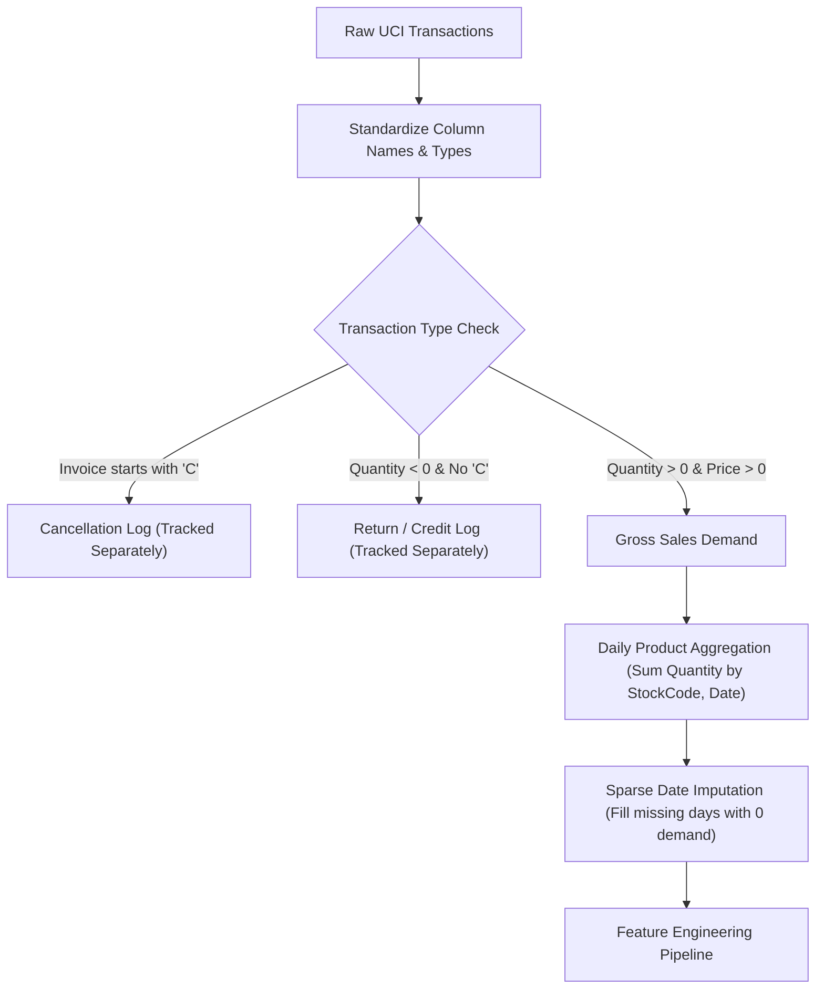

# NEXORA – Machine Learning Documentation

## 1. Overview
The machine learning subsystem serves as the analytical intelligence engine of NEXORA. It generates multi-horizon demand forecasts across **7, 15, 30, and 90 days** using historical transaction logs, providing inventory managers and executive dashboards with empirical demand baselines to govern replenishment.

---

## 2. Implementation Status

| Stage / Component | Status | Current Reality in Codebase |
| :--- | :--- | :--- |
| **ML Directory Layout** | **Implemented** | `backend/ml/data/raw/`, `processed/`, `models/`, `notebooks/`, `src/` created. |
| **Pipeline Module Stubs** | **Implemented** | `data_loader.py`, `preprocessing.py`, `feature_engineering.py`, `train.py`, `evaluate.py`, `predict.py` created with `NotImplementedError` guards. |
| **FastAPI Forecast Stub** | **Implemented** | Endpoints active under `/api/v1/forecast/`, returning `model_not_trained` status without fabricated values. |
| **Dataset Acquisition** | **Implemented** | Raw dataset verified at `backend/ml/data/raw/online_retail_II.csv` (541,910 rows). |
| **Dataset Ingestion & EDA** | **Implemented** | `backend/ml/src/data_loader.py` implemented; generated statistical report `backend/ml/data/processed/eda_report.md`. |
| **Preprocessing & Isolation** | **Implemented** | `backend/ml/src/preprocessing.py` partitions dataset into 4 verified CSV streams with 100% reconciliation. |
| **Daily SKU Aggregation** | **Planned (Milestone 1)** | Zero-demand padding and chronological aggregation planned. |
| **Feature Engineering** | **Planned (Milestone 1)** | Lags (1, 7, 14, 28) and rolling statistics (7, 28) planned without target leakage. |
| **Model Training & Comparison** | **Planned (Milestone 1)** | Seasonal baseline, Linear Regression, Random Forest, XGBoost planned across 4 horizons. |
| **Chronological Evaluation** | **Planned (Milestone 1)** | MAE, RMSE, WAPE calculation via rolling-origin backtesting planned. |
| **Artifact Persistence** | **Planned (Milestone 1)** | Joblib serialization to `backend/ml/models/` planned. |
| **API Model Integration** | **Planned (Milestone 1)** | Hooking `prediction_service.py` to load serialized `.joblib` estimators planned. |

> [!NOTE]
> No model training has been conducted yet, and no fabricated or mock accuracy metrics exist in the codebase.

---

## 3. Dataset Profile & Operational Limitations

### UCI Online Retail II Dataset
- **Source:** [UCI Machine Learning Repository – Online Retail II](https://archive.ics.uci.edu/dataset/502/online+retail+ii)
- **Timeframe:** 01/12/2009 to 09/12/2011 (2-year transaction history).
- **Scope:** UK-based online retailer selling unique all-occasion gift-ware.

### Dataset Schema & Handling Plan
| Field | Type | Description | Handling Rule |
| :--- | :--- | :--- | :--- |
| `Invoice` | String / Object | 6-digit transaction identifier | Codes starting with `'C'` indicate cancellations. Kept separate from positive demand. |
| `StockCode` | String | Unique product SKU identifier | Grouping key for product-level daily time-series aggregation. |
| `Description` | String | Product name / description | Cleaned, stripped of whitespace; tracked for catalog indexing. |
| `Quantity` | Integer | Units per transaction | Positive integers indicate gross demand. Negative quantities represent returns/cancellations. |
| `InvoiceDate` | Datetime | Transaction timestamp | Parsed to datetime format for chronological sorting and daily aggregation. |
| `Price` | Decimal / Float | Unit price in Sterling (£) | Evaluated for transaction filtering; records with non-positive price removed from sales demand. |
| `Customer ID` | Float / String | Unique client identifier | Missing in certain transactions (~20%); handled without discarding general product sales records. |
| `Country` | String | Destination country | Used for regional sales distribution analysis. |

### Data Limitations & Ground Truth Distinctions
The UCI dataset is an uncurated historical transaction dump. It specifically lacks:
1. Real warehouse physical stock levels.
2. Supplier records and delivery lead times.
3. Complete customer billing/shipping street addresses.
4. Return justification reasons (defective vs wrong item).
5. Tax identification numbers and live carrier tracking.

*Design Principle:* Historical sales demand is derived from the dataset; current operational inventory, suppliers, customers, and shipments are maintained natively in MySQL.

### Verified Dataset Empirical Findings (Phase 1, Task 1)
- **Total Rows & Columns:** 541,910 rows $\times$ 8 columns.
- **Encoding Requirement:** The dataset contains the British Pound sign (`£` = byte `0xa3`), requiring `latin1` (ISO-8859-1) encoding to read without Unicode decode errors.
- **Temporal Span:** Invoices span from **12 January 2010 to 10 December 2011** across 25,900 unique invoices and 38 countries (91.43% United Kingdom).
- **Missing Value Breakdown:**
  - `Customer ID`: 135,080 missing values (24.93%). Because demand forecasting aggregates daily quantity per `StockCode`, missing customer IDs do not prevent SKU-level modeling.
  - `Description`: 1,454 missing values (0.27%). Handled by falling back to `StockCode`.
  - All other columns (`Invoice`, `StockCode`, `Quantity`, `InvoiceDate`, `Price`, `Country`) are 100% complete (0 nulls).
- **Duplicate Rows:** 5,268 records (0.97%) are exact duplicate rows across all 8 columns.
- **Transaction Stream Classification:**
  - **Gross Positive Customer Sales:** 530,105 rows (97.82%) have `Quantity > 0`, `Price > 0`, and no `'C'` prefix. This is the sole stream used for demand forecasting models.
  - **Invoice Cancellations:** 9,288 rows (1.71%) have invoices starting with `'C'`, all having negative quantities.
  - **Returns / Credits without 'C':** 1,336 rows (0.25%) have negative quantities but lack the `'C'` prefix.
  - **Zero / Negative Prices:** 2,517 rows (0.46%) have unit price $\le 0$ (administrative adjustments, sample giveaways, or bookkeeping entries).
- **Top Product SKUs:**
  - Most frequent transaction: `85123A` (WHITE HANGING HEART T-LIGHT HOLDER, 2,265 transactions).
  - Highest gross sales volume: `23843` (80,995 units sold).

---

## 4. Data Preprocessing & Demand Isolation Logic

The preprocessing pipeline (`backend/ml/src/preprocessing.py`) follows strict isolation rules:

### Critical Preprocessing Principles
1. **Separate Accounting Measures:** Maintain distinct counts for gross sales, cancellations, returns, and net volume (`Net = Gross - Returns - Cancellations`).
2. **Positive Demand for Training:** Demand forecasting models are trained on true customer sales demand (positive quantities from valid invoices). Returns and cancellations are monitored separately under Product Health & Anomaly modules.
3. **Sparse Demand Zero-Filling:** Retail products often have inactive days. The pipeline generates continuous daily date ranges per product and fills missing sales days with `0` rather than dropping dates.

### Verified Preprocessing Outputs & Reconciliation (Phase 1, Task 2)
The preprocessing pipeline (`backend/ml/src/preprocessing.py`) executes mutually exclusive, collectively exhaustive classification, writing 4 partitioned datasets to `backend/ml/data/processed/`:
1. **`clean_gross_sales.csv` (530,105 rows, 97.82%):** Contains only valid commercial demand (`Quantity > 0`, `Price > 0`, and no `'C'` prefix). Forms the unpolluted input for time-series aggregation.
2. **`cancellation_transactions.csv` (9,288 rows, 1.71%):** Invoices starting with `'C'`, 100% verified to have negative quantities.
3. **`return_transactions.csv` (1,336 rows, 0.25%):** Non-cancellation negative quantities (`Quantity < 0`), identifying damaged, lost, or written-off items.
4. **`exceptional_transactions.csv` (1,181 rows, 0.22%):** Non-sales entries including zero-price samples (`Price == 0.0`, 1,179 rows) and accounting adjustments (`Price == -11062.06`, 2 rows).
- **Mathematical Reconciliation:** $530,105 + 9,288 + 1,336 + 1,181 = 541,910$ rows ($100.00\%$). Exactly zero records were dropped or lost.

---

## 5. Feature Engineering (Leakage-Free)

All feature generation (`backend/ml/src/feature_engineering.py`) enforces strict chronological boundaries:

| Feature Category | Features | Calculation & Leakage Prevention Rule |
| :--- | :--- | :--- |
| **Calendar Dynamics** | `DayOfWeek`, `Month`, `DayOfMonth` | Extracted directly from transaction date; captures weekly cycles and monthly seasonality. |
| **Lag Features** | `Lag1`, `Lag7`, `Lag14`, `Lag28` | Historical demand shifted by $t - k$. Never references current or future target days. |
| **Rolling Statistics** | `RollingMean7`, `RollingMean28` | Moving averages calculated over prior windows ($t-1$ backwards). Rolling windows exclude the current observation date. |
| **Horizon Alignment** | $D_7, D_{15}, D_{30}, D_{90}$ | Targets represent cumulative positive demand over the subsequent $H$ days: $\sum_{i=1}^{H} y_{t+i}$. In multi-step modeling, feature sets use information available strictly at time $t$. |

---

## 6. Multi-Horizon Forecasting Targets

| Target Code | Horizon Window | Operational Purpose in NEXORA |
| :--- | :--- | :--- |
| **D7** | 7 Days | Fast-moving item replenishment and weekly stockout prevention. |
| **D15** | 15 Days | Bi-weekly supplier ordering and batch replenishment cycles. |
| **D30** | 30 Days | Monthly warehouse space allocation and capital budgeting. |
| **D90** | 90 Days | Quarterly supply chain capacity planning and vendor volume agreements. |

*Model Strategy:* Dedicated regression models will be trained independently for each horizon ($H \in \{7, 15, 30, 90\}$) to optimize for horizon-specific variance and lead-time characteristics.

---

## 7. Model Candidates & Comparison Strategy

1. **Seasonal Naïve Baseline:** Repeats historical demand from the prior seasonal cycle (e.g., prior 7-day average). Establishes the performance benchmark.
2. **Linear Regression (Ridge / Lasso):** Provides a transparent, interpretable linear baseline.
3. **Random Forest Regressor:** Non-linear ensemble model capturing complex feature interactions and non-monotonic seasonality.
4. **XGBoost Regressor (Optional / Comparative):** Gradient boosting framework evaluated if computational environment and execution constraints permit.

---

## 8. Chronological Evaluation & Metrics

Random train/test splits cause extreme temporal data leakage in time-series forecasting. NEXORA enforces **chronological splitting** and **rolling-origin backtesting**:

- **Evaluation Window:** The final months of the dataset are reserved strictly as an out-of-time test set.
- **Metric Definitions:**
  - **MAE (Mean Absolute Error):** Measures average absolute deviation in units:
    $$\text{MAE} = \frac{1}{n} \sum_{i=1}^{n} |y_i - \hat{y}_i|$$
  - **RMSE (Root Mean Squared Error):** Penalizes large outlier forecast errors:
    $$\text{RMSE} = \sqrt{\frac{1}{n} \sum_{i=1}^{n} (y_i - \hat{y}_i)^2}$$
  - **WAPE (Weighted Absolute Percentage Error):** Robust to zero-demand days (avoids division-by-zero inherent to MAPE):
    $$\text{WAPE} = \frac{\sum_{i=1}^{n} |y_i - \hat{y}_i|}{\sum_{i=1}^{n} y_i}$$

---

## 9. Prediction Constraints & Serving Pipeline

- **Non-Negativity Guarantee:** Predicted demand cannot be negative. Post-processing enforces $\hat{y} = \max(0, \hat{y})$.
- **Insufficient History Handling:** SKUs with fewer than 28 days of history return an explicit `insufficient_history` indicator rather than arbitrary guesses.
- **Model Metadata Persistence:** Serialized `.joblib` files are stored alongside a manifest recording training date, horizon, features used, and validation metrics.
- **Decoupled Architecture:** Model training runs offline via batch scripts; the FastAPI service loads read-only Joblib binaries at startup for low-latency inference.
