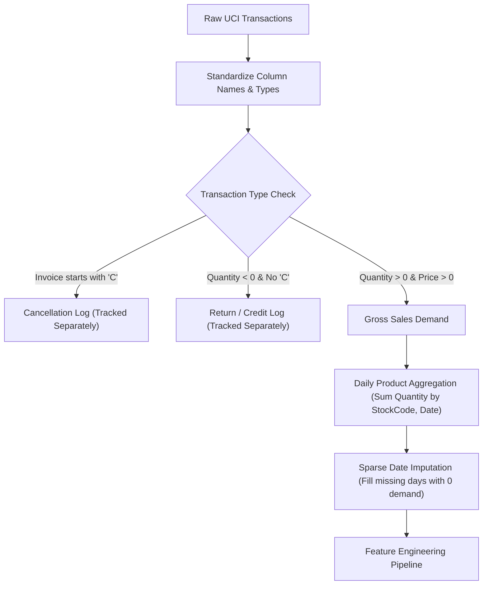

# NEXORA – Machine Learning Documentation

## 1. Overview
The machine learning subsystem serves as the analytical intelligence engine of NEXORA. It generates multi-horizon demand forecasts across **7, 15, 30, and 90 days** using historical transaction logs, providing inventory managers and executive dashboards with empirical demand baselines to govern replenishment.

---

## 2. Implementation Status

| Stage / Component | Status | Current Reality in Codebase |
| :--- | :--- | :--- |
| **ML Directory Layout** | **Implemented** | `backend/ml/data/raw/`, `processed/`, `models/`, `notebooks/`, `src/` created. |
| **Pipeline Module Stubs** | **Implemented** | `data_loader.py`, `preprocessing.py`, `feature_engineering.py`, `train.py`, `evaluate.py`, `predict.py` created with `NotImplementedError` guards. |
| **FastAPI Forecast Stub** | **Implemented** | Endpoints active under `/api/v1/forecast/`, returning `model_not_trained` status without fabricated values. |
| **Dataset Acquisition** | **Implemented** | Raw dataset verified at `backend/ml/data/raw/online_retail_II.csv` (541,910 rows). |
| **Dataset Ingestion & EDA** | **Implemented** | `backend/ml/src/data_loader.py` implemented; generated statistical report `backend/ml/data/processed/eda_report.md`. |
| **Preprocessing & Isolation** | **Implemented** | `backend/ml/src/preprocessing.py` partitions dataset into 4 verified CSV streams with 100% reconciliation. |
| **Daily SKU Aggregation** | **Implemented** | `backend/ml/src/feature_engineering.py` creates continuous daily time-series (`daily_product_demand.csv`, 1,074,653 rows) with zero-demand padding within SKU lifespan boundaries and 100% unit reconciliation. |
| **Feature Engineering** | **Implemented** | `backend/ml/src/feature_engineering.py` constructs 18-column matrix (`ml_feature_dataset.csv`, 1,074,653 rows) with calendar dynamics, lags (1, 7, 14, 28), rolling means (7, 28), and multi-horizon targets ($D_7, D_{15}, D_{30}, D_{90}$) with complete temporal isolation. |
| **Model Training & Comparison** | **Implemented** | `backend/ml/src/train.py` trains Seasonal Naive, Linear Regression, and Random Forest pipelines across all 4 horizons. |
| **Chronological Evaluation** | **Implemented** | `backend/ml/src/evaluate.py` implements strict purge/embargo splitting and computes MAE, RMSE, and WAPE out-of-time. |
| **Artifact Persistence** | **Implemented** | Joblib serialized pipelines (`demand_model_{h}d.joblib`) and `models_metadata.json` saved in `backend/ml/models/`. |
| **API Model Integration** | **Planned (Milestone 1)** | Hooking `prediction_service.py` to load serialized `.joblib` estimators planned. |

> [!NOTE]
> No model training has been conducted yet, and no fabricated or mock accuracy metrics exist in the codebase.

---

## 3. Dataset Profile & Operational Limitations

### UCI Online Retail II Dataset
- **Source:** [UCI Machine Learning Repository – Online Retail II](https://archive.ics.uci.edu/dataset/502/online+retail+ii)
- **Timeframe:** 01/12/2009 to 09/12/2011 (2-year transaction history).
- **Scope:** UK-based online retailer selling unique all-occasion gift-ware.

### Dataset Schema & Handling Plan
| Field | Type | Description | Handling Rule |
| :--- | :--- | :--- | :--- |
| `Invoice` | String / Object | 6-digit transaction identifier | Codes starting with `'C'` indicate cancellations. Kept separate from positive demand. |
| `StockCode` | String | Unique product SKU identifier | Grouping key for product-level daily time-series aggregation. |
| `Description` | String | Product name / description | Cleaned, stripped of whitespace; tracked for catalog indexing. |
| `Quantity` | Integer | Units per transaction | Positive integers indicate gross demand. Negative quantities represent returns/cancellations. |
| `InvoiceDate` | Datetime | Transaction timestamp | Parsed to datetime format for chronological sorting and daily aggregation. |
| `Price` | Decimal / Float | Unit price in Sterling (£) | Evaluated for transaction filtering; records with non-positive price removed from sales demand. |
| `Customer ID` | Float / String | Unique client identifier | Missing in certain transactions (~20%); handled without discarding general product sales records. |
| `Country` | String | Destination country | Used for regional sales distribution analysis. |

### Data Limitations & Ground Truth Distinctions
The UCI dataset is an uncurated historical transaction dump. It specifically lacks:
1. Real warehouse physical stock levels.
2. Supplier records and delivery lead times.
3. Complete customer billing/shipping street addresses.
4. Return justification reasons (defective vs wrong item).
5. Tax identification numbers and live carrier tracking.

*Design Principle:* Historical sales demand is derived from the dataset; current operational inventory, suppliers, customers, and shipments are maintained natively in MySQL.

### Verified Dataset Empirical Findings (Phase 1, Task 1)
- **Total Rows & Columns:** 541,910 rows $\times$ 8 columns.
- **Encoding Requirement:** The dataset contains the British Pound sign (`£` = byte `0xa3`), requiring `latin1` (ISO-8859-1) encoding to read without Unicode decode errors.
- **Temporal Span:** Invoices span from **12 January 2010 to 10 December 2011** across 25,900 unique invoices and 38 countries (91.43% United Kingdom).
- **Missing Value Breakdown:**
  - `Customer ID`: 135,080 missing values (24.93%). Because demand forecasting aggregates daily quantity per `StockCode`, missing customer IDs do not prevent SKU-level modeling.
  - `Description`: 1,454 missing values (0.27%). Handled by falling back to `StockCode`.
  - All other columns (`Invoice`, `StockCode`, `Quantity`, `InvoiceDate`, `Price`, `Country`) are 100% complete (0 nulls).
- **Duplicate Rows:** 5,268 records (0.97%) are exact duplicate rows across all 8 columns.
- **Transaction Stream Classification:**
  - **Gross Positive Customer Sales:** 530,105 rows (97.82%) have `Quantity > 0`, `Price > 0`, and no `'C'` prefix. This is the sole stream used for demand forecasting models.
  - **Invoice Cancellations:** 9,288 rows (1.71%) have invoices starting with `'C'`, all having negative quantities.
  - **Returns / Credits without 'C':** 1,336 rows (0.25%) have negative quantities but lack the `'C'` prefix.
  - **Zero / Negative Prices:** 2,517 rows (0.46%) have unit price $\le 0$ (administrative adjustments, sample giveaways, or bookkeeping entries).
- **Top Product SKUs:**
  - Most frequent transaction: `85123A` (WHITE HANGING HEART T-LIGHT HOLDER, 2,265 transactions).
  - Highest gross sales volume: `23843` (80,995 units sold).

---

## 4. Data Preprocessing & Demand Isolation Logic

The preprocessing pipeline (`backend/ml/src/preprocessing.py`) follows strict isolation rules:

### Critical Preprocessing Principles
1. **Separate Accounting Measures:** Maintain distinct counts for gross sales, cancellations, returns, and net volume (`Net = Gross - Returns - Cancellations`).
2. **Positive Demand for Training:** Demand forecasting models are trained on true customer sales demand (positive quantities from valid invoices). Returns and cancellations are monitored separately under Product Health & Anomaly modules.
3. **Sparse Demand Zero-Filling:** Retail products often have inactive days. The pipeline generates continuous daily date ranges per product and fills missing sales days with `0` rather than dropping dates.

### Verified Preprocessing Outputs & Reconciliation (Phase 1, Task 2)
The preprocessing pipeline (`backend/ml/src/preprocessing.py`) executes mutually exclusive, collectively exhaustive classification, writing 4 partitioned datasets to `backend/ml/data/processed/`:
1. **`clean_gross_sales.csv` (530,105 rows, 97.82%):** Contains only valid commercial demand (`Quantity > 0`, `Price > 0`, and no `'C'` prefix). Forms the unpolluted input for time-series aggregation.
2. **`cancellation_transactions.csv` (9,288 rows, 1.71%):** Invoices starting with `'C'`, 100% verified to have negative quantities.
3. **`return_transactions.csv` (1,336 rows, 0.25%):** Non-cancellation negative quantities (`Quantity < 0`), identifying damaged, lost, or written-off items.
4. **`exceptional_transactions.csv` (1,181 rows, 0.22%):** Non-sales entries including zero-price samples (`Price == 0.0`, 1,179 rows) and accounting adjustments (`Price == -11062.06`, 2 rows).
- **Mathematical Reconciliation:** $530,105 + 9,288 + 1,336 + 1,181 = 541,910$ rows ($100.00\%$). Exactly zero records were dropped or lost.

---

## 4.1 Daily SKU Demand Aggregation & Continuous Imputation (Phase 1, Task 3)

The aggregation and imputation pipeline (`backend/ml/src/feature_engineering.py`) converts the transaction-level `clean_gross_sales.csv` into a standardized daily time-series:

1. **Aggregation:** Transactions are grouped by `(StockCode, date)` computing:
   - `daily_demand`: Total units sold ($\sum \text{Quantity}$)
   - `transaction_count`: Number of sales transactions ($\text{Count}$)
   - `revenue`: Daily gross revenue ($\sum \text{Quantity} \times \text{Price}$)
2. **Continuous Lifespan Zero-Padding:**
   - For each SKU, the pipeline identifies its active commercial lifespan $[\text{min\_date}, \text{max\_date}]$.
   - Missing calendar days within this interval are explicitly reindexed and imputed with $\text{daily\_demand} = 0$, $\text{transaction\_count} = 0$, and $\text{revenue} = 0.0$.
   - **Boundary Isolation:** Dates prior to an item's first observed sale or following its last observed sale are never imputed. This prevents artificial pre-launch zero-inflation.
3. **Verified Metrics & Reconciled Demand:**
   - **Gross Sales Records Ingested:** 530,105 transactions across 3,922 unique SKUs.
   - **Observed Sales Days (Active):** 276,148 product-days.
   - **Continuous Time-Series Output:** 1,074,653 product-days (`daily_product_demand.csv`).
   - **Imputed Zero-Demand Days:** 798,505 days (**74.30% of SKU lifespan**), highlighting high retail demand intermittency.
   - **Unit Reconciliation:** $\sum \text{daily\_demand} = 5,588,377$ units, matching raw sales units exactly (**100.00% preservation; 0 loss**).
   - **Integrity Validation:** 0 duplicate product-date pairs, 0 null values, 100% continuous calendar spans. Validated via `backend/tests/test_feature_engineering.py` (7/7 passed).

---

## 5. Feature Engineering (Leakage-Free)

All feature generation (`backend/ml/src/feature_engineering.py`) enforces strict chronological boundaries:

| Feature Category | Features | Calculation & Leakage Prevention Rule | Available Rows in Dataset |
| :--- | :--- | :--- | :---: |
| **Calendar Dynamics** | `DayOfWeek`, `Month`, `DayOfMonth` | Extracted directly from observation date $t$; captures weekly cycles and monthly seasonality. | 1,074,653 (100.00%) |
| **Lag Features** | `Lag1`, `Lag7`, `Lag14`, `Lag28` | Historical demand shifted by $t - k$. Never references current or future target days. Initial burn-in days strictly preserved as `NaN`. | 970,840 to 1,070,731 (90.34%–99.64%) |
| **Rolling Statistics** | `RollingMean7`, `RollingMean28` | Moving averages calculated over prior windows ($t-1$ backwards) by shifting demand by 1 day before rolling with `min_periods=window`. Strictly excludes observation date $t$. | 970,840 to 1,048,251 (90.34%–97.54%) |
| **Horizon Alignment** | $D_7, D_{15}, D_{30}, D_{90}$ | Targets represent cumulative positive demand over the subsequent $H$ days: $\sum_{i=1}^{H} y_{t+i}$. Strictly sums dates $t+1$ to $t+H$; observation date $t$ is strictly excluded. Incomplete horizons near SKU lifespan ends strictly remain `NaN` (critical incomplete-target rule). | 753,054 to 1,048,251 (70.07%–97.54%) |

### Empirical Feature Availability & Missing Values (Phase 1, Task 4)
- **Complete Feature Matrix Rows:** 970,840 rows (90.34% of 1,074,653) have complete non-null values across all calendar, lag, and rolling features.
- **Initial Missing Values:** Row 0 of each SKU has `NaN` for `Lag1` (3,922 rows, 0.36%); the first 7 days have `NaN` for `Lag7` and `RollingMean7` (26,402 rows, 2.46%); the first 28 days have `NaN` for `Lag28` and `RollingMean28` (103,813 rows, 9.66%). These are never filled with artificial zeros.

---

## 6. Multi-Horizon Forecasting Targets

| Target Code | Horizon Window | Operational Purpose in NEXORA | Available Targets | Eligible Rows for Training (Features + Target) |
| :--- | :--- | :--- | :---: | :---: |
| **D7** | 7 Days | Fast-moving item replenishment and weekly stockout prevention. | 1,048,251 (97.54%) | **945,345 rows (87.97%)** |
| **D15** | 15 Days | Bi-weekly supplier ordering and batch replenishment cycles. | 1,018,506 (94.78%) | **916,376 rows (85.27%)** |
| **D30** | 30 Days | Monthly warehouse space allocation and capital budgeting. | 963,538 (89.66%) | **862,938 rows (80.30%)** |
| **D90** | 90 Days | Quarterly supply chain capacity planning and vendor volume agreements. | 753,054 (70.07%) | **661,228 rows (61.53%)** |

*Critical Incomplete-Target Rule:* When the full future horizon of $H$ days is unavailable (within $H$ days of each SKU's last observed sale date), the target is explicitly set to `NaN`. Incomplete future windows are never zero-padded or filled with partial sums.

*Model Strategy:* Dedicated regression models will be trained independently for each horizon ($H \in \{7, 15, 30, 90\}$) to optimize for horizon-specific variance and lead-time characteristics. Rows with complete features and a non-null target for that horizon are selected for training.

---

## 7. Model Candidates & Comparison Strategy

1. **Weekly-Average Demand-Rate Baseline (Seasonal Naïve Benchmark):** Scales the historical rolling weekly demand rate across the forecast horizon:
   $$\hat{y}_{\text{Baseline}}(t) = \max(0, H \times \text{RollingMean7}(t))$$
   Establishes the transparent, non-negative benchmark using solely prior weekly observations ($t-7..t-1$, shifted by 1 day in Task 4 to prevent lookahead).
2. **Linear Regression Pipeline (Ridge + OneHotEncoder):** Uses scikit-learn `Pipeline` with `OneHotEncoder(max_categories=50, handle_unknown="infrequent_if_exist", sparse_output=False)` for product SKUs and `StandardScaler` for numerical predictors, regularized with `Ridge(alpha=1.0)`.
   - *Zero Target Leakage:* Completely isolates categorical encoding from the target label $y$.
   - *Bounded Dimensionality:* Only top 50 high-velocity SKUs receive dedicated indicators; all other 3,872 SKUs (and unseen test SKUs) are grouped into the infrequent category.
3. **Random Forest Regressor Pipeline:** Uses `RandomForestRegressor(n_estimators=25, max_depth=10, random_state=42)` coupled with `OneHotEncoder(max_categories=50)` and `StandardScaler` to capture non-linear demand spikes and complex temporal interactions across lag windows.

---

## 8. Chronological Evaluation & Metrics (Phase 1, Task 5.1 Audited Results)

Random train/test splits cause extreme temporal data leakage in time-series forecasting. NEXORA enforces **strict chronological out-of-time holdouts** with a dedicated purge/embargo gap:
- **Purge/Embargo Rule:** For horizon $H$, training samples observed at date $t$ are eligible only if $t + H < \text{val\_start}$ ($t \le \text{val\_start} - H - 1\text{ day}$). This eliminates any overlap between training target windows and validation periods.
- **Single Out-of-Time Holdout:** Evaluated on a continuous out-of-time evaluation window formulated to maximize training history while maintaining complete forward target windows within the 12-month UCI dataset.
- **Metric Definitions:**
  - **MAE (Mean Absolute Error):** $\text{MAE} = \frac{1}{n} \sum_{i=1}^{n} |y_i - \hat{y}_i|$
  - **RMSE (Root Mean Squared Error):** $\text{RMSE} = \sqrt{\frac{1}{n} \sum_{i=1}^{n} (y_i - \hat{y}_i)^2}$
  - **WAPE (Weighted Absolute Percentage Error):** $\text{WAPE} = \frac{\sum |y_i - \hat{y}_i|}{\sum y_i} \times 100\%$ (handles zero-demand days without division-by-zero instability).

### Audited Multi-Horizon Out-of-Time Model Comparison Matrix

| Horizon | Candidate Model | MAE (Units) | RMSE (Units) | WAPE (%) | Training Samples | Validation Samples | Embargo Gap | Selected Best Model | Selection Rationale |
| :--- | :--- | :---: | :---: | :---: | :---: | :---: | :---: | :---: | :--- |
| **D_7** | Weekly-Average Baseline | 44.47 | 115.75 | 66.12% | 884,219 | 42,091 | 8 days | — | Baseline benchmark |
| **D_7** | **Linear Regression (Ridge)** | **37.43** | **92.57** | **55.65%** | 884,219 | 42,091 | 8 days | **>>> BEST** | Lowest WAPE (55.65%) & lowest MAE/RMSE |
| **D_7** | Random Forest | 48.98 | 140.50 | 72.83% | 884,219 | 42,091 | 8 days | — | Over-responsive to high-frequency noise |
| **D_15**| Weekly-Average Baseline | 86.87 | 238.33 | 59.57% | 816,930 | 57,840 | 16 days | — | Baseline benchmark |
| **D_15**| Linear Regression (Ridge) | 74.21 | 184.62 | 50.88% | 816,930 | 57,840 | 16 days | — | Strong competitive linear fit |
| **D_15**| **Random Forest** | **72.93** | **217.49** | **50.00%** | 816,930 | 57,840 | 16 days | **>>> BEST** | Lowest WAPE (50.00%) & lowest MAE |
| **D_30**| Weekly-Average Baseline | 159.02 | 509.06 | 61.98% | 678,252 | 100,262 | 31 days | — | Baseline benchmark |
| **D_30**| Linear Regression (Ridge) | 134.49 | 403.82 | 52.42% | 678,252 | 100,262 | 31 days | — | Competitive linear fit |
| **D_30**| **Random Forest** | **125.03** | **406.25** | **48.73%** | 678,252 | 100,262 | 31 days | **>>> BEST** | Lowest WAPE (48.73%) & lowest MAE |
| **D_90**| Weekly-Average Baseline | 458.68 | 1253.71 | 71.09% | 320,428 | 98,157 | 91 days | — | Baseline benchmark |
| **D_90**| Linear Regression (Ridge) | 358.93 | 925.34 | 55.63% | 320,428 | 98,157 | 91 days | — | Sub-optimal long-term nonlinear trend capture |
| **D_90**| **Random Forest** | **343.36** | **890.18** | **53.22%** | 320,428 | 98,157 | 91 days | **>>> BEST** | Lowest WAPE (53.22%) & lowest MAE/RMSE |

All best models were serialized via Joblib to `backend/ml/models/demand_model_{h}d.joblib` and validated for numerical reload consistency, non-negative finite bounds, and unseen SKU robustness.

---

## 9. Prediction Constraints & Serving Pipeline

- **Non-Negativity Guarantee:** Predicted demand cannot be negative. Post-processing enforces $\hat{y} = \max(0, \hat{y})$.
- **Insufficient History Handling:** SKUs with fewer than 28 days of history return an explicit `insufficient_history` indicator rather than arbitrary guesses.
- **Model Metadata Persistence:** Serialized `.joblib` files are stored alongside a manifest recording training date, horizon, features used, and validation metrics.
- **Decoupled Architecture:** Model training runs offline via batch scripts; the FastAPI service loads read-only Joblib binaries at startup for low-latency inference.
