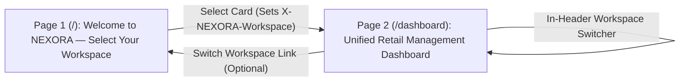
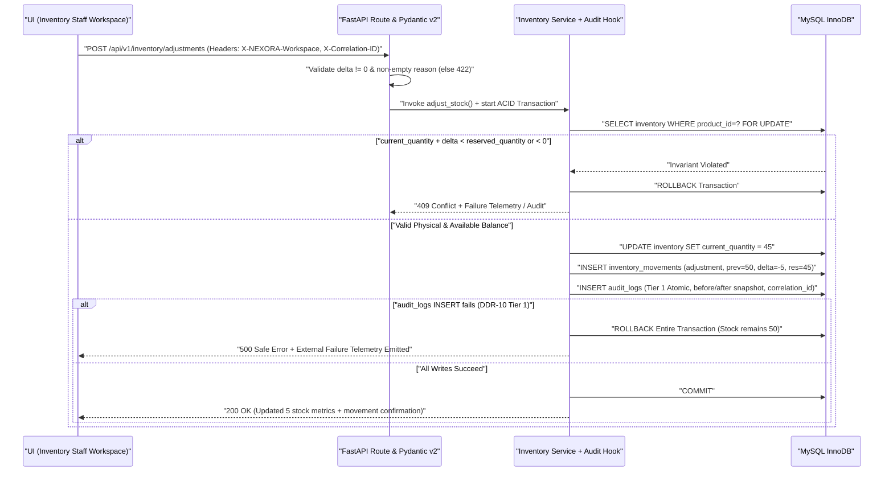
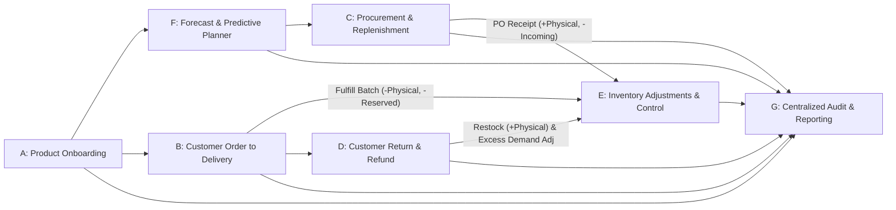
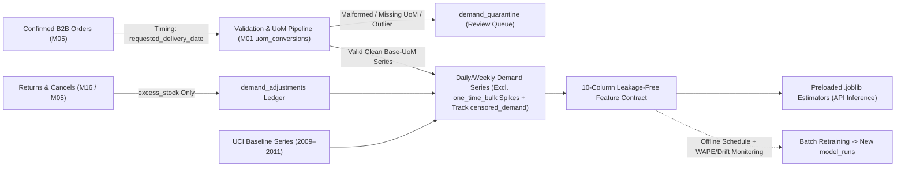
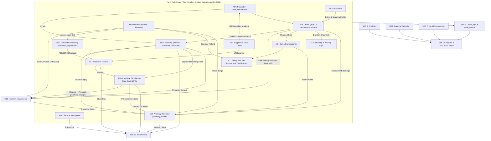

# NEXORA — Application Functionality & System Workflow Guide

- **Project:** NEXORA – AI-Powered Retail Management & Intelligence System
- **Document Version:** 1.0 (Aligned with Technical Blueprint v2.2 & `FEATURES_STATUS.md` v2.3)
- **Date:** 26 November 2026
- **Repository & Branch:** `Lalith-Manohar/LLM-Project1` (`main`)
- **Verified Commit Baseline:** `026eecde3bb5d0c9843f1d776dd6b2b433f6afab`
- **Primary Architecture Reference:** [docs/NEXORA — Technical Blueprint v1.0.md](NEXORA%20%E2%80%94%20Technical%20Blueprint%20v1.0.md) (`2.2 (Design Decision Resolution)`)
- **Implementation Status Reference:** [docs/FEATURES_STATUS.md](FEATURES_STATUS.md) (`2.3`)

> [!IMPORTANT]
> **Purpose of This Guide:** This document explains how **NEXORA** operates as an end-to-end retail software platform from both the **user's perspective** (screens, workspaces, actions, and business scenarios) and the **internal system perspective** (API orchestration, database transactions, ML inference, audit integrity, and error recovery). It distinguishes strictly between capabilities **currently implemented on `main`** and target capabilities **planned for Phases 2–6**.

---

## Source-of-Truth Hierarchy & Document Discrepancy Record

Per project documentation governance, conflicts across repository files are resolved strictly using this precedence order:

1. **Current Implementation Reality:** Verified source code, routes, ML artifacts, frontend files, and live test results on branch `main`.
2. **Feature-Level Implementation Status:** [FEATURES_STATUS.md](FEATURES_STATUS.md) (`Version 2.3`).
3. **Approved Target Architecture & Business Rules:** [NEXORA — Technical Blueprint v1.0.md](NEXORA%20%E2%80%94%20Technical%20Blueprint%20v1.0.md) (`Version 2.2`).

During repository inspection on commit `026eecde`, several discrepancies between older/parallel documents and actual repository evidence were identified and are documented explicitly below rather than silently repeated:

| Discrepancy Area | Older Document / Draft Claim | Verified Repository Reality (`main` at `026eecde`) | How This Guide Treats It |
| :--- | :--- | :--- | :--- |
| **Frontend Application (`frontend/`)** | Blueprint v2.2 Sections 1.2, 3.1, and 17.1 (and `PROJECT_OVERVIEW.md`) state `frontend/` holds only `frontend/README.md` with no `package.json`, Vite, or React code. | `frontend/` contains an interactive **Phase 1 single-screen Vite + React 18 + TypeScript Demand Forecasting demo** (`package.json`, `vite.config.ts`, `src/App.tsx`, `src/services/api.ts`, `src/types/forecast.ts`). However, Tailwind CSS, `chart.js`, React Router, Page 1 Workspace Selection, Page 2 Unified Dashboard, and frontend tests do **not** exist yet. | Treated per `FEATURES_STATUS.md` v2.3: Phase 1 demo SPA exists (`M12-28` **Partially Implemented**); target two-page 4-workspace dashboard (`SYS-01`) remains **Planned**. |
| **Serialized Models & Test Count** | Blueprint v2.2 Sections 1.2, 10, and 18.1 describe `.joblib` models as `.gitignore`d / absent on clean checkout and report `60` tests across `7` suites. | Production (`demand_model_{7,15,30,90}d.joblib`, `models_metadata.json`), Task 12 (`models_task12/`), and store-wide/experimental models (`models_experimental/`) are committed on `main`. Across `13` backend/ML test suites, `168` pytest cases pass, covering `/api/v1/forecast/*`, `/api/v1/experimental/*`, `/ready`, CSV auto-feature lookup (`historical_data_service.py`), and stateless `/api/v1/inventory/recommend`. | Treated honestly: `.joblib` models & `168`-test Phase 1 ML/forecast API surface exist and pass, while MySQL persistence and operational workflows remain **Planned**. |
| **Stateless `/api/v1/inventory/recommend` Prototype** | Blueprint v2.2 Section 1.2 states zero inventory routes exist on `main`. | `backend/app/api/routes/inventory.py` and `inventory_service.py` implement a stateless Phase 1 endpoint accepting caller-provided `current_stock`, `lead_time_days`, `review_period_days`, and `safety_stock_days` via piecewise demand interpolation. | Documented accurately as a **Partially Implemented** Phase 1 prototype (`M14-01/06/07/12`); it does **not** use MySQL `inventory` or Blueprint v2.2 `DDR-01`–`DDR-03` / `DDR-07` rules yet. |
| **Legacy RBAC, Role Count & Schema (`PROJECT_OVERVIEW.md`, `DATABASE_SCHEMA.md`, `API_DOCUMENTATION.md`)** | Older docs describe 13 modules, 6 employee roles, JWT/bcrypt login (`users`, `roles`, `permissions`, `/api/v1/auth/*`), and a 19-table schema lacking `orders`, `returns`, `payments`, `supplier_products`, `uom_conversions`, `audit_outbox`, etc. | Blueprint v2.2 and `FEATURES_STATUS.md` v2.3 permanently replace login/JWT/RBAC with a **2-page, 4-workspace** UI context model and expand scope to **18 core modules + 4 supporting capabilities**, **`DDR-01`–`DDR-10`**, and `35` logical entities (`DATABASE_SCHEMA.md` & `API_DOCUMENTATION.md` await v2.2 synchronization). | Target workflows in this guide follow Blueprint v2.2 exclusively; no login, password, JWT, or server RBAC behaviour is implied. |

---

## Section 1 — Introduction to NEXORA

### 1.1 Project Purpose & Vision
**NEXORA (AI-Powered Retail Management & Intelligence System)** is an integrated retail operations and predictive decision-support platform designed to unify day-to-day store/warehouse execution with empirical machine learning demand forecasting. Rather than building an isolated machine learning script that predicts demand in a vacuum—or an accounting CRUD database that ignores future stock risk—NEXORA connects catalog management, confirmed customer orders, physical warehouse stock ledgers, purchase order workflows, return disposition, `INR`-denominated invoicing, internal dispatch tracking, and statistical anomaly detection into one coherent monolithic system.

### 1.2 Retail Problems Addressed
Traditional student retail systems and fragmented small-to-midsize store workflows suffer from six structural failures that NEXORA is architected to eliminate:

1. **Disjointed Operations vs. Analytics:** Demand forecasting notebooks sit on disk disconnected from live stock quantities, open purchase orders, and sales order commitments.
2. **Unreliable Inventory Tracking:** Stock quantities are overwritten directly without preserving physical vs. reserved balances or recording why a shelf balance changed.
3. **Conflated Demand Streams:** Positive sales, order cancellations, returns, and accounting write-offs are mixed together, corrupting both revenue reporting and ML demand forecasts.
4. **Blind Replenishment Decisions:** Buyers guess order quantities without accounting for supplier-specific delivery lead times, existing incoming POs, or safety buffers.
5. **Silent Financial & Audit Gaps:** Deleting invoices/orders or mutating prices/tax rates retroactively breaks historical accounting integrity and leaves operators unable to trace who changed what or why an API failure occurred.
6. **Uncontrolled Automation Risk:** Fully autonomous auto-purchasing or automatic price markdowns create severe operational hazard if predictions spike unexpectedly; NEXORA retains **mandatory human approval** on procurement and pricing changes (`EXCL-03`, `EXCL-04`).

### 1.3 Traditional Retail Management vs. NEXORA

| Dimension | Traditional Standalone Retail Tool | NEXORA Integrated Operating Model |
| :--- | :--- | :--- |
| **Inventory Balance Model** | Single raw integer `qty` column overwritten manually | **Five distinct metrics (`DDR-02`/`03`):** Physical, Reserved, Available, Incoming (approved POs only), and Projected Available Stock, all reconciled via immutable `inventory_movements` |
| **Demand vs. Fulfillment Timing** | Uses invoice date or payment date as "sales demand" | **Explicit separation (`DDR-06`):** Confirmed B2B orders timed by `requested_delivery_date` establish demand; fulfillment deducts stock (`DDR-05`); invoice settlement never distorts ML timing |
| **Forecasting Integration** | Separate offline notebook or arbitrary heuristic multiplier | Pre-trained leakage-free ML regression (`7, 15, 30, 90` days) feeds shared `M11` & `M14` lead-time risk math (`DDR-01`) directly into draft PO preparation |
| **Supplier Lead Times** | Assumed fixed (e.g., hardcoded `7` days) or omitted | Hierarchical mapping (`supplier_products.lead_time_days` → fallback `suppliers.lead_time_days` → explicit `UNAVAILABLE` state; never invented per `DDR-01`/`07`) |
| **Returns & Cancellations** | Either silently ignored or subtracted blindly from sales | Split strictly into UCI `'C'` cancellations, non-`'C'` returns, `excess_stock` demand reductions (`demand_adjustments`), and unsubtracted `defective` returns (`DDR-06`) |
| **System Accountability** | Console log text wiped on server restart | Persistent MySQL **Centralized History & Audit** with before/after JSON snapshots, correlation IDs, Tier 1 fail-closed rollback, and Tier 2 `audit_outbox` recovery (`DDR-10`) |

### 1.4 Connecting Operational Data to Machine Learning Demand Intelligence
Historical intelligence in NEXORA starts from the **UCI Online Retail II dataset** ([online_retail_II.csv](file:///c:/Users/grand/OneDrive/Desktop/SDC%20-1%20Project/LLM-Project1/backend/ml/data/raw/online_retail_II.csv), `1,067,371` transactions spanning December 2009–December 2011). Because historical transaction dumps lack live stock, supplier lead times, customer street addresses, payment statuses, and structured return causes, NEXORA keeps historical ML demand baselines distinct from newly created operational records:

- **Today (Implemented Phase 1 on `main`):** Offline ML pipelines partition raw UCI CSV records, aggregate clean positive sales daily within SKU lifespans, compute 10 leakage-free lag/rolling features, serialize `.joblib` estimators for `7/15/30/90` days, and serve predictions live via FastAPI and the Phase 1 React demo.
- **Target State (Planned Operational Integration under `DDR-06`):** As live B2B/retail orders (`M05`), product unit-of-measure conversions (`M01`), and `excess_stock` returns (`M16`) accumulate in MySQL, a validation & quarantine pipeline (`demand_quarantine`) converts clean confirmed demand into base-UoM daily/weekly aggregates matching the exact Phase 1 10-column feature contract, while isolating one-time tender spikes and stockout-censored periods (`is_censored_demand`) before running scheduled offline retraining.

---

## Section 2 — Application Architecture from a User's Perspective

### 2.1 Strict Two-Page Web Structure *(Target Architecture)*
NEXORA avoids sprawling multi-URL page fragmentation by organizing all target UI functionality inside **two primary webpages** within a single React SPA:

#### Page 1 — Stakeholder Workspace Selection (`/`)
- **Visible Elements:** Displays the application branding header, exact page heading **`Welcome to NEXORA — Select Your Workspace`**, and **four interactive stakeholder cards** summarizing operational scope without requesting usernames, passwords, registrations, or login tokens.
- **Behind the Click:** Choosing a workspace card saves the selected workspace key (`store_manager`, `inventory_staff`, `purchase_manager`, `finance_staff`) in client context (`sessionStorage` / React Context), configures outgoing HTTP headers (`X-NEXORA-Workspace`), and routes immediately to `/dashboard`.

#### Page 2 — Unified Retail Management Dashboard (`/dashboard`)
- **Persistent Shell:** Renders a top header bar (branding, active workspace pill, live **Workspace Switcher**, **Smart Alerts** notification bell badge with slide-over drawer, and optional return link to Page 1), a left/top module navigation rail filtered to the active workspace, KPI summary cards, interactive Chart.js canvases, filterable/sortable data tables, action drawers, confirmation modals, and print overlays (`Invoices`, `Packing Slips`, `Routing Labels`).
- **Live In-Dashboard Switching:** Operators can switch instantaneously among all four workspaces from the top header dropdown without losing their place in `/dashboard` or logging out/in. Navigation groups, visible action buttons (such as **Approve PO > Limit** or **Configure Tax/Lifecycle Settings**), and alert filters re-scope immediately on screen.

> [!WARNING]
> **Critical Architecture Rule — Workspaces Are UI Context, NOT Security Authentication:**
> Workspace selection inside NEXORA organizes screen clarity, audit attribution (`X-NEXORA-Workspace`), and workflow governance (`DDR-09` Tier 1 vs. Store Manager PO approval stages; `DDR-04`/`08` config screens). Because NEXORA intentionally excludes login forms, passwords, user accounts, and JWTs, workspace switching is **never** cryptographically verified identity or server-side security RBAC.

### 2.2 The Four Stakeholder Workspaces

| Workspace | Target Audience & Scope | Visible Module Tabs & Primary Controls | Explicit Governance Boundaries |
| :--- | :--- | :--- | :--- |
| **1. Store Manager (Admin)** | Store supervisor / operations lead oversight (`100%` of system modules) | Full CRUD across `M01`–`M05`, `M09`, `M11`, `M16`–`M18`; complete BI, Seasonality, Lifecycle (`M08`), Price Intel, Predictive Planner (`M14`), Anomaly (`M15`), Centralized Audit History (`SYS-02`), Alerts (`SYS-03`), Reports (`SYS-04`). | Exclusive authority for **Tier 2 / > Limit / Escalated PO Approvals (`DDR-09`)**, centralized `INR`/tax rate configuration (`DDR-04`), bounded Lifecycle/Anomaly thresholds & resets (`DDR-08`), and manual **`Discontinued`** product status (`DDR-08`). Receives non-blocking oversight digests on Tier 1 PO approvals. |
| **2. Inventory Staff** | Warehouse & stockroom operators | **Primary:** `M09` Inventory Control (`Physical`/`Reserved`/`Available`/`Incoming`/`Projected`), manual adjustments, `M10` Stock Movement ledger, `M18` Shipping pick/pack/dispatch, inventory/depletion alerts. **Read Reference:** `M01` catalog, `M02` lead times, `M05` confirmed pick queue, `M08` dormant dead stock, `M11` incoming POs, `M12`/`M14` stockout risk, `M16` restock/damaged dispositions, `SYS-04` stock reports. | Focuses on physical count accuracy and parcel prep; does **not** edit catalog prices, issue financial credit notes, approve POs, or modify tax/governance settings. |
| **3. Purchase Manager** | Procurement planners & vendor coordinators | **Primary:** `M02` Suppliers & `supplier_products`, `M11` Purchase Planning Simulator & PO drafting/submission/receipts, `M14` Predictive Planner, procurement/risk alerts, `SYS-04` PO reports. **Read Reference:** `M01` catalog, `M07` seasonal calendar, `M08` lifecycle check before buying, `M09` availability, `M10` `purchase_receipt` logs, `M12` demand forecasts, `M13` vendor cost reference, `M15` demand spikes. | Executes **Tier 1 routine PO approvals (`<= Tier 1 Spending Limit`) ONLY when zero split/anomaly escalation triggers apply (`DDR-09`)**. Never approves POs above limit or flagged by escalations; approval updates internal DB only (`EXCL-03`). |
| **4. Finance Staff** | Billing clerks & financial controllers | **Primary:** `M03` Customers (billing details), `M17` Billing & Finance (`INR` invoices, manual payments, credit notes, revenue reconciliation), financial/return alerts, `SYS-04` finance/sales exports. **Read Reference:** `M01` prices, `M04` sales streams, `M05` fulfilled orders, `M06` BI revenue KPIs, `M10` `return_restock`/`sale_fulfillment`, `M12` optional forecast read, `M13` revenue contribution, `M16` return/credit approval, `M18` delivery check. | Reads centrally configured store tax rates and prints frozen historical snapshots (`DDR-04`); never alters central tax/procurement settings or executes warehouse adjustments. |

*Current Repository Reality Check (`main` at `026eecde`):* Neither Page 1 nor Page 2 exists yet. Only the Phase 1 single-screen Demand Forecasting client ([App.tsx](file:///c:/Users/grand/OneDrive/Desktop/SDC%20-1%20Project/LLM-Project1/frontend/src/App.tsx)) is runnable locally against `/health` and `POST /api/v1/forecast/`.

---

## Section 3 — Complete Module Functionality (All 18 Core Modules)

All **18 core modules** across Groups 1–5 are documented individually below using the status vocabulary from [FEATURES_STATUS.md](FEATURES_STATUS.md) v2.3 (`IMPLEMENTED`, `PARTIALLY IMPLEMENTED`, `PLANNED`).

### Group 1 — Retail Foundation (`M01`–`M05`)

#### M01 — Product Management
- **Purpose:** Maintains the master catalog of retail/B2B SKUs (`stock_code`, descriptions, categories, base units of measure, `uom_conversions`, commercial unit prices, and activation state) separated strictly from volatile warehouse stock balances.
- **What the User Can Do *(Planned)*:** Create SKUs, organize categories, search/filter/sort/paginate the catalog, edit metadata/prices, manage UoM conversion factors, map suppliers via `supplier_products`, and soft-deactivate or reactivate SKUs (`Discontinued` lifecycle handled manually via `M08`).
- **Main Inputs:** `stock_code`, `description`, `category_id`, `base_uom`, `uom_conversions` (`DECIMAL(12,6)` factors with effective dates), `current_unit_price` (`DECIMAL(10,2)` in `INR`), `is_active`, optional opening stock seed.
- **Main Outputs:** Validated catalog master rows, automated 1:1 `inventory` row initialization in `M09`, SKU price/UoM feeds to orders, invoices, and ML demand aggregation.
- **Important Business Rules:** Duplicate `stock_code` returns `409 Conflict`. Hard deletion is forbidden when historical transactions, orders, movements, POs, or forecasts exist—use `is_active = False`. Updating `current_unit_price` applies to future records only; UoM conversions retain effective-date history (`DDR-06`).
- **Module Interactions:** Feeds `M02` (`supplier_products`), `M04`, `M05`, `M06`–`M18`; triggers onboarding creation in `M09` + `M10`.
- **Workspace Ownership:** Full CRUD in **Store Manager (Admin)**; read/lookup in **Inventory Staff**, **Purchase Manager**, and **Finance Staff**.
- **Implementation Status (`v2.3`):** **`PLANNED`** (`0/14` implemented; UCI SKUs exist only in offline CSV artifacts and `products`/`categories`/`uom_conversions` tables do not exist yet).

#### M02 — Supplier Management
- **Purpose:** Manages vendor profiles and explicit many-to-many **Supplier-Product Mappings (`supplier_products`)**, capturing vendor prices, minimum order quantities (MOQs), preferred vendor flags, and hierarchical lead times absent from the UCI dataset.
- **What the User Can Do *(Planned)*:** Create/edit/search/soft-deactivate vendors, attach catalog SKUs to suppliers via `supplier_products`, designate preferred vendors, and configure supplier fallback or product-specific `lead_time_days`.
- **Main Inputs:** Vendor contact info (`supplier_name`, `email`, `phone`, `address`), optional fallback `suppliers.lead_time_days` (`1..365`, nullable), plus mapping fields (`supplier_product_code`, `purchase_price`, product `lead_time_days`, `minimum_order_quantity >= 1`, `is_preferred`, `is_active`).
- **Main Outputs:** Active supplier directory, `supplier_products` term matrix, resolved lead-time chain (`supplier_products.lead_time_days` → fallback `suppliers.lead_time_days` → `UNAVAILABLE`) for `M11` & `M14`.
- **Important Business Rules:** `lead_time_days <= 0` fails with `422`. If neither level specifies lead time, **never fabricate a default**—keep null (`UNAVAILABLE` per `DDR-01`). Deactivated suppliers/mappings cannot join new POs but remain permanently readable for historical POs/costs (`DDR-07`).
- **Module Interactions:** Linked many-to-many with `M01`; supplies terms/lead times to `M11`, `M14`, and baseline price checks to `M15`.
- **Workspace Ownership:** Full CRUD in **Store Manager (Admin)** and **Purchase Manager**; read reference in **Inventory Staff**.
- **Implementation Status (`v2.3`):** **`PLANNED`** (`0/10` implemented).

#### M03 — Customer Management
- **Purpose:** Stores operational customer profiles and billing/shipping addresses absent from the UCI dataset (~25% missing `Customer ID` and zero street addresses).
- **What the User Can Do *(Planned)*:** Create, search, update, and soft-deactivate customer profiles, enter walk-in or B2B account addresses, and invoke inline customer lookup during order (`M05`) or invoice (`M17`) entry.
- **Main Inputs:** `customer_name`, `phone`, `email`, `billing_address`, `shipping_address`, `city`, `state`, `postal_code`, `country`, `is_active`.
- **Main Outputs:** Persistent `customers` profiles auto-populating `M05` orders, `M17` invoice `billing_snapshot`s, and `M18` shipment destinations.
- **Important Business Rules:** Strictly prohibits scraping/fabricating street addresses from UCI data (`EXCL-08`). Editing a customer's address updates future orders/shipments without mutating frozen snapshots on past invoices/shipments. Deactivation preserves historical links.
- **Module Interactions:** Supplies `M04`, `M05`, `M06`, `M17`, `M18`.
- **Workspace Ownership:** Full CRUD in **Store Manager (Admin)** and **Finance Staff**; read context elsewhere where needed.
- **Implementation Status (`v2.3`):** **`PLANNED`** (`0/12` implemented).

#### M04 — Sales Management
- **Purpose:** Tracks realized commercial sales (`operational` vs. `uci_historical`), separating gross positive demand, cancellations, returns, exceptional entries, and `DDR-06` demand adjustments without conflating realized revenue with confirmed B2B demand.
- **What the User Can Do *(Planned)*:** Inspect, search, filter sales across origin (`uci_historical` / `operational`), transaction stream (`gross_sale`, `cancellation`, `return`, `exceptional`), and B2B demand type, inspect sale-to-order/invoice links, and initiate traceable sale reversals with mandatory reason.
- **Main Inputs:** Fulfilled order payloads from `M05` (or explicit operational counter entries), `order_id`, `customer_id`, SKU line items, currency (`INR` operational default), reversal reason.
- **Main Outputs:** Immutable `transactions` and `transaction_items` records, net vs. gross revenue series in `INR`/`GBP`, traceable reversals.
- **Important Business Rules:** Completed sales are **never hard-deleted**; reversals mark status and emit compensating entries under `DDR-10` Tier 1 fail-closed audit. Historical `uci_historical` rows (`GBP`) are read-only (`403`/`409` on edit) and never blended silently with `INR` operational totals (`DDR-04`). Creating a sale never deducts inventory a second time (`DDR-05`).
- **Module Interactions:** Upstream `M01`, `M03`, `M05`; downstream `M06`, `M07`, `M08`, `M13`, `M15`, `M16`, `M17`.
- **Workspace Ownership:** Full viewing/reversal in **Store Manager (Admin)**; billing reconciliation view in **Finance Staff**.
- **Implementation Status (`v2.3`):** **`PLANNED`** (`0/11` implemented).

#### M05 — Order Management
- **Purpose:** Controls the end-to-end customer/B2B order lifecycle from `draft`/`pending` intake through `confirmed` (`Reserved Stock`), `partially_fulfilled`, `fulfilled`, or `cancelled`—separating confirmed B2B customer demand from partial/multi-batch fulfillment and invoice billing.
- **What the User Can Do *(Planned)*:** Draft multi-line orders with `order_demand_type` (`recurring_replenishment`, `one_time_bulk`, `contract`, `tender`), UoM codes, and `requested_delivery_date`; edit drafts; confirm orders (`Reserved Stock` lock); execute full or partial fulfillment batches with idempotency protection; cancel open orders.
- **Main Inputs:** `customer_id`, `requested_delivery_date`, `order_demand_type`, lines (`product_id`, `quantity`, `uom_code`, `unit_price`), fulfillment batches + `Idempotency-Key`, cancellation reason.
- **Main Outputs:** `orders`, `order_items` (`fulfilled_quantity`, `base_uom_conversion_factor`), `order_fulfillments`, `Reserved Stock` updates (`M09`), `sale_fulfillment` movements (`M10`), linked sales (`M04`), split shipment eligibility (`M18`), threshold breach alerts (`SYS-03`).
- **Important Business Rules:** Drafts touch **zero** stock. Confirmation checks `Available Stock >= qty`, increments `inventory.reserved_quantity` (`DDR-03`), sets `is_censored_demand` if constrained by shortage (`DDR-06`), and logs Tier 1 audit. Fulfillment uses `SELECT ... FOR UPDATE` + unique `idempotency_key` (`DDR-05`), deducting `Physical` and `Reserved` stock **only for units actually fulfilled**, transitioning to `fulfilled` **solely when 100% of line units are fulfilled**, and triggering recommend-only `SYS-03` low-stock alerts.
- **Module Interactions:** Upstream `M01`, `M03`, `M09`; downstream `M04`, `M09`, `M10`, `M12` (`DDR-06`), `M16`, `M17`, `M18`, `SYS-03`.
- **Workspace Ownership:** Full lifecycle in **Store Manager (Admin)**; pick queue view in **Inventory Staff**; billing queue view in **Finance Staff**.
- **Implementation Status (`v2.3`):** **`PLANNED`** (`0/13` implemented).

### Group 2 — Business Intelligence (`M06`–`M08`)

#### M06 — Business Intelligence
- **Purpose:** Aggregates historical UCI and live operational retail, inventory, purchasing, and finance tables into executive KPIs, time-series trends, country splits, and SKU leaderboards with explicit source/currency boundaries.
- **What the User Can Do *(Planned)*:** Toggle `source_origin` (`uci_historical` [`GBP`], `operational` [`INR`], or `all` with distinct currency/span badges), slice KPIs by date/category/country/SKU, compare MoM/QoQ/YoY deltas, inspect slow-moving stock, and export tables via `SYS-04`.
- **Main Inputs:** Filter bounds (`start_date <= end_date`), `source_origin`, `granularity` (`day`/`week`/`month`), `country`, `category_id`, `stock_code`.
- **Main Outputs:** KPI cards, Chart.js time-series/bar/doughnut charts, SKU rankings, safe `null` zero-baseline delta percentages.
- **Important Business Rules:** Gross demand/revenue use positive valid sales only; net subtracts `'C'` cancellations and returns. Historical 2009–2011 `GBP` metrics must never be blended unlabeled into live `INR` revenue (`DDR-04`). Invalid date ranges fail with `422`.
- **Module Interactions:** Reads `M01`, `M04`, `M05`, `M09`, `M11`, `M13`, `M16`, `M17`; exports via `SYS-04`.
- **Workspace Ownership:** Full dashboard in **Store Manager (Admin)**; domain subsets in **Inventory Staff**, **Purchase Manager**, and **Finance Staff**.
- **Implementation Status (`v2.3`):** **`PLANNED`** (`0/12` implemented).

#### M07 — Seasonal Demand Calendar
- **Purpose:** Visualizes historical calendar demand intensity across `12` months, `7` days of the week, and `Month × DayOfWeek` heatmaps to help planners anticipate cyclical retail peaks without making predictive guarantees.
- **What the User Can Do *(Planned)*:** Inspect monthly seasonal index charts, weekday profiles, `Month × DayOfWeek` heatmaps filtered by SKU/category/year, and recurring peak-period SKU lists.
- **Main Inputs:** Optional `stock_code`, `category_id`, year/period filter, metric toggle (`quantity` vs. `revenue`).
- **Main Outputs:** Monthly arrays, 7-day profiles, heatmap matrices, partial-year coverage notices, and seasonal exports (`SYS-04`).
- **Important Business Rules:** Strictly empirical observation only—UI must display explicit non-guarantee disclaimers. Uses gross positive sales only and refuses to impute unseen calendar months on SKUs with `< 1` year of history.
- **Module Interactions:** Reads `M01`, `M04`; informs `M11`, `M12`, `SYS-04`.
- **Workspace Ownership:** Full in **Store Manager (Admin)**; planning reference in **Purchase Manager** and **Inventory Staff**.
- **Implementation Status (`v2.3`):** **`PLANNED`** (`0/7` implemented; calendar features exist only inside `M12` ML lag scripts).

#### M08 — Product Lifecycle Intelligence
- **Purpose:** Categorizes every SKU into the five canonical `DDR-08` lifecycle stages—**`Introduction`**, **`Growth`**, **`Maturity`**, **`Decline`**, and **`Discontinued`**—using rolling velocity, order frequency, SKU age, and anti-flicker hysteresis, while highlighting dormant stock capital separately from manual discontinuation.
- **What the User Can Do *(Planned)*:** Inspect portfolio stage distributions, inspect per-SKU lifecycle trajectories and immutable snapshot history, review stagnant/dead-stock capital in `INR`, manually transition SKUs to **`Discontinued`** (`Store Manager`), and edit bounded lifecycle parameters with reset-to-default (`DDR-08`).
- **Main Inputs:** SKU age, rolling sales velocity, order frequency, `DDR-06` demand classifications, `inventory.current_quantity`, bounded parameters in `operational_settings`.
- **Main Outputs:** Stage assignments, `product_lifecycle_snapshots`, dormant dead-stock valuation (`qty × price`), lifecycle transition notifications to `SYS-03`.
- **Important Business Rules (`DDR-08`):** Dormancy or zero recent sales **never** auto-sets `Discontinued` (requires explicit authorized manual change under `DDR-10` Tier 1 audit). Hysteresis across consecutive windows prevents label flickering. Config edits enforce system min/max bounds (`422`), apply forward-only (never altering past snapshots), trigger Tier 1 config audit (`timestamp`, workspace/operator ref, prev/new), and suppress duplicate unresolved alerts. Never recommends auto-markdowns (`EXCL-04`). UCI scans anchor cleanly to `2011-12-09`.
- **Module Interactions:** Reads `M01`, `M04`, `M05`, `M09`; feeds `M11`, `M15`, `SYS-02`, `SYS-03`, `SYS-04`.
- **Workspace Ownership:** Full analytics, bounded config/reset & manual `Discontinued` approval in **Store Manager (Admin)**; dormant review in **Inventory Staff**; pre-PO check in **Purchase Manager**.
- **Implementation Status (`v2.3`):** **`PLANNED`** (`0/9` implemented).

### Group 3 — Inventory & Procurement (`M09`–`M11`)

#### M09 — Inventory Control
- **Purpose:** Maintains authoritative live MySQL stock balances (`Physical`, `Reserved`, `Available`, plus `Incoming` and `Projected Available` views per `DDR-02`/`03`), configurable minimum stock & safety factors, low-stock checks, and audited manual stock adjustments.
- **What the User Can Do *(Planned)*:** Inspect all five stock buckets per SKU, search/filter/sort master stock, apply manual cycle-count or shelf-damage adjustments with mandatory reason, tune `minimum_stock` and `safety_factor` (`>= 1.00`, initial `1.20`), and review low-stock queues.
- **Main Inputs:** Adjustment deltas (`product_id`, delta/count, `adjustment`/`damaged`, non-empty `reason`), settings (`minimum_stock >= 0`, `safety_factor >= 1.00`), transactional stock deltas from `M05`, `M11`, `M16`.
- **Main Outputs:** Separate 5-metric stock state, `M10` movement entries, threshold alerts in `SYS-03`, availability gate for `M05`.
- **Important Business Rules:** Direct silent edits to `current_quantity` are forbidden—every physical delta executes atomically inside InnoDB with row locking (`SELECT ... FOR UPDATE`), an `M10` movement insert, and **`DDR-10` Tier 1 fail-closed audit** (`current_quantity >= 0`, `reserved_quantity <= current_quantity`). Decreasing `Available Stock` at fulfillment to/below thresholds triggers recommend-only `SYS-03` alerts (`DDR-05`, `EXCL-03`). Incoming PO units never inflate `Physical` or `Available` before receipt (`DDR-02`/`03`).
- **Module Interactions:** Coupled 1:1 with `M01` and transactional with `M10`; validates `M05`; receives POs (`M11`) & restocks (`M16`); feeds `M14` & `SYS-03`.
- **Workspace Ownership:** Full in **Store Manager (Admin)**; primary daily adjustments/counts in **Inventory Staff**; availability view in **Purchase Manager**.
- **Implementation Status (`v2.3`):** **`PLANNED`** (`0/10` implemented; `backend/app/api/routes/inventory.py` holds a stateless `POST /api/v1/inventory/recommend` recommendation prototype tracked under `M14`, not MySQL stock CRUD).

#### M10 — Stock Movement Tracking
- **Purpose:** Stores an immutable, append-only physical stock delta ledger tying every warehouse unit increase or decrease to an originating business event (`purchase_receipt`, `sale_fulfillment`, `return_restock`, `damaged`, `adjustment`) and balance math.
- **What the User Can Do *(Planned)*:** Search, filter (by SKU, movement type, date, reference, workspace), inspect chronological per-SKU movement drawers, and export reconciliation ledgers via `SYS-04`.
- **Main Inputs:** Internal transactional hooks strictly from `M05`, `M09`, `M11`, and `M16` (no standalone public `POST`/`PUT`/`DELETE /movements` API exists).
- **Main Outputs:** Immutable `inventory_movements` ledger rows proving `previous_quantity + quantity_delta == resulting_quantity >= 0`.
- **Important Business Rules:** `quantity_delta != 0`; `purchase_receipt` and `return_restock` must be `> 0`; `sale_fulfillment` and `damaged` must be `< 0`. Single-transaction atomicity guarantees a movement cannot exist without updating `inventory` (and vice versa). Append-only forever (`405`/`403` on edits/deletes).
- **Module Interactions:** Downstream of `M05`, `M09`, `M11`, `M16`; feeds `M06`, `M15`, `SYS-02`, `SYS-04`.
- **Workspace Ownership:** Full ledger in **Store Manager (Admin)** and **Inventory Staff**; filtered subsets in **Purchase Manager** (`purchase_receipt`) and **Finance Staff** (`sale_fulfillment`, `return_restock`).
- **Implementation Status (`v2.3`):** **`PLANNED`** (`0/10` implemented).

#### M11 — Purchase Planning Simulator
- **Purpose:** Combines a non-binding "what-if" replenishment simulation scratchpad with governed dual-control Purchase Order workflows (**Draft → Submitted → Tier 1 / Tier 2 Approval or Rejection → Pre-Receipt Amendment Invalidation → Partially / Fully Received**), enforcing zero auto-dispatch (`EXCL-03`).
- **What the User Can Do *(Planned)*:** Run stateless simulations overriding forecast demand, safety factor (`>= 1.00`), or supplier lead time; compare scenarios; convert recommendations into `draft` POs; edit/submit/cancel drafts; execute Tier 1 (`<= limit`, non-escalated) or Tier 2 Store Manager approvals/rejections (`DDR-09`); amend pre-receipt POs (re-triggering approval); receive partial or full physical deliveries (`M10` `purchase_receipt`); and configure Tier 1 limits/split windows (`Store Manager`).
- **Main Inputs:** Simulation params (`product_id`, `supplier_id`, overrides), `draft` PO items (`ordered_quantity > 0`, `unit_cost DECIMAL >= 0`, `expected_delivery_date`), review decision/notes, delivered receipt quantities.
- **Main Outputs:** Stateless projected deficits & suggested buy quantities matching `M14`, persistent `purchase_orders`/`purchase_order_items`, `Incoming Stock` offsets (`approved` & `partially_received` only per `DDR-02`), Tier 1 oversight digests & split/anomaly escalations (`SYS-03`), `Physical Stock` updates (`M09` + `M10`).
- **Important Business Rules:**
  - **Formula & Lead-Time Parity (`DDR-01`/`02`/`03`/`07`):** Uses `(Forecast / Horizon) × LeadTime × SafetyFactor - Projected Available Stock` (`supplier_products` LT → fallback `suppliers` → `UNAVAILABLE`), matching `M14` identically; never mutates live DB in simulation.
  - **Tiered Dual-Control Governance (`DDR-09`):** `Purchase Manager` may approve submitted POs `<= Tier 1 Spending Limit` **if zero escalation rules trigger** (emitting a non-blocking Store Manager digest); POs `> Limit` or flagged for rolling-window same-supplier PO splitting, `DDR-08` procurement anomalies, price spikes, or non-preferred supplier overrides escalate to `Store Manager (Admin)` without presuming malicious intent.
  - **Post-Approval Invalidation (`DDR-09`):** Editing `supplier_id`, `ordered_quantity`, `unit_cost`, or `total_cost` on an already-approved pre-receipt PO immediately invalidates approval, clears its `Incoming Stock`, resets to `submitted`, and writes a Tier 1 audit log.
  - **Limit Non-Retroactivity & Receipt Bounds:** Changing `Tier 1 Spending Limit` applies to future reviews only. Receipts cap `received_quantity <= ordered_quantity`, block unapproved POs (`409`), and run under `DDR-10` Tier 1 fail-closed audit. Zero automated vendor emails/orders (`EXCL-03`).
- **Module Interactions:** Upstream `M01`, `M02`, `M09`, `M12`, `M14`, `M15`; downstream `M09`, `M10`, `M06`, `SYS-02`, `SYS-03`, `SYS-04`.
- **Workspace Ownership:** Full approval/escalation/oversight/config in **Store Manager (Admin)**; primary simulation, PO creation & Tier 1 routine approvals/receipts in **Purchase Manager**; incoming delivery & receipt verification view in **Inventory Staff**.
- **Implementation Status (`v2.3`):** **`PLANNED`** (`0/18` implemented; stateless Phase 1 `/api/v1/inventory/recommend` precursor tracked under `M14`).

### Group 4 — AI & Predictive Intelligence (`M12`–`M15`)

#### M12 — Demand Forecasting
- **Purpose:** Executes NEXORA's Phase 1 leakage-free multi-horizon machine learning demand forecasting (`7`, `15`, `30`, and `90` days) built on UCI Online Retail II history, while defining planned MySQL forecast persistence and validated B2B operational demand integration (`DDR-06`).
- **What the User Can Do *(Implemented Phase 1 API & Demo + Planned Page 2)*:**
  - *Today on `main`:* Query `GET /api/v1/forecast/horizons`, `model-metrics`, `model-info`, `evaluation-comparison`, `store-wide`, and experimental Task 12 routes (`/api/v1/experimental/*`), or request single/multi-horizon forecasts (`POST /api/v1/forecast/` & `/predict`) using either automatic CSV lag extraction (`historical_data_service.py`) or manual historical feature overrides—both via Swagger UI (`/docs`) and the Phase 1 React demo ([App.tsx](file:///c:/Users/grand/OneDrive/Desktop/SDC%20-1%20Project/LLM-Project1/frontend/src/App.tsx)).
  - *Planned:* Generate and persist SKU forecasts from live MySQL B2B history (`by-sku`), review `demand_quarantine` anomalies, inspect historical forecast accuracy in Page 2 Chart.js visualizations, and track scheduled batch retraining drift metrics.
- **Main Inputs:** `stock_code`, `horizons` subset of `[7, 15, 30, 90]` (or legacy `horizon_days`), optional manual `HistoricalFeatures`; planned B2B `orders`/`order_items`, `uom_conversions`, `demand_adjustments`.
- **Main Outputs:** Clamped non-negative demand predictions per horizon, per-horizon selected model name & validation WAPE (`D_7` Ridge `55.65%`, `D_15` RF `50.00%`, `D_30` RF `48.73%`, `D_90` RF `53.22%`), infrequent/unseen SKU warnings, observation date & history span metadata.
- **Important Business Rules:** Enforce chronological train/test embargo (`t_train <= val_start - H - 1`), strict non-negativity ($\hat{y} = \max(0, \hat{y})$), finite check, unseen-SKU infrequent OneHot fallback, `< 29` calendar days (`< 28` lag days before `t`) insufficient-history HTTP `422` guard (`historical_data_service.py`), zero model retraining inside HTTP requests, plus planned `DDR-06` B2B timing (`requested_delivery_date`), bulk spike isolation, `demand_adjustments`, `is_censored_demand`, `demand_quarantine`, and offline scheduled batch retraining/drift monitoring.
- **Module Interactions:** Consumes UCI dataset + planned `M01` (`uom_conversions`), `M05` (confirmed B2B demand), `M16` (`excess_stock` demand adjustments); feeds `M11`, `M14`, `M15`, `SYS-02`, `SYS-04`.
- **Workspace Ownership:** Full in **Store Manager (Admin)**; inspection in **Inventory Staff** and **Purchase Manager**; optional read reference in **Finance Staff**.
- **Implementation Status (`v2.3`):** **`PARTIALLY IMPLEMENTED`** (**`22` Implemented** [`FEAT-V2-M12-01`..`20`, `23`, `24`], **`4` Partially Implemented** [`M12-21` Model Metadata, `M12-22` FastAPI Inference, `M12-25` Insufficient History `422` on CSV, `M12-28` Phase 1 React demo without Chart.js/Page 2], **`5` Planned** [`M12-26`, `27`, `29`, `30`, `31` B2B pipeline, MySQL persistence, quarantine, scheduled retraining/drift]).

#### M13 — Price & Revenue Intelligence
- **Purpose:** Examines historical/live SKU unit-price distributions, quantity-vs.-unit-price correlations, and Pareto revenue contributions strictly as descriptive observational analytics without autonomous price cuts (`EXCL-04`).
- **What the User Can Do *(Planned)*:** Filter price distributions, scatter/correlation views, cost-vs.-selling-price context (`M11`), and SKU revenue rankings by category, date, price tier, or `source_origin`.
- **Main Inputs:** Filters (`min_price <= max_price`, date, category, SKU, `source_origin`).
- **Main Outputs:** Price percentiles (min/P25/median/P75/max), zero-variance-safe correlation metrics (`null` when $\sigma = 0$), gross vs. net SKU revenue Pareto share, unusual unit-price deviation flags (`M15`/`DDR-08`).
- **Important Business Rules:** Strictly excludes `<= 0` price administrative/bad-debt records (`exceptional_transactions`). Never presents observational correlation as causal elasticity and never applies automatic markdowns (`EXCL-04`).
- **Module Interactions:** Reads `M01`, `M04`, `M17`, `M11` (`unit_cost`); feeds `M06`, `M15`, `SYS-04`.
- **Workspace Ownership:** Full in **Store Manager (Admin)**; revenue contribution in **Finance Staff**; vendor cost reference in **Purchase Manager**.
- **Implementation Status (`v2.3`):** **`PLANNED`** (`0/8` implemented; PIT price lookup exists on `main` solely as an internal helper for Task 12 ML models, not as Price Intelligence APIs or UI).

#### M14 — Predictive Planner
- **Purpose:** Operationalizes `M12` forecasts against live warehouse stock buckets (`M09`), open incoming POs (`M11`), and hierarchical supplier lead times (`M02`/`supplier_products`) into deterministic lead-time stockout risk ratings (`CRITICAL`, `ELEVATED`, `SAFE`, or `UNAVAILABLE`) and suggested PO quantities matching `M11` identically.
- **What the User Can Do *(Partially Implemented Prototype + Planned Core)*:**
  - *Today on `main`:* Invoke `POST /api/v1/inventory/recommend` (`inventory_service.py`) providing `stock_code`, manual `current_stock`, `lead_time_days`, `review_period_days`, `safety_stock_days`, and optional `use_experimental` flag to get `CRITICAL`/`ELEVATED`/`SAFE` classification, purchase recommendation, and mathematical breakdown.
  - *Planned Target (`M14` + `DDR-01`/`02`/`03`/`07`):* Scan single SKUs or the entire active warehouse portfolio (`portfolio`, `refresh`) automatically against MySQL `inventory` (separating `Physical`, `Reserved`, `Available`, `Incoming`, `Projected Available`), resolve hierarchical lead times (marking missing LT `UNAVAILABLE` alongside a separated horizon check), inspect Chart.js risk comparison bars, persist scan snapshots/alerts (`SYS-03`), and click `"Send to Purchase Simulator"` (`M11`).
- **Main Inputs:** SKU/`horizon_days` (`7/15/30/90`), live 5-bucket inventory, hierarchical lead times, `safety_factor` (`1.20` default) — *(prototype uses caller `current_stock` + `safety_stock_days`)*.
- **Main Outputs:** Lead-time demand, replenishment threshold, risk status (`CRITICAL`/`ELEVATED`/`SAFE`/`UNAVAILABLE`), distinguished horizon fallback badge, suggested buy qty, human-readable explanation, deduplicated `SYS-03` alerts.
- **Important Business Rules:** Must use **identical** `DDR-01`/`02`/`03` equations with `M11` (`Lead-Time Demand = (Forecast / H) × L`; `Threshold = D_lead × alpha`; `Suggested Qty = max(0, ceil(Threshold - Projected Available))`). Never fabricate missing lead times. Risk indicators are empirical decision support requiring human PO approval (`EXCL-03`).
- **Module Interactions:** Consumes `M12`, `M09`, `M02`, `M11` (incoming POs); hands off to `M11` Simulator, `SYS-03`, `SYS-02`, `SYS-04`.
- **Workspace Ownership:** Full in **Store Manager (Admin)**, **Purchase Manager**, and **Inventory Staff**.
- **Implementation Status (`v2.3`):** **`PARTIALLY IMPLEMENTED`** (**`0` Implemented**, **`4` Partially Implemented** [`M14-01` Forecast Consumption, `M14-06` Risk Classification, `M14-07` Suggested Quantity, `M14-12` Explanation via stateless `POST /api/v1/inventory/recommend` verified by `13/13` tests in `test_inventory_recommend.py`], **`10` Planned** [MySQL 5-bucket stock integration, `supplier_products` LT hierarchy & `UNAVAILABLE` state, bulk portfolio scan, alert generation, Chart.js & Simulator handoff]).

#### M15 — Anomaly Detection
- **Purpose:** Executes NEXORA's **hybrid deterministic-rule + statistical/ML** anomaly engine across demand, inventory integrity, returns (integrating `DDR-06` classifications), and procurement variance/PO splits (`DDR-08`, `DDR-09`), recording immutable `anomaly_events` separate from user alerts.
- **What the User Can Do *(Planned)*:** Trigger or review anomaly scans across domains, filter immutable `anomaly_events` by type/method/severity/SKU/date, investigate baseline vs. observed deviations, and (`Store Manager`) adjust bounded scan thresholds or reset defaults.
- **Main Inputs:** Daily demand (`orders`/`transactions` including `order_demand_type` & `is_censored_demand`), returns (`returns`/`return_items`), cancellations, `inventory_movements`, `purchase_orders` vs. `supplier_products` baseline, bounded `operational_settings`.
- **Main Outputs:** Immutable `anomaly_events` (`LOW`..`CRITICAL`), deduplicated dispatch to `SYS-03` (`alerts`), and procurement escalation flags into `M11` (`DDR-09`).
- **Important Business Rules (`DDR-08`):** Separates tender/bulk demand (`one_time_bulk`) and stockout-censored drops from true anomalies; skips cold-start `Introduction` SKUs on drop checks; handles `std == 0` gracefully; applies bounded config edits strictly forward-only with Tier 1 audit; suppresses duplicate unresolved `SYS-03` notifications while preserving historical `anomaly_events`.
- **Module Interactions:** Reads `M04`, `M05`, `M09`, `M10`, `M11`, `M16`; escalates to `M11` (`DDR-09`), `SYS-03`, `M06`, `SYS-02`.
- **Workspace Ownership:** Full scanning & bounded config/reset in **Store Manager (Admin)**; domain alerts/events in **Inventory Staff**, **Purchase Manager** (spikes & procurement variance), and **Finance Staff** (returns/cancellations).
- **Implementation Status (`v2.3`):** **`PLANNED`** (`0/12` implemented).

### Group 5 — Business Operations (`M16`–`M18`)

#### M16 — Return Intelligence
- **Purpose:** Manages operational customer returns linked to fulfilled orders/sales/invoices—enforcing strict over-return limits, physical restock/damage dispositions, `excess_stock` vs. `defective` demand adjustments (`DDR-06`), and credit note linkage—alongside analytical UCI/live return vs. cancellation metrics.
- **What the User Can Do *(Planned)*:** Submit partial or full customer returns referencing an existing order/sale/invoice, classify reason (`excess_stock` vs. `defective`/`damaged`), choose warehouse disposition (`restock` vs. `damaged`), track linked credit notes, and inspect return/cancellation rate summaries.
- **Main Inputs:** Parent `order_id`/`sale_id`/`invoice_id`, return lines (`product_id`, `quantity`, `return_classification`, `disposition`, mandatory `reason`).
- **Main Outputs:** Immutable `returns` & `return_items`, `+qty` `return_restock` movements (`M10`) when `disposition = 'restock'`, `demand_adjustments` rows **only for `excess_stock`** (`DDR-06`), linked `credit_notes` (`M17`), and return-rate analytics.
- **Important Business Rules:** Cumulative `returned <= sold` capped under DB lock (`409` if exceeded). `disposition = 'damaged'` never increments sellable `current_quantity`. `defective`/`damaged` returns issue refunds/credits without deducting original B2B demand in `demand_adjustments` (`DDR-06`). UCI `'C'` cancellations and non-`'C'` returns stay isolated without inventing defect causality. Runs under `DDR-10` Tier 1 fail-closed audit.
- **Module Interactions:** Upstream `M04`, `M05`, `M17`; downstream `M09`, `M10`, `M12` (`demand_adjustments`), `M15`, `M17`, `M06`.
- **Workspace Ownership:** Full in **Store Manager (Admin)**; return intake/credit review in **Finance Staff**; physical disposition inspection in **Inventory Staff**.
- **Implementation Status (`v2.3`):** **`PLANNED`** (`0/14` implemented; offline UCI return/cancellation CSV splitting exists in `preprocessing.py`).

#### M17 — Billing & Finance
- **Purpose:** Handles `INR`-denominated customer invoicing (`DECIMAL(12,2)`), centrally configured Store Manager tax application preserving historical tax rates, manual payment tracking, credit notes, printable invoices, and revenue reconciliation under `DDR-04` and `DDR-10`.
- **What the User Can Do *(Planned)*:** Generate operational invoices (linked to orders or manual customer entry), apply centrally configured store tax, record manual payment settlements (`cash`, `card_manual`, `bank_transfer`, `cheque`, `other`), issue bounded credit notes, print/export `INR` (`₹`) invoices, reconcile net revenue, and (`Store Manager`) edit centralized finance tax settings (`DDR-04`).
- **Main Inputs:** `customer_id`, optional `order_id`/`sale_id`, invoice lines, central store `tax_rate`, manual payment amounts/methods/references (no card PANs), credit note amount & reason.
- **Main Outputs:** Immutable `invoices` (with frozen `billing_snapshot`, `currency_code='INR'`, and applied `tax_rate`/`tax_amount`), `invoice_items`, `payments`, `credit_notes`, print views, financial reconciliation reports.
- **Important Business Rules:** Strict `DECIMAL` arithmetic (`ROUND_HALF_UP`; zero floats). Historical invoices never change when store tax settings, catalog prices, or customer addresses change later (`DDR-04`). No invoice/credit-note deletion (`405`/`409`). Credits capped at `grand_total`; payments capped at balance. Every financial mutation runs inside a **`DDR-10` Tier 1 fail-closed** transaction. Excludes statutory e-way bill portals (`EXCL-01`) and live payment gateways. Invoice dates never dictate `M12` demand timing (`DDR-06`).
- **Module Interactions:** Upstream `M01`, `M03`, `M04`, `M05`, `M16`; downstream `M18`, `M06`, `SYS-02`, `SYS-04`.
- **Workspace Ownership:** Full operational billing/payments/credits in **Finance Staff** and **Store Manager (Admin)**; exclusive central `INR`/tax configuration in **Store Manager (Admin)**.
- **Implementation Status (`v2.3`):** **`PLANNED`** (`0/14` implemented).

#### M18 — Shipping & Delivery
- **Purpose:** Coordinates internal warehouse dispatch readiness—supporting `1:N` split shipments per fulfilled/partially fulfilled order (`DDR-05`), aggregated pick lists, digital packing slips, internal routing labels, and independent parcel delivery tracking while excluding live carrier APIs (`EXCL-02`).
- **What the User Can Do *(Planned)*:** Browse `partially_fulfilled` / `fulfilled` / invoiced orders awaiting dispatch, create one or more split shipments (`order_fulfillments` / `shipments`), print warehouse pick lists, generate digital packing slips and internal routing labels, and update individual parcel statuses (`pending` → `packed` → `dispatched` → `delivered`, or pre-dispatch `cancelled`).
- **Main Inputs:** `order_id`, optional `order_fulfillment_id`/`invoice_id`, destination `shipping_address`, `delivery_method`, split `shipment_items`, status transitions + notes.
- **Main Outputs:** `shipments`, `shipment_items`, `packing_slips`, append-only `shipment_events`, internal printable pick/pack/label payloads.
- **Important Business Rules (`DDR-05` & `EXCL-02`):** Multiple split shipments (`1:N`) can ship independently for one order as fulfillment batches complete, enforcing `sum(shipped_qty) <= order_item.fulfilled_quantity <= quantity`. Blocks dispatch when shipping address is missing (`422`) or backward status jumps occur (`409`). All tracking references and labels remain strictly internal warehouse documents (`EXCL-02`).
- **Module Interactions:** Upstream `M03`, `M05`, `M17`; downstream `SYS-02`, `SYS-04`, delivery visibility for Finance.
- **Workspace Ownership:** Primary pick/pack/dispatch execution in **Inventory Staff** and **Store Manager (Admin)**; read-only delivery confirmation in **Finance Staff**.
- **Implementation Status (`v2.3`):** **`PLANNED`** (`0/11` implemented).

---

## Section 4 — Supporting System Capabilities (`SYS-01`–`SYS-04`)

### 4.1 Why Group 6 Capabilities Are Supporting Capabilities, Not Core Modules
NEXORA tracks **18 core business modules** (Groups 1–5) plus **4 supporting system capabilities** (Group 6, **`SYS-01`–`SYS-04`**), totaling `22` registry areas in [FEATURES_STATUS.md](FEATURES_STATUS.md). Supporting capabilities are intentionally separated because they do **not** own isolated retail domain objects (such as a product, purchase order, return, or invoice); instead, they provide shared **platform infrastructure, UI navigation context, cross-cutting observability, alerting, and data extraction** consumed uniformly across all 18 core modules.

| ID | Supporting Capability | Platform Role | How It Operates Across All 18 Core Modules | Status (`v2.3`) |
| :--- | :--- | :--- | :--- | :---: |
| **`SYS-01`** | **Workspace Selection** | UI Navigation Context & Attribution | Powers Page 1 (`Welcome to NEXORA — Select Your Workspace`), Page 2's live in-header workspace switcher, tab scoping (`Store Manager`, `Inventory Staff`, `Purchase Manager`, `Finance Staff`), and automatic `X-NEXORA-Workspace` request header attribution for `audit_logs`. Zero login/passwords/JWTs. | **`PLANNED`** (`0/7`; `frontend/src/App.tsx` is a single-screen Phase 1 forecast demo) |
| **`SYS-02`** | **Centralized History & Audit** | Append-Only Governance & Error Ledger | Persists cross-module business events, before/after sanitized JSON snapshots, `correlation_id`, `idempotency_key`, workspace provenance, API failures (`FAILURE`/`REJECTED`), Tier 1 fail-closed same-TX atomicity, Tier 2 durable `audit_outbox` retries/dead-letter, and SQL DB role hardening (`UPDATE`/`DELETE` omitted per `DDR-10`). | **`PLANNED`** (`0/14`) |
| **`SYS-03`** | **Smart Alerts** | Unified Notification Hub | Aggregates deduplicated actionable notifications (`active` → `acknowledged` → `resolved`) across `M09` low stock, `M05` post-fulfillment threshold drops (`DDR-05`), `M14` `CRITICAL`/`ELEVATED` risks, `M15` anomalies (`DDR-08`), `M08` negative lifecycle shifts, and `M11` Tier 1 oversight digests / split escalations / PO reminders (`DDR-09`). Never auto-orders (`EXCL-03`). | **`PLANNED`** (`0/12`) |
| **`SYS-04`** | **Reports & Export** | Safe Tabular Extraction & Print Views | Streams domain-filtered reports across sales, stock/movements, POs, forecasts, returns, finance, shipping, and audit history into paginated views, UTF-8 JSON, browser print layouts, and CSVs protected against spreadsheet formula injection (`=`, `+`, `-`, `@`, `\t`, `\r`), auditing every `REPORT_EXPORTED` event. | **`PLANNED`** (`0/14`) |

---

## Section 5 — Behind-the-Scenes System Behaviour

### 5.1 End-to-End Request Processing Anatomy
NEXORA is structured as a cleanly layered **FastAPI modular monolith** backed by **MySQL 8.x (InnoDB)** (planned) and in-memory **Scikit-learn `.joblib` pipelines** (implemented). Regardless of whether a user submits a Phase 1 demand forecast today or executes a target Phase 2–6 inventory adjustment, the internal request lifecycle follows a strict layered boundary:

1. **Frontend Interaction & Client Validation (React SPA):**
   - Renders workspace-scoped controls, runs immediate UX field validation, requires **explicit confirmation modals** before destructive/critical actions (`Fulfill Order`, `Approve PO`, `Stock Adjustment`, `Credit Note`, `Discontinue`), attaches `X-NEXORA-Workspace` and (when implemented) `X-Correlation-ID` headers, and manages Loading, Empty, `422` field error, and `500`/`503` retry banners cleanly.
2. **FastAPI Routing & Schema Validation (`app/api/routes/` + `app/schemas/`):**
   - Middleware assigns or preserves `X-Correlation-ID` (and captures `selected_workspace`, `action_source='UI'|'API'`). Pydantic v2 strictly validates types, string non-emptiness, decimal/integer ranges, enums, and finite numbers before application logic runs, returning `422 Unprocessable Entity` on invalid payloads.
3. **Business Service Orchestration (`app/services/`):**
   - Route handlers delegate immediately to service classes (`prediction_service`, `historical_data_service`, `inventory_service`, and planned domain/audit/alert services), keeping HTTP routing thin and reusable across workflows.
4. **Database Transaction Handling & Concurrency (`MySQL 8.x InnoDB + SQLAlchemy 2.x` — Planned):**
   - Read queries (`GET`) run parameterized SQLAlchemy filters/joins with explicit sort allowlists.
   - Multi-step mutations open an atomic ACID transaction (`with session.begin():`). Contended rows (`inventory`, `orders`, `order_items`, `purchase_orders`) acquire **pessimistic locks (`SELECT ... FOR UPDATE`)** to eliminate race conditions, lost stock updates, double fulfillments, or over-returns.
5. **ML Inference Execution (Implemented on `main`):**
   - During FastAPI `lifespan` startup (`backend/app/main.py`), pre-trained `.joblib` models (`PredictionService`, `ExperimentalPredictionService`) and historical CSV indices (`HistoricalDataService`, `pit_price_service`) load into RAM once and run dummy smoke tests (`READY` vs `503` probe). Inference requests construct the exact feature vector in milliseconds, run `.predict()`, clamp $\hat{y} = \max(0, \hat{y})$, and verify finiteness—**never training inside API calls**.
6. **Audit Logging & Alert Dispatch (`DDR-08`, `DDR-10` — Planned):**
   - **Tier 1 critical ops** insert `audit_logs` inside the **same DB transaction** (failing the audit insert rolls back the entire business mutation and emits external failure telemetry). **Tier 2 routine events** fall back gracefully into durable `audit_outbox` retries/dead-letter handling.
   - Post-commit or intra-transaction alert hooks evaluate threshold breaches or anomaly outputs, suppressing duplicate active/unacknowledged rows in `alerts`.
7. **Error Handling & Recovery:**
   - Business/invariant violations (`duplicate SKU`, `short stock`, `duplicate idempotency_key`, `invalid state jump`) raise explicit domain exceptions mapped to semantic HTTP status codes (`404`, `409`, `422`, `503`) using a clean structured error payload without leaking stack traces or DB credentials.

### 5.2 What Happens Inside a CRUD Operation (Example: Manual Stock Adjustment)
When an operator in the **Inventory Staff** workspace adjusts stock from `50` to `45` (`delta = -5`, reason `"Damaged packaging during inspection"`):

### 5.3 Five Distinct Layers of Every System Operation
Developers and evaluators must never conflate these five layers—each plays a distinct role in NEXORA's architecture:

| Concept | Definition in NEXORA | Example (Order Fulfillment Batch) |
| :--- | :--- | :--- |
| **1. User Action** | Interactive UI event inside a workspace (button click, confirmation modal). | Operator clicks **Fulfill Batch (`10` units)** inside **Store Manager** workspace and confirms modal. |
| **2. API Operation** | Stateless HTTP request/response routed through FastAPI and validated by Pydantic v2. | `POST /api/v1/orders/42/fulfill` carrying `Idempotency-Key`, `X-NEXORA-Workspace`, and JSON quantities. |
| **3. Business Transaction** | Complete logical domain workflow coordinating multiple rules, locks, and invariants. | Verify order confirmed + `idempotency_key` unused → deduct stock → record batch → create sale & invoice/shipment eligibility → check reorder alert. |
| **4. Database Mutation** | Concrete SQL `INSERT`/`UPDATE` statements inside an atomic InnoDB commit boundary. | Row-locked `UPDATE inventory` (`physical -10, reserved -10`), `INSERT order_fulfillments`, `UPDATE order_items`, `INSERT inventory_movements`, `INSERT transactions`. |
| **5. Audit Event** | Immutable governance/traceability record written to `audit_logs` (Tier 1 atomic or Tier 2 outbox). | Single high-level `ORDER_PARTIALLY_FULFILLED` / `ORDER_FULFILLED` row in `audit_logs` linking `order_id`, `correlation_id`, workspace, and before/after state. |

---

## Section 6 — Important Business Logic & Resolved Design Decisions (`DDR-01`–`DDR-10`)

NEXORA's **ten Design Decisions (`DDR-01`–`DDR-10`)**, formally ratified in Technical Blueprint v2.2, are **architectural and business rules spanning the 18 modules**—NOT ten additional modules. Each resolves an operational ambiguity across inventory, procurement, finance, machine learning, and auditing.

| DDR | Problem Solved | Approved Rule | Application Behaviour Impact | Affected Modules & Caps |
| :--- | :--- | :--- | :--- | :--- |
| **`DDR-01`: Unified Supplier Lead-Time Risk** | Avoiding contradictory reorder thresholds between `M11` and `M14` and avoiding fake default lead times (e.g., silent `7`-day guesses) when vendor timing is unknown. | **Lead-Time Hierarchy:** Use `supplier_products.lead_time_days` first → fallback to `suppliers.lead_time_days` → mark supplier lead-time risk **`UNAVAILABLE`** if neither exists. Compute `Lead-Time Demand = (Forecast / H) × L`, `Threshold = D_lead × alpha` (`1.20` default), identically in `M11` & `M14`. Distinguish any optional horizon fallback check (`risk_basis = 'horizon_fallback_no_lead_time'`). | Prevents blind restock recommendations for unmapped vendors, guarantees identical numbers when handing off from `M14` Planner to `M11` Simulator, and renders `UNAVAILABLE` risk badges honestly. | `M01`, `M02`, `M09`, `M11`, `M14` |
| **`DDR-02`: Incoming PO Stock Treatment** | Preventing unapproved draft/submitted POs from masking critical shortages—or rejected POs from counting as "incoming stock". | Only POs in **`approved`** or **`partially_received`** status contribute outstanding units (`ordered - received`) to `Incoming Stock`. `draft`, `submitted`, `rejected`, `received`, and `cancelled` contribute **`0`**. Incoming stock is never merged into `Physical` or `Available` stock before physical receipt. | Draft simulations or unapproved requests cannot hide an urgent stockout risk. Partial receipts decrement remaining `Incoming Stock` proportionally as stock enters `Physical Stock`. | `M09`, `M11`, `M14` |
| **`DDR-03`: Reserved & Available Stock** | Preventing two confirmed orders from double-promising the same physical shelf units prior to packing/fulfillment. | Track and **display five separate stock values:** `Physical Stock` (`current_quantity`), `Reserved Stock` (`reserved_quantity` on confirmed unfulfilled units), `Available Stock = Physical - Reserved`, `Incoming Stock`, and `Projected Available Stock = Available + Incoming`. Enforce `0 <= Reserved <= Physical`. | Confirming an order locks `Reserved Stock` immediately without changing physical shelf counts; `Available Stock` gates new sales confirmations, while `Projected Available Stock` informs procurement replenishment. | `M05`, `M09`, `M11`, `M14` |
| **`DDR-04`: Tax & `INR` Currency Config** | Eliminating hardcoded tax percentages (`0.18`, `0.20`), broken retroactive financial history when tax changes, and mixed `£`/`₹` display confusion. | **`INR` (`₹`)** is NEXORA's default operational currency across operational catalog, sales, invoices, and BI (explicitly separated from `GBP` UCI historical baselines). Store tax rates are centrally configured by **Store Manager (Admin)**. Completed invoices/sales freeze applied `currency_code`, `tax_rate`, and `tax_amount`; edits apply forward-only. | Guarantees printouts and financial reports remain penny-exact across historical tax changes while keeping `uci_historical` (`2009–2011`) cleanly badged. | `M01`, `M04`, `M06`, `M17` |
| **`DDR-05`: Partial Fulfilment & Split Shipments** | Allowing warehouses to fulfill available units immediately and dispatch multiple independent parcels for one large customer order without double-deducting inventory. | Customer orders support **multiple fulfillment batches** (`order_fulfillments` with unique `idempotency_key`) and **`1:N` split shipments** (`shipments` + `shipment_items`). Physical/Reserved stock deducts **solely for units actually fulfilled**, status reaches `fulfilled` only at `100%` completion, and threshold breaches trigger recommend-only `SYS-03` alerts. | Prevents blocking an entire B2B order when 1 of 5 SKUs is backordered, enables independent tracking per parcel (`pending` → `delivered`), and blocks duplicate click/network retries via `409 Conflict`. | `M05`, `M09`, `M18`, `SYS-03` |
| **`DDR-06`: B2B Operational Sales & ML Integration** | Resolving how live B2B operations (partial shipments, delayed invoices, case-vs-unit packaging, tender bulk spikes, stockouts, returns) feed historical ML without corrupting forecasts. | Confirmed B2B orders establish demand timed by **`requested_delivery_date`** (never invoice settlement dates); confirmed demand != fulfilled qty. Separate `demand_adjustments` ledger reduces demand on `excess_stock` returns & full cancellations (excluding `defective` returns). Classify order demand types, flag `is_censored_demand`, preserve historical `uom_conversions`, validate into `demand_quarantine`, keep Phase 1 10-col contract, schedule offline retraining + drift monitoring. | Keeps recurring ML demand baselines realistic in B2B workflows, preserves malformed data for inspection rather than silent dropping, and guards procurement recommendations with human approval (`EXCL-03`). | `M01`, `M04`, `M05`, `M12`, `M15`, `M16`, `M17` |
| **`DDR-07`: Supplier-Product Mapping** | Solving multi-vendor sourcing where two suppliers supply the same SKU at different prices, part codes, MOQs, and delivery lead times. | Explicit many-to-many **`supplier_products`** relationship storing `supplier_id`, `product_id`, `supplier_product_code`, `purchase_price`, product-specific `lead_time_days`, `minimum_order_quantity`, `is_preferred`, and `is_active` (preserving inactive rows permanently; `suppliers.lead_time_days` remains fallback). | Lets buyers compare eligible vendors per SKU, feeds accurate per-vendor lead times into `M11`/`M14`, and powers `M15` procurement price-spike detection cleanly. | `M01`, `M02`, `M11`, `M14` |
| **`DDR-08`: Lifecycle & Hybrid Anomaly Detection** | Preventing oscillating lifecycle badges (`Emerging`/`Stable` flicker), accidental automatic discontinuations, duplicate alert spam, and rewritten historical anomalies when settings change. | Standardizes 5 lifecycle stages (**`Introduction`, `Growth`, `Maturity`, `Decline`, `Discontinued`**) via velocity, frequency & hysteresis, requiring explicit manual authorization for `Discontinued`. Combines rule + stat/ML checks across demand, inventory, returns (`DDR-06`), and procurement (`DDR-09`). Bounded central defaults + reset + forward-only eval + immutable snapshots/events + Tier 1 config audit + duplicate unresolved alert suppression. | Prevents single noisy weeks from demoting stable SKUs, distinguishes planned B2B tenders from anomalies, keeps notification drawers clean, and preserves audit history of every config edit. | `M06`, `M08`, `M11`, `M13`, `M15`, `SYS-03` |
| **`DDR-09`: Tiered Purchase Order Approval** | Balancing operational speed for routine restocks against executive control over high-value purchases, PO splitting, and suspicious vendor/price changes. | **Dual-Control Approval:** `Purchase Manager` approves routine POs `<= Tier 1 Spending Limit` only when zero escalations trigger (emitting non-blocking Store Manager digest). POs `> Limit`, rolling-window same-supplier splits (`split_review_flagged` without presuming intent), `DDR-08` procurement anomalies, price spikes, or unapproved supplier swaps escalate to **`Store Manager`**. Post-approval edits invalidate approval (`submitted`); limit edits stay non-retroactive; zero auto-dispatch (`EXCL-03`). | Prevents bypassing spending limits by splitting one big PO into three small POs, blocks silent post-approval tampering of quantities/costs, and maintains human-in-the-loop accountability. | `M11`, `M15`, `SYS-01`, `SYS-03` |
| **`DDR-10`: Tiered Audit Failure Handling** | Deciding whether an audit logging DB glitch should abort a critical financial/stock mutation cleanly vs. breaking trivial UI reads/views. | **Tier 1 Critical Ops** (PO approvals, adjustments, returns/cancellations, sales fulfillment, config edits, financial transactions) execute `audit_logs` insert in the **exact same ACID InnoDB transaction** (fail-closed rollback + telemetry on error). **Tier 2 Routine Events** degrade gracefully into persistent **`audit_outbox`** retries + dead-letter (`DEAD_LETTER`) + `idempotency_key` deduplication. DB roles lack `UPDATE`/`DELETE` on `audit_logs`. | Zero unaudited financial or stock mutations can ever commit, while non-critical UX events never suffer lost logs or hard screen crashes on transient audit DB blips. | `M04`, `M05`, `M08`, `M09`, `M11`, `M15`, `M16`, `M17`, `SYS-02` |

---

## Section 7 — End-to-End Business Workflows (`Workflows A`–`G`)

Every cross-module operation in NEXORA aligns with one of **seven planned end-to-end retail workflows**. *(Note: Only ML inference steps and the stateless `/inventory/recommend` prototype inside Workflow F operate live on `main` today; Workflows A–E and G plus MySQL persistence in Workflow F remain **Planned**.)*

### Workflow A — Product Onboarding *(Planned)*
- **Starting Action:** Operator fills out **Add Product** inside `M01` (optionally including opening quantity and `supplier_products` term mapping).
- **User / Workspace Involved:** **Store Manager (Admin)**.
- **Modules Involved:** `M01` Product Management → `M09` Inventory Control → `M10` Stock Movement Tracking *(if opening stock > 0)* → `SYS-02` Audit.
- **Data Created / Modified:** `products` (1 row, `lifecycle_stage='Introduction'`), `inventory` (1:1 row with `reserved_quantity=0`), optional `inventory_movements` (`adjustment`, `+opening_qty`), `audit_logs`.
- **Backend Processing:** Validate normalized unique `stock_code` and `DECIMAL` `INR` price; inside one InnoDB transaction insert catalog item, create 1:1 `inventory` row, insert opening ledger movement if `> 0`, and write `PRODUCT_CREATED`/`INVENTORY_INITIALIZED`. Duplicate `stock_code` rolls back with `409`.
- **Result Visible to User:** New SKU appears immediately in Catalog, Inventory Registry (`Available = Physical`), Order/Invoice item pickers, and Predictive Planner eligibility.
- **Audit & Alert Behaviour:** `PRODUCT_CREATED` & `STOCK_ADJUSTED` (Tier 1 fail-closed if opening adjustment). Low-stock alert triggers if opening stock `<= minimum_stock`.

### Workflow B — Customer Order to Delivery *(Planned)*
- **Starting Action:** Creating, confirming, fulfilling (partially or fully), invoicing, and dispatching a customer order.
- **User / Workspace Involved:** **Store Manager (Admin)** (order intake/confirmation/fulfillment), **Inventory Staff** (pick/pack/split dispatch), **Finance Staff** (invoice & payment tracking).
- **Modules Involved:** `M03` → `M05` → `M04` → `M09` → `M10` → `M17` → `M18` → `SYS-02` / `SYS-03`.
- **Data Created / Modified:** `orders`, `order_items` (`fulfilled_quantity`, `base_uom_conversion_factor`), `order_fulfillments` (`idempotency_key`), `inventory` (`reserved_quantity` & `current_quantity`), `inventory_movements` (`sale_fulfillment`), `transactions`/`transaction_items`, `invoices`/`invoice_items`, `shipments`/`shipment_items`/`packing_slips`/`shipment_events`, `alerts`, `audit_logs`.
- **Backend Processing & Critical Invariants:**
  1. `draft`/`pending` touches **zero** stock.
  2. `/confirm` verifies `Available Stock >= qty`, increments `Reserved Stock` (`Physical` unchanged), timestamps B2B confirmed demand via `requested_delivery_date` (`DDR-06`), flags `is_censored_demand` on shortfall, and logs Tier 1 audit (`DDR-10`).
  3. `/fulfill` acquires `SELECT ... FOR UPDATE` locks, validates `idempotency_key` (`409` on duplicate/retry), deducts `Physical` and `Reserved` stock **solely for the actually fulfilled batch quantities (`DDR-05`)**, marks `fulfilled` **only at 100% completion** (else `partially_fulfilled`), records `sale_fulfillment` movements, creates linked sales/billing readiness, triggers recommend-only `SYS-03` threshold alert if `Available Stock <= threshold`, and commits mandatory Tier 1 `audit_logs`.
  4. `M17` freezes historical `INR`/tax rates (`DDR-04`), while `M18` processes independent `1:N` split shipments (`DDR-05`).
- **Result Visible to User:** Real-time update across all 5 stock metrics, split parcel tracking (`pending` → `delivered`), printable `INR` invoice & internal routing labels.
- **Audit & Alert Behaviour:** Tier 1 fail-closed audit on confirm, fulfill, cancel, sale, invoice; low `Available Stock` emits recommend-only notification in `SYS-03` (never auto-orders per `EXCL-03`).

### Workflow C — Procurement and Replenishment *(Planned)*
- **Starting Action:** Evaluating replenishment deficits in `M14` / simulating what-if quantities in `M11` → drafting, approving, and receiving a Purchase Order.
- **User / Workspace Involved:** **Purchase Manager** (simulate, draft, submit, Tier 1 routine approve, receive) and **Store Manager (Admin)** (Tier 2 / escalated approve, oversight digest, limit config); **Inventory Staff** (incoming visibility & receipt check).
- **Modules Involved:** `M12` → `M14` → `M11` (`M02` & `M15`) → `M09` & `M10` → `SYS-02` / `SYS-03`.
- **Data Created / Modified:** `purchase_orders`, `purchase_order_items`, `inventory` (`current_quantity`), `inventory_movements` (`purchase_receipt`), `alerts`, `audit_logs`.
- **Backend Processing & Critical Invariants:**
  1. Simulation computes deficits using shared `DDR-01`–`03` equations with zero DB writes (`UNAVAILABLE` flagged cleanly when lead time absent).
  2. Operator explicitly clicks **Create Draft PO** and submits for human approval (`EXCL-03` — zero automated vendor emails/orders).
  3. Backend runs `DDR-09` routing: routine `<= Tier 1 Spending Limit` (with no split flags, `DDR-08` anomalies, price spikes, or supplier changes) can be Tier 1 approved (emitting non-blocking Store Manager digest); otherwise escalates to **Store Manager**.
  4. Only upon `approved` status do remaining PO units enter **`Incoming Stock`** (`DDR-02`). Any post-approval edit to vendor/qty/cost invalidates approval and resets to `submitted`.
  5. `/receive` validates `received + delta <= ordered`, increments `Physical Stock`, shifts units out of `Incoming Stock`, appends `+delta` `purchase_receipt` (`M10`), and transitions to `partially_received` or `received`.
- **Result Visible to User:** Transparent spend governance badges, updated `Incoming Stock` vs. `Physical Stock`, receipt history.
- **Audit & Alert Behaviour:** Tier 1 fail-closed audit on approve, reject, escalate, invalidate, receipt, limit update; `SYS-03` procurement digests, split escalations, and overdue PO reminders.

### Workflow D — Customer Return and Refund *(Planned)*
- **Starting Action:** Customer returns delivered items; operator opens `M16` and links parent order/sale/invoice.
- **User / Workspace Involved:** **Finance Staff** or **Store Manager (Admin)**; **Inventory Staff** for physical disposition audit.
- **Modules Involved:** `M16` → (`M04`/`M05`/`M17`) → `M09`/`M10` + `M12` (`demand_adjustments`) → `M17` (`credit_notes`) → `SYS-02`.
- **Data Created / Modified:** `returns`, `return_items`, conditional `inventory` + `inventory_movements` (`return_restock`), conditional `demand_adjustments`, `credit_notes`, `invoices` (`payment_status`), `audit_logs`.
- **Backend Processing & Critical Invariants:**
  1. Enforce `already_returned + new_qty <= original_sold` under lock (`409` on over-return).
  2. Require explicit classification (`excess_stock` vs. `defective`/`damaged` per `DDR-06`) and physical disposition (`restock` vs. `damaged`).
  3. **`restock`** increments `inventory.current_quantity` via `return_restock`; **`damaged`** never inflates sellable stock.
  4. **Confirmed vs. Net Demand Rule (`DDR-06`):** Strictly **`excess_stock`** returns insert negative adjustments in `demand_adjustments` tied to `(order_id, order_item_id)` to avoid double subtraction; **`defective` returns NEVER subtract from original confirmed customer demand**.
  5. Issue `credit_notes` capped at remaining refundable `invoice.grand_total`.
- **Result Visible to User:** Completed return slip, adjusted invoice receivable status (`partially_credited`/`refunded`), accurate shelf & net-demand figures.
- **Audit & Alert Behaviour:** Tier 1 fail-closed audit (`RETURN_COMPLETED`, `CREDIT_NOTE_ISSUED`); surge in returns flagged by `M15` into `SYS-03`.

### Workflow E — Inventory Adjustment *(Planned)*
- **Starting Action:** Physical warehouse cycle count reveals surplus/shrinkage or damaged stock on shelf.
- **User / Workspace Involved:** **Inventory Staff** or **Store Manager (Admin)**.
- **Modules Involved:** `M09` Inventory Control → `M10` Stock Movement Tracking → `SYS-02` → `SYS-03`.
- **Data Created / Modified:** `inventory` (`current_quantity`), `inventory_movements` (`adjustment` or `damaged`), `audit_logs`, optional `alerts`.
- **Backend Processing:** Lock `inventory` row (`FOR UPDATE`), validate `new_physical >= reserved_quantity >= 0` (`409` if violation) and non-empty `reason` (`422`), apply update + insert `inventory_movements` + insert Tier 1 fail-closed `audit_logs` (`DDR-10`) in one transaction.
- **Result Visible to User:** Immediate refresh of `Physical`, `Available`, and `Projected Available` metrics plus verifiable movement history row.
- **Audit & Alert Behaviour:** Tier 1 atomic `STOCK_ADJUSTED` (`before_values`/`after_values`); rapid outflows feed `M15`; breaching thresholds triggers `SYS-03`.

### Workflow F — Forecast and Predictive Planning *(Partially Implemented)*
- **Starting Action:** User requests demand forecasts for an SKU (`M12`) and evaluates stockout risk (`M14`).
- **User / Workspace Involved:** **Store Manager (Admin)**, **Purchase Manager**, **Inventory Staff**.
- **Modules Involved:** `M12` → `M14` → (`M09`, `M02`, `M11`, `SYS-03`).
- **Currently Implemented Backend Flow (`main`):** Request hits `POST /api/v1/forecast/` (or `/inventory/recommend`) → `HistoricalDataService` extracts lags from `daily_product_demand.csv` (`422` if `< 29` calendar days, `404` if missing SKU) → preloaded `.joblib` pipelines predict non-negative `7/15/30/90`-day totals → `/inventory/recommend` returns stateless `CRITICAL`/`ELEVATED`/`SAFE` math using manual `current_stock`.
- **Planned Target Flow:** Read validated B2B + UCI daily aggregates (`DDR-06`), persist `forecasts` linked to `model_runs`, join MySQL 5-metric inventory + `supplier_products` fallback LT (`DDR-01`–`03`, `07`), mark missing LT `UNAVAILABLE` alongside separated horizon checks, emit deduplicated `CRITICAL`/`ELEVATED` alerts (`SYS-03`), render Chart.js comparisons, and hand off parameters cleanly to `M11` Simulation.
- **Result Visible to User:** Multi-horizon forecast cards (`App.tsx` Phase 1 demo today) and (planned) portfolio risk queue + `"Send to Simulator"`.

### Workflow G — Reporting and Audit *(Planned)*
- **Starting Action:** Cross-module events write continuously to `audit_logs`/`audit_outbox`; later, a user searches Centralized History or downloads a filtered CSV/JSON report.
- **User / Workspace Involved:** **Store Manager (Admin)** (full `SYS-02` + all reports); **Inventory**, **Purchase**, **Finance Staff** (scoped subsets & domain exports).
- **Modules Involved:** All Modules (`M01`–`M18`) → `SYS-02` (`audit_logs`, `audit_outbox`) → `SYS-04` (`Reports & Export`).
- **Backend Processing:** Enforce `DDR-10` Tier 1 atomicity & Tier 2 outbox deduplication (`correlation_id` + `idempotency_key`), block `PUT`/`PATCH`/`DELETE` (`405`), neutralize leading formula prefixes (`=`, `+`, `-`, `@`, `\t`, `\r`) in CSV streams, enforce row pagination caps (`422` if exceeded), and log `REPORT_EXPORTED` meta-audit events.
- **Result Visible to User:** Searchable before/after JSON diffs surviving restarts + spreadsheet-safe CSV/JSON/printable exports.

---

## Section 8 — Machine Learning and Retail Operations Integration

### 8.1 Historical UCI Dataset & Its Operational Limits
NEXORA's Phase 1 demand forecasting foundation builds on the **UCI Online Retail II dataset** ([online_retail_II.csv](file:///c:/Users/grand/OneDrive/Desktop/SDC%20-1%20Project/LLM-Project1/backend/ml/data/raw/online_retail_II.csv), containing `1,067,371` raw transaction rows spanning `2009-12-01` to `2011-12-09`, read with `latin1` encoding because of `£` currency byte `0xa3`; note that the earlier Phase 1 EDA snapshot [eda_report.md](file:///c:/Users/grand/OneDrive/Desktop/SDC%20-1%20Project/LLM-Project1/backend/ml/data/processed/eda_report.md) profiled the `541,910`-row Year 2 slice).

Because UCI Online Retail II is strictly a historical transaction archive:
- It contains **zero** warehouse stock quantities (`current_quantity`), safety margins, supplier identities, vendor lead times, customer street addresses, shipping statuses, or return defect reasons.
- Therefore, UCI supplies empirical sales demand patterns only; live operational inventory, suppliers, customers, orders, billing, and shipping are entered and persisted natively in MySQL.

### 8.2 Phase 1 Leakage-Free Preprocessing & Multi-Horizon Pipeline *(Implemented on `main`)*
1. **MECE Transaction Stream Separation (`backend/ml/src/preprocessing.py`):**
   - Partitions raw transactions into four mutually exclusive streams reconciling `100%` without silent drops (reported in [preprocessing_report.md](file:///c:/Users/grand/OneDrive/Desktop/SDC%20-1%20Project/LLM-Project1/backend/ml/data/processed/preprocessing_report.md) across all `1,067,371` raw records, with dedicated `service_transactions.csv` filtering applied during downstream refinement leaving `1,037,089` rows in `clean_gross_sales.csv`):
     - `clean_gross_sales.csv` (`Quantity > 0`, `Price > 0`, valid identifiers, non-`'C'` invoices) — the **sole demand stream** used for forecasting models.
     - `cancellation_transactions.csv` (`Invoice` prefixed with `'C'`).
     - `return_transactions.csv` (negative quantities without `'C'`).
     - `exceptional_transactions.csv` (zero/negative prices, zero quantities, missing identifiers, bad-debt entries).
2. **Daily SKU Aggregation & Lifespan Zero-Padding (`backend/ml/src/feature_engineering.py`):**
   - Aggregates daily unit quantities per `(StockCode, date)` and pads missing calendar dates with `0` **strictly between each SKU's observed `[min_date, max_date]`** so pre-launch or post-exit days do not artificially dilute averages. On `main`, the processed [daily_product_demand.csv](file:///c:/Users/grand/OneDrive/Desktop/SDC%20-1%20Project/LLM-Project1/backend/ml/data/processed/daily_product_demand.csv) loaded at runtime holds **`2,287,495` daily rows** across **`4,907` unique `StockCode`s** (`2009-12-01` to `2011-12-09`).
3. **10-Column Feature Contract & Multi-Horizon Training (`backend/ml/src/train.py`, `evaluate.py`):**
   - **Features:** `StockCode`, `DayOfWeek`, `Month`, `DayOfMonth`, `Lag1`, `Lag7`, `Lag14`, `Lag28`, `RollingMean7`, `RollingMean28` (all lag and rolling values shifted strictly backward to $t - 1$ or earlier, excluding current date $t$ and future targets).
   - **Purge/Embargo Holdout Validation:** Production models logged in [models_metadata.json](file:///c:/Users/grand/OneDrive/Desktop/SDC%20-1%20Project/LLM-Project1/backend/ml/models/models_metadata.json) (`1,074,653` feature rows, `3,922` SKUs, `train_start_date: 2010-12-29` through `val_end_date: 2011-12-02`) enforce $t_{\text{train}} + H < \text{val\_start}$ across horizons $H \in \{7, 15, 30, 90\}$ using **MAE**, **RMSE**, and **WAPE** (`D_7`: Ridge `55.65%` WAPE; `D_15`: Random Forest `50.00%`; `D_30`: Random Forest `48.73%`; `D_90`: Random Forest `53.22%`).
   - **Artifact Persistence & Startup Preloading:** Serialized `.joblib` pipelines (`demand_model_{7,15,30,90}d.joblib`) and `models_metadata.json` are committed on `main` (alongside Task 12 experimental & store-wide models in `models_task12/` and `models_experimental/`) and loaded once into memory at FastAPI `lifespan` startup.
4. **Live API Outputs (`PredictionService` & `HistoricalDataService`):**
   - Returns cumulative non-negative predictions per horizon ($\hat{y} = \max(0, \hat{y})$), `horizon_details` (model name & validation WAPE), UTC `timestamp`, `observation_date`, `history_days`, unseen-SKU infrequent mapping `warnings`, and enforces `< 29` calendar days (`< 28` lag span before $t$) as `HTTP 422 InsufficientHistoryError` during CSV lookup.

### 8.3 How Forecasts Feed Stock-Risk & Procurement Planning (`M11` & `M14`)
- **Current Stateless Prototype on `main` (`POST /api/v1/inventory/recommend`):** Calls `PredictionService` (or `ExperimentalPredictionService`), interpolates `7/15/30/90`d forecasts piecewise over `lead_time_days + review_period_days`, adds `safety_stock_days`, compares caller-provided manual `current_stock`, and classifies `CRITICAL` / `ELEVATED` / `SAFE` with plain-text explanation.
- **Approved Blueprint v2.2 Target Behaviour (`DDR-01`, `DDR-02`, `DDR-03`, `DDR-07` — Planned):** Both **M14 Predictive Planner** and **M11 Purchase Planning Simulator** invoke one shared deterministic risk formula reading MySQL live stock and hierarchical lead times:
  $$\text{Lead-Time Demand } (D_{\text{lead}}) = \left(\frac{\hat{y}_H}{H}\right) \times L \qquad \text{Threshold } (R) = D_{\text{lead}} \times \alpha \; (\alpha = 1.20 \text{ default})$$
  $$\text{Suggested Purchase Quantity} = \max(0, \lceil R - (\text{Available Stock} + \text{Incoming Stock}) \rceil)$$
  Where `L` resolves from `supplier_products.lead_time_days` → `suppliers.lead_time_days` → **`UNAVAILABLE`** (never invented), and `Incoming Stock` includes strictly `approved` and `partially_received` PO balances. Alerts remain advisory (`EXCL-03`: human review required before creating/approving a PO).

### 8.4 Planned Operational B2B Demand Integration, Quarantine & Scheduled Retraining (`DDR-06`)

- **Confirmed Demand vs. Fulfilment & Invoice Timing:** Live operational demand derives from **confirmed B2B sales orders** timed by `requested_delivery_date` (or creation date for immediate fulfillment)—never invoice settlement dates—keeping confirmed demand distinct from partially fulfilled quantities.
- **Quarantine Instead of Silent Drops:** Records failing schema checks, missing product/customer IDs, missing `uom_conversions`, or corrupt quantities route into **`demand_quarantine`** for Store Manager inspection instead of quietly disappearing.
- **Bulk Spike Isolation & Censored Demand:** Orders tagged `one_time_bulk`/`tender` remain preserved historically while isolated from recurring baseline predictions; stockout/allocation-constrained confirmations carry `is_censored_demand = True` so models never mistake a supply shortage for zero customer demand.
- **Scheduled Offline Retraining & Drift Monitoring:** New model weights never retrain inside live API calls; an offline scheduled batch job trains candidates preserving the 10-column contract, logs WAPE/feature drift inside `model_runs`, and exposes refreshed predictions into human-approved `M11`/`M14` workflows (`EXCL-03`).

---

## Section 9 — Data and Information Flow Between Modules

### Cross-Module Data Relationship Summary
1. **Products ↔ Suppliers (`M01` ↔ `M02`):** Linked many-to-many via `supplier_products` (vendor SKU code, `purchase_price`, MOQ, product `lead_time_days`, `is_preferred`, inactive retention) with fallback to `suppliers.lead_time_days` (`DDR-07`, `DDR-01`).
2. **Customers → Orders (`M03` → `M05`):** Customer profiles supply verified billing/shipping details to orders without UCI address scraping (`EXCL-08`).
3. **Orders → Sales (`M05` → `M04`):** Confirming an order establishes confirmed B2B demand (`DDR-06`); fulfilling an order batch creates linked `operational` sales transactions (`transactions`/`transaction_items`), without double-deducting inventory.
4. **Orders → Inventory Reservations (`M05` → `M09`):** `draft` allocates `0`; `confirmed` increments `reserved_quantity` (`Available = Physical - Reserved`); fulfillment releases `reserved_quantity` for fulfilled units; cancellation releases remaining open reserves (`DDR-03`, `DDR-05`).
5. **Fulfilment → Stock Movements & Split Shipping (`M05` → `M10` & `M18`):** Each idempotent batch writes negative `sale_fulfillment` rows (`M10`), updates cumulative `fulfilled_quantity`, and enables `1:N` independent split parcels in `shipments`/`shipment_items` (`DDR-05`).
6. **Purchase Orders → Incoming Stock & Physical Receipts (`M11` → `M09` & `M10`):** Strictly `approved` and `partially_received` POs populate `Incoming Stock` (`ordered - received`) (`DDR-02`); physical receiving shifts those units into `Physical Stock` via `+purchase_receipt` (`M10`).
7. **Returns → Demand Adjustments & Credits (`M16` → `M12` & `M17`):** `restock` physically restores shelf stock (`return_restock`) and `excess_stock` classification debits `demand_adjustments` (never `defective`/`damaged` per `DDR-06`), while `credit_notes` offset parent `invoices` (`M17`).
8. **Forecasts → Predictive Planning → Purchase Simulator (`M12` → `M14` → `M11`):** `M12` predictions join `M09` stock buckets and `M02` lead times inside `M14`, handing off identically parametrized recommendations to `M11` (`DDR-01`).
9. **Anomalies → Smart Alerts (`M15` → `SYS-03`):** `M15` writes immutable empirical `anomaly_events` (including `DDR-09` procurement variance/split signals), while `SYS-03` manages operator notification states and suppresses duplicate unresolved alerts (`DDR-08`).
10. **All Business Operations → Centralized Audit (`M01`–`M18` → `SYS-02`):** Critical financial/stock/PO/config mutations commit synchronously with `audit_logs` (Tier 1 fail-closed), while routine events use durable `audit_outbox` retries (`DDR-10`).

---

## Section 10 — Errors, Exceptions and Reliability

| Scenario | Implemented Behaviour Today (`main` @ `026eecde`) | Planned Target Behaviour (Blueprint v2.2 & `DDR-01`–`DDR-10`) |
| :--- | :--- | :--- |
| **1. Invalid User Input** | Pydantic v2 rejects empty/blank `stock_code`, invalid horizons (`!= 7/15/30/90`), negative or `NaN`/`Inf` lags, and negative `current_stock`/`lead_time_days <= 0` (`HTTP 422`), verified in `test_forecast_api.py` & `test_inventory_recommend.py`. | Applied uniformly across all domain schemas (`start_date > end_date`, out-of-bounds tax/anomaly thresholds, `safety_factor < 1.00`, blank adjustment/rejection/return reasons, SQL sort key allowlists → `422`). |
| **2. Missing Products or Suppliers** | `HistoricalDataService` raises `HistoricalDataNotFoundError` (`HTTP 404`) when requested `stock_code` is missing from CSV (`test_historical_forecast.py`, `test_inventory_recommend.py`). | Missing `product_id`, `supplier_id`, `customer_id`, or `supplier_products` pair returns `HTTP 404`; uninitialized MySQL inventory returns `404` onboarding error instead of assuming `0` stock. |
| **3. Insufficient Available Stock** | Not applicable to stateless CSV routes (`inventory_service.py` takes manual float without stock blocking). | Confirming or fulfilling when `Available Stock < qty` rolls back atomically, leaves stock unchanged, sets `is_censored_demand = True` if constrained (`DDR-06`), logs `FAILURE`/`REJECTED`, and returns `HTTP 409 Conflict`. |
| **4. Duplicate Fulfilment Requests** | Not implemented yet. | Row locks (`SELECT ... FOR UPDATE`), unique `order_fulfillments.idempotency_key`, and `fulfilled_quantity + batch <= quantity` block double-clicks or retries cleanly (`HTTP 409 Conflict`, zero duplicate stock deduction per `DDR-05`). |
| **5. Over-Return Attempts** | Not implemented yet. | Row-locked sum `already_returned + new_qty <= original_sold` blocks over-returns (`HTTP 409`/`422`), naming remaining returnable quantity, and emits `OVER_RETURN_BLOCKED` audit event. |
| **6. Invalid PO Approval** | Not implemented yet. | Receipt on `draft`/`submitted`/`rejected` PO fails (`409`); rejected without reason fails (`422`); Tier 1 Purchase Manager approval attempted on PO `> Limit` or flagged for split/anomaly/supplier-swap fails workflow gate (`409`/`403` Escalation Required to `Store Manager`); post-approval cost/qty/vendor edit invalidates approval (`DDR-09`). |
| **7. Missing Supplier Lead Time** | Current prototype defaults `lead_time_days = 7` in `InventoryRecommendationRequest`. | **Approved Target (`DDR-01`):** Remove default synthesis; if neither `supplier_products.lead_time_days` nor `suppliers.lead_time_days` exists, explicitly mark supplier lead-time risk **`UNAVAILABLE`** (never invent `7` days), optionally showing a clearly separated horizon-based stock check. |
| **8. Missing / Unavailable ML Predictions** | Startup probe (`GET /ready`) returns `503 Service Unavailable` when `.joblib` or CSV fails; prediction POST rejects unready service with `503` (`test_startup_readiness.py`); `< 29` calendar days on CSV returns `422 InsufficientHistoryError`. | Preserves `503` guard cleanly; transitions automated SKU lookup on MySQL to flag `< 28` lag days cleanly (`insufficient_history` status in `forecasts`) without fabricating predictions or failing portfolio scans. |
| **9. Audit DB Failures (`DDR-10`)** | No `audit_logs` database exists yet on `main`. | **Tier 1 Critical Ops:** If `audit_logs` insert fails, the entire enclosing MySQL transaction **rolls back** and external critical failure telemetry fires. **Tier 2 Routine Events:** Enqueued into `audit_outbox` for async retry + `DEAD_LETTER` alerting (`idempotency_key` prevents duplicates). |
| **10. API / Database Failures** | FastAPI catches unhandled ML exceptions with safe HTTP `500` JSON responses while preserving diagnostics in logger. | Database connection loss returns `503`; unhandled server errors log stack trace safely to stderr + failure entry in `audit_logs` (without leaking DB passwords/secrets) and return standardized error JSON with `correlation_id`. |

---

## Section 11 — Current Implementation vs Target Application

Per [FEATURES_STATUS.md](FEATURES_STATUS.md) (`v2.3`), NEXORA currently tracks **`277` total features** (`22` Implemented, `8` Partially Implemented, `247` Planned). Passing the Phase 1 automated suite (`168 / 168` pytest tests verified on the `main` backend/ML codebase) validates ML preprocessing, regression pipelines, forecasting endpoints, and stateless inventory math—it does **not** establish MySQL persistence, retail CRUD workflows, or the target React dashboard.

| Application Area | Status on `main` (`026eecde`) | What Actually Works Today | What Remains Planned (Target Blueprint v2.2) |
| :--- | :---: | :--- | :--- |
| **Phase 1 ML Pipeline** | **Implemented** | `ml/src/` scripts (`data_loader`, `preprocessing`, `feature_engineering`, `train`, `evaluate`, `predict`), committed `.joblib` & `models_metadata.json` (`production`, `task12`, `experimental`), leakage-free evaluation tests passing. | Operational B2B demand feeds (`uom_conversions`, `demand_adjustments`, `demand_quarantine`), `< 28`d DB history flag, scheduled batch retraining + drift monitoring (`DDR-06`), `data_loader.py` pytest tests. |
| **FastAPI Forecast APIs** | **Partially Implemented** | Live `/`, `/health`, `/ready`, `/api/v1/forecast/*` (`horizons`, `model-metrics`, `model-info`, `/`, `/predict`, `evaluation-comparison`, `store-wide`), `/api/v1/experimental/*`, CSV auto-feature lookup (`< 29`d `422` guard). | `/api/v1/forecast/by-sku` & `/{product_id}` backed by MySQL `forecasts` + `model_runs` persistence (`DDR-06`). |
| **Phase 1 React / Vite Demo** | **Partially Implemented** | Working single-page demo (`frontend/src/App.tsx`, `api.ts`, `types/forecast.ts`, `package.json`) calling `/health` and `POST /api/v1/forecast/` with horizon toggles, SKU presets, warnings & HTTP JSON inspector. | Tailwind CSS styling, `chart.js`/`react-chartjs-2` graphs, React Router, Page 1 & Page 2 workspaces, Vitest/UI automated tests (`0` frontend tests exist). |
| **MySQL & ORM** | **Planned** | `sqlalchemy`, `pymysql`, `cryptography` listed in `backend/requirements.txt`; placeholder `DB_*` fields in `config.py`. | Live MySQL 8.x InnoDB connection pool, SQLAlchemy 2.x ORM models across `35` logical entity groups, Alembic migrations, restricted `audit_logs` SQL roles (`DDR-10`). |
| **Retail CRUD Modules (`M01`–`M05`)** | **Planned** | Zero implementation files or endpoints. | Product/Category/UoM CRUD, Supplier & `supplier_products` CRUD, Customer intake, Order reserve/partial fulfill/cancel (`DDR-03`, `05`, `06`), immutable Sales & reversals (`M04`). |
| **Unified Two-Page Dashboard** | **Planned** | Single-page demo (`App.tsx`) only; Page 1 and Page 2 do not exist. | Page 1 (`/`) & Page 2 (`/dashboard`) SPA layout, header Workspace Switcher, tabs, tables, modals, print templates. |
| **Workspace Selection (`SYS-01`)** | **Planned** | Zero workspace cards, switcher, or `X-NEXORA-Workspace` header propagation. | 4 UI workspaces (`Store Manager`, `Inventory Staff`, `Purchase Manager`, `Finance Staff`), non-auth tab scoping (`DDR-09`). |
| **Procurement & Inventory Workflows (`M09`–`M11`, `M14`)** | **Partially Implemented (`M14` prototype) / Planned (`M09`–`M11`)** | Stateless `POST /api/v1/inventory/recommend` (`inventory_service.py`) computes `CRITICAL`/`ELEVATED`/`SAFE` & purchase qty from manual stock (`13/13` tests pass). | MySQL `inventory` (5 stock buckets per `DDR-02`/`03`), `inventory_movements`, `purchase_orders` dual-control approvals/escalations/invalidations/receipts (`DDR-09`), shared `DDR-01` LT formula & `UNAVAILABLE` state, `/portfolio` scans. |
| **BI, Seasonality, Lifecycle, Price & Anomalies (`M06`–`M08`, `M13`, `M15`)** | **Planned** | PIT price index helper used internally for Task 12 ML only; zero analytics/anomaly routes. | Executive BI charts (`GBP` vs `INR` selectors per `DDR-04`), seasonal heatmaps, 5-stage Lifecycle + hysteresis (`DDR-08`), Price Intel, Hybrid Anomaly Detection (`anomaly_events`), dead-stock view. |
| **Finance, Returns & Shipping (`M16`–`M18`)** | **Planned** | UCI `'C'` cancellation vs. return stream separation exists in offline preprocessing script only. | Order-linked returns (`excess_stock` vs `defective`), `INR` `DECIMAL` invoices, centralized tax settings (`DDR-04`), manual payments, credit notes, `1:N` split shipments, pick lists & internal packing/routing labels (`DDR-05`). |
| **Audit, Alerts & Reports (`SYS-02`–`SYS-04`)** | **Planned** | Console/stdout startup logging only; zero persistent DB audit, alert queue, or CSV/JSON export endpoints. | Persistent MySQL `audit_logs` + `audit_outbox` (`DDR-10`), deduplicated `Smart Alerts` (`DDR-08`/`09`), formula-safe CSV/JSON/print `Reports & Export` (`SYS-04`). |

---

## Section 12 — Scope Boundaries and Exclusions (`EXCL-01`–`EXCL-08`)

The following eight capabilities are permanently **out of scope** under Technical Blueprint v2.2 (`EXCL-01`–`EXCL-08`) and will **not** be implemented without explicit project owner approval:

| Exclusion ID | Excluded Capability | Boundary Rationale | What NEXORA Does Instead |
| :---: | :--- | :--- | :--- |
| **`EXCL-01`** | **Official Governmental E-Way Bill Generation** | Statutory GST/e-Way portal gateways & digital tax filing lie outside academic system scope. | Generates printable operational `INR` sales invoices, credit notes, and tax snapshots stored in MySQL (`M17`). |
| **`EXCL-02`** | **External Shipping Carrier API Integrations** | Integrating live FedEx, UPS, DHL, or Shiprocket APIs requires commercial contracts and external secrets. | Creates internal warehouse pick lists, digital packing slips, and internal routing labels (`M18`) across `1:N` split shipments. |
| **`EXCL-03`** | **Automatic / Autonomous Supplier Order Dispatch** | Preventing unapproved vendor spend and automated procurement errors requires human gating. | Surfaces simulated deficits (`M11`/`M14`) and alerts (`SYS-03`), requiring explicit Tier 1/Tier 2 human PO approval (`DDR-09`) with zero vendor auto-emails. |
| **`EXCL-04`** | **Autonomous Price Markdowns** | Automated repricing can erode margins unpredictably without manager oversight. | Displays observational price/volume correlations (`M13`) and stagnant inventory (`M08`); price changes happen manually in `M01`. |
| **`EXCL-05`** | **Conversational AI Chatbot / Natural-Language POS** | Adds unreliable LLM/NLP runtime complexity tangential to core retail ERP and regression forecasting. | Uses structured Page 2 forms, filters, sortable tables, charts, and deterministic REST workflows. |
| **`EXCL-06`** | **Market Basket / Affinity Mining** | Frequent itemset / association rules lie outside multi-horizon SKU demand and inventory ERP scope. | Focuses on per-SKU multi-horizon regression forecasting (`7/15/30/90` days) and seasonality calendars. |
| **`EXCL-07`** | **Complex Multi-Supplier Algorithmic Optimization** | Linear programming cost/split solvers add excessive complexity beyond transparent single-supplier replenishment. | Compares vendors via `supplier_products` (`DDR-07`) and runs deterministic single-supplier `M11` simulations. |
| **`EXCL-08`** | **Automated Customer-Address Scraping from Dataset** | UCI Online Retail II does not include valid billing/shipping street addresses (fabricating fake addresses violates integrity). | Supports clean manual customer profile creation (`M03`) and frozen billing snapshots on operational orders/invoices. |

---

## Section 13 — Example Application Scenarios *(Walkthroughs)*

*(Implementation Boundary Note: All multi-module UI, MySQL, and transactional workflows below are **Intended Target Workflows [`PLANNED`]** per Blueprint v2.2 & `FEATURES_STATUS` v2.3. Only Scenario 2 Steps 2a–2b involving `POST /api/v1/forecast/` and stateless `/api/v1/inventory/recommend` exist in backend API code on `main` today.)*

### Scenario 1 — Adding a New Product & Supplier Mapping *(Intended Target Workflow — `PLANNED`)*
1. On **Page 1** (`/`), select **Store Manager (Admin)** to enter **Page 2** (`/dashboard`).
2. Open **Product Management (`M01`)** → **Add Product**: enter `stock_code = "NEX-MUG-01"`, `"Insulated Ceramic Mug"`, `base_uom = "piece"`, `current_unit_price = ₹250.00` (`INR`), plus UoM conversion (`box_12 → 12 pieces`) and opening stock `25`.
3. Click **Confirm Create**: backend validates uniqueness, writes `products`, `uom_conversions`, 1:1 `inventory` (`Physical = 25, Reserved = 0, Available = 25`), opening `adjustment` movement (`M10`), and Tier 1 `audit_logs` row (`PRODUCT_CREATED`).
4. Open **Supplier Management (`M02`)** → select `"Apex Ceramics Ltd."` → add `supplier_products` row: `purchase_price = ₹140.00`, `lead_time_days = 10`, `MOQ = 20`, `is_preferred = True`. Now `M11` and `M14` automatically resolve exact `10`-day lead times for `NEX-MUG-01`.

### Scenario 2 — Checking Stock Risk & Planning Replenishment *(Backend ML/Prototype Partial Today; Full MySQL Planner `PLANNED`)*
1. *Live Today on `main`:* Submitting `{"stock_code": "85123A"}` to `POST /api/v1/forecast/` (via Swagger UI `/docs` or [App.tsx](file:///c:/Users/grand/OneDrive/Desktop/SDC%20-1%20Project/LLM-Project1/frontend/src/App.tsx)) computes UCI CSV features (`2011-12-09`) and returns finite `7/15/30/90`-day predictions; calling `POST /api/v1/inventory/recommend` with manual `current_stock` returns `CRITICAL`/`ELEVATED`/`SAFE` + mathematical explanation.
2. *Planned Blueprint v2.2 Flow:* Opening **Predictive Planner (`M14`)** loads `M12` `D_30 = 300` alongside MySQL `Physical = 95, Reserved = 15, Available = 80, Incoming = 0, Projected Available = 80`, resolves `supplier_products.lead_time_days = 10`, calculates `Lead-Time Demand = (300 / 30) × 10 = 100` and `Threshold = 100 × 1.20 = 120`, displays **`CRITICAL`** (`80 < 100`), and suggests buying `120 - 80 = 40` units. Clicking **"Send to Purchase Simulator"** opens `M11` pre-filled without changing live stock.

### Scenario 3 — Creating, Dual-Control Approving & Receiving a Purchase Order *(Intended Target Workflow — `PLANNED`)*
1. In the **Purchase Manager** workspace (`M11`), test a what-if `safety_factor = 1.30` (`Threshold = 130`, deficit = `50`), then click **Create Draft PO** (`50 × ₹140 = ₹7,000` INR).
2. Click **Submit PO**. Suppose `Tier 1 Spending Limit` is `₹10,000`, zero split-PO rolling alerts exist, and vendor price matches `supplier_products` (`DDR-09`): **Purchase Manager** clicks **Approve (Tier 1 Routine)**.
   - Status becomes `approved`, **`Incoming Stock` jumps from `0` to `50`**, `Projected Available Stock` updates to `80 + 50 = 130` (`SAFE`), a non-blocking **Oversight Digest** appears in Store Manager's `SYS-03` drawer, and **zero external email is auto-sent (`EXCL-03`)**. *(If cost were `₹15,000` or flagged for splitting, approval would lock until switched to **Store Manager (Admin)**.)*
3. Four days later, `30` units arrive at the dock: operator clicks **Receive (`30`)**. MySQL increments `Physical Stock` (`95 → 125`), drops `Incoming Stock` (`50 → 20`), logs `+30 purchase_receipt` (`M10`), sets PO `partially_received`, and writes Tier 1 audit (`PO_PARTIAL_RECEIVED`).

### Scenario 4 — Processing a Customer Order & Partial Fulfilment *(Intended Target Workflow — `PLANNED`)*
1. Store Manager creates order `ORD-2026-014` (`M05`) for B2B client `"Orion Traders"` (`M03`) requesting `60` units of `NEX-MUG-01` (`recurring_replenishment`, `requested_delivery_date = 2026-12-01`) and clicks **Confirm Order**.
2. MySQL validates `Available Stock >= 60`, increments `Reserved Stock` (`15 → 75`, `Physical` remains `125`, `Available` drops `110 → 50`), records confirmed B2B demand (`DDR-06`), and writes `ORDER_CONFIRMED` Tier 1 audit.
3. Warehouse ships `40` units immediately (`POST /fulfill` with unique `Idempotency-Key`): MySQL deducts `40` from both `Physical` (`125 → 85`) and `Reserved` (`75 → 35`), leaves `Available = 50`, marks order **`partially_fulfilled`** (`fulfilled_quantity = 40 / 60`), creates realized sale (`M04`), logs `-40 sale_fulfillment` (`M10`), and opens split shipment `SHP-01` (`pending → packed → dispatched → delivered` in `M18`) while `20` units remain reserved for Parcel 2 (`SHP-02`).

### Scenario 5 — Generating an `INR` Invoice & Recording Payment *(Intended Target Workflow — `PLANNED`)*
1. Inside **Finance Staff** workspace (`M17`), generate an invoice linked to the `40`-unit fulfillment (`₹250.00 × 40 = ₹10,000.00`). Backend reads the centralized store tax setting (e.g., `18%`), freezes `currency_code='INR'`, `tax_rate=18.00`, `tax_amount=₹1,800.00`, `grand_total=₹11,800.00`, and customer `billing_snapshot` in one Tier 1 fail-closed transaction.
2. Finance records a manual `bank_transfer` payment (`₹11,800.00`), updating `invoice.payment_status` to `paid`, and opens **Print Invoice** (`EXCL-01`: formatted retail invoice, not a statutory GST e-way portal bill). Even if Store Manager edits store tax to `12%` next month, this invoice permanently renders `18%` and `₹11,800.00` (`DDR-04`).

### Scenario 6 — Processing a Return & Refund *(Intended Target Workflow — `PLANNED`)*
1. Orion Traders returns `5` undamaged units from `ORD-2026-014` (`return_classification = 'excess_stock'`, `disposition = 'restock'`, reason `"Over-ordered event inventory"`).
2. `M16` checks `already_returned (0) + 5 <= 40` under lock, sets `Physical Stock` (`85 → 90`), logs `+5 return_restock` (`M10`), records `-5` linked to `(order_id, order_item_id)` in `demand_adjustments` (`DDR-06`), and creates a `₹1,475.00` `credit_notes` entry updating invoice `payment_status = 'partially_credited'`—all atomically under Tier 1 audit. *(Had the `5` items been classified `defective` + `damaged`, physical sellable stock would stay `85` and `demand_adjustments` would NOT subtract customer demand.)*

### Scenario 7 — Reviewing Anomaly & Stockout Alerts *(Intended Target Workflow — `PLANNED`)*
1. Warehouse records show an unexpected `300`-unit order without `one_time_bulk` tagging while a draft PO attempts to charge `₹210.00` (`+50%` over `₹140.00` in `supplier_products`).
2. `M15` writes immutable `anomaly_events` (`demand_spike` & `procurement_variance`) and opens deduplicated alerts in **Smart Alerts (`SYS-03`)**, simultaneously blocking Tier 1 PO approval and escalating the PO to **Store Manager (`DDR-09`)**.
3. Store Manager reviews the bell drawer, clicks **Acknowledge** (`Tier 2` audit resilient), inspects evidence, and resolves once verified—while historical `anomaly_events` rows remain untouched permanently (`DDR-08`).

### Scenario 8 — Reviewing Audit History & Exporting a Safe Report *(Intended Target Workflow — `PLANNED`)*
1. Store Manager opens **Centralized History & Audit (`SYS-02`)**, filters by `entity_type='purchase_order'` or `correlation_id`, and expands the JSON diff drawer showing sanitized `before_values`/`after_values`, `selected_workspace='purchase_manager'`, and UTC timestamp surviving server restarts.
2. Switching to **Reports & Export (`SYS-04`)**, Operator selects `Finance Reports` for the current month and clicks **Export CSV**. Backend streams UTF-8 CSV with leading `=`, `+`, `-`, `@` formulas neutralized safely and writes a `REPORT_EXPORTED` audit entry (`SYS-02`).

---

## Section 14 — Glossary

| Term | Plain-Language Definition in NEXORA |
| :--- | :--- |
| **SKU** *(Stock Keeping Unit)* | Unique alphanumeric catalog code identifying each product (e.g., `85123A`, `NEX-MUG-01`), stored cleanly in `products.stock_code`. |
| **UoM** *(Unit of Measure)* | How a SKU is counted (`piece`, `box_12`, `kg`). Product-specific `uom_conversions` convert B2B order units into `base_uom` accurately across history (`DDR-06`). |
| **Physical Stock** | Exact on-hand units physically resting in the warehouse (`inventory.current_quantity`). |
| **Reserved Stock** | Physical units already allocated to `confirmed` (and remaining `partially_fulfilled`) customer orders (`inventory.reserved_quantity`). |
| **Available Stock** | Uncommitted shelf stock ready to sell or confirm new customer orders: $\text{Physical Stock} - \text{Reserved Stock}$ (`DDR-03`). |
| **Incoming Stock** | Unreceived units strictly from **`approved`** and **`partially_received`** Purchase Orders ($\sum \text{ordered} - \text{received}$). Draft/submitted/rejected POs count as `0` (`DDR-02`). |
| **Projected Available Stock** | Forward supply position used for procurement planning: $\text{Available Stock} + \text{Incoming Stock}$ (`DDR-02`/`03`). |
| **Lead-Time Demand** | Expected customer unit demand during a vendor's delivery wait period $L$: $(\hat{y}_H / H) \times L$ (`DDR-01`). |
| **Safety Factor ($\alpha$)** | Configured multiplier ($\ge 1.00$, default `1.20`) applied to Lead-Time Demand to compute the **Replenishment Risk Threshold** across `M11` & `M14`. |
| **Purchase Order (PO)** | Governed procurement document (`draft` → `submitted` → `approved`/`rejected` → `partially_received`/`received`) requiring human review without auto-dispatch (`DDR-09`, `EXCL-03`). |
| **Fulfilment** | Dispatching confirmed order units in one or more batches (`order_fulfillments`), deducting `Physical` & `Reserved` stock once per actually fulfilled quantity (`DDR-05`). |
| **Demand Adjustment** | Append-only ledger row (`demand_adjustments`) subtracting `excess_stock` returns and full cancellations from net B2B demand while keeping `defective` returns unsubtracted (`DDR-06`). |
| **Censored Demand** | Flag (`is_censored_demand`) marking confirmed demand constrained by stockout/allocation shortages so ML does not treat supply shortfalls as low customer interest (`DDR-06`). |
| **Lifecycle Stage** | One of five standardized SKU stages (`Introduction`, `Growth`, `Maturity`, `Decline`, `Discontinued`) driven by velocity/frequency/hysteresis, with manual authorization for `Discontinued` (`DDR-08`). |
| **Anomaly Event** | Immutable statistical/rule detection fact in `anomaly_events` (`M15`), strictly separate from operator notification workflow status in `SYS-03 alerts` (`DDR-08`). |
| **Audit Log** | Append-only cross-module governance record (`audit_logs`) tracking timestamp, workspace, before/after snapshots, correlation ID, and outcome (`DDR-10`, SQL `UPDATE`/`DELETE` forbidden). |
| **Idempotency** | Guarantee via unique `idempotency_key` + row locking (`SELECT ... FOR UPDATE`) that retrying the exact same fulfilment or audit replay never executes a duplicate deduction/insert (`DDR-05`, `DDR-10`). |
| **Outbox (`audit_outbox`)** | Persistent MySQL retry/dead-letter queue allowing Tier 2 non-critical audit events to recover automatically from transient write failures without blocking UX or silently dropping logs (`DDR-10`). |
| **Hysteresis** | Multi-period consecutive evaluation buffer in `M08` preventing SKU lifecycle badges from flickering repeatedly back and forth on single-week demand noise (`DDR-08`). |
| **Quarantine (`demand_quarantine`)** | Validation holding table capturing malformed/unmapped B2B demand rows with diagnostic reasons instead of corrupting ML aggregates or silently discarding records (`DDR-06`). |
