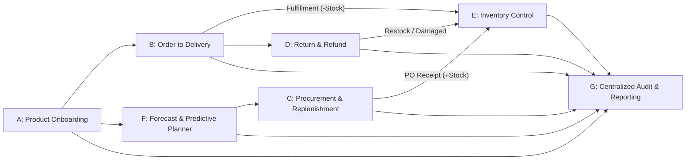
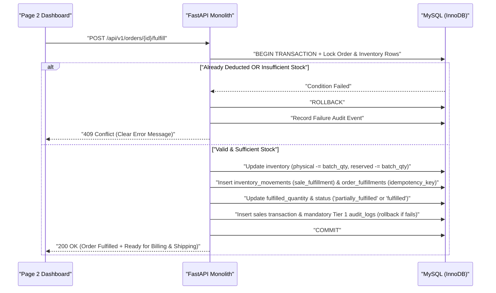
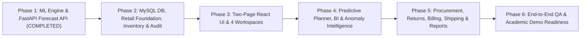

# NEXORA
## Technical Project Blueprint & Master Architecture Specification

- **Project:** NEXORA – AI-Powered Retail Management & Intelligence System
- **Document Version:** 2.2 (Design Decision Resolution)
- **Original Baseline (v1.0):** 15 November 2026
- **Scope Revision (v2.0):** 25 November 2026
- **Detailed Specification (v2.1):** 25 November 2026
- **Design Decision Resolution (v2.2):** 25 November 2026
- **Target File:** `docs/NEXORA — Technical Blueprint v1.0.md`
- **Active Repository Baseline:** Branch `main` (`3d8a937`), Phase 1 ML Engine & Forecast API Completed

---

# 1. Scope Revision & Implementation Reality

## 1.1 Continuity from v1.0, v2.0, and v2.1 to v2.2
This document consolidates Technical Blueprint v2.1 into **Technical Blueprint v2.2 (Design Decision Resolution)** by formally incorporating all ten finalized Design Decisions (**`DDR-01` through `DDR-10`**). All core architectural decisions established in v2.0 and v2.1 remain intact:

- **Maximum Two Primary Webpages:** Page 1 (**Stakeholder Workspace Selection**) and Page 2 (**Unified Retail Management Dashboard**).
- **Four Stakeholder Workspaces (UI Context, Not Authentication):** **Store Manager (Admin)**, **Inventory Staff**, **Purchase Manager**, and **Finance Staff**. Zero login screens, passwords, registration flows, or JWT tokens exist in the target design.
- **Six Functional Groups:** Eighteen (18) core operational and intelligence modules across Groups 1–5, plus four (4) supporting system capabilities in Group 6.
- **Centralized History & Audit Database:** Persistent, append-only history tracking across modules, workspaces, API errors, and restarts.
- **Preserved Phase 1 ML Engine:** Complete retention of the UCI Online Retail II preprocessing, leakage-free feature engineering, multi-horizon (7, 15, 30, 90-day) training/evaluation pipelines, and FastAPI inference endpoints.
- **Integrated Modular Monolith:** Single FastAPI backend, MySQL 8.x (InnoDB) relational database, serialized scikit-learn `.joblib` estimators, and React + TypeScript frontend.
- **Finalized Design Decisions (`DDR-01`–`DDR-10`):** Unified supplier lead-time risk calculation, incoming PO rules, stock reservation & availability breakdown, `INR` default currency and central tax config, partial fulfillment & split shipments, B2B demand/quarantine/UoM ML integration, `supplier_products` mapping, lifecycle & hybrid anomaly governance, tiered dual-control PO approval, and tiered fail-closed/outbox audit handling.

## 1.2 Verified Repository Implementation Reality (`main`)
Direct inspection of the repository on branch `main` establishes the exact boundary between implemented components and planned work. No component is claimed implemented merely because it appears in prior draft documents.

| Architectural Area | Status on `main` | Verified Repository Evidence | Target State in Blueprint v2.2 |
| :--- | :---: | :--- | :--- |
| **ML Data Ingestion & Profiling** | **Implemented** | `backend/ml/src/data_loader.py` reads `backend/ml/data/raw/online_retail_II.csv` (`latin1`, 541,910 rows) and generates `eda_report.md`. | Preserved untouched; used as empirical baseline. |
| **Transaction Stream Separation** | **Implemented** | `backend/ml/src/preprocessing.py` performs 4-way MECE classification (`gross_sales`, `cancellation`, `return_credit`, `exceptional`) verified by `test_preprocessing.py` (5 tests). | Preserved; supports future Return & Anomaly analytics. |
| **Daily Aggregation & Features** | **Implemented** | `backend/ml/src/feature_engineering.py` performs continuous lifespan zero-padding and builds leakage-free calendar, lag (`1,7,14,28`), rolling (`7,28`), and `D_7..D_90` targets verified by 17 tests (`test_feature_engineering.py`, `test_ml_features.py`). | Preserved; future MySQL operational sales integration defined carefully. |
| **Model Training & Chronological Evaluation** | **Implemented** | `backend/ml/src/train.py`, `evaluate.py`, and `predict.py` train Weekly-Average Baseline, Ridge (`OneHotEncoder` top-50), and Random Forest with purge/embargo validation (`MAE`, `RMSE`, `WAPE`) verified by 19 tests (`test_model_training.py`, `test_model_evaluation.py`). Note: `.joblib` files are `.gitignore`d and generated locally by running `train.py`. | Preserved; do not replace or retrain unnecessarily. |
| **FastAPI Core & Forecast Inference API** | **Implemented** | `backend/app/main.py` (`/` and `/health`), `backend/app/api/routes/forecast.py` (`/api/v1/forecast/horizons`, `/model-metrics`, `/model-info`, `/`, `/predict`), `schemas/forecast.py`, `services/prediction_service.py`, verified by 19 tests (`test_main.py`, `test_forecast_api.py`). | Extended with `/api/v1/*` operational routers while preserving existing `/forecast` contracts. |
| **Frontend Web Application** | **Planned** | `frontend/` currently contains only `frontend/README.md`. No `package.json`, React code, Vite config, or Tailwind setup exists on `main`. | Two-page React 18+ TypeScript + Tailwind CSS + Chart.js SPA. |
| **MySQL Database, ORM & Migrations** | **Planned** | `sqlalchemy` and `pymysql` exist in `backend/requirements.txt`; `config.py` has placeholder `DB_*` settings. Zero SQLAlchemy models, DB connection pools, Alembic setup, or live tables exist on `main`. | MySQL 8.x (InnoDB) relational schema, SQLAlchemy 2.x ORM, and Alembic migrations. |
| **Retail Ops, Inventory, Procurement, Finance, Shipping & Audit** | **Planned** | No backend routes, schemas, or services exist on `main` for catalog CRUD, suppliers, customers, orders, sales, live inventory, movements, purchasing, returns, billing, shipping, alerts, audit, or reports. | Full 18-module modular monolith + 4 supporting capabilities. |

---

# 2. Project Overview, Objectives & Scope Boundaries

## 2.1 Vision & Academic Project Objectives
**NEXORA – AI-Powered Retail Management & Intelligence System** is an integrated retail management platform unifying daily retail operations with machine-learning demand intelligence. NEXORA is **not** a standalone ML prediction demo or disconnected Swagger endpoint showcase; its objective is to connect operational database transactions directly to empirical forecasting, stock accountability, procurement workflows, financial billing, and centralized auditing.

Specifically, NEXORA is structured to demonstrate ten measurable engineering outcomes:
1. **Database Design & Relational Integrity:** Normalized MySQL InnoDB schema enforcing foreign keys, unique constraints, and `DECIMAL` financial precision.
2. **Persistent Operational CRUD:** Authentic Create, Read, Update, and Deactivate/Cancel workflows backed by FastAPI and MySQL rather than mock UI states.
3. **Integrated End-to-End Workflows:** Traceable flow from catalog and customer intake through order fulfillment, inventory deduction, invoicing, returns, and dispatch.
4. **Machine Learning Integration:** Serving pre-trained multi-horizon (7, 15, 30, 90-day) demand pipelines into stock-risk classification and procurement simulation.
5. **Business Intelligence & Diagnostics:** Sales analytics, seasonal demand patterns, SKU lifecycle classifications, and price-volume correlation studies.
6. **Inventory Accountability:** Transactional movement ledgers linking every quantity change to an originating business document or manual reason.
7. **Stakeholder-Oriented Workspaces:** Focused UI views for **Store Manager (Admin)**, **Inventory Staff**, **Purchase Manager**, and **Finance Staff** inside one unified dashboard.
8. **Centralized History & Auditability:** Persistent, append-only audit log capturing mutations, workspace context, outcomes, and system/API failures across restarts.
9. **Input Validation & Error Resilience:** Strict Pydantic v2 contracts, accurate HTTP error codes (`400`, `404`, `409`, `422`, `500`, `503`), and safe fallbacks for unseen SKUs.
10. **Practical Retail Problem-Solving:** Clean accounting separation of gross sales, cancellations, and returns paired with mandatory human approval in purchasing and pricing.

## 2.2 UCI Online Retail II Dataset Profile & Limitations
Historical demand modeling draws from the **UCI Online Retail II dataset** ([UCI Repository #502](https://archive.ics.uci.edu/dataset/502/online+retail+ii), local CSV verified at `backend/ml/data/raw/online_retail_II.csv` containing 541,910 rows from December 2010 to December 2011 on `main`).

The dataset is strictly a historical transaction dump and **does not** provide:
- Current physical warehouse stock quantities or minimum reorder thresholds.
- Supplier identities, contact details, or delivery lead times.
- Complete customer billing street addresses, cities, postal codes, or payment status.
- Customer shipping destinations, packing checklists, or internal delivery status.
- Structured reasons distinguishing product defects from customer preference returns.
- Purchase order approvals or financial credit note numbers.

**Foundational Principle:** Historical demand profiles and ML forecasting patterns originate from UCI Online Retail II, whereas live operational inventory, suppliers, customers, orders, sales, purchase orders, invoices, payments, shipments, and audit history are created and persisted natively in MySQL.

## 2.3 Approved Exclusions & Human-in-the-Loop Boundaries
The following capabilities are **permanently excluded** unless formally re-approved by the project owner:

| ID | Excluded Capability | Boundary Rationale |
| :--- | :--- | :--- |
| `EXCL-01` | **Official Governmental E-Way Bill Generation** | Statutory government tax portal integration lies outside academic project scope. |
| `EXCL-02` | **Real Shipping Carrier API Integrations** (FedEx, UPS, DHL, etc.) | Requires commercial carrier contracts; NEXORA produces internal pick lists, packing slips, and routing labels only. |
| `EXCL-03` | **Automatic / Autonomous Supplier Order Dispatch** | NEXORA supports simulation and draft POs, but requires explicit human review and approval; it never auto-emails or auto-submits vendor orders. |
| `EXCL-04` | **Unilateral Autonomous Price Markdowns** | Price & Revenue Intelligence visualizes correlations for human managers rather than executing automated price cuts. |
| `EXCL-05` | **Conversational AI Chatbot or Natural-Language POS** | System intelligence centers on structured tabular UIs, deterministic rules, and regression demand modeling. |
| `EXCL-06` | **Market Basket / Purchase Affinity Mining** | Association-rule mining lies outside NEXORA's multi-horizon demand planning and operational ERP scope. |
| `EXCL-07` | **Complex Multi-Supplier Algorithmic Optimization** | Replenishment utilizes deterministic risk formulas and single-supplier lead-time simulation rather than linear programming solvers. |
| `EXCL-08` | **Automated Customer-Address Scraping from Dataset** | Because the UCI dataset lacks full street addresses, customer intake must occur explicitly via operational forms. |

---

# 3. Technology Stack & System Architecture

## 3.1 Approved Technology Stack
NEXORA adheres to a single, streamlined stack across frontend, backend, data, ML, database, and testing layers. Microservices, external message brokers, and unnecessary visualization/UI libraries are avoided.

| Layer | Approved Technology | Status on `main` | Architectural Role |
| :--- | :--- | :---: | :--- |
| **Frontend SPA** | React (18+) + TypeScript (5.x) | **Planned** | Type-safe two-page user interface (`WorkspaceSelector` + `UnifiedDashboard`) |
| **Styling** | Tailwind CSS (3.x) | **Planned** | Utility-first styling, responsive tables, cards, and modal dialogs |
| **Charts** | Chart.js + `react-chartjs-2` | **Planned** | Sales trends, seasonal heatmaps, price-volume scatter/bar charts, forecast overlays |
| **Backend API** | Python (3.10+, tested 3.11.9) + FastAPI (`>=0.110.0`) | **Implemented** (Core/Forecast) / **Planned** (Ops) | Modular monolithic REST API under `/api/v1`, Swagger UI (`/docs`), ReDoc (`/redoc`) |
| **Schema Validation** | Pydantic v2 (`>=2.6.0`) + Pydantic-Settings | **Implemented** | Request validation, decimal/enum checking, response contracts, config parsing |
| **Database** | MySQL 8.x (InnoDB Engine) | **Planned** | ACID relational storage for retail operations, inventory, finance, forecasts, and audit logs |
| **ORM & Migrations** | SQLAlchemy 2.x (`>=2.0.0`) + PyMySQL + Alembic | **Planned** (`sqlalchemy`/`pymysql` in `requirements.txt`; `alembic` to add) | Transactional database access, foreign-key enforcement, parameterized SQL, versioned migrations |
| **Data Processing** | Pandas (`>=2.2.0`) + NumPy (`>=1.26.0`) | **Implemented** | Historical cleaning, daily aggregation, lag/rolling calculations, analytical grouping |
| **Machine Learning** | Scikit-learn (`>=1.4.0`, + optional XGBoost) | **Implemented** | Ridge Regression, Random Forest, `OneHotEncoder`, chronological backtesting |
| **Model Persistence** | Joblib (`>=1.3.0`) | **Implemented** | Read-only binary `.joblib` serialization loaded into FastAPI memory on startup |
| **Automated Testing** | Pytest (`>=8.0.0`) + `pytest-timeout` + HTTPX | **Implemented** (60 tests) | Unit, API, ML leakage, and integration verification (`pytest.ini` 30s timeout guard) |
| **API Exploration** | Swagger UI (`/docs`) + Postman | **Implemented** | Interactive endpoint inspection and reproducible API verification |

*Note on Authentication Removal:* JWT libraries and `Passlib` password hashing from Blueprint v1.0 are **not** part of the approved v2.2 stack because workspace selection replaces user login.

## 3.2 Modular Monolithic System Architecture

```text
+-----------------------------------------------------------------------------------+
|                        NEXORA WEB APPLICATION (React + TS)                        |
|   [Page 1: Workspace Selection]  <======>  [Page 2: Unified Retail Dashboard]     |
|   "Welcome to NEXORA — Select Your Workspace"    Tabs / Panels / Charts / Modals   |
|   Context Header: X-NEXORA-Workspace (UI View Context — Not Authentication)       |
+-----------------------------------------------------------------------------------+
                                          |
                                  REST / JSON (/api/v1)
                                          |
                                          v
+-----------------------------------------------------------------------------------+
|                        FASTAPI MODULAR MONOLITHIC BACKEND                         |
|                                                                                   |
|  +-----------------------+  +-----------------------+  +-----------------------+  |
|  |   Retail Operations   |  |  AI & BI Intelligence |  | Supporting Services   |  |
|  | - Product & Supplier  |  | - Demand Forecasting  |  | - Centralized History |  |
|  | - Customer & Orders   |  |   (Phase 1 Read-Only) |  |   & Audit Service     |  |
|  | - Sales & Returns     |  | - Predictive Planner  |  | - Smart Alerts Engine |  |
|  | - Inventory & Moves   |  | - BI & Seasonality    |  | - Reports & Export    |  |
|  | - Procurement/POs     |  | - Lifecycle & Price   |  | - Validation & Error  |  |
|  | - Billing & Shipping  |  | - Anomaly Detection   |  |   Correlation Layer   |  |
|  +-----------------------+  +-----------------------+  +-----------------------+  |
+-----------------------------------------------------------------------------------+
                   |                                             |
       SQLAlchemy 2.x (InnoDB ACID)                      Joblib Startup Cache
                   |                                             |
                   v                                             v
+--------------------------------------+      +-------------------------------------+
|        MYSQL 8.x DATABASE            |      |     TRAINED ML ENGINE (Disk)        |
| - Foundation & supplier_products   |      | - backend/ml/models/*.joblib        |
| - Orders, Fulfillments, Sales, Ret.  |      | - models_metadata.json              |
| - Inventory, Reserved, Moves & POs   |      | - Demand Adjustments & Quarantine   |
| - Invoices, Payments & Credit Notes  |      | - UCI Historical Demand + Validated |
| - Shipments, Forecasts, Alerts       |      |   B2B Demand Aggregates             |
| - Audit Logs, Outbox & Settings      |      +-------------------------------------+
+--------------------------------------+
```

---

# 4. Two-Page Application & Workspace Architecture

NEXORA enforces a strict **two-page web architecture**. Modules must never be fragmented across dozens of top-level routes or separate workspace sub-apps.

## 4.1 Page 1 — Stakeholder Workspace Selection
- **Route:** `/` (Application Landing Entry)
- **Required Heading:** `Welcome to NEXORA — Select Your Workspace`
- **Card Grid (Exactly Four Workspaces):**
  1. **Store Manager (Admin)** — Full operational, analytical, configuration, and audit oversight across all 18 core modules and 4 supporting capabilities.
  2. **Inventory Staff** — Focused view for physical stock control, stock adjustments, movement history, forecast consumption, replenishment alerts, and inventory reports.
  3. **Purchase Manager** — Focused view for supplier directories, supplier-product mappings, lead-time purchase simulation, PO drafting/submission, Tier 1 routine PO approval (`<= Tier 1 Spending Limit`, when not escalated), procurement workflows, forecasts, and procurement reports.
  4. **Finance Staff** — Focused view for customer billing details, invoice generation, payment tracking, return/credit note adjustments, revenue reconciliation, and financial reports.
- **Behaviour:** Clicking a workspace card stores the active workspace selection in client state (e.g., `sessionStorage` / context provider), appends workspace metadata (such as `X-NEXORA-Workspace`) to outgoing API calls for audit attribution, and routes immediately to **Page 2**.
- **Explicit Authentication Exclusion:** Page 1 must contain **no** username input, password field, registration form, forgot-password flow, or JWT login call. **This is a workspace selector, NOT an authentication system.**

## 4.2 Page 2 — Unified Retail Management Dashboard
- **Route:** `/dashboard`
- **Single-Shell Workspace Navigation:** All accessible modules render inside Page 2's main workspace container via structured navigation sections, horizontal sub-tabs, expandable drawers, sortable tables, interactive forms, and modal confirmation dialogs.
- **Live In-Dashboard Switching:** A prominent workspace switcher dropdown/selector in the Page 2 top header lets operators transition seamlessly between **Store Manager (Admin)**, **Inventory Staff**, **Purchase Manager**, and **Finance Staff** without navigating back to Page 1 or loading separate applications.
- **UI Scoping vs. Security Clarification:** Workspace visibility filters Page 2 navigation items and action panels for usability and workflow governance (such as `DDR-09` Tier 1 vs. Store Manager PO approval stages or `DDR-04`/`DDR-08` configuration panels). It must **never** be presented or relied upon as cryptographically verified identity, authentication, or server-enforced security RBAC.

---

# 5. Detailed Specification of All 18 Core Modules

Every module below follows a standardized 13-part specification (**A** through **M**) covering purpose, functional behaviour, workspace views, data flow, database entities, API requirements, CRUD/business operations, validation rules, dependencies, audit coverage, error edge cases, acceptance criteria, and honest implementation status on branch `main`.

---

## Group 1 — Retail Foundation (Modules 1–5)

### Module 1: Product Management

#### A. Module Purpose
Maintains the master SKU catalog for NEXORA, providing structured product definitions (`stock_code`, descriptions, categories, standard unit prices, and active status). Resolves the separation between static catalog metadata and volatile warehouse stock quantities while bridging legacy UCI SKUs with newly onboarded products.

#### B. Functional Requirements
- Register new retail products with unique SKU identifiers (`stock_code`), categories, descriptions, and unit prices.
- Search, filter (by category, active status, keyword), sort, and paginate the product master catalog.
- Edit product descriptions, category assignments, and baseline unit prices.
- Soft-deactivate or reactivate products rather than destroying catalog rows referenced by historical sales or invoices (`Discontinued` lifecycle status in Module 8 requires an explicit authorized manual change per `DDR-08`).
- Store product-specific base Units of Measure (`base_uom`) and support historically traceable UoM conversion factors (`uom_conversions`) used by B2B orders and ML demand aggregation (`DDR-06`).
- Link eligible suppliers, supplier part codes, purchase prices, MOQs, and product-specific lead times via `supplier_products` (`DDR-07`).
- Initialize corresponding warehouse inventory records automatically upon new product creation (or link via onboarding workflow).
- Display whether a SKU carries historical UCI transaction baseline data or was newly added operationally.

#### C. Workspace Responsibilities
- **Store Manager (Admin):** Full CRUD and soft-deactivation/reactivation control.
- **Inventory Staff:** Catalog lookup and read-only viewing while managing stock levels and movements.
- **Purchase Manager:** Read-only SKU viewing when configuring suppliers or creating purchase orders.
- **Finance Staff:** Read-only SKU pricing and description lookup during invoice composition.
*(Note: UI workspace scoping controls display only; no server-enforced RBAC authentication.)*

#### D. Inputs and Outputs
- **Inputs:** `stock_code`, `description`, `category_id` (optional/assigned), `unit_price`, `is_active`, optional initial stock seed parameters passed to Inventory Control.
- **Outputs:** Validated master product record, category metadata, SKU active status, and onboarding event triggering inventory initialization.

#### E. Database Requirements
- **Entities:** `products`, `categories`.
- **Important Fields (`products`):** `id` (PK), `stock_code` (VARCHAR, UNIQUE, indexed), `description` (VARCHAR, NOT NULL), `category_id` (FK → `categories.id`), `base_uom` (VARCHAR DEFAULT `'unit'`), `current_unit_price` (`DECIMAL(10, 2)` — operational default currency `INR` per `DDR-04`), `lifecycle_stage` (`ENUM('Introduction','Growth','Maturity','Decline','Discontinued')` per `DDR-08`), `is_uci_baseline` (BOOLEAN), `is_active` (BOOLEAN DEFAULT TRUE), `created_at`, `updated_at` (plus related `uom_conversions` and `supplier_products`).
- **Important Fields (`categories`):** `id` (PK), `name` (UNIQUE), `description`, `is_active`, `created_at`.
- **Constraints:** `stock_code` must be unique (case-trimmed/normalized); `current_unit_price > 0` (or `>= 0` only if non-commercial flags apply—recommended `>= 0.01` for active sellable SKUs).

#### F. API Requirements *(Planned)*
- `GET /api/v1/products` — Paginated catalog search/filter (`search`, `category_id`, `is_active`, `page`, `limit`).
- `GET /api/v1/products/{product_id}` (or lookup by `stock_code`) — Detailed product view including current category and stock summary.
- `POST /api/v1/products` — Create product + initialize zero/opening inventory record in one transaction (`201 Created`).
- `PUT /api/v1/products/{product_id}` — Update description, category, or unit price (`200 OK`).
- `PATCH /api/v1/products/{product_id}/status` (or `DELETE /api/v1/products/{product_id}` mapped to soft-deactivation) — Toggle `is_active` cleanly (`200 OK`).
- **Errors:** `409 Conflict` on duplicate `stock_code`, `404 Not Found` on missing product, `422 Unprocessable Entity` on negative unit price or blank description.

#### G. CRUD and Business Operations
- **Create:** Validated product creation with optional atomic zero-stock inventory entry initialization.
- **Read:** Paginated listing, search, and SKU detail inspection.
- **Update:** Non-key metadata edits (unit price updates do not retroactively rewrite historical finalized invoice line prices).
- **Deactivate (Delete Equivalent):** Soft-deactivation (`is_active = False`). Hard deletion is blocked whenever `transaction_items`, `order_items`, `inventory_movements`, `invoice_items`, `purchase_order_items`, or `forecasts` reference the `product_id`.

#### H. Business Rules and Validation
- `stock_code` cannot be blank whitespace and is normalized (trimmed uppercase where consistent with UCI alphanumeric SKUs such as `85123A`).
- Product master records hold commercial definition (`current_unit_price`), while physical quantities belong exclusively to **Inventory Control** (`inventory` table).
- Historical UCI SKUs seeded into MySQL must retain historical transaction linkages cleanly even if deactivated from active future selling.
- Updating `current_unit_price` applies to future orders/invoices only; historical `order_items`, `transaction_items`, and `invoice_items` store immutable point-in-time `unit_price`.

#### I. Module Dependencies
- **Upstream:** None (root catalog foundation).
- **Downstream:** `Inventory Control` (1:1 stock tracking), `Supplier Management` (`supplier_products` many-to-many mapping per `DDR-07`), `Order Management` & `Sales Management`, `Purchase Planning Simulator` / Purchase Orders, `Demand Forecasting` (`uom_conversions` per `DDR-06`), `Billing & Finance`, `Business Intelligence`, `Price & Revenue Intelligence`, `Return Intelligence`.

#### J. History & Audit Events
- `PRODUCT_CREATED`, `PRODUCT_UPDATED` (capturing before/after price/description snapshots), `PRODUCT_DEACTIVATED`, `PRODUCT_REACTIVATED`, `PRODUCT_CATEGORY_CREATED/UPDATED`, and failed duplicate-SKU attempts.

#### K. Error and Edge-Case Handling
- Duplicate `stock_code` creation → HTTP `409 Conflict` without creating partial inventory records.
- Deactivating a product that has open pending orders or active positive stock → permitted as soft-deactivation for new sales while allowing fulfillment/adjustment of existing commitments, with UI warning surfaced.
- Missing UCI `Description` during seed import → safely falls back to `StockCode` matching `data_loader.py` convention.

#### L. Acceptance Criteria
- New products persist in MySQL across server restarts and appear immediately in catalog search, inventory registry, and order/invoice item pickers.
- Duplicate `stock_code` returns `409`; negative price returns `422`.
- Soft-deactivated products cannot be added to newly created orders/invoices while retaining full historical analytics, invoices, and movement logs.

#### M. Implementation Status
- **Planned** *(UCI SKU lookup exists only offline in Phase 1 CSVs; no `products` MySQL table or `/api/v1/products` endpoint exists on `main`).*

---

### Module 2: Supplier Management

#### A. Module Purpose
Maintains the vendor directory and supplier lead-time data required for procurement workflows. Eliminates the UCI dataset gap where vendor identities and delivery lead times do not exist.

#### B. Functional Requirements
- Create, search, filter, view, update, and soft-deactivate suppliers.
- Store contact details (`contact_person`, `email`, `phone`, `address`) and optional supplier-level fallback `lead_time_days`.
- Maintain explicit many-to-many **Supplier-Product Mappings (`supplier_products`, `DDR-07`)** storing `supplier_product_code`, supplier-specific `purchase_price`, product-specific `lead_time_days`, `minimum_order_quantity`, `is_preferred` indicator, and `is_active` status while retaining inactive relationships for historical traceability.
- Provide deterministic lead-time resolution (`DDR-01`): product-specific `supplier_products.lead_time_days` is primary; supplier-level `suppliers.lead_time_days` acts as fallback; if neither exists, mark supplier lead-time risk unavailable rather than inventing a lead time.

#### C. Workspace Responsibilities
- **Store Manager (Admin):** Full supplier CRUD and activation management.
- **Purchase Manager:** Full supplier creation, editing, lead-time maintenance, and selection during procurement.
- **Inventory Staff:** Read-only lookup of supplier lead times when reviewing stock alerts.
- **Finance Staff:** Not required for core billing (optional read-only context for vendor reference if needed).

#### D. Inputs and Outputs
- **Inputs:** `supplier_name`, `contact_person`, `email`, `phone`, `address`, optional default `lead_time_days`, `is_active`; plus per-SKU `supplier_products` mapping inputs (`product_id`, `supplier_product_code`, `purchase_price`, product-specific `lead_time_days`, `minimum_order_quantity`, `is_preferred`, `is_active`).
- **Outputs:** Supplier profile record, many-to-many `supplier_products` mappings, and resolved lead-time parameter (`supplier_products.lead_time_days` → fallback `suppliers.lead_time_days` → `NULL`/unavailable) consumed by Module 11, Module 14, and PO expected delivery dates.

#### E. Database Requirements
- **Entities:** `suppliers`, `supplier_products` *(Resolved per `DDR-07`)*.
- **Important Fields (`suppliers`):** `id` (PK), `supplier_name` (VARCHAR, NOT NULL, indexed), `contact_person`, `email`, `phone`, `address` (TEXT), `lead_time_days` (INT NULLABLE — fallback default lead time when product-specific lead time is unset; never auto-fabricated if null), `is_active` (BOOLEAN DEFAULT TRUE), `created_at`, `updated_at`.
- **Important Fields (`supplier_products`, many-to-many per `DDR-07`):** `id` (PK), `supplier_id` (FK → `suppliers.id`), `product_id` (FK → `products.id`), `supplier_product_code` (VARCHAR), `purchase_price` (`DECIMAL(10, 2) >= 0`), `lead_time_days` (INT NULLABLE `>= 1`), `minimum_order_quantity` (INT NOT NULL DEFAULT `1`, `>= 1`), `is_preferred` (BOOLEAN NOT NULL DEFAULT FALSE), `is_active` (BOOLEAN NOT NULL DEFAULT TRUE), `created_at`, `updated_at`.
- **Constraints:** Any populated `lead_time_days` (`suppliers` or `supplier_products`) must be `>= 1` and bounded (`<= 365`). If neither table supplies a valid lead time, `lead_time_days` remains unset (`NULL`) and `DDR-01` marks lead-time-based stockout risk unavailable. Deactivated `supplier_products` mappings (`is_active = False`) are permanently retained for historical PO/cost traceability.

#### F. API Requirements *(Planned)*
- `GET /api/v1/suppliers` — Paginated supplier list (`search`, `is_active`).
- `GET /api/v1/suppliers/{supplier_id}` — Supplier details and linked PO summary.
- `POST /api/v1/suppliers` — Create supplier (`201 Created`).
- `PUT /api/v1/suppliers/{supplier_id}` — Update contact details or `lead_time_days`.
- `PATCH /api/v1/suppliers/{supplier_id}/status` (or soft `DELETE`) — Deactivate vendor (`is_active = False`).
- `GET / POST / PUT / PATCH /api/v1/suppliers/{supplier_id}/products` *(and `/api/v1/products/{product_id}/suppliers`)* — Manage `supplier_products` mappings, preferred supplier indicators, MOQs, purchase prices, and soft-deactivation (`is_active = False`).

#### G. CRUD and Business Operations
- Full Create, Read, Update, and Soft-Deactivate operations. Suppliers referenced by historical `purchase_orders` cannot be hard-deleted.

#### H. Business Rules and Validation
- Any supplied `lead_time_days` (`suppliers` or `supplier_products`) must be a valid integer (`1 <= lead_time_days <= 365`); `<= 0` fails validation (`422`). Omitting lead time keeps it `NULL` rather than fabricating a synthetic lead time (`DDR-01`).
- **Lead-Time Fallback Rule (`DDR-01` & `DDR-07`):** Product-specific `supplier_products.lead_time_days` supersedes `suppliers.lead_time_days`; supplier-level lead time serves as fallback when product-specific lead time is unavailable.
- Deactivated suppliers or deactivated `supplier_products` mappings cannot be used on new Purchase Orders, while existing in-flight and historical POs retain full FK/cost traceability.
- Changing `purchase_price` or `lead_time_days` updates future simulations and new PO calculations without altering historical closed PO records.

#### I. Module Dependencies
- **Upstream:** None.
- **Downstream:** `Purchase Planning Simulator` (leads & PO creation), `Predictive Planner` (if lead-time scaling configured), `Business Intelligence` / procurement reports.

#### J. History & Audit Events
- `SUPPLIER_CREATED`, `SUPPLIER_UPDATED` (especially changes to `lead_time_days`), `SUPPLIER_DEACTIVATED`, `SUPPLIER_REACTIVATED`, `SUPPLIER_PRODUCT_MAPPED`, `SUPPLIER_PRODUCT_UPDATED`, `SUPPLIER_PRODUCT_DEACTIVATED`.

#### K. Error and Edge-Case Handling
- Invalid email syntax or non-positive `lead_time_days` → HTTP `422`.
- Creating a PO with an inactive or missing `supplier_id` → HTTP `400` / `404` / `422`.
- Duplicate supplier name warning/prevention policy (`409 Conflict` if unique constraint applied on normalized supplier name).

#### L. Acceptance Criteria
- Operators can create, edit, and deactivate suppliers in Page 2 UI and see updated `lead_time_days` reflected in Purchase Planning Simulator calculations.
- Active POs referencing a deactivated supplier retain supplier attribution without foreign-key breakage.

#### M. Implementation Status
- **Planned** *(No `suppliers` database model, service, or API route exists on `main`).*

---

### Module 3: Customer Management

#### A. Module Purpose
Manages retail customer records, contact information, and billing/shipping addresses. Bridges the UCI dataset limitation (where ~25% of rows omit `Customer ID` and 100% omit street addresses) with persistent customer directory records for orders, sales, billing, and internal shipping while maintaining strict separation from `M17` transaction ownership.

#### B. Functional Requirements
- Create, read, search, filter, update, soft-deactivate, and reactivate customer profiles (`is_active` lifecycle toggle).
- Capture `customer_name`, `billing_address`, `city`, `postal_code`, `country` (`'India'` default when omitted), optional `state`, optional `phone`/`email`, and optional separate `shipping_address`.
- Allow rapid inline customer lookup or creation when drafting an Order (`Module 5`) or Invoice (`Module 17`).
- Support explicit handling of walk-in/guest operational orders/invoices via a designated operational guest convention alongside separate historical UCI reference handling (`uci_customer_ref` / nullable `transactions.customer_id`) without breaking relational constraints.

#### C. Workspace Responsibilities
- **Store Manager (Admin):** Full customer directory CRUD, deactivation, and reactivation via Page 2 navigation tab.
- **Finance Staff:** Full customer directory CRUD, billing address updates, and profile lookup during invoicing and credit note management via Page 2 navigation tab.
- **Inventory Staff / Purchase Manager:** **No M03 customer-management tab** in Page 2 navigation (reconciled with Section `14.3`). Customer names/addresses required downstream during warehouse dispatch are consumed inside `Order Management` (`M05`) and `Shipping & Delivery` (`M18`).
- *Non-Auth Governance Note (`SYS-01`):* UI tab scoping and `X-NEXORA-Workspace` headers are operational context and audit provenance only; endpoints do **not** implement login, JWTs, employee identities, or server-side security RBAC.

#### D. Inputs and Outputs
- **Inputs:** `customer_name`, optional `phone` and `email`, mandatory billing fields (`billing_address`, `city`, `postal_code`, `country` defaulting to `'India'`), optional `state` (nullable), optional separate `shipping_address`, optional `uci_customer_ref`, and `is_active` status transitions.
- **Outputs:** Persistent `customers` master profiles consumed by `M04` Sales Management, `M05` Order Management, `M17` Billing & Finance (capturing immutable `billing_snapshot`), and `M18` Shipping & Delivery (resolving immutable `shipments.shipping_address`).

#### E. Database Requirements
- **Entities:** `customers` (authoritative target specification in `DATABASE_SCHEMA.md` v2.9; zero unapproved columns such as `customer_type`, `is_guest`, or `customer_code`).
- **Important Fields:** `id` (`BIGINT UNSIGNED` PK), `uci_customer_ref` (`VARCHAR(64) NULL`, indexed), `customer_name` (`VARCHAR(150) NOT NULL`), `phone` (`VARCHAR(50) NULL`), `email` (`VARCHAR(255) NULL`), `billing_address` (`TEXT NOT NULL`), `shipping_address` (`TEXT NULL`), `city` (`VARCHAR(100) NOT NULL`), `state` (`VARCHAR(100) NULL` — explicitly optional in API/UI), `postal_code` (`VARCHAR(20) NOT NULL`), `country` (`VARCHAR(100) NOT NULL DEFAULT 'India'` per `DDR-04`), `is_active` (`BOOLEAN NOT NULL DEFAULT TRUE`), `selected_workspace`, `action_source`, `operator_ref`, `created_at`, `updated_at`.
- **Indexes & Uniqueness Policy:** Indexes cover `(customer_name, is_active)`, `(uci_customer_ref)`, and `(country)`. No database `UNIQUE` constraints exist on `email`, `phone`, or `customer_name`; any future application-level duplicate detection warning or check must define an explicit matching rule rather than promising unconditional global uniqueness across legitimately shared contacts.
- **Guest / Historical Handling:** Operational `orders` and `invoices` require `customer_id NOT NULL` in `DATABASE_SCHEMA.md` v2.9. Where an operational workflow requires a shared walk-in/guest customer, systems use a designated seeded operational guest customer convention (configured during Phase 2 setup without hardcoding an arbitrary ID in docs or adding schema columns); this shared operational reference must be protected against ordinary M03 deactivation or destructive profile alteration. Historical UCI `transactions` remain strictly separate (`transactions.customer_id` nullable when `order_id IS NULL`, preserving `uci_customer_ref` for ~25% null rows without forcing unidentified UCI rows into the operational guest record and without automated address scraping per `EXCL-08`).

#### F. API Requirements *(Planned)*
- `GET /api/v1/customers` — Search and filter customers (`name`, `email`, `phone`, `uci_customer_ref`, `country`, `is_active`) with pagination.
- `GET /api/v1/customers/{customer_id}` — Detailed customer profile (`order`/`sales`/`invoice` history views consume `GET /api/v1/orders?customer_id=...`, `GET /api/v1/sales?customer_id=...`, and `GET /api/v1/invoices?customer_id=...` with spend aggregates grouped strictly by currency).
- `POST /api/v1/customers` — Create customer (`201 Created`).
- `PUT /api/v1/customers/{customer_id}` — Update contact, billing, or shipping details (`200 OK`).
- `PATCH /api/v1/customers/{customer_id}/status` — Soft-deactivate (`is_active = false`) or reactivate (`is_active = true`) customer record (`200 OK`; sole supported customer lifecycle endpoint; blocks deactivation on designated protected guest reference).
- *(Lifecycle Policy: No `DELETE /api/v1/customers/{customer_id}` route, alternative hard-delete endpoint, or hard-delete UI action is provided. Hard deletion is prohibited for all customers, including unreferenced customers.)*

#### G. CRUD and Business Operations
- Create, Read, Update, Soft-Deactivate (`is_active = FALSE`), and Reactivate (`is_active = TRUE`).
- **Universal Hard-Delete Prohibition:** Customer records must **never** be hard-deleted through the NEXORA application — **including customers with zero existing business references** (neither UI action nor API `DELETE` route exists). Downstream `ON DELETE RESTRICT` foreign keys (`orders`, `transactions`, `invoices` -> `customers.id`) provide an additional database integrity safeguard rather than the sole reason hard deletion is prohibited; all customer records and historical relationships are retained permanently, and the designated shared operational guest customer cannot be deactivated or deleted through normal M03 operations.

#### H. Business Rules and Validation
- Required creation/update fields follow `DATABASE_SCHEMA.md` v2.9: `customer_name`, `billing_address`, `city`, `postal_code`, and `country` (defaulting to `'India'` if omitted). **`state` is optional in both API and UI**, as are `phone` and `email`. Automated UCI address scraping is prohibited (`EXCL-08`).
- **Shipping Destination Fallback & Snapshot Immutability:** `customers.shipping_address`, when provided, is the customer's default delivery destination. When omitted/`NULL`, `M18` deterministically composes the full destination string from billing components (`billing_address`, `city`, optional `state`, `postal_code`, `country`). `orders` stores **no** `shipping_address` column; `M18` resolves and freezes the effective destination inside `shipments.shipping_address` (`TEXT NOT NULL`) at shipment creation. Subsequent M03 updates never rewrite `invoices.billing_snapshot` or existing `shipments.shipping_address` snapshots.
- **Deactivated Customer Lifecycle Rules:** Setting `is_active = FALSE` blocks **new business transactions** (`HTTP 409 Conflict`): new `M05` order creation, confirmation (`POST /orders/{id}/confirm`) of any pre-existing `draft`/`pending` order whose customer is inactive at confirmation time, new standalone operational `M04` sales, and new standalone `M17` invoices. Deactivation does **not** retroactively cancel confirmed/partially fulfilled orders or void existing invoices; already-confirmed orders, existing invoices, payments, returns, credit notes, refunds, and shipments continue their normal lifecycle and remain permanently readable.
- **Currency-Safe Customer Spend Aggregation:** Customer financial history must never sum mixed `GBP` (UCI 2009–2011 `transactions`) and `INR` (operational `transactions`/`invoices`) totals into one combined figure; aggregates use `DECIMAL` precision grouped strictly by currency (`currency_code`), without implicit FX conversion.

#### I. Module Dependencies
- **Upstream:** None (`M03` owns customer master data, contact/address details, status, and customer lookup).
- **Downstream:** `Order Management` (`M05`), `Sales Management` (`M04`), `Billing & Finance` (`M17`), `Shipping & Delivery` (`M18`), `Business Intelligence` (`M06`). (`M03` never owns sales, order, invoice, payment, credit/refund, or shipment lifecycle records.)

#### J. History & Audit Events
- **Governance Tier (`DDR-10`):** Customer mutations execute as **Tier 2** audited operations (`audit_logs` with durable **`audit_outbox`** fallback, automated retries, dead-letter quarantine, manual replay, `correlation_id`, `idempotency_key`, append-only integrity, and secret/payment-card redaction). Business mutations succeed cleanly while transient audit delays reconcile via `audit_outbox`.
- **Standard Events:** `CUSTOMER_CREATED`, `CUSTOMER_UPDATED` (non-sensitive before/after snapshots), `CUSTOMER_DEACTIVATED`, `CUSTOMER_REACTIVATED`.

#### K. Error and Edge-Case Handling
- Incomplete required operational fields (`customer_name`, `billing_address`, `city`, `postal_code`) or malformed payloads → HTTP `422` (never rejecting for omitted optional `state`).
- Unknown `customer_id` on lookup/order/sale/invoice → HTTP `404`.
- Attempted new order, draft confirmation, standalone operational sale, or standalone invoice for an inactive (`is_active = FALSE`) customer, or prohibited deactivation of a protected shared operational guest record → HTTP `409 Conflict`.
- Historical UCI transactions lacking `Customer ID` → handled cleanly via `transactions.customer_id NULL` and nullable `uci_customer_ref` rather than failing import or mapping into the operational guest record.

#### L. Acceptance Criteria
- New customer addresses entered in UI persist in MySQL with `'India'` default `country`, optional `state`, and Tier 2 audit logging (`audit_logs` / `audit_outbox`), and auto-populate `M05`/`M17`/`M18` workflows.
- Editing or soft-deactivating/reactivating a customer leaves finalized `invoices.billing_snapshot` and `shipments.shipping_address` intact, blocks new orders/draft confirmations/standalone sales/standalone invoices while inactive, and allows existing confirmed orders and open financial/shipping lifecycles to complete normally.

#### M. Implementation Status
- **Planned** *(No `customers` ORM table or endpoint exists on `main`).*

---

### Module 4: Sales Management

#### A. Module Purpose
Tracks completed commercial sales records and unifies historical UCI transaction streams with ongoing operational store sales. Strictly preserves accounting separation between gross positive demand, cancellations, returns, and exceptional adjustments.

#### B. Functional Requirements
- Record completed commercial sales / fulfillments generated cleanly from operational orders (or verified direct entries) using central `INR` default currency and `DECIMAL` precision (`DDR-04`).
- Search, filter, and inspect sales records separated by `transaction_stream` (`gross_sale`, `cancellation`, `return`, `exceptional`), B2B `order_demand_type` (`recurring_replenishment`, `one_time_bulk`, `contract`, `tender`), and `source_origin` (`uci_historical` vs. `operational`).
- **B2B Demand & Adjustment Separation (`DDR-06`):** Separate **confirmed B2B sales demand** (from confirmed orders timed by `requested_delivery_date`, or creation date for immediate fulfillment—never invoice settlement date) from **realized/fulfilled quantities**, and maintain a separate `demand_adjustments` ledger linking excess-stock returns and full cancellations directly to original `(order_id, order_item_id)` rows while ensuring defective/damaged returns do **not** reduce original demand.
- Calculate gross sales quantity, cancellation quantity, return deductions, and net revenue/quantity.
- Support traceable **sale cancellation / reversal** creating compensating status updates and reversing entries (`DDR-10` Tier 1 fail-closed audit) rather than deleting historical records.

#### C. Workspace Responsibilities
- **Store Manager (Admin):** Full viewing, sales creation/completion oversight, and traceable cancellation/reversal operations.
- **Finance Staff:** Read access to sales streams for billing/credit reconciliation and financial analytics.
- **Inventory Staff / Purchase Manager:** Indirect visibility via Business Intelligence or inventory movement references (`sale_fulfillment`).

#### D. Inputs and Outputs
- **Inputs:** Linked `order_id` (for operational order-driven sales), customer reference, SKU line items (`product_id`, `quantity`, `unit_price`), transaction timestamp, stream classification.
- **Outputs:** Persistent `sales`/`transactions` & line-item records (`transaction_items`), net vs. gross demand feeds for Business Intelligence, and invoice linkage for Billing & Finance.

#### E. Database Requirements
- **Entities:** `transactions`, `transaction_items`, `demand_adjustments` (B2B demand reversal ledger per `DDR-06`), `demand_quarantine` (malformed demand validation staging), `uom_conversions` (historically traceable product UoM factors) — see Section 12 logical schema.
- **Important Fields:** `id` (PK), `invoice_number` / `sale_reference` (VARCHAR, indexed), `order_id` (FK → `orders.id`, nullable for direct historical UCI imports), `customer_id` (FK → `customers.id`, nullable for historical imports), `transaction_date`, `country`, `transaction_type` (`standard`, `cancellation`, `return`, `exceptional`), `source_origin` (`uci_historical`, `operational`), `total_amount` (`DECIMAL(12, 2)`), `status` (`completed`, `cancelled`, `reversed`), `created_at`.
- **Line Items:** `product_id` (FK), `quantity` (INT), `unit_price` (`DECIMAL(10, 2)`), `line_total` (`DECIMAL(12, 2)`).

#### F. API Requirements *(Planned)*
- `GET /api/v1/sales` — Paginated sales listing filterable by date range, `transaction_type`, `source_origin`, SKU, country.
- `GET /api/v1/sales/{sale_id}` — Detailed sale view with line items and linked order/invoice/movements.
- `POST /api/v1/sales` — Record operational sale (normally orchestrated by Order fulfillment flow; validates single completion per order).
- `POST /api/v1/sales/{sale_id}/reverse` — Traceable sale reversal/cancellation (requires reason; records reversing entry and triggers downstream credit/stock workflow without erasing the original row).

#### G. CRUD and Business Operations
- **No Destructive Delete:** Completed sales records **must never** be hard-deleted.
- **Create / Complete:** Tied cleanly to order fulfillment or explicit operational entry.
- **Cancel / Reverse:** Marks transaction state and generates traceable compensating audit/financial/stock entries.

#### H. Business Rules and Validation
- **Order vs. Sale vs. Confirmed Demand Distinction (`DDR-06`):** An **Order** tracks fulfillment lifecycle progression; a **Sale** tracks commercial revenue realization; **Confirmed Demand** comes from confirmed B2B sales orders timed by `requested_delivery_date` (or order creation date for immediate fulfillment). **Confirmed demand and fulfilled quantities are separate concepts**, and **invoice settlement dates must never determine demand timing**.
- **Demand Adjustment Ledger Invariant (`DDR-06`):** Excess-stock returns and full cancellations emit entries in `demand_adjustments` tied to original `(order_id, order_item_id)` to prevent duplicate deductions, whereas defective/damaged returns do **not** reduce original demand.
- **Zero Double-Deduction Guard:** Inventory deduction occurs **once per actually fulfilled quantity** at fulfillment (`Order Management` + `Inventory Control`); creating a linked sale record must never deduct inventory a second time (`DDR-05`).
- **Historical vs. Operational Boundary:** Historical UCI transactions (`source_origin = 'uci_historical'`) are read-only reference data and cannot be modified via operational sales forms. Historical transactions preserve originally applied currency (`INR` operational default per `DDR-04`), tax rate, and tax amounts regardless of subsequent tax changes.
- All monetary totals use strict `DECIMAL` arithmetic (`line_total = quantity × unit_price`).
- **Active Customer Rule on New Standalone Sales:** Direct operational sales (`POST /api/v1/sales`, where `source_origin = 'operational'`) must validate an active customer (`customers.is_active == True`, rejecting deactivated customers with HTTP `409 Conflict`), while existing completed/historical sales remain permanently readable regardless of subsequent customer deactivation (`source_origin = 'uci_historical'` preserves nullable `customer_id`).

#### I. Module Dependencies
- **Upstream:** `Order Management`, `Product Management`, `Customer Management`.
- **Downstream:** `Inventory Control` / `Stock Movement Tracking` (at fulfillment), `Billing & Finance`, `Return Intelligence`, `Business Intelligence`, `Demand Forecasting` (future operational feed).

#### J. History & Audit Events
- `SALE_CREATED` / `SALE_COMPLETED`, `SALE_CANCELLED`, `SALE_REVERSED` (capturing `order_id`, reason, `before_values`/`after_values`).

#### K. Error and Edge-Case Handling
- Attempt to delete completed sale → rejected (`405`/`409`) directing user to reversal/credit workflow.
- Duplicate completion attempt on an already finalized `order_id` → HTTP `409 Conflict`.
- Attempt to edit immutable `uci_historical` transaction → HTTP `403`/`409` error explaining read-only baseline integrity.

#### L. Acceptance Criteria
- Completing an order produces a linked sales record with penny-exact `DECIMAL` line totals.
- Reversing a sale retains the original row, updates state traceably, and writes a centralized audit record.
- BI queries cleanly filter/distinguish `uci_historical` vs. `operational` sales streams.

#### M. Implementation Status
- **Planned** *(UCI CSVs exist processed on disk for offline ML only; no operational sales API or MySQL table exists on `main`).*

---

### Module 5: Order Management

#### A. Module Purpose
Manages the end-to-end customer order lifecycle from initial order intake through item availability checks, processing, fulfillment completion, and cancellation before dispatch. Separates mutable order preparation from finalized accounting sales and invoice records.

#### B. Functional Requirements
- Create multi-item B2B/retail customer orders specifying `customer_id`, `requested_delivery_date` (or immediate fulfillment flag), `order_demand_type` (`recurring_replenishment`, `one_time_bulk`, `contract`, `tender` per `DDR-06`), shipping preferences, and product line items (`product_id`, `quantity`, `uom_code`, `unit_price` defaulting from catalog or explicit override where permitted).
- Validate SKU existence, active catalog status (`is_active == True`), positive integer quantities, UoM conversion validity, and **Available Stock** (`Physical Stock - Reserved Stock`, `DDR-03`).
- Support explicit order status transitions: `draft` / `pending` → `confirmed` (reserving `reserved_quantity` per `DDR-03` and establishing confirmed B2B demand per `DDR-06`) → `partially_fulfilled` (when some quantities are fulfilled and remaining quantities stay pending per `DDR-05`) → `fulfilled` (only when **all** line-item quantities are fulfilled), or `cancelled`.
- Execute atomic **Partial or Full Fulfillment (`DDR-05`)**: accept a per-line fulfillment batch with an `idempotency_key`, deduct `Physical Stock` (`inventory.current_quantity`) and release `Reserved Stock` (`inventory.reserved_quantity`) **only for the quantities actually fulfilled**, write `sale_fulfillment` movement records, create linked **Sales Management** / **Billing** & independent split **`Shipping & Delivery`** shipment records (`1:N`), and trigger **Smart Alerts** (`SYS-03`) if **Available Stock** reaches or falls below the reorder threshold.

#### C. Workspace Responsibilities
- **Store Manager (Admin):** Full order creation, editing (while `draft`/`pending`), confirmation, fulfillment execution, and cancellation.
- **Finance Staff:** Read access to fulfilled/confirmed orders for invoice verification and billing reconciliation.
- **Inventory Staff:** View confirmed/processing orders requiring physical pick/fulfillment readiness.

#### D. Inputs and Outputs
- **Inputs:** `customer_id`, line items (`product_id`, `quantity`), optional `requested_delivery_date`, `order_demand_type`, optional `notes`, state transition actions (`confirm`, `fulfill`, `cancel`). *(Note: `orders` stores no `shipping_address` column; delivery destination resolution occurs at shipment creation in `M18`.)*
- **Outputs:** Persistent `orders` & `order_items` records, fulfillment triggers to `Inventory Control`, `Stock Movement Tracking`, `Sales Management`, `Billing & Finance`, and `Shipping & Delivery`.

#### E. Database Requirements
- **Entities:** `orders`, `order_items`, `order_fulfillments` *(plus `order_fulfillment_items` supporting idempotent multi-batch partial fulfillment per `DDR-05`)*.
- **Important Fields (`orders`):** `id` (PK), `order_number` (UNIQUE), `customer_id` (FK → `customers.id`), `order_status` (`ENUM('draft', 'pending', 'confirmed', 'partially_fulfilled', 'fulfilled', 'cancelled')`), `order_demand_type` (`ENUM('recurring_replenishment', 'one_time_bulk', 'contract', 'tender')` DEFAULT `'recurring_replenishment'` per `DDR-06`), `requested_delivery_date` (DATE NULLABLE — determines demand timing when set; `created_at` date when immediate per `DDR-06`), `is_censored_demand` (BOOLEAN NOT NULL DEFAULT FALSE — stockout/allocation-constraint flag per `DDR-06`), `inventory_deducted` (BOOLEAN NOT NULL DEFAULT FALSE — legacy/full-completion indicator paired with cumulative `fulfilled_quantity` and `order_fulfillments.idempotency_key`), `subtotal` (`DECIMAL(12, 2)`), `notes`, `created_at`, `updated_at`.
- **Important Fields (`order_items`):** `id` (PK), `order_id` (FK → `orders.id`), `product_id` (FK → `products.id`), `quantity` (INT > 0), `fulfilled_quantity` (INT NOT NULL DEFAULT `0`, `0 <= fulfilled_quantity <= quantity`), `uom_code` (VARCHAR), `base_uom_conversion_factor` (`DECIMAL(12, 6)` snapshot per `DDR-06`), `unit_price` (`DECIMAL(10, 2)`), `line_total` (`DECIMAL(12, 2)`).

#### F. API Requirements *(Planned)*
- `GET /api/v1/orders` — List/filter orders by status, customer, date range.
- `GET /api/v1/orders/{order_id}` — Full order detail including line items, deduction flag, and linked sale/invoice/shipment.
- `POST /api/v1/orders` — Create draft or pending order (`201 Created`).
- `PUT /api/v1/orders/{order_id}` — Update items/quantities (only allowed in `draft` or `pending` state prior to fulfillment).
- `POST /api/v1/orders/{order_id}/confirm` — Validate stock and confirm order.
- `POST /api/v1/orders/{order_id}/fulfill` — Execute idempotent atomic full or **partial** fulfillment (accepting optional line-level `fulfill_items` and `Idempotency-Key`; deducts inventory strictly for units actually fulfilled, updates `fulfilled_quantity`, records `sale_fulfillment` movements, triggers `Smart Alerts` on threshold breach, and creates linked sale/shipment readiness).
- `POST /api/v1/orders/{order_id}/cancel` — Cancel unfulfilled order (or trigger reversal workflow if already fulfilled).

#### G. CRUD and Business Operations
- **Create:** Draft/Pending order intake.
- **Read:** Filtered/paginated inspection.
- **Update:** Line-item editing permitted strictly before `fulfilled`/`cancelled`.
- **State Transition Operations:** `confirm`, `fulfill`, `cancel` (replaces destructive delete).

#### H. Business Rules and Validation
- **Reserved vs. Physical Deduction Rule (`DDR-03` & `DDR-05`):**
  - `draft` / `pending` orders allocate **zero** stock (`Physical` and `Reserved` remain unchanged).
  - Transitioning to `confirmed` validates `Available Stock >= quantity` and atomically increments `inventory.reserved_quantity` (`Reserved Stock`) without reducing `Physical Stock`, establishing the confirmed B2B demand baseline (`DDR-06`). If insufficient `Available Stock` blocks or constrains confirmation/allocation, flag `is_censored_demand = True` so ML does not treat allocation shortages as zero customer demand.
  - Physical inventory (`inventory.current_quantity`) is deducted **only at Order Fulfillment**, and **only for the exact quantities actually fulfilled** in that batch (simultaneously decrementing `inventory.reserved_quantity` for those fulfilled units). Unfulfilled remaining quantities stay pending in `partially_fulfilled` state (remaining reserved until fulfilled or cancelled). An order transitions to `fulfilled` **only when all its quantities are fulfilled**.
- **Duplicate-Deduction Idempotency Guard (`DDR-05`):** Fulfillment endpoints acquire `SELECT ... FOR UPDATE` row locks on `orders`, `order_items`, and `inventory`, enforce unique fulfillment `idempotency_key` checks inside `order_fulfillments`, verify `order_item.fulfilled_quantity + delta <= order_item.quantity`, and reject duplicate/over-fulfillment attempts (`409 Conflict`) so no batch or order ever deducts inventory twice.
- **Threshold Alert Hook (`DDR-05` & `EXCL-03`):** When fulfillment decreases `Available Stock` to or below the reorder threshold (or `minimum_stock`), dispatch a replenishment alert to `SYS-03 Smart Alerts`; alerts recommend human review and **never** automatically create or submit Purchase Orders.
- **Tier 1 Fail-Closed Audit (`DDR-10`):** Confirmation, fulfillment, and cancellation commit their mandatory `audit_logs` records in the same atomic transaction (rolling back on audit insert failure).
- **Active Customer Enforcement:** New `draft`/`pending` order creation (`POST /orders`) and draft-to-confirmed transitions (`POST /orders/{id}/confirm`) block deactivated customers (`customers.is_active == False` → HTTP `409 Conflict`), whereas already `confirmed` or `partially_fulfilled` orders may continue fulfilling, invoicing, and shipping normally after later customer deactivation.
- Orders cannot include inactive SKUs (`products.is_active == False`) or quantities `<= 0`.
- Orders in `fulfilled` or `cancelled` status are immutable for line-item edits.

#### I. Module Dependencies
- **Upstream:** `Product Management`, `Customer Management`, `Inventory Control` (availability checks).
- **Downstream:** `Sales Management`, `Inventory Control`, `Stock Movement Tracking`, `Billing & Finance`, `Shipping & Delivery`, `Return Intelligence`.

#### J. History & Audit Events
- **Tier 1 Fail-Closed:** `ORDER_CONFIRMED`, `ORDER_PARTIALLY_FULFILLED`, `ORDER_FULFILLED` (recording fulfilled batch qty, `idempotency_key`, remaining open qty, and linked sale/shipment IDs), `ORDER_CANCELLED` (releasing remaining `reserved_quantity` + recording demand reversal), and `ORDER_FULFILLMENT_FAILED` (rolling back cleanly; telemetry emitted). **Tier 2:** `ORDER_CREATED` (`draft` intake), `ORDER_UPDATED` (pre-confirmation draft edit).

#### K. Error and Edge-Case Handling
- Insufficient stock at fulfillment time → rollback entire transaction (no partial stock deduction, no sale created), return HTTP `409 Conflict` with specific SKU shortfall details, and log failure outcome.
- Double-click / concurrent duplicate `/fulfill` request → blocked safely via row locks (`FOR UPDATE`), unique `order_fulfillments.idempotency_key`, and cumulative `fulfilled_quantity` bounds (`409 Conflict` / idempotent response, `DDR-05`).
- Inactive customer or deactivated SKU submitted on new order → HTTP `422` / `400`.
- Attempt to edit line items after fulfillment → HTTP `409 Conflict`.

#### L. Acceptance Criteria
- Draft/pending order creation leaves `Physical` and `Reserved` stock unchanged; confirming increments `Reserved Stock` (`Available = Physical - Reserved`) cleanly.
- Partial fulfillment deducts `Physical` and `Reserved` stock solely for actually fulfilled units, keeps remaining units `partially_fulfilled`, transitions to `fulfilled` only when 100% of units are fulfilled, supports independent split shipments (`M18`), and prevents duplicate deductions via `idempotency_key` + row locks (`409`).
- Cancelling a `confirmed`/`partially_fulfilled` order releases remaining `Reserved Stock` and writes `demand_adjustments` without mutating already-fulfilled physical deductions.

#### M. Implementation Status
- **Planned** *(No `orders` tables, schemas, or API routes exist on `main`).*

---

## Group 2 — Business Intelligence (Modules 6–8)

### Module 6: Business Intelligence

#### A. Module Purpose
Transforms raw historical (UCI) and live operational (MySQL) retail, inventory, purchasing, and billing datasets into interactive KPIs, velocity rankings, and visual trend analytics so stakeholders can evaluate store performance empirically.

#### B. Functional Requirements
- Aggregate executive KPIs: total gross revenue, net revenue, total units sold, unique order/invoice count, active SKU count, and return/cancellation totals.
- Render time-series sales charts (daily/weekly/monthly trends) using Chart.js.
- Provide country-level sales distribution breakdowns and top-performing vs. slow-moving SKU velocity tables.
- Support period-over-period comparisons (e.g., month-over-month, quarter-over-quarter, year-over-year).
- Allow clean filtering to toggle between **Historical UCI Dataset Baseline**, **Live Operational Records**, or **Combined View** (explicitly labeled so 2010–2011 records are never mistaken for live store revenue).

#### C. Workspace Responsibilities
- **Store Manager (Admin):** Full access to all BI dashboards, revenue/profit KPIs, regional splits, and product rankings.
- **Inventory Staff / Purchase Manager / Finance Staff:** Access scoped domain metrics or read-only executive summaries via reports/tabs relevant to stock turnover, vendor spend, or revenue reconciliation (full BI tab visibility optionally summarized by workspace; Store Manager sees complete dashboard).

#### D. Inputs and Outputs
- **Inputs:** Date range filters, country filter, category filter, `source_origin` filter (`uci_historical`, `operational`, `all`), SKU search query.
- **Outputs:** Aggregated KPI JSON summaries, time-series arrays for Chart.js line/bar/doughnut widgets, paginated top/slow SKU tables, and exportable datasets via `Reports & Export`.

#### E. Database Requirements
- **Primary Read Sources:** `transactions`, `transaction_items`, `products`, `categories`, `inventory`, `purchase_orders`, `invoices`, `credit_notes`.
- *(No separate duplicated BI fact tables required initially; analytical queries run via SQL aggregations/views with proper indexing on dates and foreign keys.)*

#### F. API Requirements *(Planned)*
- `GET /api/v1/analytics/summary` — Global KPI summary across selected filters.
- `GET /api/v1/analytics/timeseries` — Time-series revenue & unit velocity (`granularity=day|week|month`).
- `GET /api/v1/analytics/countries` — Geographical revenue and order volume breakdown.
- `GET /api/v1/analytics/sku-rankings` — Top-performing and slow-moving product leaderboards.
- `GET /api/v1/analytics/comparisons` — Period-over-period variance comparisons.

#### G. CRUD and Business Operations
- **Read-Only Analytical Module:** Supports query, aggregation, filtering, and export triggers (no entity mutation inside BI screens).

#### H. Business Rules and Validation
- **Demand Stream Consistency:** Gross revenue/units derive solely from positive valid sales streams (`Quantity > 0`, `Price > 0`, non-`'C'`); net figures subtract traceable cancellations and returns explicitly.
- Invalid date bounds (`start_date > end_date`) must return HTTP `422`.
- Historical UCI data boundaries (2010–2011, natively `GBP`) must be explicitly surfaced in response metadata (`data_span`, `currency`, and `source_origin`) distinct from operational NEXORA transactions (**`INR` default operational currency per `DDR-04`**) so charts never blend currencies or misrepresent UCI history as live revenue.

#### I. Module Dependencies
- **Upstream:** `Sales Management`, `Order Management`, `Product Management`, `Inventory Control`, `Purchase Planning Simulator` (PO spend), `Billing & Finance`, `Return Intelligence`.
- **Downstream:** `Reports & Export`, `Smart Alerts` / Store Manager dashboard KPIs.

#### J. History & Audit Events
- `BI_REPORT_GENERATED` or analytical export triggers (lightweight query/view paging does not need noisy row-by-row audit spam; report exports and significant diagnostic runs are audited).

#### K. Error and Edge-Case Handling
- Empty live database before operational sales are recorded → gracefully return empty-state metadata or fall back to explicitly labeled UCI historical baseline without `ZeroDivisionError`.
- Invalid country or non-existent SKU filter → returns empty dataset (`total_items: 0`) cleanly with `200 OK`.

#### L. Acceptance Criteria
- KPI cards and Chart.js time-series graphs reflect live database additions immediately after an operational sale or credit note is committed.
- Toggling `source_origin` accurately separates 2010–2011 UCI records from live MySQL records with exact `DECIMAL` sum fidelity.

#### M. Implementation Status
- **Planned** *(No `/api/v1/analytics/*` routes or Chart.js dashboard exist on `main`).*

---

### Module 7: Seasonal Demand Calendar

#### A. Module Purpose
Uncovers calendar seasonality across months and days of the week using historical sales transactions, enabling Store Managers and Purchase Managers to anticipate cyclical retail peaks and troughs visually.

#### B. Functional Requirements
- Compute and visualize monthly demand totals and seasonal index ratios (Month 1–12).
- Compute and visualize day-of-week demand distributions (Monday–Sunday; noting UCI retail patterns such as weekend/weekday ordering behavior).
- Render a seasonal demand heatmap across `Month × DayOfWeek` or SKU-specific seasonal profiles.
- Surface recurring high-demand SKUs during selected seasonal windows.

#### C. Workspace Responsibilities
- **Store Manager (Admin):** Full calendar inspection across all categories and SKUs.
- **Purchase Manager / Inventory Staff:** Calendar visibility when preparing seasonal replenishment budgets or pre-peak buffers.

#### D. Inputs and Outputs
- **Inputs:** Optional `stock_code`, `category_id`, year/period filter, aggregation metric (`quantity` vs. `revenue`).
- **Outputs:** `12-month` series, `7-day` weekday matrix, heatmap cells `(month, day_of_week, avg_demand, seasonal_index)`, recurring seasonal SKU rankings.

#### E. Database Requirements
- **Primary Read Sources:** `transactions`, `transaction_items`, `products` (grouped by `MONTH(invoice_date)` and `DAYOFWEEK`/`WEEKDAY(invoice_date)` using gross positive sales).

#### F. API Requirements *(Planned)*
- `GET /api/v1/intelligence/seasonality/monthly` — Monthly demand volume and seasonal index.
- `GET /api/v1/intelligence/seasonality/day-of-week` — Weekday concentration profile.
- `GET /api/v1/intelligence/seasonality/heatmap` — Month-by-weekday matrix with optional SKU/category filter.

#### G. CRUD and Business Operations
- **Read-Only Analytical Module:** Parameterized calendar inspection and export via `Reports & Export`.

#### H. Business Rules and Validation
- **Empirical Non-Guarantee Safeguard:** Seasonal views display **historical observations only**. UI and documentation must explicitly state that past seasonal increases do **not** guarantee identical future demand spikes.
- Calculations operate strictly on positive gross customer demand streams (`transaction_type = 'standard'`).
- Inactive calendar days must be averaged properly across active observation periods rather than inflating single-day peaks unfairly.

#### I. Module Dependencies
- **Upstream:** `Sales Management` (historical UCI + operational sales), `Product Management`.
- **Downstream:** `Purchase Planning Simulator`, `Demand Forecasting` context, `Reports & Export`.

#### J. History & Audit Events
- Report generation / seasonal export events logged to `Centralized History & Audit`.

#### K. Error and Edge-Case Handling
- Newly added SKU with `< 1` year of history → return available months/days with explicit partial-year coverage warning instead of imputing unseen calendar months as zero.

#### L. Acceptance Criteria
- Day-of-week and monthly heatmaps reconcile 100% with filtered gross positive sales quantities in MySQL.
- Interpretation disclaimer accompanies seasonal outputs.

#### M. Implementation Status
- **Planned** *(Calendar features `DayOfWeek`, `Month`, `DayOfMonth` exist inside ML feature engineering, but no seasonality analytics API or heatmap UI exists on `main`).*

---

### Module 8: Product Lifecycle Intelligence

#### A. Module Purpose
Classifies every catalog SKU into five standardized commercial lifecycle stages (**`Introduction`**, **`Growth`**, **`Maturity`**, **`Decline`**, and **`Discontinued`**) (`DDR-08`) using rolling sales velocity, order frequency, and SKU age with anti-flicker hysteresis so managers can spot expanding winners and stagnant inventory capital cleanly. *(Note: Earlier Blueprint `v2.1` draft terms map cleanly to `DDR-08`: `Emerging → Introduction`, `Growing → Growth`, `Stable → Maturity`, `Declining → Decline`, while dormant zero-sale inventory is flagged inside `Decline` / dead-stock views until explicitly `Discontinued`.)*

#### B. Functional Requirements
- Evaluate SKU demand trajectories using **rolling sales velocity**, **order frequency**, and **SKU age** against centrally configured thresholds (`operational_settings` with system defaults and enforced min/max bounds per `DDR-08`).
- Assign each SKU to one of five canonical lifecycle stages (`DDR-08`): **`Introduction`**, **`Growth`**, **`Maturity`**, **`Decline`**, or **`Discontinued`**.
- Apply **hysteresis / consecutive evaluation periods** before committing automated transitions across `Introduction`–`Decline` to prevent stage flickering near threshold boundaries.
- Identify dormant/stagnant active stock tying up warehouse capital (`current_quantity > 0` with prolonged zero sales) for dead-stock review without auto-discontinuing SKUs.
- Require an **explicit authorized manual status change** (by **Store Manager (Admin)**) to transition any SKU into **`Discontinued`**.
- Persist historical lifecycle snapshots (`product_lifecycle_snapshots`), support **reset-to-default** configuration, apply config changes strictly to future evaluations, and surface significant transitions to `Smart Alerts` (suppressing duplicate unresolved notifications).

#### C. Workspace Responsibilities
- **Store Manager (Admin):** Full lifecycle distribution dashboard, dead-stock review, and classification rule configuration.
- **Inventory Staff:** View potentially dead stock and slow-moving flags alongside physical stock balances.
- **Purchase Manager:** Consult SKU lifecycle stage before approving large long-horizon replenishment quantities.

#### D. Inputs and Outputs
- **Inputs:** SKU age (onboarding / `first_sale_date`), rolling sales velocity, order frequency, `DDR-06` demand classifications, current inventory quantity, and centrally bounded threshold settings (`DDR-08`).
- **Outputs:** Per-SKU lifecycle stage (`Introduction`..`Discontinued`), longitudinal `product_lifecycle_snapshots`, velocity trend delta (`% change`), order frequency, days since last sale, and dormant/dead-stock valuation (`current_quantity × current_unit_price` in `INR` default currency).

#### E. Database Requirements
- **Entities & Read Sources:** `product_lifecycle_snapshots` (historical snapshot retention), `products`, `orders`, `transactions`, `transaction_items`, `inventory`, and `operational_settings` (central threshold config with system defaults and min/max bounds).

#### F. API Requirements *(Planned)*
- `GET /api/v1/intelligence/lifecycle` — Filterable SKU table grouped by lifecycle stage with distribution counts.
- `GET /api/v1/intelligence/lifecycle/{product_id}` — Detailed SKU trajectory and classification breakdown.
- `GET /api/v1/intelligence/dead-stock` — Active inventory with zero recent sales exceeding inactivity window.

#### G. CRUD and Business Operations
- **Analytical Classification + Bounded Configuration + Manual Discontinuation:** Automated evaluation updates historical `product_lifecycle_snapshots`; threshold parameters are adjustable within system min/max bounds (with **reset-to-default**) in the **Store Manager (Admin)** workspace *(architecture note: reflects Operations Lead configuration privilege within NEXORA's 4-workspace, no-auth UI without introducing a 5th workspace or security RBAC)*; marking a SKU `Discontinued` requires explicit manual approval and does **not** trigger automated price markdowns (`EXCL-04`).

#### H. Business Rules and Validation (`DDR-08`)
- **Non-Auto-Discontinuation Safeguard:** Zero recent sales alone (dormant / potentially dead stock) must **never** automatically set a product's lifecycle stage to **`Discontinued`**—transitioning to `Discontinued` requires an **explicit authorized status change**.
- **Anti-Flicker Hysteresis:** Stage transitions across `Introduction`, `Growth`, `Maturity`, and `Decline` require consecutive evaluation periods (hysteresis) inside configured bands to prevent oscillating labels.
- **Forward-Only Threshold Governance:** Centrally configured defaults apply within enforced minimum/maximum bounds (`422` if out-of-bounds). Editing thresholds affects **future** evaluations only and never mutates preserved historical `product_lifecycle_snapshots`.
- **UCI Anchor Warning:** When evaluated strictly on 2010–2011 historical UCI records, SKU age and recency anchor cleanly to dataset cutoff (`2011-12-09`) rather than wall-clock date.

#### I. Module Dependencies
- **Upstream:** `Product Management`, `Sales Management`, `Inventory Control`.
- **Downstream:** `Smart Alerts`, `Purchase Planning Simulator`, `Reports & Export`.

#### J. History & Audit Events (`DDR-08` & `DDR-10` Tier 1)
- `LIFECYCLE_CONFIG_UPDATED` and `LIFECYCLE_CONFIG_RESET` (atomic Tier 1 fail-closed audit logging timestamp, `selected_workspace`, optional non-auth `operator_ref`/`user_id` attribution slot when supplied, plus previous and new threshold values), `PRODUCT_DISCONTINUED` (manual authorized stage change), plus lifecycle snapshot/export events.

#### K. Error and Edge-Case Handling
- Brand-new product created today with zero sales history → classify cleanly as `Introduction` (initial stage) rather than `Decline` or `Discontinued`.
- Division by zero when prior baseline period demand equals `0` → handle explicitly within `Introduction` / `Growth` rule checks rather than `NaN` or infinity percentage.
- Threshold update outside system min/max bounds → rejected with `422 Unprocessable Entity` before committing.

#### L. Acceptance Criteria
- Every SKU in catalog maps deterministically to one valid lifecycle label using configured thresholds and reference date anchor.
- Zero automatic product deactivations or markdown triggers occur without manual manager action.

#### M. Implementation Status
- **Planned** *(No lifecycle classification code or endpoint exists on `main`).*

---

## Group 3 — Inventory & Procurement (Modules 9–11)

### Module 9: Inventory Control

#### A. Module Purpose
Acts as the authoritative live inventory ledger in MySQL. Tracks exact on-hand physical stock (`current_quantity`), safety margins (`minimum_stock`, `safety_factor`), low-stock thresholds, and manual adjustments—bridging historical UCI transactions (which lack stock levels) with operational retail reality.

#### B. Functional Requirements
- Display master warehouse stock table clearly separating **five distinct stock values (`DDR-03` & `DDR-02`)**: `Physical Stock` (`current_quantity`), `Reserved Stock` (`reserved_quantity`), `Available Stock` (`Physical Stock - Reserved Stock`), `Incoming Stock` (outstanding `approved` / `partially_received` PO qty), and `Projected Available Stock` (`Available Stock + Incoming Stock`), with search, filtering, and allowlisted sorting.
- Store configurable per-SKU `minimum_stock` and `safety_factor` (initial default `1.20` per `DDR-01`).
- Perform manual physical stock adjustments (cycle counts, opening stock onboarding, write-offs/damage, corrections) with mandatory justification reason codes under **DDR-10 Tier 1 fail-closed** audit atomicity.
- Surface real-time `Available Stock` checks to Order Management and emit threshold warnings into `Smart Alerts` whenever fulfillment or manual decreases push `Available Stock` to or below the reorder threshold / `minimum_stock` (`DDR-05`, recommend-only without auto-PO).

#### C. Workspace Responsibilities
- **Store Manager (Admin):** Full inventory viewing, safety parameter configuration, manual stock adjustments, and dead-stock oversight.
- **Inventory Staff:** Primary workspace for daily inventory counts, stock adjustments, threshold monitoring, and low-stock inspection.
- **Purchase Manager:** Read-only stock balance inspection during procurement simulation and PO creation.

#### D. Inputs and Outputs
- **Inputs:** Adjustment requests (`product_id`, `quantity_delta` or target count, `movement_type`, `reason`), safety parameter updates (`minimum_stock`, `safety_factor`), automated deltas from `Order Management` fulfillment, `Purchase Order` receipt, and `Return Intelligence`.
- **Outputs:** Separately displayed `physical_stock` (`current_quantity`), `reserved_stock` (`reserved_quantity`), `available_stock` (`physical - reserved`), `incoming_stock` (from M11 approved open POs), `projected_available_stock` (`available + incoming`), threshold alerts, and atomic transactional calls to `Stock Movement Tracking`.

#### E. Database Requirements
- **Entities:** `inventory` (1:1 with `products`).
- **Important Fields (`inventory`):** `id` (PK), `product_id` (FK → `products.id`, UNIQUE, NOT NULL), `current_quantity` (`Physical Stock`, INT NOT NULL DEFAULT 0), `reserved_quantity` (`Reserved Stock` allocated to confirmed unfulfilled order quantities per `DDR-03`, INT NOT NULL DEFAULT 0), `minimum_stock` (INT NOT NULL DEFAULT 10), `safety_factor` (`DECIMAL(4, 2)` NOT NULL DEFAULT `1.20`), `updated_at` (TIMESTAMP). *(Derived non-persisted or view metrics: `available_stock = current_quantity - reserved_quantity`; `incoming_stock` from `DDR-02`; `projected_available_stock = available_stock + incoming_stock`.)*
- **Constraints:** `current_quantity >= 0`, `reserved_quantity >= 0`, and `reserved_quantity <= current_quantity` (`available_stock >= 0`) enforced via application logic + MySQL `CHECK` constraints; `safety_factor >= 1.00`; `minimum_stock >= 0`. Incoming PO stock must **never** be added into `current_quantity` or `available_stock` before physical receipt.

#### F. API Requirements *(Planned)*
- `GET /api/v1/inventory` — Master stock list joined with `products` (`search`, `low_stock_only`, `zero_stock_only`).
- `GET /api/v1/inventory/{product_id}` — Detailed inventory profile including `current_quantity`, safety settings, and recent movements.
- `POST /api/v1/inventory/adjustments` — Execute validated manual adjustment (`adjustment` or `damaged`) with mandatory `reason` (atomically writes `inventory` + `inventory_movements` + audit event).
- `PUT /api/v1/inventory/{product_id}/settings` — Update `minimum_stock` and `safety_factor`.
- `GET /api/v1/inventory/low-stock` — Items where `current_quantity <= minimum_stock`.

#### G. CRUD and Business Operations
- Inventory records are created automatically during Product Onboarding (`1:1`) and never deleted independently. Direct editing of `current_quantity` via generic `PUT` is **prohibited**; stock quantities mutate strictly through audited adjustment, fulfillment, receipt, or return workflows.

#### H. Business Rules and Validation
- **No Unlogged Stock Edits:** Every change to `inventory.current_quantity` MUST create a matching record in `inventory_movements` inside the same database transaction.
- **Non-Negative Stock Guard:** Operations causing `current_quantity < 0` must fail atomically and roll back (`409 Conflict` or `422`).
- **Product Deactivation Implications:** Deactivating a product (`is_active = False`) blocks new sales allocations, while preserving existing inventory rows and allowing authorized manual write-offs or return inspections if stock remains on shelf.

#### I. Module Dependencies
- **Upstream:** `Product Management`, `Order Management` (deductions), `Purchase Planning Simulator` / PO receipt (additions), `Return Intelligence` (restocks/damages).
- **Downstream:** `Stock Movement Tracking`, `Predictive Planner`, `Smart Alerts`, `Business Intelligence`, `Reports & Export`.

#### J. History & Audit Events
- `INVENTORY_INITIALIZED`, `STOCK_ADJUSTED` (before/after `current_quantity`, delta, reason), `INVENTORY_SETTINGS_UPDATED` (`minimum_stock` / `safety_factor` before/after), `LOW_STOCK_DETECTED`, and failed negative-stock attempts.

#### K. Error and Edge-Case Handling
- Concurrent adjustments or simultaneous order fulfillments targeting the same SKU → protect using pessimistic row locking (`SELECT ... FOR UPDATE`) inside the InnoDB transaction to eliminate lost updates and race conditions.
- Adjustment resulting in negative quantity → transaction rolled back (`409 Conflict`).
- Missing justification reason on manual adjustment → HTTP `422`.

#### L. Acceptance Criteria
- No API endpoint exists that modifies `current_quantity` without creating a corresponding `inventory_movements` ledger entry.
- Concurrent stock updates maintain exact mathematical balance (`opening + sum(deltas) == current_quantity`).

#### M. Implementation Status
- **Planned** *(No `inventory` schema, `inventory_service.py`, or `/api/v1/inventory` route exists on `main`).*

---

### Module 10: Stock Movement Tracking

#### A. Module Purpose
Provides an immutable, chronological ledger of every physical inventory quantity change across the warehouse. Solves inventory shrinkage blind spots by establishing full accountability tying every unit delta to an originating transaction, receipt, return, damage write-off, or manual count.

#### B. Functional Requirements
- Record every stock mutation with canonical `movement_type`, exact `quantity_delta`, `previous_quantity`, `resulting_quantity`, originating entity reference, human reason, timestamp, and `selected_workspace`.
- Filter and search movement history by SKU, `movement_type`, date range, reference ID, or workspace.
- Display movement timelines inside product/inventory detail drawers on Page 2.
- Support reconciliation verification checking that cumulative ledger deltas match live stock balances.

#### C. Workspace Responsibilities
- **Store Manager (Admin):** Full read, search, filter, and export access across all movement types.
- **Inventory Staff:** Primary operational view for reviewing recent warehouse inflows/outflows and auditing manual cycle counts.
- **Purchase Manager:** Filtered view tracking `purchase_receipt` deliveries.
- **Finance Staff:** Read visibility for `return_restock`, `damaged`, and fulfillment audit trails if reconciling inventory valuation.

#### D. Inputs and Outputs
- **Inputs:** Internal service invocations strictly coupled to stock mutations from `Inventory Control`, `Order Management`, `Purchase Planning Simulator` (PO receipt), and `Return Intelligence`.
- **Outputs:** Append-only `inventory_movements` ledger rows, audit trail views, and reconciliation export data.

#### E. Database Requirements
- **Entities:** `inventory_movements`.
- **Important Fields:** `id` (PK), `product_id` (FK → `products.id`, indexed), `movement_type` (`ENUM('adjustment', 'purchase_receipt', 'sale_fulfillment', 'return_restock', 'damaged')`), `quantity_delta` (INT NOT NULL, positive or negative non-zero), `previous_quantity` (INT NOT NULL), `resulting_quantity` (INT NOT NULL), `reference_type` (VARCHAR, e.g., `'order'`, `'purchase_order'`, `'return'`, `'manual'`), `reference_id` (VARCHAR / BIGINT, nullable), `reason` (VARCHAR(255), NOT NULL for manual/damage), `selected_workspace` (VARCHAR), `created_at` (DATETIME(6), indexed).

#### F. API Requirements *(Planned)*
- `GET /api/v1/inventory/movements` — Global paginated movement ledger (`product_id`, `movement_type`, `reference_type`, `date_from`, `date_to`).
- `GET /api/v1/inventory/{product_id}/movements` — Chronological stock history for a single SKU.
*(Note: No public `POST`/`PUT`/`DELETE /movements` endpoint is exposed independently—movements are created exclusively inside transactional operations that mutate inventory.)*

#### G. CRUD and Business Operations
- **Append-Only Ledger:** Supports **Create (System-internal within DB transaction)** and **Read / Filter / Export** only. Updates and deletes of movement rows are strictly prohibited.

#### H. Business Rules and Validation
- **Single-Transaction Atomicity Rule:** Updating `inventory.current_quantity` and inserting the corresponding `inventory_movements` row MUST execute within one ACID database transaction; failure of either rolls back both.
- **Directionality Validation:**
  - `purchase_receipt` and `return_restock` MUST have `quantity_delta > 0`.
  - `sale_fulfillment` and `damaged` MUST have `quantity_delta < 0`.
  - `adjustment` may have `quantity_delta > 0` or `quantity_delta < 0`, never `0`.
- Balance Equation Invariant: `previous_quantity + quantity_delta == resulting_quantity >= 0`.

#### I. Module Dependencies
- **Upstream:** `Inventory Control`, `Order Management`, `Purchase Planning Simulator` (PO receipt), `Return Intelligence`.
- **Downstream:** `Business Intelligence`, `Centralized History & Audit`, `Reports & Export`, `Anomaly Detection` (depletion tracking).

#### J. History & Audit Events
- While every movement is already recorded in `inventory_movements` (domain stock ledger), significant actions initiating movements (e.g., `STOCK_ADJUSTED`, `ORDER_FULFILLED`, `PO_RECEIVED`, `RETURN_RESTOCKED`) also record high-level summaries in `Centralized History & Audit` referencing the movement ID without duplicating low-level noise needlessly.

#### K. Error and Edge-Case Handling
- Attempted `quantity_delta == 0` → rejected (`422`).
- Attempted invalid sign for `purchase_receipt` (e.g., negative) → rejected (`422`).
- Transaction failure mid-operation → zero orphan movement entries and zero unlogged stock balance mutations.

#### L. Acceptance Criteria
- Every single adjustment, order fulfillment, PO receipt, and return restock/damage generates an accurate `inventory_movements` entry capturing exact before/after stock balances.
- Update or delete attempts on historical movements are rejected.

#### M. Implementation Status
- **Planned** *(No `inventory_movements` table or API route exists on `main`).*

---

### Module 11: Purchase Planning Simulator

#### A. Module Purpose
Bridges predictive ML demand forecasts with operational procurement execution. Provides an interactive "what-if" replenishment simulator alongside human-reviewed Purchase Order (PO) lifecycle management—from PO drafting through mandatory human approval/rejection and stock receipt.

#### B. Functional Requirements
- **Interactive Simulation Scratchpad:** Load a SKU's separately displayed `Physical Stock`, `Reserved Stock`, `Available Stock`, `Incoming Stock` (only outstanding `approved` / `partially_received` PO quantities per `DDR-02`), `Projected Available Stock`, ML forecast demand, and hierarchical supplier `lead_time_days` (`supplier_products` → fallback `suppliers` → `UNAVAILABLE` per `DDR-01` & `DDR-07`); allow temporary overrides of expected demand, lead time, and `safety_factor` (initial `1.20`) without mutating live DB data. If supplier lead time is unavailable, mark lead-time risk unavailable while optionally displaying a clearly distinguished horizon-based view (`DDR-01`).
- **Draft PO Generation:** Convert simulated recommendations into persistent Purchase Order drafts linked to a selected active supplier (`EXCL-03` compliant: never auto-created or auto-dispatched).
- **Tiered Dual-Control Purchase Order Lifecycle (`DDR-09`):** Create, edit (while `draft`), submit (`submitted`), enforce **Tier 1 / Tier 2 Escalated Human Approval** (`approved` or `rejected` with preserved reason), invalidate prior approval automatically if supplier/quantity/unit_price/total changes post-approval, flag suspicious same-supplier PO splitting within a configurable rolling window (and escalate DDR-08 anomalies / price spikes / unapproved supplier switches to Store Manager), and process **Partial or Full Stock Receipt** (`partially_received` / `received`).
- **Store Manager Governance Config (`DDR-09`):** Dedicated Store Manager dashboard controls for Tier 1 spending limit, anti-split rolling window/thresholds, and escalation rules (with validation + Tier 1 audit; never retroactively invalidating existing approved POs).
- **Receipt Integration:** Receiving PO quantities atomically updates `inventory.current_quantity`, reduces outstanding `Incoming Stock`, logs `purchase_receipt` entries in `Stock Movement Tracking`, and updates PO status cleanly under `DDR-10` Tier 1 audit control.

#### C. Workspace Responsibilities *(UI Context / Workflow Governance — Not Security RBAC)*
- **Store Manager (Admin):** Full simulation, PO drafting, exclusive approval authority for **POs exceeding `Tier 1 Spending Limit` or flagged for escalation** (`DDR-09`: split-PO flags, DDR-08 procurement anomaly, price spikes, unapproved supplier change), non-blocking **Oversight Notification / Digest** on Purchase Manager Tier 1 approvals, PO rejection/cancellation oversight, and centralized procurement threshold configuration.
- **Purchase Manager:** Primary workspace for running replenishment simulations, supplier-product selection, drafting & submitting POs, executing **Tier 1 routine PO approvals (`<= Tier 1 Spending Limit`, when zero escalation triggers apply)** (`DDR-09`), and recording deliveries.
- **Inventory Staff:** Read visibility into approved/expected incoming purchase orders and optional participation in physical receipt verification.

#### D. Inputs and Outputs
- **Inputs:**
  - *Simulation:* `product_id`, `supplier_id` (or manual `lead_time_days`), `current_stock` (override or live), `incoming_stock` (override or live open POs), `forecast_demand`, `safety_factor`, optional simulated order quantity.
  - *PO Operations:* `supplier_id`, `expected_delivery_date`, line items (`product_id`, `ordered_quantity`, `unit_cost`), approval/rejection notes, physical `received_quantity` per line item.
- **Outputs:** Transient simulation projection (no DB side effects), persistent `purchase_orders` & `purchase_order_items` records, and atomic inventory receipt deltas.

#### E. Database Requirements
- **Entities:** `purchase_orders`, `purchase_order_items`, `supplier_products` (M02), `operational_settings` (`po_tier1_approval_limit`, `po_split_window_days`, escalation thresholds per `DDR-09`).
- **Important Fields (`purchase_orders`):** `id` (PK), `po_number` (UNIQUE), `supplier_id` (FK → `suppliers.id`), `order_status` (`ENUM('draft', 'submitted', 'approved', 'rejected', 'partially_received', 'received', 'cancelled')`), `order_date`, `expected_delivery_date`, `total_cost` (`DECIMAL(12, 2)`), `approval_tier` (`ENUM('tier1_routine', 'tier2_store_manager')` nullable), `escalation_required` (BOOLEAN NOT NULL DEFAULT FALSE), `escalation_reason` (VARCHAR(255) nullable), `split_review_flagged` (BOOLEAN NOT NULL DEFAULT FALSE), `created_workspace`, `reviewed_workspace` (nullable), `review_notes`, `reviewed_at`, `created_at`, `updated_at`.
- **Important Fields (`purchase_order_items`):** `id` (PK), `purchase_order_id` (FK → `purchase_orders.id`), `product_id` (FK → `products.id`), `ordered_quantity` (INT > 0), `received_quantity` (INT NOT NULL DEFAULT 0), `unit_cost` (`DECIMAL(10, 2)` >= 0), `line_total` (`DECIMAL(12, 2)`).

#### F. API Requirements *(Planned)*
- `POST /api/v1/simulator/calculate` — Stateless "what-if" calculation returning projected stock balance, net deficit, risk rating, and suggested PO quantity (`200 OK`, no DB writes).
- `GET /api/v1/purchase-orders` — Paginated PO list filterable by `order_status`, `supplier_id`, date range.
- `GET /api/v1/purchase-orders/{po_id}` — Detailed PO with line items and cumulative received counts.
- `POST /api/v1/purchase-orders` — Create `draft` PO (`201 Created`).
- `PUT /api/v1/purchase-orders/{po_id}` — Edit line items/supplier (full draft editing; editing `supplier_id`, quantities, `unit_cost`, or `total_cost` on a pre-receipt `approved` PO automatically invalidates prior approval and restarts `submitted` review per `DDR-09`; locked once receipt begins).
- `POST /api/v1/purchase-orders/{po_id}/submit` — Transition `draft` → `submitted`.
- `POST /api/v1/purchase-orders/{po_id}/approve` — Human approval (`submitted` → `approved`).
- `POST /api/v1/purchase-orders/{po_id}/reject` — Human rejection (`submitted` → `rejected` with required reason).
- `POST /api/v1/purchase-orders/{po_id}/receive` — Record partial or full delivery (`approved` / `partially_received` → updates `received_quantity`, increments inventory, appends `purchase_receipt` movements).

#### G. CRUD and Business Operations
- **Simulation:** Non-persistent calculation (`POST /calculate`).
- **PO Lifecycle:** Full CRUD in `draft` state; governed state machine transitions (`submit`, `approve`, `reject`, `receive`, `cancel`) thereafter. Pre-receipt changes to `supplier_id`, quantity, `unit_cost`, or `total_cost` on an `approved` PO invalidate approval and restart review (`DDR-09`); partially/fully received POs cannot be edited or deleted.

#### H. Business Rules and Validation
- **Simulation vs. Purchase Order Distinction:** Running the Purchase Planning Simulator creates **zero** binding procurement commitments and sends nothing externally; only explicit PO creation and human approval authorize incoming stock orders.
- **No Auto-Dispatch (`EXCL-03`):** Approval modifies internal MySQL state only; NEXORA never automatically emails vendors, places electronic orders, or calls supplier EDI APIs.
- **Incoming PO Stock Inclusion Rule (`DDR-02` & `DDR-09`):** Only **`approved`** and **`partially_received`** POs contribute their outstanding (`ordered_quantity - received_quantity`) units to `Incoming Stock`. `draft`, `submitted`, `rejected`, fully `received`, and `cancelled` remaining units are strictly excluded (`0`). `Incoming Stock` remains distinct from `Physical` and `Available` stock until physical receipt.
- **Tiered Dual-Control & Escalation Rules (`DDR-09`):**
  1. `Purchase Manager` may approve submitted POs with `total_cost <= po_tier1_approval_limit` **only when zero escalation rules trigger**; upon Tier 1 approval, emit a non-blocking `SYS-03` oversight notification/digest to `Store Manager (Admin)`.
  2. POs above `po_tier1_approval_limit` **must** route to `Store Manager (Admin)` approval.
  3. **Suspicious PO Splitting Check:** Detect multiple drafts/submissions/approvals to the **same `supplier_id`** inside the configurable rolling window (`po_split_window_days`) whose combined spend or frequency exceeds threshold; **flag cleanly for Store Manager review without automatically assuming malicious intent** and escalate approval to `Store Manager (Admin)`.
  4. **Mandatory Anomaly Escalation:** Any PO exhibiting a **`DDR-08` procurement anomaly**, unusual unit-price spike relative to `supplier_products.purchase_price` / recent baseline, or change to an unapproved/non-preferred supplier escalates to `Store Manager (Admin)` regardless of amount.
  5. **Post-Approval Invalidation:** Modifying `supplier_id`, line `ordered_quantity`, `unit_cost`, or `total_cost` on an already-approved pre-receipt PO automatically **invalidates prior approval**, reverts status for fresh review (`submitted`), excludes its quantities from `Incoming Stock` until re-approved, and writes an invalidation audit event.
  6. **Rejection Preservation & Limit Non-Retroactivity:** Rejected POs permanently preserve status and mandatory `review_notes`. Changing `po_tier1_approval_limit` later never retroactively invalidates previously approved POs.
- **Partial & Full Receipt Guard:** Total `received_quantity` per item cannot exceed `ordered_quantity` (`received_quantity <= ordered_quantity`). Receiving increments `Physical Stock`, decrements outstanding `Incoming Stock`, appends `purchase_receipt` movement logs (`M10`), and transitions to `partially_received` or `received`.
- **Formula Parity Rule (`DDR-01`):** Simulation calculations MUST invoke the exact same Section 11 replenishment & lead-time equations used by `Predictive Planner` (marking lead-time risk unavailable rather than inventing a lead time when neither mapping nor supplier fallback exists).

#### I. Module Dependencies
- **Upstream:** `Supplier Management`, `Demand Forecasting`, `Predictive Planner`, `Inventory Control`, `Product Management`.
- **Downstream:** `Inventory Control`, `Stock Movement Tracking`, `Business Intelligence`, `Centralized History & Audit`, `Reports & Export`.

#### J. History & Audit Events
- **Tier 1 Fail-Closed (`DDR-10` & `DDR-09`):** `PO_APPROVED` (capturing `approval_tier`), `PO_REJECTED` (with reason), `PO_ESCALATED` (split/anomaly/price-spike/supplier-change trigger), `PO_APPROVAL_INVALIDATED` (post-approval edit), `PO_PARTIAL_RECEIVED`, `PO_FULLY_RECEIVED`, `PO_CANCELLED`, `PO_GOVERNANCE_CONFIG_UPDATED` (Tier 1 limit / split-window before/after). **Also audited:** `PO_SIMULATION_SAVED_AS_DRAFT`, `PO_CREATED`, `PO_UPDATED`, `PO_SUBMITTED`, `PO_TIER1_OVERSIGHT_DIGEST_EMITTED`.

#### K. Error and Edge-Case Handling
- Attempt to receive stock on a `draft`, `submitted`, or `rejected` PO → blocked with HTTP `409 Conflict` (must be `approved` first).
- Editing `supplier_id`, line quantities, `unit_cost`, or `total_cost` on an `approved` PO before physical receipt → automatically invalidates prior approval, removes pending `Incoming Stock`, and resets approval workflow (`DDR-09`); attempting edits after partial/full receipt (`partially_received`/`received`) → HTTP `409 Conflict`.
- Negative unit cost or zero ordered quantity → HTTP `422`.
- Receipt exceeding ordered quantity → HTTP `422` validation failure preventing accidental double-receiving.

#### L. Acceptance Criteria
- Changing lead time or safety factor in Simulator dynamically updates projected deficits without changing database rows.
- Receiving a PO partially or fully updates `inventory.current_quantity`, creates matching `purchase_receipt` movements, transitions PO status accurately, and leaves immutable approval timestamps.

#### M. Implementation Status
- **Planned** *(No `purchase_orders` tables, simulation endpoints, or UI exist on `main`).*

---

## Group 4 — AI & Predictive Intelligence (Modules 12–15)

### Module 12: Demand Forecasting

#### A. Module Purpose
Generates empirical, multi-horizon SKU demand projections (**7, 15, 30, and 90 days**) using NEXORA's pre-trained, leakage-free scikit-learn regression pipelines built on historical retail transactions. Supplies quantitative demand intelligence to Predictive Planner, Purchase Planning Simulator, and dashboard charts.

#### B. Functional Requirements
- **Implemented Backend ML Pipeline:** Load UCI Online Retail II raw transactions (`latin1`), isolate gross positive customer sales, aggregate daily demand per SKU with continuous lifespan zero-padding, construct 10 leakage-free features (`StockCode`, `DayOfWeek`, `Month`, `DayOfMonth`, `Lag1`, `Lag7`, `Lag14`, `Lag28`, `RollingMean7`, `RollingMean28`), train and evaluate models across 7/15/30/90d horizons (`WeeklyAverageDemandRateBaseline`, `Ridge`, `RandomForestRegressor`), persist `.joblib` estimators and `models_metadata.json`, and serve FastAPI predictions.
- **Implemented API Operations:** Return supported horizons, backtest evaluation metrics (`MAE`, `RMSE`, `WAPE`), active model architecture info, and single/multi-horizon non-negative predictions.
- **Planned B2B & Operational Integrations (`DDR-06`):** Persist `model_runs` and `forecasts` in MySQL; construct validated daily/weekly base-UoM demand aggregates from **confirmed B2B sales orders** (`orders` timed by `requested_delivery_date`, or `created_at` for immediate fulfillment—never invoice settlement dates); isolate one-time bulk/tender spikes from recurring baseline predictions; adjust net demand via a separate `demand_adjustments` ledger; flag allocation/stockout-constrained periods (`censored_demand`); enforce schema/identifier/UoM/anomaly checks quarantining malformed inputs into `demand_quarantine`; support scheduled batch retraining & WAPE/feature drift monitoring while preserving 100% compatibility with the Phase 1 10-column `.joblib` contract; enforce `< 28 days` `insufficient_history` flags; and render Page 2 interactive forecast graphs.

#### C. Workspace Responsibilities
- **Store Manager (Admin):** Full forecast generation, horizon comparisons, model performance/metrics inspection, and forecast history viewing.
- **Inventory Staff:** View SKU demand forecasts when inspecting stock levels and low-stock risk.
- **Purchase Manager:** Consume multi-horizon forecasts for procurement planning and simulator inputs.
- **Finance Staff:** Read-only optional access for high-level demand vs. revenue planning context.

#### D. Inputs and Outputs
- **Inputs (Current Implemented API Contract):** `stock_code` (required string), optional `horizons` subset of `[7, 15, 30, 90]` (or legacy `horizon_days`), and historical feature values (`lag_1`, `lag_7`, `lag_14`, `lag_28`, `rolling_mean_7`, `rolling_mean_28`, plus optional `day_of_week`, `month`, `day_of_month`).
- **Inputs (Planned Automated SKU Lookup):** `stock_code` and `horizons` resolved against stored daily demand series without requiring the user to calculate lags manually.
- **Outputs:** Non-negative cumulative unit predictions keyed by horizon (`"7"`, `"15"`, `"30"`, `"90"`), per-horizon `model_name` & validation `wape`, `model_version`, UTC ISO-8601 `timestamp`, informational `warnings` (e.g., infrequent/unseen SKU mapping).

#### E. Database Requirements *(Planned MySQL Persistence)*
- **Entities:** `model_runs`, `forecasts` (plus upstream validated reads from B2B confirmed `orders`/`order_items`, `demand_adjustments`, `uom_conversions`, and `demand_quarantine` per `DDR-06`).
- **Important Fields (`model_runs`):** `id` (PK), `model_name`, `model_version`, `horizon_days`, `training_start_date`, `training_end_date`, `evaluation_metrics` (JSON storing `mae`, `rmse`, `wape`), `artifact_path`, `created_at`.
- **Important Fields (`forecasts`):** `id` (PK), `product_id` (FK → `products.id`), `model_run_id` (FK → `model_runs.id`), `forecast_date`, `horizon_days`, `predicted_quantity` (`DECIMAL(10, 2)`), `status_flag` (`normal`, `insufficient_history`, `unseen_sku_fallback`), `selected_workspace`, `created_at`.

#### F. API Requirements
- **Implemented (`backend/app/api/routes/forecast.py`):**
  - `GET /api/v1/forecast/horizons` (`200 OK`)
  - `GET /api/v1/forecast/model-metrics` (`200 OK` / `503` if metadata missing)
  - `GET /api/v1/forecast/model-info` (`200 OK` / `503` if metadata missing)
  - `POST /api/v1/forecast/` & `POST /api/v1/forecast/predict` (`200 OK` / `422` validation error / `503` models not ready / `500` inference error)
- **Planned Extensions:**
  - `POST /api/v1/forecast/by-sku` *(or lookup mode where features are auto-derived from MySQL/historical daily demand)*
  - `GET /api/v1/forecast/{product_id}` (Retrieve persisted forecast history from MySQL)

#### G. CRUD and Business Operations
- **Read / Generate / Store:** Offline batch training runs (`train.py`) produce read-only `.joblib` estimators; API triggers real-time inference (`PredictionService.get_forecast`) and (planned) appends immutable `forecasts` records for historical tracking. Never retrain inside an HTTP request.

#### H. Business Rules and Validation
- **Non-Negativity:** All predictions strictly clamped via $\hat{y} = \max(0.0, \hat{y})$ with `NaN`/`Inf` rejection.
- **Unseen SKU Handling:** Native `OneHotEncoder(max_categories=50, handle_unknown="infrequent_if_exist")` encodes unseen/long-tail SKUs safely and emits an informational `warnings` string rather than crashing.
- **Insufficient History Handling:** When automated history lookup is integrated, SKUs with `< 28` consecutive lifespan days of daily demand history return an explicit insufficient-history status/warning rather than fabricated lag numbers.
- **Zero Retraining in API & Scheduled MLOps (`DDR-06`):** Read-only `.joblib` models load at FastAPI `lifespan` startup. Batch retraining runs strictly on an **offline schedule** (never inside HTTP requests), paired with **drift monitoring** (tracking out-of-time validation `WAPE`/feature shifts) and mandatory human review of downstream replenishment actions (`EXCL-03`).
- **Operational B2B Demand Integration (`DDR-06` Resolved):**
  1. **Confirmed B2B Source & Timing:** Confirmed sales orders supply operational actual demand timed by `requested_delivery_date` (or `created_at` for immediate fulfillment). **Confirmed demand and fulfilled quantities are separate concepts**, and **invoice settlement dates never affect demand timing**.
  2. **Demand Adjustment Ledger:** Excess-stock returns and full cancellations record entries in `demand_adjustments` tied to original `(order_id, order_item_id)` to reduce net demand without double deduction; defective/damaged returns do **not** reduce original demand.
  3. **B2B Order Classification & Spike Isolation:** Orders carry explicit `order_demand_type` (`recurring_replenishment`, `one_time_bulk`, `contract`, `tender`). All valid records remain preserved in history, while exceptional one-time/tender spikes are isolated so they do not distort recurring baseline forecasts.
  4. **Censored Demand Flagging:** Stockout or allocation-constrained periods carry explicit `is_censored_demand` indicators so observed under-fulfillment is never mistaken for true low demand.
  5. **Validation, Quarantine & Historical UoM Traceability:** Pre-aggregation pipelines validate schema, IDs, UoM codes, and extreme anomalous values—routing malformed records to `demand_quarantine` instead of silently dropping/ignoring them—and convert quantities using **product-specific, historically traceable `uom_conversions`**. Validated base-unit daily/weekly aggregates populate the exact 10-column feature contract compatible with Phase 1 `.joblib` estimators.

#### I. Module Dependencies
- **Upstream:** Offline UCI dataset (`ml/data/`) and (planned) `Sales Management` + `Product Management`.
- **Downstream:** `Predictive Planner`, `Purchase Planning Simulator`, `Anomaly Detection`, `Reports & Export`, `Centralized History & Audit`.

#### J. History & Audit Events
- `FORECAST_GENERATED` (recording SKU, requested horizons, prediction outputs/warnings, `model_version`, `selected_workspace`, `correlation_id`), `FORECAST_VALIDATION_FAILED`, `MODEL_LOAD_FAILED` (system startup error).

#### K. Error and Edge-Case Handling
- Negative demand inputs, `NaN`/`Inf` numbers, empty `stock_code`, or unsupported horizon (e.g., `45`) → `422 Unprocessable Entity` (verified in `test_forecast_api.py`).
- Missing `.joblib` model files or missing `models_metadata.json` on disk → `503 Service Unavailable` with explicit guidance to run `backend/ml/src/train.py`.
- Model file corruption → startup warning logged; inference safely fails with `500`/`503` instead of returning fabricated predictions.

#### L. Acceptance Criteria
- All 60 automated ML and API tests continue passing without regressions.
- Locally generated `.joblib` binaries in `backend/ml/models/` reload identically and return finite, non-negative predictions for both top-50 and unseen SKUs.
- *(Planned)* Automated UI forecast selection saves timestamped predictions into MySQL `forecasts` and logs audit history.

#### M. Implementation Status
- **Partially Implemented** *(Phase 1 ML training, evaluation, `.joblib` pipeline contract, FastAPI `/api/v1/forecast/*` endpoints, and automated Pytest verification are **Implemented**; local `.joblib` execution artifact generation is required on clean clones via `train.py`; MySQL `forecasts`/`model_runs` persistence, live MySQL feature auto-lookup, `< 28 days` DB check, and Page 2 UI charts remain **Planned**).*

---

### Module 13: Price & Revenue Intelligence

#### A. Module Purpose
Analyzes historical and operational pricing patterns against sales volumes and revenue contribution across the SKU catalog, helping stakeholders identify high-revenue drivers and price-tier demand concentrations without making false causal pricing claims.

#### B. Functional Requirements
- Compute unit-price distribution histograms and summary statistics (min, P25, median, mean, P75, max price) per SKU and across categories.
- Correlate unit-price bands against sales quantities (`price_tier × units_sold × gross_revenue`).
- Rank SKUs by cumulative gross and net revenue contribution (Pareto / top revenue contributors).
- Inspect unit-price history over time for individual products.

#### C. Workspace Responsibilities
- **Store Manager (Admin):** Full price distribution, revenue contribution, and price-band analytics.
- **Finance Staff:** Read access to revenue breakdown and high-value product contributions.
- **Purchase Manager:** Optional read reference comparing unit sales prices against supplier `unit_cost`.

#### D. Inputs and Outputs
- **Inputs:** Date range, category, `stock_code`, `source_origin` filter, configurable price bucket ranges.
- **Outputs:** Price distribution buckets, correlation coefficients (descriptive Pearson/Spearman associations), SKU revenue contribution table, and Chart.js scatter/bar/line charts.

#### E. Database Requirements
- **Primary Read Sources:** `products` (current `current_unit_price`), `transaction_items`, `invoice_items`, `credit_notes` (net revenue adjustment), `purchase_order_items` (optional unit cost reference).

#### F. API Requirements *(Planned)*
- `GET /api/v1/intelligence/price-distribution` — Price tier buckets and volume statistics.
- `GET /api/v1/intelligence/price-correlation` — Quantity vs. unit-price association metrics.
- `GET /api/v1/intelligence/revenue-contribution` — Top/bottom SKUs by gross & net revenue share.

#### G. CRUD and Business Operations
- **Read-Only Analytical Module:** Queries and visualizes pricing/revenue data; catalog price edits occur explicitly in `Product Management`.

#### H. Business Rules and Validation
- **No Causal Elasticity Claim Safeguard:** Correlation metrics must be explicitly presented as *historical observational associations*, **never** as guaranteed causal demand elasticity ("cutting price by X% will raise units by Y%").
- **No Unilateral Markdown Engine (`EXCL-04`):** Module does not generate or execute automatic price discount actions.
- Exclude `exceptional` zero/negative-price accounting records (e.g., UCI `Adjust bad debt` £-11,062.06 entries) from commercial unit-price analytics.

#### I. Module Dependencies
- **Upstream:** `Product Management`, `Sales Management`, `Billing & Finance`.
- **Downstream:** `Business Intelligence`, `Reports & Export`, manual executive pricing updates in `Product Management`.

#### J. History & Audit Events
- Price/revenue report exports and any configurable price-band rule updates logged to `Centralized History & Audit`.

#### K. Error and Edge-Case Handling
- Product with constant fixed unit price across all sales (zero price variance) → return `correlation: null` with `"Insufficient price variation for correlation"` notice rather than `NaN` / division by zero.
- Division by zero on total revenue `== 0` → return `0.00%` share safely.

#### L. Acceptance Criteria
- Revenue contribution rankings reconcile strictly to gross/net `DECIMAL` totals in `transaction_items` / `invoice_items`.
- Zero `exceptional` zero-price sample/bad-debt entries leak into average unit price metrics.

#### M. Implementation Status
- **Planned** *(Point-in-time JSON price caches exist on disk from branch artifacts, but no active Python price intelligence service, API route, or UI exists on `main`).*

---

### Module 14: Predictive Planner

#### A. Module Purpose
Combines multi-horizon ML demand predictions (**Module 12**) with live warehouse stock levels (**Module 9**) and supplier lead times (**Module 2**) to classify inventory stockout risks (`CRITICAL`, `ELEVATED`, `SAFE`) and calculate actionable replenishment quantities.

#### B. Functional Requirements
- Select planning horizon (`7`, `15`, `30`, or `90` days) across single SKUs or bulk warehouse catalog scans.
- Pull `forecast_demand`, separately tracked stock balances (`Physical Stock`, `Reserved Stock`, `Available Stock`, approved-only `Incoming Stock` per `DDR-02`, and `Projected Available Stock` per `DDR-03`), `safety_factor` (initial `1.20`), and hierarchical supplier `lead_time_days` (`supplier_products` → fallback `suppliers` per `DDR-01`/`DDR-07`).
- Compute deterministic `Lead-Time Demand`, `Replenishment Risk Threshold`, `suggested_purchase_quantity`, and supplier lead-time `risk_level` (`CRITICAL`, `ELEVATED`, `SAFE`), or mark supplier lead-time risk **`UNAVAILABLE`** (showing a separately badged horizon-based view without ever inventing a synthetic lead time per `DDR-01`).
- Display side-by-side comparison charts (Available / Projected Available Stock vs. Lead-Time / Forecast Demand vs. Replenishment Risk Threshold) and direct `"Send to Purchase Simulator"` handoffs (requiring human review; zero auto-PO creation per `EXCL-03`).

#### C. Workspace Responsibilities
- **Store Manager (Admin):** Full portfolio predictive planning, risk sorting, bulk alert generation, and simulator handoff.
- **Inventory Staff:** Inspect critical/elevated stock risks for warehouse prioritization.
- **Purchase Manager:** Primary consumer converting `CRITICAL`/`ELEVATED` replenishment recommendations into simulations and draft Purchase Orders.

#### D. Inputs and Outputs
- **Inputs:** `product_id` / `stock_code`, selected `horizon_days`, optional override `safety_factor` / `supplier_id`, live `inventory` balance, live forecast output from `PredictionService`.
- **Outputs:** `predicted_demand`, `lead_time_days` (with `lead_time_source`: `supplier_product` | `supplier_default` | `unavailable`), `lead_time_demand`, `reorder_threshold`, separately itemized `physical_stock`, `reserved_stock`, `available_stock`, `incoming_stock`, `projected_available_stock`, `risk_basis` (`lead_time_based` | `horizon_fallback_no_lead_time`), `risk_level` (`CRITICAL`/`ELEVATED`/`SAFE`/`UNAVAILABLE`), `suggested_purchase_quantity`, transparent formula explanation, and alert triggers.

#### E. Database Requirements
- **Primary Read Sources:** `inventory`, `products`, `suppliers`, `supplier_products` (`DDR-07`), `purchase_orders`/`purchase_order_items` (`approved` and `partially_received` incoming stock only per `DDR-02`), `forecasts`.
- **Outputs Written (Planned):** `inventory_alerts` / `alerts` table records when thresholds trigger alerts.

#### F. API Requirements *(Planned)*
- `POST /api/v1/predictive-planner/recommend` — Evaluate replenishment recommendation and risk explanation for a SKU.
- `GET /api/v1/predictive-planner/portfolio` — Paginated warehouse-wide risk matrix sorted by severity (`CRITICAL` first).
- `POST /api/v1/predictive-planner/refresh` — Batch scan active SKUs against live stock balances and forecasts.

#### G. CRUD and Business Operations
- Generates deterministic calculations on demand, persists risk alerts (`alerts`), and initiates draft workflows into **Purchase Planning Simulator**.

#### H. Business Rules and Validation
- **Formula Parity with Module 11 (`DDR-01`, `DDR-02`, `DDR-03`):** Both `M14` and `M11` call the shared Section 11 risk engine computing `Lead-Time Demand = (Forecast Demand / Horizon Days) × Supplier Lead Time Days`, `Replenishment Risk Threshold = Lead-Time Demand × Safety Factor` (default `1.20`), using `supplier_products` lead time first and `suppliers.lead_time_days` fallback second, and strictly subtracting `Projected Available Stock = Available Stock + Incoming Stock` (where `Incoming Stock` counts only outstanding `approved` / `partially_received` PO quantities).
- **Unavailable Lead-Time Rule (`DDR-01`):** If neither product mapping nor supplier default provides a valid lead time, **never invent one**—mark supplier lead-time risk **`UNAVAILABLE`**. A clearly badged horizon-based stock check ($\hat{y}_H$ vs. stock) may still be displayed separately without conflating it with lead-time risk.
- **Non-Guarantee & Human Review Disclaimer (`EXCL-03`):** Stockout risk flags recommend human procurement review and never auto-create or auto-submit Purchase Orders.

#### I. Module Dependencies
- **Upstream:** `Demand Forecasting` (ML engine), `Inventory Control`, `Supplier Management`, `Purchase Planning Simulator` (incoming POs).
- **Downstream:** `Purchase Planning Simulator`, `Smart Alerts`, `Centralized History & Audit`, `Reports & Export`.

#### J. History & Audit Events
- `REPLENISHMENT_RECOMMENDATION_GENERATED`, `PORTFOLIO_RISK_SCAN_RUN`, `STOCKOUT_ALERT_TRIGGERED`.

#### K. Error and Edge-Case Handling
- SKU missing from inventory table → return clear `404` / onboarding prompt rather than assuming `current_stock = 0` silently.
- SKU lacking sufficient historical demand → return explicit `insufficient_history` indicator instead of generating misleading `SAFE` status.
- SKU lacking both `supplier_products.lead_time_days` and `suppliers.lead_time_days` → mark supplier lead-time risk explicitly **`UNAVAILABLE`** (never invent lead time; optionally render clearly badged horizon-based risk check per `DDR-01`).
- Inactive product (`is_active == False`) → excluded from routine replenishment buy suggestions unless explicitly queried.

#### L. Acceptance Criteria
- Adjusting stock quantity in `Inventory Control` immediately updates the SKU's `risk_level` and `suggested_purchase_quantity` in `Predictive Planner`.
- Recommendations match `Purchase Planning Simulator` values identically when fed identical parameters.

#### M. Implementation Status
- **Planned** *(Upstream `Demand Forecasting` ML service is implemented, but no Predictive Planner service, inventory risk API, or DB connection exists on `main`).*

---

### Module 15: Anomaly Detection

#### A. Module Purpose
Implements NEXORA's **hybrid deterministic-rule and statistical/ML anomaly detection engine (`DDR-08`)** monitoring retail/B2B demand streams, inventory integrity, return surges, and procurement variances so operators detect operational disruptions, errors, or risk spikes early.

#### B. Functional Requirements (`DDR-08`)
- Execute hybrid detection across **four operational anomaly domains**:
  1. **Demand Anomalies:** Spikes and abrupt drops across daily/weekly SKU demand, explicitly integrating `DDR-06` order classifications (`recurring_replenishment`, `one_time_bulk`, `contract`, `tender`) and `censored_demand` flags so expected tagged tenders/bulk purchases are distinguished cleanly from anomalous unexplained spikes.
  2. **Inventory-Integrity Anomalies:** Rapid stock depletion velocities, physical/reserved divergence checks, and blocked negative-stock / quarantine triggers.
  3. **Return Anomalies:** Unusual return spikes integrating `DDR-06` return types (`excess_stock` vs. `defective`/`damaged` return surges separately from `'C'` cancellations).
  4. **Procurement Variance & Split Signals (`DDR-08` & `DDR-09`):** Unusual PO purchase-price spikes vs. `supplier_products.purchase_price`, lead-time slippage variances, unapproved supplier substitutions, and suspicious same-supplier PO splitting within configurable rolling windows (surfacing review flags cleanly for Store Manager PO escalation without presuming malicious intent).
- Support centrally configured thresholds with **system defaults**, **system-enforced min/max bounds**, **reset-to-default** capability, and future-only application (`operational_settings`).
- Persist immutable `anomaly_events` separately from `SYS-03` notification states and **suppress duplicate notifications** for already-unresolved events.

#### C. Workspace Responsibilities
- **Store Manager (Admin):** Full anomaly dashboard, threshold configuration, and event investigation.
- **Inventory Staff:** View rapid inventory depletion and demand spike anomalies affecting stock safety.
- **Finance Staff:** Inspect abnormal cancellation or return surges indicating potential billing/quality friction.

#### D. Inputs and Outputs
- **Inputs:** Daily aggregated sales (`transactions`), cancellations, returns, `inventory_movements` depletion velocities, configurable statistical parameters (`rolling_window_days`, `z_threshold`, `min_history_days`).
- **Outputs:** Persistent `anomaly_events` (`anomaly_type`, `severity`, `observed_value`, `baseline_mean`, `baseline_std`, `z_score`, `detection_window`), plus notification dispatch to **Smart Alerts**.

#### E. Database Requirements
- **Entities:** `anomaly_events`, plus `operational_settings` (threshold configs).
- **Important Fields (`anomaly_events`):** `id` (PK), `product_id` (FK, nullable for store-wide anomalies), `anomaly_type` (`ENUM('demand_spike', 'demand_drop', 'return_surge', 'cancellation_surge', 'rapid_depletion', 'inventory_integrity', 'procurement_variance')`), `detection_method` (`ENUM('deterministic_rule', 'statistical_zscore', 'hybrid')`), `severity` (`ENUM('LOW', 'MEDIUM', 'HIGH', 'CRITICAL')`), `detection_date`, `observed_value` (`DECIMAL(12, 2)`), `expected_baseline` (`DECIMAL(12, 2)`), `deviation_score` (`DECIMAL(8, 4)`), `details` (JSON), `detected_at`.

#### F. API Requirements *(Planned)*
- `GET /api/v1/intelligence/anomalies` — Paginated/filterable detected anomaly events (`anomaly_type`, `severity`, `product_id`, `date_range`).
- `POST /api/v1/intelligence/anomalies/scan` — Run statistical detection pass over recent transactions/movements (`200 OK` returning newly logged events).
- `PUT /api/v1/intelligence/anomalies/config` — Update statistical threshold settings.

#### G. CRUD and Business Operations
- Automated or on-demand **Detection Scans** generate immutable `anomaly_events` (deduplicated per entity/date/type). Status lifecycle (`unread`/`acknowledged`/`resolved`) is managed on the associated notification inside **Smart Alerts**.

#### H. Business Rules and Validation
- **Event vs. Notification Separation & Duplicate Suppression (`DDR-08`):** `anomaly_events` stores immutable empirical detection evidence, whereas `SYS-03 alerts` manages operator acknowledgement/resolution lifecycles. Consecutive scans MUST **suppress duplicate active/unacknowledged alerts** for unresolved events on the same entity/anomaly class.
- **Bounded Configuration & Forward-Only Rule (`DDR-08`):** Default rolling windows (e.g., `14`/`28` days), z-score cutoffs (`|z| >= 2.5`/`3.0`), and procurement variance percentages ship with system defaults and enforced min/max bounds adjustable within **Store Manager (Admin)** *(or equivalent Operations Lead admin panel in future RBAC deployments)* with **reset-to-default** support. Edits apply strictly to future evaluations and never alter historical `anomaly_events`.
- **Zero-Variance & Cold-Start Guards:** Guard $\sigma = 0$ via fallback delta/ratio rules; exempt brand-new SKUs (`Introduction` stage / insufficient baseline window) from false "demand drop" alerts.

#### I. Module Dependencies
- **Upstream:** `Sales Management`, `Return Intelligence`, `Stock Movement Tracking`, `Inventory Control`.
- **Downstream:** `Smart Alerts`, `Business Intelligence`, `Centralized History & Audit`.

#### J. History & Audit Events
- **Tier 1 Fail-Closed (`DDR-08` & `DDR-10`):** `ANOMALY_CONFIG_UPDATED` and `ANOMALY_CONFIG_RESET` (capturing `timestamp`, `selected_workspace`, optional non-auth `operator_ref`/`user_id` attribution slot when supplied, plus previous and new threshold values). **Also audited:** `ANOMALY_SCAN_EXECUTED` and `CRITICAL_ANOMALY_DETECTED`.

#### K. Error and Edge-Case Handling
- Re-running scan for the same date window → deduplication check ensures identical `(product_id, anomaly_type, detection_date)` is not alerted redundantly.
- `baseline_std == 0` → gracefully applies fallback delta check instead of crashing.

#### L. Acceptance Criteria
- Injecting an extreme synthetic order spike or massive return into operational tables causes `/scan` to record a structured `anomaly_events` row and surface a corresponding `Smart Alert`.
- Historical UCI extreme entries (e.g., 80,995-unit bulk orders/cancellations) are detected cleanly if historical scan is invoked.

#### M. Implementation Status
- **Planned** *(No statistical anomaly engine, tables, or routes exist on `main`).*

---

## Group 5 — Business Operations (Modules 16–18)

### Module 16: Return Intelligence

#### A. Module Purpose
Combines operational return processing with analytical return/cancellation health metrics. Ensures operational returns connect back to original orders/sales/invoices, enforce strict returned-quantity caps, drive warehouse stock disposition (`restock` vs. `damaged`), initiate financial credit notes/refunds, and analyze historical UCI cancellation/return friction separately from gross sales.

#### B. Functional Requirements
- **Operational Return Intake:** Search original fulfilled order/fulfillment batch/sale/invoice (`DDR-05`), select specific delivered/sold line items, specify returned quantity (`<= remaining returnable quantity`), capture structured `return_reason` + B2B demand return classification (**`excess_stock`** vs. **`defective_or_damaged`**, per `DDR-06`), and choose physical disposition (`restock` vs. `damaged`).
- **Automated Downstream Linkage:** Atomically update inventory/movements (`return_restock` or `damaged`), record net-demand subtraction in **`demand_adjustments` strictly for `excess_stock` returns** (`DDR-06` — `defective_or_damaged` returns NEVER reduce original confirmed customer demand!), and trigger Credit Note adjustment in **Billing & Finance** under **`DDR-10` Tier 1 fail-closed audit**.
- **Analytical Return Health:** Track gross sales, `'C'`-prefix cancellations, negative-quantity returns, net sales, SKU return rates, and excess-stock vs. defective return splits feeding `M15` (`DDR-08`) without conflating UCI `'C'` cancellations with non-`'C'` returns.

#### C. Workspace Responsibilities
- **Store Manager (Admin):** Full return processing, disposition approval, return analytics, and credit linkage oversight.
- **Finance Staff:** Review return records, approve/issue linked credit notes & refunds, and reconcile net revenue impact.
- **Inventory Staff:** Inspect physical returned goods disposition (`return_restock` vs. `damaged` write-off) in inventory movement history.

#### D. Inputs and Outputs
- **Inputs:** `sale_id` / `order_id` / `invoice_id`, return line items (`product_id`, `return_quantity`, `disposition` = `'restock'` | `'damaged'`, `return_reason`).
- **Outputs:** Persistent `returns` & `return_items` records, `return_restock` (`+qty`) or `damaged` (`0` net restock, or write-off/inspection log) movement entries, linked `Credit Note` trigger, and SKU return-rate analytics.

#### E. Database Requirements
- **Entities:** `returns`, `return_items` (plus read access to `transactions`, `invoices`, `credit_notes`).
- **Important Fields (`returns`):** `id` (PK), `return_number` (UNIQUE), `order_id` (FK, nullable), `sale_id` (FK, nullable), `invoice_id` (FK, nullable), `return_status` (`ENUM('requested', 'approved', 'completed', 'rejected')`), `total_refund_amount` (`DECIMAL(12, 2)`), `selected_workspace`, `created_at`.
- **Important Fields (`return_items`):** `id` (PK), `return_id` (FK → `returns.id`), `order_item_id` (FK nullable → `order_items.id` per `DDR-06`), `product_id` (FK → `products.id`), `quantity` (INT > 0), `unit_price` (`DECIMAL(10, 2)`), `line_refund` (`DECIMAL(12, 2)`), `return_classification` (`ENUM('excess_stock', 'defective', 'damaged', 'other')` per `DDR-06`), `disposition` (`ENUM('restock', 'damaged')`), `reason` (VARCHAR(255)).

#### F. API Requirements *(Planned)*
- `GET /api/v1/returns` — List operational returns filterable by SKU, status, date, order/invoice.
- `POST /api/v1/returns` — Submit/process a customer return against an existing order/sale/invoice (`201 Created`).
- `GET /api/v1/intelligence/returns/summary` — Analytical disaggregated gross sales, cancellations, returns, net volume, and SKU return rates.

#### G. CRUD and Business Operations
- **Create & Process (Non-Deletable):** Returns can be submitted, inspected, and completed/rejected (`return_status`). Completed returns are immutable audit/financial events and cannot be deleted.

#### H. Business Rules and Validation
- **Over-Return Prevention Rule (Critical):** Sum of `return_quantity` across all non-rejected returns for a given `(original_sale/order/invoice, product_id)` **must never exceed** original sold quantity (`already_returned + new_return_qty <= original_sold_qty`). Supports multiple partial returns strictly up to the originally purchased amount.
- **Disposition Movement Mapping:**
  - `disposition = 'restock'`: Atomically increments `inventory.current_quantity` by `+return_quantity` and logs `movement_type = 'return_restock'`.
  - `disposition = 'damaged'`: Does **not** add unsellable customer-returned goods back into sellable `inventory.current_quantity`; instead, the damaged disposition, quantity, and justification are recorded traceably in `return_items` and `Centralized History & Audit` (whereas write-offs of existing warehouse shelf stock execute directly via `Stock Movement Tracking` with `movement_type = 'damaged'` and negative `quantity_delta`).
- **Demand Adjustment Separation (`DDR-06`):** `excess_stock` returns generate net-demand reduction entries in `demand_adjustments` referencing `(order_id, order_item_id)` to prevent duplicate subtractions; `defective` / `damaged` returns trigger physical handling and financial credits **without** deducting original demand (`demand_adjustments` not reduced).
- **Tier 1 Fail-Closed Audit (`DDR-10`):** Return approvals/completions and cancellations execute within a single atomic transaction paired with `audit_logs`.
- **UCI Separation Preservation:** Historical UCI records strictly maintain separate streams (`'C'` cancellations vs. negative non-`'C'` returns). Neither historical returns nor cancellations alone may be used to assert product manufacturing defects.

#### I. Module Dependencies
- **Upstream:** `Order Management`, `Sales Management`, `Billing & Finance` (original invoices).
- **Downstream:** `Inventory Control`, `Stock Movement Tracking`, `Billing & Finance` (credit notes/refunds), `Anomaly Detection`, `Business Intelligence`.

#### J. History & Audit Events
- `RETURN_CREATED`, `RETURN_COMPLETED` (recording `restock`/`damaged` count and linked invoice/sale), `RETURN_REJECTED`, `OVER_RETURN_BLOCKED`.

#### K. Error and Edge-Case Handling
- Attempt to return 5 units when only 3 were purchased (or 2 of 3 were already returned) → HTTP `422` / `409 Conflict` citing remaining returnable quantity (`1`).
- Missing reference link (`order_id`, `sale_id`, `invoice_id` all absent) → rejected (`422`); operational returns must trace to an original transaction wherever possible.
- Attempt to return against an unfulfilled/cancelled order → HTTP `409 Conflict`.

#### L. Acceptance Criteria
- Partial return of 2 out of 5 sold units increments inventory by 2 (`return_restock`), triggers a matching `DECIMAL` credit note/refund eligibility, and allows returning up to 3 remaining units later while blocking a 4th unit.
- Analytical return summary reproduces exact UCI counts (`cancellation_transactions` vs. `return_transactions` vs. `clean_gross_sales`) alongside operational returns.

#### M. Implementation Status
- **Planned** *(UCI return/cancellation CSV separation exists offline in `preprocessing.py`, but zero operational return endpoints, tables, or analytics UI exist on `main`).*

---

### Module 17: Billing & Finance

#### A. Module Purpose
Handles customer invoicing, tax and grand-total calculations, payment recording, credit notes, financial refund adjustments, and revenue reconciliation using strict `DECIMAL` accounting rules.

#### B. Functional Requirements
- Create sales invoices linked to customers and completed orders/sales (supporting manual customer entry when generating standalone/custom operational invoices).
- Compute line totals (`quantity × unit_price`), invoice `subtotal`, configurable `tax_amount`, and `grand_total` cleanly in `DECIMAL(12, 2)`.
- Generate sequential `invoice_number` identifiers and formatted print-ready invoice views (`HTML`/printable browser view or structured JSON payload—without statutory e-way bill claims).
- Record payments (`payments` table: partial or full payment status `unpaid`, `partially_paid`, `paid`, `partially_credited`, `refunded`).
- Issue **Credit Notes** tied explicitly to existing parent invoices (for returns, billing corrections, or reversals).
- Provide financial revenue reconciliation views comparing invoiced gross revenue, received payments, issued credit notes, and net realized revenue.

#### C. Workspace Responsibilities
- **Store Manager (Admin):** Full financial oversight, invoice viewing, credit note oversight, reconciliation reports, and centralized `INR`/tax rate configuration (`DDR-04`).
- **Finance Staff:** Primary operational workspace for customer billing entry, invoice generation, payment tracking, credit note issuance, refund adjustments, and financial reports.

#### D. Inputs and Outputs
- **Inputs:** `customer_id` (plus immutable address snapshot), linked `order_id`/`sale_id`, line items (`product_id`, `description`, `quantity`, `unit_price`), tax configuration parameters, payment entries (`amount`, `payment_method`, `payment_reference`, `payment_date`), credit note triggers (`invoice_id`, `amount`, `reason`, optional `return_id`).
- **Outputs:** Persistent `invoices`, `invoice_items`, `payments`, and `credit_notes` records; printable invoice documents; updated payment/refund statuses; financial reconciliation summaries.

#### E. Database Requirements
- **Entities:** `invoices`, `invoice_items`, `payments`, `credit_notes`.
- **Important Fields (`invoices`):** `id` (PK), `invoice_number` (VARCHAR(64), UNIQUE, indexed), `order_id` (FK, nullable), `customer_id` (FK → `customers.id`), `billing_snapshot` (`JSON NOT NULL` freezing customer billing details at invoice issuance with canonical keys `customer_name`, `billing_address`, `city`, `state`, `postal_code`, `country`, `phone`, `email`, and `uci_customer_ref` when applicable; missing optional fields represented consistently as `null`), `currency_code` (`CHAR(3)` DEFAULT `'INR'` per `DDR-04`), `invoice_date`, `subtotal` (`DECIMAL(12, 2)`), `tax_rate` (`DECIMAL(5, 2)` — historical applied rate preserved permanently per `DDR-04`), `tax_amount` (`DECIMAL(12, 2)`), `grand_total` (`DECIMAL(12, 2)`), `amount_paid` (`DECIMAL(12, 2)` DEFAULT `0.00`), `payment_status` (`ENUM('unpaid', 'partially_paid', 'paid', 'partially_credited', 'refunded')`), `selected_workspace`, `created_at`.
- **Important Fields (`invoice_items`):** `id` (PK), `invoice_id` (FK), `product_id` (FK), `description`, `quantity`, `unit_price` (`DECIMAL(10, 2)`), `line_total` (`DECIMAL(12, 2)`).
- **Important Fields (`payments`):** `id` (PK), `invoice_id` (FK), `payment_reference`, `amount` (`DECIMAL(12, 2)`), `payment_method` (`ENUM('cash', 'card_manual', 'bank_transfer', 'cheque', 'other')`), `payment_date`, `notes`, `selected_workspace`, `created_at`.
- **Important Fields (`credit_notes`):** `id` (PK), `credit_note_number` (UNIQUE), `invoice_id` (FK), `return_id` (FK, nullable), `amount` (`DECIMAL(12, 2)`), `reason` (TEXT), `selected_workspace`, `created_at`.

#### F. API Requirements *(Planned)*
- `POST /api/v1/invoices` — Generate invoice with `DECIMAL` tax/totals (`201 Created`).
- `GET /api/v1/invoices` — Paginated invoice history filterable by status, customer, date.
- `GET /api/v1/invoices/{invoice_id}` — Detailed invoice and printable data payload.
- `POST /api/v1/invoices/{invoice_id}/payments` — Record manual payment entry (`201 Created`).
- `POST /api/v1/credit-notes` — Issue credit note against an invoice (`201 Created`).
- `GET /api/v1/credit-notes` — List credit notes.
- `GET /api/v1/finance/reconciliation` — Gross billed, collected payments, credit notes, outstanding receivables, net revenue.

#### G. CRUD and Business Operations
- **Immutable Accounting Rule:** Completed `invoices`, `payments`, and `credit_notes` **must never be edited or silently deleted**. Corrections use compensating **Credit Notes** referencing the parent invoice.
- Supports Create, Read, Print/Export, Payment Recording, and Credit Note Issuance.

#### H. Business Rules and Validation
- **Default Currency & Central Tax Configuration (`DDR-04`):**
  1. **`INR` (`₹`)** is NEXORA's default operational currency (`currency_code = 'INR'`), stored consistently alongside `DECIMAL` monetary columns (while `uci_historical` analytical baselines retain their GBP provenance label).
  2. Tax rates are **centrally configurable by `Store Manager (Admin)`** inside centralized settings (`operational_settings`); **hardcoded tax percentages across backend modules or frontend views are strictly prohibited**.
  3. **Historical Immutability & Forward-Only Changes:** Completed `invoices` preserve the exact `currency_code`, `tax_rate`, and `tax_amount` originally applied at creation. Updating central tax settings affects **future** invoices/transactions only and never retroactively alters existing records.
- **Strict DECIMAL & Demand Timing Boundaries (`DDR-04`, `DDR-06`):** Every monetary calculation uses Python `decimal.Decimal` (`ROUND_HALF_UP`) and MySQL `DECIMAL(10, 2)` / `DECIMAL(12, 2)` (never `FLOAT`/`DOUBLE`). Per `DDR-06`, invoice issuance and payment settlement dates **never** determine ML demand timing (which tracks order `requested_delivery_date` / order date).
- **Credit Cap, Overpayment & Tier 1 Audit (`DDR-10`):** Sum of credit notes cannot exceed `grand_total`; payments cannot exceed remaining collectible balance; every financial write (`invoice`, `payment`, `credit_note`) executes as a **DDR-10 Tier 1 fail-closed atomic transaction**.
- **Billing Snapshot & Inactive-Customer Boundary:** New standalone operational invoices reject deactivated customers (`customers.is_active == False` → HTTP `409 Conflict`), while existing confirmed/fulfilled orders and existing invoices settle payments, credit notes, and refunds normally. Every invoice captures `billing_snapshot` (`customer_name`, `billing_address`, `city`, `state`, `postal_code`, `country`, `phone`, `email`, and `uci_customer_ref` when applicable) at issuance; historical invoice rendering reads `billing_snapshot` immutably regardless of later M03 edits.
- **Boundary Rules (`EXCL-01`):** Does **not** integrate external payment gateways or government statutory e-way/GST portal APIs.

#### I. Module Dependencies
- **Upstream:** `Customer Management`, `Order Management`, `Sales Management`, `Product Management`, `Return Intelligence`.
- **Downstream:** `Shipping & Delivery` (invoiced order dispatch), `Business Intelligence`, `Centralized History & Audit`, `Reports & Export`.

#### J. History & Audit Events
- `INVOICE_GENERATED`, `PAYMENT_RECORDED` (never logging raw card/PAN numbers), `CREDIT_NOTE_ISSUED`, `FINANCE_RECONCILIATION_EXPORTED`, and blocked delete/over-credit errors.

#### K. Error and Edge-Case Handling
- Attempt to delete an invoice → HTTP `405`/`409 Conflict` explaining immutable financial ledger policy.
- Issuing a credit note greater than remaining refundable invoice total → HTTP `422` / `409 Conflict`.
- Duplicate `invoice_number` race condition → sequential generator / DB `UNIQUE` constraint retries cleanly or surfaces `409`.

#### L. Acceptance Criteria
- Multi-line invoice with fractional prices and tax computes penny-exact `DECIMAL` totals (`ROUND_HALF_UP`).
- Partial/full payments and credit notes automatically update `invoice.payment_status` and reconciliation figures accurately.
- Completed financial rows persist unchanged across edits to catalog unit prices or customer addresses.

#### M. Implementation Status
- **Planned** *(No billing tables, invoice endpoints, or Decimal accounting logic exist on `main`).*

---

### Module 18: Shipping & Delivery

#### A. Module Purpose
Manages internal warehouse fulfillment preparation and dispatch tracking for confirmed/invoiced orders: generating pick lists, digital packing slips, internal routing labels, and delivery status updates—while honoring the exclusion of external carrier API integrations (`EXCL-02`).

#### B. Functional Requirements
- View queue of `partially_fulfilled`, `fulfilled`, and invoiced orders awaiting packing and dispatch (`1:N` split-shipment queue per `DDR-05`).
- Generate internal **Warehouse Pick Lists** aggregating SKU descriptions and quantities to pull from shelves.
- Generate **Digital Packing Slips** linking shipment ID, order/fulfillment/invoice IDs, destination address, and independent split-parcel line items.
- Generate **Internal Dispatch / Routing Labels** (order number, customer destination address, delivery method, internal `tracking_reference`).
- Track internal shipment status progression (`pending` → `packed` → `dispatched` → `delivered` or `cancelled`) and maintain delivery status event history.

#### C. Workspace Responsibilities
- **Store Manager (Admin):** Full shipment creation, packing slip/label generation, status progression oversight, and delivery reporting.
- **Inventory Staff:** View packing queue, print/view pick lists and packing slips, and mark orders `packed` / `dispatched` / `delivered`.
- **Finance Staff:** Read-only shipment status check when verifying delivery completion against invoiced orders.

#### D. Inputs and Outputs
- **Inputs:** `order_id` / `invoice_id`, destination `shipping_address` (resolved by `M18` from `customers.shipping_address` when supplied, otherwise deterministic billing-address composition `[billing_address, city, optional state, postal_code, country]`, or explicit destination entered at shipment creation — `orders` stores no `shipping_address` column), `delivery_method` (`Standard Delivery`, `Express Internal`, `Customer Pickup`), `shipment_items`, status transition updates with optional operator notes.
- **Outputs:** Persistent `shipments`, `shipment_items`, `packing_slips`, and `shipment_events` records; printable pick-list, packing-slip, and internal routing-label payloads.

#### E. Database Requirements
- **Entities:** `shipments`, `shipment_items`, `packing_slips`, `shipment_events`.
- **Important Fields (`shipments`):** `id` (PK), `shipment_number` (UNIQUE), `order_id` (FK, indexed — `1:N` supporting multiple split shipments per order under `DDR-05`), `order_fulfillment_id` (FK nullable → `order_fulfillments.id`), `invoice_id` (FK, nullable), `shipping_address` (TEXT NOT NULL), `delivery_method` (VARCHAR(50)), `shipping_status` (`ENUM('pending', 'packed', 'dispatched', 'delivered', 'cancelled')`), `internal_tracking_ref` (VARCHAR(100)), `created_at`, `updated_at`.
- **Important Fields (`shipment_items`):** `id` (PK), `shipment_id` (FK), `order_item_id` (FK → `order_items.id`), `product_id` (FK), `quantity` (INT > 0 — independent shipped quantity per split parcel under `DDR-05`).
- **Important Fields (`packing_slips`):** `id` (PK), `shipment_id` (FK), `slip_number` (UNIQUE), `selected_workspace`, `generated_at`.
- **Important Fields (`shipment_events`):** `id` (PK), `shipment_id` (FK), `status`, `notes`, `selected_workspace`, `event_at`.

#### F. API Requirements *(Planned)*
- `GET /api/v1/shipping/orders` — List orders awaiting/undergoing dispatch.
- `GET /api/v1/shipping/pick-lists` — Aggregated warehouse picking checklist across pending shipments.
- `POST /api/v1/shipping` — Create internal shipment from fulfilled/invoiced order (`201 Created`).
- `POST /api/v1/shipping/{shipment_id}/packing-slip` — Generate/record digital packing slip.
- `GET /api/v1/shipping/{shipment_id}/label` — Retrieve internal dispatch routing label payload.
- `PATCH /api/v1/shipping/{shipment_id}/status` — Advance shipment status (`pending` → `packed` → `dispatched` → `delivered`) and append to `shipment_events`.

#### G. CRUD and Business Operations
- Shipment creation tied to order/invoice, document generation (`pick_list`, `packing_slip`, `internal_label`), and monotonic state transitions (`shipment_events` appended cleanly). Dispatched/delivered shipments cannot be deleted.

#### H. Business Rules and Validation
- **Internal Fulfillment Boundary (`EXCL-02`):** Tracking references and labels are **internal warehouse references only**, never live carrier API labels (FedEx/UPS/DHL).
- **Status Progression Validation & Immutable Destination Snapshot:** Invalid jumps (e.g., `delivered` back to `pending`, or shipping without destination address) must be rejected with HTTP `409`/`422`. At shipment creation, `M18` resolves the effective delivery destination (`customers.shipping_address` if populated, else deterministic full-address fallback from `billing_address`, `city`, optional `state`, `postal_code`, `country`) and freezes it immutably in `shipments.shipping_address`; later `M03` profile edits never mutate existing shipment snapshots.
- **Partial Fulfillment & Split-Shipment Model (`DDR-05` Resolved):** A single customer order (`orders`) supports **multiple fulfillments and multiple split shipments (`1:N`)**. Each `shipments` row tracks its own independent `shipment_items` quantities and independent delivery status (`pending` → `packed` → `dispatched` → `delivered`, or pre-dispatch `cancelled`).
- **Cumulative Quantity Consistency:** Cumulative non-cancelled `shipment_items.quantity` for any `order_item_id` must never exceed `order_item.fulfilled_quantity` (nor `order_items.quantity`). Remaining unfulfilled order quantities stay pending in `M05` without blocking dispatch of already-fulfilled split shipments.

#### I. Module Dependencies
- **Upstream:** `Order Management`, `Billing & Finance` (invoice link), `Customer Management` (shipping address).
- **Downstream:** `Centralized History & Audit`, `Reports & Export`, Finance delivery confirmation visibility.

#### J. History & Audit Events
- `SHIPMENT_CREATED`, `PACKING_SLIP_GENERATED`, `INTERNAL_LABEL_GENERATED`, `SHIPMENT_STATUS_UPDATED` (capturing previous → next status).

#### K. Error and Edge-Case Handling
- Order missing valid shipping address → blocked at shipment creation (`422`) requiring customer/order address entry.
- Re-generating packing slip for same shipment → returns existing slip or increments revision cleanly without duplicate shipping deductions.
- Transitioning cancelled shipment to `dispatched` → blocked with `409 Conflict`.

#### L. Acceptance Criteria
- Fulfilling an order enables internal pick-list, packing-slip, and routing-label generation and records status progression (`pending` → `packed` → `dispatched` → `delivered`) inside `shipment_events` and `Centralized History & Audit`.
- Zero external shipping carrier API credentials or network dependencies are required.

#### M. Implementation Status
- **Planned** *(No shipping tables, pick-list endpoints, or UI exist on `main`).*

---

# 6. Four Supporting System Capabilities *(Group 6 — Not Core Modules)*

Supporting System Capabilities provide cross-cutting navigation, governance, alerting, and data export across all 18 core modules. They are **not** counted as additional core modules.

## 6.1 Capability 1 — Workspace Selection *(Planned)*
- **Purpose:** Provides role-focused navigation and workspace context attribution across the two-page React SPA without login credentials or JWT authentication.
- **Behaviour:** Powers Page 1 (`"Welcome to NEXORA — Select Your Workspace"`) and the Page 2 top-bar workspace switcher (`Store Manager (Admin)`, `Inventory Staff`, `Purchase Manager`, `Finance Staff`), propagating `X-NEXORA-Workspace` metadata on API requests.
- **Boundary:** Strictly a UI-level presentation and audit-context mechanism—not an authentication or security barrier.

## 6.2 Capability 2 — Centralized History & Audit *(Planned)*
- **Purpose:** Maintains a persistent, append-only operational ledger across backend restarts tracking meaningful business operations, state transitions, and API/system failures.
- **Full Specification:** Detailed in **Section 9 (Centralized History & Audit Architecture)**.

## 6.3 Capability 3 — Smart Alerts *(Planned)*
- **Purpose:** Presents a unified operator notification center aggregating critical stockout risks from **Predictive Planner**, statistical deviations from **Anomaly Detection**, low-stock triggers from **Inventory Control**, and pending/overdue workflow reminders (such as POs awaiting approval).
- **Functional Lifecycle:** Each notification tracks `alert_id`, `source_module` (`predictive_planner`, `anomaly_detection`, `inventory_control`, `procurement`), `severity` (`INFO`, `WARNING`, `ELEVATED`, `CRITICAL`), linked `entity_type`/`entity_id`, `message`, and lifecycle status (`active` → `acknowledged` → `resolved`, where acknowledgements follow `DDR-10` Tier 2 audit resilience).
- **Consolidated Trigger & Suppression Rules (`DDR-05`, `DDR-08`, `DDR-09`, `EXCL-03`):**
  - *Fulfillment Stock Threshold (`DDR-05`):* Order fulfillment inventory decreases pushing `Available Stock <= Reorder Threshold` (or `minimum_stock`) trigger replenishment recommendation alerts cleanly—never auto-creating or submitting POs.
  - *Duplicate Suppression (`DDR-08`):* Suppress duplicate active/unacknowledged alerts for unresolved `anomaly_events` or active threshold breaches on the same entity; preserve underlying `anomaly_events` even after an alert resolves.
  - *Procurement Oversight & Escalations (`DDR-09`):* Emit non-blocking Store Manager notification/digest alerts on Purchase Manager Tier 1 PO approvals, plus escalation notices for anti-split flags, DDR-08 price variances, and unapproved supplier overrides.
- **Planned Endpoints:** `GET /api/v1/alerts`, `PATCH /api/v1/alerts/{id}/acknowledge`, `PATCH /api/v1/alerts/{id}/resolve`.

## 6.4 Capability 4 — Reports & Export *(Planned)*
- **Purpose:** Generates structured, workspace-relevant tabular reports and downloadable exports (CSV / JSON / print-ready HTML views) directly from live MySQL and ML records.
- **Supported Report Types:**
  - *Store Manager:* Comprehensive sales summary, profitability/revenue intelligence, audit logs export, inventory health, procurement summary.
  - *Inventory Staff:* Master stock valuation/quantities, low-stock & risk report, stock movement ledger export.
  - *Purchase Manager:* Open/approved/received Purchase Orders report, supplier lead-time & replenishment summary.
  - *Finance Staff:* Invoice register, payment collection log, credit notes & refunds report, financial reconciliation statement.
- **Safety & Audit Rules:** Every report generation/export emits an audit event (`REPORT_EXPORTED`), sanitizes CSV cells against spreadsheet formula injection (`=`, `+`, `-`, `@` prefix escaping), and enforces reasonable row pagination/limits.

---

# 7. Integrated Operational Workflows

The 18 modules interact through seven end-to-end transactional workflows. Each workflow preserves ACID boundaries, movement accountability, and centralized auditability.



## Workflow A — Product Onboarding
1. **Trigger:** Store Manager submits a new SKU form in **Product Management** (Page 2).
2. **Preconditions:** Valid non-blank `stock_code`, positive `unit_price`, active workspace selected.
3. **Ordered Processing Steps:**
   1. Backend validates Pydantic payload (`stock_code`, `description`, `unit_price`, optional `initial_quantity >= 0`).
   2. Check `products.stock_code` uniqueness (`409` if duplicate).
   3. Insert `products` row.
   4. Initialize 1:1 `inventory` row (`current_quantity = 0` or opening count; `minimum_stock`; `safety_factor`).
   5. If `initial_quantity > 0`, insert opening `adjustment` record into `inventory_movements` (`previous=0`, `delta=initial_quantity`, `resulting=initial_quantity`, `reason="Opening Stock"`).
   6. Append `PRODUCT_CREATED` (and `INVENTORY_INITIALIZED`) to `Centralized History & Audit`.
4. **Database Entities Affected:** `products`, `inventory`, `inventory_movements` (if opening stock > 0), `audit_logs`.
5. **Transaction Boundary:** Single atomic InnoDB transaction covering steps 3–6.
6. **Audit Events:** `PRODUCT_CREATED` (with `after_values` snapshot), `STOCK_ADJUSTED` (if opening quantity > 0).
7. **Failure & Rollback:** Duplicate `stock_code` or validation error rolls back all inserts—no orphan `inventory` or `product` row persists.
8. **Expected Final State:** Product is active in catalog, live stock record exists, audit history recorded.

## Workflow B — Customer Order to Delivery *(Updated for `DDR-03`, `DDR-04`, `DDR-05`, `DDR-06`, `DDR-10`)*
1. **Trigger:** Store Manager creates, confirms, and executes full or partial fulfillment on a customer order (with Finance/Inventory visibility downstream).
2. **Preconditions:** Active `customer_id` (`customers.is_active == True` at draft creation and confirmation time; existing confirmed/partially fulfilled orders continue fulfilling cleanly if customer is deactivated afterward), active `products`, valid `Available Stock` (`Physical Stock - Reserved Stock`) for confirmed/fulfilled quantities.
3. **Ordered Processing Steps:**
   1. Create `orders` (`status='draft'`/`'pending'`, `order_demand_type`, `requested_delivery_date`, `inventory_deducted=False`) and `order_items` (no stock reservation or deduction yet).
   2. Transition to `confirmed` (`DDR-03` & `DDR-06`): validate `Available Stock >= quantity`, atomically increment `inventory.reserved_quantity` (`Reserved Stock`), establish confirmed B2B demand (flagging `is_censored_demand = True` if constrained), and log Tier 1 audit.
   3. Trigger `/orders/{id}/fulfill` for a partial or full batch (`DDR-05`): acquire `SELECT ... FOR UPDATE` row locks on `orders`, `order_items`, and target `inventory` rows.
   4. Validate unique fulfillment `idempotency_key` (`order_fulfillments`) and verify `order_item.fulfilled_quantity + batch_qty <= order_item.quantity` and `inventory.current_quantity >= batch_qty`.
   5. Deduct **only the batch quantity actually fulfilled** (`current_quantity -= batch_qty` and release `reserved_quantity -= batch_qty`), and insert `sale_fulfillment` (`delta = -batch_qty`) in `inventory_movements`.
   6. Update `order_items.fulfilled_quantity += batch_qty`; set `orders.order_status = 'fulfilled'` (and `inventory_deducted = True`) **only if all lines are 100% fulfilled**, otherwise set `'partially_fulfilled'` keeping unfulfilled quantities pending/reserved.
   7. Create linked completed `sales`/`transactions` record + line items (`source_origin='operational'`), and emit **Smart Alert** (`SYS-03`) if `Available Stock` reaches or falls below reorder threshold (recommend-only; zero auto-PO per `EXCL-03`).
   8. Generate linked `invoices` & `invoice_items` (`INR` default currency, centralized `DECIMAL` tax snapshot per `DDR-04`, never overriding `M12` demand timing).
   9. Create internal split or full `shipments` (`1:N` per order under `DDR-05`) with `shipment_items`, pick list / packing slip / routing label, and progress independently through `packed` → `dispatched` → `delivered`.
4. **Database Entities Affected:** `orders`, `order_items`, `order_fulfillments`, `inventory`, `inventory_movements`, `transactions`/`transaction_items`, `invoices`/`invoice_items`, `shipments`, `shipment_items`, `packing_slips`, `shipment_events`, `alerts`, `audit_logs`.
5. **Transaction Boundary:** Steps 3–7 MUST occur in one atomic InnoDB transaction paired with **DDR-10 Tier 1 fail-closed** `audit_logs` insert (if audit write fails, entire fulfillment rolls back cleanly and emits external failure telemetry).
6. **Audit Events:** `ORDER_CREATED` (Tier 2), `ORDER_CONFIRMED`, `ORDER_PARTIALLY_FULFILLED` / `ORDER_FULFILLED`, `SALE_COMPLETED`, `INVOICE_GENERATED`, `SHIPMENT_STATUS_UPDATED` (Tier 1 fail-closed on fulfillment/sales/invoices).
7. **Failure & Rollback:** Duplicate `idempotency_key`, over-fulfillment, insufficient stock, or Tier 1 audit write failure rolls back the entire fulfillment transaction atomically, leaving `current_quantity`, `reserved_quantity`, and `fulfilled_quantity` untouched.
8. **Expected Final State:** Actually fulfilled units deducted once, remaining unfulfilled quantities cleanly tracked (`partially_fulfilled`), movements & Tier 1 audit logged, split shipments progressing independently, and threshold alerts surfaced.



## Workflow C — Procurement and Replenishment *(Updated for `DDR-01`, `DDR-02`, `DDR-07`, `DDR-09`, `DDR-10`)*
1. **Trigger:** Purchase Manager or Store Manager reviews `CRITICAL`/`ELEVATED` stock risks in Predictive Planner or runs what-if procurement simulations (`EXCL-03` human review mandatory; zero auto-POs).
2. **Preconditions:** Active SKU & inventory balances (`Physical`, `Reserved`, `Available`, `Incoming`), ML forecast available, supplier-product (`supplier_products`) or supplier fallback `lead_time_days` resolved (`UNAVAILABLE` flagged cleanly if neither exists per `DDR-01`).
3. **Ordered Processing Steps:**
   1. Evaluate lead-time demand `(Forecast / Horizon) × Lead Time`, threshold (`Lead-Time Demand × Safety Factor`), and `Projected Available Stock` (`Available + approved/partially_received Incoming` per `DDR-02`/`DDR-03`) identically across `M14` & `M11`.
   2. Convert recommendation into a `draft` Purchase Order (`POST /purchase-orders`) and `submit` for dual-control review (non-binding until approved).
   3. Run `DDR-09` routing checks: compare `total_cost` against central `Tier 1 Spending Limit`, scan for same-supplier PO splitting inside `po_split_window_days`, and check `DDR-08` procurement anomalies / price spikes / non-preferred supplier switches.
   4. **Approval Gate (`DDR-09`):** Routine POs `<= Tier 1 Limit` with zero triggers may be approved by `Purchase Manager` (emitting a non-blocking digest to Store Manager); POs exceeding limit or flagged/escalated require `Store Manager (Admin)` approval (approval changes DB state only—zero auto-dispatch per `EXCL-03`). Approved outstanding units now enter `Incoming Stock` (`DDR-02`). Any post-approval edit to supplier/qty/unit_price/total invalidates approval and restarts review.
   5. When goods arrive physically, staff execute `/receive`: lock PO items + `inventory`, validate `received_quantity + delta <= ordered_quantity`, increment `inventory.current_quantity` (`Physical Stock`, shifting units out of `Incoming Stock`), append `purchase_receipt` (`+delta`) to `inventory_movements`, update PO status (`partially_received` or `received`), and commit mandatory **Tier 1 fail-closed `audit_logs` (`DDR-10`)**.
4. **Database Entities Affected:** `forecasts`, `supplier_products`, `suppliers`, `purchase_orders`, `purchase_order_items`, `inventory`, `inventory_movements`, `alerts`, `audit_logs`.
5. **Transaction Boundary:** PO approvals, rejections, approval invalidations, and stock receipts execute inside single atomic ACID transactions with mandatory **DDR-10 Tier 1 fail-closed** `audit_logs` writes.
6. **Audit Events:** `PO_CREATED`, `PO_SUBMITTED`, `PO_APPROVED`, `PO_REJECTED`, `PO_ESCALATED`, `PO_APPROVAL_INVALIDATED`, `PO_TIER1_OVERSIGHT_DIGEST_EMITTED`, `PO_PARTIAL_RECEIVED`, `PO_FULLY_RECEIVED`.
7. **Failure & Rollback:** Over-receipt (`422`), receipt on unapproved PO (`409`), escalated PO approval attempted outside Store Manager context (`409`/`403` workflow gate), or Tier 1 audit write failure triggers full atomic rollback.
8. **Expected Final State:** Only verified approved open PO quantities count as `Incoming Stock`; received deliveries increment `Physical Stock` with exact movement + Tier 1 audit traceability.

## Workflow D — Customer Return and Refund
1. **Trigger:** Customer returns merchandise; Finance Staff or Store Manager initiates return against an original order/sale/invoice.
2. **Preconditions:** Original fulfilled order/sale/invoice exists; remaining returnable unit balance $> 0$.
3. **Ordered Processing Steps:**
   1. Validate `return_quantity <= (sold_quantity - previously_returned_quantity)`.
   2. Record `returns` & `return_items` with mandatory reason, B2B classification (`excess_stock` vs. `defective`/`damaged` per `DDR-06`), and physical disposition (`restock` or `damaged`).
   3. For `restock` items: atomically add `+return_quantity` to `inventory.current_quantity` and insert `return_restock` in `inventory_movements`.
   4. For `damaged` items: keep sellable `current_quantity` unchanged while logging explicit `damaged` disposition traceability.
   5. **Demand Adjustment Rule (`DDR-06`):** If classified `excess_stock`, insert a linked net-demand reduction row into `demand_adjustments` citing `(order_id, order_item_id)` to prevent duplicate deductions; if classified `defective`/`damaged`, leave original confirmed B2B demand unreduced.
   6. Generate linked `credit_notes` record (`amount <= remaining refundable invoice grand_total` in `DECIMAL` per `DDR-04`) and update `invoice.payment_status`.
   7. Append **Tier 1 fail-closed (`DDR-10`)** `RETURN_COMPLETED` and `CREDIT_NOTE_ISSUED` audit rows in the same commit.
4. **Database Entities Affected:** `returns`, `return_items`, `inventory`, `inventory_movements`, `demand_adjustments`, `credit_notes`, `invoices`, `audit_logs`.
5. **Transaction Boundary:** Return persistence + inventory/movement updates + `demand_adjustments` + credit note adjustment + Tier 1 audit committed atomically.
6. **Audit Events:** `RETURN_CREATED`, `RETURN_COMPLETED`, `CREDIT_NOTE_ISSUED`.
7. **Failure & Rollback:** Over-return or credit exceeding invoice total triggers atomic rollback (`422`/`409`).
8. **Expected Final State:** Return linked to parent invoice/sale, physical disposition logged, financial credit applied safely.

## Workflow E — Inventory Adjustment
1. **Trigger:** Inventory Staff conducts physical cycle count or identifies damaged shelf stock.
2. **Preconditions:** Valid `product_id`, non-zero integer `quantity_delta`, mandatory `reason`, `resulting_quantity >= 0`.
3. **Ordered Processing Steps:**
   1. Lock `inventory` row for `product_id`.
   2. Validate `current_quantity + quantity_delta >= 0`.
   3. Update `inventory.current_quantity`.
   4. Insert `adjustment` or `damaged` entry into `inventory_movements` with `previous_quantity`, `quantity_delta`, `resulting_quantity`, and `reason`.
   5. Insert `STOCK_ADJUSTED` into `audit_logs` with before/after JSON snapshots.
4. **Database Entities Affected:** `inventory`, `inventory_movements`, `audit_logs`.
5. **Transaction Boundary:** Single atomic ACID transaction for steps 1–5 (**DDR-10 Tier 1 fail-closed**: rollback entire adjustment + emit independent telemetry if `audit_logs` insert fails).
6. **Audit Events:** `STOCK_ADJUSTED`.
7. **Failure & Rollback:** Missing reason (`422`) or negative resulting quantity (`409`) aborts transaction cleanly.
8. **Expected Final State:** Live stock matches physical shelf count; movement ledger and centralized audit match 1:1.

## Workflow F — Forecast and Predictive Planning
1. **Trigger:** Stakeholder requests multi-horizon forecast and replenishment check for a SKU (or batch portfolio scan).
2. **Preconditions:** Phase 1 `.joblib` pipelines loaded in `PredictionService` memory; valid `stock_code`.
3. **Ordered Processing Steps:**
   1. Check whether historical daily demand meets minimum lookback requirement (`>= 28` days when auto-resolved).
   2. Invoke read-only `PredictionService` pipelines (`D_7, D_15, D_30, D_90`) with 10-column leakage-free feature frame.
   3. Clamp predictions $\hat{y} = \max(0.0, \hat{y})$ and validate finite numbers.
   4. Optionally persist forecast record in `forecasts` linked to `model_runs`.
   5. Combine forecast output with live `inventory.current_quantity`, `safety_factor`, supplier `lead_time_days`, and incoming POs.
   6. Compute `reorder_threshold`, `risk_level` (`CRITICAL`/`ELEVATED`/`SAFE`), and `suggested_purchase_quantity`.
   7. If `CRITICAL` or `ELEVATED`, upsert/emit notification into `Smart Alerts`.
4. **Database Entities Affected:** *(Current implemented step 2–3 requires zero DB writes; planned steps 4–7 touch `forecasts`, `alerts`, `audit_logs`)*.
5. **Transaction Boundary:** Inference execution runs outside DB write locks; persisting `forecasts`, `alerts`, and `audit_logs` commits cleanly afterwards.
6. **Audit Events:** `FORECAST_GENERATED`, `REPLENISHMENT_RECOMMENDATION_GENERATED`, `STOCKOUT_ALERT_TRIGGERED`.
7. **Failure & Rollback:** Missing models → `503`; malformed features → `422`; insufficient history → graceful warning/error payload (`422` or `insufficient_history` status flag) without fake numbers.
8. **Expected Final State:** Operator views accurate predictions, risk badge, explanation formula, and "Send to Simulator" action.

## Workflow G — Centralized Audit and Reporting
1. **Trigger:** Any significant mutation/failure emits an audit event; later, Store Manager (or authorized staff for domain reports) queries history or exports a report.
2. **Preconditions:** Append-only `audit_logs` persisted in MySQL across restarts.
3. **Ordered Processing Steps:**
   1. FastAPI service/middleware captures operation outcome, `module`, `action`, `entity_type`, `entity_id`, `selected_workspace`, `action_source`, `correlation_id`, and sanitized `before_values`/`after_values`.
   2. Persist immutable row into `audit_logs`.
   3. Operator opens History/Reports panel in Page 2, sets filters (`date_from`, `date_to`, `module`, `outcome`, `selected_workspace`, `entity_id`).
   4. Backend returns paginated audit timeline or generates sanitized CSV/JSON export (`Reports & Export`) and records `REPORT_EXPORTED`.
4. **Database Entities Affected:** `audit_logs` (read for query, insert for export event), target module tables (read-only for reports).
5. **Transaction Boundary:** Governed by **`DDR-10` Tiered Audit Failure Handling** (Section 9.5): Tier 1 critical writes commit/roll back atomically with the business mutation (`audit_logs`); Tier 2 routine events fall back safely to the persistent `audit_outbox` queue with retry and dead-letter handling.
6. **Audit Events:** Meta-auditing logs `REPORT_EXPORTED` / `AUDIT_EXPORTED`.
7. **Failure & Rollback:** Invalid filter ranges return `422`; delete/edit attempts on `audit_logs` return `405`/`403`.
8. **Expected Final State:** Complete traceable timeline persisted across restarts; reproducible downloads generated safely.

---

# 8. CRUD & Business Workflow Integrity

All operational modules must implement **real, database-persisted CRUD operations** backed by FastAPI and MySQL. Decorative buttons, client-only mock state arrays, and silent failures are strictly prohibited.

| Domain | Create | Read | Update | Delete / Reversal Strategy |
| :--- | :---: | :---: | :---: | :--- |
| **Products, Suppliers** | Yes | Yes | Yes | **Soft-Deactivate** (`is_active=False`) when referenced by historical records |
| **Customers** | Yes | Yes | Yes | **Soft-Deactivate (`is_active=False`) / Reactivate (`is_active=True`) only**; hard deletion prohibited universally through application even when unreferenced (no `DELETE` endpoint/UI; FKs add `ON DELETE RESTRICT` safeguard) |
| **Orders** | Yes (`draft`/`pending`) | Yes | Yes (pre-confirmation; post-confirm via controlled amend) | **Cancel** (`cancelled` releases remaining `reserved_quantity` + `demand_adjustments`; supports `partially_fulfilled` before `fulfilled`) |
| **Sales (`transactions`)** | Via Order Fulfillment | Yes | Forbidden once completed | **Traceable Reversal / Cancellation** (immutable original row) |
| **Inventory** | Auto on Product Onboarding | Yes | Settings (`min`, `safety`) only; Qty via Adjustments | **No Deletion** (quantity resets via audited `adjustment` movement) |
| **Stock Movements** | Atomic side effect only | Yes | **Immutable** | **Append-Only (Forbidden)** |
| **Purchase Orders** | Yes (`draft`) | Yes | Draft edits; editing supplier/qty/cost after approval **invalidates approval** (`DDR-09`) | **Reject / Cancel** (`rejected`/`cancelled`; rejected history preserved; never delete approved/received POs) |
| **Returns** | Linked to Order/Sale/Invoice | Yes | Status transitions only | **Append-Only once Completed** |
| **Invoices, Payments, Credit Notes** | Yes | Yes | Payment status transitions via new Payments/Credit Notes | **Immutable Accounting Ledger (Forbidden to Delete)**; adjust via Credit Notes |
| **Shipments & Packing Slips** | Yes (from Order/Invoice) | Yes | Status progression + notes | **Cancel prior to dispatch**; status history immutable |
| **Centralized History & Audit** | System / Service Hook | Yes (Search/Filter) | **Immutable** | **Append-Only (Forbidden)** |

---

# 9. Centralized History & Audit Architecture *(Planned — Consolidated with DDR-10 in v2.2)*

## 9.1 Persistent Audit Specification
NEXORA maintains a unified **Centralized History & Audit** ledger in MySQL InnoDB that **persists across backend restarts**. It provides operational traceability across all 18 modules, diagnostic visibility into failed requests, and before/after mutation accountability.

## 9.2 Auditable Event Catalog
- **Catalog & Partners:** Product/category/supplier/customer creations, edits (price, lead time, address), soft-deactivations, and reactivations (`M03` emits `CUSTOMER_CREATED`, `CUSTOMER_UPDATED`, `CUSTOMER_DEACTIVATED`, `CUSTOMER_REACTIVATED`).
- **Orders & Sales:** Order creation, item modifications, confirmations, fulfillments, cancellations, and sales reversals.
- **Inventory & Movements:** Manual cycle-count adjustments, damaged stock write-offs, safety factor / minimum stock updates, and blocked negative-stock attempts.
- **Procurement (`DDR-09`):** Draft PO creation, submissions, Tier 1 & Tier 2 approvals, non-blocking Tier 1 oversight digests, PO split/anomaly escalations, post-approval invalidations, rejections (with notes), partial/full deliveries received, cancellations, and Tier 1 limit / window config changes.
- **AI, Intelligence & Settings (`DDR-04`, `DDR-06`, `DDR-08`):** Demand forecast inference runs, quarantined malformed demand inputs, Predictive Planner recommendations, anomaly scan runs, manual `Discontinued` transitions, and centralized threshold/tax/currency configuration updates (recording timestamp, workspace, optional operator reference, previous values, and new values).
- **Returns, Billing & Shipping:** Return approvals/dispositions, invoice creations, manual payment recordings, credit note issuances, shipment creations, packing slip/label generations, delivery status transitions.
- **Reporting & System Events:** Report generations/exports, FastAPI startup model loads/errors, unexpected API `500`/`422`/`409` exceptions.

## 9.3 Standard Audit Record Schema Concept

| Field | Logical Type | Description |
| :--- | :--- | :--- |
| `id` | `BIGINT` (PK, Auto-Inc) | Unique immutable sequence ID |
| `timestamp` | `DATETIME(6)` UTC | Server-generated UTC timestamp (never trusted from client input) |
| `module` | `VARCHAR(64)` (Indexed) | Standardized module key (e.g., `inventory_control`, `billing_finance`) |
| `action` | `VARCHAR(64)` (Indexed) | Verb/event constant (e.g., `STOCK_ADJUSTED`, `PO_APPROVED`, `API_ERROR`) |
| `entity_type` | `VARCHAR(64)` | Business table/domain entity (`product`, `order`, `invoice`, `system`) |
| `entity_id` | `VARCHAR(64)` (Nullable, Indexed) | Primary ID or key reference of affected record |
| `outcome` | `ENUM('SUCCESS', 'FAILURE', 'REJECTED')` | Outcome classification |
| `action_source` | `ENUM('UI', 'API', 'SYSTEM', 'ML_ENGINE')` | Trigger channel |
| `selected_workspace` | `VARCHAR(32)` (Nullable, Indexed) | `store_manager`, `inventory_staff`, `purchase_manager`, `finance_staff`, or `NULL` for direct API/system tasks |
| `operator_ref` *(Optional `user_id` slot)* | `VARCHAR(64)` (Nullable) | Optional operator attribution when supplied on config/workflow requests (`NULL` in login-free mode; never fabricated as authenticated user identity) |
| `correlation_id` | `VARCHAR(64)` (Indexed) | UUID request trace ID linking HTTP requests, service calls, and sub-events |
| `idempotency_key` | `VARCHAR(128)` (Nullable, `UNIQUE`) | Deduplication token preventing duplicate audit inserts across `audit_outbox` retries (`DDR-10`) |
| `before_values` | `JSON` (Nullable) | Redacted state snapshot before mutation |
| `after_values` | `JSON` (Nullable) | Redacted state snapshot after mutation or error context summary |

## 9.4 Distinction Across Operational & Audit Tables
To avoid confusing redundancy across tables:
1. **Business Transaction Records** (`orders`, `transactions`, `purchase_orders`, `invoices`, `payments`, `credit_notes`, `returns`): Store structured commercial domain data and current business states.
2. **Inventory Movement Records** (`inventory_movements`): Store exact physical unit deltas (`previous_quantity`, `quantity_delta`, `resulting_quantity`) required for stock balance arithmetic reconciliation.
3. **Centralized History & Audit Records** (`audit_logs`): Unified cross-module timeline tracking **who (which workspace/source) changed or attempted to change what, when, with what before/after snapshot, and under which correlation ID**. An order fulfillment logs one high-level `ORDER_FULFILLED` audit summary (referencing order/sale IDs), rather than spamming duplicate raw SQL dumps.
4. **API Error & System Events:** Captured inside `audit_logs` with `outcome='FAILURE'`/`'REJECTED'` and sanitized error metadata (plus structured stdout/file server logs during runtime), avoiding duplicate error database tables.

## 9.5 Append-Only Governance, Database Permissions & Tiered Failure Handling (`DDR-10` Resolved)
- **Strict Append-Only Design & DB Role Privileges:** Neither UI operators nor FastAPI endpoints expose updates/deletes on `audit_logs`. Furthermore, **MySQL application database role permissions MUST grant `SELECT` and `INSERT` only on `audit_logs`—`UPDATE` and `DELETE` privileges MUST NOT be granted to application DB users** (`DDR-10`).
- **No Sensitive Leakage:** Secrets, database credentials, API keys, tokens, and raw payment details (card PANs/CVVs) must **never** be stored inside `before_values`, `after_values`, outbox payloads, or error telemetry.
- **No Fabricated User Identity:** Because NEXORA enforces zero login/JWT authentication, `audit_logs` captures `selected_workspace`, `action_source`, and optional explicitly provided `operator_ref` cleanly rather than simulating authenticated RBAC identities.
- **Tiered Audit Failure Architecture (`DDR-10` Resolved):**
  - **Tier 1 Critical Operations — Strict Fail-Closed:** Covers **PO approvals** (and rejections/escalations/invalidations), **manual inventory adjustments**, **returns and cancellations**, **sales fulfillment**, **threshold/configuration changes** (`DDR-04`/`08`/`09`), and **financial transactions** (invoices, payments, credit notes). Both the business mutation and the mandatory `audit_logs` `INSERT` MUST execute inside the **same atomic ACID InnoDB database transaction**. If the `audit_logs` insert fails for any reason, **the entire database transaction rolls back** so zero unaudited Tier 1 mutations can persist, and **independent failure telemetry** emits outside the rolled-back DB transaction (structured critical error telemetry log/sink).
  - **Tier 2 Non-Critical Events — Graceful Degradation & Durable Async Reconciliation:** Covers M03 customer operations (`CUSTOMER_CREATED`, `CUSTOMER_UPDATED`, `CUSTOMER_DEACTIVATED`, `CUSTOMER_REACTIVATED`), routine `draft` edits, `SYS-03` notification acknowledgements, UI view/filter events, and non-mutating telemetry. If direct `audit_logs` persistence encounters transient failure, the event routes through a **durable persistent `audit_outbox` queue** with background **retry** attempts, **dead-letter (`DEAD_LETTER`) quarantine** for exhausted retries and manual replay, independent failure telemetry, and deterministic **`idempotency_key` + `correlation_id`** protection guaranteeing zero duplicate `audit_logs` rows during retries.

---

# 10. Machine Learning Architecture *(Completed Phase 1 Baseline)*

The Phase 1 ML subsystem is a verified, tested foundation (`60` passing tests on `main`). **It must not be silently redesigned, replaced, or retrained inside API requests.**

## 10.1 Preserved Pipeline & Dataset Details
- **Dataset:** UCI Online Retail II (`backend/ml/data/raw/online_retail_II.csv`, read with `encoding='latin1'` due to `£` byte `0xa3`; 541,910 rows from `2010-12-01` to `2011-12-09` profiled in `eda_report.md` on `main`).
- **4-Way MECE Stream Isolation (`backend/ml/src/preprocessing.py`):**
  1. `clean_gross_sales.csv`: `Quantity > 0`, `Price > 0`, valid IDs, `Invoice` not starting with `'C'` (**sole stream used for demand forecasting**).
  2. `cancellation_transactions.csv`: `Invoice` starting with `'C'`.
  3. `return_transactions.csv`: `Quantity < 0` and no `'C'` prefix.
  4. `exceptional_transactions.csv`: Zero/negative prices, zero quantities, missing identifiers, accounting bad-debt entries (`-11062.06`).
  - *Invariant:* Total row count across all 4 partitioned streams equals 100% of ingested raw rows (`0` dropped rows).
- **Daily SKU Demand Aggregation & Zero-Padding (`backend/ml/src/feature_engineering.py`):**
  - Aggregates gross units sold by `(StockCode, date)` and zero-pads missing calendar days **strictly within each SKU's observed lifespan** `[min_date, max_date]` (preventing pre-launch/post-discontinuation zero-inflation while truthfully capturing ~74.3% intermittent zero-demand days).
- **Leakage-Free Feature & Target Contract:**
  - Exact 10 input features accepted by `.joblib` pipelines: `StockCode`, `DayOfWeek`, `Month`, `DayOfMonth`, `Lag1`, `Lag7`, `Lag14`, `Lag28`, `RollingMean7`, `RollingMean28`.
  - Rolling means are shifted backward from $t - 1$ to exclude observation date $t$. Burn-in `NaN`s remain missing (never zero-filled with future info).
  - Direct multi-horizon targets $D_H(t) = \sum_{i=1}^{H} \text{daily\_demand}_{t+i}$ for $H \in \{7, 15, 30, 90\}$; incomplete future windows near lifespan end strictly remain `NaN`.

## 10.2 Verified Models, Evaluation Strategy & Production Benchmarks
- **Model Candidates (`backend/ml/src/train.py`):**
  1. `WeeklyAverageDemandRateBaseline`: $\hat{y} = \max(0, H \times \text{RollingMean7})$.
  2. `Linear Regression (Ridge)`: `OneHotEncoder(max_categories=50, handle_unknown='infrequent_if_exist', sparse_output=False)` + `StandardScaler` + `Ridge(alpha=1.0)` (zero target encoding leakage).
  3. `Random Forest Regressor`: `OneHotEncoder(max_categories=50, handle_unknown='infrequent_if_exist')` + `StandardScaler` + `RandomForestRegressor(n_estimators=25, max_depth=10, random_state=42)`.
  4. *(Optional candidate)* XGBoost Regressor if explicitly installed.
- **Chronological Purge/Embargo Validation (`backend/ml/src/evaluate.py`):**
  - Strictly enforces chronological out-of-time splitting with purge/embargo gap $t_{\text{train}} \le \text{val\_start} - H - 1\text{ day}$ (eliminating forward target overlap; noted in `KNOWN_ISSUES.md` ISSUE-007 that single 12-month data accommodates one holdout per horizon rather than 3+ rolling folds on $D_{90}$).
  - Metrics: **MAE**, **RMSE**, and **WAPE** ($\frac{\sum |y_i - \hat{y}_i|}{\sum y_i} \times 100\%$). MAPE avoided due to zero denominators.
- **Documented Phase 1 Audited Holdout Benchmarks (from `ML_DOCUMENTATION.md` & `API_DOCUMENTATION.md`):**
  - **$D_7$:** Best = **Linear Regression (Ridge)** (`MAE=37.43`, `RMSE=92.57`, `WAPE=55.65%` vs. Baseline `66.12%`).
  - **$D_{15}$:** Best = **Random Forest** (`MAE=72.93`, `RMSE=217.49`, `WAPE=50.00%` vs. Baseline `59.57%`).
  - **$D_{30}$:** Best = **Random Forest** (`MAE=125.03`, `RMSE=406.25`, `WAPE=48.73%` vs. Baseline `61.98%`).
  - **$D_{90}$:** Best = **Random Forest** (`MAE=343.36`, `RMSE=890.18`, `WAPE=53.22%` vs. Baseline `71.09%`).
- **Serving & Safety Rules:**
  - Read-only `.joblib` startup caching inside `PredictionService.load_models()` via FastAPI `lifespan`.
  - Strict non-negativity post-processing: $\hat{y} = \max(0.0, \hat{y})$ and finite checks.
  - Native unseen-SKU safety via infrequent OHE bucket with API `warnings` feedback.
  - **B2B Operational Integration & Scheduled Retraining (`DDR-06` Resolved):** Operational confirmed B2B sales orders (timed by `requested_delivery_date` or `created_at` for immediate fulfillment, converted cleanly via historically traceable `uom_conversions`, adjusted by `demand_adjustments`, validated with malformed records routed to `demand_quarantine`, with `one_time_bulk`/`tender` spikes isolated from recurring baseline and `is_censored_demand` periods flagged) feed validated daily/weekly aggregates into the exact 10-column feature contract compatible with existing Phase 1 `.joblib` estimators. Future retraining executes strictly on an **offline batch schedule** paired with WAPE/feature drift monitoring—never inside FastAPI HTTP requests.

---

# 11. Inventory Intelligence & Risk Calculations

Predictive Planner (**Module 14**) and Purchase Planning Simulator (**Module 11**) MUST compute stockout risk and replenishment recommendations using **identical, consistent mathematics**.

## 11.1 Canonical Stock Definitions (`DDR-02` & `DDR-03`)
All modules (`M05`, `M09`, `M11`, `M14`) must maintain and **always display separately**:
1. **Physical Stock** ($S_{\text{physical}}$): Exact quantity physically held in warehouse (`inventory.current_quantity`).
2. **Reserved Stock** ($S_{\text{reserved}}$): Quantity allocated to confirmed, unfulfilled (and remaining `partially_fulfilled`) customer orders (`inventory.reserved_quantity`).
3. **Available Stock** ($S_{\text{available}}$): $S_{\text{physical}} - S_{\text{reserved}}$ (`>= 0`).
4. **Incoming Stock** ($S_{\text{incoming}}$): Outstanding quantities strictly from **`approved`** and **`partially_received`** Purchase Orders:
   $$S_{\text{incoming}} = \sum_{\text{status} \in \{\text{approved},\, \text{partially\_received}\}} \max(0,\; \text{ordered\_quantity} - \text{received\_quantity})$$
   - *Excluded (`0` contribution):* `draft`, `submitted`, `rejected`, fully `received`, and `cancelled` remaining quantities. `Incoming Stock` is **never** merged into `Physical` or `Available` stock before receipt.
5. **Projected Available Stock** ($S_{\text{projected\_available}}$): $S_{\text{available}} + S_{\text{incoming}}$.

## 11.2 Supplier Lead-Time Resolution & Unified Risk Equations (`DDR-01` & `DDR-07`)
1. **Lead-Time Hierarchy ($L$):**
   - **Primary:** Product-specific `supplier_products.lead_time_days` (`is_active = True`; preferred or selected supplier).
   - **Fallback:** Supplier-level default `suppliers.lead_time_days` when product-specific lead time is null.
   - **Unavailable Rule:** If neither provides a valid integer lead time (`>= 1`), **never invent a default lead time**—mark supplier lead-time-based risk **`UNAVAILABLE`**.
2. **Primary Lead-Time Equations (When Valid Lead Time $L$ Exists):**
   Given ML forecast $\hat{y}_H$ over horizon $H \in \{7, 15, 30, 90\}$ and safety factor $\alpha \ge 1.00$ (initial default `1.20`):
   $$\text{Lead-Time Demand } (D_{\text{lead}}) = \left(\frac{\hat{y}_H}{H}\right) \times L$$
   $$\text{Replenishment Risk Threshold } (R) = D_{\text{lead}} \times \alpha$$
   $$\text{Suggested Purchase Quantity } (Q_{\text{order}}) = \max(0,\; \lceil R - S_{\text{projected\_available}} \rceil)$$
   *Worked Example:* With $H = 30$, $\hat{y}_{30} = 300$, $L = 10$ days, $\alpha = 1.20$, $S_{\text{available}} = 80$, and $S_{\text{incoming}} = 0$: `Lead-Time Demand` $= (300 / 30) \times 10 = 100$ units; `Replenishment Risk Threshold` $= 100 \times 1.20 = 120$ units; `Suggested Purchase Quantity` $= \max(0, 120 - 80) = 40$ units.

## 11.3 Deterministic Risk Classification & Horizon Fallback Display (`DDR-01` & `DDR-03`)

| Mathematical Condition | Risk Level | Operational Meaning |
| :--- | :---: | :--- |
| Lead time $L$ missing / unavailable | **`UNAVAILABLE`** *(Lead-Time Basis)* | Supplier lead-time-based risk cannot be calculated; never fabricate lead times |
| $S_{\text{projected\_available}} < D_{\text{lead}}$ | **`CRITICAL`** | Projected available stock falls below expected lead-time demand |
| $D_{\text{lead}} \le S_{\text{projected\_available}} < R$ | **`ELEVATED`** | Covers lead-time demand, but falls below safety replenishment threshold |
| $S_{\text{projected\_available}} \ge R$ | **`SAFE`** | Projected available stock covers lead-time demand plus safety buffer |

- **Distinguished Horizon-Based Risk View:** When supplier lead time is unavailable, systems may still evaluate and render a clearly labeled **horizon-based stock check** ($\hat{y}_H$ vs. $S_{\text{available}}$ / $S_{\text{projected\_available}}$ with threshold $\hat{y}_H \times \alpha$), **explicitly distinguished** from supplier lead-time-based risk (`risk_basis = 'horizon_fallback_no_lead_time'`).
- *(Reminder: Risk indicators are empirical decision-support recommendations requiring human review; they never auto-create Purchase Orders (`EXCL-03`).)*

---

# 12. Database Architecture & Relationships *(Logical Specification — Planned)*

All persistence utilizes **MySQL 8.x (`InnoDB` engine)** accessed via **SQLAlchemy 2.x** and **Alembic** migrations. **Note:** Concrete DDL SQL belongs in the future dedicated revision of `docs/DATABASE_SCHEMA.md`. The obsolete v1.0 tables (`users`, `roles`, `permissions`, `role_permissions`, `password_hash`, and `user_id` FKs) are deprecated and omitted from this logical architecture.

```mermaid
erDiagram
    CATEGORIES ||--o{ PRODUCTS : categorizes
    PRODUCTS ||--|| INVENTORY : tracks
    PRODUCTS ||--o{ INVENTORY_MOVEMENTS : records
    PRODUCTS ||--o{ ORDER_ITEMS : ordered_in
    PRODUCTS ||--o{ TRANSACTION_ITEMS : sold_in
    PRODUCTS ||--o{ PURCHASE_ORDER_ITEMS : replenished_in
    PRODUCTS ||--o{ FORECASTS : predicts
    PRODUCTS ||--o{ ANOMALY_EVENTS : monitors

    CUSTOMERS ||--o{ ORDERS : places
    CUSTOMERS ||--o{ INVOICES : billed_to
    SUPPLIERS ||--o{ SUPPLIER_PRODUCTS : maps_terms
    PRODUCTS ||--o{ SUPPLIER_PRODUCTS : sourced_by
    PRODUCTS ||--o{ UOM_CONVERSIONS : converts
    PRODUCTS ||--o{ PRODUCT_LIFECYCLE_SNAPSHOTS : tracks_stage

    ORDERS ||--|{ ORDER_ITEMS : contains
    ORDERS ||--o{ ORDER_FULFILLMENTS : fulfills
    ORDERS ||--o{ DEMAND_ADJUSTMENTS : adjusts_demand
    ORDERS ||--o{ TRANSACTIONS : completes_as
    ORDERS ||--o{ INVOICES : bills
    ORDERS ||--o{ RETURNS : receives
    ORDERS ||--o{ SHIPMENTS : dispatches

    SUPPLIERS ||--o{ PURCHASE_ORDERS : supplies
    PURCHASE_ORDERS ||--|{ PURCHASE_ORDER_ITEMS : contains

    INVOICES ||--|{ INVOICE_ITEMS : includes
    INVOICES ||--o{ PAYMENTS : collects
    INVOICES ||--o{ CREDIT_NOTES : adjusts

    RETURNS ||--|{ RETURN_ITEMS : specifies
    RETURNS ||--o| CREDIT_NOTES : triggers

    SHIPMENTS ||--|{ SHIPMENT_ITEMS : packs
    SHIPMENTS ||--o{ PACKING_SLIPS : prints
    SHIPMENTS ||--o{ SHIPMENT_EVENTS : tracks

    MODEL_RUNS ||--o{ FORECASTS : produces
```



## 12.1 Logical Entity Catalog

| Domain | Logical Entity | Primary Key & Important Fields | Key Relationships (FKs) & Constraints | Lifecycle / Retention Rule |
| :--- | :--- | :--- | :--- | :--- |
| **Retail Foundation** | `categories` | `id` (PK), `name` (UNIQUE), `description`, `is_active`, `created_at` | Referenced by `products.category_id` (nullable) | Update & Soft-Deactivate (`is_active`) |
| **Retail Foundation** | `products` | `id` (PK), `stock_code` (UNIQUE, idx), `description`, `category_id`, `base_uom`, `current_unit_price` (`DECIMAL(10,2)`), `lifecycle_stage` (`Introduction`..`Discontinued`), `is_uci_baseline`, `is_active`, `created_at`, `updated_at` | `category_id -> categories.id` | Update & Soft-Deactivate; `Discontinued` requires manual auth change |
| **Retail Foundation** | `uom_conversions` | `id` (PK), `product_id`, `uom_code`, `conversion_to_base` (`DECIMAL(12,6) > 0`), `effective_from`, `effective_to`, `is_active`, `created_at` | `product_id -> products.id` | Product-specific, historically traceable (`DDR-06`) |
| **Retail Foundation** | `suppliers` | `id` (PK), `supplier_name` (idx), `contact_person`, `email`, `phone`, `address`, `lead_time_days` (`INT >= 1`, nullable fallback), `is_active`, `created_at`, `updated_at` | Referenced by `supplier_products`, `purchase_orders` | Update & Soft-Deactivate; retain if referenced |
| **Retail Foundation** | `supplier_products` | `id` (PK), `supplier_id`, `product_id`, `supplier_product_code`, `purchase_price` (`DECIMAL(10,2)`), `lead_time_days` (`INT >= 1`, nullable), `minimum_order_quantity` (`INT >= 1`), `is_preferred`, `is_active`, `created_at`, `updated_at` | `supplier_id -> suppliers.id`, `product_id -> products.id` (`DDR-07`) | **Retain inactive rows for historical traceability** |
| **Retail Foundation** | `customers` | `id` (PK), `uci_customer_ref` (nullable idx), `customer_name`, `phone`, `email`, `billing_address`, `shipping_address`, `city`, `state`, `postal_code`, `country`, `is_active`, `created_at` | Referenced by `orders`, `transactions`, `invoices` (`ON DELETE RESTRICT` safeguard) | Update, Soft-Deactivate (`is_active=False`) & Reactivate (`is_active=True`); retain permanently (hard deletion prohibited across application regardless of references) |
| **Retail Foundation** | `orders` | `id` (PK), `order_number` (UNIQUE), `customer_id`, `order_status` (`draft`..`partially_fulfilled`..`fulfilled`/`cancelled`), `order_demand_type`, `requested_delivery_date`, `is_censored_demand`, `inventory_deducted` (`BOOL DEFAULT FALSE`), `subtotal` (`DECIMAL(12,2)`), `notes`, `selected_workspace`, `created_at`, `updated_at` | `customer_id -> customers.id` | Confirmed B2B orders establish demand (`DDR-05`/`06`) |
| **Retail Foundation** | `order_items` | `id` (PK), `order_id`, `product_id`, `quantity` (`INT > 0`), `fulfilled_quantity` (`0..quantity`), `uom_code`, `base_uom_conversion_factor` (`DECIMAL(12,6)`), `unit_price` (`DECIMAL(10,2)`), `line_total` (`DECIMAL(12,2)`) | `order_id -> orders.id`, `product_id -> products.id` | Tracks partial fulfillment cleanly (`DDR-05`) |
| **Retail Foundation** | `order_fulfillments` | `id` (PK), `order_id` (idx), `idempotency_key` (UNIQUE), `fulfillment_status`, `selected_workspace`, `fulfilled_at` | `order_id -> orders.id` | Prevents duplicate stock deduction per fulfillment batch (`DDR-05`) |
| **Retail Foundation** | `demand_adjustments` | `id` (PK), `order_id` (idx), `order_item_id` (idx), `return_id` (nullable), `adjustment_reason` (`excess_stock_return`/`cancellation`), `quantity_delta` (`INT < 0`), `base_uom_quantity_delta` (`DECIMAL(14,4)`), `effective_date`, `created_at` | `order_id`, `order_item_id`, `return_id` (`DDR-06`) | Append-only demand adjustment ledger (excludes defective returns) |
| **Retail Foundation** | `demand_quarantine` | `id` (PK), `source_reference`, `raw_payload` (JSON), `failure_reason`, `quarantine_status` (`pending_review`/`resolved`/`rejected`), `quarantined_at` | None | Isolates malformed demand inputs for inspection (`DDR-06`) |
| **Retail Foundation** | `transactions` *(Sales)* | `id` (PK), `invoice_number` (idx), `order_id` (nullable), `customer_id` (nullable), `uci_customer_ref` (nullable), `transaction_date` (idx), `country`, `transaction_type` (`standard`/`cancellation`/`return`/`exceptional`), `source_origin` (`uci_historical`/`operational`), `currency_code` (`CHAR(3)`), `total_amount` (`DECIMAL(12,2)`), `status` (`completed`/`cancelled`/`reversed`), `created_at` | `order_id -> orders.id`, `customer_id -> customers.id` | **Retain Permanently**; reverse via state + credit/compensating rows |
| **Retail Foundation** | `transaction_items` | `id` (PK), `transaction_id`, `product_id`, `quantity` (`INT`), `unit_price` (`DECIMAL(10,2)`), `line_total` (`DECIMAL(12,2)`) | `transaction_id -> transactions.id`, `product_id -> products.id` | **Retain Permanently** |
| **Inventory** | `inventory` | `id` (PK), `product_id` (UNIQUE), `current_quantity` (`Physical >= 0`), `reserved_quantity` (`Reserved >= 0`, `<= current_quantity`), `minimum_stock` (`INT >= 0`), `safety_factor` (`DECIMAL(4,2) >= 1.00`), `updated_at` | `product_id -> products.id` (`1:1`) (`DDR-03`) | Mutated only via transactional workflows + settings |
| **Inventory** | `inventory_movements` | `id` (PK), `product_id` (idx), `movement_type`, `quantity_delta` (`INT != 0`), `previous_quantity` (`>= 0`), `resulting_quantity` (`>= 0`), `reference_type`, `reference_id`, `reason`, `selected_workspace`, `created_at` (idx) | `product_id -> products.id` | **Append-Only (Immutable Forever)** |
| **Purchasing** | `purchase_orders` | `id` (PK), `po_number` (UNIQUE), `supplier_id`, `order_status`, `order_date`, `expected_delivery_date`, `total_cost` (`DECIMAL(12,2)`), `approval_tier`, `escalation_required`, `escalation_reason`, `split_review_flagged`, `created_workspace`, `reviewed_workspace`, `review_notes`, `reviewed_at`, `created_at`, `updated_at` | `supplier_id -> suppliers.id` (`DDR-02`/`09`) | Draft editable; human dual-control; **Retain after Approval/Reject/Receipt** |
| **Purchasing** | `purchase_order_items` | `id` (PK), `purchase_order_id`, `product_id`, `ordered_quantity` (`> 0`), `received_quantity` (`0..ordered_quantity`), `unit_cost` (`DECIMAL(10,2) >= 0`), `line_total` (`DECIMAL(12,2)`) | `purchase_order_id -> purchase_orders.id`, `product_id -> products.id` | Tracks cumulative receipts |
| **Returns** | `returns` | `id` (PK), `return_number` (UNIQUE), `order_id`, `sale_id`, `invoice_id`, `return_status`, `total_refund_amount` (`DECIMAL(12,2)`), `selected_workspace`, `created_at` | `order_id`, `sale_id` (`transactions.id`), `invoice_id` | **Retain Permanently** once completed |
| **Returns** | `return_items` | `id` (PK), `return_id`, `order_item_id`, `product_id`, `quantity` (`> 0`), `unit_price` (`DECIMAL(10,2)`), `line_refund` (`DECIMAL(12,2)`), `return_classification` (`excess_stock`/`defective`/`damaged`/`other`), `disposition` (`restock`/`damaged`), `reason` | `return_id -> returns.id`, `order_item_id -> order_items.id`, `product_id -> products.id` | **Retain Permanently** (`DDR-06`) |
| **Finance** | `invoices` | `id` (PK), `invoice_number` (UNIQUE, idx), `order_id` (nullable), `customer_id`, `billing_snapshot` (JSON), `currency_code` (`CHAR(3)` DEFAULT `'INR'`), `invoice_date`, `subtotal` (`DECIMAL(12,2)`), `tax_rate` (`DECIMAL(5,2)`), `tax_amount` (`DECIMAL(12,2)`), `grand_total` (`DECIMAL(12,2)`), `amount_paid` (`DECIMAL(12,2)`), `payment_status`, `selected_workspace`, `created_at` | `customer_id -> customers.id`, `order_id -> orders.id` (`DDR-04`) | **Immutable Accounting Ledger (Preserves Original Tax & Currency Snapshot)** |
| **Finance** | `invoice_items` | `id` (PK), `invoice_id`, `product_id`, `description`, `quantity` (`> 0`), `unit_price` (`DECIMAL(10,2)`), `line_total` (`DECIMAL(12,2)`) | `invoice_id -> invoices.id`, `product_id -> products.id` | **Immutable** |
| **Finance** | `payments` | `id` (PK), `invoice_id` (idx), `payment_reference`, `amount` (`DECIMAL(12,2) > 0`), `payment_method`, `payment_date`, `notes`, `selected_workspace`, `created_at` | `invoice_id -> invoices.id` | **Immutable Financial Ledger** |
| **Finance** | `credit_notes` | `id` (PK), `credit_note_number` (UNIQUE), `invoice_id` (idx), `return_id` (nullable), `amount` (`DECIMAL(12,2) > 0`), `reason`, `selected_workspace`, `created_at` | `invoice_id -> invoices.id`, `return_id -> returns.id` | **Immutable Financial Ledger** |
| **Shipping** | `shipments` | `id` (PK), `shipment_number` (UNIQUE), `order_id` (idx), `order_fulfillment_id` (nullable), `invoice_id` (nullable), `shipping_address`, `delivery_method`, `shipping_status`, `internal_tracking_ref`, `created_at`, `updated_at` | `order_id -> orders.id`, `order_fulfillment_id -> order_fulfillments.id`, `invoice_id -> invoices.id` | `1:N` split shipments per order (`DDR-05`) |
| **Shipping** | `shipment_items` | `id` (PK), `shipment_id`, `order_item_id`, `product_id`, `quantity` (`> 0`) | `shipment_id -> shipments.id`, `order_item_id -> order_items.id`, `product_id -> products.id` | Independent line quantities per parcel (`DDR-05`) |
| **Shipping** | `packing_slips` | `id` (PK), `shipment_id`, `slip_number` (UNIQUE), `selected_workspace`, `generated_at` | `shipment_id -> shipments.id` | Document generation record |
| **Shipping** | `shipment_events` | `id` (PK), `shipment_id` (idx), `status`, `notes`, `selected_workspace`, `event_at` | `shipment_id -> shipments.id` | **Append-Only Status Log** |
| **ML & Intel** | `model_runs` | `id` (PK), `model_name`, `model_version`, `horizon_days`, `training_start_date`, `training_end_date`, `evaluation_metrics` (JSON), `drift_status`, `created_at` | Referenced by `forecasts.model_run_id` | Immutable ML run manifest |
| **ML & Intel** | `forecasts` | `id` (PK), `product_id`, `model_run_id`, `forecast_date`, `horizon_days`, `predicted_quantity` (`DECIMAL(10,2) >= 0`), `status_flag`, `selected_workspace`, `created_at` | `product_id -> products.id`, `model_run_id -> model_runs.id` (idx on SKU/horizon/date) | Retain forecast audit trail |
| **ML & Intel** | `product_lifecycle_snapshots` | `id` (PK), `product_id` (idx), `lifecycle_stage`, `rolling_velocity`, `order_frequency`, `sku_age_days`, `evaluated_at` | `product_id -> products.id` (`DDR-08`) | **Append-Only History** (future config edits never rewrite past snapshots) |
| **ML & Intel** | `anomaly_events` | `id` (PK), `product_id` (nullable), `anomaly_type`, `detection_method`, `severity`, `detection_date`, `observed_value` (`DECIMAL(12,2)`), `expected_baseline` (`DECIMAL(12,2)`), `deviation_score` (`DECIMAL(8,4)`), `details` (JSON), `detected_at` | `product_id -> products.id` | **Retain Historical Evidence (`DDR-08`)** |
| **ML & Intel** | `alerts` | `id` (PK), `product_id` (nullable), `source_module`, `anomaly_event_id` (nullable), `severity`, `title`, `message`, `alert_status` (`active`/`acknowledged`/`resolved`), `resolved_workspace`, `created_at`, `resolved_at` | `product_id -> products.id`, `anomaly_event_id -> anomaly_events.id` | Suppress duplicate unresolved alerts (`DDR-08`) |
| **Governance** | `audit_logs` | `id` (PK), `timestamp` (UTC idx), `module` (idx), `action` (idx), `entity_type`, `entity_id` (idx), `outcome`, `action_source`, `selected_workspace` (idx), `operator_ref`, `correlation_id` (idx), `idempotency_key` (UNIQUE), `before_values` (JSON), `after_values` (JSON) | Standalone append-only log (no restrictive delete FKs; **zero `UPDATE`/`DELETE` DB grants**) | **Append-Only Forever (Tier 1 Atomic / Tier 2 Idempotent)** |
| **Governance** | `audit_outbox` | `id` (PK), `idempotency_key` (UNIQUE), `correlation_id`, `payload` (JSON), `retry_count`, `status` (`pending`/`retrying`/`delivered`/`dead_letter`), `last_error`, `created_at`, `updated_at` | None (`DDR-10` Tier 2 async reconciliation) | Retry + dead-letter queue for non-critical audit resilience |
| **Config** | `operational_settings` | `id` (PK), `setting_key` (UNIQUE), `setting_value`, `default_value`, `min_bound`, `max_bound`, `value_type`, `description`, `updated_workspace`, `updated_at` | None | Bounded config (`DDR-04`/`08`/`09`), reset-to-default, Tier 1 audited |

## 12.2 Mandatory Relational Integrity Rules
1. Use MySQL **InnoDB** exclusively for ACID guarantees and enforced foreign keys.
2. Manage all schema creation and alterations cleanly through **SQLAlchemy 2.x** and **Alembic** migrations.
3. Enforce uniqueness on natural/business keys (`products.stock_code`, `orders.order_number`, `invoices.invoice_number`, `purchase_orders.po_number`, `returns.return_number`, `shipments.shipment_number`).
4. Enforce `DECIMAL(10, 2)` or `DECIMAL(12, 2)` for all unit prices, unit costs, taxes, subtotals, payments, credits, and grand totals—zero `FLOAT`/`DOUBLE` monetary columns.
5. Wrap multi-entity state mutations in explicit ACID database transactions with pessimistic locking (`FOR UPDATE`) on `inventory` rows during stock adjustments, fulfillments, and PO receipts.
6. Retain financial, movement, lifecycle snapshot, anomaly event, inactive `supplier_products`, and audit records permanently without destructive deletes.
7. **Supplier-Product Mapping & Audit DB Privileges (`DDR-07` & `DDR-10`):** Include explicit many-to-many `supplier_products` in `DATABASE_SCHEMA.md`, and enforce MySQL least-privilege DB roles omitting `UPDATE` and `DELETE` permissions on `audit_logs` for all application accounts.

---

# 13. Backend API Architecture (`/api/v1`)

## 13.1 Standard API Conventions
- **Base Prefix:** All operational, intelligence, governance, and reporting routers mount under `/api/v1` (except health probes `/` and `/health`).
- **Format:** `application/json` UTF-8 requests/responses validated via Pydantic v2. Monetary amounts serialized consistently (two-decimal string/decimal precision matching Pydantic rules).
- **Consistent Error Envelope:** All non-2xx API responses should return a unified structured error envelope alongside FastAPI validation formatting:
  ```json
  {
    "status": "error",
    "error_code": "INSUFFICIENT_STOCK",
    "message": "Cannot fulfill order: SKU '85123A' has 5 available units, 12 requested.",
    "details": { "stock_code": "85123A", "available": 5, "requested": 12 },
    "correlation_id": "req-9f4c12a8",
    "timestamp": "2026-11-25T16:10:00Z"
  }
  ```
- **HTTP Status Code Conventions:**
  - `200 OK` — Successful read, update, simulation, or transition.
  - `201 Created` — Successful new entity creation.
  - `400 Bad Request` — Malformed non-schema business parameter.
  - `404 Not Found` — Missing SKU/resource ID.
  - `409 Conflict` — Duplicate key (`stock_code`), invalid status transition, double fulfillment, insufficient stock, or delete blocked by financial immutability.
  - `422 Unprocessable Entity` — Pydantic type/range/missing-field validation error.
  - `500 Internal Server Error` — Unhandled server exception (logged safely to audit without exposing stack traces to client).
  - `503 Service Unavailable` — ML models uninitialized or MySQL database unreachable.
- **Pagination, Filtering & Sorting:** Standard query params `page` (default `1`), `page_size` (default `25`, max `100`), `sort_by`, `sort_dir` (`asc`/`desc`), returning `{ "items": [...], "total": int, "page": int, "page_size": int, "total_pages": int }`.
- **Date/Time Representation:** ISO-8601 UTC (`YYYY-MM-DDTHH:MM:SSZ` for timestamps, `YYYY-MM-DD` for calendar dates).
- **Workspace Attribution & Correlation IDs:** Optional HTTP headers `X-NEXORA-Workspace` and `X-Correlation-ID` (auto-generated by FastAPI middleware if omitted) propagate automatically through services into `audit_logs`.

## 13.2 Implemented Forecast & Health Contracts *(Preserved Untouched)*
Verified existing endpoints on `main`:
- `GET /` & `GET /health`: Service metadata and HTTP liveness (`200 OK`).
- `GET /api/v1/forecast/horizons`: `[7, 15, 30, 90]` horizons & operational definitions.
- `GET /api/v1/forecast/model-metrics`: Chronological out-of-time MAE, RMSE, and WAPE manifest.
- `GET /api/v1/forecast/model-info`: Runtime pipeline types, feature columns, and infrequent SKU handling.
- `POST /api/v1/forecast/` & `POST /api/v1/forecast/predict`: Multi-horizon or legacy single-horizon demand inference accepting nested or flat `HistoricalFeatures`, returning non-negative clamped `predictions`, `horizon_details`, `warnings`, `model_version`, and UTC `timestamp`. *(Existing contracts and automated `test_forecast_api.py` coverage must remain backwards-compatible.)*

## 13.3 Planned Modular Endpoint Domains *(No `/auth/*` Endpoints)*

| API Domain Prefix | Module | Primary Operations & Methods | Audit Requirement |
| :--- | :--- | :--- | :--- |
| `/api/v1/products` | Product Management | `GET` list/detail, `POST` create (+ init inventory), `PUT` update, `PATCH /status` deactivate/reactivate | Log all creates, price/info edits, status toggles |
| `/api/v1/suppliers` | Supplier Management | `GET` list/detail, `POST` create, `PUT` edit lead time/contact, `PATCH /status`, `GET`/`POST`/`PUT`/`PATCH /{id}/products` (`supplier_products`) | Log vendor & supplier-product mapping creates, edits, status changes |
| `/api/v1/customers` | Customer Management | `GET` search/detail, `POST` intake, `PUT` address edit, `PATCH /status` | Log creates, profile updates, deactivations |
| `/api/v1/orders` | Order Management | `GET` list/detail, `POST` draft, `PUT` draft items, `POST /confirm`, `POST /fulfill`, `POST /cancel` | Log creates, transitions, fulfillments, failed stock checks |
| `/api/v1/sales` | Sales Management | `GET` stream/source filterable sales, `GET` detail, `POST` complete, `POST /{id}/reverse` | Log completions and traceable reversals |
| `/api/v1/inventory` | Inventory Control | `GET` stock master (`physical`, `reserved`, `available`, `incoming`, `projected_available`), `GET /{product_id}`, `GET /low-stock`, `POST /adjustments`, `PUT /{id}/settings` | Tier 1 fail-closed logging for adjustments & settings |
| `/api/v1/inventory/movements` | Stock Movement Tracking | `GET` global & per-SKU immutable ledger (`movement_type`, dates, reference) | Read-only ledger; originating mutations logged |
| `/api/v1/purchase-orders` | Purchase Planning (POs) | `GET` list/detail, `POST` draft, `PUT` draft/amend (invalidates approval on change), `POST /submit`, `/approve`, `/reject`, `/receive`, `/api/v1/settings/procurement` | Tier 1 fail-closed logging for approvals, escalations, invalidations, receipts & Tier 1 limit config |
| `/api/v1/simulator` | Purchase Planning Simulator | `POST /calculate` stateless simulation, `POST /draft-po` handoff | Log saved draft triggers & errors |
| `/api/v1/forecast` | Demand Forecasting | Existing `/horizons`, `/model-metrics`, `/model-info`, `/`, `/predict` + Planned `/by-sku` & `GET /{product_id}` | Log forecast requests & inference failures |
| `/api/v1/predictive-planner` | Predictive Planner | `POST /recommend`, `GET /portfolio`, `POST /refresh` | Log risk scans & recommendation triggers |
| `/api/v1/analytics` & `/api/v1/intelligence` | BI, Seasonality, Lifecycle, Price, Anomalies | `GET /analytics/*`, `GET /intelligence/seasonality/*`, `/lifecycle`, `/price-*`, `/anomalies` & `POST /anomalies/scan` | Log anomaly scans, config updates, errors |
| `/api/v1/returns` | Return Intelligence | `GET` list/detail, `POST` submit return & disposition, `GET /intelligence/returns/summary` | Log returns, restocks/damages, over-return blocks |
| `/api/v1/invoices`, `/payments`, `/credit-notes`, `/finance` | Billing & Finance | `POST`/`GET /invoices`, `POST /invoices/{id}/payments`, `POST`/`GET /credit-notes`, `GET /finance/reconciliation` | Log all invoices, payments, credit notes (no card PANs) |
| `/api/v1/shipping` | Shipping & Delivery | `GET /orders`, `GET /pick-lists`, `POST /`, `POST /{id}/packing-slip`, `GET /{id}/label`, `PATCH /{id}/status` | Log shipment creations, slips, labels, status jumps |
| `/api/v1/alerts` | Smart Alerts | `GET` alerts, `PATCH /{id}/acknowledge`, `PATCH /{id}/resolve` | Log acknowledgements & resolutions |
| `/api/v1/history` | Centralized History & Audit | `GET /` filtered audit search (`module`, `action`, `workspace`, `outcome`, `date_range`, `correlation_id`) | Meta-log audit exports if triggered |
| `/api/v1/reports` | Reports & Export | `GET` / `POST` report preview & CSV/JSON export download | Log every `REPORT_EXPORTED` action |

---

# 14. Frontend Architecture & Navigation *(Planned)*

The frontend (`frontend/`) is planned as a **React 18 + TypeScript + Vite + Tailwind CSS + Chart.js** application restricted strictly to **two primary webpages**.

## 14.1 Page 1 — Stakeholder Workspace Selection (`/`)
- Displays centered branding header and exact heading: **`Welcome to NEXORA — Select Your Workspace`**.
- Renders four clean workspace selection cards (**Store Manager (Admin)**, **Inventory Staff**, **Purchase Manager**, **Finance Staff**), each summarizing its operational focus and primary module count without requesting any credentials.
- Selecting any card updates active workspace context state, persists choice across in-tab refreshes, and transitions smoothly to **Page 2** (`/dashboard`).

## 14.2 Page 2 — Unified Retail Management Dashboard (`/dashboard`)
All operational and analytical interfaces live within this single dashboard layout:
- **Top Dashboard Header:** Displays NEXORA logo, active workspace badge, an interactive **Workspace Switcher** dropdown/pill control (allowing instant switching among the 4 workspaces on the spot), an active **Smart Alerts** bell badge with slide-over notification drawer, and a shortcut back to Page 1 if desired.
- **Responsive Navigation Sidebar / Tab Rail:** Lists module groups filtered cleanly according to the currently selected workspace.
- **Unified Workspace Content Area:**
  - **KPI Summary Strip:** Dynamic top cards showing live backend/database metrics (or clearly badged historical UCI benchmarks where explicitly selected).
  - **Module Sub-Tabs & Views:** Interactive data tables (search, sort, filter, pagination), Chart.js canvases (`Line`, `Bar`, `Doughnut`, `Heatmap`/matrix grids), clean CRUD creation/edit modal dialogs, confirmation prompts before irreversible steps (Order Fulfillment, Sale Reversal, PO Approval, Stock Adjustment, Soft-Deactivation), and print-ready modal overlays (Invoices, Packing Slips, Dispatch Labels).

## 14.3 Workspace Navigation & Visibility Matrix
*(Note: Store Manager sees 100% of modules and capabilities. Other workspaces show focused task views; no separate webpages are created.)*

| Group & Capability / Module | Store Manager (Admin) | Inventory Staff | Purchase Manager | Finance Staff |
| :--- | :---: | :---: | :---: | :---: |
| **G1.1 Product Management** | Full CRUD & Status | View Catalogue | View Catalogue | View SKU Prices |
| **G1.2 Supplier Management** | Full CRUD & Status | View Lead Times (Ref) | Full CRUD & Lead Times | — |
| **G1.3 Customer Management** | Full CRUD & Status | — | — | Full CRUD & Billing Details |
| **G1.4 Sales Management** | Full View & Reversal | — | — | View & Credit Linkage |
| **G1.5 Order Management** | Full Lifecycle & Fulfill | View Pick/Stock Queue | — | View Invoiced Orders |
| **G2.6 Business Intelligence** | Full BI Dashboard | Stock Turnover Subset | Procurement Spend Subset | Revenue Analytics Subset |
| **G2.7 Seasonal Demand Calendar** | Full Calendar & Heatmaps | Seasonal Buffer Ref | Seasonal Planning Ref | — |
| **G2.8 Product Lifecycle Intel.** | Full Lifecycle, Config & `Discontinued` | Dormant / Dead-Stock View | Lifecycle Before PO Check | — |
| **G3.9 Inventory Control** | Full Stock (`Phys/Res/Avail/Inc/Proj`), Adj & Config | Primary Stock & Adj | View Available/Incoming Stock | — |
| **G3.10 Stock Movement Tracking** | Full Movement Ledger | Full Movement Ledger | View `purchase_receipt` | View Return/Fulfill Audit |
| **G3.11 Purchase Planning Simulator** | Sim, PO, Tier 2/Escalated Approval, Oversight Digest & Config | View Incoming POs & Receive | Primary Sim, PO Draft & Tier 1 Approval (`<= Limit`, non-escalated) | — |
| **G4.12 Demand Forecasting** | Full Forecasts & Metrics | Forecast Inspection | Forecast Consumption | Optional Read Reference |
| **G4.13 Price & Revenue Intel.** | Full Price/Rev Analytics | — | Cost vs Price Reference | Revenue Contribution View |
| **G4.14 Predictive Planner** | Full Risk Portfolio | Critical/Elevated Monitoring | Primary Replenishment Hub | — |
| **G4.15 Anomaly Detection** | Full Anomalies & Config | Depletion & Spike Alerts | Demand Spike Monitoring | Cancellation/Return Surges |
| **G5.16 Return Intelligence** | Full Returns & Health | Restock/Damaged Intake | — | Return Credit Approval |
| **G5.17 Billing & Finance** | Full Oversight & Recon | — | — | Primary Billing, Pay, Credits |
| **G5.18 Shipping & Delivery** | Full Fulfillment & Status | Primary Pick/Pack/Dispatch | — | Delivery Verification View |
| **G6.A Workspace Selection** | In-Header Switcher | In-Header Switcher | In-Header Switcher | In-Header Switcher |
| **G6.B Centralized History & Audit** | Full History Search/Filter | Domain Activity Subset | Domain Activity Subset | Financial History Subset |
| **G6.C Smart Alerts** | All System Alerts | Stock & Depletion Alerts | Replenishment & PO Alerts | Return/Cancel Alerts |
| **G6.D Reports & Export** | All Module Exports | Inventory/Movement Reports | Procurement Reports | Billing & Reconciliation |

## 14.4 Mandatory Frontend Engineering Standards
- **Typed API Client (`frontend/src/services/` & `types/`):** Strict TypeScript interfaces aligned 1:1 with backend Pydantic v2 schemas, injecting `X-NEXORA-Workspace` automatically on all API requests.
- **Explicit UI State Handling:** Every async table, chart, and form must render clean **Loading** (skeleton/spinner), **Empty** (actionable zero-record guidance), **Validation Error** (field-level `422` messages), and **API Failure** states (human-readable banner + retry button).
- **Safe Action Confirmation:** Mandatory confirmation modals before executing irreversible/critical actions (`Fulfill Order`, `Approve/Reject PO`, `Issue Credit Note`, `Reverse Sale`, `Deactivate Product`).
- **Truthful Data & Separate Stock Metrics Policy (`DDR-01`–`DDR-04`):** Never render hardcoded mock numbers as live MySQL or ML responses. Historical UCI figures must display explicit `GBP` / `Historical UCI 2010–2011 Baseline` badges distinct from live `INR` operations. Always render `Physical Stock`, `Reserved Stock`, `Available Stock`, `Incoming Stock`, and `Projected Available Stock` separately, and clearly label when supplier lead-time risk is `UNAVAILABLE` (distinguished from any horizon-based fallback view).

---

# 15. Security, Privacy & Data Integrity

1. **Honest Non-Authentication Boundary:** NEXORA v2.2 explicitly omits login/passwords/JWT. Documentation and UI must **never** claim that workspace selection verifies operator identity or enforces cryptographically secure server authorization. Tiered PO approval and configuration workflows (`DDR-04`, `DDR-08`, `DDR-09`) operate as UI-level workspace governance plus strict backend invariant enforcement rather than security RBAC.
2. **Server-Side Input Validation:** Every incoming REST payload is rigorously validated by FastAPI + Pydantic v2 (numeric ranges, enums, non-empty strings, finite checks, `DECIMAL` formatting) regardless of frontend form validation.
3. **SQL Injection Prevention:** All MySQL queries execute through SQLAlchemy 2.x ORM models and bound parameterized statements—zero string-formatted raw SQL concatenation.
4. **Safe Error Responses:** Unhandled exceptions capture full trace details internally (stdout / server diagnostic logs) and record sanitized failure metadata in `audit_logs`, while returning safe HTTP `500`/`409`/`422` JSON payloads to clients without leaking DB passwords, stack traces, or filesystem paths.
5. **Sensitive Information Exclusion:** Environment secrets (`.env`), DB passwords, tokens, API keys, and payment card details must never be stored in `audit_logs`, error responses, or `.gitignore` leaks.
6. **Referential Integrity & Transaction Rollback:** MySQL InnoDB foreign keys block orphaned items; multi-step mutations wrap in atomic SQLAlchemy transactions (`with session.begin():`) so any mid-step failure cleanly rolls back partial state.
7. **Concurrent Inventory Protection:** Simultaneous stock modifications acquire row-level locks (`SELECT ... FOR UPDATE`) to prevent lost updates, overselling, or duplicate fulfillment deductions.
8. **Financial Precision & Append-Only DB Hardening (`DDR-04` & `DDR-10`):** Python `decimal.Decimal` paired with MySQL `DECIMAL(10, 2)` / `DECIMAL(12, 2)` (`INR` default operational currency) prevents IEEE-754 drift and preserves historical invoice tax/currency snapshots permanently. Completed financial, movement, and audit rows are never deleted, and application MySQL roles MUST lack `UPDATE` and `DELETE` privileges on `audit_logs`.
9. **Export Formula Safety:** CSV reports generated by `Reports & Export` neutralize spreadsheet formula injection by escaping/quoting leading `=`, `+`, `-`, `@`, tab, and carriage-return characters.

---

# 16. Testing Strategy & Acceptance Criteria

Every completed module must pass automated verification inside `backend/.venv/Scripts/python.exe -m pytest` (and Vitest/React Testing Library/Playwright where configured for frontend) before integration completion.

## 16.1 Verification Layers
- **Unit Tests:**
  - Deterministic `DDR-01` lead-time demand formulas, lead-time fallback hierarchy (`supplier_products` → `suppliers` → `UNAVAILABLE`), `DDR-02` incoming PO filtering (`approved`/`partially_received` only), `DDR-03` stock availability equations, `DECIMAL` `INR`/tax rounding (`ROUND_HALF_UP`), `DDR-06` `uom_conversions` / `demand_adjustments` / `demand_quarantine` rules, `DDR-08` lifecycle hysteresis & z-score zero-variance guards, valid status transition state machines, and ML feature lag/rolling leakage isolation.
- **API Endpoint Tests (`TestClient` / `HTTPX`):**
  - Valid & malformed JSON payloads, HTTP `200`/`201`/`400`/`404`/`409`/`422`/`503` checks, duplicate `stock_code` `409` rejection, pagination/filtering accuracy, over-return `422`/`409` checks, and existing `test_forecast_api.py` compatibility.
- **Database Tests (Test MySQL / Isolated Test Schema):**
  - Foreign-key constraint enforcement, `UNIQUE` indexes, atomic rollback when simulated failure triggers mid-fulfillment/mid-adjustment, row-locking consistency under stock edits, `DECIMAL` storage fidelity, and persistence verification across session resets.
- **Integration Tests:**
  - *Order-to-Sale-to-Inventory (`DDR-03` & `DDR-05`):* Order confirmation allocates `Reserved Stock`; partial fulfillment deducts `Physical` and `Reserved` stock solely for fulfilled units, supports `1:N` split shipments, blocks duplicate `idempotency_key` deductions (`409`), emits threshold alerts on low `Available Stock`, and reaches `fulfilled` only at 100% quantity fulfillment.
  - *Procurement Flow (`DDR-01`, `DDR-02`, `DDR-09`):* Tier 1 routine PO approval (`<= limit`) emits Store Manager digest; escalated PO (`> limit`, same-supplier split flag, DDR-08 anomaly, or price spike) blocks until Store Manager approval; post-approval supplier/qty/price mutation invalidates prior approval; partial/full receipt transitions `Incoming Stock` to `Physical Stock`.
  - *Return-to-Credit & Demand Adjustments (`DDR-06`):* Partial `excess_stock` return restocks inventory, reduces net demand in `demand_adjustments`, and issues bounded credit note, while `defective` return leaves original confirmed demand intact.
  - *Forecast-to-Planner & Anomaly Governance (`DDR-01`, `DDR-06`, `DDR-08`):* Quarantined malformed B2B rows do not break aggregation; `UNAVAILABLE` lead times surface cleanly without fabrication; unresolved duplicate alerts are suppressed.
  - *Tiered Audit Failure & DB Hardening (`DDR-10`):* Simulated DB failure on `audit_logs` insert rolls back Tier 1 fulfillment/adjustment/invoice/PO-approval/config mutations completely + emits failure telemetry; Tier 2 failures persist into `audit_outbox`, retry without duplicate `idempotency_key` rows, and dead-letter exhausted retries; application DB account fails on `UPDATE`/`DELETE audit_logs`.
- **Frontend Tests:**
  - Page 1 (`"Welcome to NEXORA — Select Your Workspace"`) card rendering & routing to Page 2; in-dashboard workspace switcher filtering tabs accurately without leaving Page 2; CRUD modals triggering real API calls; Loading, Empty, `422` validation, and `500`/`503` error banner states; confirmation modals blocking accidental clicks.
- **End-to-End Acceptance Run:**
  - Single automated scenario tracing product onboarding $\rightarrow$ customer intake $\rightarrow$ order creation & fulfillment $\rightarrow$ stock movement check $\rightarrow$ ML forecast & predictive planner risk review $\rightarrow$ PO simulation/approval/receipt $\rightarrow$ invoice & payment $\rightarrow$ return & credit note $\rightarrow$ internal shipment dispatch $\rightarrow$ centralized audit query & CSV report export.

---

# 17. Repository Structure & Development Roadmap

## 17.1 Target Repository Structure (Verified Current vs. Planned)

```text
LLM-Project1/
├── AGENTS.md                            # Project engineering handbook (pending v2 sync)
├── README.md                            # Setup & usage guide
├── pytest.ini                           # Global 30s timeout test runner config [Implemented]
├── backend/
│   ├── .venv/                           # Python 3.11 virtual environment (gitignored)
│   ├── .env.example                     # DB & ML config template
│   ├── requirements.txt                 # Dependencies (alembic to add in Phase 2)
│   ├── alembic/                         # Database migrations [Planned]
│   ├── app/
│   │   ├── main.py                      # FastAPI entry point & lifespan caching [Implemented]
│   │   ├── core/                        # config.py [Impl], db.py & audit_middleware.py [Planned]
│   │   ├── models/                      # SQLAlchemy ORM table classes [Planned]
│   │   ├── schemas/                     # forecast.py [Impl], domain Pydantic schemas [Planned]
│   │   ├── api/routes/                  # forecast.py [Impl], modular operational routers [Planned]
│   │   └── services/                    # prediction_service.py [Impl], domain/audit/alert/report services [Planned]
│   ├── ml/
│   │   ├── data/raw/                    # online_retail_II.csv [Implemented]
│   │   ├── data/processed/              # Partitioned CSVs & reports [Implemented]
│   │   ├── models/                      # .joblib artifacts generated locally by train.py [Gitignored except .gitkeep]
│   │   └── src/                         # data_loader, preprocessing, feature_engineering, train, evaluate, predict [Implemented]
│   └── tests/                           # 7 Phase 1 suites (60 tests) [Impl] + CRUD/DB/Integration tests [Planned]
├── frontend/
│   ├── README.md                        # Existing placeholder [Implemented]
│   ├── package.json / vite.config.ts    # React + TS + Tailwind + Chart.js setup [Planned]
│   └── src/
│       ├── pages/                       # WorkspaceSelectionPage.tsx & UnifiedDashboardPage.tsx [Planned]
│       ├── components/                  # WorkspaceSwitcher, ModuleTabs, Charts, Tables, Modals [Planned]
│       ├── services/                    # Typed API clients + X-NEXORA-Workspace headers [Planned]
│       └── types/                       # TypeScript schemas [Planned]
└── docs/                                # Master Technical Blueprint v2.2 & knowledge registries
```

## 17.2 Revised Six-Phase Development Roadmap



- **Phase 1 — ML Engine & FastAPI Serving *(Completed on `main`)*:** Dataset profiling, 4-stream separation, continuous daily aggregation, leakage-free feature matrix, Ridge/RF/Baseline training, chronological purge/embargo evaluation, Joblib persistence, FastAPI `/forecast` API, and 60 passing automated tests.
- **Phase 2 — MySQL Relational Core, Retail Foundation, Inventory & Centralized Audit *(Planned Next Target)*:** Configure MySQL 8.x + SQLAlchemy 2.x + Alembic; create initial tables (`categories`, `products`, `suppliers`, `supplier_products`, `customers`, `orders`, `order_items`, `order_fulfillments`, `transactions`, `transaction_items`, `inventory`, `inventory_movements`, `audit_logs`, `audit_outbox`, `operational_settings`); implement Foundation CRUD, confirmed stock reservation, idempotent partial/full Order fulfillment, manual stock adjustments, and DDR-10 tiered fail-closed/outbox Centralized Audit logging with restricted DB role grants.
- **Phase 3 — Two-Page React Frontend & Workspace Experience *(Planned)*:** Scaffold React + TypeScript + Tailwind CSS + Chart.js; build Page 1 (`"Welcome to NEXORA — Select Your Workspace"`) and Page 2 (Unified Retail Management Dashboard with live Workspace Switcher, separate `Physical`/`Reserved`/`Available`/`Incoming`/`Projected Available` stock views, Foundation/Order/Inventory/History panels, and strict loading/empty/error states).
- **Phase 4 — AI Predictive Integration, Business Intelligence & Smart Alerts *(Planned)*:** Persist `model_runs`, `forecasts`, `uom_conversions`, `demand_adjustments`, `demand_quarantine`, and `product_lifecycle_snapshots`; integrate B2B validated demand aggregates + live stock + hierarchical lead times into `Predictive Planner` (`DDR-01`/`06`); implement `Business Intelligence`, `Seasonal Demand Calendar`, `Product Lifecycle Intelligence` (`Introduction`..`Discontinued` per `DDR-08`), `Price & Revenue Intelligence`, hybrid `Anomaly Detection`, and `Smart Alerts` (with duplicate suppression).
- **Phase 5 — Procurement, Returns, Billing, Shipping & Reporting *(Planned)*:** Implement `Purchase Planning Simulator` + `DDR-09` tiered dual-control PO approval & anti-split escalation + receipts (`DDR-02`), `Return Intelligence` (`excess_stock` vs. `defective` per `DDR-06`), `Billing & Finance` (`INR` default + centrally configurable tax per `DDR-04`), `Shipping & Delivery` (`1:N` split shipments per `DDR-05`), and `Reports & Export`.
- **Phase 6 — End-to-End Integration, QA Verification & Academic Demo Prep *(Planned)*:** Execute comprehensive DB/API/Integration/UI regression tests, validate `DECIMAL` accuracy and audit persistence across restarts, refine UX, and rehearse connected demonstration.

---

# 18. Deployment & Execution Architecture

NEXORA targets clean **local development execution** for university development and live demonstration without requiring Kubernetes, Docker Swarm, or cloud managed infrastructure. *(Future production deployments would place FastAPI behind HTTPS reverse proxy such as Nginx, restrict CORS origins strictly, and run managed MySQL backups).*

## 18.1 Verified Current Local Execution (Phase 1 on `main`)
1. **Python Environment:** Always execute via `backend/.venv` (Python 3.11+):
   - Windows activation: `.\backend\.venv\Scripts\Activate.ps1`
   - Install dependencies: `python -m pip install -r backend/requirements.txt`
2. **Generate Local ML Artifacts *(Mandatory on Clean Checkout)*:**
   - Because `backend/ml/models/*` is excluded in `.gitignore` (except `.gitkeep`), run preprocessing/feature checks if needed and generate `.joblib` models + `models_metadata.json`:
     `python backend/ml/src/train.py` *(requires `backend/ml/data/processed/ml_feature_dataset.csv`; if absent, run `preprocessing.py` then `feature_engineering.py` first)*.
3. **Verify Tests:** `python -m pytest backend/tests/ -v` (`pytest.ini` sets `pythonpath = backend` and `timeout = 30`).
4. **Start FastAPI Server:** `cd backend && ..\backend\.venv\Scripts\python.exe -m uvicorn app.main:app --reload --host 0.0.0.0 --port 8000`
   - Lifespan event loads `.joblib` estimators into RAM once at startup.
   - Verify health probe at `http://localhost:8000/health` and interactive Swagger UI at `http://localhost:8000/docs`.

## 18.2 Target Full-Stack Local Execution Sequence *(Planned Phases 2–6)*
1. **Configure `.env`:** Populate `DB_HOST`, `DB_PORT` (`3306`), `DB_USER`, `DB_PASSWORD`, `DB_NAME` (`nexora_db`), `MODELS_DIR`, and restricted `CORS_ORIGINS` (`http://localhost:5173`). Never commit `.env`.
2. **Start MySQL 8.x & Apply Migrations:** Ensure local MySQL 8.x service is active; execute `alembic upgrade head` inside `backend/` to create/verify InnoDB schema tables cleanly, followed by optional UCI catalog/historical transaction seed command.
3. **Start FastAPI Backend:** Uvicorn loads ML `.joblib` artifacts, verifies MySQL connectivity via health/readiness check, logs startup event to `audit_logs`, and serves port `8000`.
4. **Start React Frontend:** `cd frontend && npm install && npm run dev` (Vite dev server on `http://localhost:5173` pointing via `VITE_API_BASE_URL` to `http://localhost:8000/api/v1`).
5. **Restart & Recovery Behaviour:** Restarting FastAPI or Vite leaves all catalog, order, inventory, PO, invoice, shipment, alert, and centralized audit history fully intact in MySQL; `.joblib` estimators reload deterministically from disk without retraining.

---

# 19. Team Responsibilities & Development Governance

## 19.1 Recommended Team Role Allocation *(Preserved Anonymous Slot Structure from v1.0, Aligned to v2.2)*
For a 4-member student engineering team (combine backend/frontend slices cleanly for smaller teams):

| Team Slot | Primary Functional Focus |
| :--- | :--- |
| **Member 1** | UCI dataset exploration, 4-way transaction stream separation (`preprocessing.py`), Return Intelligence & Seasonality/Lifecycle analytics rules |
| **Member 2** | Leakage-free feature engineering, ML model training/evaluation (`train.py`, `evaluate.py`), FastAPI forecasting endpoints, Predictive Planner & Anomaly logic |
| **Member 3** | MySQL 8.x InnoDB schema, Alembic migrations, Retail Foundation/Inventory/Movement/Procurement/Billing/Shipping REST APIs, and Centralized History & Audit service |
| **Member 4** | Two-page React + TypeScript + Tailwind SPA (`Welcome to NEXORA` Page 1 + Unified Page 2 Dashboard), 4 Workspace views, Chart.js visualizations, Reports & E2E testing |

Every team member must understand end-to-end interactions across the ML engine, MySQL transactions, FastAPI routes, and two-page UI rather than treating components in isolation.

## 19.2 Mandatory AI-Assisted & Developer Engineering Rules
1. **Inspect Repository State First:** Read `AGENTS.md`, this Blueprint, and actual code/tests before altering any file; never assume a planned document is already coded.
2. **Preserve Working Phase 1 ML:** Do not alter existing preprocessing, leakage-free feature engineering, model binaries, or existing `/api/v1/forecast/*` contracts unnecessarily.
3. **One Coherent Feature / Module at a Time:** Avoid monolithic multi-module generation; build, migrate, test, and verify incrementally.
4. **Avoid Unrelated Refactoring:** Keep edits strictly scoped to the assigned module or defect.
5. **Follow Master Specifications:** Align schema tables, endpoint conventions, and UI constraints with this Blueprint and supporting registries (`DATABASE_SCHEMA.md`, `API_DOCUMENTATION.md`).
6. **Use Versioned Migrations:** Never modify live MySQL tables via manual ad-hoc SQL without matching SQLAlchemy models and Alembic revisions.
7. **Write Tests Alongside Implementation:** Every new endpoint, business rule, calculation, and atomic rollback scenario must ship with automated Pytest verification.
8. **No Decorative CRUD UI:** Every Create/Edit/Deactivate/Approve/Fulfill button in Page 2 must invoke real backend APIs and verify persistent database changes.
9. **Verify Actual Persistence:** Confirm records survive backend/browser restarts inside MySQL (and never present synthetic client arrays as DB queries).
10. **Synchronize Knowledge Registries:** Update `DEVELOPMENT_LOG.md`, `FEATURES_STATUS.md`, `TECHNICAL_DECISIONS.md`, and `KNOWN_ISSUES.md` after every verified task.
11. **Honest Reporting:** Report exact changed files, exact executed test counts/outputs, and observed warnings/failures without exaggeration.
12. **Maintain Status Truthfulness:** Strictly distinguish `Implemented`, `Partially Implemented`, and `Planned` features across code, UI, docs, and oral explanations.

---

# 20. Academic Demonstration & Evaluation Mapping

## 20.1 Alignment with Evaluation Criteria

| Evaluation Criterion | How NEXORA Demonstrates Excellence | Current Readiness on `main` |
| :--- | :--- | :--- |
| **Technical Innovation** | Combines leakage-free multi-horizon ML forecasting (`7/15/30/90d`, purge/embargo CV, `OneHotEncoder` unseen-SKU resilience) directly with deterministic stock-risk alerts and an interactive Purchase Planning Simulator. | **ML Core Ready**; UI/Simulator *Planned* |
| **Database Design** | Normalizes Retail Foundation, Inventory Ledger, Procurement, Returns, `DECIMAL` Accounting, Shipping, ML Tracking, and Append-Only Centralized Audit in MySQL InnoDB with transactional locking. | **Architecturally Defined**; MySQL Implementation *Planned* |
| **Practical Retail Solving & Stakeholder Usage** | Streamlined Two-Page interface with 4 role-tailored Workspaces (Store Manager, Inventory, Purchase, Finance), human-approved POs, and separate sales/cancellation/return streams. | **Design Finalized**; React SPA *Planned* |
| **Code Quality & Execution** | Clean decoupled monolithic architecture (`routes`/`schemas`/`services`/`ml`), Pydantic v2 strict validation, `DECIMAL` precision, and automated Pytest regression coverage (`60` tests). | **Phase 1 Verified**; Ops Expansion *Planned* |
| **Presentation & Accountability** | Coherent narrative uniting historical UCI empirical insights with live store operations, complete audit trails across restarts, and structured CSV/JSON exports. | **Forecast Swagger Demo Ready**; Full Flow *Planned* |

## 20.2 Connected End-to-End Academic Demonstration Script *(Planned Target Flow)*
*(Note: Steps 1–6 and 8–15 remain Planned and require Phases 2–5 completion before live execution. Only Step 7's backend demand forecasting inference via Swagger UI `/docs` or CLI is runnable on `main` today after local `train.py` artifact generation.)*

1. **Workspace Selection (`Page 1`):** Open `/` showing `"Welcome to NEXORA — Select Your Workspace"` with 4 workspace cards and zero login forms.
2. **Enter Store Manager Workspace (`Page 2`):** Click **Store Manager (Admin)** to load the unified dashboard showing all 18 module controls.
3. **Product Onboarding & Supplier Mapping (`M01 + M02 + M09`):** Create a catalog SKU (e.g., `NEX-DEMO-01`, unit price `₹250.00` INR, opening stock `25`) with a `supplier_products` mapping (`lead_time_days = 10`, purchase cost `₹160.00`), verifying automatic 1:1 `inventory` initialization (`Physical = 25, Reserved = 0, Available = 25`).
4. **Customer Intake (`M03`):** Add or inspect customer billing and shipping details entered manually (`Jane Doe`, complete operational billing and optional shipping address).
5. **Order Confirmation, Partial/Full Fulfillment & Stock Breakdown (`M05 + M04 + M09`):** Confirm an order for `15` units (`Physical = 25, Reserved = 15, Available = 10`), then fulfill (`15` units or partial `10` + `5` split shipments), proving idempotent deduction only for fulfilled quantities (`Physical = 10, Reserved = 0, Available = 10`) and linked sale recording.
6. **Verify Stock Movement Ledger (`M10`):** Inspect the immutable inventory movement entry (`sale_fulfillment`, `-15` delta, `25 → 10`) linked to the fulfilled order.
7. **Generate Demand Forecast (`M12` — *Backend API Currently Implemented*):** Request 7, 15, 30, and 90-day forecasts for a catalog SKU (`85123A` or unseen SKU), verifying non-negative predictions and evaluation WAPE benchmarks.
8. **Review Predictive Planner (`M14 + G6.C`):** Inspect `CRITICAL` / `ELEVATED` lead-time risk status using `(Forecast / Horizon) × Lead Time × 1.20`, separately displaying `Physical`, `Reserved`, `Available`, `Incoming`, and `Projected Available Stock` alongside Smart Alerts (`UNAVAILABLE` when no lead time exists).
9. **Simulate Purchase Recommendation (`M11 + M02`):** Simulate supplier-product `lead_time_days = 10` and adjusted safety factor in Purchase Planning Simulator without mutating live DB records.
10. **Create & Dual-Control Approve Purchase Order (`M11`):** Draft & submit a PO, demonstrating Tier 1 Purchase Manager approval (and non-blocking Store Manager digest) vs. Store Manager approval when exceeding limit or triggering an escalation flag (zero auto-dispatch per `EXCL-03`; approved open units enter `Incoming Stock`).
11. **Receive Approved Stock (`M11 + M10`):** Receive delivered PO quantities into the warehouse, shifting units out of `Incoming Stock` into `Physical Stock` with exact `purchase_receipt` ledger + Tier 1 audit entries.
12. **Demonstrate Billing, Return/Credit & Split Shipping (`M17 + M16 + M18`):** Inspect the `INR` `DECIMAL` invoice with centrally configured tax snapshot, record payment, process a partial `excess_stock` vs. `defective` return showing restock, `demand_adjustments`, and bounded credit note linkage, and track independent split-shipment statuses (`pending → packed → dispatched → delivered`).
13. **Switch Stakeholder Workspaces (`G6.A`):** Switch seamlessly inside Page 2's header to **Inventory Staff**, **Purchase Manager**, and **Finance Staff**, demonstrating tailored views without leaving Page 2.
14. **Inspect Centralized History & Audit (`G6.B`):** Open Audit History and filter by workspace/entity to demonstrate persistent before/after records of the demo flow across modules.
15. **Generate Report & Export (`G6.D`):** Export an operational inventory, procurement, or financial reconciliation CSV report cleanly.

---

# 21. Scope Boundaries Summary & Finalized Design Decision Register (`DDR-01`–`DDR-10`)

## 21.1 Summary of Excluded Features *(Preserved Unchanged)*
Per Section 2.3, NEXORA strictly continues to exclude: government e-way bills (`EXCL-01`), live shipping carrier APIs (`EXCL-02`), autonomous supplier order dispatch (`EXCL-03`), autonomous price markdowns (`EXCL-04`), conversational AI chatbots (`EXCL-05`), market basket affinity mining (`EXCL-06`), multi-supplier algorithmic linear optimization (`EXCL-07`), and automated UCI customer address scraping (`EXCL-08`). All ten finalized DDRs explicitly preserve these eight boundaries.

## 21.2 Consolidated Register of Approved Design Decisions (`DDR-01` through `DDR-10` — Resolved in v2.2)
All ten open Design Decisions surfaced in `v2.1` are now formally ratified and integrated throughout Technical Blueprint `v2.2`:

| Decision Ref | Status | Primary Impacted Areas | Finalized Blueprint v2.2 Decision Summary |
| :--- | :---: | :--- | :--- |
| **`DDR-01`** | **RESOLVED** | `M02`, `M11`, `M14`, `Sec 11` | Primary lead time from `supplier_products`, fallback `suppliers.lead_time_days`; never fabricate missing lead time (`UNAVAILABLE`). Formulas: `Lead-Time Demand = (Forecast Demand / Horizon) × Lead Time`, `Replenishment Risk Threshold = Lead-Time Demand × Safety Factor` (initial `1.20`), identical across `M11` & `M14`; optional horizon-based risk view clearly separated when lead time is unavailable. |
| **`DDR-02`** | **RESOLVED** | `M09`, `M11`, `M14`, `Sec 11` | Only **`approved`** and **`partially_received`** POs count outstanding (`ordered - received`) units into `Incoming Stock`. `draft`, `submitted`, `rejected`, fully `received`, and `cancelled` remaining units are excluded (`0`). Always keep `Incoming Stock` separate from `Physical` and `Available` stock. |
| **`DDR-03`** | **RESOLVED** | `M05`, `M09`, `M11`, `M14`, `Sec 11`, `Sec 12` | Maintain 5 distinct metrics: `Physical Stock` (`current_quantity`), `Reserved Stock` (`reserved_quantity` on confirmed unfulfilled order units), `Available Stock = Physical - Reserved`, `Incoming Stock`, and `Projected Available Stock = Available + Incoming`. Display all values separately; never treat incoming units as physically available before receipt. |
| **`DDR-04`** | **RESOLVED** | `M01`, `M04`, `M06`, `M17`, `Sec 12`, `Sec 15` | **`INR`** is the default operational currency (`DECIMAL` precision everywhere). Tax rates are centrally configurable by `Store Manager (Admin)` without hardcoding across modules. Historical invoices/transactions preserve originally applied tax rate/amount; config updates affect future records only. |
| **`DDR-05`** | **RESOLVED** | `M05`, `M09`, `M10`, `M16`, `M17`, `M18`, `SYS-03` | Customer orders support **multiple fulfillments & `1:N` split shipments** with independent parcel quantities and delivery statuses (`pending`→`delivered`). Stock deduction applies solely to actually fulfilled quantities with idempotency protection; order reaches `fulfilled` only when 100% of units are fulfilled. Decreasing `Available Stock` to/below threshold triggers recommend-only `Smart Alerts` (no auto-PO). |
| **`DDR-06`** | **RESOLVED** | `M04`, `M05`, `M12`, `M16`, `Sec 10`, `Sec 12` | Confirmed B2B sales orders are actual demand timed by `requested_delivery_date` (or creation date if immediate; never invoice settlement dates). Confirmed demand != fulfilled qty. Separate `demand_adjustments` ledger reduces demand on excess-stock returns & full cancellations (linked to order/line) without letting defective returns reduce original demand. Classify `recurring_replenishment`/`one_time_bulk`/`contract`/`tender` (preventing spike distortion), flag censored demand, validate & quarantine (`demand_quarantine`) malformed inputs, keep product-specific historical `uom_conversions`, preserve Phase 1 ML contract + scheduled retraining + drift monitoring + human procurement review. |
| **`DDR-07`** | **RESOLVED** | `M01`, `M02`, `M11`, `M14`, `Sec 12` | Explicit many-to-many `supplier_products` relationship tracking `supplier_id`, `product_id`, `supplier_product_code`, `purchase_price`, product-specific `lead_time_days` (with `suppliers.lead_time_days` fallback per `DDR-01`), `minimum_order_quantity`, `is_preferred`, and `is_active` while preserving inactive rows for historical traceability. |
| **`DDR-08`** | **RESOLVED** | `M08`, `M15`, `SYS-02`, `SYS-03`, `Sec 12` | Five lifecycle stages (`Introduction`, `Growth`, `Maturity`, `Decline`, `Discontinued`) via rolling sales velocity, order frequency & SKU age + anti-flicker hysteresis; `Discontinued` requires explicit manual authorized change. Hybrid deterministic + statistical/ML anomaly engine spanning demand, inventory integrity, returns (integrating `DDR-06`), and procurement variance (`DDR-09`). Central defaults inside min/max bounds + reset-to-default + forward-only effect + immutable history + Tier 1 audit (`timestamp`, workspace/optional operator ref, prev/new) + duplicate unresolved alert suppression. |
| **`DDR-09`** | **RESOLVED** | `Sec 4`, `M11`, `M15`, `SYS-03`, `Sec 14` | Dual-control tiered approval: `Purchase Manager` creates POs and approves routine POs `<= Tier 1 Spending Limit` (triggering non-blocking Store Manager digest); POs `> limit` OR flagged for same-supplier PO splitting within configurable rolling window / DDR-08 anomalies / price spikes / unapproved supplier changes escalate to `Store Manager (Admin)` (flagging split orders without presuming intent). Post-approval supplier/qty/price/total edits invalidate approval and restart flow; approval changes internal state only (`EXCL-03`); rejected history retained; limit edits never retroactively invalidate approved POs; Store Manager dashboard configures limits/windows with audit. |
| **`DDR-10`** | **RESOLVED** | `Sec 7`, `Sec 9`, `Sec 12`, `Sec 15` | **Tier 1 critical operations** (PO approvals, manual stock adjustments, returns/cancellations, sales fulfillment, config/threshold edits, financial transactions) commit inside one atomic InnoDB transaction with mandatory `audit_logs` insert (fail-closed rollback + external failure telemetry if audit fails). **Tier 2 routine events** degrade gracefully via durable `audit_outbox` retry + dead-letter queue. Application DB roles lack `UPDATE`/`DELETE` privileges on `audit_logs`; `correlation_id` + `idempotency_key` prevent retry duplicates. |

### Architecture Governance Note (Workspaces vs. RBAC)
- Workspace scoping (`Store Manager (Admin)`, `Inventory Staff`, `Purchase Manager`, `Finance Staff`) remains a **two-page UI-level navigation and workflow governance layer—not cryptographic authentication or server-side security RBAC**. Threshold administration (`DDR-04`, `DDR-08`, `DDR-09`) and `Discontinued` approvals reside inside the **Store Manager (Admin)** workspace panel (fulfilling the "Store Manager or explicitly authorized Operations Lead" governance requirement cleanly without creating an unapproved 5th workspace), while audit records capture `selected_workspace`, `action_source`, and optional explicitly supplied non-auth `operator_ref` metadata without fabricating authenticated user accounts.

---

**Document Authority:** This Technical Blueprint v2.2 supersedes Technical Blueprint v1.0, v2.0, and v2.1 as the canonical architectural specification for NEXORA. All subsequent updates to `DATABASE_SCHEMA.md`, `FEATURES_STATUS.md`, `API_DOCUMENTATION.md`, `PROJECT_OVERVIEW.md`, `DEVELOPMENT_ROADMAP.md`, and `AGENTS.md` must synchronize cleanly with v2.2.
