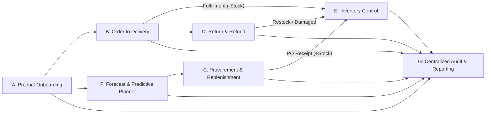
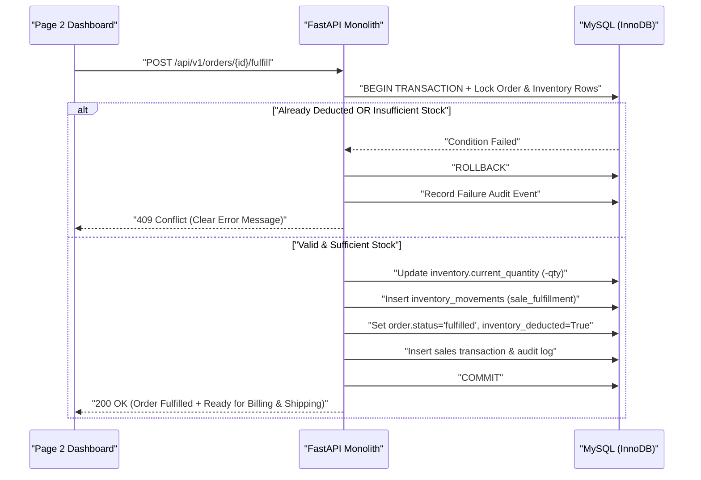
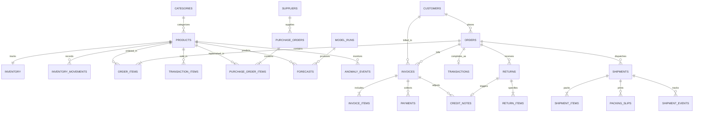
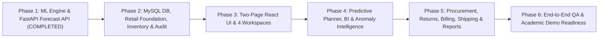

# NEXORA
## Technical Project Blueprint & Master Architecture Specification

- **Project:** NEXORA – AI-Powered Retail Management & Intelligence System
- **Document Version:** 2.1 (Detailed Technical Specification)
- **Original Baseline (v1.0):** 15 November 2026
- **Scope Revision (v2.0):** 25 November 2026
- **Detailed Specification (v2.1):** 25 November 2026
- **Target File:** `docs/NEXORA — Technical Blueprint v1.0.md`
- **Active Repository Baseline:** Branch `main` (`f0e56ba`), Phase 1 ML Engine & Forecast API Completed

---

# 1. Scope Revision & Implementation Reality

## 1.1 Continuity from v1.0 and v2.0 to v2.1
This document refines and completes Technical Blueprint v2.0 into an implementation-ready technical specification (`v2.1`). All core architectural decisions established in v2.0 remain intact:

- **Maximum Two Primary Webpages:** Page 1 (**Stakeholder Workspace Selection**) and Page 2 (**Unified Retail Management Dashboard**).
- **Four Stakeholder Workspaces (UI Context, Not Authentication):** **Store Manager (Admin)**, **Inventory Staff**, **Purchase Manager**, and **Finance Staff**. Zero login screens, passwords, registration flows, or JWT tokens exist in the target design.
- **Six Functional Groups:** Eighteen (18) core operational and intelligence modules across Groups 1–5, plus four (4) supporting system capabilities in Group 6.
- **Centralized History & Audit Database:** Persistent, append-only history tracking across modules, workspaces, API errors, and restarts.
- **Preserved Phase 1 ML Engine:** Complete retention of the UCI Online Retail II preprocessing, leakage-free feature engineering, multi-horizon (7, 15, 30, 90-day) training/evaluation pipelines, and FastAPI inference endpoints.
- **Integrated Modular Monolith:** Single FastAPI backend, MySQL 8.x (InnoDB) relational database, serialized scikit-learn `.joblib` estimators, and React + TypeScript frontend.

## 1.2 Verified Repository Implementation Reality (`main`)
Direct inspection of the repository on branch `main` establishes the exact boundary between implemented components and planned work. No component is claimed implemented merely because it appears in prior draft documents.

| Architectural Area | Status on `main` | Verified Repository Evidence | Target State in Blueprint v2.1 |
| :--- | :---: | :--- | :--- |
| **ML Data Ingestion & Profiling** | **Implemented** | `backend/ml/src/data_loader.py` reads `backend/ml/data/raw/online_retail_II.csv` (`latin1`, 541,910 rows) and generates `eda_report.md`. | Preserved untouched; used as empirical baseline. |
| **Transaction Stream Separation** | **Implemented** | `backend/ml/src/preprocessing.py` performs 4-way MECE classification (`gross_sales`, `cancellation`, `return_credit`, `exceptional`) verified by `test_preprocessing.py` (5 tests). | Preserved; supports future Return & Anomaly analytics. |
| **Daily Aggregation & Features** | **Implemented** | `backend/ml/src/feature_engineering.py` performs continuous lifespan zero-padding and builds leakage-free calendar, lag (`1,7,14,28`), rolling (`7,28`), and `D_7..D_90` targets verified by 17 tests (`test_feature_engineering.py`, `test_ml_features.py`). | Preserved; future MySQL operational sales integration defined carefully. |
| **Model Training & Chronological Evaluation** | **Implemented** | `backend/ml/src/train.py`, `evaluate.py`, and `predict.py` train Weekly-Average Baseline, Ridge (`OneHotEncoder` top-50), and Random Forest with purge/embargo validation (`MAE`, `RMSE`, `WAPE`) verified by 19 tests (`test_model_training.py`, `test_model_evaluation.py`). Note: `.joblib` files are `.gitignore`d and generated locally by running `train.py`. | Preserved; do not replace or retrain unnecessarily. |
| **FastAPI Core & Forecast Inference API** | **Implemented** | `backend/app/main.py` (`/` and `/health`), `backend/app/api/routes/forecast.py` (`/api/v1/forecast/horizons`, `/model-metrics`, `/model-info`, `/`, `/predict`), `schemas/forecast.py`, `services/prediction_service.py`, verified by 19 tests (`test_main.py`, `test_forecast_api.py`). | Extended with `/api/v1/*` operational routers while preserving existing `/forecast` contracts. |
| **Frontend Web Application** | **Planned** | `frontend/` currently contains only `frontend/README.md`. No `package.json`, React code, Vite config, or Tailwind setup exists on `main`. | Two-page React 18+ TypeScript + Tailwind CSS + Chart.js SPA. |
| **MySQL Database, ORM & Migrations** | **Planned** | `sqlalchemy` and `pymysql` exist in `backend/requirements.txt`; `config.py` has placeholder `DB_*` settings. Zero SQLAlchemy models, DB connection pools, Alembic setup, or live tables exist on `main`. | MySQL 8.x (InnoDB) relational schema, SQLAlchemy 2.x ORM, and Alembic migrations. |
| **Retail Ops, Inventory, Procurement, Finance, Shipping & Audit** | **Planned** | No backend routes, schemas, or services exist on `main` for catalog CRUD, suppliers, customers, orders, sales, live inventory, movements, purchasing, returns, billing, shipping, alerts, audit, or reports. | Full 18-module modular monolith + 4 supporting capabilities. |

---

# 2. Project Overview, Objectives & Scope Boundaries

## 2.1 Vision & Academic Project Objectives
**NEXORA – AI-Powered Retail Management & Intelligence System** is an integrated retail management platform unifying daily retail operations with machine-learning demand intelligence. NEXORA is **not** a standalone ML prediction demo or disconnected Swagger endpoint showcase; its objective is to connect operational database transactions directly to empirical forecasting, stock accountability, procurement workflows, financial billing, and centralized auditing.

Specifically, NEXORA is structured to demonstrate ten measurable engineering outcomes:
1. **Database Design & Relational Integrity:** Normalized MySQL InnoDB schema enforcing foreign keys, unique constraints, and `DECIMAL` financial precision.
2. **Persistent Operational CRUD:** Authentic Create, Read, Update, and Deactivate/Cancel workflows backed by FastAPI and MySQL rather than mock UI states.
3. **Integrated End-to-End Workflows:** Traceable flow from catalog and customer intake through order fulfillment, inventory deduction, invoicing, returns, and dispatch.
4. **Machine Learning Integration:** Serving pre-trained multi-horizon (7, 15, 30, 90-day) demand pipelines into stock-risk classification and procurement simulation.
5. **Business Intelligence & Diagnostics:** Sales analytics, seasonal demand patterns, SKU lifecycle classifications, and price-volume correlation studies.
6. **Inventory Accountability:** Transactional movement ledgers linking every quantity change to an originating business document or manual reason.
7. **Stakeholder-Oriented Workspaces:** Focused UI views for **Store Manager (Admin)**, **Inventory Staff**, **Purchase Manager**, and **Finance Staff** inside one unified dashboard.
8. **Centralized History & Auditability:** Persistent, append-only audit log capturing mutations, workspace context, outcomes, and system/API failures across restarts.
9. **Input Validation & Error Resilience:** Strict Pydantic v2 contracts, accurate HTTP error codes (`400`, `404`, `409`, `422`, `500`, `503`), and safe fallbacks for unseen SKUs.
10. **Practical Retail Problem-Solving:** Clean accounting separation of gross sales, cancellations, and returns paired with mandatory human approval in purchasing and pricing.

## 2.2 UCI Online Retail II Dataset Profile & Limitations
Historical demand modeling draws from the **UCI Online Retail II dataset** ([UCI Repository #502](https://archive.ics.uci.edu/dataset/502/online+retail+ii), local CSV verified at `backend/ml/data/raw/online_retail_II.csv` containing 541,910 rows from December 2010 to December 2011 on `main`).

The dataset is strictly a historical transaction dump and **does not** provide:
- Current physical warehouse stock quantities or minimum reorder thresholds.
- Supplier identities, contact details, or delivery lead times.
- Complete customer billing street addresses, cities, postal codes, or payment status.
- Customer shipping destinations, packing checklists, or internal delivery status.
- Structured reasons distinguishing product defects from customer preference returns.
- Purchase order approvals or financial credit note numbers.

**Foundational Principle:** Historical demand profiles and ML forecasting patterns originate from UCI Online Retail II, whereas live operational inventory, suppliers, customers, orders, sales, purchase orders, invoices, payments, shipments, and audit history are created and persisted natively in MySQL.

## 2.3 Approved Exclusions & Human-in-the-Loop Boundaries
The following capabilities are **permanently excluded** unless formally re-approved by the project owner:

| ID | Excluded Capability | Boundary Rationale |
| :--- | :--- | :--- |
| `EXCL-01` | **Official Governmental E-Way Bill Generation** | Statutory government tax portal integration lies outside academic project scope. |
| `EXCL-02` | **Real Shipping Carrier API Integrations** (FedEx, UPS, DHL, etc.) | Requires commercial carrier contracts; NEXORA produces internal pick lists, packing slips, and routing labels only. |
| `EXCL-03` | **Automatic / Autonomous Supplier Order Dispatch** | NEXORA supports simulation and draft POs, but requires explicit human review and approval; it never auto-emails or auto-submits vendor orders. |
| `EXCL-04` | **Unilateral Autonomous Price Markdowns** | Price & Revenue Intelligence visualizes correlations for human managers rather than executing automated price cuts. |
| `EXCL-05` | **Conversational AI Chatbot or Natural-Language POS** | System intelligence centers on structured tabular UIs, deterministic rules, and regression demand modeling. |
| `EXCL-06` | **Market Basket / Purchase Affinity Mining** | Association-rule mining lies outside NEXORA's multi-horizon demand planning and operational ERP scope. |
| `EXCL-07` | **Complex Multi-Supplier Algorithmic Optimization** | Replenishment utilizes deterministic risk formulas and single-supplier lead-time simulation rather than linear programming solvers. |
| `EXCL-08` | **Automated Customer-Address Scraping from Dataset** | Because the UCI dataset lacks full street addresses, customer intake must occur explicitly via operational forms. |

---

# 3. Technology Stack & System Architecture

## 3.1 Approved Technology Stack
NEXORA adheres to a single, streamlined stack across frontend, backend, data, ML, database, and testing layers. Microservices, external message brokers, and unnecessary visualization/UI libraries are avoided.

| Layer | Approved Technology | Status on `main` | Architectural Role |
| :--- | :--- | :---: | :--- |
| **Frontend SPA** | React (18+) + TypeScript (5.x) | **Planned** | Type-safe two-page user interface (`WorkspaceSelector` + `UnifiedDashboard`) |
| **Styling** | Tailwind CSS (3.x) | **Planned** | Utility-first styling, responsive tables, cards, and modal dialogs |
| **Charts** | Chart.js + `react-chartjs-2` | **Planned** | Sales trends, seasonal heatmaps, price-volume scatter/bar charts, forecast overlays |
| **Backend API** | Python (3.10+, tested 3.11.9) + FastAPI (`>=0.110.0`) | **Implemented** (Core/Forecast) / **Planned** (Ops) | Modular monolithic REST API under `/api/v1`, Swagger UI (`/docs`), ReDoc (`/redoc`) |
| **Schema Validation** | Pydantic v2 (`>=2.6.0`) + Pydantic-Settings | **Implemented** | Request validation, decimal/enum checking, response contracts, config parsing |
| **Database** | MySQL 8.x (InnoDB Engine) | **Planned** | ACID relational storage for retail operations, inventory, finance, forecasts, and audit logs |
| **ORM & Migrations** | SQLAlchemy 2.x (`>=2.0.0`) + PyMySQL + Alembic | **Planned** (`sqlalchemy`/`pymysql` in `requirements.txt`; `alembic` to add) | Transactional database access, foreign-key enforcement, parameterized SQL, versioned migrations |
| **Data Processing** | Pandas (`>=2.2.0`) + NumPy (`>=1.26.0`) | **Implemented** | Historical cleaning, daily aggregation, lag/rolling calculations, analytical grouping |
| **Machine Learning** | Scikit-learn (`>=1.4.0`, + optional XGBoost) | **Implemented** | Ridge Regression, Random Forest, `OneHotEncoder`, chronological backtesting |
| **Model Persistence** | Joblib (`>=1.3.0`) | **Implemented** | Read-only binary `.joblib` serialization loaded into FastAPI memory on startup |
| **Automated Testing** | Pytest (`>=8.0.0`) + `pytest-timeout` + HTTPX | **Implemented** (60 tests) | Unit, API, ML leakage, and integration verification (`pytest.ini` 30s timeout guard) |
| **API Exploration** | Swagger UI (`/docs`) + Postman | **Implemented** | Interactive endpoint inspection and reproducible API verification |

*Note on Authentication Removal:* JWT libraries and `Passlib` password hashing from Blueprint v1.0 are **not** part of the approved v2.1 stack because workspace selection replaces user login.

## 3.2 Modular Monolithic System Architecture

```text
+-----------------------------------------------------------------------------------+
|                        NEXORA WEB APPLICATION (React + TS)                        |
|   [Page 1: Workspace Selection]  <======>  [Page 2: Unified Retail Dashboard]     |
|   "Welcome to NEXORA — Select Your Workspace"    Tabs / Panels / Charts / Modals   |
|   Context Header: X-NEXORA-Workspace (UI View Context — Not Authentication)       |
+-----------------------------------------------------------------------------------+
                                          |
                                  REST / JSON (/api/v1)
                                          |
                                          v
+-----------------------------------------------------------------------------------+
|                        FASTAPI MODULAR MONOLITHIC BACKEND                         |
|                                                                                   |
|  +-----------------------+  +-----------------------+  +-----------------------+  |
|  |   Retail Operations   |  |  AI & BI Intelligence |  | Supporting Services   |  |
|  | - Product & Supplier  |  | - Demand Forecasting  |  | - Centralized History |  |
|  | - Customer & Orders   |  |   (Phase 1 Read-Only) |  |   & Audit Service     |  |
|  | - Sales & Returns     |  | - Predictive Planner  |  | - Smart Alerts Engine |  |
|  | - Inventory & Moves   |  | - BI & Seasonality    |  | - Reports & Export    |  |
|  | - Procurement/POs     |  | - Lifecycle & Price   |  | - Validation & Error  |  |
|  | - Billing & Shipping  |  | - Anomaly Detection   |  |   Correlation Layer   |  |
|  +-----------------------+  +-----------------------+  +-----------------------+  |
+-----------------------------------------------------------------------------------+
                   |                                             |
       SQLAlchemy 2.x (InnoDB ACID)                      Joblib Startup Cache
                   |                                             |
                   v                                             v
+--------------------------------------+      +-------------------------------------+
|        MYSQL 8.x DATABASE            |      |     TRAINED ML ENGINE (Disk)        |
| - Foundation (Catalog, Cust, Supp)   |      | - backend/ml/models/*.joblib        |
| - Transactions, Orders & Returns     |      | - models_metadata.json              |
| - Inventory, Movements & POs         |      | - UCI Historical Demand Baseline    |
| - Invoices, Payments & Credit Notes  |      |   (online_retail_II.csv)            |
| - Shipments, Forecasts, Alerts       |      +-------------------------------------+
| - Centralized History & Audit Logs   |
+--------------------------------------+
```

---

# 4. Two-Page Application & Workspace Architecture

NEXORA enforces a strict **two-page web architecture**. Modules must never be fragmented across dozens of top-level routes or separate workspace sub-apps.

## 4.1 Page 1 — Stakeholder Workspace Selection
- **Route:** `/` (Application Landing Entry)
- **Required Heading:** `Welcome to NEXORA — Select Your Workspace`
- **Card Grid (Exactly Four Workspaces):**
  1. **Store Manager (Admin)** — Full operational, analytical, configuration, and audit oversight across all 18 core modules and 4 supporting capabilities.
  2. **Inventory Staff** — Focused view for physical stock control, stock adjustments, movement history, forecast consumption, replenishment alerts, and inventory reports.
  3. **Purchase Manager** — Focused view for supplier directories, lead-time purchase simulation, purchase order drafting/management, procurement workflows, forecasts, and procurement reports.
  4. **Finance Staff** — Focused view for customer billing details, invoice generation, payment tracking, return/credit note adjustments, revenue reconciliation, and financial reports.
- **Behaviour:** Clicking a workspace card stores the active workspace selection in client state (e.g., `sessionStorage` / context provider), appends workspace metadata (such as `X-NEXORA-Workspace`) to outgoing API calls for audit attribution, and routes immediately to **Page 2**.
- **Explicit Authentication Exclusion:** Page 1 must contain **no** username input, password field, registration form, forgot-password flow, or JWT login call. **This is a workspace selector, NOT an authentication system.**

## 4.2 Page 2 — Unified Retail Management Dashboard
- **Route:** `/dashboard`
- **Single-Shell Workspace Navigation:** All accessible modules render inside Page 2's main workspace container via structured navigation sections, horizontal sub-tabs, expandable drawers, sortable tables, interactive forms, and modal confirmation dialogs.
- **Live In-Dashboard Switching:** A prominent workspace switcher dropdown/selector in the Page 2 top header lets operators transition seamlessly between **Store Manager (Admin)**, **Inventory Staff**, **Purchase Manager**, and **Finance Staff** without navigating back to Page 1 or loading separate applications.
- **UI Scoping vs. Security Clarification:** Workspace visibility filters Page 2 navigation items and action panels for usability and role focus. It must **never** be presented or relied upon as cryptographically verified identity or server-enforced authorization.

---

# 5. Detailed Specification of All 18 Core Modules

Every module below follows a standardized 13-part specification (**A** through **M**) covering purpose, functional behaviour, workspace views, data flow, database entities, API requirements, CRUD/business operations, validation rules, dependencies, audit coverage, error edge cases, acceptance criteria, and honest implementation status on branch `main`.

---

## Group 1 — Retail Foundation (Modules 1–5)

### Module 1: Product Management

#### A. Module Purpose
Maintains the master SKU catalog for NEXORA, providing structured product definitions (`stock_code`, descriptions, categories, standard unit prices, and active status). Resolves the separation between static catalog metadata and volatile warehouse stock quantities while bridging legacy UCI SKUs with newly onboarded products.

#### B. Functional Requirements
- Register new retail products with unique SKU identifiers (`stock_code`), categories, descriptions, and unit prices.
- Search, filter (by category, active status, keyword), sort, and paginate the product master catalog.
- Edit product descriptions, category assignments, and baseline unit prices.
- Soft-deactivate or reactivate products rather than destroying catalog rows referenced by historical sales or invoices.
- Initialize corresponding warehouse inventory records automatically upon new product creation (or link via onboarding workflow).
- Display whether a SKU carries historical UCI transaction baseline data or was newly added operationally.

#### C. Workspace Responsibilities
- **Store Manager (Admin):** Full CRUD and soft-deactivation/reactivation control.
- **Inventory Staff:** Catalog lookup and read-only viewing while managing stock levels and movements.
- **Purchase Manager:** Read-only SKU viewing when configuring suppliers or creating purchase orders.
- **Finance Staff:** Read-only SKU pricing and description lookup during invoice composition.
*(Note: UI workspace scoping controls display only; no server-enforced RBAC authentication.)*

#### D. Inputs and Outputs
- **Inputs:** `stock_code`, `description`, `category_id` (optional/assigned), `unit_price`, `is_active`, optional initial stock seed parameters passed to Inventory Control.
- **Outputs:** Validated master product record, category metadata, SKU active status, and onboarding event triggering inventory initialization.

#### E. Database Requirements
- **Entities:** `products`, `categories`.
- **Important Fields (`products`):** `id` (PK), `stock_code` (VARCHAR, UNIQUE, indexed), `description` (VARCHAR, NOT NULL), `category_id` (FK → `categories.id`), `current_unit_price` (`DECIMAL(10, 2)`), `is_uci_baseline` (BOOLEAN), `is_active` (BOOLEAN DEFAULT TRUE), `created_at`, `updated_at`.
- **Important Fields (`categories`):** `id` (PK), `name` (UNIQUE), `description`, `is_active`, `created_at`.
- **Constraints:** `stock_code` must be unique (case-trimmed/normalized); `current_unit_price > 0` (or `>= 0` only if non-commercial flags apply—recommended `>= 0.01` for active sellable SKUs).

#### F. API Requirements *(Planned)*
- `GET /api/v1/products` — Paginated catalog search/filter (`search`, `category_id`, `is_active`, `page`, `limit`).
- `GET /api/v1/products/{product_id}` (or lookup by `stock_code`) — Detailed product view including current category and stock summary.
- `POST /api/v1/products` — Create product + initialize zero/opening inventory record in one transaction (`201 Created`).
- `PUT /api/v1/products/{product_id}` — Update description, category, or unit price (`200 OK`).
- `PATCH /api/v1/products/{product_id}/status` (or `DELETE /api/v1/products/{product_id}` mapped to soft-deactivation) — Toggle `is_active` cleanly (`200 OK`).
- **Errors:** `409 Conflict` on duplicate `stock_code`, `404 Not Found` on missing product, `422 Unprocessable Entity` on negative unit price or blank description.

#### G. CRUD and Business Operations
- **Create:** Validated product creation with optional atomic zero-stock inventory entry initialization.
- **Read:** Paginated listing, search, and SKU detail inspection.
- **Update:** Non-key metadata edits (unit price updates do not retroactively rewrite historical finalized invoice line prices).
- **Deactivate (Delete Equivalent):** Soft-deactivation (`is_active = False`). Hard deletion is blocked whenever `transaction_items`, `order_items`, `inventory_movements`, `invoice_items`, `purchase_order_items`, or `forecasts` reference the `product_id`.

#### H. Business Rules and Validation
- `stock_code` cannot be blank whitespace and is normalized (trimmed uppercase where consistent with UCI alphanumeric SKUs such as `85123A`).
- Product master records hold commercial definition (`current_unit_price`), while physical quantities belong exclusively to **Inventory Control** (`inventory` table).
- Historical UCI SKUs seeded into MySQL must retain historical transaction linkages cleanly even if deactivated from active future selling.
- Updating `current_unit_price` applies to future orders/invoices only; historical `order_items`, `transaction_items`, and `invoice_items` store immutable point-in-time `unit_price`.

#### I. Module Dependencies
- **Upstream:** None (root catalog foundation).
- **Downstream:** `Inventory Control` (1:1 stock tracking), `Order Management` & `Sales Management`, `Purchase Planning Simulator` / Purchase Orders, `Demand Forecasting`, `Billing & Finance`, `Business Intelligence`, `Price & Revenue Intelligence`, `Return Intelligence`.

#### J. History & Audit Events
- `PRODUCT_CREATED`, `PRODUCT_UPDATED` (capturing before/after price/description snapshots), `PRODUCT_DEACTIVATED`, `PRODUCT_REACTIVATED`, `PRODUCT_CATEGORY_CREATED/UPDATED`, and failed duplicate-SKU attempts.

#### K. Error and Edge-Case Handling
- Duplicate `stock_code` creation → HTTP `409 Conflict` without creating partial inventory records.
- Deactivating a product that has open pending orders or active positive stock → permitted as soft-deactivation for new sales while allowing fulfillment/adjustment of existing commitments, with UI warning surfaced.
- Missing UCI `Description` during seed import → safely falls back to `StockCode` matching `data_loader.py` convention.

#### L. Acceptance Criteria
- New products persist in MySQL across server restarts and appear immediately in catalog search, inventory registry, and order/invoice item pickers.
- Duplicate `stock_code` returns `409`; negative price returns `422`.
- Soft-deactivated products cannot be added to newly created orders/invoices while retaining full historical analytics, invoices, and movement logs.

#### M. Implementation Status
- **Planned** *(UCI SKU lookup exists only offline in Phase 1 CSVs; no `products` MySQL table or `/api/v1/products` endpoint exists on `main`).*

---

### Module 2: Supplier Management

#### A. Module Purpose
Maintains the vendor directory and supplier lead-time data required for procurement workflows. Eliminates the UCI dataset gap where vendor identities and delivery lead times do not exist.

#### B. Functional Requirements
- Create, search, filter, view, update, and soft-deactivate suppliers.
- Store contact details (`contact_person`, `email`, `phone`, `address`) and operational `lead_time_days`.
- Associate supplier terms with draft/submitted Purchase Orders and expose lead times to Purchase Planning Simulator and Predictive Planner.

#### C. Workspace Responsibilities
- **Store Manager (Admin):** Full supplier CRUD and activation management.
- **Purchase Manager:** Full supplier creation, editing, lead-time maintenance, and selection during procurement.
- **Inventory Staff:** Read-only lookup of supplier lead times when reviewing stock alerts.
- **Finance Staff:** Not required for core billing (optional read-only context for vendor reference if needed).

#### D. Inputs and Outputs
- **Inputs:** `supplier_name`, `contact_person`, `email`, `phone`, `address`, `lead_time_days`, `is_active`.
- **Outputs:** Supplier profile record, lead-time parameter (`lead_time_days`) consumed by procurement simulation and PO expected delivery dates.

#### E. Database Requirements
- **Entities:** `suppliers` (plus optional `supplier_products` mapping if multiple suppliers supply an item—see `[DESIGN DECISION REQUIRED]` below).
- **Important Fields (`suppliers`):** `id` (PK), `supplier_name` (VARCHAR, NOT NULL, indexed), `contact_person`, `email`, `phone`, `address` (TEXT), `lead_time_days` (INT NOT NULL DEFAULT 7), `is_active` (BOOLEAN DEFAULT TRUE), `created_at`, `updated_at`.
- **Constraints:** `lead_time_days >= 1` (must be positive integer days); `[DESIGN DECISION REQUIRED]` whether a `supplier_products` many-to-many SKU-to-preferred-supplier link table is needed in Phase 2/5 or if Purchase Orders select any active supplier dynamically.

#### F. API Requirements *(Planned)*
- `GET /api/v1/suppliers` — Paginated supplier list (`search`, `is_active`).
- `GET /api/v1/suppliers/{supplier_id}` — Supplier details and linked PO summary.
- `POST /api/v1/suppliers` — Create supplier (`201 Created`).
- `PUT /api/v1/suppliers/{supplier_id}` — Update contact details or `lead_time_days`.
- `PATCH /api/v1/suppliers/{supplier_id}/status` (or soft `DELETE`) — Deactivate vendor (`is_active = False`).

#### G. CRUD and Business Operations
- Full Create, Read, Update, and Soft-Deactivate operations. Suppliers referenced by historical `purchase_orders` cannot be hard-deleted.

#### H. Business Rules and Validation
- `lead_time_days` must be a valid integer (`>= 1` and bounded reasonably, e.g., `<= 365`). Missing or `<= 0` lead times must fail validation (`422`).
- Deactivated suppliers cannot be assigned to new Purchase Orders, though existing in-flight or historical POs remain intact.
- Changing `lead_time_days` updates future simulations and new PO `expected_delivery_date` calculations without altering historical closed PO dates.

#### I. Module Dependencies
- **Upstream:** None.
- **Downstream:** `Purchase Planning Simulator` (leads & PO creation), `Predictive Planner` (if lead-time scaling configured), `Business Intelligence` / procurement reports.

#### J. History & Audit Events
- `SUPPLIER_CREATED`, `SUPPLIER_UPDATED` (especially changes to `lead_time_days`), `SUPPLIER_DEACTIVATED`, `SUPPLIER_REACTIVATED`.

#### K. Error and Edge-Case Handling
- Invalid email syntax or non-positive `lead_time_days` → HTTP `422`.
- Creating a PO with an inactive or missing `supplier_id` → HTTP `400` / `404` / `422`.
- Duplicate supplier name warning/prevention policy (`409 Conflict` if unique constraint applied on normalized supplier name).

#### L. Acceptance Criteria
- Operators can create, edit, and deactivate suppliers in Page 2 UI and see updated `lead_time_days` reflected in Purchase Planning Simulator calculations.
- Active POs referencing a deactivated supplier retain supplier attribution without foreign-key breakage.

#### M. Implementation Status
- **Planned** *(No `suppliers` database model, service, or API route exists on `main`).*

---

### Module 3: Customer Management

#### A. Module Purpose
Manages retail customer records, contact information, and billing/shipping addresses. Bridges the UCI dataset limitation (where ~25% of rows omit `Customer ID` and 100% omit street addresses) with persistent customer directory records for orders, sales, billing, and internal shipping.

#### B. Functional Requirements
- Create, read, search, filter, update, and soft-deactivate customer profiles.
- Capture `customer_name`, `phone`, `email`, `billing_address`, `city`, `state`, `postal_code`, and `country`.
- Allow rapid inline customer lookup or creation when drafting an Order (`Module 5`) or Invoice (`Module 17`).
- Support explicit handling of walk-in/guest or historical unidentified customers (`legacy_uci_customer_id` / null linkage) without breaking relational constraints.

#### C. Workspace Responsibilities
- **Store Manager (Admin):** Full customer directory CRUD and deactivation.
- **Finance Staff:** Customer creation, billing address updates, and profile lookup during invoicing and credit note management.
- **Inventory Staff / Purchase Manager:** Read-only viewing where required for order/shipping context (typically excluded from Inventory/Purchase primary tabs unless browsing Store Manager views).

#### D. Inputs and Outputs
- **Inputs:** Customer identity, email, phone, billing street/city/state/postal/country, optional separate shipping address, optional `customer_type` (`registered` / `walk_in`).
- **Outputs:** Customer profile consumed by Order Management, Sales Management, Billing & Finance (invoices), and Shipping & Delivery (destination addresses).

#### E. Database Requirements
- **Entities:** `customers`.
- **Important Fields:** `id` (PK), `customer_code` / optional `uci_customer_ref` (VARCHAR, nullable, indexed), `customer_name` (VARCHAR, NOT NULL), `phone`, `email`, `billing_address` (TEXT), `shipping_address` (TEXT, nullable — defaults to billing if omitted), `city`, `state`, `postal_code`, `country` (NOT NULL DEFAULT `'United Kingdom'`), `is_active` (BOOLEAN DEFAULT TRUE), `created_at`, `updated_at`.
- **Guest / Historical Handling:** Operational retail orders/invoices must link to a valid `customers.id` (including an explicit seeded `Walk-In / Guest Customer` or created customer record); historical imported UCI `transactions` retain optional string `uci_customer_ref` (allowing `NULL` matching raw UCI missing rates) without polluting newly entered customer address books.

#### F. API Requirements *(Planned)*
- `GET /api/v1/customers` — Search customers by name, phone, email, or country.
- `GET /api/v1/customers/{customer_id}` — Detailed customer profile with order/invoice summary.
- `POST /api/v1/customers` — Create customer (`201 Created`).
- `PUT /api/v1/customers/{customer_id}` — Update billing/shipping details.
- `PATCH /api/v1/customers/{customer_id}/status` — Soft-deactivate customer record.

#### G. CRUD and Business Operations
- Create, Read, Update, Soft-Deactivate. Customers tied to completed orders, sales, or invoices cannot be hard-deleted.

#### H. Business Rules and Validation
- Required billing fields (`customer_name`, `billing_address`, `city`, `postal_code`, `country`) must be validated when creating customer profiles for shipping/invoicing (explicitly avoiding automated scraping from UCI records per `EXCL-08`).
- Updating a customer's address updates future orders/shipments without mutating address snapshots frozen on already issued invoices or dispatched shipments.

#### I. Module Dependencies
- **Upstream:** None.
- **Downstream:** `Order Management`, `Sales Management`, `Billing & Finance`, `Shipping & Delivery`, `Business Intelligence`.

#### J. History & Audit Events
- `CUSTOMER_CREATED`, `CUSTOMER_UPDATED` (before/after non-sensitive profile changes), `CUSTOMER_DEACTIVATED`.

#### K. Error and Edge-Case Handling
- Incomplete billing fields for invoice-bound customers → HTTP `422`.
- Missing customer on order/invoice creation → HTTP `404`.
- Historical UCI transactions lacking `Customer ID` → handled cleanly via nullable historical reference rather than failing import.

#### L. Acceptance Criteria
- New customer addresses entered in UI persist in MySQL and auto-populate invoice billing and shipment destination forms.
- Editing customer address leaves previously finalized historical invoices intact.

#### M. Implementation Status
- **Planned** *(No `customers` ORM table or endpoint exists on `main`).*

---

### Module 4: Sales Management

#### A. Module Purpose
Tracks completed commercial sales records and unifies historical UCI transaction streams with ongoing operational store sales. Strictly preserves accounting separation between gross positive demand, cancellations, returns, and exceptional adjustments.

#### B. Functional Requirements
- Record completed operational sales (normally generated upon Order fulfillment or direct point-of-sale completion).
- Search, filter, and inspect sales records separated by `transaction_stream` (`gross_sale`, `cancellation`, `return`, `exceptional`) and `data_source` (`historical_uci` vs. `operational_mysql`).
- Calculate gross sales quantity, cancellation quantity, return deductions, and net revenue/quantity.
- Support traceable **sale cancellation / reversal** creating compensating status updates and reversing entries rather than deleting historical records.

#### C. Workspace Responsibilities
- **Store Manager (Admin):** Full viewing, sales creation/completion oversight, and traceable cancellation/reversal operations.
- **Finance Staff:** Read access to sales streams for billing/credit reconciliation and financial analytics.
- **Inventory Staff / Purchase Manager:** Indirect visibility via Business Intelligence or inventory movement references (`sale_fulfillment`).

#### D. Inputs and Outputs
- **Inputs:** Linked `order_id` (for operational order-driven sales), customer reference, SKU line items (`product_id`, `quantity`, `unit_price`), transaction timestamp, stream classification.
- **Outputs:** Persistent `sales`/`transactions` & line-item records (`transaction_items`), net vs. gross demand feeds for Business Intelligence, and invoice linkage for Billing & Finance.

#### E. Database Requirements
- **Entities:** `transactions` (unified or paired operational `sales` + `sale_items` / `transaction_items`—see Section 12 logical schema).
- **Important Fields:** `id` (PK), `invoice_number` / `sale_reference` (VARCHAR, indexed), `order_id` (FK → `orders.id`, nullable for direct historical UCI imports), `customer_id` (FK → `customers.id`, nullable for historical imports), `transaction_date`, `country`, `transaction_type` (`standard`, `cancellation`, `return`, `exceptional`), `source_origin` (`uci_historical`, `operational`), `total_amount` (`DECIMAL(12, 2)`), `status` (`completed`, `cancelled`, `reversed`), `created_at`.
- **Line Items:** `product_id` (FK), `quantity` (INT), `unit_price` (`DECIMAL(10, 2)`), `line_total` (`DECIMAL(12, 2)`).

#### F. API Requirements *(Planned)*
- `GET /api/v1/sales` — Paginated sales listing filterable by date range, `transaction_type`, `source_origin`, SKU, country.
- `GET /api/v1/sales/{sale_id}` — Detailed sale view with line items and linked order/invoice/movements.
- `POST /api/v1/sales` — Record operational sale (normally orchestrated by Order fulfillment flow; validates single completion per order).
- `POST /api/v1/sales/{sale_id}/reverse` — Traceable sale reversal/cancellation (requires reason; records reversing entry and triggers downstream credit/stock workflow without erasing the original row).

#### G. CRUD and Business Operations
- **No Destructive Delete:** Completed sales records **must never** be hard-deleted.
- **Create / Complete:** Tied cleanly to order fulfillment or explicit operational entry.
- **Cancel / Reverse:** Marks transaction state and generates traceable compensating audit/financial/stock entries.

#### H. Business Rules and Validation
- **Order vs. Sale Distinction:** An **Order** represents customer purchase intent and lifecycle progression; a **Sale** represents a confirmed/realized commercial revenue event.
- **Zero Double-Deduction Guard:** If a sale originates from an order (`order_id`), inventory deduction occurs **once** at fulfillment (`Order Management` + `Inventory Control`); creating a linked sale record must not deduct inventory a second time.
- **Historical vs. Operational Boundary:** Historical UCI transactions (`source_origin = 'uci_historical'`) are read-only reference data and cannot be modified via operational sales forms.
- All monetary totals use strict `DECIMAL` arithmetic (`line_total = quantity × unit_price`).

#### I. Module Dependencies
- **Upstream:** `Order Management`, `Product Management`, `Customer Management`.
- **Downstream:** `Inventory Control` / `Stock Movement Tracking` (at fulfillment), `Billing & Finance`, `Return Intelligence`, `Business Intelligence`, `Demand Forecasting` (future operational feed).

#### J. History & Audit Events
- `SALE_CREATED` / `SALE_COMPLETED`, `SALE_CANCELLED`, `SALE_REVERSED` (capturing `order_id`, reason, `before_values`/`after_values`).

#### K. Error and Edge-Case Handling
- Attempt to delete completed sale → rejected (`405`/`409`) directing user to reversal/credit workflow.
- Duplicate completion attempt on an already finalized `order_id` → HTTP `409 Conflict`.
- Attempt to edit immutable `uci_historical` transaction → HTTP `403`/`409` error explaining read-only baseline integrity.

#### L. Acceptance Criteria
- Completing an order produces a linked sales record with penny-exact `DECIMAL` line totals.
- Reversing a sale retains the original row, updates state traceably, and writes a centralized audit record.
- BI queries cleanly filter/distinguish `uci_historical` vs. `operational` sales streams.

#### M. Implementation Status
- **Planned** *(UCI CSVs exist processed on disk for offline ML only; no operational sales API or MySQL table exists on `main`).*

---

### Module 5: Order Management

#### A. Module Purpose
Manages the end-to-end customer order lifecycle from initial order intake through item availability checks, processing, fulfillment completion, and cancellation before dispatch. Separates mutable order preparation from finalized accounting sales and invoice records.

#### B. Functional Requirements
- Create multi-item customer orders specifying `customer_id`, order date, shipping preferences, and product line items (`product_id`, `quantity`, `unit_price` defaulting from catalog or explicit override where permitted).
- Validate SKU existence, active catalog status (`is_active == True`), positive integer quantities, and live inventory availability.
- Support explicit order status transitions: `draft` / `pending` → `confirmed` → `fulfilled` (or `cancelled`).
- Execute atomic **Fulfillment**: convert an order to fulfilled state, verify single-execution guard, deduct inventory **once**, write `sale_fulfillment` movement records, generate/link the **Sales Management** record, and enable **Billing & Finance** & **Shipping & Delivery**.

#### C. Workspace Responsibilities
- **Store Manager (Admin):** Full order creation, editing (while `draft`/`pending`), confirmation, fulfillment execution, and cancellation.
- **Finance Staff:** Read access to fulfilled/confirmed orders for invoice verification and billing reconciliation.
- **Inventory Staff:** View confirmed/processing orders requiring physical pick/fulfillment readiness.

#### D. Inputs and Outputs
- **Inputs:** `customer_id`, line items (`product_id`, `quantity`), optional notes/shipping address override, state transition actions (`confirm`, `fulfill`, `cancel`).
- **Outputs:** Persistent `orders` & `order_items` records, fulfillment triggers to `Inventory Control`, `Stock Movement Tracking`, `Sales Management`, `Billing & Finance`, and `Shipping & Delivery`.

#### E. Database Requirements
- **Entities:** `orders`, `order_items`.
- **Important Fields (`orders`):** `id` (PK), `order_number` (UNIQUE), `customer_id` (FK → `customers.id`), `order_status` (`ENUM('draft', 'pending', 'confirmed', 'fulfilled', 'cancelled')`), `inventory_deducted` (BOOLEAN NOT NULL DEFAULT FALSE — idempotency guard), `subtotal` (`DECIMAL(12, 2)`), `notes`, `created_at`, `updated_at`.
- **Important Fields (`order_items`):** `id` (PK), `order_id` (FK → `orders.id`), `product_id` (FK → `products.id`), `quantity` (INT > 0), `unit_price` (`DECIMAL(10, 2)`), `line_total` (`DECIMAL(12, 2)`).

#### F. API Requirements *(Planned)*
- `GET /api/v1/orders` — List/filter orders by status, customer, date range.
- `GET /api/v1/orders/{order_id}` — Full order detail including line items, deduction flag, and linked sale/invoice/shipment.
- `POST /api/v1/orders` — Create draft or pending order (`201 Created`).
- `PUT /api/v1/orders/{order_id}` — Update items/quantities (only allowed in `draft` or `pending` state prior to fulfillment).
- `POST /api/v1/orders/{order_id}/confirm` — Validate stock and confirm order.
- `POST /api/v1/orders/{order_id}/fulfill` — Execute atomic fulfillment (deducts inventory once, creates `sale_fulfillment` movements, generates linked sale/invoice readiness).
- `POST /api/v1/orders/{order_id}/cancel` — Cancel unfulfilled order (or trigger reversal workflow if already fulfilled).

#### G. CRUD and Business Operations
- **Create:** Draft/Pending order intake.
- **Read:** Filtered/paginated inspection.
- **Update:** Line-item editing permitted strictly before `fulfilled`/`cancelled`.
- **State Transition Operations:** `confirm`, `fulfill`, `cancel` (replaces destructive delete).

#### H. Business Rules and Validation
- **Inventory Deduction Rule (Critical Consistency Guarantee):** Physical inventory (`inventory.current_quantity`) is **deducted at Order Fulfillment**, NOT at initial order creation, to prevent unconfirmed drafts or cancelled quotes from draining stock balances.
- **Single-Deduction Idempotency Guard:** Every order tracks `inventory_deducted = True` inside the same database transaction that transitions `order_status → 'fulfilled'` and inserts `inventory_movements`. Any duplicate fulfillment call must check `inventory_deducted == True` (with row-level `SELECT ... FOR UPDATE` locking) and reject with `409 Conflict`, guaranteeing the same order **can never deduct inventory more than once**.
- `[DESIGN DECISION REQUIRED]` **Optional Soft Stock Reservation at Confirmation:** Decide whether transitioning `order_status` from `draft` → `confirmed` should reserve stock via an explicit `inventory.reserved_quantity` column prior to physical deduction at `fulfilled`, or rely strictly on fulfillment-time availability checking.
- Orders cannot include inactive SKUs (`products.is_active == False`) or quantities `<= 0`.
- Orders in `fulfilled` or `cancelled` status are immutable for line-item edits.

#### I. Module Dependencies
- **Upstream:** `Product Management`, `Customer Management`, `Inventory Control` (availability checks).
- **Downstream:** `Sales Management`, `Inventory Control`, `Stock Movement Tracking`, `Billing & Finance`, `Shipping & Delivery`, `Return Intelligence`.

#### J. History & Audit Events
- `ORDER_CREATED`, `ORDER_UPDATED`, `ORDER_CONFIRMED`, `ORDER_FULFILLED` (recording `inventory_deducted=True` and linked sale ID), `ORDER_CANCELLED`, and `ORDER_FULFILLMENT_FAILED` (e.g., insufficient stock rollback).

#### K. Error and Edge-Case Handling
- Insufficient stock at fulfillment time → rollback entire transaction (no partial stock deduction, no sale created), return HTTP `409 Conflict` with specific SKU shortfall details, and log failure outcome.
- Double-click / concurrent duplicate `/fulfill` request → second request blocked via row lock + `inventory_deducted` check (`409 Conflict`).
- Inactive customer or deactivated SKU submitted on new order → HTTP `422` / `400`.
- Attempt to edit line items after fulfillment → HTTP `409 Conflict`.

#### L. Acceptance Criteria
- Order creation validates SKUs and customer without prematurely deducting `current_quantity`.
- Fulfilling an order atomically reduces inventory once, creates `sale_fulfillment` movements, creates a linked sale, and blocks subsequent duplicate fulfillment calls with `409`.
- Cancelled pre-fulfillment orders never alter inventory balances.

#### M. Implementation Status
- **Planned** *(No `orders` tables, schemas, or API routes exist on `main`).*

---

## Group 2 — Business Intelligence (Modules 6–8)

### Module 6: Business Intelligence

#### A. Module Purpose
Transforms raw historical (UCI) and live operational (MySQL) retail, inventory, purchasing, and billing datasets into interactive KPIs, velocity rankings, and visual trend analytics so stakeholders can evaluate store performance empirically.

#### B. Functional Requirements
- Aggregate executive KPIs: total gross revenue, net revenue, total units sold, unique order/invoice count, active SKU count, and return/cancellation totals.
- Render time-series sales charts (daily/weekly/monthly trends) using Chart.js.
- Provide country-level sales distribution breakdowns and top-performing vs. slow-moving SKU velocity tables.
- Support period-over-period comparisons (e.g., month-over-month, quarter-over-quarter, year-over-year).
- Allow clean filtering to toggle between **Historical UCI Dataset Baseline**, **Live Operational Records**, or **Combined View** (explicitly labeled so 2010–2011 records are never mistaken for live store revenue).

#### C. Workspace Responsibilities
- **Store Manager (Admin):** Full access to all BI dashboards, revenue/profit KPIs, regional splits, and product rankings.
- **Inventory Staff / Purchase Manager / Finance Staff:** Access scoped domain metrics or read-only executive summaries via reports/tabs relevant to stock turnover, vendor spend, or revenue reconciliation (full BI tab visibility optionally summarized by workspace; Store Manager sees complete dashboard).

#### D. Inputs and Outputs
- **Inputs:** Date range filters, country filter, category filter, `source_origin` filter (`uci_historical`, `operational`, `all`), SKU search query.
- **Outputs:** Aggregated KPI JSON summaries, time-series arrays for Chart.js line/bar/doughnut widgets, paginated top/slow SKU tables, and exportable datasets via `Reports & Export`.

#### E. Database Requirements
- **Primary Read Sources:** `transactions`, `transaction_items`, `products`, `categories`, `inventory`, `purchase_orders`, `invoices`, `credit_notes`.
- *(No separate duplicated BI fact tables required initially; analytical queries run via SQL aggregations/views with proper indexing on dates and foreign keys.)*

#### F. API Requirements *(Planned)*
- `GET /api/v1/analytics/summary` — Global KPI summary across selected filters.
- `GET /api/v1/analytics/timeseries` — Time-series revenue & unit velocity (`granularity=day|week|month`).
- `GET /api/v1/analytics/countries` — Geographical revenue and order volume breakdown.
- `GET /api/v1/analytics/sku-rankings` — Top-performing and slow-moving product leaderboards.
- `GET /api/v1/analytics/comparisons` — Period-over-period variance comparisons.

#### G. CRUD and Business Operations
- **Read-Only Analytical Module:** Supports query, aggregation, filtering, and export triggers (no entity mutation inside BI screens).

#### H. Business Rules and Validation
- **Demand Stream Consistency:** Gross revenue/units derive solely from positive valid sales streams (`Quantity > 0`, `Price > 0`, non-`'C'`); net figures subtract traceable cancellations and returns explicitly.
- Invalid date bounds (`start_date > end_date`) must return HTTP `422`.
- Historical UCI data boundaries (2010–2011) must be explicitly surfaced in response metadata (`data_span` / `source_origin`) so BI charts never misrepresent historical UK e-commerce records as live current-year revenue.

#### I. Module Dependencies
- **Upstream:** `Sales Management`, `Order Management`, `Product Management`, `Inventory Control`, `Purchase Planning Simulator` (PO spend), `Billing & Finance`, `Return Intelligence`.
- **Downstream:** `Reports & Export`, `Smart Alerts` / Store Manager dashboard KPIs.

#### J. History & Audit Events
- `BI_REPORT_GENERATED` or analytical export triggers (lightweight query/view paging does not need noisy row-by-row audit spam; report exports and significant diagnostic runs are audited).

#### K. Error and Edge-Case Handling
- Empty live database before operational sales are recorded → gracefully return empty-state metadata or fall back to explicitly labeled UCI historical baseline without `ZeroDivisionError`.
- Invalid country or non-existent SKU filter → returns empty dataset (`total_items: 0`) cleanly with `200 OK`.

#### L. Acceptance Criteria
- KPI cards and Chart.js time-series graphs reflect live database additions immediately after an operational sale or credit note is committed.
- Toggling `source_origin` accurately separates 2010–2011 UCI records from live MySQL records with exact `DECIMAL` sum fidelity.

#### M. Implementation Status
- **Planned** *(No `/api/v1/analytics/*` routes or Chart.js dashboard exist on `main`).*

---

### Module 7: Seasonal Demand Calendar

#### A. Module Purpose
Uncovers calendar seasonality across months and days of the week using historical sales transactions, enabling Store Managers and Purchase Managers to anticipate cyclical retail peaks and troughs visually.

#### B. Functional Requirements
- Compute and visualize monthly demand totals and seasonal index ratios (Month 1–12).
- Compute and visualize day-of-week demand distributions (Monday–Sunday; noting UCI retail patterns such as weekend/weekday ordering behavior).
- Render a seasonal demand heatmap across `Month × DayOfWeek` or SKU-specific seasonal profiles.
- Surface recurring high-demand SKUs during selected seasonal windows.

#### C. Workspace Responsibilities
- **Store Manager (Admin):** Full calendar inspection across all categories and SKUs.
- **Purchase Manager / Inventory Staff:** Calendar visibility when preparing seasonal replenishment budgets or pre-peak buffers.

#### D. Inputs and Outputs
- **Inputs:** Optional `stock_code`, `category_id`, year/period filter, aggregation metric (`quantity` vs. `revenue`).
- **Outputs:** `12-month` series, `7-day` weekday matrix, heatmap cells `(month, day_of_week, avg_demand, seasonal_index)`, recurring seasonal SKU rankings.

#### E. Database Requirements
- **Primary Read Sources:** `transactions`, `transaction_items`, `products` (grouped by `MONTH(invoice_date)` and `DAYOFWEEK`/`WEEKDAY(invoice_date)` using gross positive sales).

#### F. API Requirements *(Planned)*
- `GET /api/v1/intelligence/seasonality/monthly` — Monthly demand volume and seasonal index.
- `GET /api/v1/intelligence/seasonality/day-of-week` — Weekday concentration profile.
- `GET /api/v1/intelligence/seasonality/heatmap` — Month-by-weekday matrix with optional SKU/category filter.

#### G. CRUD and Business Operations
- **Read-Only Analytical Module:** Parameterized calendar inspection and export via `Reports & Export`.

#### H. Business Rules and Validation
- **Empirical Non-Guarantee Safeguard:** Seasonal views display **historical observations only**. UI and documentation must explicitly state that past seasonal increases do **not** guarantee identical future demand spikes.
- Calculations operate strictly on positive gross customer demand streams (`transaction_type = 'standard'`).
- Inactive calendar days must be averaged properly across active observation periods rather than inflating single-day peaks unfairly.

#### I. Module Dependencies
- **Upstream:** `Sales Management` (historical UCI + operational sales), `Product Management`.
- **Downstream:** `Purchase Planning Simulator`, `Demand Forecasting` context, `Reports & Export`.

#### J. History & Audit Events
- Report generation / seasonal export events logged to `Centralized History & Audit`.

#### K. Error and Edge-Case Handling
- Newly added SKU with `< 1` year of history → return available months/days with explicit partial-year coverage warning instead of imputing unseen calendar months as zero.

#### L. Acceptance Criteria
- Day-of-week and monthly heatmaps reconcile 100% with filtered gross positive sales quantities in MySQL.
- Interpretation disclaimer accompanies seasonal outputs.

#### M. Implementation Status
- **Planned** *(Calendar features `DayOfWeek`, `Month`, `DayOfMonth` exist inside ML feature engineering, but no seasonality analytics API or heatmap UI exists on `main`).*

---

### Module 8: Product Lifecycle Intelligence

#### A. Module Purpose
Classifies every catalog SKU into clear commercial lifecycle stages (**Emerging**, **Growing**, **Stable**, **Declining**, and **Inactive / Potentially Dead Stock**) using sales velocity and recency rules so managers can spot expanding winners and stagnant inventory capital.

#### B. Functional Requirements
- Evaluate SKU sales trajectories across configurable observation windows (recent period vs. prior baseline period).
- Assign each active product to one of five lifecycle stages: `Emerging`, `Growing`, `Stable`, `Declining`, or `Inactive / Potentially Dead Stock`.
- Identify potentially dead stock tying up live warehouse inventory (`current_quantity > 0` with prolonged zero sales).
- Track lifecycle transitions and surface notable degradations to `Smart Alerts` (for Store Manager/Inventory review).

#### C. Workspace Responsibilities
- **Store Manager (Admin):** Full lifecycle distribution dashboard, dead-stock review, and classification rule configuration.
- **Inventory Staff:** View potentially dead stock and slow-moving flags alongside physical stock balances.
- **Purchase Manager:** Consult SKU lifecycle stage before approving large long-horizon replenishment quantities.

#### D. Inputs and Outputs
- **Inputs:** Product lifespan (`first_sale_date`, `last_sale_date`), historical/operational transaction volumes across recent vs. prior windows, current inventory quantity, configurable threshold settings.
- **Outputs:** Per-SKU lifecycle classification, velocity trend delta (`% change`), days since last sale, dead-stock inventory value estimate (`current_quantity × current_unit_price`).

#### E. Database Requirements
- **Primary Read Sources:** `products`, `transactions`, `transaction_items`, `inventory`, plus `operational_settings` for lifecycle threshold configuration.

#### F. API Requirements *(Planned)*
- `GET /api/v1/intelligence/lifecycle` — Filterable SKU table grouped by lifecycle stage with distribution counts.
- `GET /api/v1/intelligence/lifecycle/{product_id}` — Detailed SKU trajectory and classification breakdown.
- `GET /api/v1/intelligence/dead-stock` — Active inventory with zero recent sales exceeding inactivity window.

#### G. CRUD and Business Operations
- **Read-Only Analytical Classification + Configurable Parameters:** Thresholds configurable by Store Manager; does **not** automatically deactivate SKUs or enforce markdowns (`EXCL-04`).

#### H. Business Rules and Validation
- **Non-Discontinuation Safeguard:** A product with zero recent sales (`Inactive / Potentially Dead Stock`) must **never** be automatically assumed permanently discontinued—intermittent demand or seasonal dormancy may explain inactivity.
- **UCI Anchor Warning:** When run solely on 2010–2011 historical data, recency ("days since last sale") must be measured relative to the dataset reference cutoff date (`2011-12-09`) rather than today's wall-clock date, preventing every UCI product from appearing falsely dead!
- `[DESIGN DECISION REQUIRED]` **Exact Lifecycle Threshold Parameters:** Confirm default day windows and percentage growth/decline thresholds distinguishing `Emerging`, `Growing`, `Stable`, `Declining`, and `Inactive` (e.g., `+20%` growth threshold, `60/90` days inactivity threshold).

#### I. Module Dependencies
- **Upstream:** `Product Management`, `Sales Management`, `Inventory Control`.
- **Downstream:** `Smart Alerts`, `Purchase Planning Simulator`, `Reports & Export`.

#### J. History & Audit Events
- `LIFECYCLE_CONFIG_UPDATED` when classification thresholds change; lifecycle report exports logged in `Centralized History & Audit`.

#### K. Error and Edge-Case Handling
- Brand-new product created today with zero sales history → classify cleanly as `Emerging (No Sales Yet)` rather than `Inactive / Dead Stock`.
- Division by zero when prior baseline period demand equals `0` → handle explicitly as `Emerging` / `New Activity` rather than `NaN` or infinity percentage.

#### L. Acceptance Criteria
- Every SKU in catalog maps deterministically to one valid lifecycle label using configured thresholds and reference date anchor.
- Zero automatic product deactivations or markdown triggers occur without manual manager action.

#### M. Implementation Status
- **Planned** *(No lifecycle classification code or endpoint exists on `main`).*

---

## Group 3 — Inventory & Procurement (Modules 9–11)

### Module 9: Inventory Control

#### A. Module Purpose
Acts as the authoritative live inventory ledger in MySQL. Tracks exact on-hand physical stock (`current_quantity`), safety margins (`minimum_stock`, `safety_factor`), low-stock thresholds, and manual adjustments—bridging historical UCI transactions (which lack stock levels) with operational retail reality.

#### B. Functional Requirements
- Display master warehouse stock table across all products with search, filtering (low stock, zero stock, category, active/inactive), and sorting.
- Store configurable per-SKU `minimum_stock` and `safety_factor` (default `1.20`).
- Perform manual physical stock adjustments (cycle counts, opening stock onboarding, write-offs/damage, corrections) with mandatory justification reason codes.
- Surface real-time stock availability checks to Order Management and low-stock flags to Predictive Planner & Smart Alerts.

#### C. Workspace Responsibilities
- **Store Manager (Admin):** Full inventory viewing, safety parameter configuration, manual stock adjustments, and dead-stock oversight.
- **Inventory Staff:** Primary workspace for daily inventory counts, stock adjustments, threshold monitoring, and low-stock inspection.
- **Purchase Manager:** Read-only stock balance inspection during procurement simulation and PO creation.

#### D. Inputs and Outputs
- **Inputs:** Adjustment requests (`product_id`, `quantity_delta` or target count, `movement_type`, `reason`), safety parameter updates (`minimum_stock`, `safety_factor`), automated deltas from `Order Management` fulfillment, `Purchase Order` receipt, and `Return Intelligence`.
- **Outputs:** Live `current_quantity`, `available_quantity`, threshold violation indicators, and atomic transactional calls to `Stock Movement Tracking`.

#### E. Database Requirements
- **Entities:** `inventory` (1:1 with `products`).
- **Important Fields (`inventory`):** `id` (PK), `product_id` (FK → `products.id`, UNIQUE, NOT NULL), `current_quantity` (INT NOT NULL DEFAULT 0), `minimum_stock` (INT NOT NULL DEFAULT 10), `safety_factor` (`DECIMAL(4, 2)` NOT NULL DEFAULT `1.20`), `updated_at` (TIMESTAMP). *(Plus optional `reserved_quantity` pending `[DESIGN DECISION REQUIRED]` in Module 5).*
- **Constraints:** `current_quantity >= 0` enforced at both application validation and MySQL `CHECK` constraint; `safety_factor >= 1.00`; `minimum_stock >= 0`.

#### F. API Requirements *(Planned)*
- `GET /api/v1/inventory` — Master stock list joined with `products` (`search`, `low_stock_only`, `zero_stock_only`).
- `GET /api/v1/inventory/{product_id}` — Detailed inventory profile including `current_quantity`, safety settings, and recent movements.
- `POST /api/v1/inventory/adjustments` — Execute validated manual adjustment (`adjustment` or `damaged`) with mandatory `reason` (atomically writes `inventory` + `inventory_movements` + audit event).
- `PUT /api/v1/inventory/{product_id}/settings` — Update `minimum_stock` and `safety_factor`.
- `GET /api/v1/inventory/low-stock` — Items where `current_quantity <= minimum_stock`.

#### G. CRUD and Business Operations
- Inventory records are created automatically during Product Onboarding (`1:1`) and never deleted independently. Direct editing of `current_quantity` via generic `PUT` is **prohibited**; stock quantities mutate strictly through audited adjustment, fulfillment, receipt, or return workflows.

#### H. Business Rules and Validation
- **No Unlogged Stock Edits:** Every change to `inventory.current_quantity` MUST create a matching record in `inventory_movements` inside the same database transaction.
- **Non-Negative Stock Guard:** Operations causing `current_quantity < 0` must fail atomically and roll back (`409 Conflict` or `422`).
- **Product Deactivation Implications:** Deactivating a product (`is_active = False`) blocks new sales allocations, while preserving existing inventory rows and allowing authorized manual write-offs or return inspections if stock remains on shelf.

#### I. Module Dependencies
- **Upstream:** `Product Management`, `Order Management` (deductions), `Purchase Planning Simulator` / PO receipt (additions), `Return Intelligence` (restocks/damages).
- **Downstream:** `Stock Movement Tracking`, `Predictive Planner`, `Smart Alerts`, `Business Intelligence`, `Reports & Export`.

#### J. History & Audit Events
- `INVENTORY_INITIALIZED`, `STOCK_ADJUSTED` (before/after `current_quantity`, delta, reason), `INVENTORY_SETTINGS_UPDATED` (`minimum_stock` / `safety_factor` before/after), `LOW_STOCK_DETECTED`, and failed negative-stock attempts.

#### K. Error and Edge-Case Handling
- Concurrent adjustments or simultaneous order fulfillments targeting the same SKU → protect using pessimistic row locking (`SELECT ... FOR UPDATE`) inside the InnoDB transaction to eliminate lost updates and race conditions.
- Adjustment resulting in negative quantity → transaction rolled back (`409 Conflict`).
- Missing justification reason on manual adjustment → HTTP `422`.

#### L. Acceptance Criteria
- No API endpoint exists that modifies `current_quantity` without creating a corresponding `inventory_movements` ledger entry.
- Concurrent stock updates maintain exact mathematical balance (`opening + sum(deltas) == current_quantity`).

#### M. Implementation Status
- **Planned** *(No `inventory` schema, `inventory_service.py`, or `/api/v1/inventory` route exists on `main`).*

---

### Module 10: Stock Movement Tracking

#### A. Module Purpose
Provides an immutable, chronological ledger of every physical inventory quantity change across the warehouse. Solves inventory shrinkage blind spots by establishing full accountability tying every unit delta to an originating transaction, receipt, return, damage write-off, or manual count.

#### B. Functional Requirements
- Record every stock mutation with canonical `movement_type`, exact `quantity_delta`, `previous_quantity`, `resulting_quantity`, originating entity reference, human reason, timestamp, and `selected_workspace`.
- Filter and search movement history by SKU, `movement_type`, date range, reference ID, or workspace.
- Display movement timelines inside product/inventory detail drawers on Page 2.
- Support reconciliation verification checking that cumulative ledger deltas match live stock balances.

#### C. Workspace Responsibilities
- **Store Manager (Admin):** Full read, search, filter, and export access across all movement types.
- **Inventory Staff:** Primary operational view for reviewing recent warehouse inflows/outflows and auditing manual cycle counts.
- **Purchase Manager:** Filtered view tracking `purchase_receipt` deliveries.
- **Finance Staff:** Read visibility for `return_restock`, `damaged`, and fulfillment audit trails if reconciling inventory valuation.

#### D. Inputs and Outputs
- **Inputs:** Internal service invocations strictly coupled to stock mutations from `Inventory Control`, `Order Management`, `Purchase Planning Simulator` (PO receipt), and `Return Intelligence`.
- **Outputs:** Append-only `inventory_movements` ledger rows, audit trail views, and reconciliation export data.

#### E. Database Requirements
- **Entities:** `inventory_movements`.
- **Important Fields:** `id` (PK), `product_id` (FK → `products.id`, indexed), `movement_type` (`ENUM('adjustment', 'purchase_receipt', 'sale_fulfillment', 'return_restock', 'damaged')`), `quantity_delta` (INT NOT NULL, positive or negative non-zero), `previous_quantity` (INT NOT NULL), `resulting_quantity` (INT NOT NULL), `reference_type` (VARCHAR, e.g., `'order'`, `'purchase_order'`, `'return'`, `'manual'`), `reference_id` (VARCHAR / BIGINT, nullable), `reason` (VARCHAR(255), NOT NULL for manual/damage), `selected_workspace` (VARCHAR), `created_at` (DATETIME(6), indexed).

#### F. API Requirements *(Planned)*
- `GET /api/v1/inventory/movements` — Global paginated movement ledger (`product_id`, `movement_type`, `reference_type`, `date_from`, `date_to`).
- `GET /api/v1/inventory/{product_id}/movements` — Chronological stock history for a single SKU.
*(Note: No public `POST`/`PUT`/`DELETE /movements` endpoint is exposed independently—movements are created exclusively inside transactional operations that mutate inventory.)*

#### G. CRUD and Business Operations
- **Append-Only Ledger:** Supports **Create (System-internal within DB transaction)** and **Read / Filter / Export** only. Updates and deletes of movement rows are strictly prohibited.

#### H. Business Rules and Validation
- **Single-Transaction Atomicity Rule:** Updating `inventory.current_quantity` and inserting the corresponding `inventory_movements` row MUST execute within one ACID database transaction; failure of either rolls back both.
- **Directionality Validation:**
  - `purchase_receipt` and `return_restock` MUST have `quantity_delta > 0`.
  - `sale_fulfillment` and `damaged` MUST have `quantity_delta < 0`.
  - `adjustment` may have `quantity_delta > 0` or `quantity_delta < 0`, never `0`.
- Balance Equation Invariant: `previous_quantity + quantity_delta == resulting_quantity >= 0`.

#### I. Module Dependencies
- **Upstream:** `Inventory Control`, `Order Management`, `Purchase Planning Simulator` (PO receipt), `Return Intelligence`.
- **Downstream:** `Business Intelligence`, `Centralized History & Audit`, `Reports & Export`, `Anomaly Detection` (depletion tracking).

#### J. History & Audit Events
- While every movement is already recorded in `inventory_movements` (domain stock ledger), significant actions initiating movements (e.g., `STOCK_ADJUSTED`, `ORDER_FULFILLED`, `PO_RECEIVED`, `RETURN_RESTOCKED`) also record high-level summaries in `Centralized History & Audit` referencing the movement ID without duplicating low-level noise needlessly.

#### K. Error and Edge-Case Handling
- Attempted `quantity_delta == 0` → rejected (`422`).
- Attempted invalid sign for `purchase_receipt` (e.g., negative) → rejected (`422`).
- Transaction failure mid-operation → zero orphan movement entries and zero unlogged stock balance mutations.

#### L. Acceptance Criteria
- Every single adjustment, order fulfillment, PO receipt, and return restock/damage generates an accurate `inventory_movements` entry capturing exact before/after stock balances.
- Update or delete attempts on historical movements are rejected.

#### M. Implementation Status
- **Planned** *(No `inventory_movements` table or API route exists on `main`).*

---

### Module 11: Purchase Planning Simulator

#### A. Module Purpose
Bridges predictive ML demand forecasts with operational procurement execution. Provides an interactive "what-if" replenishment simulator alongside human-reviewed Purchase Order (PO) lifecycle management—from PO drafting through mandatory human approval/rejection and stock receipt.

#### B. Functional Requirements
- **Interactive Simulation Scratchpad:** Load a SKU's live available stock, open incoming stock, ML forecast demand, and preferred/selected supplier `lead_time_days`; allow temporary overrides of expected demand, lead time, and `safety_factor` to inspect simulated stock positions and suggested purchase quantities without mutating live DB data.
- **Draft PO Generation:** Convert simulated recommendations into persistent Purchase Order drafts linked to a selected active supplier.
- **Purchase Order Lifecycle:** Create, edit (while `draft`), submit for approval (`submitted`), execute mandatory human **Approval** or **Rejection** (`approved` / `rejected`), and process **Partial or Full Stock Receipt** (`partially_received` / `received`).
- **Receipt Integration:** Receiving PO quantities atomically updates `inventory.current_quantity`, logs `purchase_receipt` entries in `Stock Movement Tracking`, and updates PO received quantities.

#### C. Workspace Responsibilities
- **Store Manager (Admin):** Full access to simulation, PO drafting, PO approval/rejection, and receipt confirmation.
- **Purchase Manager:** Primary workspace for running replenishment simulations, managing supplier selections, drafting POs, submitting/managing PO workflows, and receiving deliveries. *(See `[DESIGN DECISION REQUIRED]` below regarding approval separation between Purchase Manager and Store Manager).*
- **Inventory Staff:** Read visibility into approved/expected incoming purchase orders and optional participation in physical receipt verification.

#### D. Inputs and Outputs
- **Inputs:**
  - *Simulation:* `product_id`, `supplier_id` (or manual `lead_time_days`), `current_stock` (override or live), `incoming_stock` (override or live open POs), `forecast_demand`, `safety_factor`, optional simulated order quantity.
  - *PO Operations:* `supplier_id`, `expected_delivery_date`, line items (`product_id`, `ordered_quantity`, `unit_cost`), approval/rejection notes, physical `received_quantity` per line item.
- **Outputs:** Transient simulation projection (no DB side effects), persistent `purchase_orders` & `purchase_order_items` records, and atomic inventory receipt deltas.

#### E. Database Requirements
- **Entities:** `purchase_orders`, `purchase_order_items`.
- **Important Fields (`purchase_orders`):** `id` (PK), `po_number` (UNIQUE), `supplier_id` (FK → `suppliers.id`), `order_status` (`ENUM('draft', 'submitted', 'approved', 'rejected', 'partially_received', 'received', 'cancelled')`), `order_date`, `expected_delivery_date`, `total_cost` (`DECIMAL(12, 2)`), `created_workspace`, `reviewed_workspace` (nullable), `review_notes`, `reviewed_at`, `created_at`, `updated_at`.
- **Important Fields (`purchase_order_items`):** `id` (PK), `purchase_order_id` (FK → `purchase_orders.id`), `product_id` (FK → `products.id`), `ordered_quantity` (INT > 0), `received_quantity` (INT NOT NULL DEFAULT 0), `unit_cost` (`DECIMAL(10, 2)` >= 0), `line_total` (`DECIMAL(12, 2)`).

#### F. API Requirements *(Planned)*
- `POST /api/v1/simulator/calculate` — Stateless "what-if" calculation returning projected stock balance, net deficit, risk rating, and suggested PO quantity (`200 OK`, no DB writes).
- `GET /api/v1/purchase-orders` — Paginated PO list filterable by `order_status`, `supplier_id`, date range.
- `GET /api/v1/purchase-orders/{po_id}` — Detailed PO with line items and cumulative received counts.
- `POST /api/v1/purchase-orders` — Create `draft` PO (`201 Created`).
- `PUT /api/v1/purchase-orders/{po_id}` — Edit line items/supplier (strictly while status is `draft`).
- `POST /api/v1/purchase-orders/{po_id}/submit` — Transition `draft` → `submitted`.
- `POST /api/v1/purchase-orders/{po_id}/approve` — Human approval (`submitted` → `approved`).
- `POST /api/v1/purchase-orders/{po_id}/reject` — Human rejection (`submitted` → `rejected` with required reason).
- `POST /api/v1/purchase-orders/{po_id}/receive` — Record partial or full delivery (`approved` / `partially_received` → updates `received_quantity`, increments inventory, appends `purchase_receipt` movements).

#### G. CRUD and Business Operations
- **Simulation:** Non-persistent calculation (`POST /calculate`).
- **PO Lifecycle:** Full CRUD in `draft` state; governed state machine transitions (`submit`, `approve`, `reject`, `receive`, `cancel`) thereafter. Approved/received POs cannot be edited or deleted.

#### H. Business Rules and Validation
- **Simulation vs. Purchase Order Distinction:** Running the Purchase Planning Simulator creates **zero** binding procurement commitments and sends nothing externally; only explicit PO creation and human approval authorize incoming stock orders.
- **No Auto-Dispatch (`EXCL-03`):** Approving a PO transitions status cleanly inside MySQL; NEXORA never automatically emails vendors or calls supplier EDI APIs.
- **Partial & Full Receipt Guard:** Total `received_quantity` per item cannot exceed `ordered_quantity` unless an explicit over-delivery tolerance policy is adopted (`received_quantity <= ordered_quantity` enforced by default). Receiving transitions PO automatically to `partially_received` when some lines/units remain open, or `received` when all lines reach `received_quantity == ordered_quantity`.
- **Formula Parity Rule:** Simulation calculations MUST use the exact same replenishment equation defined in Section 11 (`Predictive Planner`).
- `[DESIGN DECISION REQUIRED]` **PO Approval Workspace Boundary:** Determine whether **Purchase Manager** may approve `submitted` POs directly within their workspace or whether two-person/managerial separation requires **Store Manager (Admin)** workspace context for `/approve` and `/reject`.

#### I. Module Dependencies
- **Upstream:** `Supplier Management`, `Demand Forecasting`, `Predictive Planner`, `Inventory Control`, `Product Management`.
- **Downstream:** `Inventory Control`, `Stock Movement Tracking`, `Business Intelligence`, `Centralized History & Audit`, `Reports & Export`.

#### J. History & Audit Events
- `PO_SIMULATION_SAVED_AS_DRAFT`, `PO_CREATED`, `PO_UPDATED`, `PO_SUBMITTED`, `PO_APPROVED`, `PO_REJECTED` (with reason), `PO_PARTIAL_RECEIVED`, `PO_FULLY_RECEIVED`, `PO_CANCELLED`.

#### K. Error and Edge-Case Handling
- Attempt to receive stock on a `draft`, `submitted`, or `rejected` PO → blocked with HTTP `409 Conflict` (must be `approved` first).
- Attempt to edit line items after PO approval → HTTP `409 Conflict`.
- Negative unit cost or zero ordered quantity → HTTP `422`.
- Receipt exceeding ordered quantity → HTTP `422` validation failure preventing accidental double-receiving.

#### L. Acceptance Criteria
- Changing lead time or safety factor in Simulator dynamically updates projected deficits without changing database rows.
- Receiving a PO partially or fully updates `inventory.current_quantity`, creates matching `purchase_receipt` movements, transitions PO status accurately, and leaves immutable approval timestamps.

#### M. Implementation Status
- **Planned** *(No `purchase_orders` tables, simulation endpoints, or UI exist on `main`).*

---

## Group 4 — AI & Predictive Intelligence (Modules 12–15)

### Module 12: Demand Forecasting

#### A. Module Purpose
Generates empirical, multi-horizon SKU demand projections (**7, 15, 30, and 90 days**) using NEXORA's pre-trained, leakage-free scikit-learn regression pipelines built on historical retail transactions. Supplies quantitative demand intelligence to Predictive Planner, Purchase Planning Simulator, and dashboard charts.

#### B. Functional Requirements
- **Implemented Backend ML Pipeline:** Load UCI Online Retail II raw transactions (`latin1`), isolate gross positive customer sales, aggregate daily demand per SKU with continuous lifespan zero-padding, construct 10 leakage-free features (`StockCode`, `DayOfWeek`, `Month`, `DayOfMonth`, `Lag1`, `Lag7`, `Lag14`, `Lag28`, `RollingMean7`, `RollingMean28`), train and evaluate models across 7/15/30/90d horizons (`WeeklyAverageDemandRateBaseline`, `Ridge`, `RandomForestRegressor`), persist `.joblib` estimators and `models_metadata.json`, and serve FastAPI predictions.
- **Implemented API Operations:** Return supported horizons, backtest evaluation metrics (`MAE`, `RMSE`, `WAPE`), active model architecture info, and single/multi-horizon non-negative predictions.
- **Planned Integrations:** Persist generated forecasts and training runs in MySQL (`model_runs`, `forecasts`), automatically look up SKU lag/rolling history from MySQL + UCI baseline without manual client feature entry, enforce explicit `< 28 days` insufficient-history flags when automating feature lookup, and render Page 2 interactive forecast graphs.

#### C. Workspace Responsibilities
- **Store Manager (Admin):** Full forecast generation, horizon comparisons, model performance/metrics inspection, and forecast history viewing.
- **Inventory Staff:** View SKU demand forecasts when inspecting stock levels and low-stock risk.
- **Purchase Manager:** Consume multi-horizon forecasts for procurement planning and simulator inputs.
- **Finance Staff:** Read-only optional access for high-level demand vs. revenue planning context.

#### D. Inputs and Outputs
- **Inputs (Current Implemented API Contract):** `stock_code` (required string), optional `horizons` subset of `[7, 15, 30, 90]` (or legacy `horizon_days`), and historical feature values (`lag_1`, `lag_7`, `lag_14`, `lag_28`, `rolling_mean_7`, `rolling_mean_28`, plus optional `day_of_week`, `month`, `day_of_month`).
- **Inputs (Planned Automated SKU Lookup):** `stock_code` and `horizons` resolved against stored daily demand series without requiring the user to calculate lags manually.
- **Outputs:** Non-negative cumulative unit predictions keyed by horizon (`"7"`, `"15"`, `"30"`, `"90"`), per-horizon `model_name` & validation `wape`, `model_version`, UTC ISO-8601 `timestamp`, informational `warnings` (e.g., infrequent/unseen SKU mapping).

#### E. Database Requirements *(Planned MySQL Persistence)*
- **Entities:** `model_runs`, `forecasts`.
- **Important Fields (`model_runs`):** `id` (PK), `model_name`, `model_version`, `horizon_days`, `training_start_date`, `training_end_date`, `evaluation_metrics` (JSON storing `mae`, `rmse`, `wape`), `artifact_path`, `created_at`.
- **Important Fields (`forecasts`):** `id` (PK), `product_id` (FK → `products.id`), `model_run_id` (FK → `model_runs.id`), `forecast_date`, `horizon_days`, `predicted_quantity` (`DECIMAL(10, 2)`), `status_flag` (`normal`, `insufficient_history`, `unseen_sku_fallback`), `selected_workspace`, `created_at`.

#### F. API Requirements
- **Implemented (`backend/app/api/routes/forecast.py`):**
  - `GET /api/v1/forecast/horizons` (`200 OK`)
  - `GET /api/v1/forecast/model-metrics` (`200 OK` / `503` if metadata missing)
  - `GET /api/v1/forecast/model-info` (`200 OK` / `503` if metadata missing)
  - `POST /api/v1/forecast/` & `POST /api/v1/forecast/predict` (`200 OK` / `422` validation error / `503` models not ready / `500` inference error)
- **Planned Extensions:**
  - `POST /api/v1/forecast/by-sku` *(or lookup mode where features are auto-derived from MySQL/historical daily demand)*
  - `GET /api/v1/forecast/{product_id}` (Retrieve persisted forecast history from MySQL)

#### G. CRUD and Business Operations
- **Read / Generate / Store:** Offline batch training runs (`train.py`) produce read-only `.joblib` estimators; API triggers real-time inference (`PredictionService.get_forecast`) and (planned) appends immutable `forecasts` records for historical tracking. Never retrain inside an HTTP request.

#### H. Business Rules and Validation
- **Non-Negativity:** All predictions strictly clamped via $\hat{y} = \max(0.0, \hat{y})$ with `NaN`/`Inf` rejection.
- **Unseen SKU Handling:** Native `OneHotEncoder(max_categories=50, handle_unknown="infrequent_if_exist")` encodes unseen/long-tail SKUs safely and emits an informational `warnings` string rather than crashing.
- **Insufficient History Handling:** When automated history lookup is integrated, SKUs with `< 28` consecutive lifespan days of daily demand history return an explicit insufficient-history status/warning rather than fabricated lag numbers.
- **Zero Retraining in API:** Models are loaded once during FastAPI `lifespan` startup as read-only pipelines.
- `[DESIGN DECISION REQUIRED]` **Live Operational Sales Integration with Historical Baseline:** Define how ongoing sales recorded in MySQL (`source_origin='operational'`) append to or replace the UCI historical series when computing inference lags (`Lag1`..`RollingMean28`) at future dates without silently invalidating or altering the verified Phase 1 `.joblib` model contracts.

#### I. Module Dependencies
- **Upstream:** Offline UCI dataset (`ml/data/`) and (planned) `Sales Management` + `Product Management`.
- **Downstream:** `Predictive Planner`, `Purchase Planning Simulator`, `Anomaly Detection`, `Reports & Export`, `Centralized History & Audit`.

#### J. History & Audit Events
- `FORECAST_GENERATED` (recording SKU, requested horizons, prediction outputs/warnings, `model_version`, `selected_workspace`, `correlation_id`), `FORECAST_VALIDATION_FAILED`, `MODEL_LOAD_FAILED` (system startup error).

#### K. Error and Edge-Case Handling
- Negative demand inputs, `NaN`/`Inf` numbers, empty `stock_code`, or unsupported horizon (e.g., `45`) → `422 Unprocessable Entity` (verified in `test_forecast_api.py`).
- Missing `.joblib` model files or missing `models_metadata.json` on disk → `503 Service Unavailable` with explicit guidance to run `backend/ml/src/train.py`.
- Model file corruption → startup warning logged; inference safely fails with `500`/`503` instead of returning fabricated predictions.

#### L. Acceptance Criteria
- All 60 automated ML and API tests continue passing without regressions.
- Locally generated `.joblib` binaries in `backend/ml/models/` reload identically and return finite, non-negative predictions for both top-50 and unseen SKUs.
- *(Planned)* Automated UI forecast selection saves timestamped predictions into MySQL `forecasts` and logs audit history.

#### M. Implementation Status
- **Partially Implemented** *(Phase 1 ML training, evaluation, `.joblib` pipeline contract, FastAPI `/api/v1/forecast/*` endpoints, and automated Pytest verification are **Implemented**; local `.joblib` execution artifact generation is required on clean clones via `train.py`; MySQL `forecasts`/`model_runs` persistence, live MySQL feature auto-lookup, `< 28 days` DB check, and Page 2 UI charts remain **Planned**).*

---

### Module 13: Price & Revenue Intelligence

#### A. Module Purpose
Analyzes historical and operational pricing patterns against sales volumes and revenue contribution across the SKU catalog, helping stakeholders identify high-revenue drivers and price-tier demand concentrations without making false causal pricing claims.

#### B. Functional Requirements
- Compute unit-price distribution histograms and summary statistics (min, P25, median, mean, P75, max price) per SKU and across categories.
- Correlate unit-price bands against sales quantities (`price_tier × units_sold × gross_revenue`).
- Rank SKUs by cumulative gross and net revenue contribution (Pareto / top revenue contributors).
- Inspect unit-price history over time for individual products.

#### C. Workspace Responsibilities
- **Store Manager (Admin):** Full price distribution, revenue contribution, and price-band analytics.
- **Finance Staff:** Read access to revenue breakdown and high-value product contributions.
- **Purchase Manager:** Optional read reference comparing unit sales prices against supplier `unit_cost`.

#### D. Inputs and Outputs
- **Inputs:** Date range, category, `stock_code`, `source_origin` filter, configurable price bucket ranges.
- **Outputs:** Price distribution buckets, correlation coefficients (descriptive Pearson/Spearman associations), SKU revenue contribution table, and Chart.js scatter/bar/line charts.

#### E. Database Requirements
- **Primary Read Sources:** `products` (current `current_unit_price`), `transaction_items`, `invoice_items`, `credit_notes` (net revenue adjustment), `purchase_order_items` (optional unit cost reference).

#### F. API Requirements *(Planned)*
- `GET /api/v1/intelligence/price-distribution` — Price tier buckets and volume statistics.
- `GET /api/v1/intelligence/price-correlation` — Quantity vs. unit-price association metrics.
- `GET /api/v1/intelligence/revenue-contribution` — Top/bottom SKUs by gross & net revenue share.

#### G. CRUD and Business Operations
- **Read-Only Analytical Module:** Queries and visualizes pricing/revenue data; catalog price edits occur explicitly in `Product Management`.

#### H. Business Rules and Validation
- **No Causal Elasticity Claim Safeguard:** Correlation metrics must be explicitly presented as *historical observational associations*, **never** as guaranteed causal demand elasticity ("cutting price by X% will raise units by Y%").
- **No Unilateral Markdown Engine (`EXCL-04`):** Module does not generate or execute automatic price discount actions.
- Exclude `exceptional` zero/negative-price accounting records (e.g., UCI `Adjust bad debt` £-11,062.06 entries) from commercial unit-price analytics.

#### I. Module Dependencies
- **Upstream:** `Product Management`, `Sales Management`, `Billing & Finance`.
- **Downstream:** `Business Intelligence`, `Reports & Export`, manual executive pricing updates in `Product Management`.

#### J. History & Audit Events
- Price/revenue report exports and any configurable price-band rule updates logged to `Centralized History & Audit`.

#### K. Error and Edge-Case Handling
- Product with constant fixed unit price across all sales (zero price variance) → return `correlation: null` with `"Insufficient price variation for correlation"` notice rather than `NaN` / division by zero.
- Division by zero on total revenue `== 0` → return `0.00%` share safely.

#### L. Acceptance Criteria
- Revenue contribution rankings reconcile strictly to gross/net `DECIMAL` totals in `transaction_items` / `invoice_items`.
- Zero `exceptional` zero-price sample/bad-debt entries leak into average unit price metrics.

#### M. Implementation Status
- **Planned** *(Point-in-time JSON price caches exist on disk from branch artifacts, but no active Python price intelligence service, API route, or UI exists on `main`).*

---

### Module 14: Predictive Planner

#### A. Module Purpose
Combines multi-horizon ML demand predictions (**Module 12**) with live warehouse stock levels (**Module 9**) and supplier lead times (**Module 2**) to classify inventory stockout risks (`CRITICAL`, `ELEVATED`, `SAFE`) and calculate actionable replenishment quantities.

#### B. Functional Requirements
- Select planning horizon (`7`, `15`, `30`, or `90` days) across single SKUs or bulk warehouse catalog scans.
- Pull `forecast_demand`, `current_quantity`, `safety_factor`, supplier `lead_time_days`, and incoming open PO quantities.
- Compute deterministic `reorder_threshold`, `suggested_purchase_quantity`, and `risk_level` (`CRITICAL`, `ELEVATED`, `SAFE`).
- Display side-by-side comparison charts (Current Stock vs. Forecast Demand vs. Reorder Threshold) and direct `"Send to Purchase Simulator"` workflow triggers.

#### C. Workspace Responsibilities
- **Store Manager (Admin):** Full portfolio predictive planning, risk sorting, bulk alert generation, and simulator handoff.
- **Inventory Staff:** Inspect critical/elevated stock risks for warehouse prioritization.
- **Purchase Manager:** Primary consumer converting `CRITICAL`/`ELEVATED` replenishment recommendations into simulations and draft Purchase Orders.

#### D. Inputs and Outputs
- **Inputs:** `product_id` / `stock_code`, selected `horizon_days`, optional override `safety_factor` / `supplier_id`, live `inventory` balance, live forecast output from `PredictionService`.
- **Outputs:** `predicted_demand`, `reorder_threshold`, `current_stock`, `incoming_stock`, `risk_level` (`CRITICAL`/`ELEVATED`/`SAFE`), `suggested_purchase_quantity`, human-readable explanation breakdown, and optional persisted alert records.

#### E. Database Requirements
- **Primary Read Sources:** `inventory`, `products`, `suppliers`, `purchase_orders`/`purchase_order_items` (incoming open stock), `forecasts`.
- **Outputs Written (Planned):** `inventory_alerts` / `alerts` table records when thresholds trigger alerts.

#### F. API Requirements *(Planned)*
- `POST /api/v1/predictive-planner/recommend` — Evaluate replenishment recommendation and risk explanation for a SKU.
- `GET /api/v1/predictive-planner/portfolio` — Paginated warehouse-wide risk matrix sorted by severity (`CRITICAL` first).
- `POST /api/v1/predictive-planner/refresh` — Batch scan active SKUs against live stock balances and forecasts.

#### G. CRUD and Business Operations
- Generates deterministic calculations on demand, persists risk alerts (`alerts`), and initiates draft workflows into **Purchase Planning Simulator**.

#### H. Business Rules and Validation
- **Formula Parity with Module 11:** Predictive Planner and Purchase Planning Simulator **must use identical mathematical equations** for reorder thresholds, risk levels, and suggested purchase quantities (defined in Section 11).
- **Non-Guarantee Disclaimer:** Stockout risk flags are empirical decision-support warnings, not physical guarantees that a stockout will occur.
- `[DESIGN DECISION REQUIRED]` **Unified Lead-Time Scaling & Incoming PO Rules:** Confirm (1) whether `Forecast Demand` over supplier `lead_time_days` scales the nearest ML horizon prediction vs. uses direct selected horizon prediction, and (2) whether incoming `approved` PO units offset `suggested_purchase_quantity`. (Baseline fallback formula preserved in Section 11 until confirmed.)

#### I. Module Dependencies
- **Upstream:** `Demand Forecasting` (ML engine), `Inventory Control`, `Supplier Management`, `Purchase Planning Simulator` (incoming POs).
- **Downstream:** `Purchase Planning Simulator`, `Smart Alerts`, `Centralized History & Audit`, `Reports & Export`.

#### J. History & Audit Events
- `REPLENISHMENT_RECOMMENDATION_GENERATED`, `PORTFOLIO_RISK_SCAN_RUN`, `STOCKOUT_ALERT_TRIGGERED`.

#### K. Error and Edge-Case Handling
- SKU missing from inventory table → return clear `404` / onboarding prompt rather than assuming `current_stock = 0` silently.
- SKU lacking sufficient historical demand → return explicit `insufficient_history` indicator instead of generating misleading `SAFE` status.
- Inactive product (`is_active == False`) → excluded from routine replenishment buy suggestions unless explicitly queried.

#### L. Acceptance Criteria
- Adjusting stock quantity in `Inventory Control` immediately updates the SKU's `risk_level` and `suggested_purchase_quantity` in `Predictive Planner`.
- Recommendations match `Purchase Planning Simulator` values identically when fed identical parameters.

#### M. Implementation Status
- **Planned** *(Upstream `Demand Forecasting` ML service is implemented, but no Predictive Planner service, inventory risk API, or DB connection exists on `main`).*

---

### Module 15: Anomaly Detection

#### A. Module Purpose
Monitors retail sales streams, cancellation rates, return surges, and stock depletion velocities using transparent statistical deviation techniques so operators detect operational disruptions, errors, or sudden market shifts early.

#### B. Functional Requirements
- Detect five core anomaly classes:
  1. **Demand Spikes:** Daily/weekly SKU demand significantly above historical rolling mean (`z-score > upper_threshold`).
  2. **Demand Drops:** Sudden collapse in sales velocity for previously active SKUs.
  3. **Unusual Return Activity:** Return rate or returned units spiking above SKU historical baseline.
  4. **Cancellation Surges:** Abrupt rise in cancelled orders/invoices within an evaluation window.
  5. **Rapid Inventory Depletion:** Physical stock dropping far faster than typical daily consumption velocity.
- Support configurable rolling lookback window sizes and sigma/percentage thresholds.
- Persist structured `anomaly_events` records separate from user-facing `Smart Alerts` notifications.

#### C. Workspace Responsibilities
- **Store Manager (Admin):** Full anomaly dashboard, threshold configuration, and event investigation.
- **Inventory Staff:** View rapid inventory depletion and demand spike anomalies affecting stock safety.
- **Finance Staff:** Inspect abnormal cancellation or return surges indicating potential billing/quality friction.

#### D. Inputs and Outputs
- **Inputs:** Daily aggregated sales (`transactions`), cancellations, returns, `inventory_movements` depletion velocities, configurable statistical parameters (`rolling_window_days`, `z_threshold`, `min_history_days`).
- **Outputs:** Persistent `anomaly_events` (`anomaly_type`, `severity`, `observed_value`, `baseline_mean`, `baseline_std`, `z_score`, `detection_window`), plus notification dispatch to **Smart Alerts**.

#### E. Database Requirements
- **Entities:** `anomaly_events`, plus `operational_settings` (threshold configs).
- **Important Fields (`anomaly_events`):** `id` (PK), `product_id` (FK, nullable for store-wide anomalies), `anomaly_type` (`ENUM('demand_spike', 'demand_drop', 'return_surge', 'cancellation_surge', 'rapid_depletion')`), `severity` (`ENUM('LOW', 'MEDIUM', 'HIGH', 'CRITICAL')`), `detection_date`, `observed_value` (`DECIMAL(12, 2)`), `expected_baseline` (`DECIMAL(12, 2)`), `deviation_score` (`DECIMAL(8, 4)`), `details` (JSON), `detected_at`.

#### F. API Requirements *(Planned)*
- `GET /api/v1/intelligence/anomalies` — Paginated/filterable detected anomaly events (`anomaly_type`, `severity`, `product_id`, `date_range`).
- `POST /api/v1/intelligence/anomalies/scan` — Run statistical detection pass over recent transactions/movements (`200 OK` returning newly logged events).
- `PUT /api/v1/intelligence/anomalies/config` — Update statistical threshold settings.

#### G. CRUD and Business Operations
- Automated or on-demand **Detection Scans** generate immutable `anomaly_events` (deduplicated per entity/date/type). Status lifecycle (`unread`/`acknowledged`/`resolved`) is managed on the associated notification inside **Smart Alerts**.

#### H. Business Rules and Validation
- **Event vs. Notification Separation Rule:** An `anomaly_event` is an objective statistical measurement record (historical analytical evidence), whereas a **Smart Alert** is the actionable operator notification presenting that anomaly (or stock risk) for acknowledgement and resolution.
- **Zero-Variance Guard:** When historical rolling standard deviation $\sigma = 0$ (e.g., constant zero or flat demand), z-score division must be guarded explicitly via minimum baseline floor or fallback ratio rule rather than throwing `ZeroDivisionError` / `Inf`.
- **Minimum Baseline Rule:** Avoid flagging newly created SKUs with only 1–2 observations as statistical "demand drops".
- `[DESIGN DECISION REQUIRED]` **Default Statistical Windows & Sigma Cutoffs:** Finalize exact rolling window lengths (e.g., 14 vs. 28 days) and default $z$-score thresholds (e.g., $|z| \ge 2.5$ warning, $|z| \ge 3.0$ critical) plus batch execution trigger (scheduled/on-demand vs. inline after sales/returns).

#### I. Module Dependencies
- **Upstream:** `Sales Management`, `Return Intelligence`, `Stock Movement Tracking`, `Inventory Control`.
- **Downstream:** `Smart Alerts`, `Business Intelligence`, `Centralized History & Audit`.

#### J. History & Audit Events
- `ANOMALY_SCAN_EXECUTED` (summary counts), `ANOMALY_CONFIG_UPDATED` (before/after thresholds), `CRITICAL_ANOMALY_DETECTED`.

#### K. Error and Edge-Case Handling
- Re-running scan for the same date window → deduplication check ensures identical `(product_id, anomaly_type, detection_date)` is not alerted redundantly.
- `baseline_std == 0` → gracefully applies fallback delta check instead of crashing.

#### L. Acceptance Criteria
- Injecting an extreme synthetic order spike or massive return into operational tables causes `/scan` to record a structured `anomaly_events` row and surface a corresponding `Smart Alert`.
- Historical UCI extreme entries (e.g., 80,995-unit bulk orders/cancellations) are detected cleanly if historical scan is invoked.

#### M. Implementation Status
- **Planned** *(No statistical anomaly engine, tables, or routes exist on `main`).*

---

## Group 5 — Business Operations (Modules 16–18)

### Module 16: Return Intelligence

#### A. Module Purpose
Combines operational return processing with analytical return/cancellation health metrics. Ensures operational returns connect back to original orders/sales/invoices, enforce strict returned-quantity caps, drive warehouse stock disposition (`restock` vs. `damaged`), initiate financial credit notes/refunds, and analyze historical UCI cancellation/return friction separately from gross sales.

#### B. Functional Requirements
- **Operational Return Intake:** Search original order/sale/invoice, select specific sold items, specify returned quantity (`<= remaining returnable quantity`), record mandatory structured `return_reason`, and choose physical disposition (`restock` vs. `damaged`).
- **Automated Downstream Linkage:** Atomically update inventory/movements (`return_restock` or `damaged`) and trigger draft/issued credit note adjustment in **Billing & Finance**.
- **Analytical Return Health:** Track gross sales, `'C'`-prefix cancellations, negative-quantity returns, net sales (`Net = Gross - Returns - Cancellations`), SKU return rates (`returned_units / gross_units`), and top-returned items across both UCI history and live operations.

#### C. Workspace Responsibilities
- **Store Manager (Admin):** Full return processing, disposition approval, return analytics, and credit linkage oversight.
- **Finance Staff:** Review return records, approve/issue linked credit notes & refunds, and reconcile net revenue impact.
- **Inventory Staff:** Inspect physical returned goods disposition (`return_restock` vs. `damaged` write-off) in inventory movement history.

#### D. Inputs and Outputs
- **Inputs:** `sale_id` / `order_id` / `invoice_id`, return line items (`product_id`, `return_quantity`, `disposition` = `'restock'` | `'damaged'`, `return_reason`).
- **Outputs:** Persistent `returns` & `return_items` records, `return_restock` (`+qty`) or `damaged` (`0` net restock, or write-off/inspection log) movement entries, linked `Credit Note` trigger, and SKU return-rate analytics.

#### E. Database Requirements
- **Entities:** `returns`, `return_items` (plus read access to `transactions`, `invoices`, `credit_notes`).
- **Important Fields (`returns`):** `id` (PK), `return_number` (UNIQUE), `order_id` (FK, nullable), `sale_id` (FK, nullable), `invoice_id` (FK, nullable), `return_status` (`ENUM('requested', 'approved', 'completed', 'rejected')`), `total_refund_amount` (`DECIMAL(12, 2)`), `selected_workspace`, `created_at`.
- **Important Fields (`return_items`):** `id` (PK), `return_id` (FK → `returns.id`), `product_id` (FK → `products.id`), `quantity` (INT > 0), `unit_price` (`DECIMAL(10, 2)`), `line_refund` (`DECIMAL(12, 2)`), `disposition` (`ENUM('restock', 'damaged')`), `reason` (VARCHAR(255)).

#### F. API Requirements *(Planned)*
- `GET /api/v1/returns` — List operational returns filterable by SKU, status, date, order/invoice.
- `POST /api/v1/returns` — Submit/process a customer return against an existing order/sale/invoice (`201 Created`).
- `GET /api/v1/intelligence/returns/summary` — Analytical disaggregated gross sales, cancellations, returns, net volume, and SKU return rates.

#### G. CRUD and Business Operations
- **Create & Process (Non-Deletable):** Returns can be submitted, inspected, and completed/rejected (`return_status`). Completed returns are immutable audit/financial events and cannot be deleted.

#### H. Business Rules and Validation
- **Over-Return Prevention Rule (Critical):** Sum of `return_quantity` across all non-rejected returns for a given `(original_sale/order/invoice, product_id)` **must never exceed** original sold quantity (`already_returned + new_return_qty <= original_sold_qty`). Supports multiple partial returns strictly up to the originally purchased amount.
- **Disposition Movement Mapping:**
  - `disposition = 'restock'`: Atomically increments `inventory.current_quantity` by `+return_quantity` and logs `movement_type = 'return_restock'`.
  - `disposition = 'damaged'`: Does **not** add unsellable customer-returned goods back into sellable `inventory.current_quantity`; instead, the damaged disposition, quantity, and justification are recorded traceably in `return_items` and `Centralized History & Audit` (whereas write-offs of existing warehouse shelf stock execute directly via `Stock Movement Tracking` with `movement_type = 'damaged'` and negative `quantity_delta`).
- **UCI Separation Preservation:** Historical UCI records strictly maintain separate streams (`'C'` cancellations vs. negative non-`'C'` returns). Neither historical returns nor cancellations alone may be used to assert product manufacturing defects.

#### I. Module Dependencies
- **Upstream:** `Order Management`, `Sales Management`, `Billing & Finance` (original invoices).
- **Downstream:** `Inventory Control`, `Stock Movement Tracking`, `Billing & Finance` (credit notes/refunds), `Anomaly Detection`, `Business Intelligence`.

#### J. History & Audit Events
- `RETURN_CREATED`, `RETURN_COMPLETED` (recording `restock`/`damaged` count and linked invoice/sale), `RETURN_REJECTED`, `OVER_RETURN_BLOCKED`.

#### K. Error and Edge-Case Handling
- Attempt to return 5 units when only 3 were purchased (or 2 of 3 were already returned) → HTTP `422` / `409 Conflict` citing remaining returnable quantity (`1`).
- Missing reference link (`order_id`, `sale_id`, `invoice_id` all absent) → rejected (`422`); operational returns must trace to an original transaction wherever possible.
- Attempt to return against an unfulfilled/cancelled order → HTTP `409 Conflict`.

#### L. Acceptance Criteria
- Partial return of 2 out of 5 sold units increments inventory by 2 (`return_restock`), triggers a matching `DECIMAL` credit note/refund eligibility, and allows returning up to 3 remaining units later while blocking a 4th unit.
- Analytical return summary reproduces exact UCI counts (`cancellation_transactions` vs. `return_transactions` vs. `clean_gross_sales`) alongside operational returns.

#### M. Implementation Status
- **Planned** *(UCI return/cancellation CSV separation exists offline in `preprocessing.py`, but zero operational return endpoints, tables, or analytics UI exist on `main`).*

---

### Module 17: Billing & Finance

#### A. Module Purpose
Handles customer invoicing, tax and grand-total calculations, payment recording, credit notes, financial refund adjustments, and revenue reconciliation using strict `DECIMAL` accounting rules.

#### B. Functional Requirements
- Create sales invoices linked to customers and completed orders/sales (supporting manual customer entry when generating standalone/custom operational invoices).
- Compute line totals (`quantity × unit_price`), invoice `subtotal`, configurable `tax_amount`, and `grand_total` cleanly in `DECIMAL(12, 2)`.
- Generate sequential `invoice_number` identifiers and formatted print-ready invoice views (`HTML`/printable browser view or structured JSON payload—without statutory e-way bill claims).
- Record payments (`payments` table: partial or full payment status `unpaid`, `partially_paid`, `paid`, `partially_credited`, `refunded`).
- Issue **Credit Notes** tied explicitly to existing parent invoices (for returns, billing corrections, or reversals).
- Provide financial revenue reconciliation views comparing invoiced gross revenue, received payments, issued credit notes, and net realized revenue.

#### C. Workspace Responsibilities
- **Store Manager (Admin):** Full financial oversight, invoice viewing, credit note oversight, and reconciliation reports.
- **Finance Staff:** Primary operational workspace for customer billing entry, invoice generation, payment tracking, credit note issuance, refund adjustments, and financial reports.

#### D. Inputs and Outputs
- **Inputs:** `customer_id` (plus immutable address snapshot), linked `order_id`/`sale_id`, line items (`product_id`, `description`, `quantity`, `unit_price`), tax configuration parameters, payment entries (`amount`, `payment_method`, `payment_reference`, `payment_date`), credit note triggers (`invoice_id`, `amount`, `reason`, optional `return_id`).
- **Outputs:** Persistent `invoices`, `invoice_items`, `payments`, and `credit_notes` records; printable invoice documents; updated payment/refund statuses; financial reconciliation summaries.

#### E. Database Requirements
- **Entities:** `invoices`, `invoice_items`, `payments`, `credit_notes`.
- **Important Fields (`invoices`):** `id` (PK), `invoice_number` (VARCHAR(64), UNIQUE, indexed), `order_id` (FK, nullable), `customer_id` (FK → `customers.id`), `billing_snapshot` (JSON/TEXT freezing customer billing details at invoice time), `invoice_date`, `subtotal` (`DECIMAL(12, 2)`), `tax_rate` (`DECIMAL(5, 2)`), `tax_amount` (`DECIMAL(12, 2)`), `grand_total` (`DECIMAL(12, 2)`), `amount_paid` (`DECIMAL(12, 2)` DEFAULT `0.00`), `payment_status` (`ENUM('unpaid', 'partially_paid', 'paid', 'partially_credited', 'refunded')`), `selected_workspace`, `created_at`.
- **Important Fields (`invoice_items`):** `id` (PK), `invoice_id` (FK), `product_id` (FK), `description`, `quantity`, `unit_price` (`DECIMAL(10, 2)`), `line_total` (`DECIMAL(12, 2)`).
- **Important Fields (`payments`):** `id` (PK), `invoice_id` (FK), `payment_reference`, `amount` (`DECIMAL(12, 2)`), `payment_method` (`ENUM('cash', 'card_manual', 'bank_transfer', 'cheque', 'other')`), `payment_date`, `notes`, `selected_workspace`, `created_at`.
- **Important Fields (`credit_notes`):** `id` (PK), `credit_note_number` (UNIQUE), `invoice_id` (FK), `return_id` (FK, nullable), `amount` (`DECIMAL(12, 2)`), `reason` (TEXT), `selected_workspace`, `created_at`.

#### F. API Requirements *(Planned)*
- `POST /api/v1/invoices` — Generate invoice with `DECIMAL` tax/totals (`201 Created`).
- `GET /api/v1/invoices` — Paginated invoice history filterable by status, customer, date.
- `GET /api/v1/invoices/{invoice_id}` — Detailed invoice and printable data payload.
- `POST /api/v1/invoices/{invoice_id}/payments` — Record manual payment entry (`201 Created`).
- `POST /api/v1/credit-notes` — Issue credit note against an invoice (`201 Created`).
- `GET /api/v1/credit-notes` — List credit notes.
- `GET /api/v1/finance/reconciliation` — Gross billed, collected payments, credit notes, outstanding receivables, net revenue.

#### G. CRUD and Business Operations
- **Immutable Accounting Rule:** Completed `invoices`, `payments`, and `credit_notes` **must never be edited or silently deleted**. Corrections use compensating **Credit Notes** referencing the parent invoice.
- Supports Create, Read, Print/Export, Payment Recording, and Credit Note Issuance.

#### H. Business Rules and Validation
- **Strict DECIMAL Precision:** Every monetary calculation uses Python `decimal.Decimal` (`ROUND_HALF_UP`) and MySQL `DECIMAL(10, 2)` / `DECIMAL(12, 2)`. IEEE floating-point (`FLOAT`/`DOUBLE`) is prohibited.
- **Credit Cap Rule:** Sum of credit notes issued against an invoice **cannot exceed** `invoice.grand_total` (`already_credited + new_credit <= grand_total`).
- **Overpayment Validation:** Payment amounts must be `> 0` and `amount_paid + new_payment <= grand_total - already_credited` (or cleanly warn/block overpayment).
- **Boundary Rules:** Does **not** integrate external credit-card gateways (Stripe/Razorpay) or statutory tax filing portals (`EXCL-01`); payment recording tracks manual settlement bookkeeping only.
- `[DESIGN DECISION REQUIRED]` **Tax Configuration Granularity & Currency:** Define whether tax applies as a single configurable store-wide percentage setting vs. per-invoice manual rate override vs. per-SKU tax category, and confirm single display currency symbol (e.g., `£` matching UCI vs. configurable store currency).

#### I. Module Dependencies
- **Upstream:** `Customer Management`, `Order Management`, `Sales Management`, `Product Management`, `Return Intelligence`.
- **Downstream:** `Shipping & Delivery` (invoiced order dispatch), `Business Intelligence`, `Centralized History & Audit`, `Reports & Export`.

#### J. History & Audit Events
- `INVOICE_GENERATED`, `PAYMENT_RECORDED` (never logging raw card/PAN numbers), `CREDIT_NOTE_ISSUED`, `FINANCE_RECONCILIATION_EXPORTED`, and blocked delete/over-credit errors.

#### K. Error and Edge-Case Handling
- Attempt to delete an invoice → HTTP `405`/`409 Conflict` explaining immutable financial ledger policy.
- Issuing a credit note greater than remaining refundable invoice total → HTTP `422` / `409 Conflict`.
- Duplicate `invoice_number` race condition → sequential generator / DB `UNIQUE` constraint retries cleanly or surfaces `409`.

#### L. Acceptance Criteria
- Multi-line invoice with fractional prices and tax computes penny-exact `DECIMAL` totals (`ROUND_HALF_UP`).
- Partial/full payments and credit notes automatically update `invoice.payment_status` and reconciliation figures accurately.
- Completed financial rows persist unchanged across edits to catalog unit prices or customer addresses.

#### M. Implementation Status
- **Planned** *(No billing tables, invoice endpoints, or Decimal accounting logic exist on `main`).*

---

### Module 18: Shipping & Delivery

#### A. Module Purpose
Manages internal warehouse fulfillment preparation and dispatch tracking for confirmed/invoiced orders: generating pick lists, digital packing slips, internal routing labels, and delivery status updates—while honoring the exclusion of external carrier API integrations (`EXCL-02`).

#### B. Functional Requirements
- View queue of fulfilled/invoiced orders awaiting packing and dispatch.
- Generate internal **Warehouse Pick Lists** aggregating SKU descriptions and quantities to pull from shelves.
- Generate **Digital Packing Slips** linking shipment ID, order/invoice ID, destination address, and packed line items.
- Generate **Internal Dispatch / Routing Labels** (order number, customer destination address, delivery method, internal `tracking_reference`).
- Track internal shipment status progression (`pending` → `packed` → `dispatched` → `delivered` or `cancelled`) and maintain delivery status event history.

#### C. Workspace Responsibilities
- **Store Manager (Admin):** Full shipment creation, packing slip/label generation, status progression oversight, and delivery reporting.
- **Inventory Staff:** View packing queue, print/view pick lists and packing slips, and mark orders `packed` / `dispatched` / `delivered`.
- **Finance Staff:** Read-only shipment status check when verifying delivery completion against invoiced orders.

#### D. Inputs and Outputs
- **Inputs:** `order_id` / `invoice_id`, destination `shipping_address` (from customer/order), `delivery_method` (`Standard Delivery`, `Express Internal`, `Customer Pickup`), `shipment_items`, status transition updates with optional operator notes.
- **Outputs:** Persistent `shipments`, `shipment_items`, `packing_slips`, and `shipment_events` records; printable pick-list, packing-slip, and internal routing-label payloads.

#### E. Database Requirements
- **Entities:** `shipments`, `shipment_items`, `packing_slips`, `shipment_events`.
- **Important Fields (`shipments`):** `id` (PK), `shipment_number` (UNIQUE), `order_id` (FK, indexed), `invoice_id` (FK, nullable), `shipping_address` (TEXT NOT NULL), `delivery_method` (VARCHAR(50)), `shipping_status` (`ENUM('pending', 'packed', 'dispatched', 'delivered', 'cancelled')`), `internal_tracking_ref` (VARCHAR(100)), `created_at`, `updated_at`.
- **Important Fields (`shipment_items`):** `id` (PK), `shipment_id` (FK), `product_id` (FK), `quantity` (INT > 0).
- **Important Fields (`packing_slips`):** `id` (PK), `shipment_id` (FK), `slip_number` (UNIQUE), `selected_workspace`, `generated_at`.
- **Important Fields (`shipment_events`):** `id` (PK), `shipment_id` (FK), `status`, `notes`, `selected_workspace`, `event_at`.

#### F. API Requirements *(Planned)*
- `GET /api/v1/shipping/orders` — List orders awaiting/undergoing dispatch.
- `GET /api/v1/shipping/pick-lists` — Aggregated warehouse picking checklist across pending shipments.
- `POST /api/v1/shipping` — Create internal shipment from fulfilled/invoiced order (`201 Created`).
- `POST /api/v1/shipping/{shipment_id}/packing-slip` — Generate/record digital packing slip.
- `GET /api/v1/shipping/{shipment_id}/label` — Retrieve internal dispatch routing label payload.
- `PATCH /api/v1/shipping/{shipment_id}/status` — Advance shipment status (`pending` → `packed` → `dispatched` → `delivered`) and append to `shipment_events`.

#### G. CRUD and Business Operations
- Shipment creation tied to order/invoice, document generation (`pick_list`, `packing_slip`, `internal_label`), and monotonic state transitions (`shipment_events` appended cleanly). Dispatched/delivered shipments cannot be deleted.

#### H. Business Rules and Validation
- **Internal Fulfillment Boundary (`EXCL-02`):** Tracking references and labels are **internal warehouse references only**, never live carrier API labels (FedEx/UPS/DHL).
- **Status Progression Validation:** Invalid jumps (e.g., `delivered` back to `pending`, or shipping without destination address) must be rejected with HTTP `409`/`422`.
- **Order Consistency:** Total quantity packed across shipment(s) for an order must never exceed `order_items.quantity`.
- `[DESIGN DECISION REQUIRED]` **Partial Shipment Support:** Determine whether one order strictly produces one shipment (`1:1`) or supports split/partial multi-parcel shipments (`1:N` using `shipment_items` balance validation).

#### I. Module Dependencies
- **Upstream:** `Order Management`, `Billing & Finance` (invoice link), `Customer Management` (shipping address).
- **Downstream:** `Centralized History & Audit`, `Reports & Export`, Finance delivery confirmation visibility.

#### J. History & Audit Events
- `SHIPMENT_CREATED`, `PACKING_SLIP_GENERATED`, `INTERNAL_LABEL_GENERATED`, `SHIPMENT_STATUS_UPDATED` (capturing previous → next status).

#### K. Error and Edge-Case Handling
- Order missing valid shipping address → blocked at shipment creation (`422`) requiring customer/order address entry.
- Re-generating packing slip for same shipment → returns existing slip or increments revision cleanly without duplicate shipping deductions.
- Transitioning cancelled shipment to `dispatched` → blocked with `409 Conflict`.

#### L. Acceptance Criteria
- Fulfilling an order enables internal pick-list, packing-slip, and routing-label generation and records status progression (`pending` → `packed` → `dispatched` → `delivered`) inside `shipment_events` and `Centralized History & Audit`.
- Zero external shipping carrier API credentials or network dependencies are required.

#### M. Implementation Status
- **Planned** *(No shipping tables, pick-list endpoints, or UI exist on `main`).*

---

# 6. Four Supporting System Capabilities *(Group 6 — Not Core Modules)*

Supporting System Capabilities provide cross-cutting navigation, governance, alerting, and data export across all 18 core modules. They are **not** counted as additional core modules.

## 6.1 Capability 1 — Workspace Selection *(Planned)*
- **Purpose:** Provides role-focused navigation and workspace context attribution across the two-page React SPA without login credentials or JWT authentication.
- **Behaviour:** Powers Page 1 (`"Welcome to NEXORA — Select Your Workspace"`) and the Page 2 top-bar workspace switcher (`Store Manager (Admin)`, `Inventory Staff`, `Purchase Manager`, `Finance Staff`), propagating `X-NEXORA-Workspace` metadata on API requests.
- **Boundary:** Strictly a UI-level presentation and audit-context mechanism—not an authentication or security barrier.

## 6.2 Capability 2 — Centralized History & Audit *(Planned)*
- **Purpose:** Maintains a persistent, append-only operational ledger across backend restarts tracking meaningful business operations, state transitions, and API/system failures.
- **Full Specification:** Detailed in **Section 9 (Centralized History & Audit Architecture)**.

## 6.3 Capability 3 — Smart Alerts *(Planned)*
- **Purpose:** Presents a unified operator notification center aggregating critical stockout risks from **Predictive Planner**, statistical deviations from **Anomaly Detection**, low-stock triggers from **Inventory Control**, and pending/overdue workflow reminders (such as POs awaiting approval).
- **Functional Lifecycle:** Each notification tracks `alert_id`, `source_module` (`predictive_planner`, `anomaly_detection`, `inventory_control`, `procurement`), `severity` (`INFO`, `WARNING`, `ELEVATED`, `CRITICAL`), linked `entity_type`/`entity_id`, `message`, and lifecycle status (`active` → `acknowledged` → `resolved`).
- **Distinction:** Smart Alerts present actionable operator notifications with acknowledgement/resolution tracking; underlying objective events (like `anomaly_events` or `inventory` balances) remain preserved independently.
- **Planned Endpoints:** `GET /api/v1/alerts`, `PATCH /api/v1/alerts/{id}/acknowledge`, `PATCH /api/v1/alerts/{id}/resolve`.

## 6.4 Capability 4 — Reports & Export *(Planned)*
- **Purpose:** Generates structured, workspace-relevant tabular reports and downloadable exports (CSV / JSON / print-ready HTML views) directly from live MySQL and ML records.
- **Supported Report Types:**
  - *Store Manager:* Comprehensive sales summary, profitability/revenue intelligence, audit logs export, inventory health, procurement summary.
  - *Inventory Staff:* Master stock valuation/quantities, low-stock & risk report, stock movement ledger export.
  - *Purchase Manager:* Open/approved/received Purchase Orders report, supplier lead-time & replenishment summary.
  - *Finance Staff:* Invoice register, payment collection log, credit notes & refunds report, financial reconciliation statement.
- **Safety & Audit Rules:** Every report generation/export emits an audit event (`REPORT_EXPORTED`), sanitizes CSV cells against spreadsheet formula injection (`=`, `+`, `-`, `@` prefix escaping), and enforces reasonable row pagination/limits.

---

# 7. Integrated Operational Workflows

The 18 modules interact through seven end-to-end transactional workflows. Each workflow preserves ACID boundaries, movement accountability, and centralized auditability.



## Workflow A — Product Onboarding
1. **Trigger:** Store Manager submits a new SKU form in **Product Management** (Page 2).
2. **Preconditions:** Valid non-blank `stock_code`, positive `unit_price`, active workspace selected.
3. **Ordered Processing Steps:**
   1. Backend validates Pydantic payload (`stock_code`, `description`, `unit_price`, optional `initial_quantity >= 0`).
   2. Check `products.stock_code` uniqueness (`409` if duplicate).
   3. Insert `products` row.
   4. Initialize 1:1 `inventory` row (`current_quantity = 0` or opening count; `minimum_stock`; `safety_factor`).
   5. If `initial_quantity > 0`, insert opening `adjustment` record into `inventory_movements` (`previous=0`, `delta=initial_quantity`, `resulting=initial_quantity`, `reason="Opening Stock"`).
   6. Append `PRODUCT_CREATED` (and `INVENTORY_INITIALIZED`) to `Centralized History & Audit`.
4. **Database Entities Affected:** `products`, `inventory`, `inventory_movements` (if opening stock > 0), `audit_logs`.
5. **Transaction Boundary:** Single atomic InnoDB transaction covering steps 3–6.
6. **Audit Events:** `PRODUCT_CREATED` (with `after_values` snapshot), `STOCK_ADJUSTED` (if opening quantity > 0).
7. **Failure & Rollback:** Duplicate `stock_code` or validation error rolls back all inserts—no orphan `inventory` or `product` row persists.
8. **Expected Final State:** Product is active in catalog, live stock record exists, audit history recorded.

## Workflow B — Customer Order to Delivery
1. **Trigger:** Store Manager creates and fulfills a customer order (with Finance/Inventory visibility downstream).
2. **Preconditions:** Active `customer_id`, active `products`, sufficient physical stock at fulfillment time.
3. **Ordered Processing Steps:**
   1. Create `orders` (`status='draft'`/`'pending'`, `inventory_deducted=False`) and `order_items` (no stock deduction yet).
   2. Optionally transition order to `confirmed`.
   3. Trigger `/orders/{id}/fulfill`: acquire DB row locks (`FOR UPDATE`) on `orders` and target `inventory` rows.
   4. Verify `order.inventory_deducted == False` and `order.order_status` is eligible (`draft`/`pending`/`confirmed`).
   5. For every item, verify `inventory.current_quantity >= order_item.quantity`.
   6. Deduct `inventory.current_quantity` and insert `sale_fulfillment` (`delta = -quantity`) in `inventory_movements`.
   7. Mark `orders.order_status = 'fulfilled'` and `inventory_deducted = True`.
   8. Create linked completed `sales`/`transactions` record + line items (`source_origin='operational'`).
   9. Generate linked `invoices` & `invoice_items` (`DECIMAL` subtotal, tax, grand total) in `Billing & Finance` (or enable one-click invoice creation).
   10. Create internal `shipments` (`pending`) and generate pick list / packing slip / routing label; update status to `packed` → `dispatched` → `delivered`.
4. **Database Entities Affected:** `orders`, `order_items`, `inventory`, `inventory_movements`, `transactions`/`transaction_items`, `invoices`/`invoice_items`, `shipments`, `shipment_items`, `packing_slips`, `shipment_events`, `audit_logs`.
5. **Transaction Boundary:** Steps 3–8 MUST occur in one atomic transaction guaranteeing stock deduction, movement log, order fulfillment flag, and sales creation succeed or fail together.
6. **Audit Events:** `ORDER_CREATED`, `ORDER_FULFILLED`, `SALE_COMPLETED`, `INVOICE_GENERATED`, `SHIPMENT_STATUS_UPDATED`.
7. **Failure & Rollback:** Insufficient stock on any item in step 5 rolls back the entire fulfillment transaction, leaving `inventory_deducted=False` and `current_quantity` untouched, and records `ORDER_FULFILLMENT_FAILED` in audit history.
8. **Expected Final State:** Stock decremented once, movements logged, sale + invoice finalized, shipment delivered.



## Workflow C — Procurement and Replenishment
1. **Trigger:** Purchase Manager / Store Manager runs Predictive Planner or inspects `CRITICAL`/`ELEVATED` stock risk.
2. **Preconditions:** Product exists with inventory balance, ML forecast generated, active supplier with valid `lead_time_days`.
3. **Ordered Processing Steps:**
   1. Query `Demand Forecasting` ML predictions + live `inventory` + supplier `lead_time_days`.
   2. Evaluate "what-if" buffers in `Purchase Planning Simulator` (`POST /simulator/calculate`).
   3. Convert simulation into a `draft` Purchase Order (`POST /purchase-orders`) and `submit` for review.
   4. Human reviewer inspects PO and executes `/approve` (or `/reject` with reason).
   5. When goods physically arrive at warehouse, staff submit `/receive` with actual delivered counts per line item.
   6. Lock PO items + inventory rows, validate `received_quantity + delta <= ordered_quantity`, increment `inventory.current_quantity`, append `purchase_receipt` (`+delta`) to `inventory_movements`, update PO status (`partially_received` or `received`), and audit.
4. **Database Entities Affected:** `forecasts`, `purchase_orders`, `purchase_order_items`, `inventory`, `inventory_movements`, `audit_logs`.
5. **Transaction Boundary:** Steps 6 execute atomically in one transaction on receipt.
6. **Audit Events:** `PO_CREATED`, `PO_SUBMITTED`, `PO_APPROVED`/`PO_REJECTED`, `PO_PARTIAL_RECEIVED`/`PO_FULLY_RECEIVED`.
7. **Failure & Rollback:** Receipt on unapproved PO or over-quantity receipt rolls back cleanly (`409`/`422`), zero phantom inventory increases.
8. **Expected Final State:** Stock increased by verified delivery amount, `purchase_receipt` ledger updated, PO closed/partially tracked.

## Workflow D — Customer Return and Refund
1. **Trigger:** Customer returns merchandise; Finance Staff or Store Manager initiates return against an original order/sale/invoice.
2. **Preconditions:** Original fulfilled order/sale/invoice exists; remaining returnable unit balance $> 0$.
3. **Ordered Processing Steps:**
   1. Validate `return_quantity <= (sold_quantity - previously_returned_quantity)`.
   2. Record `returns` & `return_items` with reason and disposition (`restock` or `damaged`).
   3. For `restock` items: atomically add `+return_quantity` to `inventory.current_quantity` and insert `return_restock` in `inventory_movements`.
   4. For `damaged` items: keep sellable `current_quantity` unchanged while logging explicit `damaged` disposition traceability (or record `damaged` write-off delta if originally added to stock).
   5. Generate linked `credit_notes` record (`amount <= remaining refundable invoice grand_total`) and update `invoice.payment_status`.
   6. Append `RETURN_COMPLETED` and `CREDIT_NOTE_ISSUED` to audit ledger.
4. **Database Entities Affected:** `returns`, `return_items`, `inventory`, `inventory_movements`, `credit_notes`, `invoices`, `audit_logs`.
5. **Transaction Boundary:** Return persistence + inventory/movement updates + credit note adjustment committed atomically.
6. **Audit Events:** `RETURN_CREATED`, `RETURN_COMPLETED`, `CREDIT_NOTE_ISSUED`.
7. **Failure & Rollback:** Over-return or credit exceeding invoice total triggers atomic rollback (`422`/`409`).
8. **Expected Final State:** Return linked to parent invoice/sale, physical disposition logged, financial credit applied safely.

## Workflow E — Inventory Adjustment
1. **Trigger:** Inventory Staff conducts physical cycle count or identifies damaged shelf stock.
2. **Preconditions:** Valid `product_id`, non-zero integer `quantity_delta`, mandatory `reason`, `resulting_quantity >= 0`.
3. **Ordered Processing Steps:**
   1. Lock `inventory` row for `product_id`.
   2. Validate `current_quantity + quantity_delta >= 0`.
   3. Update `inventory.current_quantity`.
   4. Insert `adjustment` or `damaged` entry into `inventory_movements` with `previous_quantity`, `quantity_delta`, `resulting_quantity`, and `reason`.
   5. Insert `STOCK_ADJUSTED` into `audit_logs` with before/after JSON snapshots.
4. **Database Entities Affected:** `inventory`, `inventory_movements`, `audit_logs`.
5. **Transaction Boundary:** Single atomic ACID transaction for steps 1–5.
6. **Audit Events:** `STOCK_ADJUSTED`.
7. **Failure & Rollback:** Missing reason (`422`) or negative resulting quantity (`409`) aborts transaction cleanly.
8. **Expected Final State:** Live stock matches physical shelf count; movement ledger and centralized audit match 1:1.

## Workflow F — Forecast and Predictive Planning
1. **Trigger:** Stakeholder requests multi-horizon forecast and replenishment check for a SKU (or batch portfolio scan).
2. **Preconditions:** Phase 1 `.joblib` pipelines loaded in `PredictionService` memory; valid `stock_code`.
3. **Ordered Processing Steps:**
   1. Check whether historical daily demand meets minimum lookback requirement (`>= 28` days when auto-resolved).
   2. Invoke read-only `PredictionService` pipelines (`D_7, D_15, D_30, D_90`) with 10-column leakage-free feature frame.
   3. Clamp predictions $\hat{y} = \max(0.0, \hat{y})$ and validate finite numbers.
   4. Optionally persist forecast record in `forecasts` linked to `model_runs`.
   5. Combine forecast output with live `inventory.current_quantity`, `safety_factor`, supplier `lead_time_days`, and incoming POs.
   6. Compute `reorder_threshold`, `risk_level` (`CRITICAL`/`ELEVATED`/`SAFE`), and `suggested_purchase_quantity`.
   7. If `CRITICAL` or `ELEVATED`, upsert/emit notification into `Smart Alerts`.
4. **Database Entities Affected:** *(Current implemented step 2–3 requires zero DB writes; planned steps 4–7 touch `forecasts`, `alerts`, `audit_logs`)*.
5. **Transaction Boundary:** Inference execution runs outside DB write locks; persisting `forecasts`, `alerts`, and `audit_logs` commits cleanly afterwards.
6. **Audit Events:** `FORECAST_GENERATED`, `REPLENISHMENT_RECOMMENDATION_GENERATED`, `STOCKOUT_ALERT_TRIGGERED`.
7. **Failure & Rollback:** Missing models → `503`; malformed features → `422`; insufficient history → graceful warning/error payload (`422` or `insufficient_history` status flag) without fake numbers.
8. **Expected Final State:** Operator views accurate predictions, risk badge, explanation formula, and "Send to Simulator" action.

## Workflow G — Centralized Audit and Reporting
1. **Trigger:** Any significant mutation/failure emits an audit event; later, Store Manager (or authorized staff for domain reports) queries history or exports a report.
2. **Preconditions:** Append-only `audit_logs` persisted in MySQL across restarts.
3. **Ordered Processing Steps:**
   1. FastAPI service/middleware captures operation outcome, `module`, `action`, `entity_type`, `entity_id`, `selected_workspace`, `action_source`, `correlation_id`, and sanitized `before_values`/`after_values`.
   2. Persist immutable row into `audit_logs`.
   3. Operator opens History/Reports panel in Page 2, sets filters (`date_from`, `date_to`, `module`, `outcome`, `selected_workspace`, `entity_id`).
   4. Backend returns paginated audit timeline or generates sanitized CSV/JSON export (`Reports & Export`) and records `REPORT_EXPORTED`.
4. **Database Entities Affected:** `audit_logs` (read for query, insert for export event), target module tables (read-only for reports).
5. **Transaction Boundary:** Audit write committed cleanly (see Section 9 & `[DESIGN DECISION REQUIRED]` regarding strict rollback vs. fallback recording on audit write error).
6. **Audit Events:** Meta-auditing logs `REPORT_EXPORTED` / `AUDIT_EXPORTED`.
7. **Failure & Rollback:** Invalid filter ranges return `422`; delete/edit attempts on `audit_logs` return `405`/`403`.
8. **Expected Final State:** Complete traceable timeline persisted across restarts; reproducible downloads generated safely.

---

# 8. CRUD & Business Workflow Integrity

All operational modules must implement **real, database-persisted CRUD operations** backed by FastAPI and MySQL. Decorative buttons, client-only mock state arrays, and silent failures are strictly prohibited.

| Domain | Create | Read | Update | Delete / Reversal Strategy |
| :--- | :---: | :---: | :---: | :--- |
| **Products, Suppliers, Customers** | Yes | Yes | Yes | **Soft-Deactivate** (`is_active=False`) when referenced by historical records |
| **Orders** | Yes (`draft`/`pending`) | Yes | Yes (pre-fulfillment only) | **Cancel** (`cancelled` status; reverses/credits if already fulfilled) |
| **Sales (`transactions`)** | Via Order Fulfillment | Yes | Forbidden once completed | **Traceable Reversal / Cancellation** (immutable original row) |
| **Inventory** | Auto on Product Onboarding | Yes | Settings (`min`, `safety`) only; Qty via Adjustments | **No Deletion** (quantity resets via audited `adjustment` movement) |
| **Stock Movements** | Atomic side effect only | Yes | **Immutable** | **Append-Only (Forbidden)** |
| **Purchase Orders** | Yes (`draft`) | Yes | Yes (`draft` state only) | **Reject / Cancel** (`rejected`/`cancelled`; never delete approved/received POs) |
| **Returns** | Linked to Order/Sale/Invoice | Yes | Status transitions only | **Append-Only once Completed** |
| **Invoices, Payments, Credit Notes** | Yes | Yes | Payment status transitions via new Payments/Credit Notes | **Immutable Accounting Ledger (Forbidden to Delete)**; adjust via Credit Notes |
| **Shipments & Packing Slips** | Yes (from Order/Invoice) | Yes | Status progression + notes | **Cancel prior to dispatch**; status history immutable |
| **Centralized History & Audit** | System / Service Hook | Yes (Search/Filter) | **Immutable** | **Append-Only (Forbidden)** |

---

# 9. Centralized History & Audit Architecture *(Planned — Major v2.0/v2.1 Requirement)*

## 9.1 Persistent Audit Specification
NEXORA maintains a unified **Centralized History & Audit** ledger in MySQL InnoDB that **persists across backend restarts**. It provides operational traceability across all 18 modules, diagnostic visibility into failed requests, and before/after mutation accountability.

## 9.2 Auditable Event Catalog
- **Catalog & Partners:** Product/category/supplier/customer creations, edits (price, lead time, address), and soft-deactivations.
- **Orders & Sales:** Order creation, item modifications, confirmations, fulfillments, cancellations, and sales reversals.
- **Inventory & Movements:** Manual cycle-count adjustments, damaged stock write-offs, safety factor / minimum stock updates, and blocked negative-stock attempts.
- **Procurement:** Draft PO creation, submissions, human approvals, rejections (with notes), partial/full deliveries received, and cancellations.
- **AI & Intelligence:** Demand forecast inference runs, Predictive Planner recommendations, anomaly scan runs, threshold configuration edits.
- **Returns, Billing & Shipping:** Return approvals/dispositions, invoice creations, manual payment recordings, credit note issuances, shipment creations, packing slip/label generations, delivery status transitions.
- **Reporting & System Events:** Report generations/exports, FastAPI startup model loads/errors, unexpected API `500`/`422`/`409` exceptions.

## 9.3 Standard Audit Record Schema Concept

| Field | Logical Type | Description |
| :--- | :--- | :--- |
| `id` | `BIGINT` (PK, Auto-Inc) | Unique immutable sequence ID |
| `timestamp` | `DATETIME(6)` UTC | Server-generated UTC timestamp (never trusted from client input) |
| `module` | `VARCHAR(64)` (Indexed) | Standardized module key (e.g., `inventory_control`, `billing_finance`) |
| `action` | `VARCHAR(64)` (Indexed) | Verb/event constant (e.g., `STOCK_ADJUSTED`, `PO_APPROVED`, `API_ERROR`) |
| `entity_type` | `VARCHAR(64)` | Business table/domain entity (`product`, `order`, `invoice`, `system`) |
| `entity_id` | `VARCHAR(64)` (Nullable, Indexed) | Primary ID or key reference of affected record |
| `outcome` | `ENUM('SUCCESS', 'FAILURE', 'REJECTED')` | Outcome classification |
| `action_source` | `ENUM('UI', 'API', 'SYSTEM', 'ML_ENGINE')` | Trigger channel |
| `selected_workspace` | `VARCHAR(32)` (Nullable, Indexed) | `store_manager`, `inventory_staff`, `purchase_manager`, `finance_staff`, or `NULL` for direct API/system tasks |
| `correlation_id` | `VARCHAR(64)` (Indexed) | UUID request trace ID linking HTTP requests, service calls, and sub-events |
| `before_values` | `JSON` (Nullable) | Redacted state snapshot before mutation |
| `after_values` | `JSON` (Nullable) | Redacted state snapshot after mutation or error context summary |

## 9.4 Distinction Across Operational & Audit Tables
To avoid confusing redundancy across tables:
1. **Business Transaction Records** (`orders`, `transactions`, `purchase_orders`, `invoices`, `payments`, `credit_notes`, `returns`): Store structured commercial domain data and current business states.
2. **Inventory Movement Records** (`inventory_movements`): Store exact physical unit deltas (`previous_quantity`, `quantity_delta`, `resulting_quantity`) required for stock balance arithmetic reconciliation.
3. **Centralized History & Audit Records** (`audit_logs`): Unified cross-module timeline tracking **who (which workspace/source) changed or attempted to change what, when, with what before/after snapshot, and under which correlation ID**. An order fulfillment logs one high-level `ORDER_FULFILLED` audit summary (referencing order/sale IDs), rather than spamming duplicate raw SQL dumps.
4. **API Error & System Events:** Captured inside `audit_logs` with `outcome='FAILURE'`/`'REJECTED'` and sanitized error metadata (plus structured stdout/file server logs during runtime), avoiding duplicate error database tables.

## 9.5 Append-Only Governance, Privacy & Failure Handling
- **Append-Only:** Neither UI operators (including Store Manager) nor standard API endpoints may modify or delete rows in `audit_logs`.
- **No Sensitive Leakage:** Secrets, database credentials, API keys, tokens, and sensitive payment details (e.g., raw card numbers/CVVs) must **never** be captured inside `before_values`, `after_values`, or error summaries. Explicit payload redaction filters strip forbidden keys prior to audit serialization.
- **No Fabricated User Identity:** Because workspace selection is unauthenticated UI state, `audit_logs` captures `selected_workspace` and `action_source` truthfully rather than inventing authenticated employee usernames or emails.
- `[DESIGN DECISION REQUIRED]` **Audit Persistence Failure Policy:** When a business mutation (e.g., recording an invoice or fulfillment) succeeds in memory before `COMMIT`, and inserting the accompanying `audit_logs` row fails due to a DB error, decide whether to (a) **abort and roll back the entire business transaction** (strict guarantee: zero unaudited operations), or (b) **commit the business transaction while writing an emergency structured fallback error log/retry queue** (high availability without falsely reporting audit persistence succeeded).

---

# 10. Machine Learning Architecture *(Completed Phase 1 Baseline)*

The Phase 1 ML subsystem is a verified, tested foundation (`60` passing tests on `main`). **It must not be silently redesigned, replaced, or retrained inside API requests.**

## 10.1 Preserved Pipeline & Dataset Details
- **Dataset:** UCI Online Retail II (`backend/ml/data/raw/online_retail_II.csv`, read with `encoding='latin1'` due to `£` byte `0xa3`; 541,910 rows from `2010-12-01` to `2011-12-09` profiled in `eda_report.md` on `main`).
- **4-Way MECE Stream Isolation (`backend/ml/src/preprocessing.py`):**
  1. `clean_gross_sales.csv`: `Quantity > 0`, `Price > 0`, valid IDs, `Invoice` not starting with `'C'` (**sole stream used for demand forecasting**).
  2. `cancellation_transactions.csv`: `Invoice` starting with `'C'`.
  3. `return_transactions.csv`: `Quantity < 0` and no `'C'` prefix.
  4. `exceptional_transactions.csv`: Zero/negative prices, zero quantities, missing identifiers, accounting bad-debt entries (`-11062.06`).
  - *Invariant:* Total row count across all 4 partitioned streams equals 100% of ingested raw rows (`0` dropped rows).
- **Daily SKU Demand Aggregation & Zero-Padding (`backend/ml/src/feature_engineering.py`):**
  - Aggregates gross units sold by `(StockCode, date)` and zero-pads missing calendar days **strictly within each SKU's observed lifespan** `[min_date, max_date]` (preventing pre-launch/post-discontinuation zero-inflation while truthfully capturing ~74.3% intermittent zero-demand days).
- **Leakage-Free Feature & Target Contract:**
  - Exact 10 input features accepted by `.joblib` pipelines: `StockCode`, `DayOfWeek`, `Month`, `DayOfMonth`, `Lag1`, `Lag7`, `Lag14`, `Lag28`, `RollingMean7`, `RollingMean28`.
  - Rolling means are shifted backward from $t - 1$ to exclude observation date $t$. Burn-in `NaN`s remain missing (never zero-filled with future info).
  - Direct multi-horizon targets $D_H(t) = \sum_{i=1}^{H} \text{daily\_demand}_{t+i}$ for $H \in \{7, 15, 30, 90\}$; incomplete future windows near lifespan end strictly remain `NaN`.

## 10.2 Verified Models, Evaluation Strategy & Production Benchmarks
- **Model Candidates (`backend/ml/src/train.py`):**
  1. `WeeklyAverageDemandRateBaseline`: $\hat{y} = \max(0, H \times \text{RollingMean7})$.
  2. `Linear Regression (Ridge)`: `OneHotEncoder(max_categories=50, handle_unknown='infrequent_if_exist', sparse_output=False)` + `StandardScaler` + `Ridge(alpha=1.0)` (zero target encoding leakage).
  3. `Random Forest Regressor`: `OneHotEncoder(max_categories=50, handle_unknown='infrequent_if_exist')` + `StandardScaler` + `RandomForestRegressor(n_estimators=25, max_depth=10, random_state=42)`.
  4. *(Optional candidate)* XGBoost Regressor if explicitly installed.
- **Chronological Purge/Embargo Validation (`backend/ml/src/evaluate.py`):**
  - Strictly enforces chronological out-of-time splitting with purge/embargo gap $t_{\text{train}} \le \text{val\_start} - H - 1\text{ day}$ (eliminating forward target overlap; noted in `KNOWN_ISSUES.md` ISSUE-007 that single 12-month data accommodates one holdout per horizon rather than 3+ rolling folds on $D_{90}$).
  - Metrics: **MAE**, **RMSE**, and **WAPE** ($\frac{\sum |y_i - \hat{y}_i|}{\sum y_i} \times 100\%$). MAPE avoided due to zero denominators.
- **Documented Phase 1 Audited Holdout Benchmarks (from `ML_DOCUMENTATION.md` & `API_DOCUMENTATION.md`):**
  - **$D_7$:** Best = **Linear Regression (Ridge)** (`MAE=37.43`, `RMSE=92.57`, `WAPE=55.65%` vs. Baseline `66.12%`).
  - **$D_{15}$:** Best = **Random Forest** (`MAE=72.93`, `RMSE=217.49`, `WAPE=50.00%` vs. Baseline `59.57%`).
  - **$D_{30}$:** Best = **Random Forest** (`MAE=125.03`, `RMSE=406.25`, `WAPE=48.73%` vs. Baseline `61.98%`).
  - **$D_{90}$:** Best = **Random Forest** (`MAE=343.36`, `RMSE=890.18`, `WAPE=53.22%` vs. Baseline `71.09%`).
- **Serving & Safety Rules:**
  - Read-only `.joblib` startup caching inside `PredictionService.load_models()` via FastAPI `lifespan`.
  - Strict non-negativity post-processing: $\hat{y} = \max(0.0, \hat{y})$ and finite checks.
  - Native unseen-SKU safety via infrequent OHE bucket with API `warnings` feedback.
  - Clear distinction: Phase 1 pipelines accept explicit lag/rolling vectors or use UCI CSV history; integrating ongoing MySQL operational sales rows into daily aggregation for automated feature construction (`[DESIGN DECISION REQUIRED]` in Module 12) will feed the *existing* estimators cleanly without modifying Phase 1 training logic.

---

# 11. Inventory Intelligence & Risk Calculations

Predictive Planner (**Module 14**) and Purchase Planning Simulator (**Module 11**) MUST compute stockout risk and replenishment recommendations using **identical, consistent mathematics**.

## 11.1 Verified Phase 1/v1.0 Baseline Formula
For a selected forecast horizon $H \in \{7, 15, 30, 90\}$ with ML prediction $\hat{y}_H$, live on-hand inventory $S_{\text{current}}$, and configurable safety factor $\alpha \ge 1.0$ (default `1.20`):

$$\text{Reorder Threshold } (R) = \hat{y}_H \times \alpha$$
$$\text{Suggested Purchase Quantity } (Q_{\text{order}}) = \max(0, \lceil R - S_{\text{current}} \rceil)$$

*Worked Example:* Predicted 7-day demand = `100`, safety factor $\alpha = 1.2$ $\rightarrow$ `Reorder Threshold` = `120`. With `Current Stock` = `80`, `Suggested Purchase Quantity` = `max(0, 120 - 80) = 40` units.

## 11.2 Deterministic Risk Classification Rules

| Mathematical Condition | Risk Level | Operational Meaning |
| :--- | :---: | :--- |
| $S_{\text{effective}} < D_{\text{projected}}$ | **CRITICAL** | Available stock does not cover projected demand; urgent replenishment needed |
| $D_{\text{projected}} \le S_{\text{effective}} < R$ | **ELEVATED** | Projected demand is covered, but stock falls below desired safety threshold |
| $S_{\text{effective}} \ge R$ | **SAFE** | Stock adequately covers projected demand plus safety margin |

*(Reminder: Stock risk indicators are empirical decision-support warnings, not physical stockout guarantees.)*

## 11.3 Lead-Time & Incoming Stock Alignment `[DESIGN DECISION REQUIRED]`
Because Blueprint v2.1 introduces **Supplier `lead_time_days`** ($L$) and **Incoming Open Purchase Orders** ($S_{\text{incoming}}$), two formal design confirmations are required before implementing `inventory_service.py` / `simulator_service.py` so both modules share identical equations:

1. `[DESIGN DECISION REQUIRED]` **Lead-Time Demand Calculation ($D_{\text{projected}}$):** Should $D_{\text{projected}}$ use:
   - *Option A (Horizon Direct):* The selected ML horizon forecast $\hat{y}_H$ directly (with lead time used only to project stock exhaustion timing / PO arrival date), OR
   - *Option B (Lead-Time Scaled):* Daily run-rate scaled by supplier lead time plus planning buffer, e.g., $D_{\text{lead}} = \left(\frac{\hat{y}_H}{H}\right) \times L$, setting $\text{Reorder Threshold} = D_{\text{lead}} \times \alpha$?
2. `[DESIGN DECISION REQUIRED]` **Effective Stock Definition ($S_{\text{effective}}$):** Should `Effective Available Stock` equal $S_{\text{current}} + S_{\text{incoming\_approved}}$ (counting only `approved`/`partially_received` PO units, excluding `draft`/`submitted`) vs. $S_{\text{current}}$ alone?

Until formally ratified, implementers must apply the verified Section 11.1 formula cleanly as baseline and parameterize lead-time offsets explicitly.

---

# 12. Database Architecture & Relationships *(Logical Specification — Planned)*

All persistence utilizes **MySQL 8.x (`InnoDB` engine)** accessed via **SQLAlchemy 2.x** and **Alembic** migrations. **Note:** Concrete DDL SQL belongs in the future dedicated revision of `docs/DATABASE_SCHEMA.md`. The obsolete v1.0 tables (`users`, `roles`, `permissions`, `role_permissions`, `password_hash`, and `user_id` FKs) are deprecated and omitted from this logical architecture.



## 12.1 Logical Entity Catalog

| Domain | Logical Entity | Primary Key & Important Fields | Key Relationships (FKs) & Constraints | Lifecycle / Retention Rule |
| :--- | :--- | :--- | :--- | :--- |
| **Retail Foundation** | `categories` | `id` (PK), `name` (UNIQUE), `description`, `is_active`, `created_at` | Referenced by `products.category_id` (nullable) | Update & Soft-Deactivate (`is_active`) |
| **Retail Foundation** | `products` | `id` (PK), `stock_code` (UNIQUE, idx), `description`, `category_id`, `current_unit_price` (`DECIMAL(10,2)`), `is_uci_baseline`, `is_active`, `created_at`, `updated_at` | `category_id -> categories.id` | Update & Soft-Deactivate; retain if referenced |
| **Retail Foundation** | `suppliers` | `id` (PK), `supplier_name` (idx), `contact_person`, `email`, `phone`, `address`, `lead_time_days` (`INT >= 1`), `is_active`, `created_at`, `updated_at` | Referenced by `purchase_orders.supplier_id` | Update & Soft-Deactivate; retain if referenced |
| **Retail Foundation** | `customers` | `id` (PK), `uci_customer_ref` (nullable idx), `customer_name`, `phone`, `email`, `billing_address`, `shipping_address`, `city`, `state`, `postal_code`, `country`, `is_active`, `created_at` | Referenced by `orders`, `transactions`, `invoices` | Update & Soft-Deactivate; retain if referenced |
| **Retail Foundation** | `orders` | `id` (PK), `order_number` (UNIQUE), `customer_id`, `order_status`, `inventory_deducted` (`BOOL DEFAULT FALSE`), `subtotal` (`DECIMAL(12,2)`), `notes`, `selected_workspace`, `created_at`, `updated_at` | `customer_id -> customers.id` | Editable pre-fulfillment; transitions to `fulfilled` or `cancelled` |
| **Retail Foundation** | `order_items` | `id` (PK), `order_id`, `product_id`, `quantity` (`INT > 0`), `unit_price` (`DECIMAL(10,2)`), `line_total` (`DECIMAL(12,2)`) | `order_id -> orders.id` (CASCADE draft), `product_id -> products.id` | Immutable once order is `fulfilled` |
| **Retail Foundation** | `transactions` *(Sales)* | `id` (PK), `invoice_number` (idx), `order_id` (nullable), `customer_id` (nullable), `uci_customer_ref` (nullable), `transaction_date` (idx), `country`, `transaction_type` (`standard`/`cancellation`/`return`/`exceptional`), `source_origin` (`uci_historical`/`operational`), `total_amount` (`DECIMAL(12,2)`), `status` (`completed`/`cancelled`/`reversed`), `created_at` | `order_id -> orders.id`, `customer_id -> customers.id` | **Retain Permanently**; reverse via state + credit/compensating rows |
| **Retail Foundation** | `transaction_items` | `id` (PK), `transaction_id`, `product_id`, `quantity` (`INT`), `unit_price` (`DECIMAL(10,2)`), `line_total` (`DECIMAL(12,2)`) | `transaction_id -> transactions.id`, `product_id -> products.id` | **Retain Permanently** |
| **Inventory** | `inventory` | `id` (PK), `product_id` (UNIQUE), `current_quantity` (`INT >= 0`), `minimum_stock` (`INT >= 0`), `safety_factor` (`DECIMAL(4,2) >= 1.00`), `updated_at` | `product_id -> products.id` (`1:1`) | Mutated only via transactional workflows + settings |
| **Inventory** | `inventory_movements` | `id` (PK), `product_id` (idx), `movement_type`, `quantity_delta` (`INT != 0`), `previous_quantity` (`>= 0`), `resulting_quantity` (`>= 0`), `reference_type`, `reference_id`, `reason`, `selected_workspace`, `created_at` (idx) | `product_id -> products.id` | **Append-Only (Immutable Forever)** |
| **Purchasing** | `purchase_orders` | `id` (PK), `po_number` (UNIQUE), `supplier_id`, `order_status`, `order_date`, `expected_delivery_date`, `total_cost` (`DECIMAL(12,2)`), `created_workspace`, `reviewed_workspace`, `review_notes`, `reviewed_at`, `created_at`, `updated_at` | `supplier_id -> suppliers.id` | Draft editable; human-gated transitions; **Retain after Approval/Receipt** |
| **Purchasing** | `purchase_order_items` | `id` (PK), `purchase_order_id`, `product_id`, `ordered_quantity` (`> 0`), `received_quantity` (`0..ordered_quantity`), `unit_cost` (`DECIMAL(10,2) >= 0`), `line_total` (`DECIMAL(12,2)`) | `purchase_order_id -> purchase_orders.id`, `product_id -> products.id` | Tracks cumulative receipts |
| **Returns** | `returns` | `id` (PK), `return_number` (UNIQUE), `order_id`, `sale_id`, `invoice_id`, `return_status`, `total_refund_amount` (`DECIMAL(12,2)`), `selected_workspace`, `created_at` | `order_id`, `sale_id` (`transactions.id`), `invoice_id` | **Retain Permanently** once completed |
| **Returns** | `return_items` | `id` (PK), `return_id`, `product_id`, `quantity` (`> 0`), `unit_price` (`DECIMAL(10,2)`), `line_refund` (`DECIMAL(12,2)`), `disposition` (`restock`/`damaged`), `reason` | `return_id -> returns.id`, `product_id -> products.id` | **Retain Permanently** |
| **Finance** | `invoices` | `id` (PK), `invoice_number` (UNIQUE, idx), `order_id` (nullable), `customer_id`, `billing_snapshot` (JSON), `invoice_date`, `subtotal` (`DECIMAL(12,2)`), `tax_rate` (`DECIMAL(5,2)`), `tax_amount` (`DECIMAL(12,2)`), `grand_total` (`DECIMAL(12,2)`), `amount_paid` (`DECIMAL(12,2)`), `payment_status`, `selected_workspace`, `created_at` | `customer_id -> customers.id`, `order_id -> orders.id` | **Immutable Accounting Ledger (Never Deleted)** |
| **Finance** | `invoice_items` | `id` (PK), `invoice_id`, `product_id`, `description`, `quantity` (`> 0`), `unit_price` (`DECIMAL(10,2)`), `line_total` (`DECIMAL(12,2)`) | `invoice_id -> invoices.id`, `product_id -> products.id` | **Immutable** |
| **Finance** | `payments` | `id` (PK), `invoice_id` (idx), `payment_reference`, `amount` (`DECIMAL(12,2) > 0`), `payment_method`, `payment_date`, `notes`, `selected_workspace`, `created_at` | `invoice_id -> invoices.id` | **Immutable Financial Ledger** |
| **Finance** | `credit_notes` | `id` (PK), `credit_note_number` (UNIQUE), `invoice_id` (idx), `return_id` (nullable), `amount` (`DECIMAL(12,2) > 0`), `reason`, `selected_workspace`, `created_at` | `invoice_id -> invoices.id`, `return_id -> returns.id` | **Immutable Financial Ledger** |
| **Shipping** | `shipments` | `id` (PK), `shipment_number` (UNIQUE), `order_id` (idx), `invoice_id` (nullable), `shipping_address`, `delivery_method`, `shipping_status`, `internal_tracking_ref`, `created_at`, `updated_at` | `order_id -> orders.id`, `invoice_id -> invoices.id` | **Retain Delivery Trail** |
| **Shipping** | `shipment_items` | `id` (PK), `shipment_id`, `product_id`, `quantity` (`> 0`) | `shipment_id -> shipments.id`, `product_id -> products.id` | Linked to shipment |
| **Shipping** | `packing_slips` | `id` (PK), `shipment_id`, `slip_number` (UNIQUE), `selected_workspace`, `generated_at` | `shipment_id -> shipments.id` | Document generation record |
| **Shipping** | `shipment_events` | `id` (PK), `shipment_id` (idx), `status`, `notes`, `selected_workspace`, `event_at` | `shipment_id -> shipments.id` | **Append-Only Status Log** |
| **ML & Intel** | `model_runs` | `id` (PK), `model_name`, `model_version`, `horizon_days`, `training_start_date`, `training_end_date`, `evaluation_metrics` (JSON), `created_at` | Referenced by `forecasts.model_run_id` | Immutable ML run manifest |
| **ML & Intel** | `forecasts` | `id` (PK), `product_id`, `model_run_id`, `forecast_date`, `horizon_days`, `predicted_quantity` (`DECIMAL(10,2) >= 0`), `status_flag`, `selected_workspace`, `created_at` | `product_id -> products.id`, `model_run_id -> model_runs.id` (idx on SKU/horizon/date) | Retain forecast audit trail |
| **ML & Intel** | `anomaly_events` | `id` (PK), `product_id` (nullable), `anomaly_type`, `severity`, `detection_date`, `observed_value` (`DECIMAL(12,2)`), `expected_baseline` (`DECIMAL(12,2)`), `deviation_score` (`DECIMAL(8,4)`), `details` (JSON), `detected_at` | `product_id -> products.id` | Retain statistical anomaly evidence |
| **ML & Intel** | `alerts` | `id` (PK), `product_id` (nullable), `source_module`, `anomaly_event_id` (nullable), `severity`, `title`, `message`, `alert_status` (`active`/`acknowledged`/`resolved`), `resolved_workspace`, `created_at`, `resolved_at` | `product_id -> products.id`, `anomaly_event_id -> anomaly_events.id` | State transitions only; retain history |
| **Governance** | `audit_logs` | `id` (PK), `timestamp` (UTC idx), `module` (idx), `action` (idx), `entity_type`, `entity_id` (idx), `outcome`, `action_source`, `selected_workspace` (idx), `correlation_id` (idx), `before_values` (JSON), `after_values` (JSON) | Standalone append-only log (no restrictive delete FKs) | **Append-Only Forever (Never Modify/Delete)** |
| **Config** | `operational_settings` | `id` (PK), `setting_key` (UNIQUE), `setting_value`, `value_type`, `description`, `updated_workspace`, `updated_at` | None | Update with before/after audit log |

## 12.2 Mandatory Relational Integrity Rules
1. Use MySQL **InnoDB** exclusively for ACID guarantees and enforced foreign keys.
2. Manage all schema creation and alterations cleanly through **SQLAlchemy 2.x** and **Alembic** migrations.
3. Enforce uniqueness on natural/business keys (`products.stock_code`, `orders.order_number`, `invoices.invoice_number`, `purchase_orders.po_number`, `returns.return_number`, `shipments.shipment_number`).
4. Enforce `DECIMAL(10, 2)` or `DECIMAL(12, 2)` for all unit prices, unit costs, taxes, subtotals, payments, credits, and grand totals—zero `FLOAT`/`DOUBLE` monetary columns.
5. Wrap multi-entity state mutations in explicit ACID database transactions with pessimistic locking (`FOR UPDATE`) on `inventory` rows during stock adjustments, fulfillments, and PO receipts.
6. Retain financial, movement, and audit records permanently without destructive deletes.
7. `[DESIGN DECISION REQUIRED]` **Optional Supplier-Product Catalog Mapping:** Confirm whether an explicit `supplier_products` associative table (mapping each SKU to default/eligible suppliers and last cost) should be included in `DATABASE_SCHEMA.md` alongside `purchase_orders`.

---

# 13. Backend API Architecture (`/api/v1`)

## 13.1 Standard API Conventions
- **Base Prefix:** All operational, intelligence, governance, and reporting routers mount under `/api/v1` (except health probes `/` and `/health`).
- **Format:** `application/json` UTF-8 requests/responses validated via Pydantic v2. Monetary amounts serialized consistently (two-decimal string/decimal precision matching Pydantic rules).
- **Consistent Error Envelope:** All non-2xx API responses should return a unified structured error envelope alongside FastAPI validation formatting:
  ```json
  {
    "status": "error",
    "error_code": "INSUFFICIENT_STOCK",
    "message": "Cannot fulfill order: SKU '85123A' has 5 available units, 12 requested.",
    "details": { "stock_code": "85123A", "available": 5, "requested": 12 },
    "correlation_id": "req-9f4c12a8",
    "timestamp": "2026-11-25T16:10:00Z"
  }
  ```
- **HTTP Status Code Conventions:**
  - `200 OK` — Successful read, update, simulation, or transition.
  - `201 Created` — Successful new entity creation.
  - `400 Bad Request` — Malformed non-schema business parameter.
  - `404 Not Found` — Missing SKU/resource ID.
  - `409 Conflict` — Duplicate key (`stock_code`), invalid status transition, double fulfillment, insufficient stock, or delete blocked by financial immutability.
  - `422 Unprocessable Entity` — Pydantic type/range/missing-field validation error.
  - `500 Internal Server Error` — Unhandled server exception (logged safely to audit without exposing stack traces to client).
  - `503 Service Unavailable` — ML models uninitialized or MySQL database unreachable.
- **Pagination, Filtering & Sorting:** Standard query params `page` (default `1`), `page_size` (default `25`, max `100`), `sort_by`, `sort_dir` (`asc`/`desc`), returning `{ "items": [...], "total": int, "page": int, "page_size": int, "total_pages": int }`.
- **Date/Time Representation:** ISO-8601 UTC (`YYYY-MM-DDTHH:MM:SSZ` for timestamps, `YYYY-MM-DD` for calendar dates).
- **Workspace Attribution & Correlation IDs:** Optional HTTP headers `X-NEXORA-Workspace` and `X-Correlation-ID` (auto-generated by FastAPI middleware if omitted) propagate automatically through services into `audit_logs`.

## 13.2 Implemented Forecast & Health Contracts *(Preserved Untouched)*
Verified existing endpoints on `main`:
- `GET /` & `GET /health`: Service metadata and HTTP liveness (`200 OK`).
- `GET /api/v1/forecast/horizons`: `[7, 15, 30, 90]` horizons & operational definitions.
- `GET /api/v1/forecast/model-metrics`: Chronological out-of-time MAE, RMSE, and WAPE manifest.
- `GET /api/v1/forecast/model-info`: Runtime pipeline types, feature columns, and infrequent SKU handling.
- `POST /api/v1/forecast/` & `POST /api/v1/forecast/predict`: Multi-horizon or legacy single-horizon demand inference accepting nested or flat `HistoricalFeatures`, returning non-negative clamped `predictions`, `horizon_details`, `warnings`, `model_version`, and UTC `timestamp`. *(Existing contracts and automated `test_forecast_api.py` coverage must remain backwards-compatible.)*

## 13.3 Planned Modular Endpoint Domains *(No `/auth/*` Endpoints)*

| API Domain Prefix | Module | Primary Operations & Methods | Audit Requirement |
| :--- | :--- | :--- | :--- |
| `/api/v1/products` | Product Management | `GET` list/detail, `POST` create (+ init inventory), `PUT` update, `PATCH /status` deactivate/reactivate | Log all creates, price/info edits, status toggles |
| `/api/v1/suppliers` | Supplier Management | `GET` list/detail, `POST` create, `PUT` edit lead time/contact, `PATCH /status` | Log creates, lead-time changes, status changes |
| `/api/v1/customers` | Customer Management | `GET` search/detail, `POST` intake, `PUT` address edit, `PATCH /status` | Log creates, profile updates, deactivations |
| `/api/v1/orders` | Order Management | `GET` list/detail, `POST` draft, `PUT` draft items, `POST /confirm`, `POST /fulfill`, `POST /cancel` | Log creates, transitions, fulfillments, failed stock checks |
| `/api/v1/sales` | Sales Management | `GET` stream/source filterable sales, `GET` detail, `POST` complete, `POST /{id}/reverse` | Log completions and traceable reversals |
| `/api/v1/inventory` | Inventory Control | `GET` stock master, `GET /{product_id}`, `GET /low-stock`, `POST /adjustments`, `PUT /{id}/settings` | Log adjustments and threshold config changes |
| `/api/v1/inventory/movements` | Stock Movement Tracking | `GET` global & per-SKU immutable ledger (`movement_type`, dates, reference) | Read-only ledger; originating mutations logged |
| `/api/v1/purchase-orders` | Purchase Planning (POs) | `GET` list/detail, `POST` draft, `PUT` draft, `POST /submit`, `/approve`, `/reject`, `/receive` | Log every draft, approval, rejection, and receipt |
| `/api/v1/simulator` | Purchase Planning Simulator | `POST /calculate` stateless simulation, `POST /draft-po` handoff | Log saved draft triggers & errors |
| `/api/v1/forecast` | Demand Forecasting | Existing `/horizons`, `/model-metrics`, `/model-info`, `/`, `/predict` + Planned `/by-sku` & `GET /{product_id}` | Log forecast requests & inference failures |
| `/api/v1/predictive-planner` | Predictive Planner | `POST /recommend`, `GET /portfolio`, `POST /refresh` | Log risk scans & recommendation triggers |
| `/api/v1/analytics` & `/api/v1/intelligence` | BI, Seasonality, Lifecycle, Price, Anomalies | `GET /analytics/*`, `GET /intelligence/seasonality/*`, `/lifecycle`, `/price-*`, `/anomalies` & `POST /anomalies/scan` | Log anomaly scans, config updates, errors |
| `/api/v1/returns` | Return Intelligence | `GET` list/detail, `POST` submit return & disposition, `GET /intelligence/returns/summary` | Log returns, restocks/damages, over-return blocks |
| `/api/v1/invoices`, `/payments`, `/credit-notes`, `/finance` | Billing & Finance | `POST`/`GET /invoices`, `POST /invoices/{id}/payments`, `POST`/`GET /credit-notes`, `GET /finance/reconciliation` | Log all invoices, payments, credit notes (no card PANs) |
| `/api/v1/shipping` | Shipping & Delivery | `GET /orders`, `GET /pick-lists`, `POST /`, `POST /{id}/packing-slip`, `GET /{id}/label`, `PATCH /{id}/status` | Log shipment creations, slips, labels, status jumps |
| `/api/v1/alerts` | Smart Alerts | `GET` alerts, `PATCH /{id}/acknowledge`, `PATCH /{id}/resolve` | Log acknowledgements & resolutions |
| `/api/v1/history` | Centralized History & Audit | `GET /` filtered audit search (`module`, `action`, `workspace`, `outcome`, `date_range`, `correlation_id`) | Meta-log audit exports if triggered |
| `/api/v1/reports` | Reports & Export | `GET` / `POST` report preview & CSV/JSON export download | Log every `REPORT_EXPORTED` action |

---

# 14. Frontend Architecture & Navigation *(Planned)*

The frontend (`frontend/`) is planned as a **React 18 + TypeScript + Vite + Tailwind CSS + Chart.js** application restricted strictly to **two primary webpages**.

## 14.1 Page 1 — Stakeholder Workspace Selection (`/`)
- Displays centered branding header and exact heading: **`Welcome to NEXORA — Select Your Workspace`**.
- Renders four clean workspace selection cards (**Store Manager (Admin)**, **Inventory Staff**, **Purchase Manager**, **Finance Staff**), each summarizing its operational focus and primary module count without requesting any credentials.
- Selecting any card updates active workspace context state, persists choice across in-tab refreshes, and transitions smoothly to **Page 2** (`/dashboard`).

## 14.2 Page 2 — Unified Retail Management Dashboard (`/dashboard`)
All operational and analytical interfaces live within this single dashboard layout:
- **Top Dashboard Header:** Displays NEXORA logo, active workspace badge, an interactive **Workspace Switcher** dropdown/pill control (allowing instant switching among the 4 workspaces on the spot), an active **Smart Alerts** bell badge with slide-over notification drawer, and a shortcut back to Page 1 if desired.
- **Responsive Navigation Sidebar / Tab Rail:** Lists module groups filtered cleanly according to the currently selected workspace.
- **Unified Workspace Content Area:**
  - **KPI Summary Strip:** Dynamic top cards showing live backend/database metrics (or clearly badged historical UCI benchmarks where explicitly selected).
  - **Module Sub-Tabs & Views:** Interactive data tables (search, sort, filter, pagination), Chart.js canvases (`Line`, `Bar`, `Doughnut`, `Heatmap`/matrix grids), clean CRUD creation/edit modal dialogs, confirmation prompts before irreversible steps (Order Fulfillment, Sale Reversal, PO Approval, Stock Adjustment, Soft-Deactivation), and print-ready modal overlays (Invoices, Packing Slips, Dispatch Labels).

## 14.3 Workspace Navigation & Visibility Matrix
*(Note: Store Manager sees 100% of modules and capabilities. Other workspaces show focused task views; no separate webpages are created.)*

| Group & Capability / Module | Store Manager (Admin) | Inventory Staff | Purchase Manager | Finance Staff |
| :--- | :---: | :---: | :---: | :---: |
| **G1.1 Product Management** | Full CRUD & Status | View Catalogue | View Catalogue | View SKU Prices |
| **G1.2 Supplier Management** | Full CRUD & Status | View Lead Times (Ref) | Full CRUD & Lead Times | — |
| **G1.3 Customer Management** | Full CRUD & Status | — | — | Full CRUD & Billing Details |
| **G1.4 Sales Management** | Full View & Reversal | — | — | View & Credit Linkage |
| **G1.5 Order Management** | Full Lifecycle & Fulfill | View Pick/Stock Queue | — | View Invoiced Orders |
| **G2.6 Business Intelligence** | Full BI Dashboard | Stock Turnover Subset | Procurement Spend Subset | Revenue Analytics Subset |
| **G2.7 Seasonal Demand Calendar** | Full Calendar & Heatmaps | Seasonal Buffer Ref | Seasonal Planning Ref | — |
| **G2.8 Product Lifecycle Intel.** | Full Lifecycle & Config | Dead-Stock View | Lifecycle Before PO Check | — |
| **G3.9 Inventory Control** | Full Stock, Adj & Config | Primary Stock & Adj | View Current Stock | — |
| **G3.10 Stock Movement Tracking** | Full Movement Ledger | Full Movement Ledger | View `purchase_receipt` | View Return/Fulfill Audit |
| **G3.11 Purchase Planning Simulator** | Full Sim, PO & Approval | View Incoming POs & Receive | Primary Sim, PO & Workflow | — |
| **G4.12 Demand Forecasting** | Full Forecasts & Metrics | Forecast Inspection | Forecast Consumption | Optional Read Reference |
| **G4.13 Price & Revenue Intel.** | Full Price/Rev Analytics | — | Cost vs Price Reference | Revenue Contribution View |
| **G4.14 Predictive Planner** | Full Risk Portfolio | Critical/Elevated Monitoring | Primary Replenishment Hub | — |
| **G4.15 Anomaly Detection** | Full Anomalies & Config | Depletion & Spike Alerts | Demand Spike Monitoring | Cancellation/Return Surges |
| **G5.16 Return Intelligence** | Full Returns & Health | Restock/Damaged Intake | — | Return Credit Approval |
| **G5.17 Billing & Finance** | Full Oversight & Recon | — | — | Primary Billing, Pay, Credits |
| **G5.18 Shipping & Delivery** | Full Fulfillment & Status | Primary Pick/Pack/Dispatch | — | Delivery Verification View |
| **G6.A Workspace Selection** | In-Header Switcher | In-Header Switcher | In-Header Switcher | In-Header Switcher |
| **G6.B Centralized History & Audit** | Full History Search/Filter | Domain Activity Subset | Domain Activity Subset | Financial History Subset |
| **G6.C Smart Alerts** | All System Alerts | Stock & Depletion Alerts | Replenishment & PO Alerts | Return/Cancel Alerts |
| **G6.D Reports & Export** | All Module Exports | Inventory/Movement Reports | Procurement Reports | Billing & Reconciliation |

## 14.4 Mandatory Frontend Engineering Standards
- **Typed API Client (`frontend/src/services/` & `types/`):** Strict TypeScript interfaces aligned 1:1 with backend Pydantic v2 schemas, injecting `X-NEXORA-Workspace` automatically on all API requests.
- **Explicit UI State Handling:** Every async table, chart, and form must render clean **Loading** (skeleton/spinner), **Empty** (actionable zero-record guidance), **Validation Error** (field-level `422` messages), and **API Failure** states (human-readable banner + retry button).
- **Safe Action Confirmation:** Mandatory confirmation modals before executing irreversible/critical actions (`Fulfill Order`, `Approve/Reject PO`, `Issue Credit Note`, `Reverse Sale`, `Deactivate Product`).
- **Truthful Data Policy:** Never render hardcoded mock numbers as live MySQL or ML responses. Historical UCI figures must display explicit date badges (`Historical UCI 2010–2011 Baseline`).

---

# 15. Security, Privacy & Data Integrity

1. **Honest Non-Authentication Boundary:** NEXORA v2.1 explicitly omits login/passwords/JWT. Documentation and UI must **never** claim that workspace selection verifies operator identity or enforces cryptographically secure server authorization. Backend integrity relies on strict business rules rather than simulated login barriers.
2. **Server-Side Input Validation:** Every incoming REST payload is rigorously validated by FastAPI + Pydantic v2 (numeric ranges, enums, non-empty strings, finite checks, `DECIMAL` formatting) regardless of frontend form validation.
3. **SQL Injection Prevention:** All MySQL queries execute through SQLAlchemy 2.x ORM models and bound parameterized statements—zero string-formatted raw SQL concatenation.
4. **Safe Error Responses:** Unhandled exceptions capture full trace details internally (stdout / server diagnostic logs) and record sanitized failure metadata in `audit_logs`, while returning safe HTTP `500`/`409`/`422` JSON payloads to clients without leaking DB passwords, stack traces, or filesystem paths.
5. **Sensitive Information Exclusion:** Environment secrets (`.env`), DB passwords, tokens, API keys, and payment card details must never be stored in `audit_logs`, error responses, or `.gitignore` leaks.
6. **Referential Integrity & Transaction Rollback:** MySQL InnoDB foreign keys block orphaned items; multi-step mutations wrap in atomic SQLAlchemy transactions (`with session.begin():`) so any mid-step failure cleanly rolls back partial state.
7. **Concurrent Inventory Protection:** Simultaneous stock modifications acquire row-level locks (`SELECT ... FOR UPDATE`) to prevent lost updates, overselling, or duplicate fulfillment deductions.
8. **Financial Precision & Non-Destructive Retention:** Python `decimal.Decimal` paired with MySQL `DECIMAL(10, 2)` / `DECIMAL(12, 2)` prevents IEEE-754 drift; completed financial, movement, and audit rows are never silently deleted.
9. **Export Formula Safety:** CSV reports generated by `Reports & Export` neutralize spreadsheet formula injection by escaping/quoting leading `=`, `+`, `-`, `@`, tab, and carriage-return characters.

---

# 16. Testing Strategy & Acceptance Criteria

Every completed module must pass automated verification inside `backend/.venv/Scripts/python.exe -m pytest` (and Vitest/React Testing Library/Playwright where configured for frontend) before integration completion.

## 16.1 Verification Layers
- **Unit Tests:**
  - Deterministic inventory risk formulas, reorder threshold math, lead-time calculations, `DECIMAL` invoice/tax/credit rounding (`ROUND_HALF_UP`), lifecycle classification logic, anomaly z-score zero-variance guards, valid status transition state machines, and ML feature lag/rolling leakage isolation.
- **API Endpoint Tests (`TestClient` / `HTTPX`):**
  - Valid & malformed JSON payloads, HTTP `200`/`201`/`400`/`404`/`409`/`422`/`503` checks, duplicate `stock_code` `409` rejection, pagination/filtering accuracy, over-return `422`/`409` checks, and existing `test_forecast_api.py` compatibility.
- **Database Tests (Test MySQL / Isolated Test Schema):**
  - Foreign-key constraint enforcement, `UNIQUE` indexes, atomic rollback when simulated failure triggers mid-fulfillment/mid-adjustment, row-locking consistency under stock edits, `DECIMAL` storage fidelity, and persistence verification across session resets.
- **Integration Tests:**
  - *Order-to-Sale-to-Inventory:* Order fulfillment deducts inventory once, logs `sale_fulfillment`, blocks second fulfill call (`409`), creates sale & invoice.
  - *Procurement Flow:* Simulation $\rightarrow$ draft PO $\rightarrow$ submit $\rightarrow$ approve $\rightarrow$ partial receipt $\rightarrow$ final receipt increments stock accurately.
  - *Return-to-Credit:* Partial return restocks inventory and issues bounded credit note while blocking over-returns.
  - *Forecast-to-Planner:* ML inference feeds Predictive Planner risk labels and Smart Alerts.
  - *Audit & Workspace Propagation:* `X-NEXORA-Workspace` and `X-Correlation-ID` appear in persisted `audit_logs` across all major operations and API error events.
- **Frontend Tests:**
  - Page 1 (`"Welcome to NEXORA — Select Your Workspace"`) card rendering & routing to Page 2; in-dashboard workspace switcher filtering tabs accurately without leaving Page 2; CRUD modals triggering real API calls; Loading, Empty, `422` validation, and `500`/`503` error banner states; confirmation modals blocking accidental clicks.
- **End-to-End Acceptance Run:**
  - Single automated scenario tracing product onboarding $\rightarrow$ customer intake $\rightarrow$ order creation & fulfillment $\rightarrow$ stock movement check $\rightarrow$ ML forecast & predictive planner risk review $\rightarrow$ PO simulation/approval/receipt $\rightarrow$ invoice & payment $\rightarrow$ return & credit note $\rightarrow$ internal shipment dispatch $\rightarrow$ centralized audit query & CSV report export.

---

# 17. Repository Structure & Development Roadmap

## 17.1 Target Repository Structure (Verified Current vs. Planned)

```text
LLM-Project1/
├── AGENTS.md                            # Project engineering handbook (pending v2 sync)
├── README.md                            # Setup & usage guide
├── pytest.ini                           # Global 30s timeout test runner config [Implemented]
├── backend/
│   ├── .venv/                           # Python 3.11 virtual environment (gitignored)
│   ├── .env.example                     # DB & ML config template
│   ├── requirements.txt                 # Dependencies (alembic to add in Phase 2)
│   ├── alembic/                         # Database migrations [Planned]
│   ├── app/
│   │   ├── main.py                      # FastAPI entry point & lifespan caching [Implemented]
│   │   ├── core/                        # config.py [Impl], db.py & audit_middleware.py [Planned]
│   │   ├── models/                      # SQLAlchemy ORM table classes [Planned]
│   │   ├── schemas/                     # forecast.py [Impl], domain Pydantic schemas [Planned]
│   │   ├── api/routes/                  # forecast.py [Impl], modular operational routers [Planned]
│   │   └── services/                    # prediction_service.py [Impl], domain/audit/alert/report services [Planned]
│   ├── ml/
│   │   ├── data/raw/                    # online_retail_II.csv [Implemented]
│   │   ├── data/processed/              # Partitioned CSVs & reports [Implemented]
│   │   ├── models/                      # .joblib artifacts generated locally by train.py [Gitignored except .gitkeep]
│   │   └── src/                         # data_loader, preprocessing, feature_engineering, train, evaluate, predict [Implemented]
│   └── tests/                           # 7 Phase 1 suites (60 tests) [Impl] + CRUD/DB/Integration tests [Planned]
├── frontend/
│   ├── README.md                        # Existing placeholder [Implemented]
│   ├── package.json / vite.config.ts    # React + TS + Tailwind + Chart.js setup [Planned]
│   └── src/
│       ├── pages/                       # WorkspaceSelectionPage.tsx & UnifiedDashboardPage.tsx [Planned]
│       ├── components/                  # WorkspaceSwitcher, ModuleTabs, Charts, Tables, Modals [Planned]
│       ├── services/                    # Typed API clients + X-NEXORA-Workspace headers [Planned]
│       └── types/                       # TypeScript schemas [Planned]
└── docs/                                # Master Technical Blueprint v2.1 & knowledge registries
```

## 17.2 Revised Six-Phase Development Roadmap



- **Phase 1 — ML Engine & FastAPI Serving *(Completed on `main`)*:** Dataset profiling, 4-stream separation, continuous daily aggregation, leakage-free feature matrix, Ridge/RF/Baseline training, chronological purge/embargo evaluation, Joblib persistence, FastAPI `/forecast` API, and 60 passing automated tests.
- **Phase 2 — MySQL Relational Core, Retail Foundation, Inventory & Centralized Audit *(Planned Next Target)*:** Configure MySQL 8.x + SQLAlchemy 2.x + Alembic; create initial tables (`categories`, `products`, `suppliers`, `customers`, `orders`, `order_items`, `transactions`, `transaction_items`, `inventory`, `inventory_movements`, `audit_logs`); implement Foundation CRUD, Order fulfillment with single-deduction locking, manual stock adjustments, and append-only Centralized Audit logging.
- **Phase 3 — Two-Page React Frontend & Workspace Experience *(Planned)*:** Scaffold React + TypeScript + Tailwind CSS + Chart.js; build Page 1 (`"Welcome to NEXORA — Select Your Workspace"`) and Page 2 (Unified Retail Management Dashboard with live Workspace Switcher, Product/Supplier/Customer/Order/Inventory/History panels, and strict loading/empty/error states).
- **Phase 4 — AI Predictive Integration, Business Intelligence & Smart Alerts *(Planned)*:** Persist `model_runs` & `forecasts`; integrate live MySQL stock with `Demand Forecasting` into `Predictive Planner`; implement `Business Intelligence`, `Seasonal Demand Calendar`, `Product Lifecycle Intelligence`, `Price & Revenue Intelligence`, `Anomaly Detection`, and `Smart Alerts`.
- **Phase 5 — Procurement, Returns, Billing, Shipping & Reporting *(Planned)*:** Implement `Purchase Planning Simulator` + PO lifecycle + receipts, `Return Intelligence`, `Billing & Finance` (invoices, payments, credit notes, reconciliation), `Shipping & Delivery` (pick lists, packing slips, internal labels), and `Reports & Export`.
- **Phase 6 — End-to-End Integration, QA Verification & Academic Demo Prep *(Planned)*:** Execute comprehensive DB/API/Integration/UI regression tests, validate `DECIMAL` accuracy and audit persistence across restarts, refine UX, and rehearse connected demonstration.

---

# 18. Deployment & Execution Architecture

NEXORA targets clean **local development execution** for university development and live demonstration without requiring Kubernetes, Docker Swarm, or cloud managed infrastructure. *(Future production deployments would place FastAPI behind HTTPS reverse proxy such as Nginx, restrict CORS origins strictly, and run managed MySQL backups).*

## 18.1 Verified Current Local Execution (Phase 1 on `main`)
1. **Python Environment:** Always execute via `backend/.venv` (Python 3.11+):
   - Windows activation: `.\backend\.venv\Scripts\Activate.ps1`
   - Install dependencies: `python -m pip install -r backend/requirements.txt`
2. **Generate Local ML Artifacts *(Mandatory on Clean Checkout)*:**
   - Because `backend/ml/models/*` is excluded in `.gitignore` (except `.gitkeep`), run preprocessing/feature checks if needed and generate `.joblib` models + `models_metadata.json`:
     `python backend/ml/src/train.py` *(requires `backend/ml/data/processed/ml_feature_dataset.csv`; if absent, run `preprocessing.py` then `feature_engineering.py` first)*.
3. **Verify Tests:** `python -m pytest backend/tests/ -v` (`pytest.ini` sets `pythonpath = backend` and `timeout = 30`).
4. **Start FastAPI Server:** `cd backend && ..\backend\.venv\Scripts\python.exe -m uvicorn app.main:app --reload --host 0.0.0.0 --port 8000`
   - Lifespan event loads `.joblib` estimators into RAM once at startup.
   - Verify health probe at `http://localhost:8000/health` and interactive Swagger UI at `http://localhost:8000/docs`.

## 18.2 Target Full-Stack Local Execution Sequence *(Planned Phases 2–6)*
1. **Configure `.env`:** Populate `DB_HOST`, `DB_PORT` (`3306`), `DB_USER`, `DB_PASSWORD`, `DB_NAME` (`nexora_db`), `MODELS_DIR`, and restricted `CORS_ORIGINS` (`http://localhost:5173`). Never commit `.env`.
2. **Start MySQL 8.x & Apply Migrations:** Ensure local MySQL 8.x service is active; execute `alembic upgrade head` inside `backend/` to create/verify InnoDB schema tables cleanly, followed by optional UCI catalog/historical transaction seed command.
3. **Start FastAPI Backend:** Uvicorn loads ML `.joblib` artifacts, verifies MySQL connectivity via health/readiness check, logs startup event to `audit_logs`, and serves port `8000`.
4. **Start React Frontend:** `cd frontend && npm install && npm run dev` (Vite dev server on `http://localhost:5173` pointing via `VITE_API_BASE_URL` to `http://localhost:8000/api/v1`).
5. **Restart & Recovery Behaviour:** Restarting FastAPI or Vite leaves all catalog, order, inventory, PO, invoice, shipment, alert, and centralized audit history fully intact in MySQL; `.joblib` estimators reload deterministically from disk without retraining.

---

# 19. Team Responsibilities & Development Governance

## 19.1 Recommended Team Role Allocation *(Preserved Anonymous Slot Structure from v1.0, Aligned to v2.1)*
For a 4-member student engineering team (combine backend/frontend slices cleanly for smaller teams):

| Team Slot | Primary Functional Focus |
| :--- | :--- |
| **Member 1** | UCI dataset exploration, 4-way transaction stream separation (`preprocessing.py`), Return Intelligence & Seasonality/Lifecycle analytics rules |
| **Member 2** | Leakage-free feature engineering, ML model training/evaluation (`train.py`, `evaluate.py`), FastAPI forecasting endpoints, Predictive Planner & Anomaly logic |
| **Member 3** | MySQL 8.x InnoDB schema, Alembic migrations, Retail Foundation/Inventory/Movement/Procurement/Billing/Shipping REST APIs, and Centralized History & Audit service |
| **Member 4** | Two-page React + TypeScript + Tailwind SPA (`Welcome to NEXORA` Page 1 + Unified Page 2 Dashboard), 4 Workspace views, Chart.js visualizations, Reports & E2E testing |

Every team member must understand end-to-end interactions across the ML engine, MySQL transactions, FastAPI routes, and two-page UI rather than treating components in isolation.

## 19.2 Mandatory AI-Assisted & Developer Engineering Rules
1. **Inspect Repository State First:** Read `AGENTS.md`, this Blueprint, and actual code/tests before altering any file; never assume a planned document is already coded.
2. **Preserve Working Phase 1 ML:** Do not alter existing preprocessing, leakage-free feature engineering, model binaries, or existing `/api/v1/forecast/*` contracts unnecessarily.
3. **One Coherent Feature / Module at a Time:** Avoid monolithic multi-module generation; build, migrate, test, and verify incrementally.
4. **Avoid Unrelated Refactoring:** Keep edits strictly scoped to the assigned module or defect.
5. **Follow Master Specifications:** Align schema tables, endpoint conventions, and UI constraints with this Blueprint and supporting registries (`DATABASE_SCHEMA.md`, `API_DOCUMENTATION.md`).
6. **Use Versioned Migrations:** Never modify live MySQL tables via manual ad-hoc SQL without matching SQLAlchemy models and Alembic revisions.
7. **Write Tests Alongside Implementation:** Every new endpoint, business rule, calculation, and atomic rollback scenario must ship with automated Pytest verification.
8. **No Decorative CRUD UI:** Every Create/Edit/Deactivate/Approve/Fulfill button in Page 2 must invoke real backend APIs and verify persistent database changes.
9. **Verify Actual Persistence:** Confirm records survive backend/browser restarts inside MySQL (and never present synthetic client arrays as DB queries).
10. **Synchronize Knowledge Registries:** Update `DEVELOPMENT_LOG.md`, `FEATURES_STATUS.md`, `TECHNICAL_DECISIONS.md`, and `KNOWN_ISSUES.md` after every verified task.
11. **Honest Reporting:** Report exact changed files, exact executed test counts/outputs, and observed warnings/failures without exaggeration.
12. **Maintain Status Truthfulness:** Strictly distinguish `Implemented`, `Partially Implemented`, and `Planned` features across code, UI, docs, and oral explanations.

---

# 20. Academic Demonstration & Evaluation Mapping

## 20.1 Alignment with Evaluation Criteria

| Evaluation Criterion | How NEXORA Demonstrates Excellence | Current Readiness on `main` |
| :--- | :--- | :--- |
| **Technical Innovation** | Combines leakage-free multi-horizon ML forecasting (`7/15/30/90d`, purge/embargo CV, `OneHotEncoder` unseen-SKU resilience) directly with deterministic stock-risk alerts and an interactive Purchase Planning Simulator. | **ML Core Ready**; UI/Simulator *Planned* |
| **Database Design** | Normalizes Retail Foundation, Inventory Ledger, Procurement, Returns, `DECIMAL` Accounting, Shipping, ML Tracking, and Append-Only Centralized Audit in MySQL InnoDB with transactional locking. | **Architecturally Defined**; MySQL Implementation *Planned* |
| **Practical Retail Solving & Stakeholder Usage** | Streamlined Two-Page interface with 4 role-tailored Workspaces (Store Manager, Inventory, Purchase, Finance), human-approved POs, and separate sales/cancellation/return streams. | **Design Finalized**; React SPA *Planned* |
| **Code Quality & Execution** | Clean decoupled monolithic architecture (`routes`/`schemas`/`services`/`ml`), Pydantic v2 strict validation, `DECIMAL` precision, and automated Pytest regression coverage (`60` tests). | **Phase 1 Verified**; Ops Expansion *Planned* |
| **Presentation & Accountability** | Coherent narrative uniting historical UCI empirical insights with live store operations, complete audit trails across restarts, and structured CSV/JSON exports. | **Forecast Swagger Demo Ready**; Full Flow *Planned* |

## 20.2 Connected End-to-End Academic Demonstration Script *(Planned Target Flow)*
*(Note: Steps 1–6 and 8–15 remain Planned and require Phases 2–5 completion before live execution. Only Step 7's backend demand forecasting inference via Swagger UI `/docs` or CLI is runnable on `main` today after local `train.py` artifact generation.)*

1. **Workspace Selection (`Page 1`):** Open `/` showing `"Welcome to NEXORA — Select Your Workspace"` with 4 workspace cards and zero login forms.
2. **Enter Store Manager Workspace (`Page 2`):** Click **Store Manager (Admin)** to load the unified dashboard showing all 18 module controls.
3. **Product Onboarding (`M01 + M09`):** Create or inspect a catalog SKU (e.g., `NEX-DEMO-01`, unit price `£12.50`, opening stock `25`), verifying automatic inventory initialization.
4. **Customer Intake (`M03`):** Add or inspect customer billing and shipping details entered manually (`Jane Doe`, complete UK street address).
5. **Order Creation, Sale Completion & Deduction (`M05 + M04 + M09`):** Create an order for `15` units and click **Fulfill**, proving single atomic stock deduction (`25 → 10` remaining) and completed sale recording.
6. **Verify Stock Movement Ledger (`M10`):** Inspect the immutable inventory movement entry (`sale_fulfillment`, `-15` delta, `25 → 10`) linked to the fulfilled order.
7. **Generate Demand Forecast (`M12` — *Backend API Currently Implemented*):** Request 7, 15, 30, and 90-day forecasts for a catalog SKU (`85123A` or unseen SKU), verifying non-negative predictions and evaluation WAPE benchmarks.
8. **Review Predictive Planner (`M14 + G6.C`):** Inspect `CRITICAL` / `ELEVATED` risk status when live stock drops below forecast × safety factor (`1.20`), showing exact suggested order calculation and active Smart Alerts.
9. **Simulate Purchase Recommendation (`M11 + M02`):** Simulate supplier `lead_time_days = 10` and adjusted safety factor in Purchase Planning Simulator without mutating live DB records.
10. **Create & Approve Purchase Order (`M11`):** Convert the simulation into a draft Purchase Order, submit it, and execute explicit human approval.
11. **Receive Approved Stock (`M11 + M10`):** Receive delivered PO quantities into the warehouse, confirming live stock increment and `purchase_receipt` ledger creation.
12. **Demonstrate Billing, Return/Credit & Shipping (`M17 + M16 + M18`):** Inspect the `DECIMAL`-exact invoice, record payment, process a partial Return showing restock/credit note linkage without deleting original invoices, and progress shipment status (`pending → packed → dispatched → delivered`) with pick list and packing slip.
13. **Switch Stakeholder Workspaces (`G6.A`):** Switch seamlessly inside Page 2's header to **Inventory Staff**, **Purchase Manager**, and **Finance Staff**, demonstrating tailored views without leaving Page 2.
14. **Inspect Centralized History & Audit (`G6.B`):** Open Audit History and filter by workspace/entity to demonstrate persistent before/after records of the demo flow across modules.
15. **Generate Report & Export (`G6.D`):** Export an operational inventory, procurement, or financial reconciliation CSV report cleanly.

---

# 21. Scope Boundaries Summary & Open Design Decisions (`[DESIGN DECISION REQUIRED]`)

## 21.1 Summary of Excluded Features
Per Section 2.3, NEXORA strictly continues to exclude: government e-way bills (`EXCL-01`), live shipping carrier APIs (`EXCL-02`), autonomous supplier order dispatch (`EXCL-03`), autonomous price markdowns (`EXCL-04`), conversational AI chatbots (`EXCL-05`), market basket affinity mining (`EXCL-06`), multi-supplier algorithmic linear optimization (`EXCL-07`), and automated UCI customer address scraping (`EXCL-08`).

## 21.2 Consolidated Register of Unresolved Design Decisions (`[DESIGN DECISION REQUIRED]`)
Before database DDL completion (`DATABASE_SCHEMA.md`) and Phase 2–5 coding, the project owner must confirm the following ten explicit design decisions surfaced during this specification audit:

| Decision Ref | Module / Area | Unresolved Specification Question |
| :--- | :--- | :--- |
| **`DDR-01`** | Module 11 & 14 (`Planner` / `Simulator`) | **Unified Lead-Time Demand Formula:** Should supplier `lead_time_days` scale the nearest ML horizon forecast pro-rata ($(\hat{y}_H / H) \times L$) inside `Reorder Threshold`, or remain strictly horizon-based ($\hat{y}_H \times \alpha$)? Both modules must share the identical finalized rule. |
| **`DDR-02`** | Module 11 & 14 (`Planner` / `Simulator`) | **Incoming PO Stock Offset:** Should `approved` (not yet received) Purchase Order quantities be added into `Effective Available Stock` when computing stockout risk (`CRITICAL`/`ELEVATED`/`SAFE`) and `Suggested Purchase Quantity`? |
| **`DDR-03`** | Module 5 & 9 (`Orders` / `Inventory`) | **Order Confirmation Soft Stock Reservation:** Confirm that physical `current_quantity` deducts only once at Order **Fulfillment** (already specified), and decide whether `confirmed` orders also maintain an explicit `reserved_quantity` column prior to fulfillment. |
| **`DDR-04`** | Module 17 (`Billing & Finance`) | **Tax Rate Model & Display Currency:** Confirm whether invoice tax uses a single configurable global percentage, per-invoice editable rate, or per-SKU tax rules, and confirm standardized currency (`£` vs. configurable symbol). |
| **`DDR-05`** | Module 18 (`Shipping & Delivery`) | **Partial Order Fulfillment / Multi-Shipment Policy:** Confirm whether one order maps `1:1` to one shipment or supports split/partial multi-parcel shipments via `shipment_items`. |
| **`DDR-06`** | Module 12 (`Demand Forecasting`) | **Automated Operational History Lag Lookup:** Define the exact runtime aggregation pipeline feeding ongoing MySQL sales into the existing 10-column `.joblib` feature contract (blended UCI + live timeline vs. active operational window) without retraining Phase 1 models unnecessarily. |
| **`DDR-07`** | Module 2 & 11 (and Section 12 Database) (`Suppliers`) | **Supplier-to-Product Association:** Confirm whether an optional `supplier_products` many-to-many link table (preferred supplier & vendor unit cost per SKU) is needed beyond direct supplier selection on POs. |
| **`DDR-08`** | Module 8 & 15 (`Lifecycle` / `Anomaly`) | **Analytical Default Thresholds:** Ratify default growth/decline/inactivity day cutoffs for Product Lifecycle (`Emerging`..`Inactive`) and default rolling window sizes / z-score cutoffs for Anomaly Detection (`abs(z) >= 2.5` / `3.0`). |
| **`DDR-09`** | Module 11 (`Procurement` / `Workspaces`) | **PO Approval Authority in No-Auth UI:** Decide whether **Purchase Manager** may click "Approve PO" inside their workspace or whether human separation requires switching to **Store Manager (Admin)** for PO approvals. |
| **`DDR-10`** | Section 9 (`Centralized History & Audit`) | **Audit Write Failure Policy:** Decide whether an `audit_logs` DB write failure rolls back the enclosing business transaction (strict audit completeness) or commits the core business operation while writing an urgent diagnostic fallback log. |

---

**Document Authority:** This Technical Blueprint v2.1 supersedes Technical Blueprint v1.0 and v2.0 as the canonical architectural specification for NEXORA. All subsequent updates to `DATABASE_SCHEMA.md`, `FEATURES_STATUS.md`, `API_DOCUMENTATION.md`, `PROJECT_OVERVIEW.md`, `DEVELOPMENT_ROADMAP.md`, and `AGENTS.md` must synchronize cleanly with v2.1 following owner approval.
